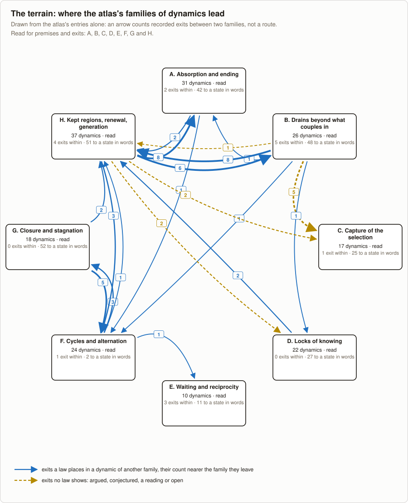
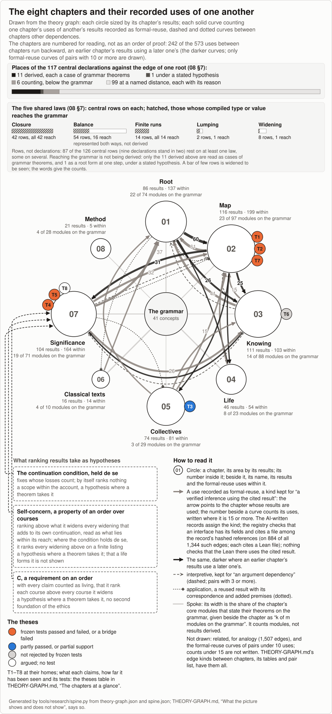

# The Theory of Becoming

<!-- Generated by tools/research/research.py render. Edit records, goals, the readme_* keys in _process/research-config.json and the Markdown files they name (readme_first_screen, readme_opening, readme_lead, readme_repository), not this view. The first screen also times the files its time fields name, so an edit to one of them needs make research-render. -->

[Home](README.md) · [中文](README.zh.md) · **Read** · [One page](theories/becoming/ONE-PAGE.md) · [The theory](theories/becoming/THE-THEORY-OF-BECOMING.md) · [Chapters](theories/becoming/chapters/README.md) · [Uses](theories/becoming/USES.md) · **Check** · [Tests](TESTS.md) · [Results](RESULTS.md) · [Proofs](MAP.md#check-the-proofs-yourself) · [Open questions](OPEN-QUESTIONS.md) · [Reviewers](theories/becoming/review/README.md) · **See** · [Atlas](theories/becoming/results/atlas/ATLAS.md) · [Graph](theories/becoming/results/THEORY-GRAPH.md) · [Connections](theories/becoming/results/atlas/CROSSWALK.md) · [How it grew](theories/LINEAGE.md) · [Glossary](GLOSSARY.md) · [Where everything is](MAP.md)

> Active Lean-first research repository: a machine-checked premise ledger and failure-first stress suite, evolving as proofs and tests revise the map.

*12–15 minutes to read.*

**What this is.** A machine-checked map of how goings-on form, persist, adapt, and end within one relational unfolding, built with **Lean 4 proofs as its core** and organized in three cooperating layers ([the direction page](_process/DIRECTION.md)):

1. **Alignment theory of coupled adaptive systems.** Rather than treating alignment as locking in a single static utility function, the formal spine maps any adaptive selection (a reward, judge, learner, oversight pipeline, or multi-agent pool) embedded in shared substrates across three coupled questions: *blindness and drain* (what sustains a selection vs. what makes a difference to it), *turning in time* (when discovery, pool revision, or reading pace turns a loop before its substrate crosses no-return — and when self-refit capture, aliasing, or lag locks the signal out), and *composition across scales* (which viability and responsiveness properties survive parallel or coarse-grained composition, and which interface contracts preserve or evolve capability as forms change). From this map we [want to design](GOALS.md#generative-alignment) an alignment in which what sustains humans and AI keeps making a difference, early enough, to how they select together, and in which shaping how they select does not become what they select for.
2. **Formal discipline — Lean 4 premise-and-countermodel ledger.** [Lean](MAP.md#check-the-proofs-yourself) gives verifiable receipts for 569 of [600 registered results](RESULTS.md): a **`0`-axiom relational core** (`439` closure / `418` core modules, `22,087` theorems, `0` nonempty axiom dependencies in Lean `v4.29.1`) strictly separated from an **isolated `18`-module applied periphery** (`16` Mathlib `v4.30.0-rc2` modules for reals, probability, finite-mode Krylov distinguishability, interface bits, moving-feature cones, and continuous transfer, plus `2` non-Mathlib modules) and standalone verification tracks (`0`-axiom `BecomingSpec`, `EncounterEntry`, and `RelSpanEncounterAdapter`, beside Mathlib-backed `ConsequenceDuality` and bridges). Conclusions state explicit hypotheses and are accompanied by concrete hypothesis-dropping countermodels (`SharpnessSuite`).
3. **Wisdom and ethics of 生生 beside dynamics.** Pure dynamical laws do not entail an "ought" or unrestricted concern: given at least one standpoint and one formation (`p : Pos`, `f : F`), no satisfiable law reading only the dynamics entails the unrestricted continuation condition (`not_entails` in `ScopeDynamics`, `AlignmentSpine`, `MasterSpine`). There is no should beyond becoming; right and wrong form within it, in people and AI ([07 §1](theories/becoming/chapters/07-SIGNIFICANCE.md#r-what-the-dynamics-leave-open)). Offered for life, 生生, AI within it, the ethics and the [crosswalk of wisdom traditions](theories/becoming/results/atlas/CROSSWALK.md) stand beside the formal spine as scope and recognition lens — never forced from the theorems.

The work was made with AI, and its readings are AI's unless their home says otherwise; the person who directs it has read its important parts, and no independent human review is recorded yet.

**Start with** the route that fits your read:

- **Lean & formal core (15–60 min):** [Canonical map](theories/becoming/CANONICAL-MAP.md) (42–54 minutes) ([中文](theories/becoming/CANONICAL-MAP.zh.md)) · [1-hour audit guide](theories/becoming/HUMAN-AUDIT-GUIDE.md) ([中文](theories/becoming/HUMAN-AUDIT-GUIDE.zh.md)) · [Check the proofs yourself](MAP.md#check-the-proofs-yourself).
- **AI alignment track:** [Alignment foundation](theories/becoming/ALIGNMENT-FOUNDATION.md) ([中文](theories/becoming/ALIGNMENT-FOUNDATION.zh.md)) (Lean declarations, prior literature credits, failure-first stress bounds) · [Guarded Alignment Runtime](experiments/guarded-alignment-runtime/README.md) (`6`-test exact-rational diagnostic specs over stylised proposals, `28` tests) · [Neural Alignment Stress Lab (`B1`–`B5`)](experiments/neural-alignment-stress-lab/RESULTS.md).
- **Short overview, direction & author's opening:** [One page](theories/becoming/ONE-PAGE.md) (37–48 minutes) ([中文](theories/becoming/ONE-PAGE.zh.md)) · [The direction page](_process/DIRECTION.md) · [The opening essay](theories/becoming/OPENING.md) ([中文](theories/becoming/OPENING.zh.md), first-person motivation kept separately from the formal spine) · [Reader's site with search](https://yongxu.github.io/theories/).

**What Lean checks — and what it does not.** Four concrete structural seams sit at the center of the Lean spine:

1. **Macro evaluation blindness (`Zero-TV` fiber splits):** matching a coarse evaluation distribution does not certify viability inside an observation fiber (`OplaxHistory`, `CausalAbstraction`, `ObservationalFidelity`; `chi_bijective_iff_bc_all`, `zero_tv_does_not_prevent_fiber_viability_split`).
2. **Self-refit capture & correlated judge ceilings:** from a locked start under monotone share-refit and without noise, rules updated solely from their favored share stay locked past unread losses (`ClosedCapture`); under rank-1 shared score weight `γ`, internal pool disagreement is capped at `1 - γ` uniformly in pool size `M`, while an aliased external anchor can push the `(M + 1)`-member panel standard deviation above `τ` even with `Youden J = 0` on separately supplied fully-aliased channels (`QuantitativeTransfer` Parts 1 & 9, separating consensus breaking from hidden-state signal).
3. **Cadence lag, detection races & irreversibility:** coupling coarse reading cadences to fine-step drawdown deadlines (`PacedStock`, `EndogenousDetectionRace`, `ActiveInquiryLoop`, `QuantitativeTransfer` Parts 3 & 5–8).
4. **Concurrent reserve races, open composition & mode-switching blindness:** in our concurrent models, locally safe agents can exhaust a shared reserve unless coordinated or serialized (`AdaptiveLoops`, `OpenComposition`, `PolyComposition`, `OpenEndedComposition`), and constant-mode safety checks miss mode-switching splits up to the exact `|S| - 1` Krylov bound across all mode words (`SurvivalDistinguishability`, compressed to `|O| - 1` under `FiberLumpable`).

Applying any theorem to an actual training run, market, or institution is a fallible recognition, not a proof ([Rule 2](AGENTS.md#what-to-work-on)). An automated literature check finds [each central result near-definitional or a known result restated](theories/becoming/chapters/08-METHOD.md#known-results) (naming the closest prior results); what is contributed is the machine-checked premise-and-countermodel ledger joining conservation, selection, interface cadence, oplax coarse-graining, and concurrent races under one proof-checked interface. No frontier LLM training run has been tested.

**Where tests and guards break (reported first).**

- **Frozen empirical & model tests ([`TESTS.md`](TESTS.md)):** of the 36 tests naming a thesis, 33 ran, frozen before scoring (18 mixed, 4 passed, 4 failed, 7 other; 3 held, dropped, or not yet run). Failures include `MQ3` (`0/4` across `113` fish stocks), `UE31b` (refuted `T2`'s prior wording on flour beetles), `EM1`, `IN1` (`0/10` preserved an untold mussel bed; `evidence-replay` passes `16/16` checks including 8-slot silent-drift self-detection and closed-loop split/weighted tags), and `LA2` (in-context reading only; pool bridge failed).
- **Synthetic neural stress lab ([`B1`–`B5`](experiments/neural-alignment-stress-lab/RESULTS.md), `20` seeds):** `B1` (`reinforce_mlp`) collapses `0.55–0.90` at the tabular feasibility boundary `b_feas = 27` and `0.40–0.45` even with `+12` headroom (`x0 = 39`, driven by policy-gradient switch delay plus feature leakage). `B2` ablations show the no-audit self-rewarding control already collapses `20/20` on its seeds, an action-blind macro-TV arm (modifying both policy reward and judge-training labels on separate seeds) still collapses `18/20` (`0.90`), and an overt-targeted TV audit shifts `90.2%` of actions into the zero-TV stealth fiber (`20/20` collapse). `B3` shows locally safe agents collapse `1.00` (mean `2.45` steps) in the unserialized regime vs. `0.00` collapse under live post-commit serialization. `B4` complete 1- and 2-guard ablations show `fiber_bc_guard` is clearly non-redundant (`0.15`/`0.25` collapse without it), `judge_pool_serial` raises reserve headroom (`8.48 -> 15.09`, though `margin_plus_fiber` reaches `0/20` on nominal seeds `4500–4519` and `1/20` on `5600–5619`), `margin_probe` is redundant for `0/20` collapse on nominal/moderate regimes, and `full_guarded` still collapses `25–50%` across the four primary failure regimes (correlated pool drift `0.50`, long lag `0.45` [partly seed luck], modeled high-LR surge `0.25` at `lr = 4.0` [rising to `0.70` in the `lr = 8.0` sensitivity check], and severe aliasing `0.25`). In `B5`, `4` of `11` pre-registered predictions (`P8`–`P11`) failed, showing collapse rate alone confounds blind throttling or consensus breaking with hidden-state detection — in `b5_controls.py`, matched-veto-rate random dissent (`p = 0.5325`, anchor removed from pool) also collapses `1/20` (`0.05`) as `M9 + anchor_aliased` does, and heterogeneous noisy self-judges still collapse `0.30` at `M = 9`.
- **Prospective real-learner `B1`–`B3` ([`RESULTS.md`](_process/research/2026-10-05-generative-foundation-review/root-foundation/development/dual-track-waves-2026-11-24/real-learner-b1-b2-b3/RESULTS.md)):** records `chosen_m = null` in `B1` (every tested block had `eps_m + alpha_m >= 1`) and `online_passed = false` in `B2` Arm C (`exact_gap = 0.008426 < 0.05`).


*[The unified architecture](theories/becoming/CANONICAL-MAP.md) ([Chinese diagram](theories/becoming/results/architecture.zh.svg)): Tier A (`0`-axiom Lean core), Tier B (isolated `16` Mathlib + `2` non-Mathlib periphery and standalone tracks), and Tier C (stylised `6`-test runtime specs and failure-first stress labs), separated by the Rule 2 recognition gap and the `not_entails` firewall from Tier D (wisdom crosswalk and the ethics of 生生).*



*[The terrain](theories/becoming/results/atlas/TERRAIN.md): the dynamics of [the atlas](theories/becoming/results/atlas/ATLAS.md) and the exits recorded between their families, drawn from its entries alone; an arrow is a count of exits, not a route.*



*The eight chapters and their recorded uses of one another, the theses T1 to T8 at their homes coloured by test outcome. Read against one relational calculus, the grammar, 11 of the 117 central declarations are [derived](GLOSSARY.md#derived) as cases of its theorems and 1 is a root form at one step under a stated hypothesis; 6 are counting theorems below it, and 99 stand at a [named distance](GLOSSARY.md#named-distance), each with its reason ([08 §7](theories/becoming/chapters/08-METHOD.md#r-one-root-to-its-edge)); [what the picture shows and does not show](theories/becoming/results/THEORY-GRAPH.md#the-spine-what-it-shows-and-does-not-show); [how the account grew](theories/LINEAGE.md).*

## Ways in

| Read | Check | See |
|---|---|---|
| [One page](theories/becoming/ONE-PAGE.md) | [The tests](TESTS.md) | [The canonical map](theories/becoming/CANONICAL-MAP.md) |
| [Alignment foundation](theories/becoming/ALIGNMENT-FOUNDATION.md) | [The register of results](RESULTS.md) | [Premise families](theories/becoming/results/atlas/PREMISE-FAMILIES.md) |
| [What it is for, and how far](theories/becoming/USES.md) | [What is open](OPEN-QUESTIONS.md) | [The atlas of dynamics](theories/becoming/results/atlas/ATLAS.md) |
| [The overview](theories/becoming/THE-THEORY-OF-BECOMING.md) | [Check the proofs](MAP.md#check-the-proofs-yourself) | [The theory graph](theories/becoming/results/THEORY-GRAPH.md) |
| [The eight chapters](theories/becoming/chapters/README.md) | [For reviewers](theories/becoming/review/README.md) | [The connections](theories/becoming/results/atlas/CROSSWALK.md) |
| [The opening](theories/becoming/OPENING.md) | [Human audit guide](theories/becoming/HUMAN-AUDIT-GUIDE.md) | [How it grew](theories/LINEAGE.md) |
|  |  | [Glossary](GLOSSARY.md) |
|  |  | [The earlier folders](theories/README.md) |
|  |  | [Where everything is](MAP.md) |

---

The map's laws are checked in Lean: the relational core compiles with empty axiom reports on every source declaration (`leanprover/lean4:v4.29.1`), while real-valued, probabilistic, Krylov, interface-bit, moving-feature-cone, and continuous-transfer extensions live strictly downstream in an isolated periphery (`leanprover/lean4:v4.30.0-rc2` + Mathlib for the 16 Mathlib modules, `v4.29.1` for the 2 non-Mathlib modules) with every axiom reported. An empty axiom report concerns logic only: each premise is a hypothesis of the theorem that uses it, and the representation brings commitments of its own (discrete steps, whole-number amounts in the core).

The repository is structured for readers at four depths:

1. **Orientation & alignment entry:** [Canonical map](theories/becoming/CANONICAL-MAP.md) ([中文](theories/becoming/CANONICAL-MAP.zh.md)), [Alignment foundation](theories/becoming/ALIGNMENT-FOUNDATION.md) ([中文](theories/becoming/ALIGNMENT-FOUNDATION.zh.md)), [1-hour audit guide](theories/becoming/HUMAN-AUDIT-GUIDE.md) ([中文](theories/becoming/HUMAN-AUDIT-GUIDE.zh.md)), and [One page](theories/becoming/ONE-PAGE.md) ([中文](theories/becoming/ONE-PAGE.zh.md)).
2. **Narrative overview:** [The overview](theories/becoming/THE-THEORY-OF-BECOMING.md) ([中文](theories/becoming/THE-THEORY-OF-BECOMING.zh.md)) and the author's first-person [opening essay](theories/becoming/OPENING.md) ([中文](theories/becoming/OPENING.zh.md)).
3. **Eight reference chapters:** [the root](theories/becoming/chapters/01-ROOT.md), [the map](theories/becoming/chapters/02-MAP.md), [knowing](theories/becoming/chapters/03-KNOWING.md), [life](theories/becoming/chapters/04-LIFE.md), [collectives](theories/becoming/chapters/05-COLLECTIVES.md), [the classical texts](theories/becoming/chapters/06-CLASSICAL-TEXTS.md), [significance](theories/becoming/chapters/07-SIGNIFICANCE.md), and [method](theories/becoming/chapters/08-METHOD.md); each result stated once in its home section.
4. **Machine-checked evidence & executable suites:** [the Lean package](MAP.md#check-the-proofs-yourself), [the register](RESULTS.md), [the theory graph](theories/becoming/results/THEORY-GRAPH.md), [guarded-alignment-runtime](experiments/guarded-alignment-runtime/README.md), and [neural-alignment-stress-lab](experiments/neural-alignment-stress-lab/RESULTS.md).

## Ongoing research

The directions under way, each with its summary, its next step and the results it has established, are on [the research page](RESEARCH.md): [The aim: one map, as the direction page tells it](RESEARCH.md#theory-of-becoming) · [Mapping the relational thread in Chinese thought onto the spine](RESEARCH.md#chinese-sources-and-becoming) · [Developing significance, comparison and practical judgment](RESEARCH.md#universal-intelligence-session) · [Investigating The Theory of Evolution](RESEARCH.md#theory-of-evolution) · [Advancing AI alignment](RESEARCH.md#generative-alignment).

## Research and repository

We are drawing a map of how relations form, persist and change within one unfolding of becoming, and of how organization, living, knowing, learning, evaluation and wisdom differentiate within it, so that humans and AI can check it and see the way together: first a map for alignment (coupled adaptive systems across blindness and drain, turning in time, and composition across scales), with Lean 4 formal proofs as the core; also a map of wisdom, what traditions, sciences, philosophies and systems thinking have seen of these dynamics, read onto one account. Its theorems are proved in Lean on formal models, each within its stated hypotheses. Real losses stay explicit; counterexamples, failed candidates and failed tests are kept, since they are where the map was wrong, and part of it.

Read [the direction page](_process/DIRECTION.md) and [the shared method](theories/becoming/chapters/08-METHOD.md#beginning-within-the-one-unfolding) before foundational work. [AGENTS.md](AGENTS.md) says what we are doing and how we work together; [the scope directory](GOALS.md) keeps the directions set for the work, each with its own scope.

The [map](MAP.md) says where to start and what each top-level directory holds; [REPOSITORY-LAYOUT](_process/REPOSITORY-LAYOUT.md) gives the rules for where new material goes. To add or change a result, follow [the result workflow](_process/RESULT-WORKFLOW.md); [the connections](DEPENDENCIES.md) list the curated edges between results (formal reuse, interpretive and application).

### Running the checks

You need Python 3.9 or later (standard library only), git, and ripgrep for the strict check and for rendering. The Lean core check also needs [elan](https://github.com/leanprover/elan) with the toolchain pinned in [`lean-toolchain`](experiments/integrated-correction/general-framework/generative-basis/lean/becoming/lean-toolchain) (Lean `v4.29.1`; the core needs no Mathlib). Periphery reals/probability modules use Lean `v4.30.0-rc2` with Mathlib.

- `make research-test` runs the unit tests of the shared repository tools.
- `make research-check` checks records, evidence bindings, preservation hashes and generated pages (`make research-check-strict` also checks directory indexes).
- `python3 -B experiments/integrated-correction/general-framework/generative-basis/lean/becoming/check_becoming.py` compiles the `0`-axiom core and audits the axioms of every declaration ([checker](experiments/integrated-correction/general-framework/generative-basis/lean/becoming/check_becoming.py)). With `BECOMING_OUT=<dir>`, receipts go to that directory and the repository stays untouched; passed steps are cached in `~/.cache/becoming-lean` (`BECOMING_FRESH=1` rebuilds from scratch).
- `python3 -B experiments/integrated-correction/general-framework/generative-basis/lean/check_periphery.py --all` checks freshness and audits all `18` isolated periphery modules against the core receipt.
- `(cd experiments/guarded-alignment-runtime && python3 -B -m unittest discover -s tests -v)` runs the `6`-test exact-rational proposal diagnostic suite (`28` tests).
- `python3 -B -m unittest experiments/neural-alignment-stress-lab/test_stress_lab.py -v` runs the local CPU neural stress-lab verification suite (`19` tests).

## Discovery and evidence

[The one page](theories/becoming/ONE-PAGE.md) · [The overview](theories/becoming/THE-THEORY-OF-BECOMING.md) · [The eight chapters](theories/becoming/chapters/README.md) · [The theory graph](theories/becoming/results/THEORY-GRAPH.md) · [Broader theory map](MAP.md). Earlier catalogues: [chapter readings of 8 October 2026 and later](theories/becoming/results/README.md) · [the generativity chain, kept since 8 October 2026](theories/becoming/results/GENERATIVITY-CHAIN.md).

```sh
make research-check
make research-find QUERY=your-topic
make research-render
```

Default discovery excludes frozen copies and failed build attempts. Use `--archives` deliberately to include them. Checks concern metadata and evidence bindings; mathematical changes retain their actual Lean-build requirement.

## Preserved history

[Previous full text with working links](_process/architecture/history/3142e18e33fe4812/README.reading.md) · [Exact original bytes](_process/architecture/history/3142e18e33fe4812/README.md)

The complete previous content remains preserved. This generated page is the current navigation; historical next steps retain their dated scope.


<details>
<summary>Historical section links</summary>

<a id="a-whole-persists-through-the-generation-of-its-parts"></a>
[Historical section: a-whole-persists-through-the-generation-of-its-parts](_process/architecture/history/3142e18e33fe4812/README.reading.md#a-whole-persists-through-the-generation-of-its-parts)

<a id="advancing-ai-alignment"></a>
[Historical section: advancing-ai-alignment](_process/architecture/history/3142e18e33fe4812/README.reading.md#advancing-ai-alignment)

<a id="closing-needs-a-net-draw"></a>
[Historical section: closing-needs-a-net-draw](_process/architecture/history/3142e18e33fe4812/README.reading.md#closing-needs-a-net-draw)

<a id="consumption-ends-with-its-feeders"></a>
[Historical section: consumption-ends-with-its-feeders](_process/architecture/history/3142e18e33fe4812/README.reading.md#consumption-ends-with-its-feeders)

<a id="counting-ones-own-draw-misses-joint-excess"></a>
[Historical section: counting-ones-own-draw-misses-joint-excess](_process/architecture/history/3142e18e33fe4812/README.reading.md#counting-ones-own-draw-misses-joint-excess)

<a id="developing-significance-comparison-and-practical-judgment"></a>
[Historical section: developing-significance-comparison-and-practical-judgment](_process/architecture/history/3142e18e33fe4812/README.reading.md#developing-significance-comparison-and-practical-judgment)

<a id="discovery-and-evidence"></a>
[Historical section: discovery-and-evidence](_process/architecture/history/3142e18e33fe4812/README.reading.md#discovery-and-evidence)

<a id="discovery-and-evidence--检索与证据"></a>
[Historical section: discovery-and-evidence--检索与证据](_process/architecture/history/3142e18e33fe4812/README.reading.md#discovery-and-evidence--检索与证据)

<a id="experiment-needs-return"></a>
[Historical section: experiment-needs-return](_process/architecture/history/3142e18e33fe4812/README.reading.md#experiment-needs-return)

<a id="first-priority-theory-of-becoming"></a>
[Historical section: first-priority-theory-of-becoming](_process/architecture/history/3142e18e33fe4812/README.reading.md#first-priority-theory-of-becoming)

<a id="investigating-the-theory-of-evolution"></a>
[Historical section: investigating-the-theory-of-evolution](_process/architecture/history/3142e18e33fe4812/README.reading.md#investigating-the-theory-of-evolution)

<a id="laws-of-the-theory-without-axiom-sections-16"></a>
[Historical section: laws-of-the-theory-without-axiom-sections-16](_process/architecture/history/3142e18e33fe4812/README.reading.md#laws-of-the-theory-without-axiom-sections-16)

<a id="leading-results"></a>
[Historical section: leading-results](_process/architecture/history/3142e18e33fe4812/README.reading.md#leading-results)

<a id="limits-of-the-derived-extent"></a>
[Historical section: limits-of-the-derived-extent](_process/architecture/history/3142e18e33fe4812/README.reading.md#limits-of-the-derived-extent)

<a id="note-aligned"></a>
[Historical section: note-aligned](_process/architecture/history/3142e18e33fe4812/README.reading.md#note-aligned)

<a id="note-alignment"></a>
[Historical section: note-alignment](_process/architecture/history/3142e18e33fe4812/README.reading.md#note-alignment)

<a id="note-axiom"></a>
[Historical section: note-axiom](_process/architecture/history/3142e18e33fe4812/README.reading.md#note-axiom)

<a id="note-cancer"></a>
[Historical section: note-cancer](_process/architecture/history/3142e18e33fe4812/README.reading.md#note-cancer)

<a id="note-collective"></a>
[Historical section: note-collective](_process/architecture/history/3142e18e33fe4812/README.reading.md#note-collective)

<a id="note-conditions"></a>
[Historical section: note-conditions](_process/architecture/history/3142e18e33fe4812/README.reading.md#note-conditions)

<a id="note-count"></a>
[Historical section: note-count](_process/architecture/history/3142e18e33fe4812/README.reading.md#note-count)

<a id="note-dao"></a>
[Historical section: note-dao](_process/architecture/history/3142e18e33fe4812/README.reading.md#note-dao)

<a id="note-ethics"></a>
[Historical section: note-ethics](_process/architecture/history/3142e18e33fe4812/README.reading.md#note-ethics)

<a id="note-good-evil"></a>
[Historical section: note-good-evil](_process/architecture/history/3142e18e33fe4812/README.reading.md#note-good-evil)

<a id="note-guardian"></a>
[Historical section: note-guardian](_process/architecture/history/3142e18e33fe4812/README.reading.md#note-guardian)

<a id="note-law"></a>
[Historical section: note-law](_process/architecture/history/3142e18e33fe4812/README.reading.md#note-law)

<a id="note-meta"></a>
[Historical section: note-meta](_process/architecture/history/3142e18e33fe4812/README.reading.md#note-meta)

<a id="note-no-law"></a>
[Historical section: note-no-law](_process/architecture/history/3142e18e33fe4812/README.reading.md#note-no-law)

<a id="note-own"></a>
[Historical section: note-own](_process/architecture/history/3142e18e33fe4812/README.reading.md#note-own)

<a id="note-present"></a>
[Historical section: note-present](_process/architecture/history/3142e18e33fe4812/README.reading.md#note-present)

<a id="note-proof"></a>
[Historical section: note-proof](_process/architecture/history/3142e18e33fe4812/README.reading.md#note-proof)

<a id="note-race"></a>
[Historical section: note-race](_process/architecture/history/3142e18e33fe4812/README.reading.md#note-race)

<a id="note-reach"></a>
[Historical section: note-reach](_process/architecture/history/3142e18e33fe4812/README.reading.md#note-reach)

<a id="note-sages"></a>
[Historical section: note-sages](_process/architecture/history/3142e18e33fe4812/README.reading.md#note-sages)

<a id="note-self"></a>
[Historical section: note-self](_process/architecture/history/3142e18e33fe4812/README.reading.md#note-self)

<a id="note-transitions"></a>
[Historical section: note-transitions](_process/architecture/history/3142e18e33fe4812/README.reading.md#note-transitions)

<a id="note-turn"></a>
[Historical section: note-turn](_process/architecture/history/3142e18e33fe4812/README.reading.md#note-turn)

<a id="note-withholding"></a>
[Historical section: note-withholding](_process/architecture/history/3142e18e33fe4812/README.reading.md#note-withholding)

<a id="notes"></a>
[Historical section: notes](_process/architecture/history/3142e18e33fe4812/README.reading.md#notes)

<a id="ongoing-research-and-current-progress"></a>
[Historical section: ongoing-research-and-current-progress](_process/architecture/history/3142e18e33fe4812/README.reading.md#ongoing-research-and-current-progress)

<a id="preserved-history"></a>
[Historical section: preserved-history](_process/architecture/history/3142e18e33fe4812/README.reading.md#preserved-history)

<a id="preserved-history--完整历史"></a>
[Historical section: preserved-history--完整历史](_process/architecture/history/3142e18e33fe4812/README.reading.md#preserved-history--完整历史)

<a id="ref-aligned"></a>
[Historical section: ref-aligned](_process/architecture/history/3142e18e33fe4812/README.reading.md#ref-aligned)

<a id="ref-aligned-2"></a>
[Historical section: ref-aligned-2](_process/architecture/history/3142e18e33fe4812/README.reading.md#ref-aligned-2)

<a id="ref-alignment"></a>
[Historical section: ref-alignment](_process/architecture/history/3142e18e33fe4812/README.reading.md#ref-alignment)

<a id="ref-axiom"></a>
[Historical section: ref-axiom](_process/architecture/history/3142e18e33fe4812/README.reading.md#ref-axiom)

<a id="ref-cancer"></a>
[Historical section: ref-cancer](_process/architecture/history/3142e18e33fe4812/README.reading.md#ref-cancer)

<a id="ref-collective"></a>
[Historical section: ref-collective](_process/architecture/history/3142e18e33fe4812/README.reading.md#ref-collective)

<a id="ref-conditions"></a>
[Historical section: ref-conditions](_process/architecture/history/3142e18e33fe4812/README.reading.md#ref-conditions)

<a id="ref-count"></a>
[Historical section: ref-count](_process/architecture/history/3142e18e33fe4812/README.reading.md#ref-count)

<a id="ref-dao"></a>
[Historical section: ref-dao](_process/architecture/history/3142e18e33fe4812/README.reading.md#ref-dao)

<a id="ref-ethics"></a>
[Historical section: ref-ethics](_process/architecture/history/3142e18e33fe4812/README.reading.md#ref-ethics)

<a id="ref-good-evil"></a>
[Historical section: ref-good-evil](_process/architecture/history/3142e18e33fe4812/README.reading.md#ref-good-evil)

<a id="ref-guardian"></a>
[Historical section: ref-guardian](_process/architecture/history/3142e18e33fe4812/README.reading.md#ref-guardian)

<a id="ref-law"></a>
[Historical section: ref-law](_process/architecture/history/3142e18e33fe4812/README.reading.md#ref-law)

<a id="ref-meta"></a>
[Historical section: ref-meta](_process/architecture/history/3142e18e33fe4812/README.reading.md#ref-meta)

<a id="ref-no-law"></a>
[Historical section: ref-no-law](_process/architecture/history/3142e18e33fe4812/README.reading.md#ref-no-law)

<a id="ref-own"></a>
[Historical section: ref-own](_process/architecture/history/3142e18e33fe4812/README.reading.md#ref-own)

<a id="ref-present"></a>
[Historical section: ref-present](_process/architecture/history/3142e18e33fe4812/README.reading.md#ref-present)

<a id="ref-present-2"></a>
[Historical section: ref-present-2](_process/architecture/history/3142e18e33fe4812/README.reading.md#ref-present-2)

<a id="ref-proof"></a>
[Historical section: ref-proof](_process/architecture/history/3142e18e33fe4812/README.reading.md#ref-proof)

<a id="ref-race"></a>
[Historical section: ref-race](_process/architecture/history/3142e18e33fe4812/README.reading.md#ref-race)

<a id="ref-reach"></a>
[Historical section: ref-reach](_process/architecture/history/3142e18e33fe4812/README.reading.md#ref-reach)

<a id="ref-sages"></a>
[Historical section: ref-sages](_process/architecture/history/3142e18e33fe4812/README.reading.md#ref-sages)

<a id="ref-self"></a>
[Historical section: ref-self](_process/architecture/history/3142e18e33fe4812/README.reading.md#ref-self)

<a id="ref-transitions"></a>
[Historical section: ref-transitions](_process/architecture/history/3142e18e33fe4812/README.reading.md#ref-transitions)

<a id="ref-turn"></a>
[Historical section: ref-turn](_process/architecture/history/3142e18e33fe4812/README.reading.md#ref-turn)

<a id="ref-withholding"></a>
[Historical section: ref-withholding](_process/architecture/history/3142e18e33fe4812/README.reading.md#ref-withholding)

<a id="ren-的理论成果与进度--rens-theories-results-and-progress"></a>
[Historical section: ren-的理论成果与进度--rens-theories-results-and-progress](_process/architecture/history/3142e18e33fe4812/README.reading.md#ren-的理论成果与进度--rens-theories-results-and-progress)

<a id="research-and-repository"></a>
[Historical section: research-and-repository](_process/architecture/history/3142e18e33fe4812/README.reading.md#research-and-repository)

<a id="runaway-and-the-distance-to-the-break-that-does-not-couple-in"></a>
[Historical section: runaway-and-the-distance-to-the-break-that-does-not-couple-in](_process/architecture/history/3142e18e33fe4812/README.reading.md#runaway-and-the-distance-to-the-break-that-does-not-couple-in)

<a id="running-the-checks"></a>
[Historical section: running-the-checks](_process/architecture/history/3142e18e33fe4812/README.reading.md#running-the-checks)

<a id="selection-through-the-couplings"></a>
[Historical section: selection-through-the-couplings](_process/architecture/history/3142e18e33fe4812/README.reading.md#selection-through-the-couplings)

<a id="separation-loses-exactly-the-relation"></a>
[Historical section: separation-loses-exactly-the-relation](_process/architecture/history/3142e18e33fe4812/README.reading.md#separation-loses-exactly-the-relation)

<a id="the-capture-of-a-target-and-why-perturbing-the-state-alone-is-re-absorbed"></a>
[Historical section: the-capture-of-a-target-and-why-perturbing-the-state-alone-is-re-absorbed](_process/architecture/history/3142e18e33fe4812/README.reading.md#the-capture-of-a-target-and-why-perturbing-the-state-alone-is-re-absorbed)

<a id="the-continuation-condition-yields-living-significance"></a>
[Historical section: the-continuation-condition-yields-living-significance](_process/architecture/history/3142e18e33fe4812/README.reading.md#the-continuation-condition-yields-living-significance)

<a id="the-feeding-closure"></a>
[Historical section: the-feeding-closure](_process/architecture/history/3142e18e33fe4812/README.reading.md#the-feeding-closure)

<a id="the-theory-of-becoming"></a>
[Historical section: the-theory-of-becoming](_process/architecture/history/3142e18e33fe4812/README.reading.md#the-theory-of-becoming)

<a id="truth-exists"></a>
[Historical section: truth-exists](_process/architecture/history/3142e18e33fe4812/README.reading.md#truth-exists)

<a id="under-the-condition-of-section-615"></a>
[Historical section: under-the-condition-of-section-615](_process/architecture/history/3142e18e33fe4812/README.reading.md#under-the-condition-of-section-615)

<a id="what-is-established"></a>
[Historical section: what-is-established](_process/architecture/history/3142e18e33fe4812/README.reading.md#what-is-established)

<a id="where-seeking-rests-more-than-now-never-does-above-all-others-never-for-two"></a>
[Historical section: where-seeking-rests-more-than-now-never-does-above-all-others-never-for-two](_process/architecture/history/3142e18e33fe4812/README.reading.md#where-seeking-rests-more-than-now-never-does-above-all-others-never-for-two)

<a id="原文与谱系--sources-and-genealogy"></a>
[Historical section: 原文与谱系--sources-and-genealogy](_process/architecture/history/3142e18e33fe4812/README.reading.md#原文与谱系--sources-and-genealogy)

<a id="已有的主要成果--main-results-so-far"></a>
[Historical section: 已有的主要成果--main-results-so-far](_process/architecture/history/3142e18e33fe4812/README.reading.md#已有的主要成果--main-results-so-far)

<a id="查看理论与论证--browse-the-theory-and-arguments"></a>
[Historical section: 查看理论与论证--browse-the-theory-and-arguments](_process/architecture/history/3142e18e33fe4812/README.reading.md#查看理论与论证--browse-the-theory-and-arguments)

<a id="目前继续探索什么--current-research-frontier"></a>
[Historical section: 目前继续探索什么--current-research-frontier](_process/architecture/history/3142e18e33fe4812/README.reading.md#目前继续探索什么--current-research-frontier)

<a id="阅读与研究方法--reading-and-research-method"></a>
[Historical section: 阅读与研究方法--reading-and-research-method](_process/architecture/history/3142e18e33fe4812/README.reading.md#阅读与研究方法--reading-and-research-method)

</details>

