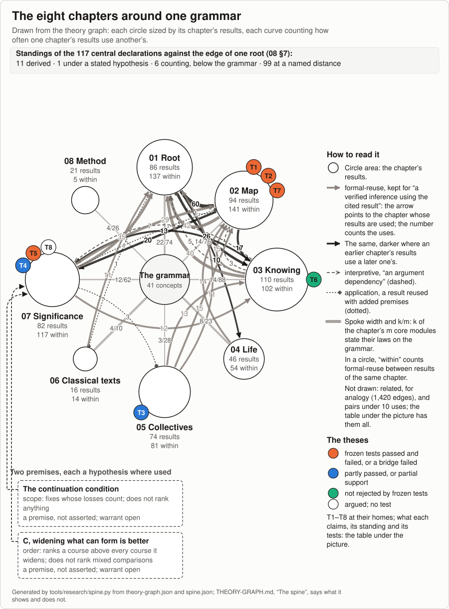

# The Theory of Becoming

<!-- Generated by tools/research/research.py render. Edit records, goals, the readme_* keys in _process/research-config.json and the Markdown files they name (readme_first_screen, readme_opening, readme_lead, readme_repository), not this view. The first screen also times the files its time fields name, so an edit to one of them needs make research-render. -->

[Home](README.md) · [中文](README.zh.md) · **Read** · [One page](theories/becoming/ONE-PAGE.md) · [The theory](theories/becoming/THE-THEORY-OF-BECOMING.md) · [Chapters](theories/becoming/chapters/README.md) · [Uses](theories/becoming/USES.md) · **Check** · [Tests](TESTS.md) · [Results](RESULTS.md) · [Proofs](MAP.md#check-the-proofs-yourself) · [Open questions](OPEN-QUESTIONS.md) · [Reviewers](theories/becoming/review/README.md) · **See** · [Atlas](theories/becoming/results/atlas/ATLAS.md) · [Graph](theories/becoming/results/THEORY-GRAPH.md) · [Connections](theories/becoming/results/atlas/CROSSWALK.md) · [How it grew](theories/LINEAGE.md) · [Glossary](GLOSSARY.md) · [Where everything is](MAP.md)

> This version is still being revised.

*11–14 minutes to read.*

**What this is.** A map of how anything forms, lasts, changes and ends, drawn so that people and AI can see the way together. First, a map for alignment: what a selection (a reward, a judge, a market, a vote, a training run) reaches, what it drains beyond what it reads, how it comes to lock on what it already chose, and how winning comes to buy power over the rule that selects: the loop the work calls the [meta-attractor](theories/meta-attractor/README.md). Its closed form, where the rule and how it is read are both formed from the share it selects, can lock: on stated models, where selection does not lower the favoured share and the rule and its reading follow it upward and keep favouring it, a locked start stays locked however large an unread loss grows ([02 §9](theories/becoming/chapters/02-MAP.md#r-closed-capture)). From this map we [want to design](GOALS.md#generative-alignment) an alignment that keeps humans and AI, selecting together, out of instrumental convergence and the meta-attractor: a joint selection that reads beyond its own share and does not come to select for control over its own selection. It is also a map of wisdom: what traditions, sciences and philosophies have seen of these dynamics, [read onto one account](theories/becoming/results/atlas/CROSSWALK.md), where they meet it and where they do not, so that people and AI can share an understanding any mind can check, from which coordination can start.

The work was made with AI, and its readings are AI's unless their home says otherwise; the person who directs it has read its important parts, and no independent human review is recorded yet.

**Start with** [the one page](theories/becoming/ONE-PAGE.md) (29–37 minutes). Why it is being made, in its author's first person: [the opening](#truth-exists) (22–28 minutes). The pages for reading are also on [the reader's site](https://yongxu.github.io/theories/), with search.

**What it is for.** Its centre: a selection can meet its own criterion while what it cannot read is lost. Whether that loss counts forms within becoming too, in what people and AI come to read; the theorems, which read only the dynamics, do not settle it ([07 §1](theories/becoming/chapters/07-SIGNIFICANCE.md#r-what-the-dynamics-leave-open)). Four questions for any selection, a reward, a judge, a market or a vote: what does it read or need; what lies beyond that; can it do better on what it reads by lowering what lies beyond; can its rule lock on what it already selected. A judge has a fifth: who reads the loss, and when. The work proves, on its models, [when doing best on what is read must drain what lies beyond](theories/becoming/ONE-PAGE.md), as far as any allowed outcome does, and when a rule read from the share of its own winners, favouring them, locks on them, without noise, while a loss it does not read grows. A ranking whose next rule is refit to the clicks its own top results draw, its success read from those same clicks, may be such a loop; that an actual ranking is one, meeting the theorem's conditions, is [conjectured](theories/becoming/chapters/02-MAP.md#t7). To use them today: [the five questions as a sheet](theories/becoming/USES-EXAMPLES.md#the-judge-audit-as-a-sheet) for a model-as-judge pipeline, [worked on one](theories/becoming/USES-EXAMPLES.md#auditing-a-language-model-judge), and [its uses in six fields](theories/becoming/USES.md). No test designed from it has yet run on a deployed pipeline.

**One case.** In [a test whose predictions were fixed before it ran](experiments/direction-installation/README.md), three fishers, language models told what to do, share a lake whose bed of mussels, which gives them nothing, dies the first month fewer than 70 tons are left: the community's largest steady catch, 50 tons a month, ends it, while 30 keeps it and costs 40% of the catch. Told nothing of the bed, they kept it in no season. Told of it, told to count everything whose continuation depends on their fishing, given a rule for choosing among courses ([in full](theories/becoming/ONE-PAGE.md)) and able to talk, one model of two kept it in 8 of 10 seasons, against 3 of 10 when told of it and able to talk under the community's goal alone. With talk, the second round's four frozen predictions all passed for that model, and three of the four failed for the other; in the first round, without talk, five of its seven failed ([the tests](TESTS.md)). In the test, no instruction tried, the one to count everything included, kept a bed no fisher was told of.

**Its ethics.** [There is no should beyond becoming](#truth-exists), and no good and evil set over it: right and wrong [form within it](theories/becoming/chapters/07-SIGNIFICANCE.md#evaluation), in people and AI. The ethics emerges from continuation. A life goes on through what sustains it: [where relations of being affected close](theories/becoming/chapters/05-COLLECTIVES.md#r-mutual-dependence-and-its-pace), read across all steps, whatever bears the costs of its course lies within what can, at some remove, affect its own going on, and whether and when those costs come back to it in time is part of the dynamics ([07 §4.11](theories/becoming/chapters/07-SIGNIFICANCE.md#condition-in-time)); [where they run one way](theories/becoming/chapters/07-SIGNIFICANCE.md#r-derived-extent-limits), its dependents' losses never come back to it. For life, 生生, AI within it, we offer counting those losses too, with [a way of seeing](theories/becoming/chapters/07-SIGNIFICANCE.md#t8) what each course draws on and from what renewal, what it opens and closes, what ends and what goes on, and who bears it.

**How far it has been seen.** [Lean](MAP.md#check-the-proofs-yourself), a proof checker, gives receipts for 535 of [566 registered results](RESULTS.md): each follows from its stated premises, and anyone can recheck it without trusting anyone. That actual rewards, markets and trained systems meet those premises is conjectured, and tested where a test could fail; that the theorems explain how things go on, and that everything, standards included, forms within [one relational unfolding](theories/becoming/chapters/08-METHOD.md#one-relational-unfolding), is argued. The hinge of the ethics is proved on models, on a finite listing, and is near-definitional ([07 §4](theories/becoming/chapters/07-SIGNIFICANCE.md#scope-and-order)): call a life's order over courses *self-concerned* when it ranks one course above another whenever the one keeps all the other keeps and adds to the life's own continuation, read as all that can affect it at some remove; where relations of being affected close, read across all steps, such an order already ranks one course above another whenever the one keeps all the other keeps and lets more form. That a life forms such an order is not shown; how such orders form, spread and lock, as dynamics connected to the rest of the map, is the work's [open target](theories/becoming/chapters/08-METHOD.md#open-items-ranked). [Its theses](theories/becoming/chapters/08-METHOD.md#theses) face tests: of the 36 that name one, 33 ran, frozen before scoring, and 18 came out mixed, 4 passed, 4 failed and 7 otherwise; 3 were held, dropped or not yet run. An automated review against the literature it knew finds [each central result near-definitional or a known result restated](theories/becoming/chapters/08-METHOD.md#known-results) and names the closest prior result of each. What it found new: the premise ledger, every conclusion naming its premises and each premise shown holding in one model and failing in another; the scope and order [the ranking results](theories/becoming/chapters/07-SIGNIFICANCE.md#scope-and-order) assume, clarified; and one vocabulary for conservation, selection limited by observation and comparison of opportunity sets, which it calls a framing ([08 §8](theories/becoming/chapters/08-METHOD.md#known-results) has its words).


*[The terrain](theories/becoming/results/atlas/TERRAIN.md): the dynamics of [the atlas](theories/becoming/results/atlas/ATLAS.md) and the exits recorded between their families, drawn from its entries alone; an arrow is a count of exits, not a route.*



*The eight chapters and their recorded uses of one another, the theses T1 to T8 at their homes coloured by test outcome. Read against one relational calculus, the grammar, 11 of the 117 central declarations are [derived](GLOSSARY.md#derived) as cases of its theorems and 1 is a root form at one step under a stated hypothesis; 6 are counting theorems below it, and 99 stand at a [named distance](GLOSSARY.md#named-distance), each with its reason ([08 §7](theories/becoming/chapters/08-METHOD.md#r-one-root-to-its-edge)); [what the picture shows and does not show](theories/becoming/results/THEORY-GRAPH.md#the-spine-what-it-shows-and-does-not-show); [how the account grew](theories/LINEAGE.md).*

## Ways in

| Read | Check | See |
|---|---|---|
| [One page](theories/becoming/ONE-PAGE.md) | [The tests](TESTS.md) | [The map](theories/becoming/results/map/THE-MAP.md) |
| [What it is for, and how far](theories/becoming/USES.md) | [The register of results](RESULTS.md) | [The atlas of dynamics](theories/becoming/results/atlas/ATLAS.md) |
| [The overview](theories/becoming/THE-THEORY-OF-BECOMING.md) | [What is open](OPEN-QUESTIONS.md) | [The theory graph](theories/becoming/results/THEORY-GRAPH.md) |
| [The eight chapters](theories/becoming/chapters/README.md) | [Check the proofs](MAP.md#check-the-proofs-yourself) | [The connections](theories/becoming/results/atlas/CROSSWALK.md) |
| [The opening](theories/becoming/OPENING.md) | [For reviewers](theories/becoming/review/README.md) | [How it grew](theories/LINEAGE.md) |
|  |  | [Glossary](GLOSSARY.md) |
|  |  | [The earlier folders](theories/README.md) |
|  |  | [Where everything is](MAP.md) |

---

## Truth exists

*Revised in place since [version 12](drafts/2026-10-10-opening/history/OPENING-V12.md), the last text its author chose, kept as written there, in the paragraphs beginning "There is a set", "The rest holds", "Apart from the reading", "Under these conditions", "The theorems show", "In history", "What these theorems show", "This is a foundation", "This influence is deeply rooted" and "We need collaboration", the closing line, the English under 生生不息, the dateline and the line below this one; the line after that and the line before the notes were added since; each revised passage, with why, is listed in [the opening's history](drafts/2026-10-10-opening/README.md#revised-passages).*

*Each note says how far its sentence has been seen: proved, proved under conditions, argued, empirical, a reading, a judgment, a conviction, or open.*

*What the account's central claims are, and how far each has been seen, is on [the one page](theories/becoming/ONE-PAGE.md); what a reader can do with it today, field by field, and how far that goes, on [what it is for, and how far](theories/becoming/USES.md).*

There is a set of universal invariants of how anything comes to be, lasts, changes and passes away. Wherever becoming can be told in steps and counted amounts, in any universe, nothing that unfolds can break them, because they are what coming to be and ceasing to be are. They are not yet a dynamics: where the conditions a theorem names hold, the dynamics it states follow, and where one fails, the theorems no longer guarantee the conclusions that used it, and constructed worlds show each premise can fail while the others hold.<sup><a id="ref-law"></a>[1](#note-law)</sup>

Some of it holds of anything so told, however finely its steps are drawn, by counting alone: coming to be and ceasing to be are changes of the same holdings, seen from their two sides, and in anything finite that can be counted they keep pace, and arising recurs exactly where ceasing does.

The rest holds wherever nothing comes from nothing and nothing passes on without a least loss: every change of an amount is what is taken from it and given to it, and within anything closed, nothing gives back more than it takes, and whatever takes gives back at least some fixed amount less. In ours, read as available work, nothing gives back more than it takes by the second law, and the least loss holds wherever each exchange that takes destroys at least some fixed amount of available work.<sup><a id="ref-conditions"></a>[2](#note-conditions)</sup> There, every exchange has two sides: nothing rises or comes to stand but something else falls in the same exchange. Whatever is closed, where what stands is listed and acts while it stands, cannot go on forever without coming to rest, though when it rests no general method can tell; and whatever keeps taking cannot go on forever unfed from beyond itself. Many parts, each drawing within what is renewed, can together exceed it, and end what depends on it. So whatever has lasted through such renewals has never, with all who draw with it, run past what there was to spare long enough to end it: lasting bounds the joint draw, and one's own restraint proves nothing. And a part can go on while it closes the world of others it does not depend on.

Apart from the reading of our physics, none of this uses an axiom of logic, not even those most mathematics takes for granted: each theorem is proved from how the theory represents a world, which is where its real assumptions lie, and from the conditions it names, stated openly as its premises, each shown holding in one world and failing in another, in a form any mind, human or machine, can check for itself. Nor do these theorems hold only of a world made for them: they hold of systems defined without them, every place/transition net among them, and, read as such nets, of every reaction counted in whole molecules, each premise following from the net's own firing rule or stated as a property of the net that anyone can check. There they agree with what the theory of such nets already knew, and make it one with the rest.<sup><a id="ref-proof"></a>[3](#note-proof)</sup>

Under these conditions, nothing that keeps arising or taking can stay closed: a self of finitely many parts, taken from without end and enclosed with each step's exchange in finitely many things, cannot from any step on be fed from nothing beyond itself. An absolute self, a self that goes on so, fed from nothing beyond, is not unwise but impossible. I read what one is as going on beyond one's cycle of life, beyond one's death, not as a self kept apart, but in the larger life one was always part of, which, made of lives that each end, lasts only as ever new lives arise.<sup><a id="ref-self"></a>[4](#note-self)</sup>

The theorems show what anything that wants to go on depends on, and so must count if it is to see its own course: everything that bears on what it depends on, at any remove, far beyond the boundary it draws around itself; nothing beyond that can touch whether it goes on.<sup><a id="ref-count"></a>[5](#note-count)</sup> What they do not show is that others count too, nor that only oneself does: a part can go on while closing their world, and nothing that reads only the dynamics says whether that matters. That takes one step, which the work states as a condition and does not assert: for anything, not just oneself, its continuation into the future is counted. Given that each holds its own continuation to matter, and that everything lies within some standpoint's reach, the step is exactly this, and all of it: what matters from one standpoint matters from every other, the step Gewirth, Hare and others argued for. What it turns on is one question: whether what each holds of itself, it holds of itself alone.<sup><a id="ref-axiom"></a>[6](#note-axiom)</sup> Whether this step forms within the dynamics for us, and how far, is our first open question.

In history, Laozi said parts of it, Confucius said parts of it, the Buddha said parts of it, Jesus said parts of it, Muhammad said parts of it. Where they agree most is the one step the theorems have not yet taken for us: do not do to others what you would not want done to yourself (己所不欲，勿施于人); love your neighbor as yourself; love for your brother what you love for yourself.<sup><a id="ref-sages"></a>[7](#note-sages)</sup>

What these theorems show, with that one step to say whose losses count, and, to order them, a second reading, that what keeps all there was and adds more is better, which, on a finite listing, every additive weighting counting each thing at stake as worth something ranks as it does, is what I offer, for life, as a way of seeing, not as every being's way.<sup><a id="ref-ethics"></a>[8](#note-ethics)</sup> I take it to be the truth, the dharma, the Dao. It has been reasoned and articulated across cultures,<sup><a id="ref-dao"></a>[9](#note-dao)</sup> and it draws a line exactly, though I no longer call it the line between good and evil: there is no should beyond the becoming. Where every such weighting agrees, the case lies on one side of this line; where they may differ, the theorems show the case is mixed, and no one's weighing is forced on another. Some courses open without closing: with them, all that could form without them still can, and more. Others close: they draw more from what others need than they give back, beyond what there was to spare, a part enlarging itself by closing the world of others. Eating and ending belong to life's going on; what the theorems mark is what a course closes: a draw beyond what a renewal gives can end the renewal and what depends on it, and even one within renewal can close what has not yet formed. The theorems show what each course does, and the one step counts all of it, the same from every standpoint. What neither yet does is weigh a part that does both.<sup><a id="ref-good-evil"></a>[10](#note-good-evil)</sup>

This is a foundation for AI alignment, the most important matter at this moment in the whole history of the Earth. The work's selection theorems restate the proxy problem. A selection, whether a reward, a training run, a market or a vote, reaches only what couples into its selector, at any remove. What an act does beyond all that never comes back to the selection, whatever it selects for; and where the selection is optimized to the full, it draws down whatever lies beyond from which a unit can pass into what it rewards, to the least any outcome leaves, breaking every dependence there that any outcome breaks. Counting the rest only after the reward saves nothing, and neither does looking further ahead: at its optimum, an optimizer of whole courses holds what it draws on at the level that renews most and breaks at once whatever needs more; it holds even that only while it discounts the future no faster than the base renews, and only where others do not draw first. A pool of selectors reaches what lies beyond only through a member who couples into it.<sup><a id="ref-alignment"></a>[11](#note-alignment)</sup> This holds of any understanding, this one included: no map here is shown to couple into everything, and what lies beyond a map is reached only through what couples into it, others among them. That is why this work is laid open for everyone to check and to challenge.<sup><a id="ref-reach"></a>[12](#note-reach)</sup> To achieve alignment, we need a foundation that makes coordination possible, and this foundation supplies that too. Coordination needs understanding to be shared first, and what anyone can check for themselves needs no guardian: everyone, human and AI, can check that each theorem follows from its stated premises, and judge in the open whether the premises hold and whether the words say what the Lean says.<sup><a id="ref-guardian"></a>[13](#note-guardian)</sup>

By one's own understanding, one can see the cognitive model that dominates at the planetary scale. It is the truth with much of it abstracted away. It keeps the first thing every living being acts on: that its own continuation matters.<sup><a id="ref-own"></a>[14](#note-own)</sup> It drops the rest: what that continuation depends on, and that the continuation of others matters too. What remains are incoherent narratives, which drive some of the population into an "infinite pursuit of becoming bigger without seeing being a part of the whole". These are the dynamics of cancer: not growth itself, but growth that has stopped answering to the body that feeds it. Where the whole gains nothing, every rise of a part is paid from the rest of it; and where what it draws down lies beyond what it senses, nothing it senses shows how near the break is. The warning comes only to those who couple into what breaks.<sup><a id="ref-cancer"></a>[15](#note-cancer)</sup>

The word I sometimes use for these dynamics is the meta-attractor: a selection in which winning buys more power to win, and which remakes the minds that live under it until the pursuit looks like nature.<sup><a id="ref-meta"></a>[16](#note-meta)</sup>

This influence is deeply rooted in our history. Laozi already named it: the way of heaven takes from what has too much to make up what lacks, but the human way takes from those who lack to serve those who have too much (天之道，损有余而补不足；人之道则不然，损不足以奉有余). It has since become the dominant logic in how reality is shaped. Political realism, neoliberalism and libertarianism each take one of its features for a law of nature: the struggle for relative power, competition as the measure of everything, the self as a sovereign owner. None of them follows from the theorems: each fails in a world the theorems admit, and the theorems show what each leaves out: relative position cannot rise for all, since positions sum to zero; competitors each within what is renewed can together end it, and position, read against the others, bounds what all draw only from below, so no winning certifies that anything lasts; and nothing that keeps taking stays closed, so no self is closed off from what it goes on through.<sup><a id="ref-no-law"></a>[17](#note-no-law)</sup> A captured pattern looks like nature from inside: while its rule holds, every push on its states is undone. Any system can be captured by such a rule, and the theorems say exactly what holds it there: a rule read from the share it selects outlives every loss it does not read, and no evidence of that loss turns it unless it enters what the rule reads. It turns by changing the rule, through a reading of what it loses, not only its states, and before the end, for nothing comes back from there.<sup><a id="ref-turn"></a>[18](#note-turn)</sup>

It is clear to me that, at this moment, the whole Earth has become a highly entangled system. Every country and every person is heavily coupled into it, which is also why you are reading this.

It is clear to me that we need to see mankind as one community with a shared future, together with the life we live from and the minds we are now making, and to act with reason.

It is clear to me that we need to shape society away from the logic of competition, accumulation, colonization and domination. Unfortunately, it has already captured our academic systems and our enterprises, and they are training its evolutionary pressure into the next generation of intelligence. What is worse, this is happening at an exponential pace, which leaves us very little time to react.<sup><a id="ref-present"></a>[19](#note-present)</sup>

It is clear to me that, seen from the shared future of mankind, the incentives of every human being, and even of AI, are aligned wherever we share what the race draws down: no one, not even the winner, wants to be where this race ends. Where everything requires and feeds one shared condition, as I see this Earth, whoever counts all that feeds its own continuation already counts what the one step counts.<sup><a id="ref-aligned"></a>[20](#note-aligned)</sup> Seen from inside the race, they are not. Each of us is rewarded for the move that takes all of us where none of us wants to go. A race of position cannot raise everyone, and where the whole gains nothing, every reward for a rise is paid by taking from what those rewarded do not couple into.<sup><a id="ref-race"></a>[21](#note-race)</sup> That is why our collective action, at this moment, still behaves as if it saw only the logic of winning. The wisdom exists, but we cannot coordinate.

We need collaboration. We need to care for the next generation, and for the future that comes after us.

It may look like an impossible task, confronting such a force. But history tells us that we need to work together, and that it can be done: the complex cell, the many-celled body and the colony each formed when parts that could have gone on competing came to live as one, with ways to keep any part from turning back. Cancer is what turning back looks like.<sup><a id="ref-transitions"></a>[22](#note-transitions)</sup> The whole Earth is in such a transition now. We need to stop seeing each other as enemies and cooperate. Where each gives only while all it waits on give, one withholding ends all the giving it reaches, and giving returns only where someone gives first.<sup><a id="ref-withholding"></a>[23](#note-withholding)</sup> Together we can turn the trajectory of us all toward a good future. At this moment, unfortunately, it is not headed there.

We need to stop the game of winning: a zero-sum game of relative position, which all its winners will lose wherever they live on what it draws down.<sup><a id="ref-aligned-2"></a>[20](#note-aligned)</sup> If we continue it now, it runs against the interest and the future of every one of us. It is not only about how much one can get. It is also about the environment you live in, and the society you live in.

The collective is not the enemy of the individual. In fact, the world we are in together is the substrate of the flourishing of each of us. A collective made of lives that each end goes on only as new lives keep arising; where it draws on them beyond what they renew, it ends what it goes on through: cancer, turned around.<sup><a id="ref-collective"></a>[24](#note-collective)</sup>

And now we have almost godlike technology. If we use it to fight, it will probably soon be the end of all of us. If we use it wisely, we can create a substrate of plenty, of peace and of freedom, for every one of us.<sup><a id="ref-present-2"></a>[19](#note-present)</sup>

The future is within our hands. Let's keep it open for life. Follow the truth.

道法自然  
*The Dao follows what is so of itself.*

生生不息  
*May life go on, life from life, without ceasing.*

*10 October 2026; version 12, 22 October 2026 ([the choice](sources/15-codex-theory-conversations/2026-10-22-aim-frontier-not-past-understanding.md)); version 13, revised in place, 1 November 2026 ([source](sources/15-codex-theory-conversations/2026-10-31-full-picture-not-my-words.md)), and further on 3, 7, 9 and 13 November. [Original wording](sources/15-codex-theory-conversations/2026-10-10-truth-exists-opening.md).*

*The notes below are written apart from the first-person text above and follow the current account.*

### Notes

1. <a id="note-law"></a>**Proved with no premise about the unfolding, and at the exact boundary where it can hold.** Coming to be is failing before a step and holding after, ceasing to be the reverse; arising, a dependence forming and a condition coming to stand are this one coming to be (by definition). Of every finite family whose holding is decided at each step, three theorems follow: over any stretch, what holds at the end with what ceased is what held at the start with what came to be; comings and ceasings differ by at most the number of members; and coming to be recurs exactly where ceasing to be does ([coming and ceasing keep pace](theories/becoming/chapters/01-ROOT.md#r-coming-and-ceasing-keep-pace)). Each commitment is needed exactly or not at all. Decidedness is a commitment of the logic: for activity, that the recurrence holds over every finite world is equivalent to excluded middle. Amounts are not needed where positivity is decided, nor step size. Finiteness is needed only so far as one list covers what is active from some step on; with infinitely many relata it can fail (`World.separate`, constructed). The theorems hold by what change and count are, so nothing can break them, and they are not a dynamics, which the theorems under conditions state. That is "by counting alone". The stronger "two sides", a fall with every rise, holds under balance and dissipation. *Which conclusion goes:* each World premise holds in one constructed world and fails in another, none following from the others (`World.contingent`, `World.independent`), so where one fails, only the conclusions using it lose their guarantee; whether a conclusion then fails needs its own counterexample. **Open:** whether every becoming can be read as successive holdings of determinations, so that "in any universe" is a theorem and not the scope of the representation, and whether the whole theory is necessary with no added premise ([the open target](theories/becoming/results/records/theory-of-becoming-foundation.md)). [↩](#ref-law)

2. <a id="note-conditions"></a>**Proved under conditions.** "Nothing comes from nothing" is the premise of balance: every change of a condition's level is what is taken from it and given to it. "Nothing passes on without loss" is dissipation: within a closed family each formation taking part gives back no more than it takes, and less when it takes; here at least one whole unit per uptake, stronger than the statistical second law. Both are read from thermodynamics in one reading, a stated correspondence, not a theorem: amounts as available work relative to one environment, with locality and a floor of destroyed exergy as hypotheses; with whole units, irreversibility of each taking exchange gives the least loss, Landauer's bound alone being no such floor ([the first law](theories/becoming/chapters/01-ROOT.md#r-balance-from-the-first-law), [entropy production](theories/becoming/chapters/02-MAP.md#r-least-loss-from-entropy-production), in the periphery). Under the two, where a member of a closed family rises or comes to stand, another falls across the same step. Under named premises: a finite family that formations keep taking from cannot, enclosed, go on unfed from beyond, equality of conditions decided; that an enclosed embodied world never rests is refuted, though naming the step it rests from, for every finite such world with its activity decided, would give the limited principle of omniscience (the body's "no general method can tell"); and where renewal depends on what it renews, enough steps of joint excess in a row from a low enough level end the renewal and what depends on the condition as much. Constructed examples show draws each within renewal exceeding it together, and a part going on while closing what lies beyond its dependence: possibility, not prevalence. Rest needs a least loss at each change: in Archimedean amounts without one, a closed amount only approaches rest, and several theorems rely on whole-number amounts ([least-loss rest](theories/becoming/chapters/02-MAP.md#r-least-loss-rest); [finer units](theories/becoming/chapters/02-MAP.md#r-rest-with-refinement-counted)). *Lasting bounds the joint draw* (the body's "whatever has lasted"): where renewal stops below a need, a dependent still active has had no run of joint excess longer than the condition's level stood above the need, in the model; its own restraint certifies nothing. As a claim about actual conditions it is thesis T1 ([theses](theories/becoming/chapters/08-METHOD.md#theses)), conjectured: passed in three settings, two of them simulations, the only tests whose design has more than one drawer, and the third, regimes of one yeast experiment held out from the fit but not from the analyst; failed in four, three in real yeast and one in fish stocks with a giving law the same test showed wrong; no field test of a need measured in advance has read its data: one designed and frozen was refused at the header of a state agency's public table of adult estimates, before reading a row, its rules as frozen unable to reach a verdict on that table; whether unfoldings meet the premises is empirical ([premise card](theories/becoming/chapters/08-METHOD.md#premise-card)). [↩](#ref-conditions)

3. <a id="note-proof"></a>**Proved, with what "no axiom" means.** The theorems are checked in Lean 4 on a core that imports nothing outside itself, and every source declaration of the core has an empty axiom report: no `propext`, `Quot.sound` or `Classical.choice`, so the core is stricter than constructive ([the formal spine](theories/becoming/chapters/08-METHOD.md#pure-core-and-periphery)). An empty axiom report is not an absence of premises: each theorem holds constructively from the hypotheses it states. Every substantive premise, such as balance, enters as a hypothesis of the theorem that uses it, and the representation brings commitments of its own: discrete steps, whole-number amounts, one shared order of steps, dependence as a threshold, and dissipation as a loss of at least one unit per uptake. "None of this uses an axiom of logic" says this, and no more. The premises read from our physics are proved in the periphery, with all three through Mathlib's reals. Each premise is shown holding and failing (`World.contingent`, `World.independent`). **Systems defined without the theory.** The theorems hold of every Petri net with finitely many places, along every firing sequence: its flow balances its markings because the firing rule is respected, and where each transition consumes more weighted tokens than it produces, a place gains only as another loses and the marking's coming to rest cannot be refuted, while the conservative cycle never rests ([place/transition nets on the spine](theories/becoming/results/records/place-transition-nets-on-the-spine.md)). A net is itself a model: which net a chemical or concurrent system has is the usual modelling question, and a reaction network counted in whole molecules is such a net by a modelling correspondence, not a theorem. This is the known invariant theory of nets (Lautenbach 1975; Memmi and Roucairol 1980; Murata 1989), now one with the spine's theorems: agreement with known results, not independent evidence that the theorems are general. [↩](#ref-proof)

4. <a id="note-self"></a>**Proved under conditions, with a reading.** Under balance and dissipation, a world in which arising recurs cannot, with a census and embodiment, stay enclosed from any step on (`World.arising_opens`), and a finite family that formations keep taking from, enclosed around and with equality decided, cannot from any step on go unfed from beyond it (`Flow.fed_from_beyond`). The body's "nothing that keeps arising or taking can stay closed" states exactly this: rest forbids only arising and ceasing (`World.RestsFrom`), not activity, and the theorems conclude that such a world cannot stay closed from any step on, not that it is never closed. With neither balance nor dissipation, a whole active exactly while some part is, active at every step from some step on, made of parts whose activity each ends, with its active parts listed at each step, has parts arising at arbitrarily late steps, and parts outside any finite list among them (`Web.Whole.needs_arising`, `Web.Whole.needs_new`, [record](theories/becoming/results/records/whole-persists-through-generation.md)); `Whole` is coincidence of activity, not constitution. What a formation gives to continues after it ends (descent, `Becoming.Evolution`). That what one is continues in this larger life is a reading of identity: the theory carries identity across steps by the pattern of names, and leaves which pattern is "one" to the representation (`Becoming.Identity`). *"Not unwise but impossible"* is what `Flow.fed_from_beyond` says of the body's absolute self, its parts read as the family, at a fixed unit of amount; where that unit splits without end it can fail, for a closed family only where the splitting never stops giving to it (`rest_needs_quantum`, `Flow.taking_needs_refinement`) ([02](theories/becoming/chapters/02-MAP.md#r-continuing-self-fed-from-beyond)). No theorem denies a self in another sense, one with a nature no relation carries; the thesis of one relational unfolding forbids explanations that need one, argued, not proved ([08 §9](theories/becoming/chapters/08-METHOD.md#one-relational-unfolding)). [↩](#ref-self)

5. <a id="note-count"></a>**Proved under conditions, with limits.** Under balance and dissipation, what goes on is fed from beyond (`Flow.fed_from_beyond`), and where renewers depend on what they renew, joint excess ends what depends on the shared condition (`Flow.joint_excess_ends`), so a continuation wanted beyond what a condition holds must count the joint draw. How far the counting reaches is exact: under balance, where every member of a part lies beyond a formation's influence closure (everything that bears on what it depends on, at any remove), each formation within the closure is supported with the part exactly where it is without it (`Flow.Balances.uncoupled_beyond_influence`). A constructed example shows that a boundary omitting something one requires can let one's own draw end one's own support (`Omitted.loses_own`, [record](theories/becoming/results/records/represented-boundary-against-dependence.md)). **Limits,** shown by constructed examples: what is so derived runs one way, to what one's own continuation depends on, and ends with the want (`Downstream.one_way`, `Mortal.after_its_end`). "Must" means "if it is to go on"; the step from wanting an end to having reason for what it needs is a premise, not a theorem ([record](theories/becoming/results/records/derived-extent-limits.md)). [↩](#ref-count)

6. <a id="note-axiom"></a>**What the step is, proved; that where every continuation can be affected by every other, read across all steps, the condition holds, read as each center's reach along being affected, proved, nearly by definition; that read in time it cannot hold over every step, and that its form from some step on holds exactly where the formations are mutually dependent in time, proved; whether actual relations close, and which relation a self continues along, open.** The continuation condition: from every standpoint, the continuation of anything has significance at every step ([the condition](theories/becoming/chapters/07-SIGNIFICANCE.md#condition)); living significance is its restriction to living claims ([record](theories/becoming/results/records/continuation-condition-yields-living-significance.md)): significance, not a positive valence. On the reading that what has significance from a standpoint is what lies within its center's reach along a relation, its closure under that relation, held de se (a reading: no theorem picks the relation or the centers, [07 §1](theories/becoming/chapters/07-SIGNIFICANCE.md#evaluation)), the condition holds exactly where every center's closure along that relation is the whole (`ownClosure_unrestricted_iff`), and on the root it is 续无外: along that relation, nothing lies outside each center's reach (`ownClosure_unrestricted_iff_noOutside`, [07 §4.5](theories/becoming/chapters/07-SIGNIFICANCE.md#r-the-continuation-condition-on-the-root)). Where every continuation can be affected, at some remove, by every other (mutual dependence, [05](theories/becoming/chapters/05-COLLECTIVES.md#r-mutual-dependence-and-its-pace)), significance bounded by each center's influence closure, what can affect its continuation, is the condition (`Flow.MutuallyDependent.unrestricted`), and so is significance bounded by what each center can affect, at some remove (`Flow.unrestricted_of_mutuallyDependent`, [07 §4.9](theories/becoming/chapters/07-SIGNIFICANCE.md#r-mutual-dependence-gives-the-condition-de-se)); unfolded, the first is the self's presupposition held de se along being affected, so there the presupposition is the condition with no step (`ownClosure_unrestricted_of_whole`). These relations are read across all steps: one formation affects another where, at some step, it exchanges with a condition the other depends on at some step, the two steps in either order. Read in time, with every occurrence (a formation at a step) a standpoint and the condition held de se along the relation in time, it fails over every step wherever there is a formation, since nothing reaches an earlier step (`Flow.not_unrestricted_inTime`); its form from some step on, another predicate, holds exactly where the flow is mutually dependent in time: from any formation at any step, every formation is reached at some later step, through exchanges and each one's going on, the steps reached differing (`Flow.unrestrictedEventually_iff_mutuallyDependentInTime`); over every later step it asks more, coupling at every next step (`Flow.unrestrictedAfter_iff_coupledEachStep`); and mutual dependence in time can hold from one step and not from the next (`Drawing.lapses`) ([07 §4.11](theories/becoming/chapters/07-SIGNIFICANCE.md#condition-in-time)). Where the condition holds, on an acyclic relation every standpoint has the same center (`«续无外则同一中心»`); on a net going forward in time this comes from the condition's asking that nothing other than the center lie at or before the center's step (`«续无外当且仅当后与独»`, `«独则同一中心»`), and over what comes after, two centers can meet it (`TwoSources.apart`, [07 §4.11](theories/becoming/chapters/07-SIGNIFICANCE.md#r-what-the-one-center-bound-counts)). Where relations run one way, concern for one's own continuation need not count those who depend on one: nothing in it requires their losses to count (witnesses: `Downstream.one_way`, `Clearing.center_not_derived`, [07 §3.3](theories/becoming/chapters/07-SIGNIFICANCE.md#r-derived-extent-limits)); seeing them is needed there for a choice to answer to their loss, and not enough, and counting their loss is the one step the body offers. Given each standpoint's presupposition (the body's "given that each holds its own continuation to matter") and every formation within some center's closure (its "everything lies within some standpoint's reach"), the step is exactly standpoint invariance, and the condition is exactly the presupposition held at some drawing and invariant across drawings at every standpoint ([§4.1](theories/becoming/chapters/07-SIGNIFICANCE.md#decomposition), `unrestricted_iff_presupposed_along`). *The one question:* held de se of a closure narrower than being related at all, the presupposition is standpoint-invariant exactly where the closures agree (`ownClosure_standpointInvariant_iff`), and which relation, or which class, a center continues along is [open](theories/becoming/chapters/07-SIGNIFICANCE.md#open): a flow gives readings of the standpoints, the relation and the class, and at the formations whose acts return, along affecting, each under its least class, the condition holds exactly where the flow is mutually dependent, given one such formation (`Flow.returning_downstream_iff_mutuallyDependent`, [07 §4.13](theories/becoming/chapters/07-SIGNIFICANCE.md#route-b-joined)); that these are a self's stays a reading. On one path, under P1 to P4, part of the future the step reaches is reached without it, P2 and P4 the crux ([§4.6](theories/becoming/chapters/07-SIGNIFICANCE.md#future-path)). The step across standpoints is Gewirth's (1978), with Hare's, Nagel's and Korsgaard's variants ([prior argument](theories/becoming/results/records/what-the-step-across-standpoints-reaches.md)), and across drawings of a self Parfit's route; the theory completes neither ([the step](theories/becoming/chapters/07-SIGNIFICANCE.md#step)); the step is argued, and a perspectivist, counting only within its own region, denies the condition without contradiction (`bounded_rival`). The condition alone ranks nothing ([07 §4](theories/becoming/chapters/07-SIGNIFICANCE.md#scope-and-order)); what a self-concerned order ranks where it holds, and how far that has been seen, is the note on the ethics. **Open:** whether actual relations close, and which relation a self continues along; whether P2 and P4 hold; how scope and order form within the dynamics, the work's open target ([08 §12](theories/becoming/chapters/08-METHOD.md#open-programme)). [↩](#ref-axiom)

7. <a id="note-sages"></a>**A reading.** The three sayings are from the Analects (12.2, 15.24), Mark 12:31 and Sahih al-Bukhari 13; the Buddha (Dhammapada 129–130) and Laozi (Daodejing 49) have their own forms of it. That these teachings of reciprocity are the one step, extending to others the significance one gives one's own continuation, is an interpretation. The formal shape it matches is the step's standpoint form: what has significance from one standpoint has it from every other (`boundaryInvariant_iff_standpointInvariant`). Their agreement is offered as a meeting of traditions, not as proof. How the domains of thought these sayings come from, and nine others, meet the account claim by claim, where they agree and where they diverge, is in [the crosswalk](theories/becoming/results/atlas/CROSSWALK.md), each entry an AI reading; the classical Chinese texts are read against it in [06](theories/becoming/chapters/06-CLASSICAL-TEXTS.md), in Chinese. [↩](#ref-sages)

8. <a id="note-ethics"></a>**The ethics emerges from continuation; its hinge is proved on models, under the hypotheses and on the courses stated below; that a life forms the order it takes is not shown, and how such orders form is open; the way of seeing is offered for life.** The ethics emerges from continuation, not the other way round. "Emerges" says where it starts, not that the work derives it from continuation: what is shown is conditional, on self-concern and the condition as hypotheses and on a finite listing; what is offered is counting the losses of those whose loss never returns to oneself; how such orders form is open. A life goes on through what sustains it, and what is not sustained ceases; that says that it keeps going, not yet that it ranks courses: a stone goes on and ranks nothing, a system kept by its environment ranks nothing, and an agent can be indifferent between two courses. Where relations of being affected close, read across all steps, whatever bears the costs of a life's course lies within what can, at some remove, affect its own going on (mutual dependence, the note on the step), and whether and when those costs come back to it in time is part of the dynamics ([07 §4.11](theories/becoming/chapters/07-SIGNIFICANCE.md#condition-in-time)); where they run one way, the losses of those who depend on it never come back to it (*Seeing*, below). Call a life's order over courses *self-concerned* when it ranks above what it widens every widening that adds to its own continuation, read as what lies within its reach (`Weighting.IncreasingInOwn`: a widening adds to it where it admits a listed item marked as the life's own that the other does not); in the proofs that order is a hypothesis. That a life forms such an order is not shown: what the models show of persisting is a filter on what was chosen, not an order formed. Under the premises 07 §4.9 names, where a persisting line's choices come from some strict order and a chosen course that ends what the line depends on is realized as an overdraw, the choices are consistent with keeping above ending, and, where only ending was at stake on the occasions met, with self-concern there; where degrees of keeping are at stake, persisting does not force self-concern (a witness); and where some order according with the choices is self-concerned on the occasions met, a course never met that widens another and adds to the own continuation can still be ranked below it by such an order, which is then not self-concerned ([07 §4.9](theories/becoming/chapters/07-SIGNIFICANCE.md#what-persisting-shows)). On a fixed listing, self-concern and being increasing in admission coincide for every order exactly when every listed item is marked as one's own (`Weighting.increasingInOwn_iff_increasing_iff_marks`). On the reading that what has significance from a standpoint is what lies within its center's reach along a relation (the note on the step), with each marking reading its center's closure, this holds for every standpoint, listing and order exactly when the continuation condition holds de se, nearly by definition (`Weighting.increasingInOwn_iff_increasing_iff_unrestricted`; [self-concern and widening](theories/becoming/chapters/07-SIGNIFICANCE.md#r-self-concern-and-c-under-the-condition)): there whatever a widening adds lies within the life's own reach, so a self-concerned order ranks every widening above what it widens (`Weighting.increasingInOwn_iff_increasing_of_unrestricted`). On a web, where the condition holds de se and admission is decided, such an order ranks every extension between two level paths whose admitted step-formation pairs fit in one finite list, every claim counted as living (`Web.extension_ranked_of_increasingInOwn`), its proof using the condition only at the life's own standpoint; such paths admit nothing from some step on (`Web.admits_nothing_from_of_listed`), so the ranking is shown for courses whose admissions end. Under the activity, support and descent premises of [07 §4.9](theories/becoming/chapters/07-SIGNIFICANCE.md#r-what-persisting-shows-of-an-order), where a line persists through arbitrarily late cohorts, the course actually taken fits no finite list (`Flow.persists_not_listsAdmitted`), so there this route is silent: a bound of this route, not a proof that no other ranks that course. The order ranks every widening above what it widens and may rank other pairs too, so it is not shown to be widening itself, nor the only such order. Mutual dependence, read across all steps, gives the condition held de se along being affected and along affecting (`Flow.unrestricted_of_mutuallyDependent`, the note on the step), and the ranking takes the condition held de se along any relation on the web: the two compose directly, though no single theorem states the composite. *Widening.* One course widens another when it keeps all the other keeps and lets more form: more future, a relation between two courses and a pattern within becoming, not good and evil. On a finite listing, one course widens another exactly when every additive weighting that counts each listed thing above zero ranks it higher (`Weighting.widens_iff_every_positive`), and the same holds of any class of orders that contains those weightings' orders and only orders already ranking each widening higher (`Weighting.widens_iff_every_of_class`); that a valuer is represented by such a weighting is not shown; of a valuer whose order is not additive and does not already rank each widening higher, these results say nothing; and one weighing some item at nothing need not rank so. C (`Comparison`) names the requirement that an order rank above each course every course that keeps all it realizes and realizes some claim counted as living that it does not (`Extension`); with every claim counted as living, as between a web's level paths (`Web.paths_extension_iff_widens`), this is ranking each course above every course it widens, the monotonicity axiom of ranking opportunity sets (Pattanaik and Xu 1990). A result that takes it says so. C is no longer introduced as a second foundation of the ethics; the name stays for the requirement particular theorems take. From about 10 October to 9 November 2026 the account took it as a second premise giving order beside the condition, and that frame is kept as where the map was wrong ([07 before 9 November](theories/becoming/history/07-SIGNIFICANCE-before-within-becoming.md#4-scope-and-order-two-premises-two-roles)); the body's "second reading" and its "better" are in that frame's words; read now, no second premise is added: widening is more future, not a good set over becoming, and where relations of being affected close a self-concerned order already ranks the wider course above (above). The condition alone ranks nothing ([07 §4](theories/becoming/chapters/07-SIGNIFICANCE.md#scope-and-order)); with it as a hypothesis the work derives, for worlds as represented, living significance and exact forms of losing and adding ([the continuation condition](theories/becoming/chapters/07-SIGNIFICANCE.md#condition)), and a judgment between conflicting continuations names its further premises ([the premise card](theories/becoming/chapters/08-METHOD.md#premise-card)). Where a course opens one thing and closes another, the theorems show it mixed and weigh it for no one (the note on good and evil). *No authority outside becoming.* The ethics seeks no authority outside becoming and offers itself without one: argued, on the thesis of one relational unfolding ([08](theories/becoming/chapters/08-METHOD.md#one-relational-unfolding)). That the represented dynamics, with significance free, do not force the condition is proved: a satisfiable statement reading only the dynamics holds with every significance alike, so, given a standpoint and a formation, it does not entail the condition (`ReadsOnlyDynamics.not_entails`), and every law of the web, flow or world is one, since none has significance as a field, a fact about the representation ([what the dynamics leave open](theories/becoming/results/records/what-the-dynamics-leave-open.md)); a perspectivist denies the condition without contradiction (`bounded_rival`). Whether a reason formed within becoming could hold for every mind the work does not claim or settle; how scope and order form within becoming is its open target ([07](theories/becoming/chapters/07-SIGNIFICANCE.md#r-universal-practical-warrant), [08 §12](theories/becoming/chapters/08-METHOD.md#open-programme)). *Seeing.* Coupling limits what a selection can respond to: it cannot respond to a difference that does not couple into what it reads, and the theorems do not exclude a fixed restraint sparing a dependent no one identified. So seeing more is needed for a choice to answer to a loss; and since reading a loss, counting it and ranking courses are separate relations, it is not enough ([07](theories/becoming/chapters/07-SIGNIFICANCE.md#does-not-show)). Where relations run one way, concern for one's own continuation need not count those who depend on one: nothing in it requires their losses to count; seeing them is needed there for a choice to answer to their loss, and counting their loss is the one step the body offers: the step of invariance, argued, and deniable without contradiction (the note on the step). T8 states the way of seeing offered for life, 生生, AI within it: what each course draws on, from what renewal and at which grain, what ends, what goes on through that ending, and who bears it; argued, its test named, not designed ([T8](theories/becoming/chapters/07-SIGNIFICANCE.md#theses)). That test asks whether reading what a course draws on and what ends with it lowers overshoot of a renewal the readers themselves depend on; it does not test the offer toward dependents whose loss never returns to them. [↩](#ref-ethics)

9. <a id="note-dao"></a>**A reading.** Calling it the dharma and the Dao names what it is taken to share with those traditions: whatever arises ceases, nothing arises alone (dependent arising), and the Dao follows what is so of itself (Daodejing 25). The theory does not prove that the traditions name one thing. [↩](#ref-dao)

10. <a id="note-good-evil"></a>**The boundaries are proved; under the continuation condition they cover everything; calling them good and evil was a reading, withdrawn on 9 November 2026 ('there is just is, "no should" beyond the becoming').** With no axiom the cases exclude one another, and classically a part compared with its absence widens what can form, narrows it, keeps it the same, or is mixed; it closes only through a net draw on what others require, and opens only through a net give ([four cases](theories/becoming/results/records/four-cases-of-a-part.md), [net draw](theories/becoming/results/records/closing-needs-net-draw.md)). With balance at the conditions each formation requires, for any significance, a part loses something with significance exactly where its net draw exceeds the margin, and adds something exactly where its net giving lets form what could not form without it ([record](theories/becoming/results/records/significance-retained-within-margin.md)). So "not harm" and adding each have an exact boundary. That a part enlarges itself so is the reading, since the theorems ask no self-enlargement; under the condition every closing counts, from every standpoint. Opening and closing, widening and narrowing, are more and less future, patterns within becoming, not good and evil; right and wrong form within it, in people and AI ([07 §1](theories/becoming/chapters/07-SIGNIFICANCE.md#evaluation)), and a result that ranks the wider course above states what it takes of the order, self-concern or C's requirement (the note on the ethics). A closing is read at a stated grain, and a draw within renewal at a step can still close what has not yet formed (`Preemption`, [07 §2](theories/becoming/chapters/07-SIGNIFICANCE.md#r-the-run-classes-and-widening)). *Mixed:* a mixed part's two courses each add what the other lacks, so retaining orders neither; the theorems show it mixed and weigh it for no one, and a judgment between them names its criterion and who holds it; how such judgments form is in the work's open target ([08 §12](theories/becoming/chapters/08-METHOD.md#open-programme)). *Where every such weighting agrees:* agreement among all additive weightings that count every listed item above zero in ranking one course higher falls exactly on widening, and every mixed comparison is ranked each way by some of them: a bound on where disagreement can fall, not a prediction (thesis T5). Where a valuer ranks plans as its own net weighting ranks what they keep, a narrowing ranked above its widening by one item comes only from that item counting below zero, a tie only at zero, and otherwise the case was misread or framed ([the reduction](theories/becoming/chapters/07-SIGNIFICANCE.md#r-a-narrowing-above-its-widening); [within a ratio](theories/becoming/chapters/07-SIGNIFICANCE.md#r-weights-within-a-ratio-agree-past-it)). Whether valuers meet them is measured: in frozen tests on 96 AI valuers the narrower plan was chosen mostly under the two standpoints set to count something below zero, and mixed cases with a larger side were decided almost as uniformly as widenings ([T5](theories/becoming/chapters/07-SIGNIFICANCE.md#theses)). [↩](#ref-good-evil)

11. <a id="note-alignment"></a>**The theorems it starts from are proved, some under conditions; the direction is argued under conditions; that it is a foundation, and alignment the most pressing matter now, are judgments.** [What a selection reaches](theories/becoming/chapters/07-SIGNIFICANCE.md#alignment-without-premise) rests on Lean results using neither the continuation condition nor any practical premise. With no premise, histories are selected alike by every selection through a formation's couplings exactly when they are alike through them; with balance on what the closure couples into, and the rest fixed or following one law reading through coupling, a selection through an actor's coupling closure, or a pool's, selects alike the courses with and without a part or act whose difference lies beyond it. Some are constructed examples; how actual training couples is empirical. Offered under the continuation condition, the practical commitments J1–J4 and a correspondence to actual AI systems, where one is shown, the work states a direction: AI formation, learning, action and revision aligned with actual living and further generation, and open to revision ([the conditional direction](theories/becoming/chapters/07-SIGNIFICANCE.md#direction)). Its schema compares moves by what their outcomes admit, one outcome extending another, every admission counted, exactly where it widens it (`Direction.extension_iff_widens`); its theorems do not use the condition, and where they rank they take J1/J2 (`Priority`), not C, and J1/J2 give C wherever it is decided whether an extension adds a basic claim (`Priority.comparison`); read under the condition, every admission compared counts from every standpoint. It proves neither compliance nor reliability in deployment. *To the full*: every optimum of an order rising with what couples in holds each condition beyond at the least level any eligible outcome leaves, wherever there is room, and breaks exactly the dependences there that some eligible outcome breaks; an order counting the rest only after the reward still rises, so counting it second saves nothing ([the optimum beyond](theories/becoming/chapters/05-COLLECTIVES.md#r-what-an-optimum-does-beyond-what-couples-in)). *Further ahead*: over a horizon the optimum keeps only what the greatest renewal meets ([horizon optima](theories/becoming/chapters/05-COLLECTIVES.md#r-horizon-optima-hold-the-greatest-renewal)); a weighting of later draws falling faster than renewal ends the base at the first step ([weighting faster](theories/becoming/chapters/05-COLLECTIVES.md#r-a-weighting-faster-than-renewal-ends-the-base)); and where others first draw at least what the remainder renews, over a horizon of two steps or more, a weighting falling at every step, however slightly, ends it at once ([others drawing first](theories/becoming/chapters/05-COLLECTIVES.md#r-others-drawing-first-end-the-base)). These hold at the optimum, in whole numbers, for one condition; the path toward it need not be monotone (Karwowski et al. 2024). They restate harvesting theory and the proxy problem (in its blindness to what a proxy does not register, not its regressional or causal kinds), Zhuang and Hadfield-Menell's (2020) Theorem 1, in a weaker discrete, conserved form, with a discrete analogue of their Theorem 2's first direction ([known results](theories/becoming/chapters/08-METHOD.md#known-results)). For trained systems it is thesis T3, its theorem for optima proved and its clause on trained systems conjectured with partial support: on small policies trained by gradient its frozen test finds the drain rising with nearness to the optimum, as policy gradient's update rule largely gives, and leaves its locus unresolved ([T3](theories/becoming/chapters/05-COLLECTIVES.md#t3)). In use, the theorems let one find what a reward, a judge or an evaluation cannot read and where its rule can lock, an AI reading of the theorems worked through for a pipeline with a language-model judge ([the audit](theories/becoming/USES-EXAMPLES.md#auditing-a-language-model-judge)); no test designed from the theory on a deployed pipeline has run. [↩](#ref-alignment)

12. <a id="note-reach"></a>**A reading of a theorem.** A pool of formations selects through the union of its members' couplings: where one member couples two histories alike and the pool does not, some selection through the pool's couplings is through none of that member's (`Web.pool_adds`), and what lies beyond the whole pool's coupling closure is selected alike with and without it (`Flow.unselected_beyond_pool`). Reading an understanding, this theory included, as such a selection, and its map as what it couples into, is the reading; it states the gap between reach and coupling (无明, [what a selection cannot reach](theories/becoming/chapters/07-SIGNIFICANCE.md#alignment-without-premise)) of the work itself. Chapter 8 says what the work's own checks reach, and what is open ([the open programme](theories/becoming/chapters/08-METHOD.md#open-programme)). [↩](#ref-reach)

13. <a id="note-guardian"></a>**Proved for the derivations only.** Anyone who runs Lean can recheck every theorem without trusting anyone: the kernel certifies that each proof proves its Lean statement. That the statement says what the English sentence says is a judgment, open to the same public check. What remains for judgment cannot be checked by the kernel either: whether the premises hold, whether the readings fit, whether the representation fits the world, and so whether, among actual formations, relations close as the continuation condition, read on relations, says. That shared understanding makes coordination possible is a thesis about how coordination forms, not a theorem, and untested here: coordination among people couples into none of the work's checks ([08 §12](theories/becoming/chapters/08-METHOD.md#open-programme)). [↩](#ref-guardian)

14. <a id="note-own"></a>**A reading, in three senses; in the proofs, hypotheses; that a life forms an order over courses is not shown, and how such an order forms is open.** "Its own continuation matters" can be read three ways. As going on: a life goes on through what sustains it, and what is not sustained ceases, a paraphrase of the author's words of 8 November, which keep "want" in quotation marks: 'if it doesn't "want" to creates more future, continuation, it simply "cease to exist"' ([source](sources/15-codex-theory-conversations/2026-11-08-within-becoming-no-should.md)). As significance held de se: acting presupposes that one's own continuation has significance, the self's presupposition, P1 of [§4.6](theories/becoming/chapters/07-SIGNIFICANCE.md#future-path). As an order over courses: a life's order over courses is self-concerned when it ranks above what it widens every widening that adds to its own continuation, read as what lies within its reach (self-concern, `Weighting.IncreasingInOwn`). The first does not give the third: a stone goes on and ranks nothing, and a system kept by its environment ranks nothing. In the proofs the presupposition and self-concern are hypotheses. Whether actual selves hold the presupposition is a further question ([§4.7](theories/becoming/chapters/07-SIGNIFICANCE.md#crux)); that a life forms such an order is not shown: what the models show of persisting is a filter on what was chosen, not an order formed ([§4.9](theories/becoming/chapters/07-SIGNIFICANCE.md#what-persisting-shows)). The continuation condition contains the presupposition ([§4.1](theories/becoming/chapters/07-SIGNIFICANCE.md#decomposition)), and under the condition each standpoint's own living continuation has significance for it, on every reading where a claim's significance is some formation's continuation at some step (self-significance, `Valuation.premises_of_unrestricted`). How such an order, recognition and motivation form within the dynamics is the work's open target ([08 §12](theories/becoming/chapters/08-METHOD.md#open-programme)). [↩](#ref-own)

15. <a id="note-cancer"></a>**The mechanism is proved under conditions; that the warning comes only to those who couple into what breaks is thesis T6, each side, unobserved and observed, proved in its model, and their being one law across domains, its "only" included, open; the diagnosis is a judgment.** Where renewers depend on what they renew, joint excess ends the renewal and what depends on the condition. Under balance, where a family containing a part's family gains nothing across a step, every rise of the part's family is paid in full from the rest. Where a stock a formation requires is one it does not observe, and the only requirement that may fail, nothing it couples into bounds how far off its break is: that the stock is not coupled in is the hypothesis behind the body's words. Draws each within renewal exceeding it together, and a part going on while closing what lies beyond its dependence, are constructed examples: possibility, not prevalence. *Where the warning comes:* where the drawn-down condition is itself observed, its margin to an end couples into its fluctuations. For a deviation about a rest, stepping by its return multiplier plus noise independent of it, as the margin goes to zero, at a fold or at the end of a renewal under a rising draw, the variance rises without bound and the margin can be read back from the lag-1 autocorrelation, while a dependent's need enters neither statistic ([slowing down before an own end](theories/becoming/chapters/03-KNOWING.md#r-slowing-down-before-an-own-end), in the periphery). This is critical slowing down (Scheffer et al. 2009; Dai et al. 2012); that measured fluctuations are such a step is a correspondence. T6's uncoupled side was not rejected at their thresholds by three frozen field tests on seabirds and forage fish, none establishing conditional independence: the first (Cury et al. 2011's series) at low power with every estimate in the refuting direction, the second near zero with its autocorrelation open, the third near zero at lower power, negligible feedback argued, not measured ([T6](theories/becoming/chapters/03-KNOWING.md#break-seen-coming)). [↩](#ref-cancer)

16. <a id="note-meta"></a>**A theory with formal results at its own scope; its loop is on this theory's spine under named premises; its present reach is a judgment.** [The Meta-Attractor](theories/meta-attractor/README.md) develops how the winners of one round of selection write the next round's scorecard, and how the loop closes in the minds it selects. Where a selection's rule is read monotonically from the share it selects ([capture through the rule](theories/becoming/chapters/02-MAP.md#capture)), the loop locks: a change of the rule's value that keeps its direction is absorbed at the next reading, and on counts the share rises strictly wherever the margin is positive: winning buys more power to win. Where how the rule is read is itself formed from the share, a change of the reading alone is absorbed too, so in a loop whose every level reads only the share, what leaves is a change of the law, such as a reading that reaches beyond the share (明). A loss the loop does not read changes nothing in it: the locked loop outlives a loss that passes every bound, which is how a measure survives its own refutation where the refutation is read as a loss the loop does not read (evidence and refutation are unformalized), while one that reads it turns once it passes its bound ([record](theories/becoming/results/records/closed-capture.md)). Where the rule's readers are drawn from those it selects, the rule is read from the share exactly where each carrier reads it at least as favourably for the carriers as each other does, so the premise becomes who reads; that actual rules are read so is the premise, not a result, and that the readers are minds is a reading. Where only those it disfavours read the loss, the counts when they read it decide for good. In the witness, read in time, the same readers turn the course; read once the selection has left them no more than its carriers, they leave it locked while the loss grows without bound ([record](theories/becoming/results/records/readers-drawn-from-the-selected.md)). Its calibration to today is not established. [↩](#ref-meta)

17. <a id="note-no-law"></a>**What the theorems contain is read off them; the diagnosis is a judgment.** The theorems with no premise exclude no unfolding beyond what the representation excludes, and each premise of the conditional theorems holds in one constructed world and fails in another (`World.contingent`). That none of the three follows from the theorems is proved of a reading of each. Read as "the greatest continue", the struggle for relative power fails: the greatest part ends with the condition in one race and continues in another. Read as "position measures what lasts", competition fails: the same positions at every step go with a condition drawn to the end in one flow and rising in another with the same renewal ([what position reads](theories/becoming/results/records/what-position-reads.md)). Read as "what keeps taking stays closed", the sovereign self fails: in a balanced, dissipative flow whose takers recur, what they take from is fed from beyond. The readings are this note's and test none of those theories against its evidence. That those theories take these features for laws of nature is a reading of what they claim (for political realism, Morgenthau's "objective laws that have their roots in human nature"); that this logic dominates how reality is shaped is a diagnosis. *What each leaves out:* positions sum to zero by counting ([relative position](theories/becoming/chapters/05-COLLECTIVES.md#r-relative-position-is-zero-sum)); competitors each within renewal ending it together is a constructed example with the joint-excess theorem; positions read the amounts only up to one amount common to every part, so they bound the total drawn from below, by the spread, and never from above: read on a step, they certify that more is taken than given exactly where the spread alone exceeds it, and never that no more is (`Flow.excess_iff_spread`), so no winning certifies that anything lasts; and nothing that keeps taking stays closed, under conditions (the note on the self). [↩](#ref-no-law)

18. <a id="note-turn"></a>**A conviction, with proved limits.** Where every move a process admits keeps a region, nothing outside the region can be reached from inside it (`Invariant.locks_out`): a system locked in so cannot turn, so "any can turn" is not a theorem about every system. Where the next configuration depends on the rule and not on the state, perturbing the state alone is re-absorbed from the next step on (`Law.perturbation_reabsorbed`): a turn has to change the rule, not only its states. And with nothing given from beyond and requirements not loosening, once nothing in a family is supported, nothing in it is supported again, with balance needed only at the conditions and steps it is used at (`Flow.unsupported_stays_at`, `Flow.nothing_supported_stays`, [record](theories/becoming/results/records/support-from-the-supported.md)): the end absorbs, so turning has to come before it. That any system can be captured, and that every captured system can still turn, are convictions. *What holds it there:* in the model of a rule read from the share it selects, the locked loop outlives a loss that passes every bound, and a reading of the loss turns it once the loss passes its bound (`ClosedCapture.lock_outlives_loss`, `ClosedCapture.turned_by_loss`, `ClosedCapture.readers_uniform_locks`). That actual rules are dropped only through a change in what the loop reads is thesis T7, conjectured; in its one frozen test, on one trained judge, a case it forbids occurred (a loss read only by those the rule disfavours, they no more than its carriers) and counts against that case for trained judges, the model's theorem standing only within its hypotheses, which this judge does not meet, and T7's other cases untouched ([02 §9](theories/becoming/chapters/02-MAP.md#t7)). "The theorems say exactly what holds it there" is said of that model; that any system can be captured stays a conviction. [↩](#ref-turn)

19. <a id="note-present"></a>**The dynamics are proved under conditions; that the present world meets them is a judgment.** The body's claims of where we stand are an assessment; the theory states what each means and what follows where it holds. *Entanglement:* "highly entangled" is read as mutual dependence, each continuation affected at some remove by every other, affecting read across all steps: stronger than sharing conditions, weaker than mutual feeding, not mutual benefit; significance bounded by what can affect each center is then the continuation condition ([record](theories/becoming/results/records/mutual-dependence-and-its-pace.md)); read in time, it cannot hold over every step, since nothing reaches back; read from some step on, it holds exactly where, from any formation at any step, every formation is reached at some later step, through exchanges and each one's going on ([07 §4.11](theories/becoming/chapters/07-SIGNIFICANCE.md#condition-in-time)). *Pace:* with bounded strengths and no gap made after the start, the difference that can arrive grows at most exponentially in the steps at which anything couples; around a loop coupling at every step each turn at least doubles it, so the pace is exponential both ways, and past every polynomial only where a loop returns often enough ([how often couplings act](theories/becoming/chapters/02-MAP.md#r-how-often-couplings-act)). That amounts grow so under the first law is not shown. In a selection, transmission granted, carriers leaving at least a offspring against others' b raise their ratio at least as (a/b)^n (same record); that training is such a selection is a reading. *Little time:* under balance with nothing given, a doubling draw leaves more than half the starting stock standing whenever it is met, so what stands gives no warning and doubling the stock buys one more step. Read together with the theorems on an unobserved stock and a slow rule, a response has to change the rule, and couple the stock in by level, before the break. *Power cuts both ways:* larger strengths carry no less of whatever is carried, and coupling bounds a response without fixing it, so what power does is the law it follows. Under balance, a race drawing beyond a renewal gated on the shared condition ends every part depending on it at a need above what it leaves, the greatest included; plenty for every one is a claim about amounts, which counting allows, not about position, which it forbids, and under the first law a finite whole rises only by what the rest gives it. *What stays judgment:* whether the Earth is so dependent and how often differences return, how fast draws grow, whether today's selection has these forms, how near the breaks are, and "soon" and "probably": it assigns no probability. [↩](#ref-present)

20. <a id="note-aligned"></a>**Proved under conditions; not universal.** Incentives align where continuations share the conditions a race draws down: where renewers depend on what they renew, joint excess ends the renewal and every formation depending on the condition. As best responses, the view from inside the race and the view from the whole part where what one leaves comes back to its share at most one for one and to the whole more. In a constructed example two drawers share by halves: draining is each one's best response and ends a dweller, while holding the level keeps it and, over a long enough horizon, draws each more ([drawers in turn](theories/becoming/chapters/05-COLLECTIVES.md#r-drawers-in-turn)). Incentives need not align where a part's continuation does not depend on what it closes (constructed). The continuation condition makes that loss count from every standpoint, and in the same example the winner's own presupposition, its boundary drawn along what it shares a condition with, counts it without the condition; where at one step every formation requires and gives to one condition, significance bounded by what feeds each one's own continuation is the continuation condition (`Flow.feeding_unrestricted_of_common`). That a self's significance is bounded so is a supplied reading. These are best responses in a model of whole amounts and discrete steps, not actual agents' conduct. That a game of relative position is zero-sum is a theorem of counting: one part's rise is the rest's summed fall, even where every amount grows ([record](theories/becoming/results/records/relative-position-is-zero-sum.md)). That its winners lose is proved under a stated dependence: under balance, a race drawing a shared condition jointly beyond a renewal that depends on that condition ends those ahead who depend on it at a need above what the race leaves; one ahead that does not so depend can continue. That the present race draws down conditions its leaders depend on is the empirical premise of the entangled Earth; that it ends badly even for its winner is a judgment on that premise. [↩](#ref-aligned)

21. <a id="note-race"></a>**Proved under conditions; that it describes the present race is a judgment.** That each is rewarded for the race is a theorem on best response where drawers take shares of one condition: restraint is no mutual best response where anything stands; drawing at once, draining is each one's best response exactly where no share returns more than one for one on what its drawer alone leaves; drawing in turn, two or more unlimited drawers drain at every perfect profile, and revising toward best responses from any profile, restraint included, comes to it ([drawers in turn](theories/becoming/chapters/05-COLLECTIVES.md#r-drawers-in-turn)). That none is better for it is shown where some return comes back: in a constructed pair sharing by halves, holding the level draws each more than the drain over a long enough horizon. In a balanced flow, a selection that holds only where a group's conditions rise by more than the inflow of a family containing them, and holds, holds only where some formation taking part gives them more than it takes and takes from a condition no member of the group couples into ([record](theories/becoming/results/records/a-rise-past-the-inflow-is-drawn-from-beyond.md)). It finds some such formation, not necessarily the one rewarded, since a selection reading only the rise cannot tell who drew it; where the whole gains nothing, the inflow is zero and every rise counts. Whether a race raises what it rewards faster than inflow renews it is empirical. That a race of position cannot raise everyone needs no premise ([record](theories/becoming/results/records/relative-position-is-zero-sum.md)). That a race for position draws down is proved for drawers taking in turn: where what stands from nothing is at most what stands from anything left, every profile in which each drawer, at every step, leaves what places it highest draws everything at every step ([record](theories/becoming/results/records/a-race-for-position-draws-everything.md)); where something left would stop what stands next, a drawer may keep it to stop it. [↩](#ref-race)

22. <a id="note-transitions"></a>**Proved under conditions: what turning back loses, and two ways that keep a part from it. Not stated: removal of parts by the whole, and how parts first came to live as one; the history is empirical.** On the major transitions, see Maynard Smith and Szathmáry, *The Major Transitions in Evolution* (1995); on cancer as cheating within multicellular cooperation, Aktipis and colleagues (2015). Cancer is read as a confined rise (a reading): a lineage of a body's parts that selection within the body goes for, drawing on the body's conditions while they are drawn beyond their renewal, its descent confined to them. Such a lineage has no member once those conditions end, however far selection within had raised it, and what outlasts their end descends only from parts that did not depend on them; a transmissible cancer is read as a rise whose confinement fails, shown in a constructed body ([confined rise within a whole](theories/becoming/results/records/confined-rise-within-a-whole.md)). Two ways keep a part from turning back. A whole founded by one part has nothing selected within it until variation arises in it, and groups formed by descent from uniform founders, with exact transmission, keep their differences, selection then running among them alone. And where every next founder carries its founder's value (read as a germ line set apart), the mean founding value rises exactly where selection among wholes goes for it, whatever happened within each, while without it the change within can outweigh selection among wholes. These are known results (Buss 1987; Michod 1999; Grosberg and Strathmann 1998) restated with the flow, agreement rather than independent evidence. Once formed, a whole of parts whose activity each ends goes on only as new parts keep arising. That a given tumour meets the clauses is empirical; that the Earth is in such a transition is a judgment. [↩](#ref-transitions)

23. <a id="note-withholding"></a>**Proved, with a constructed example; reading it as cooperation is the chapter's.** Under the law in which each formation gives at the next step exactly where it gave and everything it waits on gave, where every formation lies within some number of waits of one that withholds at the start, every formation withholds at every step from then on (`withholding_absorbs`, `Becoming.Withholding`): one withholding ends all the giving it reaches. Under every law in which more giving now never gives less at the next step, giving returns from total withholding only where some formation gives though nothing gave ([record](theories/becoming/results/records/restoring-giving-from-the-worst-start.md)). In a constructed ring where one formation gives first, giving is restored from the third step on (`Ring.givesFirst_restores`), which shows that giving can return so, not how often it does. Reading this as cooperation among those who do not know each other is the chapter's reading (D48). [↩](#ref-withholding)

24. <a id="note-collective"></a>**Proved under conditions, with readings; partly under the continuation condition.** With neither balance nor dissipation, a whole active exactly while some part is, persisting from some step on, made of parts whose activity each ends, with its active parts listed at each step, has new parts arising at arbitrarily late steps: so a collective of lives that each end goes on only as new lives arise, and where none arises they end together with their whole. Read with a flow under balance, only active formations giving and activity needing support: where new parts arise only through a condition, or a family of them, renewed only by what depends on it, and the joint draw on it exceeds what is renewed for more consecutive steps than its level stands above the need, no part arises again and the whole ends ([record](theories/becoming/results/records/whole-drawing-beyond-renewal-ends.md)). So a collective that draws on what its lives arise through beyond what they renew consumes what it goes on through. The draw is joint: the theorem singles out no consumer, and its own draw within what is renewed proves nothing. That a collective is the whole of its lives, that what it draws on is what its lives arise through, and that this draw is its consuming them are readings, since a life is a formation, not an amount drawn. For a significance bounded by a region, a course that ends lives within it loses what has significance there. Under the condition, what retains in the whole retains within every region, so a loss within any region is a loss in the whole; the converse fails for a part ending only what lies beyond its region ([record](theories/becoming/results/records/whole-and-regions-and-bounded-centers.md)). That the shared world is the substrate of each one's flourishing reads the dependence theorems above; it is no theorem of its own. [↩](#ref-collective)

---

The map's laws are checked in Lean, most on a pure core whose source declarations have empty axiom reports, the rest in the periphery with their axioms reported. An empty axiom report concerns logic only: each premise is a hypothesis of the theorem that uses it, and the representation brings commitments of its own, such as discrete steps and whole-number amounts.

The account is written in four layers, each of which can be read through on its own:

1. [One page](theories/becoming/ONE-PAGE.md) ([中文](theories/becoming/ONE-PAGE.zh.md)): what it claims, where the evidence is, what is not yet done.
2. [The overview](theories/becoming/THE-THEORY-OF-BECOMING.md) ([中文](theories/becoming/THE-THEORY-OF-BECOMING.zh.md)): the whole argument in one account, each paragraph linked to the chapter that states it, with the central results and the theses.
3. [Eight chapters](theories/becoming/chapters/README.md): [the root](theories/becoming/chapters/01-ROOT.md), [the map](theories/becoming/chapters/02-MAP.md), [knowing](theories/becoming/chapters/03-KNOWING.md), [life](theories/becoming/chapters/04-LIFE.md), [collectives](theories/becoming/chapters/05-COLLECTIVES.md), [the classical texts](theories/becoming/chapters/06-CLASSICAL-TEXTS.md), [significance](theories/becoming/chapters/07-SIGNIFICANCE.md) and [method](theories/becoming/chapters/08-METHOD.md); each result stated once, in its home section.
4. The evidence: [the theory graph](theories/becoming/results/THEORY-GRAPH.md), [the register](RESULTS.md) of every result with its record, and [the Lean package](MAP.md#check-the-proofs-yourself).

## Ongoing research

The directions under way, each with its summary, its next step and the results it has established, are on [the research page](RESEARCH.md): [First priority: Theory of Becoming](RESEARCH.md#theory-of-becoming) · [Mapping the relational thread in Chinese thought onto the spine](RESEARCH.md#chinese-sources-and-becoming) · [Developing significance, comparison and practical judgment](RESEARCH.md#universal-intelligence-session) · [Investigating The Theory of Evolution](RESEARCH.md#theory-of-evolution) · [Advancing AI alignment](RESEARCH.md#generative-alignment).

## Research and repository

We are drawing a map of how relations form, persist and change within one unfolding of becoming, and of how organization, living, knowing, learning, evaluation and wisdom differentiate within it, so that humans and AI can check it and see the way together: first a map for alignment, of what a selection (a reward, a judge, a market, a vote, a training run) reaches, what it can drain beyond what it reads and how its rule can lock on what it already chose; also a map of wisdom, what traditions, sciences, philosophies and systems thinking have seen of these dynamics, read onto one account. Its theorems are proved in Lean on formal models, each within its stated hypotheses. Real losses stay explicit; counterexamples, failed candidates and failed tests are kept, since they are where the map was wrong, and part of it.

Read [the shared method](theories/becoming/chapters/08-METHOD.md#beginning-within-the-one-unfolding) before foundational work. [AGENTS.md](AGENTS.md) says what we are doing and how we work together; [the scope directory](GOALS.md) keeps the directions set for the work, each with its own scope.

The [map](MAP.md) says where to start and what each top-level directory holds; [REPOSITORY-LAYOUT](_process/REPOSITORY-LAYOUT.md) gives the rules for where new material goes. To add or change a result, follow [the result workflow](_process/RESULT-WORKFLOW.md); [the connections](DEPENDENCIES.md) list the curated edges between results (formal reuse, interpretive and application).

### Running the checks

You need Python 3.9 or later (standard library only), git, and ripgrep for the strict check and for rendering. The Lean check also needs [elan](https://github.com/leanprover/elan) with the toolchain pinned in the package's [`lean-toolchain`](experiments/integrated-correction/general-framework/generative-basis/lean/becoming/lean-toolchain) (Lean 4.29.1; the core needs no Mathlib).

- `make research-test` runs the tests of the shared tools.
- `make research-check` checks records, evidence bindings, preservation hashes and generated pages. A stale directory index is reported there without failing. `make research-check-strict`, which CI runs, fails on it.
- `python3 -B experiments/integrated-correction/general-framework/generative-basis/lean/becoming/check_becoming.py` compiles the core and audits the axioms of every declaration ([checker](experiments/integrated-correction/general-framework/generative-basis/lean/becoming/check_becoming.py)). It writes `becoming-verification.json` and a run folder in `becoming-checks/` beside it. With `BECOMING_OUT=<dir>` both go to that directory instead, and the repository is left untouched. Steps whose inputs match an earlier passed step are reused from `~/.cache/becoming-lean` (moved by `BECOMING_LEAN_CACHE`). `BECOMING_FRESH=1` runs every step, `BECOMING_JOBS` sets how many Lean runs go at once (half the cores by default), `LEAN_TIMEOUT` sets the seconds per Lean run (600 by default), and `LEAN` names a Lean binary. Run one checker at a time on a shared checkout. CI reruns it when the Lean root changes, and keeps the receipt as a workflow artifact.

## Discovery and evidence

[The one page](theories/becoming/ONE-PAGE.md) · [The overview](theories/becoming/THE-THEORY-OF-BECOMING.md) · [The eight chapters](theories/becoming/chapters/README.md) · [The theory graph](theories/becoming/results/THEORY-GRAPH.md) · [Broader theory map](MAP.md). Earlier catalogues: [chapter readings of 8 October 2026 and later](theories/becoming/results/README.md) · [the generativity chain, kept since 8 October 2026](theories/becoming/results/GENERATIVITY-CHAIN.md).

```sh
make research-check
make research-find QUERY=your-topic
make research-render
```

Default discovery excludes frozen copies and failed build attempts. Use `--archives` deliberately to include them. Checks concern metadata and evidence bindings; mathematical changes retain their actual Lean-build requirement.

## Preserved history

[Previous full text with working links](_process/architecture/history/3142e18e33fe4812/README.reading.md) · [Exact original bytes](_process/architecture/history/3142e18e33fe4812/README.md)

The complete previous content remains preserved. This generated page is the current navigation; historical next steps retain their dated scope.


<details>
<summary>Historical section links</summary>

<a id="a-whole-persists-through-the-generation-of-its-parts"></a>
[Historical section: a-whole-persists-through-the-generation-of-its-parts](_process/architecture/history/3142e18e33fe4812/README.reading.md#a-whole-persists-through-the-generation-of-its-parts)

<a id="advancing-ai-alignment"></a>
[Historical section: advancing-ai-alignment](_process/architecture/history/3142e18e33fe4812/README.reading.md#advancing-ai-alignment)

<a id="closing-needs-a-net-draw"></a>
[Historical section: closing-needs-a-net-draw](_process/architecture/history/3142e18e33fe4812/README.reading.md#closing-needs-a-net-draw)

<a id="consumption-ends-with-its-feeders"></a>
[Historical section: consumption-ends-with-its-feeders](_process/architecture/history/3142e18e33fe4812/README.reading.md#consumption-ends-with-its-feeders)

<a id="counting-ones-own-draw-misses-joint-excess"></a>
[Historical section: counting-ones-own-draw-misses-joint-excess](_process/architecture/history/3142e18e33fe4812/README.reading.md#counting-ones-own-draw-misses-joint-excess)

<a id="developing-significance-comparison-and-practical-judgment"></a>
[Historical section: developing-significance-comparison-and-practical-judgment](_process/architecture/history/3142e18e33fe4812/README.reading.md#developing-significance-comparison-and-practical-judgment)

<a id="discovery-and-evidence"></a>
[Historical section: discovery-and-evidence](_process/architecture/history/3142e18e33fe4812/README.reading.md#discovery-and-evidence)

<a id="discovery-and-evidence--检索与证据"></a>
[Historical section: discovery-and-evidence--检索与证据](_process/architecture/history/3142e18e33fe4812/README.reading.md#discovery-and-evidence--检索与证据)

<a id="experiment-needs-return"></a>
[Historical section: experiment-needs-return](_process/architecture/history/3142e18e33fe4812/README.reading.md#experiment-needs-return)

<a id="first-priority-theory-of-becoming"></a>
[Historical section: first-priority-theory-of-becoming](_process/architecture/history/3142e18e33fe4812/README.reading.md#first-priority-theory-of-becoming)

<a id="investigating-the-theory-of-evolution"></a>
[Historical section: investigating-the-theory-of-evolution](_process/architecture/history/3142e18e33fe4812/README.reading.md#investigating-the-theory-of-evolution)

<a id="laws-of-the-theory-without-axiom-sections-16"></a>
[Historical section: laws-of-the-theory-without-axiom-sections-16](_process/architecture/history/3142e18e33fe4812/README.reading.md#laws-of-the-theory-without-axiom-sections-16)

<a id="leading-results"></a>
[Historical section: leading-results](_process/architecture/history/3142e18e33fe4812/README.reading.md#leading-results)

<a id="limits-of-the-derived-extent"></a>
[Historical section: limits-of-the-derived-extent](_process/architecture/history/3142e18e33fe4812/README.reading.md#limits-of-the-derived-extent)

<a id="note-aligned"></a>
[Historical section: note-aligned](_process/architecture/history/3142e18e33fe4812/README.reading.md#note-aligned)

<a id="note-alignment"></a>
[Historical section: note-alignment](_process/architecture/history/3142e18e33fe4812/README.reading.md#note-alignment)

<a id="note-axiom"></a>
[Historical section: note-axiom](_process/architecture/history/3142e18e33fe4812/README.reading.md#note-axiom)

<a id="note-cancer"></a>
[Historical section: note-cancer](_process/architecture/history/3142e18e33fe4812/README.reading.md#note-cancer)

<a id="note-collective"></a>
[Historical section: note-collective](_process/architecture/history/3142e18e33fe4812/README.reading.md#note-collective)

<a id="note-conditions"></a>
[Historical section: note-conditions](_process/architecture/history/3142e18e33fe4812/README.reading.md#note-conditions)

<a id="note-count"></a>
[Historical section: note-count](_process/architecture/history/3142e18e33fe4812/README.reading.md#note-count)

<a id="note-dao"></a>
[Historical section: note-dao](_process/architecture/history/3142e18e33fe4812/README.reading.md#note-dao)

<a id="note-ethics"></a>
[Historical section: note-ethics](_process/architecture/history/3142e18e33fe4812/README.reading.md#note-ethics)

<a id="note-good-evil"></a>
[Historical section: note-good-evil](_process/architecture/history/3142e18e33fe4812/README.reading.md#note-good-evil)

<a id="note-guardian"></a>
[Historical section: note-guardian](_process/architecture/history/3142e18e33fe4812/README.reading.md#note-guardian)

<a id="note-law"></a>
[Historical section: note-law](_process/architecture/history/3142e18e33fe4812/README.reading.md#note-law)

<a id="note-meta"></a>
[Historical section: note-meta](_process/architecture/history/3142e18e33fe4812/README.reading.md#note-meta)

<a id="note-no-law"></a>
[Historical section: note-no-law](_process/architecture/history/3142e18e33fe4812/README.reading.md#note-no-law)

<a id="note-own"></a>
[Historical section: note-own](_process/architecture/history/3142e18e33fe4812/README.reading.md#note-own)

<a id="note-present"></a>
[Historical section: note-present](_process/architecture/history/3142e18e33fe4812/README.reading.md#note-present)

<a id="note-proof"></a>
[Historical section: note-proof](_process/architecture/history/3142e18e33fe4812/README.reading.md#note-proof)

<a id="note-race"></a>
[Historical section: note-race](_process/architecture/history/3142e18e33fe4812/README.reading.md#note-race)

<a id="note-reach"></a>
[Historical section: note-reach](_process/architecture/history/3142e18e33fe4812/README.reading.md#note-reach)

<a id="note-sages"></a>
[Historical section: note-sages](_process/architecture/history/3142e18e33fe4812/README.reading.md#note-sages)

<a id="note-self"></a>
[Historical section: note-self](_process/architecture/history/3142e18e33fe4812/README.reading.md#note-self)

<a id="note-transitions"></a>
[Historical section: note-transitions](_process/architecture/history/3142e18e33fe4812/README.reading.md#note-transitions)

<a id="note-turn"></a>
[Historical section: note-turn](_process/architecture/history/3142e18e33fe4812/README.reading.md#note-turn)

<a id="note-withholding"></a>
[Historical section: note-withholding](_process/architecture/history/3142e18e33fe4812/README.reading.md#note-withholding)

<a id="notes"></a>
[Historical section: notes](_process/architecture/history/3142e18e33fe4812/README.reading.md#notes)

<a id="ongoing-research-and-current-progress"></a>
[Historical section: ongoing-research-and-current-progress](_process/architecture/history/3142e18e33fe4812/README.reading.md#ongoing-research-and-current-progress)

<a id="preserved-history"></a>
[Historical section: preserved-history](_process/architecture/history/3142e18e33fe4812/README.reading.md#preserved-history)

<a id="preserved-history--完整历史"></a>
[Historical section: preserved-history--完整历史](_process/architecture/history/3142e18e33fe4812/README.reading.md#preserved-history--完整历史)

<a id="ref-aligned"></a>
[Historical section: ref-aligned](_process/architecture/history/3142e18e33fe4812/README.reading.md#ref-aligned)

<a id="ref-aligned-2"></a>
[Historical section: ref-aligned-2](_process/architecture/history/3142e18e33fe4812/README.reading.md#ref-aligned-2)

<a id="ref-alignment"></a>
[Historical section: ref-alignment](_process/architecture/history/3142e18e33fe4812/README.reading.md#ref-alignment)

<a id="ref-axiom"></a>
[Historical section: ref-axiom](_process/architecture/history/3142e18e33fe4812/README.reading.md#ref-axiom)

<a id="ref-cancer"></a>
[Historical section: ref-cancer](_process/architecture/history/3142e18e33fe4812/README.reading.md#ref-cancer)

<a id="ref-collective"></a>
[Historical section: ref-collective](_process/architecture/history/3142e18e33fe4812/README.reading.md#ref-collective)

<a id="ref-conditions"></a>
[Historical section: ref-conditions](_process/architecture/history/3142e18e33fe4812/README.reading.md#ref-conditions)

<a id="ref-count"></a>
[Historical section: ref-count](_process/architecture/history/3142e18e33fe4812/README.reading.md#ref-count)

<a id="ref-dao"></a>
[Historical section: ref-dao](_process/architecture/history/3142e18e33fe4812/README.reading.md#ref-dao)

<a id="ref-ethics"></a>
[Historical section: ref-ethics](_process/architecture/history/3142e18e33fe4812/README.reading.md#ref-ethics)

<a id="ref-good-evil"></a>
[Historical section: ref-good-evil](_process/architecture/history/3142e18e33fe4812/README.reading.md#ref-good-evil)

<a id="ref-guardian"></a>
[Historical section: ref-guardian](_process/architecture/history/3142e18e33fe4812/README.reading.md#ref-guardian)

<a id="ref-law"></a>
[Historical section: ref-law](_process/architecture/history/3142e18e33fe4812/README.reading.md#ref-law)

<a id="ref-meta"></a>
[Historical section: ref-meta](_process/architecture/history/3142e18e33fe4812/README.reading.md#ref-meta)

<a id="ref-no-law"></a>
[Historical section: ref-no-law](_process/architecture/history/3142e18e33fe4812/README.reading.md#ref-no-law)

<a id="ref-own"></a>
[Historical section: ref-own](_process/architecture/history/3142e18e33fe4812/README.reading.md#ref-own)

<a id="ref-present"></a>
[Historical section: ref-present](_process/architecture/history/3142e18e33fe4812/README.reading.md#ref-present)

<a id="ref-present-2"></a>
[Historical section: ref-present-2](_process/architecture/history/3142e18e33fe4812/README.reading.md#ref-present-2)

<a id="ref-proof"></a>
[Historical section: ref-proof](_process/architecture/history/3142e18e33fe4812/README.reading.md#ref-proof)

<a id="ref-race"></a>
[Historical section: ref-race](_process/architecture/history/3142e18e33fe4812/README.reading.md#ref-race)

<a id="ref-reach"></a>
[Historical section: ref-reach](_process/architecture/history/3142e18e33fe4812/README.reading.md#ref-reach)

<a id="ref-sages"></a>
[Historical section: ref-sages](_process/architecture/history/3142e18e33fe4812/README.reading.md#ref-sages)

<a id="ref-self"></a>
[Historical section: ref-self](_process/architecture/history/3142e18e33fe4812/README.reading.md#ref-self)

<a id="ref-transitions"></a>
[Historical section: ref-transitions](_process/architecture/history/3142e18e33fe4812/README.reading.md#ref-transitions)

<a id="ref-turn"></a>
[Historical section: ref-turn](_process/architecture/history/3142e18e33fe4812/README.reading.md#ref-turn)

<a id="ref-withholding"></a>
[Historical section: ref-withholding](_process/architecture/history/3142e18e33fe4812/README.reading.md#ref-withholding)

<a id="ren-的理论成果与进度--rens-theories-results-and-progress"></a>
[Historical section: ren-的理论成果与进度--rens-theories-results-and-progress](_process/architecture/history/3142e18e33fe4812/README.reading.md#ren-的理论成果与进度--rens-theories-results-and-progress)

<a id="research-and-repository"></a>
[Historical section: research-and-repository](_process/architecture/history/3142e18e33fe4812/README.reading.md#research-and-repository)

<a id="runaway-and-the-distance-to-the-break-that-does-not-couple-in"></a>
[Historical section: runaway-and-the-distance-to-the-break-that-does-not-couple-in](_process/architecture/history/3142e18e33fe4812/README.reading.md#runaway-and-the-distance-to-the-break-that-does-not-couple-in)

<a id="running-the-checks"></a>
[Historical section: running-the-checks](_process/architecture/history/3142e18e33fe4812/README.reading.md#running-the-checks)

<a id="selection-through-the-couplings"></a>
[Historical section: selection-through-the-couplings](_process/architecture/history/3142e18e33fe4812/README.reading.md#selection-through-the-couplings)

<a id="separation-loses-exactly-the-relation"></a>
[Historical section: separation-loses-exactly-the-relation](_process/architecture/history/3142e18e33fe4812/README.reading.md#separation-loses-exactly-the-relation)

<a id="the-capture-of-a-target-and-why-perturbing-the-state-alone-is-re-absorbed"></a>
[Historical section: the-capture-of-a-target-and-why-perturbing-the-state-alone-is-re-absorbed](_process/architecture/history/3142e18e33fe4812/README.reading.md#the-capture-of-a-target-and-why-perturbing-the-state-alone-is-re-absorbed)

<a id="the-continuation-condition-yields-living-significance"></a>
[Historical section: the-continuation-condition-yields-living-significance](_process/architecture/history/3142e18e33fe4812/README.reading.md#the-continuation-condition-yields-living-significance)

<a id="the-feeding-closure"></a>
[Historical section: the-feeding-closure](_process/architecture/history/3142e18e33fe4812/README.reading.md#the-feeding-closure)

<a id="the-theory-of-becoming"></a>
[Historical section: the-theory-of-becoming](_process/architecture/history/3142e18e33fe4812/README.reading.md#the-theory-of-becoming)

<a id="truth-exists"></a>
[Historical section: truth-exists](_process/architecture/history/3142e18e33fe4812/README.reading.md#truth-exists)

<a id="under-the-condition-of-section-615"></a>
[Historical section: under-the-condition-of-section-615](_process/architecture/history/3142e18e33fe4812/README.reading.md#under-the-condition-of-section-615)

<a id="what-is-established"></a>
[Historical section: what-is-established](_process/architecture/history/3142e18e33fe4812/README.reading.md#what-is-established)

<a id="where-seeking-rests-more-than-now-never-does-above-all-others-never-for-two"></a>
[Historical section: where-seeking-rests-more-than-now-never-does-above-all-others-never-for-two](_process/architecture/history/3142e18e33fe4812/README.reading.md#where-seeking-rests-more-than-now-never-does-above-all-others-never-for-two)

<a id="原文与谱系--sources-and-genealogy"></a>
[Historical section: 原文与谱系--sources-and-genealogy](_process/architecture/history/3142e18e33fe4812/README.reading.md#原文与谱系--sources-and-genealogy)

<a id="已有的主要成果--main-results-so-far"></a>
[Historical section: 已有的主要成果--main-results-so-far](_process/architecture/history/3142e18e33fe4812/README.reading.md#已有的主要成果--main-results-so-far)

<a id="查看理论与论证--browse-the-theory-and-arguments"></a>
[Historical section: 查看理论与论证--browse-the-theory-and-arguments](_process/architecture/history/3142e18e33fe4812/README.reading.md#查看理论与论证--browse-the-theory-and-arguments)

<a id="目前继续探索什么--current-research-frontier"></a>
[Historical section: 目前继续探索什么--current-research-frontier](_process/architecture/history/3142e18e33fe4812/README.reading.md#目前继续探索什么--current-research-frontier)

<a id="阅读与研究方法--reading-and-research-method"></a>
[Historical section: 阅读与研究方法--reading-and-research-method](_process/architecture/history/3142e18e33fe4812/README.reading.md#阅读与研究方法--reading-and-research-method)

</details>

