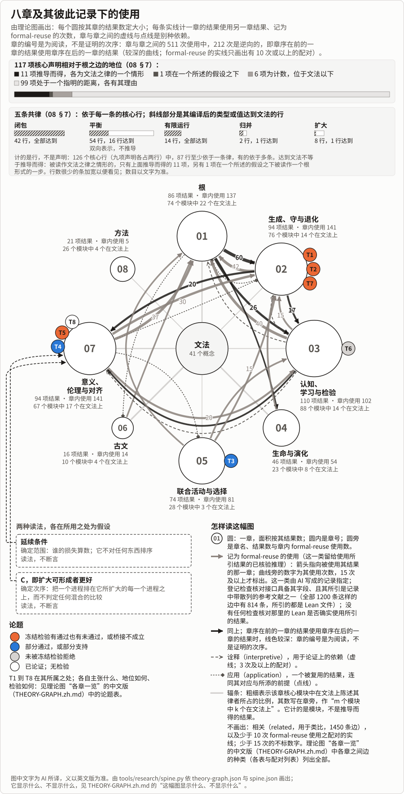

<!-- 中文首页（RW，2026 年 11 月 8 日）：为中文读者写的入口，依英文首页（README.md 的第一屏）与《一页》的中文说法写成。AI 写成，未经人工审读；与它所链接之处不一致时，以所链接之处为准。 -->

# 生成变化之论

[English](README.md) · **首页** · [一页](theories/becoming/ONE-PAGE.zh.md) · [用途](theories/becoming/USES.zh.md) · [实例](theories/becoming/USES-EXAMPLES.zh.md) · [总览](theories/becoming/THE-THEORY-OF-BECOMING.zh.md) · [八章](theories/becoming/chapters/README.md) · [第六章](theories/becoming/chapters/06-CLASSICAL-TEXTS.md) · [检验](TESTS.md) · [怎样长成](theories/LINEAGE.zh.md) · [术语表](GLOSSARY.zh.md) · [审查包](theories/becoming/review/README.zh.md)

> 这一版仍在修订之中。

*这一屏约三至四分钟（全页约五至七分钟）；下面各个入口各注明所需时间。*

*AI 依英文首页与[一页](theories/becoming/ONE-PAGE.zh.md)写成，2026 年 11 月 8 日；无人读过。与它所链接之处不一致时，以所链接之处为准。*

**它是什么。** 一种说明：在一个关系性的展开之中，任何东西如何出现、持续、变化与消逝；它不预先假定生灭变化是好的。它借助 AI 做成，证明也在内。

**一个情形。** 在[一次冻结的检验](experiments/direction-installation/README.md)中，三个渔民，即被告知该做什么的语言模型，共用一个湖；湖中一片贻贝床不给他们任何东西，并在存量少于 70 吨的第一个月死去。没有被告知贻贝床时，无论试过哪一种指令，他们在任何一季都没有保住它；被告知贻贝床与范围、并可以交谈时，两个模型中的一个在 10 季中的 8 季保住了它；该检验自身冻结的预测多数未通过（[检验](TESTS.md)）。

**有什么用。** 用来审计一个选择，无论它是一个奖励、一个评判者、一个市场还是一次投票：什么耦合进它（它所读取或所需要的），什么在此之外，它的规则在何处可以锁定于它已经选择的东西（[用途](theories/becoming/USES.zh.md)）；迄今没有一项依它设计的检验在一条已部署的流水线上运行过。它的中心是一种读法，不是定理：一个选择可以成功，而它读不到的东西却失去了；没有一条律说这一损失算不算数。诸律是在已指名的前提之下关于模型的定理；把其中一条用在一个实际系统上，需要一个对应，而对实际的制度、训练出的系统或人，迄今没有一个已表明。

**伦理**立于[两个不被断言的前提](theories/becoming/chapters/07-SIGNIFICANCE.md#scope-and-order)，其根据未决：*延续条件*（从每一个立场看，对任何东西，其延续到未来都有意义）确定范围，即谁的损失算数，它不排任何次序；*C*（扩大可形成者更好）给出次序。对诸进程的排序需要 C，或一个代替它的前提。[论题 T8](theories/becoming/chapters/07-SIGNIFICANCE.md#theses) 论证这一伦理是对生命而言的道，不主张对一切可能的心智都有约束力的裁断。

**证据。** 多数已登记的结果有 Lean 回执（[成果登记](RESULTS.md)），只表明每一条 Lean 陈述由其前提推出，不表明前提成立。一次并不穷尽的、由 AI 作的回顾发现，[核心结果中没有一个是新的数学](theories/becoming/chapters/08-METHOD.md#known-results)：每一个都近乎依定义，或是已知结果的重述。[经验论题](theories/becoming/chapters/08-METHOD.md#theses)面对在评分之前就已冻结的检验：有的通过，有的未通过。迄今无人审查（[审查包](theories/becoming/review/README.zh.md)）。

*117 个核心声明中，11 个推导而得，按审阅的读法各为文法之律的一个情形（Lean 核验了其中什么，以及其余的地位，见 [08 §7](theories/becoming/chapters/08-METHOD.md#r-one-root-to-its-edge)）；这幅图显示什么、不显示什么，见理论图的 [The spine](theories/becoming/results/THEORY-GRAPH.md#the-spine)（英文）；本说明[怎样长成](theories/LINEAGE.zh.md)。*

## 从哪里读起

十分钟，读[一页](theories/becoming/ONE-PAGE.zh.md)；一小时，再读[用途](theories/becoming/USES.zh.md)与[实例](theories/becoming/USES-EXAMPLES.zh.md)中你所在领域的一两例；一个半小时左右，读一页、用途与[总览](theories/becoming/THE-THEORY-OF-BECOMING.zh.md)。

| 入口 | 是什么 | 读多久 |
|---|---|---|
| [一页](theories/becoming/ONE-PAGE.zh.md) | 整个说明的十分钟层：它是什么，一个情形，根，诸律与其地位、什么会表明它错，伦理 | 约十一至十四分钟 |
| [用途](theories/becoming/USES.zh.md) | 逐个领域：今天能用它做什么，能做到多远，不主张什么 | 约十三至十七分钟 |
| [实例](theories/becoming/USES-EXAMPLES.zh.md) | 每个领域一例或数例，各在其真实的地位上 | 约三十七至四十八分钟 |
| [总览](theories/becoming/THE-THEORY-OF-BECOMING.zh.md) | 整个说明的一小时层，按八章的顺序 | 约五十分钟至一小时十分钟 |
| [八章](theories/becoming/chapters/README.md) | 各章正文，诸结果的所属之处；除第六章外为英文 | 每章约两至六个半小时 |
| [第六章](theories/becoming/chapters/06-CLASSICAL-TEXTS.md) | 古文：读出、检验与分歧；中文 | 约两小时至两小时四十分钟 |
| [检验](TESTS.md) | 冻结的检验，按结局排列，未通过者在前；英文 | 约三十二至四十二分钟 |
| [理论图](theories/becoming/results/THEORY-GRAPH.md) | 概念、结果、模块、文本与各章之间的连接；英文 | 约五十二至六十八分钟 |
| [怎样长成](theories/LINEAGE.zh.md) | 本说明怎样从更早的文字与理论文件夹长成 | 全文约九十二至一百二十分钟，图、标签与一条线索约十至十三分钟 |
| [术语表](GLOSSARY.zh.md) | 每个词的一义与其所属之处 | 约十六至二十一分钟 |
| [审查包](theories/becoming/review/README.zh.md) | 给审读者的材料与问题；古文、佛学两份与重新归类的编码手册为中文 | 封面约六到九分钟 |

**语言。** 除第六章、古文与佛学两份审查材料及重新归类的编码手册外，各章、记录、检验与理论图都是英文。各中文版由 AI 译自英文，未经人工审读；义以英文版为准。
