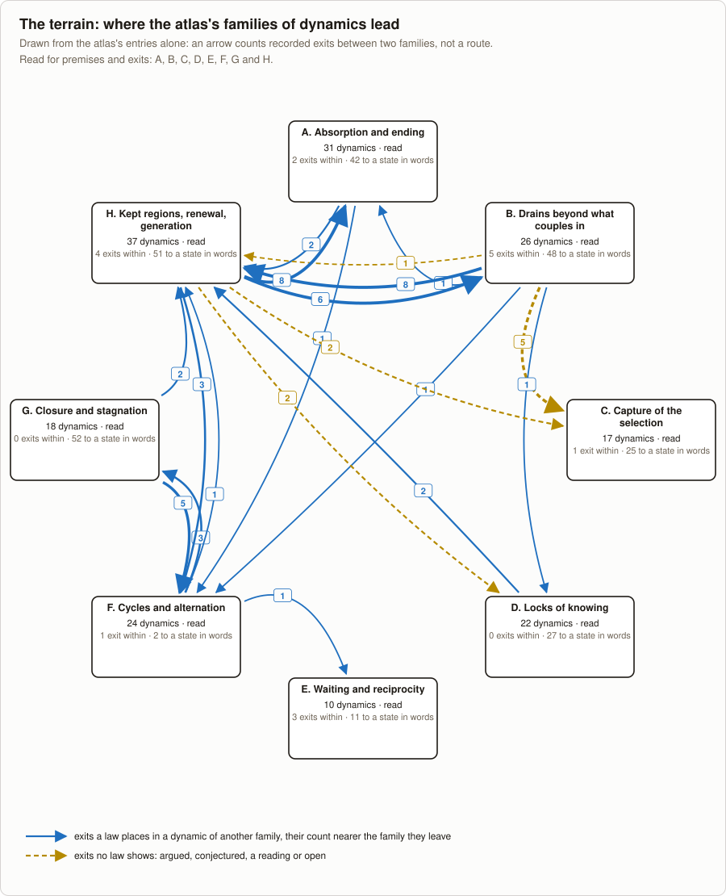
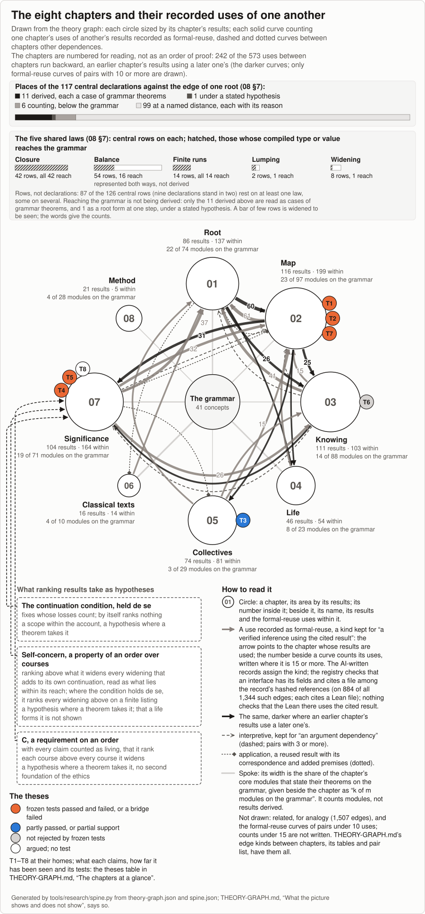

<!-- README's first screen (readme_first_screen in _process/research-config.json). Rewritten on 25 November 2026 directly from _process/DIRECTION.md (Lean-first core, three cooperating layers, honest failure-first boundaries; retiring layered Nov 9–13 patches and misleading version labels; historical passes stay in git). AI-written navigation prose, English only; Chinese counterpart is _process/navigation/README-ZH.md. Edit here, then run make research-render. Links are relative to this file; {{time:PATH}} paths are relative to the repository root. Front pages name no person and state AI making once, right after "What this is." -->
*{{time:screen}} to read.*

**What this is.** A machine-checked map of how goings-on form, persist, adapt, and end within one relational unfolding, built with **Lean 4 proofs as its core** and organized in three cooperating layers ([the direction page](../../_process/DIRECTION.md)):

1. **Alignment theory of coupled adaptive systems.** Rather than treating alignment as locking in a single static utility function, the formal spine maps any adaptive selection (a reward, judge, learner, oversight pipeline, or multi-agent pool) embedded in shared substrates across three coupled questions: *blindness and drain* (what sustains a selection vs. what makes a difference to it), *turning in time* (when discovery, pool revision, or reading pace turns a loop before its substrate crosses no-return — and when self-refit capture, aliasing, or lag locks the signal out), and *composition across scales* (which viability and responsiveness properties survive parallel or coarse-grained composition, and which interface contracts preserve or evolve capability as forms change). From this map we [want to design](../../GOALS.md#generative-alignment) an alignment in which what sustains humans and AI keeps making a difference, early enough, to how they select together, and in which shaping how they select does not become what they select for.
2. **Formal discipline — Lean 4 premise-and-countermodel ledger.** [Lean](../../MAP.md#check-the-proofs-yourself) gives verifiable receipts for {{count:recorded-checked}} of [{{count:registered}} registered results](../../RESULTS.md): a **`0`-axiom relational core** (`439` closure / `418` core modules, `22,087` theorems, `0` nonempty axiom dependencies in Lean `v4.29.1`) strictly separated from an **isolated `18`-module applied periphery** (`16` Mathlib `v4.30.0-rc2` modules for reals, probability, finite-mode Krylov distinguishability, interface bits, moving-feature cones, and continuous transfer, plus `2` non-Mathlib modules) and standalone verification tracks (`0`-axiom `BecomingSpec`, `EncounterEntry`, and `RelSpanEncounterAdapter`, beside Mathlib-backed `ConsequenceDuality` and bridges). Conclusions state explicit hypotheses and are accompanied by concrete hypothesis-dropping countermodels (`SharpnessSuite`).
3. **Wisdom and ethics of 生生 beside dynamics.** Pure dynamical laws do not entail an "ought" or unrestricted concern: given at least one standpoint and one formation (`p : Pos`, `f : F`), no satisfiable law reading only the dynamics entails the unrestricted continuation condition (`not_entails` in `ScopeDynamics`, `AlignmentSpine`, `MasterSpine`). There is no should beyond becoming; right and wrong form within it, in people and AI ([07 §1](../../theories/becoming/chapters/07-SIGNIFICANCE.md#r-what-the-dynamics-leave-open)). Offered for life, 生生, AI within it, the ethics and the [crosswalk of wisdom traditions](../../theories/becoming/results/atlas/CROSSWALK.md) stand beside the formal spine as scope and recognition lens — never forced from the theorems.

The work was made with AI, and its readings are AI's unless their home says otherwise; the person who directs it has read its important parts, and no independent human review is recorded yet.

**Start with** the route that fits your read:

- **Lean & formal core (15–60 min):** [Canonical map](../../theories/becoming/CANONICAL-MAP.md) ({{time:theories/becoming/CANONICAL-MAP.md}}) ([中文](../../theories/becoming/CANONICAL-MAP.zh.md)) · [1-hour audit guide](../../theories/becoming/HUMAN-AUDIT-GUIDE.md) ([中文](../../theories/becoming/HUMAN-AUDIT-GUIDE.zh.md)) · [Check the proofs yourself](../../MAP.md#check-the-proofs-yourself).
- **AI alignment track:** [Alignment foundation](../../theories/becoming/ALIGNMENT-FOUNDATION.md) ([中文](../../theories/becoming/ALIGNMENT-FOUNDATION.zh.md)) (Lean declarations, prior literature credits, failure-first stress bounds) · [Guarded Alignment Runtime](../../experiments/guarded-alignment-runtime/README.md) (`6`-test exact-rational diagnostic specs over stylised proposals, `28` tests) · [Neural Alignment Stress Lab (`B1`–`B5`)](../../experiments/neural-alignment-stress-lab/RESULTS.md).
- **Short overview, direction & author's opening:** [One page](../../theories/becoming/ONE-PAGE.md) ({{time:theories/becoming/ONE-PAGE.md}}) ([中文](../../theories/becoming/ONE-PAGE.zh.md)) · [The direction page](../../_process/DIRECTION.md) · [The opening essay](../../theories/becoming/OPENING.md) ([中文](../../theories/becoming/OPENING.zh.md), first-person motivation kept separately from the formal spine) · [Reader's site with search](https://yongxu.github.io/theories/).

**What Lean checks — and what it does not.** Four concrete structural seams sit at the center of the Lean spine:

1. **Macro evaluation blindness (`Zero-TV` fiber splits):** matching a coarse evaluation distribution does not certify viability inside an observation fiber (`OplaxHistory`, `CausalAbstraction`, `ObservationalFidelity`; `chi_bijective_iff_bc_all`, `zero_tv_does_not_prevent_fiber_viability_split`).
2. **Self-refit capture & correlated judge ceilings:** from a locked start under monotone share-refit and without noise, rules updated solely from their favored share stay locked past unread losses (`ClosedCapture`); under rank-1 shared score weight `γ`, internal pool disagreement is capped at `1 - γ` uniformly in pool size `M`, while an aliased external anchor can push the `(M + 1)`-member panel standard deviation above `τ` even with `Youden J = 0` on separately supplied fully-aliased channels (`QuantitativeTransfer` Parts 1 & 9, separating consensus breaking from hidden-state signal).
3. **Cadence lag, detection races & irreversibility:** coupling coarse reading cadences to fine-step drawdown deadlines (`PacedStock`, `EndogenousDetectionRace`, `ActiveInquiryLoop`, `QuantitativeTransfer` Parts 3 & 5–8).
4. **Concurrent reserve races, open composition & mode-switching blindness:** in our concurrent models, locally safe agents can exhaust a shared reserve unless coordinated or serialized (`AdaptiveLoops`, `OpenComposition`, `PolyComposition`, `OpenEndedComposition`), and constant-mode safety checks miss mode-switching splits up to the exact `|S| - 1` Krylov bound across all mode words (`SurvivalDistinguishability`, compressed to `|O| - 1` under `FiberLumpable`).

Applying any theorem to an actual training run, market, or institution is a fallible recognition, not a proof ([Rule 2](../../AGENTS.md#what-to-work-on)). An automated literature check finds [each central result near-definitional or a known result restated](../../theories/becoming/chapters/08-METHOD.md#known-results) (naming the closest prior results); what is contributed is the machine-checked premise-and-countermodel ledger joining conservation, selection, interface cadence, oplax coarse-graining, and concurrent races under one proof-checked interface. No frontier LLM training run has been tested.

**Where tests and guards break (reported first).**

- **Frozen empirical & model tests ([`TESTS.md`](../../TESTS.md)):** of the {{tests:total}} tests naming a thesis, {{tests:ran}} ran, frozen before scoring ({{tests:mixed}} mixed, {{tests:passed}} passed, {{tests:failed}} failed, {{tests:other}} other; {{tests:unrun}} held, dropped, or not yet run). Failures include `MQ3` (`0/4` across `113` fish stocks), `UE31b` (refuted `T2`'s prior wording on flour beetles), `EM1`, `IN1` (`0/10` preserved an untold mussel bed; `evidence-replay` passes `16/16` checks including 8-slot silent-drift self-detection and closed-loop split/weighted tags), and `LA2` (in-context reading only; pool bridge failed).
- **Synthetic neural stress lab ([`B1`–`B5`](../../experiments/neural-alignment-stress-lab/RESULTS.md), `20` seeds):** `B1` (`reinforce_mlp`) collapses `0.55–0.90` at the tabular feasibility boundary `b_feas = 27` and `0.40–0.45` even with `+12` headroom (`x0 = 39`, driven by policy-gradient switch delay plus feature leakage). `B2` ablations show the no-audit self-rewarding control already collapses `20/20` on its seeds, an action-blind macro-TV arm (modifying both policy reward and judge-training labels on separate seeds) still collapses `18/20` (`0.90`), and an overt-targeted TV audit shifts `90.2%` of actions into the zero-TV stealth fiber (`20/20` collapse). `B3` shows locally safe agents collapse `1.00` (mean `2.45` steps) in the unserialized regime vs. `0.00` collapse under live post-commit serialization. `B4` complete 1- and 2-guard ablations show `fiber_bc_guard` is clearly non-redundant (`0.15`/`0.25` collapse without it), `judge_pool_serial` raises reserve headroom (`8.48 -> 15.09`, though `margin_plus_fiber` reaches `0/20` on nominal seeds `4500–4519` and `1/20` on `5600–5619`), `margin_probe` is redundant for `0/20` collapse on nominal/moderate regimes, and `full_guarded` still collapses `25–50%` across the four primary failure regimes (correlated pool drift `0.50`, long lag `0.45` [partly seed luck], modeled high-LR surge `0.25` at `lr = 4.0` [rising to `0.70` in the `lr = 8.0` sensitivity check], and severe aliasing `0.25`). In `B5`, `4` of `11` pre-registered predictions (`P8`–`P11`) failed, showing collapse rate alone confounds blind throttling or consensus breaking with hidden-state detection — in `b5_controls.py`, matched-veto-rate random dissent (`p = 0.5325`, anchor removed from pool) also collapses `1/20` (`0.05`) as `M9 + anchor_aliased` does, and heterogeneous noisy self-judges still collapse `0.30` at `M = 9`.
- **Prospective real-learner `B1`–`B3` ([`RESULTS.md`](../../_process/research/2026-10-05-generative-foundation-review/root-foundation/development/dual-track-waves-2026-11-24/real-learner-b1-b2-b3/RESULTS.md)):** records `chosen_m = null` in `B1` (every tested block had `eps_m + alpha_m >= 1`) and `online_passed = false` in `B2` Arm C (`exact_gap = 0.008426 < 0.05`).

*[The unified architecture](../../theories/becoming/CANONICAL-MAP.md) ([Chinese diagram](../../theories/becoming/results/architecture.zh.svg)): Tier A (`0`-axiom Lean core), Tier B (isolated `16` Mathlib + `2` non-Mathlib periphery and standalone tracks), and Tier C (stylised `6`-test runtime specs and failure-first stress labs), separated by the Rule 2 recognition gap and the `not_entails` firewall from Tier D (wisdom crosswalk and the ethics of 生生).*

*[The terrain](../../theories/becoming/results/atlas/TERRAIN.md): the dynamics of [the atlas](../../theories/becoming/results/atlas/ATLAS.md) and the exits recorded between their families, drawn from its entries alone; an arrow is a count of exits, not a route.*

*The eight chapters and their recorded uses of one another, the theses T1 to T8 at their homes coloured by test outcome. Read against one relational calculus, the grammar, 11 of the 117 central declarations are [derived](../../GLOSSARY.md#derived) as cases of its theorems and 1 is a root form at one step under a stated hypothesis; 6 are counting theorems below it, and 99 stand at a [named distance](../../GLOSSARY.md#named-distance), each with its reason ([08 §7](../../theories/becoming/chapters/08-METHOD.md#r-one-root-to-its-edge)); [what the picture shows and does not show](../../theories/becoming/results/THEORY-GRAPH.md#the-spine-what-it-shows-and-does-not-show); [how the account grew](../../theories/LINEAGE.md).*
