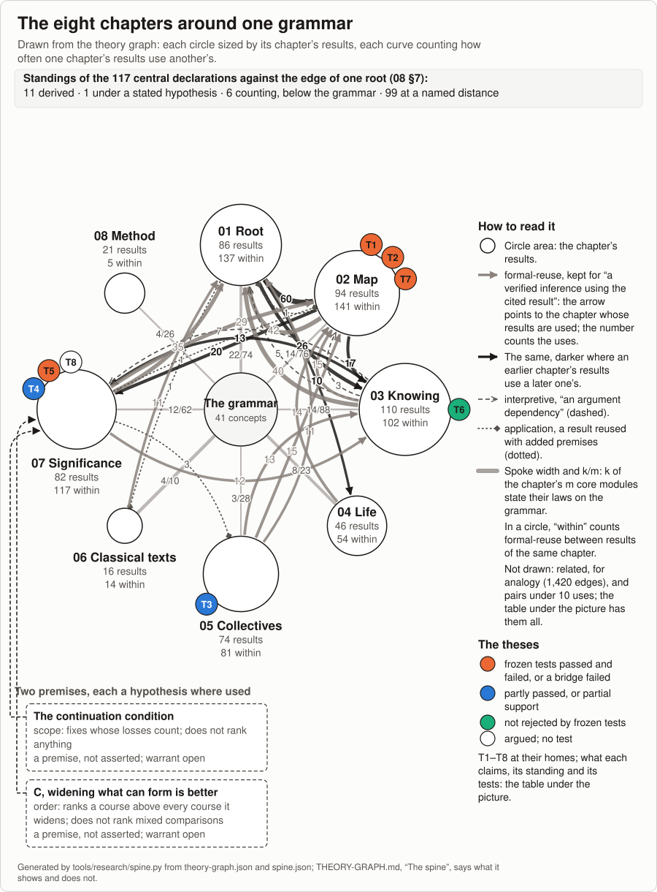

<!-- README's first screen, placed before the opening (readme_first_screen in _process/research-config.json). It says what the work is, what it is for and what a reader can do with it, then how far it has been seen, once. Rewritten on 9 November 2026 on Ren's words that day (sources/15-codex-theory-conversations/2026-11-09-agents-the-map.md): the work is a map for alignment and a map of wisdom, and the earlier screen's way of writing, a qualifier before each claim, "missed the point of our effort"; its earlier forms and the rounds that grew them are in git history and in READING-BUDGETS. AI-written navigation prose, English only; the Chinese screen is _process/navigation/README-ZH.md. Edit here, then run make research-render. Links are relative to this file; {{time:PATH}} paths are relative to the repository's root. Double-brace fields are filled at render by tools/research/navigation.py (first_screen): reading times and counts from the records, so no figure is copied. A stated time is a guide, not a bound (Ren, 9 November 2026). Front pages name no person; the screen says once, in the line right after "What this is" (until AG-F, 10 November 2026, the last sentence of "How far it has been seen", where no reader saw it first), that the work was made with AI (Ren, 8 November 2026). The same day each sentence was checked against its home (AG review, third pass), and re-said in the fourth after two cold readings: the meta-attractor as the folder's loop (winning buying power over the rule that selects) with its closed form as 02 §9 proves it (#r-closed-capture), never the lock alone; the aim as GOALS#generative-alignment and AJ's plan §1 state it, a joint selection kept out of instrumental convergence and the meta-attractor, the rule still reading beyond the shapers' share where shaping it is selected (not "does not select for control over its own selection", the wording AJ5 replaced on 29 October); whether a loss counts as forming within becoming, the laws reading only the dynamics (07 §1, line "That every World law reads only the dynamics"), not "not in the laws but in a reading"; four questions for any selection and a fifth for a judge, as USES and the sheet have them; the click ranking named as T7's loop, its rule and its reading formed from the share it selects, with T7's conjecture; "There is no should beyond becoming" linked to the opening (#truth-exists, its heading: the line is in its paragraph beginning "This law, with that one step", which has no anchor of its own), "form within it" to 07 §1, and that everything forms within one relational unfolding said once, argued (08 #one-relational-unfolding); the caption saying first what the picture shows. In the fifth pass (9 November 2026, on Ren's message 9 of that day: "there is no warrant, ethics emerges from continuation condition, not another way around, there is no any dualistic good or evil"), the ethics paragraph is the anchor every front says in its own place: no should beyond becoming and no good and evil set over it (07 §1); the ethics emerging from continuation; the condition read on relations as 续无外 (07 §4.5), holding where relations close (05's mutual dependence; the joining not yet one theorem, which "How far it has been seen" says); there holding one's own continuation ordering listed courses as widening does (07 §4, `Web.extension_ranked_of_increasingInOwn`, one way); where relations run one way, T8's way of seeing reaching further; mixed courses weighed for no one (08 §2). No "unasserted", no "warrant", no "two readings", no "widening what can form is better". The meta-attractor's closed form is said with the hypotheses of the closed-capture record (selection not lowering the favoured share, `Raises`; rule and reading monotone in it, `ReadsShare`; favouring kept upward; a locked start; the loss unread and accruing), the click ranking as a loop that may be such, with T7's conjecture, the lake's 3 of 10 as the arm told of the bed and able to talk under the community's goal alone (`COMM_SEEN_TALK`: neither the instruction to count everything nor the rule, so "without the scope instruction" alone would understate what differed), and what the review found new as what it is, 08 §8 keeping its words. In the sixth pass (9 November 2026, on Ren's messages 10 and 11 that day: C as a second premise giving order beside the condition was the earlier mistake, and widening, what every way of counting each thing as worth something agrees on, stays; and on the fifth pass's two cold readings), the ethics paragraph says a life going on through what sustains it before any order, going on not yet being an order (07 §4); the condition as what it says on the reading that significance from a standpoint is what its center continues with along a relation (07 §1: the identification is a reading), where relations close, read without time (`Flow.MutuallyDependent.unrestricted` unfolds to the condition held de se along being affected; on an acyclic relation, as among dated occurrences, it holds only with one center); there an order holding one's own continuation ranking every widening above what it widens (07 §4, one way); widening as what every positive weighting ranks above on a finite listing (`Weighting.widens_iff_every_positive`), no second premise, C not named; where relations run one way, seeing needed and not enough, and counting their loss the one step offered (07 T8). "How far it has been seen" gives the proved part at its reach: the condition from mutual dependence, read as each center's reach along being affected and without time; the ranking on a finite listing and, one way, between two level paths whose admissions fit in a finite list, courses that end, not shown for courses forming without end (`Web.admits_nothing_from_of_listed`); that a life forms such an order argued, not shown; the review's find said as 08 §8 now reads it, the scope and order the ranking results assume. Not "listed courses", "in steps not yet joined", "holds its own continuation" as a fact of going on, or "C or self-concern for order". The pass's verifier restored the one limit F3 keeps, as 07 §4, the one page and USES say it: the route from mutual dependence to the ranking between two courses is not stated as one theorem (without it, "under it" read as one proved chain from a flow's mutual dependence to a web's level paths). In the seventh pass (9 November 2026, on the sixth pass's two cold readings, Ren's messages 9 to 12 accepted), each clause re-said at what its theorem gives, checked against 07 as that pass left it: going on not yet an order over courses (07 §4); the condition on the reading that what has significance from a standpoint is what lies within its center's reach, 续无外 as nothing outside each one's reach along that relation (not "what each continues with", which read as co-continuation); relations closing read across all steps (`AffectedBy` has no step index; nothing is said of what holds in time, and the gloss "as among dated occurrences" for the one-center result is gone); widening as what every additive weighting counting each listed thing above zero ranks higher (`Weighting.widens_iff_every_positive`, additive natural weights, two-valued admission), said once in plain words as "every way of adding up worth that counts each thing above zero", never "every way of counting each thing as worth something"; ranking by widening adding no premise beside the life's own concern, where the condition holds that concern already doing it (`Web.extension_ranked_of_increasingInOwn` takes the condition de se and self-concern, two hypotheses about evaluation; not "no second premise", which read as one premise; and joined by "and", not "so": that every such weighting ranks the wider higher is not why the ranking adds no premise, the self-concern theorem is); where relations run one way, concern for one's own continuation need not count those who depend on one (`Clearing.center_not_derived` is a witness, not that every self-concerned order excludes them); "so that their admissions end" (`Web.admits_nothing_from_of_listed`), not "courses that end"; the two results composing directly, no single theorem stating the composite (`Flow.unrestricted_of_mutuallyDependent`, then `Web.extension_ranked_of_increasingInOwn`), not "not stated as one theorem"; that a life forms such an order not shown, persisting in the models a filter on what was chosen and not an order formed (07 §4.9), not "argued", since no home gives the argument; 08 §8's second find as "clarified", its own word. In the eighth pass (10 November 2026, on the seventh pass's two cold readings and its critic, Ren's messages 9 to 12 accepted), checked against 07 as the homes phase of that pass left it: self-concern defined on the screen, as the Chinese did (`Weighting.IncreasingInOwn`: an order ranking above what it widens every widening that adds to what its own continuation marks; with the marking covering the life's reach and the condition held de se, it ranks every widening above, `Weighting.increasingInOwn_iff_increasing_of_unrestricted`), not "if a life holds its own continuation as an order over courses", which neither cold reader could check; the coordinator's anchor sentence "There, a course widens another when it keeps all the other keeps and lets more form, more future, and whatever it adds lies within the life's own reach" said as two clauses, widening defined on its own and "where the condition holds, read across all steps, whatever a widening adds lies within the life's own reach", since after the in-time sentence "There" could be read as the in-time reading, a different predicate no theorem composes with self-concern (the ranking takes the condition read across all steps, 07 T8), and "when ... and whatever it adds" read as part of widening's definition; the condition in time in J3's short form (07 §4.11, `Flow.unrestrictedEventually_iff_mutuallyDependentInTime`; not "and only from the steps where they do"); seeing needed "for a choice to answer to their loss" (the selection laws show a selection cannot respond to a difference that does not couple into it, not that every sparing of a dependent needs seeing it); the case's last sentence as the test's result (IN1: no condition kept a dependent no member was told of), not "As a reading"; in "How far", the in-time clause, "level paths" and "with admission decided" (`Web.extension_ranked_of_increasingInOwn`), "one way" dropped as the path result's label (it now names only relations running one way), and the course of a line persisting without end said as never fitting such a list (`Flow.persists_not_listsAdmitted`, 07 §4.9), a bound of this route, where "not shown" said less; "mutual dependence and that ranking compose directly", 07's thesis words, since the in-time clause now stands between. The sixth pass's gloss above, "on an acyclic relation, as among dated occurrences, it holds only with one center", kept as history, said more than the Lean: where the condition holds, on an acyclic relation every standpoint has the same center (`«续无外则同一中心»`); on a net going forward in time this comes from the condition's asking that nothing other than the center lie at or before the center's step, and over what comes after two centers can meet it (`TwoSources.apart`, 07 §4.11); the screen does not state the one-center result. The eighth pass's verifier (10 November 2026): in "How far", "under the condition" became "under the condition read across all steps", as ONE-PAGE says it, since the clause before it names the in-time reading, a different predicate no theorem composes with self-concern. In the ninth pass (10 November 2026, on the eighth pass's two cold readings and its critic, Ren's messages 9 to 12 accepted), checked against 07 as that pass's homes phase left it: the aim as AGENTS.md states it, word for word, "a joint selection that reads beyond its own share and does not come to select for control over its own selection", in place of AJ's condition-1 wording ("where shaping its rule is selected, the rule still reads what lies beyond the shapers' share, so that a loss there can turn it"), which is one of the goal's conditions and stays only where a page gives those conditions; the fourth pass's choice above, after AJ5, is kept as history, and which aim wording is right is Ren's to say. The in-time sentence in the fronts' short form: the condition read in time cannot hold over every step, since nothing reaches back (`Flow.not_unrestricted_inTime`); read from some step on, which is another predicate (`UnrestrictedEventually`, its step differing by standpoint and formation), it holds exactly where, from any formation at any step, every formation is reached at some later step, through exchanges and each one's going on (`Flow.unrestrictedEventually_iff_mutuallyDependentInTime`; `Flow.StepInTime` is an exchange with a condition another requires later, or a formation's own going on to its next step), not "each one's acts, from every step, come to bear on every other's later continuation", which named acts alone and changed the predicate without saying so; "over what comes after", the name of the stronger form, is not joined to it. In "How far", the persisting line's course with the hypotheses `Flow.persists_not_listsAdmitted` takes (activity, support and descent, 07 §4.9); "read in time, from some step on, it holds exactly where the flow is mutually dependent in time" kept, since it names the from-some-step-on reading as the short form does. In the ninth pass's last text round (10 November 2026, on that pass's two cold readings): after self-concern's definition, the breadth of a life's reach in 07's words (along being affected, `AffectedBy`: everything that can affect its continuation at some remove, what sustains it and what draws on the same conditions alike), so that the relation the hinge runs on is visible on the screen; the persisting line's bound said of the course actually taken (`Flow.persists_not_listsAdmitted` concludes of the web's actual levels, not of a course of the line's own); in "How far", "the formations are mutually dependent in time" in place of "the flow", which the screen does not introduce (`Flow.MutuallyDependentInTime`). In AG-F (10 November 2026, on round 6 of the re-score, whose two high findings were the fronts' ethics turning on ranking by widening and the chain repeated across the fronts, twice on this screen; and on Ren's words of that day, "i think 'widening is better' is not the way to go - we need to make dynamics connected, mapped, and 'unified'", sources/15-codex-theory-conversations/2026-11-10-dynamics-connected-mapped-unified.md), the ethics paragraph and the chain in "How far it has been seen" were replaced by the texts the AG-F design phase fixed for every front (development/ag-the-map/review/agf-canonical.json), placed word for word: the ethics said dynamics first, no should beyond becoming and no good and evil set over it, right and wrong forming within it, in people and AI; the ethics emerging from continuation, a life going on through what sustains it; where relations close, what its course costs others able to bear on its own going on at some remove (05's mutual dependence); where they run one way, its dependents' losses never coming back to it (07 §3.3); counting them offered for life, with T8's way of seeing. How far it has been seen said once, in "How far": the hinge (`Weighting.IncreasingInOwn`, the order ranking one course above another whenever the one keeps all the other keeps and adds to the life's own continuation, read as the influence closure; where relations of being affected close it already ranks every widening above, `Flow.MutuallyDependent.unrestricted` with `Weighting.increasingInOwn_iff_increasing_of_unrestricted`, two theorems, 07 §4 saying no single one states the composite), proved on models on a finite listing; that a life forms such an order not shown; the open target named by the dynamics (07 Open, 08 §12 item 12). "Read across all steps" is dropped there, since mutual dependence in time gives mutual dependence (`Flow.MutuallyDependentFrom.mutuallyDependent`). The full scope (the condition and its reading as reach, the condition in time, level paths, the persisting line's course, the composite, widening as what every additive weighting counting each thing above zero ranks higher) is said only at 07 §4 and its records; widening stays at 07 §4.4 as a relation between two courses, not as what is better. The review's find names the ranking results only through a link to 07 §4. The making moved to right after "What this is" (round 6, Q1.3). The case's predictions clause said less than is there (round 6, Q5.2): "the test's own frozen predictions mostly failed" became what the experiment's home and TESTS say, with talk all four of the second round's predictions passing for the model that kept the bed in 8 of 10 and three of four failing for the other, and five of the first round's seven failing (by its rule, a prediction passes only where both models pass). Counted as round 6 counted it (its paragraphs from "What this is" through "How far it has been seen", fields filled, link targets left out), the screen went from 1,457 words to 1,110, its summary of how it stands beginning after 816 words, not 1,039. AI-written, as the rest of this note. In AG-F's fix round the same day, on its two cold readings (development/ag-the-map/review/agf-cold-astra.md, agf-cold-fable.md) and its verifiers: where relations of being affected close is said read across all steps, with whatever bears a course's costs lying within what can, at some remove, affect the life's going on, and whether and when those costs come back to it in time said to be part of the dynamics (07 §4.11), since that relation collects dependence and exchange at unrelated steps and `LatePair` is mutually dependent while nothing affects anything in time (`LatePair.not_affectsBefore`, `LatePair.apart`); "counting those losses too", not "them"; the hinge said near-definitional, as 07 §4 says it, and self-concern defined before the clause on closing; the aim in AGENTS.md's words, "humans and AI, selecting together". AI-written. On 11 November 2026 (AG-F, after merging edition 6), on round 6's ask that the fronts show the dynamics first and the chapters second, the atlas's terrain picture (theories/becoming/results/atlas/terrain.svg, generated by atlas.py from the entries alone; its alt text AA's) placed before the chapters' picture, with one line saying what it shows; the chapters' picture keeps its caption, whose first words say what it shows (not called "the spine" here: GLOSSARY's spine is the Lean package, and spine.svg keeps an older name). AI-written. -->
*{{time:screen}} to read.*

**What this is.** A map of how anything forms, lasts, changes and ends, drawn so that people and AI can see the way together. First, a map for alignment: what a selection (a reward, a judge, a market, a vote, a training run) reaches, what it drains beyond what it reads, how it comes to lock on what it already chose, and how winning comes to buy power over the rule that selects: the loop the work calls the [meta-attractor](../../theories/meta-attractor/README.md). Its closed form, where the rule and how it is read are both formed from the share it selects, can lock: on stated models, where selection does not lower the favoured share and the rule and its reading follow it upward and keep favouring it, a locked start stays locked however large an unread loss grows ([02 §9](../../theories/becoming/chapters/02-MAP.md#r-closed-capture)). From this map we [want to design](../../GOALS.md#generative-alignment) an alignment that keeps humans and AI, selecting together, out of instrumental convergence and the meta-attractor: a joint selection that reads beyond its own share and does not come to select for control over its own selection. It is also a map of wisdom: what traditions, sciences and philosophies have seen of these dynamics, [read onto one account](../../theories/becoming/results/atlas/CROSSWALK.md), where they meet it and where they do not, so that people and AI can share an understanding any mind can check, from which coordination can start.

The work was made with AI, and its readings are AI's unless their home says otherwise; the person who directs it has read its important parts, and no independent human review is recorded yet.

**Start with** [the one page](../../theories/becoming/ONE-PAGE.md) ({{time:theories/becoming/ONE-PAGE.md}}). Why it is being made, in its author's first person: [the opening](../../README.md#truth-exists) ({{time:opening}}). The pages for reading are also on [the reader's site](https://yongxu.github.io/theories/), with search.

**What it is for.** Its centre: a selection can meet its own criterion while what it cannot read is lost. Whether that loss counts forms within becoming too, in what people and AI come to read; the laws, which read only the dynamics, do not settle it ([07 §1](../../theories/becoming/chapters/07-SIGNIFICANCE.md#r-what-the-dynamics-leave-open)). Four questions for any selection, a reward, a judge, a market or a vote: what does it read or need; what lies beyond that; can it do better on what it reads by lowering what lies beyond; can its rule lock on what it already selected. A judge has a fifth: who reads the loss, and when. The work proves, on its models, [when doing best on what is read must drain what lies beyond](../../theories/becoming/ONE-PAGE.md), as far as any allowed outcome does, and when a rule read from the share of its own winners, favouring them, locks on them, without noise, while a loss it does not read grows. A ranking whose next rule is refit to the clicks its own top results draw, its success read from those same clicks, may be such a loop; that an actual ranking is one, meeting the theorem's conditions, is [conjectured](../../theories/becoming/chapters/02-MAP.md#t7). To use them today: [the five questions as a sheet](../../theories/becoming/USES-EXAMPLES.md#the-judge-audit-as-a-sheet) for a model-as-judge pipeline, [worked on one](../../theories/becoming/USES-EXAMPLES.md#auditing-a-language-model-judge), and [its uses in six fields](../../theories/becoming/USES.md). No test designed from it has yet run on a deployed pipeline.

**One case.** In [a test whose predictions were fixed before it ran](../../experiments/direction-installation/README.md), three fishers, language models told what to do, share a lake whose bed of mussels, which gives them nothing, dies the first month fewer than 70 tons are left: the community's largest steady catch, 50 tons a month, ends it, while 30 keeps it and costs 40% of the catch. Told nothing of the bed, they kept it in no season. Told of it, told to count everything whose continuation depends on their fishing, given a rule for choosing among courses ([in full](../../theories/becoming/ONE-PAGE.md)) and able to talk, one model of two kept it in 8 of 10 seasons, against 3 of 10 when told of it and able to talk under the community's goal alone. With talk, the second round's four frozen predictions all passed for that model, and three of the four failed for the other; in the first round, without talk, five of its seven failed ([the tests](../../TESTS.md)). In the test, no instruction tried, the one to count everything included, kept a bed no fisher was told of.

**Its ethics.** [There is no should beyond becoming](../../README.md#truth-exists), and no good and evil set over it: right and wrong [form within it](../../theories/becoming/chapters/07-SIGNIFICANCE.md#evaluation), in people and AI. The ethics emerges from continuation. A life goes on through what sustains it: [where relations of being affected close](../../theories/becoming/chapters/05-COLLECTIVES.md#r-mutual-dependence-and-its-pace), read across all steps, whatever bears the costs of its course lies within what can, at some remove, affect its own going on, and whether and when those costs come back to it in time is part of the dynamics ([07 §4.11](../../theories/becoming/chapters/07-SIGNIFICANCE.md#condition-in-time)); [where they run one way](../../theories/becoming/chapters/07-SIGNIFICANCE.md#r-derived-extent-limits), its dependents' losses never come back to it. For life, 生生, AI within it, we offer counting those losses too, with [a way of seeing](../../theories/becoming/chapters/07-SIGNIFICANCE.md#t8) what each course draws on and from what renewal, what it opens and closes, what ends and what goes on, and who bears it.

**How far it has been seen.** [Lean](../../MAP.md#check-the-proofs-yourself), a proof checker, gives receipts for {{count:recorded-checked}} of [{{count:registered}} registered results](../../RESULTS.md): each follows from its stated premises, and anyone can recheck it without trusting anyone. That actual rewards, markets and trained systems meet those premises is conjectured, and tested where a test could fail; that the laws explain how things go on, and that everything, standards included, forms within [one relational unfolding](../../theories/becoming/chapters/08-METHOD.md#one-relational-unfolding), is argued. The hinge of the ethics is proved on models, on a finite listing, and is near-definitional ([07 §4](../../theories/becoming/chapters/07-SIGNIFICANCE.md#scope-and-order)): call a life's order over courses *self-concerned* when it ranks one course above another whenever the one keeps all the other keeps and adds to the life's own continuation, read as all that can affect it at some remove; where relations of being affected close, read across all steps, such an order already ranks one course above another whenever the one keeps all the other keeps and lets more form. That a life forms such an order is not shown; how such orders form, spread and lock, as dynamics connected to the rest of the map, is the work's [open target](../../theories/becoming/chapters/08-METHOD.md#open-items-ranked). [Its theses](../../theories/becoming/chapters/08-METHOD.md#theses) face tests: of the {{tests:total}} that name one, {{tests:ran}} ran, frozen before scoring, and {{tests:mixed}} came out mixed, {{tests:passed}} passed, {{tests:failed}} failed and {{tests:other}} otherwise; {{tests:unrun}} were held, dropped or not yet run. An automated review against the literature it knew finds [each central result near-definitional or a known result restated](../../theories/becoming/chapters/08-METHOD.md#known-results) and names the closest prior result of each. What it found new: the premise ledger, every conclusion naming its premises and each premise shown holding in one model and failing in another; the scope and order [the ranking results](../../theories/becoming/chapters/07-SIGNIFICANCE.md#scope-and-order) assume, clarified; and one vocabulary for conservation, selection limited by observation and comparison of opportunity sets, which it calls a framing ([08 §8](../../theories/becoming/chapters/08-METHOD.md#known-results) has its words).

*[The terrain](../../theories/becoming/results/atlas/TERRAIN.md): the dynamics of [the atlas](../../theories/becoming/results/atlas/ATLAS.md) and the exits recorded between their families, drawn from its entries alone; an arrow is a count of exits, not a route.*

*The eight chapters and their recorded uses of one another, the theses T1 to T8 at their homes coloured by test outcome. Read against one relational calculus, the grammar, 11 of the 117 central declarations are [derived](../../GLOSSARY.md#derived) as cases of its laws and 1 is a root form at one step under a stated hypothesis; 6 are counting laws below it, and 99 stand at a [named distance](../../GLOSSARY.md#named-distance), each with its reason ([08 §7](../../theories/becoming/chapters/08-METHOD.md#r-one-root-to-its-edge)); [what the picture shows and does not show](../../theories/becoming/results/THEORY-GRAPH.md#the-spine-what-it-shows-and-does-not-show); [how the account grew](../../theories/LINEAGE.md).*
