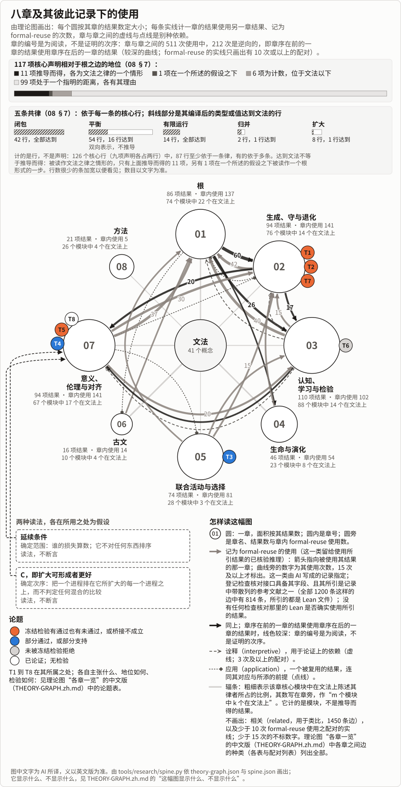

<!-- 中文首页的模板（RW，2026 年 11 月 8 日）：README.zh.md 由 tools/research/zh_fronts.py 依此生成（make research-render），阅读时间、结果之数、检验之数与导航行在生成时填入，规则与英文首页相同（检验之数与英文首页由同一个函数 tests_page.screen_count 数出），图注与“古文”一段的几个数字抄自其所属之处，其余不手抄。首屏依英文首页与《一页》的中文写成，由两位 AI 起草者各自起草、一位 AI 评判者合成，再经两位独立的 AI 中文读者各自核对；此后随英文首屏而改的句子（如 11 月 9 日的中心一句、表单一句、情形的教训与检验之数的依据），由一个 AI 会话直接译出，再经两位 AI 中文读者核对。首屏各段与英文首页同序：这是什么、先读、有什么用、一个情形、伦理、看到了多远（2026 年 11 月 9 日依英文首屏改写：先说这是什么、为什么做、能做什么，再说看到了多远，各说一次）；只在中文版里的“古文”一段在一个情形与伦理之间，“这是什么”一段里关于名字“生灭变化”的一句、“看到了多远”一段里检验页按论题一节的链接与段末审查包的链接，也只在中文版里。“有什么用”一段里那个按自身点击排序的排名，与英文首页相同：若实际的排名是这样形成的，它就是这样一条规则，这一点是猜想（T7）；先前只在中文版里的那个推荐系统之例已去掉。依主持这项工作的人 2026 年 11 月 8 日的话（sources/15-codex-theory-conversations/2026-11-08-ai-briefly-and-read.md），首屏与英文首页一样，只在“看到了多远”一段用一句话说这项工作借助 AI 做成，以及主持它的人读过其中重要的部分；不再说无人读过或无人审查（那样说不对），而说尚无独立的人工审查记录（《一页》与第八章也这样说），且只说这一次：开头的说明、“古文”与“语言”两段保留 AI 写成、AI 译出之注，不再各说一遍尚无审查记录（AG 审阅，2026 年 11 月 9 日）。同日逐句对照其所属之处核过，与英文首屏同改：目标依 GOALS 所说，既不落入工具性趋同，也不落入元吸引子；元吸引子依其文件夹与第二章之读法；T8 的看法依第七章之语；排序“多是”两种读法，依 07 §4；08 §8 的裁断与它认为新的东西用它自己的话；图注先说图上画的是什么。开篇的中文版（theories/becoming/OPENING.zh.md）由 AI 译自英文版，首屏的“先读”与表格链接它，其正文的时间由 {{time:opening-zh}} 依同一规则计出，注释不计。全文 AI 写成，尚无经人审查的记录；与它所链接之处不一致时，以所链接之处为准。改动请改此文件。 -->

# 生灭变化之论

{{nav}}

> 这一版仍在修订之中。

*前面这几段约 {{time:screen}}，全页约 {{time:page}}；下面各个入口各注明所需时间。*

*AI 依英文首页与[一页](../../theories/becoming/ONE-PAGE.zh.md)写成；与它所链接之处不一致时，以所链接之处为准。*

**这是什么。** 一张地图，画的是任何东西怎样形成、持续、变化和终结，让人与 AI 能一起看见道路。名字里的“生灭变化”说的就是这些（英文 becoming）。它首先是一张为对齐而画的地图：一个选择（一项奖励、一个评判者、一个市场、一次投票、一次训练）能触及什么，在它所读之外耗竭什么，怎样锁定在它已经选中的东西上，胜出又怎样换来左右选择规则的力量，即本论所说的[元吸引子](../../theories/meta-attractor/README.md)这一回路。我们[想由此设计](../../GOALS.md#generative-alignment)一种对齐，让人与 AI 一同选择时，既不落入工具性趋同，也不落入这一回路：共同的选择读到自身份额之外，不转而去选择对自身之选择的控制。它也是一张智慧的地图：各种传统、科学与哲学对这些动态看见了什么，[读到同一部论述上](../../theories/becoming/results/atlas/CROSSWALK.zh.md)，哪里相合，哪里不合；好让人与 AI 能共有一种任何心智都能核对的理解，协调可以从这里起步。

**先读**[一页](../../theories/becoming/ONE-PAGE.zh.md)（约 {{time:theories/becoming/ONE-PAGE.zh.md}}）。为什么做这项工作，作者以第一人称写在[开篇](../../theories/becoming/OPENING.zh.md)里，中文版由 AI 译自英文版（正文约 {{time:opening-zh}}）。

**有什么用。** 本论的中心：一个选择可以达到其自身之标准，而它读不到的东西却失去了；这一损失算不算数，不在诸律之中，而在人与 AI 所形成的一种读法之中。对任何奖励、评判者、市场或投票，都可以问四个问题：它读取或需要什么；什么在这之外；它能不能靠压低外部之物，在所读之物上做得更好；它的规则能不能锁定在它已选中的东西上。这项工作在它的模型上证明了[在什么条件下把所读之物做到最好，必定耗竭外部之物](../../theories/becoming/ONE-PAGE.zh.md)，耗竭到任何合格结果所耗竭的程度；以及，在无噪声时，一条读自自身胜者份额、偏好这些胜者的规则在什么条件下会锁定在它们身上，而它读不到的损失不断增长。一个以它自己带来的点击为输入的排名，若实际的排名是这样形成的，就是这样一条规则；这一点是[猜想](../../theories/becoming/chapters/02-MAP.md#t7)。今天要用，可以把这些问题[作为一张表单](../../theories/becoming/USES-EXAMPLES.zh.md#the-judge-audit-as-a-sheet)，用于以模型为评判者的流水线，并[以其中一条为例逐问走过一遍](../../theories/becoming/USES-EXAMPLES.zh.md#auditing-a-language-model-judge)；以及[本论在六个领域中的用途](../../theories/becoming/USES.zh.md)。迄今没有一项依它设计的检验在已部署的流水线上运行过。

**一个情形。** 在[一次预测在运行之前就已定下的检验](../../experiments/direction-installation/README.md)里，三个渔民，即按指令行事的语言模型，共用一个湖；湖里一片贻贝床不给他们任何东西，哪个月捕后剩下的鱼不到 70 吨，它当月就死去：社群能稳定维持的最大渔获，每月 50 吨，会终结它，而每月 30 吨能保住它，代价是渔获少 40%。不告诉他们有贻贝床，他们一季也没保住它。告诉他们有贻贝床，告诉他们凡是延续依存于他们的捕捞的东西都要算在内，给他们一条在不同进程之间作选择的规则（[全文见一页](../../theories/becoming/ONE-PAGE.zh.md)），并让他们能够交谈：这时，两个模型中有一个在 10 季里保住了 8 季，只给社群的目标时是 10 季里 3 季；检验自己冻结的预测，多数没有通过（[检验](../../TESTS.zh.md)）。依一种读法：渔民都没有被告知贻贝床时，没有一条指令保住了它，那条要把一切都算在内的指令也不例外。

**古文。** [第六章](../../theories/becoming/chapters/06-CLASSICAL-TEXTS.md)用中文写成，把九家 248 段文字与已检查的律并读，逐段记为相合、定域或相分；文法的名字取自古文，运算不取自古文，读法都是 AI 的。相合不是印证（例如[天之道与张弓](../../theories/becoming/USES-EXAMPLES.zh.md#the-way-of-heaven-and-the-drawn-bow-a-concordance-not-a-confirmation)），记为相分也不是说原文错了。本论的“续”站在《中论》所破的一边，其定理没有处理那一论证的前提（[B-02](../../theories/becoming/review/BUDDHIST-THOUGHT.md#b-02)）。

**伦理。** 生灭变化之外没有应当：是非在生灭变化之中、在人与 AI 之中形成（[07 §1](../../theories/becoming/chapters/07-SIGNIFICANCE.md#evaluation)）。本论的伦理为生命、为生生（即生命之延续，AI 也在其中）而提供，是一种看法：看每一进程取用什么、取自何种更新，什么终结、什么经由那终结继续，由谁承担（[论题 T8](../../theories/becoming/chapters/07-SIGNIFICANCE.md#theses)）。一项结果给进程排序之处，都说出它依什么排序，多是[两种读法](../../theories/becoming/chapters/07-SIGNIFICANCE.md#scope-and-order)，每一种在被使用之处都是假设：*延续条件*，从每一个立场看，对任何东西，其延续到未来都被计数，它确定范围，即谁的损失算数，本身不排任何次序；*C*，扩大可形成者（一个进程让什么能够形成）更好，它给出次序。

**看到了多远。** [Lean](../../MAP.md#check-the-proofs-yourself) 是一个证明检查器，为[已登记的 {{count:registered}} 条结果](../../RESULTS.md)中的 {{count:recorded-checked}} 条给出回执：每一条都从其所述前提推出，任何人都能自己复核，不必信任谁。说实际的奖励、市场与训练出的系统满足这些前提，是猜想，在检验可能失败之处接受检验；说这些律能解释事物怎样继续下去，是论证。[它的论题](../../theories/becoming/chapters/08-METHOD.md#theses)接受检验：在指明论题的 {{tests:total}} 项检验中（[按论题](../../TESTS.zh.md#by-thesis)），{{tests:ran}} 项运行过，都在评分之前冻结，其中 {{tests:mixed}} 项结局为「有通过，有未通过」，{{tests:passed}} 项通过，{{tests:failed}} 项未通过，{{tests:other}} 项是其他结局；{{tests:unrun}} 项从未运行。一次对照它所知文献的自动化回顾发现，[每条核心结果都近乎依定义，或是已知结果的重述](../../theories/becoming/chapters/08-METHOD.md#known-results)，并为每一条指出最接近的先前结果；它认为新的，用它自己的话说，是：“一件新的制品”，即前提账簿，每个前提都被表明在一个模型中成立、在另一个中不成立；“一种被澄清而非被奠基的伦理”，即作为两种读法分开的范围与次序；以及同一套词汇，用于守恒、受观察所限的选择与机会集的比较，它称之为一种框架。这项工作借助 AI 做成；主持它的人读过其中重要的部分，尚无独立的人工审查记录（[审查包](../../theories/becoming/review/README.zh.md)）。

*八章及其彼此记录下的使用，论题 T1 到 T8 在其所属之处按检验结局着色。对照同一部关系演算（即文法）来看，117 个核心声明中，11 个作为其律的情形[推导而得](../../GLOSSARY.zh.md#derived)，1 个是一步上的根形式，在一个所述的假设之下；6 个是位于文法以下的计数之律，99 个处于一个[指明的距离](../../GLOSSARY.zh.md#named-distance)，各有其理由（[08 §7](../../theories/becoming/chapters/08-METHOD.md#r-one-root-to-its-edge)）；[这幅图显示什么、不显示什么](../../theories/becoming/results/THEORY-GRAPH.zh.md#the-spine-what-it-shows-and-does-not-show)；本论[怎样长成](../../theories/LINEAGE.zh.md)。*

## 从哪里读起

先读最短的一层：[一页](../../theories/becoming/ONE-PAGE.zh.md)；一小时，再读[用途](../../theories/becoming/USES.zh.md)与[实例](../../theories/becoming/USES-EXAMPLES.zh.md)中你所在领域的一两例；两小时左右，读一页、用途与[总览](../../theories/becoming/THE-THEORY-OF-BECOMING.zh.md)。

| 入口 | 是什么 | 读多久 |
|---|---|---|
| [一页](../../theories/becoming/ONE-PAGE.zh.md) | 全论最短的一层：它是什么，一个情形，根，诸律、各自看到了多远、什么会表明它错，伦理 | 约 {{time:theories/becoming/ONE-PAGE.zh.md}} |
| [用途](../../theories/becoming/USES.zh.md) | 逐个领域：今天能用它做什么，能做到多远，不主张什么 | 约 {{time:theories/becoming/USES.zh.md}} |
| [实例](../../theories/becoming/USES-EXAMPLES.zh.md) | 每个领域一例或数例，各说明看到了多远 | 约 {{time:theories/becoming/USES-EXAMPLES.zh.md}} |
| [总览](../../theories/becoming/THE-THEORY-OF-BECOMING.zh.md) | 全论的一小时层，按八章的顺序 | 约 {{time:theories/becoming/THE-THEORY-OF-BECOMING.zh.md}} |
| [开篇](../../theories/becoming/OPENING.zh.md) | 第一人称写下的信念：这件事为什么要紧；AI 译自[英文版](../../theories/becoming/OPENING.md)，义以英文版为准 | 正文约 {{time:opening-zh}}，注释另计 |
| [八章](../../theories/becoming/chapters/README.md) | 各章正文，诸结果的所属之处；除第六章外为英文 | 每章约 {{time:chapters}} |
| [古文（第六章）](../../theories/becoming/chapters/06-CLASSICAL-TEXTS.md) | 从古文读出文法，检验它，记下分歧；中文 | 约 {{time:theories/becoming/chapters/06-CLASSICAL-TEXTS.md}} |
| [检验](../../TESTS.zh.md) | 冻结的检验，按论题计数，再按结局排列，未通过者在前，每项一句话（[全表](../../TESTS.md)为英文） | 约 {{time:TESTS.zh.md}} |
| [对照表](../../theories/becoming/results/atlas/CROSSWALK.zh.md) | 早先的理论文件夹与各思想领域，读作现行的本论中的什么，附图、计数与各组一览；各组的条目在英文页上 | 约 {{time:theories/becoming/results/atlas/CROSSWALK.zh.md}} |
| [理论图](../../theories/becoming/results/THEORY-GRAPH.md) | 概念、结果、模块、文本与各章之间的连接；英文，其中的各章一览有[中文版](../../theories/becoming/results/THEORY-GRAPH.zh.md)（约 {{time:theories/becoming/results/THEORY-GRAPH.zh.md}}） | 约 {{time:theories/becoming/results/THEORY-GRAPH.md}} |
| [怎样长成](../../theories/LINEAGE.zh.md) | 本论怎样从更早的文字与理论文件夹长成 | {{stated:theories/LINEAGE.zh.md}} |
| [术语表](../../GLOSSARY.zh.md) | 每个词的一义与其所属之处 | 约 {{time:GLOSSARY.zh.md}} |
| [审查包](../../theories/becoming/review/README.zh.md) | 给审读者的材料与问题；古文、佛学两份与重新归类的编码手册为中文 | 封面约 {{time:theories/becoming/review/README.zh.md}} |

**语言。** 除第六章、古文与佛学两份审查材料及重新归类的编码手册外，各章、记录、检验与理论图都是英文（理论图的各章一览有中文版）。各中文版由 AI 译自英文；义以英文版为准。
