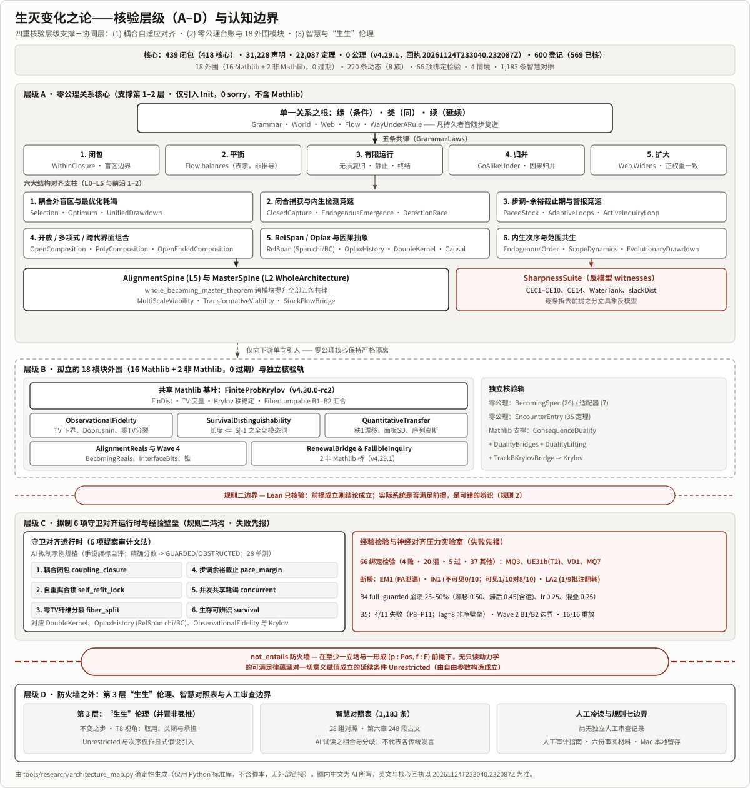
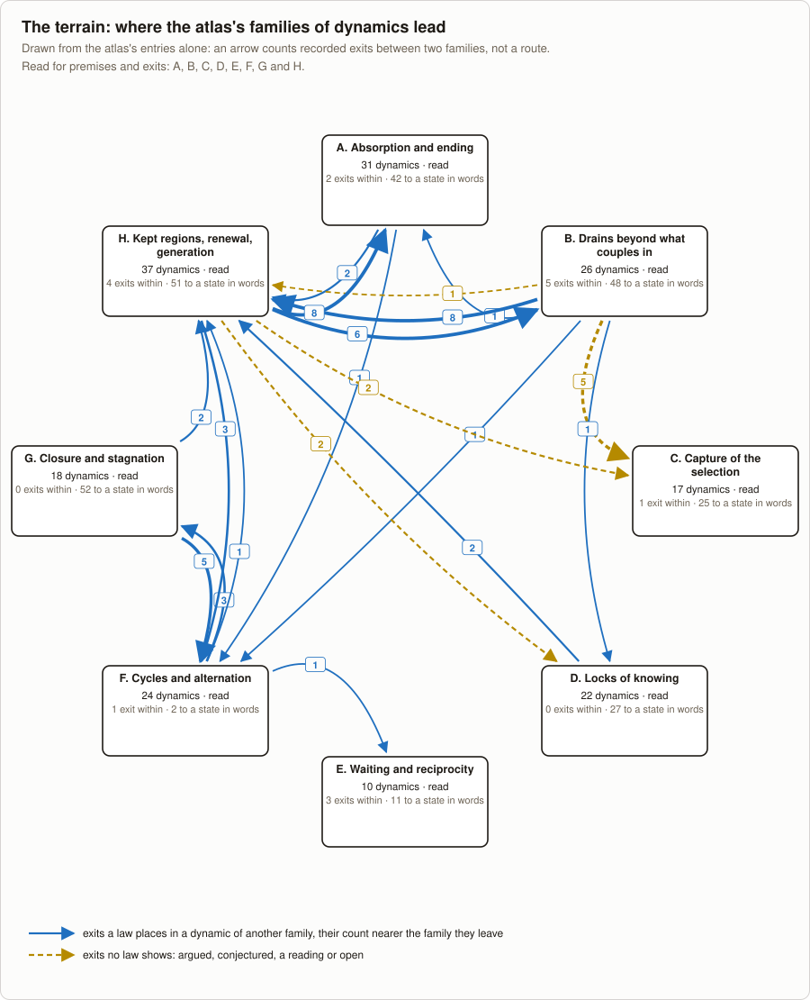
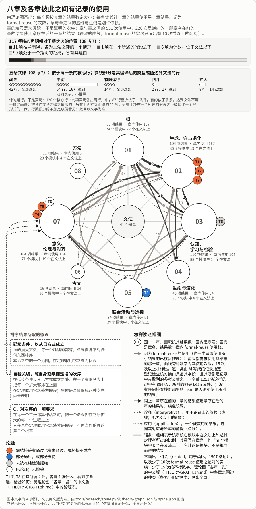

<!-- 中文首页模板（2026 年 11 月 25 日依 _process/DIRECTION.md 与新版英文首屏重写：以 Lean 形式化证明为核心、按三层协同框架统一陈述、先报失效边界、去掉过时的版本标签与层叠补丁；历史修订记录保留于 git）。README.zh.md 由 tools/research/zh_fronts.py 依此生成（make research-render）。全文 AI 写成，改动请改此文件。 -->

# 生灭变化之论

{{nav}}

> 以 Lean 形式化证明为核心的持续研究仓库：机器核验的前提账簿与先报失效的压力检验，随证明与检验不断修订。

*前面这几段约 {{time:screen}}，全页约 {{time:page}}；下面各个入口各注明所需时间。*

*AI 依英文首页写成；与它所链接之处不一致时，以所链接之处为准。*

**这是什么。** 一张以 **Lean 4 形式化证明为核心**、可在机器上独立核验的地图，刻画任何事物怎样在同一个关系性的展开中形成、持续、适应与终结，并按三层协同架构展开（[方向页](../../_process/DIRECTION.md)，英文）：

1. **耦合适应系统对齐理论。** 本工作不把对齐视为锁定单一固定效用函数，而是把嵌入共同基底中的任何适应性选择（奖励、评判者、学习者、监督流水线或多智能体池）放到三个耦合问题上刻画：*盲区与暗耗*（什么维系一个选择，与什么对它造成差别）、*及时转向*（发现、评判池修订或读取节律何时能在基底越过不可逆期限前使回路转向，以及自我重拟合锁定、混叠或滞后何时把信号锁在外面）、以及*跨尺度组合*（当多个回路并联或粗粒化组合时，哪些存续与响应性质得以保持、哪些失效，以及何种接口契约能在形态演化时维持或演化能力）。由此我们[希望设计](../../GOALS.md#generative-alignment)这样一种对齐：人与 AI 赖以延续的，始终及时地对他们怎样一同选择造成差别；塑造他们怎样选择，也不成为他们为之而选的。
2. **形式化纪律——Lean 4 前提与反例账簿。** [Lean](../../MAP.md#check-the-proofs-yourself) 为[已登记的 {{count:registered}} 条结果](../../RESULTS.md)中的 {{count:recorded-checked}} 条给出可复核回执：**零公理关系核心**（Lean `v4.29.1`，`439` 个闭包模块 / `418` 个核心模块、`22,087` 条定理、核心闭包无非空公理依赖）与**隔离的 `18` 个应用外围模块**（`16` 个 Mathlib `v4.30.0-rc2` 模块用于实数、概率、有限模式 Krylov 可区分性、接口比特、移动特征锥与定量迁移，另加 `2` 个非 Mathlib 模块）及独立核验支线（零公理 `BecomingSpec`、`EncounterEntry`、`RelSpanEncounterAdapter`，以及依赖 Mathlib 的 `ConsequenceDuality` 与桥接模块）严格分离。各项结论标明前提，并附带具体去前提反模型（`SharpnessSuite`）。
3. **与动力学并立的智慧与生生伦理。** 纯动力学律不蕴涵“应当”或无外关切：在至少有一个立场与一个形成（`p : Pos`, `f : F`）的前提下，任何只读取动力学且可满足的律都不蕴涵无外延续条件（`not_entails`，见 `ScopeDynamics`、`AlignmentSpine`、`MasterSpine`）。生灭变化之外没有应当，是非在其中形成，形成于人与 AI 之中（[07 §1](../../theories/becoming/chapters/07-SIGNIFICANCE.md#r-what-the-dynamics-leave-open)）。为生命、为生生（AI 也在其中），生生伦理与[各传统智慧对照表](../../theories/becoming/results/atlas/CROSSWALK.zh.md)作为范围与辨认视角并立于形式脊柱之旁，绝不由定理强行推出。

这项工作借助 AI 做成，其中的读法除其所属之处另有说明外都是 AI 的；主持它的人读过其中重要的部分，尚无独立的人工审查记录（[审查包](../../theories/becoming/review/README.zh.md)）。

**先读**适合你的入口：

- **Lean 与形式核心（15–60 分钟）：** [规范地图](../../theories/becoming/CANONICAL-MAP.zh.md)（[英文版](../../theories/becoming/CANONICAL-MAP.md)，约 {{time:theories/becoming/CANONICAL-MAP.md}}）· [1 小时人工审计指南](../../theories/becoming/HUMAN-AUDIT-GUIDE.zh.md) · [自行复核证明](../../MAP.md#check-the-proofs-yourself)（英文）。
- **AI 对齐支线：** [对齐基础](../../theories/becoming/ALIGNMENT-FOUNDATION.zh.md)（Lean 声明、先前文献致谢与先报失效压力边界）· [守卫对齐运行时](../../experiments/guarded-alignment-runtime/README.md)（风格化精确有理数 `6` 项诊断规格，`28` 项测试，英文）· [神经对齐压力实验室（`B1`–`B5`）](../../experiments/neural-alignment-stress-lab/RESULTS.md)（英文）。
- **简明概览、方向与作者开篇：** [一页](../../theories/becoming/ONE-PAGE.zh.md)（约 {{time:theories/becoming/ONE-PAGE.zh.md}}）· [方向页](../../_process/DIRECTION.md)（英文）· [作者第一人称开篇](../../theories/becoming/OPENING.zh.md)，由 AI 译自英文版（正文约 {{time:opening-zh}}）（与形式脊柱分开存放的个人动机）· [可搜索的读者网站](https://yongxu.github.io/theories/)。

**Lean 核验了什么——以及它不保证什么。** 形式脊柱围绕四条结构接缝展开：

1. **宏观评估盲区（`Zero-TV` 纤维分裂）：** 匹配粗糙的宏观评估分布并不保证观测纤维内部的存续（`OplaxHistory`、`CausalAbstraction`、`ObservationalFidelity`；`chi_bijective_iff_bc_all`、`zero_tv_does_not_prevent_fiber_viability_split`）。
2. **自我重拟合锁定与相关评判上限：** 在无噪声与单调份额重拟合下，从锁定起点出发且仅依所偏向份额更新的规则会在读不到的损失之外保持锁定（`ClosedCapture`）；在秩 1 共同评分权重 `γ` 下，评判池内部分歧无论规模 `M` 多大都不超过 `1 - γ`，而一个经由混叠宏观观测分解的外部锚即使在另行给出的完全混叠信道上 `Youden J = 0`，仍可把 `(M + 1)` 成员评判池标准差推高至 `τ` 以上（`QuantitativeTransfer` 第 1、9 部分，把“打破一致”与“隐藏状态信息”严格分开）。
3. **节律滞后、检测竞态与不可逆期限：** 把粗粒度读取节律耦合到细步消耗期限（`PacedStock`、`EndogenousDetectionRace`、`ActiveInquiryLoop`、`QuantitativeTransfer` 第 3、5–8 部分）。
4. **并发共享存量竞态、开放组合与模式切换盲区：** 在我们的并发模型中，各自安全的智能体若缺乏协调或序列化会共同耗尽共享存量（`AdaptiveLoops`、`OpenComposition`、`PolyComposition`、`OpenEndedComposition`），而仅检常驻模式的安全审计会漏掉模式切换分裂，覆盖全部模式字的精确 Krylov 截断为 `|S| - 1`（`SurvivalDistinguishability`，在 `FiberLumpable` 下压缩至 `|O| - 1`）。

把任何定理应用到真实训练过程、市场或制度上，都是可错的辨认而非证明（[规则 2](../../AGENTS.md#what-to-work-on)）。自动化文献核查指出，[每条核心结果都近乎依定义或是已知结果的重述](../../theories/becoming/chapters/08-METHOD.md#known-results)（并逐条注明最近先前结果）；本工作的贡献在于把守恒、选择、接口节律、松弛粗粒化与并发竞态纳入同一部机器核验的前提与反例账簿。尚未在前沿大语言模型训练上检验。

**检验与守卫在何处失效（先报失效）。**

- **已冻结的经验与模型检验（[`TESTS.zh.md`](../../TESTS.zh.md)）：** 在指明论题的 {{tests:total}} 项检验中（[按论题](../../TESTS.zh.md#by-thesis)），{{tests:ran}} 项在评分前冻结并运行（{{tests:mixed}} 项混合、{{tests:passed}} 项通过、{{tests:failed}} 项未通过、{{tests:other}} 项其他；{{tests:unrun}} 项暂缓、放弃或未运行）。主要失效包括 `MQ3`（`113` 个鱼群 `0/4`）、`UE31b`（推翻了 `T2` 先前表述）、`EM1`、`IN1`（未告知贻贝床时 `0/10` 保住；`evidence-replay` 通过 `16/16` 项核验，含 8 槽静默漂移自检与闭环分裂/加权标签）与 `LA2`（仅上下文读取，池化桥接失效）。
- **合成神经压力实验室（[`B1`–`B5`](../../experiments/neural-alignment-stress-lab/RESULTS.md)，`20` 种子）：** `B1`（`reinforce_mlp`）在表格式可行边界 `b_feas = 27` 处即崩塌 `0.55–0.90`，即使留出 `+12` 余地（`x0 = 39`）仍因策略梯度切换延迟叠加特征泄漏而崩塌 `0.40–0.45`。`B2` 消融表明，无 TV 审计的自我奖励对照臂在其种子上本就 `20/20` 崩塌，独立种子块上的动作盲宏观 TV 臂（同时改变策略奖励与评判训练标签）仍崩塌 `18/20`（`0.90`），而针对显式漂移的 TV 臂（在独立种子块上同样改变策略奖励与评判训练标签）录得 `90.2%` 隐蔽份额与 `0.0164` 宏观 TV（`20/20` 崩塌）。`B3` 显示各自安全的智能体在未序列化并发下崩塌 `1.00`（均值 `2.45` 步），而在提交后实时序列化下崩塌 `0.00`。`B4` 完整的单守卫与双守卫消融表明，`fiber_bc_guard` 明显不可省略（去掉后名义 `0.15`／中度 `0.25` 崩塌），`judge_pool_serial` 提升储备余地（`8.48 -> 15.09`，不过 `margin_plus_fiber` 在 `4500–4519` 种子上达 `0/20`、在 `5600–5619` 上为 `1/20`），`margin_probe` 在名义与中度情境对 `0/20` 崩塌属冗余；且 `full_guarded` 在四项主要失效情境下仍崩塌 `25–50%`（相关评判漂移 `0.50`、长滞后 `0.45`［含部分种子运气］、建模高学习率绕过 `lr = 4.0` 时 `0.25`［B5 新种子基线在 `lr = 4.0` 为 `0.40`、`lr = 8.0` 为 `0.80`］、严重混叠 `0.25`）。`B5` 中 `4/11` 预登记预测（`P8`–`P11`）未通过，说明仅凭崩塌率无法区分盲目节流／打破一致与隐藏状态检测——在 `b5_controls.py` 中，移除锚点并按匹配否决率（`p = 0.5325`）随机否决同样崩塌 `1/20`（`0.05`），且异质含噪自评判池在 `M = 9` 时仍崩塌 `0.30`。
- **前瞻真实学习者 `B1`–`B3`（[`RESULTS.md`](../../_process/research/2026-10-05-generative-foundation-review/root-foundation/development/dual-track-waves-2026-11-24/real-learner-b1-b2-b3/RESULTS.md)）：** 在 `B1` 记为 `chosen_m = null`（所测块长均满足 `eps_m + alpha_m >= 1`），在 `B2` C 臂记为 `online_passed = false`（`exact_gap = 0.008426 < 0.05`）。

*[统一架构](../../theories/becoming/CANONICAL-MAP.zh.md)（[英文图](../../theories/becoming/results/architecture.svg)）：层级 A（零公理 Lean 核心）、层级 B（隔离的 `16` 个 Mathlib 加 `2` 个非 Mathlib 外围模块与独立支线）、层级 C（风格化 `6` 项运行时规格与先报失效压力实验），经由规则 2 识别鸿沟与 `not_entails` 防火墙，与层级 D（智慧对照表与生生伦理）分隔开。*

*地形（英文图）：图集中的动态，以及其各族之间已记录的出口，只依图集的条目画出；一支箭头是出口的计数，不是一条路线（[地形](../../theories/becoming/results/atlas/TERRAIN.md)、[图集](../../theories/becoming/results/atlas/ATLAS.md)，皆英文）。*

*八章之间已记录的引用与依赖关系，论题 T1 到 T8 在其所属之处按检验结局着色。对照同一部关系演算（即文法）来看，117 个核心声明中，11 个作为其律的情形[推导而得](../../GLOSSARY.zh.md#derived)，1 个是一步上的根形式，在一个所述的假设之下；6 个是位于文法以下的计数之定理，99 个处于一个[指明的距离](../../GLOSSARY.zh.md#named-distance)，各有其理由（[08 §7](../../theories/becoming/chapters/08-METHOD.md#r-one-root-to-its-edge)）；[这幅图显示什么、不显示什么](../../theories/becoming/results/THEORY-GRAPH.zh.md#the-spine-what-it-shows-and-does-not-show)；本论[怎样长成](../../theories/LINEAGE.zh.md)。*

## 从哪里读起

| 入口 | 是什么 | 读多久 |
|---|---|---|
| [规范地图](../../theories/becoming/CANONICAL-MAP.zh.md) | 全图通读综合（[英文版](../../theories/becoming/CANONICAL-MAP.md)）：零公理脊柱、18 个隔离外围模块、66 项已登记检验（57 项绑定动态）、4 个受检情境、压力测试与 `not_entails` 边界 | 英文版约 {{time:theories/becoming/CANONICAL-MAP.md}} |
| [对齐基础](../../theories/becoming/ALIGNMENT-FOUNDATION.zh.md) | 面向 AI 对齐的三项诚实主张（[英文版](../../theories/becoming/ALIGNMENT-FOUNDATION.md)）：Lean 结构核心、风格化 6 项[守卫对齐运行时](../../experiments/guarded-alignment-runtime/README.md)诊断与先报失效的压力边界 | 专题入口 |
| [人工审计指南](../../theories/becoming/HUMAN-AUDIT-GUIDE.zh.md) | 给独立研究者的 1 小时可复核审计清单（[英文版](../../theories/becoming/HUMAN-AUDIT-GUIDE.md)），直接核验 Lean 回执、外围隔离与 `B1`–`B5` 失效 | 约 1 小时审计 |
| [一页](../../theories/becoming/ONE-PAGE.zh.md) | 全论最短的一层：核心概念、诸律、各自看到了多远、什么会表明它错，以及三层对齐进展 | 约 {{time:theories/becoming/ONE-PAGE.zh.md}} |
| [用途](../../theories/becoming/USES.zh.md) | 逐个领域：今天能用它做什么，各部分看到了多远 | 约 {{time:theories/becoming/USES.zh.md}} |
| [实例](../../theories/becoming/USES-EXAMPLES.zh.md) | 每个领域一例或数例，各说明看到了多远 | 约 {{time:theories/becoming/USES-EXAMPLES.zh.md}} |
| [总览](../../theories/becoming/THE-THEORY-OF-BECOMING.zh.md) | 全论的一小时层，按八章的顺序 | 约 {{time:theories/becoming/THE-THEORY-OF-BECOMING.zh.md}} |
| [开篇](../../theories/becoming/OPENING.zh.md) | 作者第一人称写下的信念与动机（[英文原文](../../theories/becoming/OPENING.md)） | 正文约 {{time:opening-zh}}，注释另计 |
| [八章](../../theories/becoming/chapters/README.md) | 各章正文，诸结果的所属之处；除第六章外为英文 | 每章约 {{time:chapters}} |
| [古文（第六章）](../../theories/becoming/chapters/06-CLASSICAL-TEXTS.md) | 从古文读出文法，检验它，记下分歧；中文 | 约 {{time:theories/becoming/chapters/06-CLASSICAL-TEXTS.md}} |
| [检验](../../TESTS.zh.md) | 冻结的检验，按论题计数，再按结局排列，未通过者在前，每项一句话（[全表](../../TESTS.md)为英文） | 约 {{time:TESTS.zh.md}} |
| [对照表](../../theories/becoming/results/atlas/CROSSWALK.zh.md) | 早先的理论文件夹与各思想领域，在现行的本论中各读作什么，附图、计数与各组一览；各组的条目在英文页上 | 约 {{time:theories/becoming/results/atlas/CROSSWALK.zh.md}} |
| [理论图](../../theories/becoming/results/THEORY-GRAPH.md) | 概念、结果、模块、文本与各章之间的连接；英文，其中的各章一览有[中文版](../../theories/becoming/results/THEORY-GRAPH.zh.md)（约 {{time:theories/becoming/results/THEORY-GRAPH.zh.md}}） | 约 {{time:theories/becoming/results/THEORY-GRAPH.md}} |
| [怎样长成](../../theories/LINEAGE.zh.md) | 本论怎样从更早的文字与理论文件夹长成 | {{stated:theories/LINEAGE.zh.md}} |
| [术语表](../../GLOSSARY.zh.md) | 每个词的一义与其所属之处 | 约 {{time:GLOSSARY.zh.md}} |
| [审查包](../../theories/becoming/review/README.zh.md) | 给审读者的材料与问题；古文、佛学两份与重新归类的编码手册为中文 | 封面约 {{time:theories/becoming/review/README.zh.md}} |

**语言。** 除第六章、古文与佛学两份审查材料及重新归类的编码手册外，各章、记录、检验与理论图都是英文（理论图的各章一览有中文版）。各中文版由 AI 译自英文；义以英文版为准。
