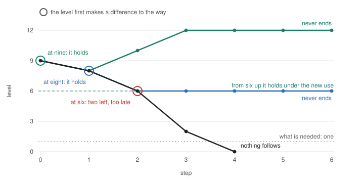

*AI-written, 13 November 2026, for Ren's read: a candidate statement of the centre on one page. Where it and [02 §11](../../../../../../theories/becoming/chapters/02-MAP.md#turning-in-time) differ, §11 and its Lean decide. [中文，另写](TURNING-IN-TIME.zh.md)*

# Turning in time

**The statement.** Things happen, and what happens is a condition of what follows it. All of that conditioning together is the net. Seen in one respect, a run of happenings is alike: a line. A line ends in one of two ways. Nothing follows at all: the net itself ends there. Or something follows that is no longer alike: the line ends while the net goes on. The second is a turn. The first is running out, as it was or after a turn that came too late.

Which of the two happens is not settled by the respect alone. In the model below it is settled by an amount.

**With an amount.** Let going on in some way need a level of something, and let each step lower that level. Call the levels marked at which the level may make a difference to the way; at every other level the way after a step is the same whatever the level. Where no marked level is reached while the need is met, the way stays as it was, the same from every level, until the level is below what is needed and nothing follows. It turns only at a marked level, reached while the need is still met. The turn holds only if what that step leaves is enough under the new use.

So three levels of one quantity decide: where its fall first makes a difference, what that step leaves, and the level from which it holds under the new use.

**One case in numbers.** What is left gives back `min(z, 12 − z)`. The way as it was uses five a step; the way it turns into uses three. One is needed. Start at nine. As it was, the level runs nine, eight, six, two, nothing. Under a use of three it holds from six up to twelve.

| The fall first makes a difference at | What follows |
|---|---|
| nine | it turns at once, eight is left, and it never ends |
| eight | it turns one step later, six is left, and it never ends |
| six | it turns with two left, too few; one step later nothing is left and nothing follows |
| no level | it never turns: nine, eight, six, two, nothing, the same way to the end |

One step separates a turn that holds from a turn that comes too late: as it was, the course can still be turned to hold at step 2 and no longer at step 3, its point of no return, and a turn takes hold one step after the step at which the level first makes a difference (proved: `Three.noReturn`, `turns_in_time_iff_before`).

*The level, step by step. Black: as it was. A ring marks the step at which the level first makes a difference to the way; that step still uses five. That the two upper lines never end and the black one ends is proved (`Three`); the levels after a turn are computed from the model's step.*

## What it says, by reader

- **Machine learning and alignment** (a reading; no test here trains a system). Read the way as a trained system together with what selects it, and the level as something that selection needs and lowers. Where no level changes the way, the way shows nothing of the level: from one way at two levels the ways are the same step for step, up to the end. Only at marked levels does the level's fall show in the way. So, for it to go on, two things are asked of whatever the selection lives on: that its fall change the way early, and that enough is left for the changed way to hold. There is no overseer outside the course in this; there are only levels that make a difference.
- **Systems and economics.** This is a draw beyond regrowth with a response at a threshold. Near work switches a tax on at a chosen level of a stock and says in words that it must come in time. Here the comparison of the three levels is exact and machine-checked, on whole numbers and discrete steps, with no delay and no noise.
- **Philosophy.** The way and the level are two readings of one configuration, not two things joined afterwards. Nothing in the statement is good or bad. "Lock", "capture" and "turn" are its names from one standpoint or another.
- **Anyone.** A habit, a firm or a society can go on exactly as it was up to the day what it lives on is gone. If it is to go on, what it lives on must come to change it while there is still enough left.

## How far this has been seen

| | |
|---|---|
| **Proved**, in Lean with no axioms | The root's two names for the gap are tied: where each occurrence has at most one next, constancy up to the net's end is going alike with it decided whether a next exists (`«局定后则至终有常当且仅当同行可决»`). On the model: which levels make a difference (`TurningInTime.toEnd_iff`); running out as it was (`ends_with_net`); the exact condition for a turn that holds, under the premises in the next row (`turns_in_time_iff`); the line ending while the net goes on (`kind_ends_while_net_goes`); which lines of the table end (`Three`; the levels shown are computed from the model's step). The earlier lock's courses are courses of this model where nothing is needed (`window_is_pair`, `net_zero`); where its going on needs a level and no marked level is reached while the need is met, a locked start ends still locked (`locked_ends_with_net`). |
| **Given, not derived** | Which levels are marked, what is needed, the way it turns into, and that this way is kept and has one standing use. For the exact condition also: one giving-back for every way, the way entering the level's step only through how much it uses; nothing given from nothing; a top level up to which the new use holds (twelve in the case); and a start from which, as it was, it runs out. |
| **Not shown** | How what brings a level's difference to a way comes to stand, and whether it stands on that same level. Anything about a trained system. That this is new: several near papers were read only in part. |
