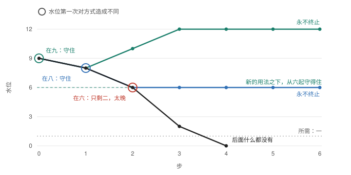

*AI 所写，2026 年 11 月 13 日，供 Ren 阅读：用一页陈述中心的一份候选稿。与[英文页](TURNING-IN-TIME.md)并行写成，不是译文。它与[第二章 §11](../../../../../../theories/becoming/chapters/02-MAP.md#turning-in-time)有出入时，以 §11 及其 Lean 为准。*

# 来得及转吗

**陈述。** 事情发生，发生的事是后继之事的条件；这些条件关系合在一起，叫作网。就某一方面看，其中一串彼此相同，这就是一条线。一条线有两种终法。一种是后面什么都没有了：网本身到此为止。另一种是后面还有，只是不再相同：网还在续，线已经终了。后一种是转。前一种是用尽：或者照旧走到用尽，或者转得太晚，转了之后仍然用尽。

走哪一种，单凭这个“方面”定不下来。在下面的模型里，由一个量决定。

**加上一个量。** 设照某种方式持续，需要某样东西保持一定的水位，而每走一步，水位都会降低。水位高低可能对方式造成不同的那些水位，称为有标记的水位；在其余的水位上，一步之后的方式都一样，与水位无关。若在所需仍然满足的时候始终没有到达有标记的水位，方式就一如其旧，从哪个水位出发都一样，直到水位低于所需，后面什么都没有。只有到达一个有标记的水位，并且那时所需仍然满足，它才会转。转得住转不住，要看这一步之后剩下的，够不够新的用法维持。

所以，决定结局的是同一个量上的三个水位：下降从哪里开始造成不同；那一步之后剩多少；在新的用法之下，从多少起守得住。

**一个带数字的例子。** 剩下的量是 z 时，每步给还 `min(z, 12 − z)`。照旧的方式每步用五，转成的方式每步用三。所需为一。从九开始。照旧走，水位依次是九、八、六、二、零。每步用三时，从六到十二都守得住。

| 下降从哪个水位开始造成不同 | 结果 |
|---|---|
| 九 | 立刻转，剩八，永不终止 |
| 八 | 晚一步转，剩六，永不终止 |
| 六 | 转时只剩二，不够；再过一步就什么都不剩，后面也什么都没有 |
| 没有这样的水位 | 始终不转：九、八、六、二、零，一路照旧到底 |

转得住与转得太晚，只差一步：照旧的进程在第二步转还守得住，到第三步便不能，那是它的不可返回点；而转向要在水位第一次造成不同的那一步之后一步才起作用（已证：`Three.noReturn`、`turns_in_time_iff_before`）。

*水位一步一步的变化。黑线是照旧。圆圈标出水位第一次对方式造成不同的那一步，那一步的用量仍是五。上面两条线永不终止、黑线终止，这是已证的（`Three`）；转之后的各个水位，是按模型的步算出来的。*

## 对不同的读者，它说的是什么

- **机器学习与对齐**（这是一种读法；这里没有任何检验训练过模型）。把“方式”读作一个受训系统连同选择它的东西，把“水位”读作这种选择所需要、又在降低的东西。凡是没有哪个水位改变方式的地方，方式上看不出水位：同一方式从两个水位出发，每一步的方式都相同，直到终点。只有在有标记的水位上，水位的下降才在方式上显出来。所以，要持续下去，对选择所依赖的东西就有两个要求：它的下降要早早改变方式；改变之后剩下的要够新的方式守住。这里没有站在进程之外的监督者，只有造成不同的水位。
- **系统与经济。** 这是取用超过再生，加上一个阈值上的响应。相近的研究在存量降到选定的水平时开征一种税，并用文字说明它必须来得及。这里三个水位的比较是精确的，并经机器检验；前提是整数、离散的步，没有延迟，没有噪声。
- **哲学。** 方式与水位是同一个构形的两种读法，不是先有两样东西再连起来。陈述里没有好坏。“锁定”“俘获”“转”都是从某个立场给它的名字。
- **任何人。** 一个习惯、一家企业、一个社会，都可以一如其旧地走到它赖以为生的东西耗尽的那一天。它若要持续下去，它赖以为生的东西，就得在还剩得够的时候改变它。

## 看到了多远

| | |
|---|---|
| **已证**，Lean，不用公理 | 根对同一个缺口的两个名字接上了：每一件事至多有一个后继时，至终有常就是同行，外加“有没有后继”可以判定（`«局定后则至终有常当且仅当同行可决»`）。在模型上：哪些水位造成不同（`TurningInTime.toEnd_iff`）；照旧而用尽（`ends_with_net`）；转得住的确切条件，前提见下一行（`turns_in_time_iff`）；网还在续而线已终（`kind_ends_while_net_goes`）；上表中哪些线终止（`Three`；表中的水位是按模型的步算出来的）。此前“锁定”的那些进程，就是这个模型在什么都不需要时的进程（`window_is_pair`、`net_zero`）；它的持续若需要一个水位，而所需满足时始终没有到达有标记的水位，那么从锁定出发，终了时仍是锁定（`locked_ends_with_net`）。 |
| **给定，未推出** | 哪些水位有标记；需要多少；转成的是哪种方式；这种方式会保持下去，并且用量恒定。确切条件还需要：各种方式共用同一个给还，方式只通过用量进入水位的变化；无中不生有；有一个上限，新的用法在它以下守得住（例子里是十二）；出发的水位，照旧走是会用尽的。 |
| **未证** | 把水位的不同带给方式的东西，是怎样立起来的，它是否就立在这同一个水位上。任何关于受训系统的事。它是不是新的：若干相近的论文只读了一部分。 |
