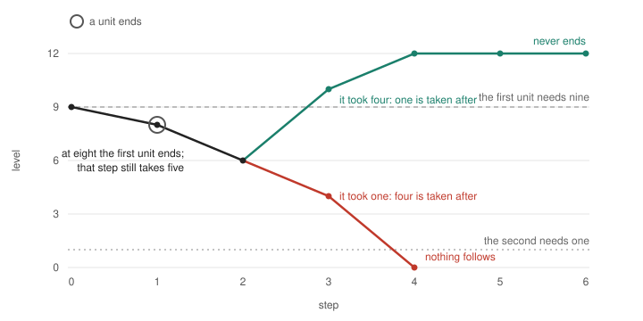

*AI-written, 13 November 2026. What board item WU adds to [turning in time](../tt-turning-in-time/TURNING-IN-TIME.md), in five minutes ([中文](A-WAY-OF-UNITS.zh.md)). Proved in Lean, with no axioms, except where a line says it is a reading. No person's review of it is recorded yet.*

# A way of units: a turn with no mark given

## What was missing

Turning in time says when a line turns before the level it needs is gone. It takes one thing as given: the levels at which the level makes a difference to the way. Its own page says so. Where could such a difference come from?

## One source that needs nothing added

Let the way be made of units. Each unit goes on while the level meets its own need, and each takes its own amount from the level. When the level falls below a unit's need, that unit ends, and what it took ends with it.

Nothing reads the level here. The turn is the ending.

## When the whole goes on for ever

Units end, one or several at a step, until what remains holds on what is left, or until none goes on. Exactly: the line never ends where it comes to a way that is not empty, whose units' needs are all met, at a level from which what they take together holds. This is for any number of units, under the same premises on the giving as in turning in time, asked along the course (`WayOfUnits.unending_iff_holds`).

For two units it is the exact condition of turning in time, with its premises about marks now proved and not assumed (`WayOfUnits.two_units_iff`).

## Which unit takes the larger use decides it

*Two units, needing nine and one, taking five together, from the level nine. At eight the unit that needs nine ends; that step still takes five and leaves six. Both lines are proved (`WayOfUnits.With`, `WayOfUnits.Against`).*

If the unit that ended took four, one is taken after: ten, twelve, twelve, and the line never ends. If it took one, four is taken after: four, nothing, and the line ends. The needs, the sum taken and the levels up to the ending are the same.

Three comparisons, for two units, from a start below the level at which both would hold:

- A greater need of the unit that ends first never ends a line that did not end (`greater_need`).
- More of the use on that unit never ends a line that did not end (`more_use_on_first`).
- With a first unit that takes nothing, the line never ends exactly where the other unit's line alone never ends (`takes_nothing_iff_alone`). At the ending of a unit that takes nothing, the level's course is as it was.

## What it lets someone see

- A turn needs no reader where what ends was taking.
- Where what ends took little, little changes. Where it took nothing, its ending can only be read by something else. That is where the marks of turning in time, the lock's window of readers and the gauges of reading in time still stand as given.
- *A reading, with no theorem and no test behind it:* in a whole whose members that need most take least, their ending relieves the level least, and the level goes on falling for those that take most.

## What is not shown

- Units only end. Nothing builds a unit, and nothing says why a unit that needs more is there.
- The three comparisons are for two units. Simulations found them true with some premises dropped; that is not proved.
- The marks of a way that conditions on a reading are not derived.
- Nothing here is about a trained system.
- It is not learning with no learner. It is the case below it: correction with no reader.

## How it was made, and where it is

A first design claimed the marks "all follow". Three AI readers cut it back: what ends here is not a reader in the account's sense, one sentence was false, and the exact condition was false as first written. Both forms and every report are kept ([the study note](NOTE.md), [the readers](READER.md), [the first design](DESIGN-attacked.md)).

- Lean: [`Becoming/WayOfUnits.lean`](../../../../../../experiments/integrated-correction/general-framework/generative-basis/lean/becoming/Becoming/WayOfUnits.lean), core run `20261113T023828.938796Z`.
- Chapter: [02 §11](../../../../../../theories/becoming/chapters/02-MAP.md#r-a-way-of-units).
- Record: [`a-way-of-units`](../../../../../../theories/becoming/results/records/a-way-of-units.json).
