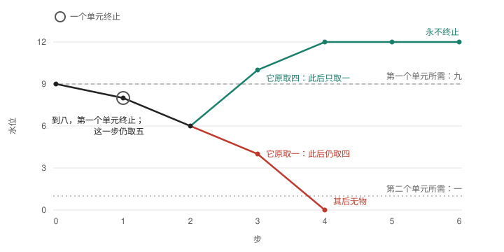

*AI 撰写，2026 年 11 月 13 日。板上条目 WU 在[及时转向](../tt-turning-in-time/TURNING-IN-TIME.zh.md)之上添了什么，五分钟读完（[English](A-WAY-OF-UNITS.md)）。除标明为“读法”之处外，均已在 Lean 中证明，不用公理。尚无人审查它的记录。中文与英文分别写成，以英文为准。*

# 由单元组成的方式：无需标记的转向

## 原先缺的是什么

“及时转向”说的是：一条线，在它所需的水位耗尽之前，何时转得过来。它把一件事当作给定：水位在哪些位上对方式造成不同。它自己的那一页也这样说。这种不同能从哪里来？

## 一个不必另加任何东西的来源

让方式由若干单元组成。每个单元在水位满足它自己所需时继续，并各自从水位取它自己的用量。水位一旦落到某个单元所需之下，那个单元终止，它所取的也随之终止。

这里没有谁在读水位。转向就是终止本身。

## 整体何时永不终止

单元一个或几个地终止，直到剩下的在余下的水位上守得住，或者一个也不再继续。精确地说：这条线永不终止，当且仅当它走到一个非空的方式，其中各单元所需都被满足，而水位不低于它们合起来所取之量守得住的那一位。单元可以有任意多个；对“给还”的前提与“及时转向”相同，只在沿途要求（`WayOfUnits.unending_iff_holds`）。

只有两个单元时，这就是“及时转向”的精确条件，其关于标记的前提已被证明，而不是假设（`WayOfUnits.two_units_iff`）。

## 哪个单元取得多，决定结局

*两个单元，所需为九与一，合取五，从水位九出发。到八，所需为九的那个单元终止；这一步仍取五，余六。两条线都已证明（`WayOfUnits.With`、`WayOfUnits.Against`）。*

若终止的那个单元原取四，此后只取一：十、十二、十二，这条线永不终止。若它原取一，此后仍取四：四、零，这条线终止。两种情形里，所需相同，合取之量相同，直到终止那一步的水位也相同。

两个单元的线若永不终止，水位始终不低于第二个单元独自的行程开始下落的那一位（`unending_above`）。三个比较，都是对两个单元：

- 先终止的那个单元所需更大，不会使一条本不终止的线终止（`greater_need`）。
- 更多的用量落在那个单元上，也不会（`more_use_on_first`）。
- 若第一个单元什么也不取，这条线永不终止，当且仅当另一个单元独自的线永不终止（`takes_nothing_iff_alone`）。一个什么也不取的单元终止时，水位的行程照旧。

## 它让人看见什么

- 终止的若是在取用的，转向不需要读者。
- 终止的若取得少，变得就少；若什么也不取，它的终止只能被别的东西读到。“及时转向”的标记、锁里读者的窗口、“及时读出”里的量规，正是在这里仍作为给定。
- *一种读法，其后没有定理，也没有检验：*一个整体里，所需最多的成员若取得最少，它们的终止对水位的缓解也最少，水位便继续为取得最多者而下落。

## 没有证明的

- 单元只会终止。没有什么生出单元，也没有什么说明为何会有一个所需更多的单元。
- 三个比较只对两个单元陈述；对更多单元尚无陈述。
- 一个以“读”为条件的方式，其标记没有被导出。
- 这里没有任何一条是关于训练出来的系统的。
- 这不是“无学习者的学习”。它是其下的一种情形：无读者的纠正。

## 它是怎么做成的，在哪里

最初的设计声称标记“全都推得出来”。三位 AI 读者把它削了回去：这里终止的东西不是本论意义上的读者，有一句话是错的，精确条件照最初的写法也是错的。两稿设计与每一份报告都留着（[研究笔记](NOTE.md)、[读者](READER.md)、[最初的设计](DESIGN-attacked.md)）。

- Lean：[`Becoming/WayOfUnits.lean`](../../../../../../experiments/integrated-correction/general-framework/generative-basis/lean/becoming/Becoming/WayOfUnits.lean)，核心运行 `20261113T023828.938796Z`。
- 章节：[02 §11](../../../../../../theories/becoming/chapters/02-MAP.md#r-a-way-of-units)。
- 记录：[`a-way-of-units`](../../../../../../theories/becoming/results/records/a-way-of-units.json)。
