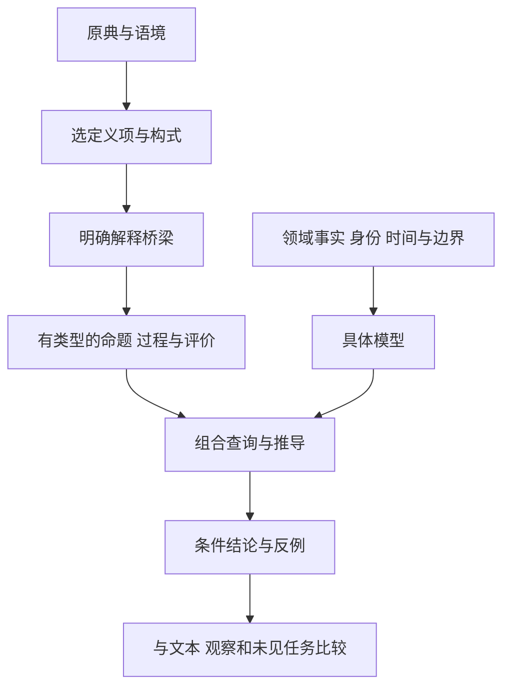

# 文理生生 组合文法 v0.4

**2026年10月21日**

这版把古典概念的组合研究推进到四项可检查的成果：有固定文本范围的覆盖试点、区分成分与整体意义的构式登记、全部十三条邻接的有类型规则，以及相对原文法更小的等价表达核心。

核心结论是：**选定古典表达可以提供关系、结构、过程和情境判断的组合入口；经过选义与明确建模，它们能够参与实际推演。**本版进一步显示哪些内容来自原文、哪些条件需要补入，以及删去条件时结论怎样失败。古典词汇总体的“large part”、学习迁移增益和任意系统的绝对最小文法仍未确立。

## 本版交付

| 内容 | 已完成的范围 | 阅读入口 |
|---|---|---|
| 连续文本试点 | 四组文本55单元；两份分别锁定的AI标注、来源快照与分歧记录 | [固定语料覆盖试点](corpus/固定语料覆盖试点.md) |
| 构式系统 | 原32组混合表达统一登记；12张完整卡与13个微型模型 | [构式与微型模型](constructions/构式与微型模型.md) |
| 八字关系图 | 8节点、13邻接；9条限定现代规则、4条规范接口，均有成功及失败检查 | [八字有类型规则图](graph/八字有类型规则图.md) |
| 可执行机制 | 重组、约束可达性、表达评价三个模型；原始数据、完整事件轨迹与查询 | [规则案例](engine/README.md) |
| 较小等价核心与能力下界 | G1的22种命题／过程构式归约为13种；等值证明、归约器、限定表达力下界 | [最小文法的相对结果](basis/最小文法相对结果.md) |
| 基础词义与来源 | 沿用113核心字、211选定义项；全部144字、245接口，以及原典证据索引 | [词义接口](references/08_组合文法逐字类型词典_v0.3.md) · [出处](references/05_原典证据索引与校勘说明_v0.2.md) |

既有01—18号成果完整保存在 [references](references/README.md)，包含八卦映射、文—象—辞桥梁及此前审计；它们保留原版本号，新结论以本版主文为准。

原词典保留原版本号，防止把新构式卡中的解释误算成已注册新义项。“然”在自然构式中得到解释，但尚未因此进入旧词典；八卦候选也不与词典数量混算。构式数、句子数、字数和逻辑构式数始终分别报告。

## 整个基础结构怎样相接

这套研究有六层。每一层向后一层提供条件，不能省略中间的解释与建模。

| 层次 | 处理什么 | 本版的连接方式 |
|---|---|---|
| 原典与语境 | 哪一文本、哪一句、哪种论说 | 原文、定位、版本快照及证据边界 |
| 词义与构式 | 哪个义项、哪些参与项、成分怎样形成整体意义 | 词义接口、12张构式卡、32组登记 |
| 类型与组合 | 命题、过程、解释记录、规范能怎样相接 | G1语义与G0等价核心；拒绝类型偷换 |
| 具体系统 | 对象身份、状态、资源、关系、时间与环境 | 原始输入及生成状态的事件规则 |
| 条件推演 | 哪些结论由前提推出，哪些条件不可省 | 十三边规则、模型查询、证明与失败支路 |
| 外部检验 | 文本是否忠实，模型是否解释现实，是否改善理解 | 本版完成文本试标与形式核验；现实机制及认知效果须另行研究 |



“文”在这张基础图中提供表征与表达的入口；具体语境决定它是爻物错杂、文字还是篇章。它不能独自跨过“符号如何对应对象”“对象如何变化”“何种评价成立”这三个问题。《易传》的卦象、辞与变化论说可以进入此架构；现代位运算、状态方程和规范函数仍分别标为现代补充。

组合也不只有一种。配置组合连接部分与关系，过程顺接要求实际中间状态相同，条件筛选限制允许历程，规范判断则另问哪种选择合宜。它们可以协作，但“合”不能在几个层次间无声明地换义。

## 一个现在可以完整推演的例子

共同重组模型从有两个部件的整体A开始。拆分后形成B与C；在资源、兼容性及信息条件满足时，重新组成新整体D，再完成一项任务。四个实例身份始终互异，谱系记录它们的承接。

```text
A整体 ─拆分→ B与C ─合并→ 新整体D ─执行→ 任务完成
                     ├─信息丢失→ D形成，但无法执行
                     ├─资源不足→ 尝试发生，D未形成
                     └─错过时窗→ 物理上能合并，时宜规范禁止
```

这一个例子把“生、分、合、变、势、理、和、中”的若干选定义项接到了同一组可查事实：

- **生与分**：同一拆分事件使旧整体退出模式，也使两个新实例进入各自模式。
- **分与合**：恢复原部件组合不恢复原身份；D不等于A。若丢失信息，功能条件也未恢复。
- **合与势**：只有部件形成整体还不够；信息与资源会改变下一项任务是否可达。
- **理与和**：在本例定义下，连接、兼容、信息等条件共同支持结构协调；有损组织可能已形成而未协调。
- **势与中**：物理可行性与时宜规范分别判断。一个动作可以能做却不合该规范，也可以被要求却做不到。

这里“和”的结构协调义与《中庸》的发而中节义分别建模。“中”使用未发或时中义，没有暗中改成数值中心或稳定点。表达评价的另一个模型表明：同一未发起点可以产生合节或失节的后续表达，因此不能从未发自动推出和。

模型从部件、连接、资源和信息等原始记录推得存在、协调及可达结果，没有预先把“生了”“和了”“能完成”填成真。完整前后态及失效支路可在[事件轨迹](engine/transition_trace.json)查阅。这是公开条件下的现代机制示范，不是古代语词自行给出了一套现实设备定律。

## 对原始主张的新增回答

### 有了一个可复查的文本分母

本版连续纳入《老子》前八章、《学而》全篇、《说卦》全篇和《经上》前二十条，合计55单元。A与B分别判出36、31个明确关系单元；双方均判明确的有30个。总标签一致46个，另9处分歧保留原判断。

这些数量测量的是“一段中至少出现一处结构”，不能当作整段已经完整解释，更不能当作古典词汇覆盖率。两份标注是共享研究背景下的AI独立试标，不是人类实验或代表性抽样。

试点给出的实质边界是：《学而》的情境规范、观察方向和推知结构可以进入组合分析；《说卦》的单项卦训、动物或身体对应，以及《墨经》的部分短训释，不应仅因能写成对照表就算作动力模型。具体差异和疑义均保留在数据中。

### 复合表达现在有统一的分析系统

生生、感应、中和、变通、分合、名实、本末、虚实、阴阳、自然、无为、相生都已有完整卡：原句、成分关系、整体义、不能逐字推出的内容、现代补充、有限模型和失败条件。

例如，“相生”的概念相待与有向支持采用两个模型，不能混为同一双向因果；“名实”的实与“虚实”的实保持不同类型；“自然”的自己如此不等于不需要外部资源；“无为”的干预范围不等于所有动作都停止。

因此，“一些表达压缩关系图式”的主张更具体了。若称其为“微型理论”，必须指明整体解释还从语境获得了什么、现代模型又增加了什么。32组登记不等于32个历史复合词，12张重点卡也不代表覆盖了各表达的全部词义史。

### 原八字图获得了逐边规则

十三条邻接全部有了明确处置：九条限定现代规则、四条规范接口。每条关联来源、选定义项、角色、前提、推导方向、失败例及可复跑查询。原图的连线依然不自动传递因果，局部规则也不能直接反向。

这里的完整性是“全部指定邻接都能追查到规则及其边界”。它不表示八字已经穷尽全部中文概念，也不证明原图拓扑是历史上唯一的概念结构。

### 最小性研究取得了两项限定结果

本版在不改变领域原子与解释表的条件下，将G1的22种命题／过程构式归约到13种G0构式，并给出相互结构归纳证明。真值、过程关系、空域和变量作用域均保持；另有两种项形式单列。

同时，对一个限定的前向局部片段，证明任一固定有限观察范围都不能统一判断任意规模有限链上的可达性。若要解决这个任务，必须提供某种不受固定步数限制的能力，如闭包、递归或已计入成本的外部计算。

这两项结果分别推进了“足够”与某种能力“必要”的论证。但13种构式尚未证明逐项不可再减。减少构式还可能增大表达长度；领域事实、解释桥梁和观测成本也没有消失。因此仍不能宣布任意系统的绝对最小文法已经找到。

## 如何核对

在项目目录运行：

```text
python3 validate_release.py
```

这会重新检查冻结语料及标注、构式模型、十三边案例、图与查询绑定、G0归约结果，以及版本文件清单。具体复核范围、修正记录与未完成的总体主张见[版本复核与完成边界](版本复核与完成边界.md)。全部计算局限在公开的有限模型与规则内；文本标签的适切性仍需读原文评估。

本版的四类证据互不替代：原典支持语义入口，文本试标检查操作判据，数学证明支持限定形式结论，计算核验检查具体实现与模型。任何一项的数量，都不当作另外几项已经完成的证明。

## 阶段结论

> 选定的中国古典概念与构式可以组织成一套描述关系配置、生成过程和情境行动的组合词汇。本版为这项重构提供了固定范围的文本试点、可追溯的构式与规则网络，以及能够保持原文法表达力的较小形式核心。总体词汇覆盖、相对解释与学习增益，以及任意系统的最小性仍待独立确立。

> Selected concepts and constructions in classical Chinese texts can be organized into a compositional vocabulary for relational configurations, processes of becoming, and context-sensitive action. This version supplies a bounded textual pilot, traceable construction and rule registries, and a smaller formal core that preserves the previous grammar's expressive power. Lexicon-wide prevalence, added explanatory and learning value, and minimality for arbitrary systems remain unestablished.
