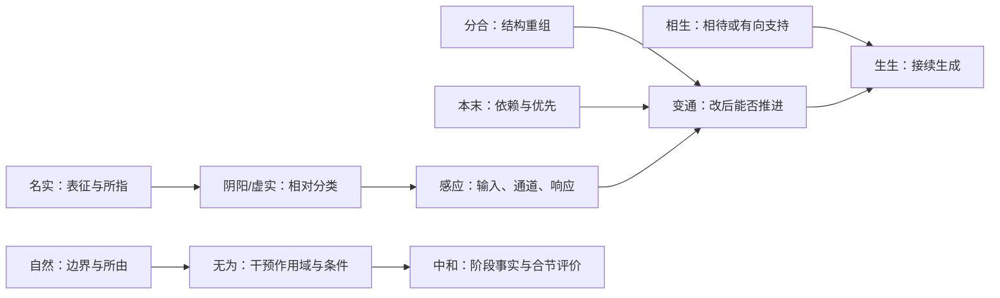

# 构式与微型模型：把组合压缩的信息展开

发布版本 v0.4 · 2026-10-21

这一版把04的32个混合句族变成同一格式的构式登记，并展开12个重点构式：生生、感应、中和、变通、分合、名实、本末、虚实、阴阳、自然、无为、相生。目标是把表达里压缩的参与项、成分关系、条件和后果恢复出来，接到07的G1关系文法。

**构式是本版的登记单位，不是已经认证的历史单词。**原32行保留67个表面标签；12张卡含13个微型模型，因为相生分别处理概念相待与有向支持。分合不在原32行标签中，另从S5登记为补充入口。11张重点卡关联原表11行，不能据此说11行里的全部子项都已完成。自然中的“然”也没有登记在08的144字中；本卡明确解释其作用，不冒称已经新增一个G1字词接口。

以下短引都在本轮实际打开原典网页核对，链接、段落和经/传/注层级逐卡给出。网页行号是本次读取的定位辅助；篇段与短引可独立检索。本稿不处理最早出处、传本谱系与历史词汇化证明。原典是证据，现代有限模型是本项目的构造；后者不反向证明古人已经持有同一形式系统。

## 一、统一组合接口

一个完整构式记录包含：**选义与对象 → 成分关系 → 整体约束 → 文本限制 → 明确增补 → 模型与规则 → 后果及失败例**。字面组合不能省去其中的空位。

| 层 | 可填写的内容 | 必须保留的界线 |
|---|---|---|
| 文本 | 原句、篇章、经传注层、语境论说 | TextClaim不能直接充作现实世界公理 |
| 词法/构式 | 所选义、参与项与关系、否定作用域 | 连文与二字长度不证明词界；整句不算一个词 |
| 对象与状态 | 对象域、身份、位置、特征、配置 | 名称、所指和对象事实分层 |
| 事实式 Formula | 在当前状态可真可假的明确谓词与组合 | 不能把规范许可或文字象征偷偷当事实 |
| 过程 Program | 列明的原子边、串联、选择、测试与重复 | 分类、支持关系或名称本身不会自动生成时间边 |
| 评价 Judgement | 指定V下的合宜、许可与优先 | 可达性不推出正当；合宜也不保证可行 |

以下数值、阈值、动作边、令牌、规范表和对象身份均为显式补充。需要“久”时，动作必须推进固定正时间；测试、skip、star的零步不能冒充时间。存在成功路径也不等于行动者具备在线识别并控制该路径的策略。

## 二、12个构式怎样相接

箭头是本项目设计的接口：要把前一张卡的结果用于后一张卡，仍须满足下面的桥梁，不能直接读成古典同义链或自然因果链。

| 接口 | 允许的连接与所需桥梁 |
|---|---|
| 名实 → 阴阳 | 先给名称所指，再给同一比较维度的分类；名称不改变相位，分类不自动生成转移。 |
| 阴阳 → 变通 | 相位分类可作为重配置的前后条件；具体边与合时条件另给。 |
| 分合 → 变通 | split/merge可作为reconfigure候选，但还必须通过CanReach目标检验。 |
| 本末 → 变通 | 依赖条件可作行动guard；基础就绪仍需执行边，必要不自动充分。 |
| 虚实 → 感应 | 容量配置经观测形成输入，再选择响应；信息过时会使据标签的行动失败。 |
| 感应 → 变通 | 响应可是一种改制候选；有响应不等于恢复目标可达。 |
| 自然 → 无为 | 先界定局部过程与外部命令，再谈哪些干预受限制；资源输入与命令不同。 |
| 无为 → 中和 | 过程许可/可行性与规范判断分别求值；守镇策略和情感合节不共用一个未声明V。 |
| 相生 → 生生 | 支持关系只有配上资源与发生机制，才可能产生接续生成；有环不保证发生。 |
| 变通 → 生生 | 到达生成可行状态只是起点；继续生成仍需每步真实事件及资源，通不自动久。 |
| 名实 → 虚实 | 名实之实取所指，虚实之实取容量配置；禁止同字类型偷换。 |
| 本末 → 中和 | 优先序和合节判断均需规范，但可以属于不同V；不由二者含价值就认作同一善。 |

这些连接产生可区分的系统结构：名实增加表征层，分合增加组织层，虚实增加位置和容量层，感应增加通道层，本末增加依赖与优先层，中和增加规范层。组合文法的作用是让这些层能在明确条件下相接，而不是用一个生、变、和或道包办所有关系。

## 三、32行统一登记

下表覆盖原表全部32行；更完整字段及67个表面标签在 `constructions.json`。没有重点卡的行已经统一登记其结构和待补条件，但尚未冒称完成整词深析。

| 登记ID | 原组合或句族 | 本版工作单位 | 组合所压缩的关系 | 重点卡 |
|---|---|---|---|---|
| R01 | 文理生生、求文、求理 | mixed：项目名称与动作短语 | 表征—解释—生成的项目工作流 | 登记层 |
| R02 | 生生、生生之谓易 | mixed：重叠构式＋定义命题 | 生成事件的接续及概念归属 | CX01 |
| R03 | 生生不息 | 固定表达候选：修饰生成的否定构式 | 否定停止与延续作用域 | 登记层 |
| R04 | 相生、有无、有无相生 | mixed：关系构式＋对举＋命题 | 概念相待或有向支持 | CX12 |
| R05 | 相克、相生相克 | mixed：现代通称＋关系组合 | 生成环与制约环叠置 | CX12 |
| R06 | 共生、自生 | 词候选：现代技术组合候选 | 共同参与或过程来源 | 登记层 |
| R07 | 养生 | 词候选：实践概念候选 | 持续域内的维护与条件适应 | 登记层 |
| R08 | 本末、终始 | mixed：两组对举构式 | 基础/派生与开端/完成 | CX07 |
| R09 | 体用 | 词候选：对举概念候选 | 构成或根据与功能 | 登记层 |
| R10 | 阴阳、刚柔、动静、柔弱 | mixed：四组对举构式 | 共用尺度下的分类、性质和变化 | CX09 |
| R11 | 虚实 | 词候选：相对配置构式 | 容量、位置、对手/任务与观测 | CX08 |
| R12 | 消长、兴衰 | mixed：趋势与阶段对举 | 量或功能的升降与兴衰 | 登记层 |
| R13 | 分界、度量 | mixed：边界与尺度构式 | 分配边界和量度 | 登记层 |
| R14 | 感应 | 词候选：响应关系构式 | 感发、通道与响应 | CX02 |
| R15 | 制衡 | 现代技术标签：约束与平衡候选 | 有向制约网络 | 登记层 |
| R16 | 和同、和而不同、和实生物同则不继 | mixed：对举标签＋固定表达＋命题 | 差异保持与协调评价 | 登记层 |
| R17 | 中和、时中 | mixed：两种规范构式候选 | 未发/已发评价或合时判断 | CX03 |
| R18 | 名实、同异、约定俗成 | mixed：两组对举＋固定表达 | 命名、分类与约定 | CX06 |
| R19 | 穷变、变通、穷变通久及其完整格言 | mixed：关系短语＋条件链标签 | 受限、重配置、可行及延续 | CX04 |
| R20 | 聚散、聚则为生散则为死 | mixed：对举概念＋条件命题 | 组织/解组与生死解释 | 登记层 |
| R21 | 往复、反复 | mixed：返回/再现构式候选 | 路径返回或方向反转 | 登记层 |
| R22 | 天文、人文、道之文 | mixed：三种跨文献之文表达 | 自然/人事样态与文学本源 | 登记层 |
| R23 | 自然、道法自然、无为 | mixed：概念构式＋哲学命题＋否定构式 | 自身所由、所法与干预范围 | CX10、CX11 |
| R24 | 齐物、方生方死 | mixed：篇名/概念候选＋平行命题 | 观照、是非与生成消亡视角 | 登记层 |
| R25 | 天人之分、天行有常 | mixed：论域区分短语＋命题 | 自然运行与人间职责分层 | 登记层 |
| R26 | 仁义礼、性 | mixed：并列伦理概念串＋单字 | 伦理、制度与禀赋论争 | 登记层 |
| R27 | 三表 | 词候选：计数命名的论证标准 | 历史、观测与施政后果的依据 | 登记层 |
| R28 | 状变而实无别、有化而无别、存中之变 | mixed：两条命题＋现代总结 | 状态变化与对象身份 | 登记层 |
| R29 | 生存变亡、身份延续、失稳、续存 | mixed：现代分析标签 | 生命周期分类与组织安全 | 登记层 |
| R30 | 物相杂故曰文、文者物象之本 | mixed：两条跨文献命题 | 爻物交错与文字本源 | 登记层 |
| R31 | 反者道之动 | 命题：道与反的判断 | 方向反转或返归解释 | 登记层 |
| R32 | 读书百遍其义自见 | 命题/固定转述：反复阅读的认知主张 | 实践量与理解的候选联系 | 登记层 |

补充入口 SUP01：分合，来源S5；完整卡CX05。它不计入原表32行。

## CX01 生生

**登记单位。** 重叠构式候选。词界待证；连文已核，不据二字连用判定单一复合词。

**原典入口。**

- [Y03 · 见原典链接及篇段定位](https://zh.wikisource.org/wiki/易傳/繫辭上#第五章)：第五章‘一陰一陽之謂道’段，网页第162行。短引：“生生之謂易”。层级：易传正文。

**选义与成分关系。** 本卡选生成活动的接续：一次生成与后续生成相接。它区别于同一既有个体一直存活，也不把生统一读作数值增加。

重叠提示接续性，但接续多少次、是否产生新个体、何者承接何者，都由语境和模型另外约定。

**整体义。** 将生成事件、前后承接及某种持续尺度压缩在一个表达中；不是两个孤立的‘存在’谓词。

不能逐字推出的部分：

- ‘之谓易’的概念归属关系和整段宇宙论语境不能由两个生的字典义相加推出。
- 不断产生全新身份、永远成功、生成就是善，均不在本卡字面规则中。

**文本实际约束。**

- 原句把生生与易相联；同段还有日新、成象、阴阳等叙述。
- 原句没有实体清单、事件计数、无穷量词、消耗率或现代身份函数。

**现代补充。**

- 固定有限对象域 {a,b,c}；对象身份由标签追踪，死亡后不复用标签冒充全新身份。
- 模型每条 tick 边耗时1；gen是tick中发生至少一次新对象出现的子关系。
- 谱系 a→b、b→c为本模型给定的生成归属，不能只由共现事实反推。

**事实与规范。**

| 层 | 内容 |
|---|---|
| 事实 | Alive、对象出现/消失、生成边与有限步数的可达性。 |
| 规范 | 本卡不设规范评价；若要称良性生成，必须另外给V及资源、伤害等标准。 |
| 禁止偷换 | Alive或gen为真不推出善、宜或应当继续。 |

**G1接口与组合规则。**

- status：现代参数化配方；不是现成AST或自动字词编译器
- types：{"Alive":"Formula","gen":"Program，gen⊆tick","T":"外部自然数参数，repeat次数"}
- definition：GenT(T) := Alive ∧ ⟨(gen;?Alive)^T⟩⊤；T=0仍检查起点Alive。
- identity：存在/出生的对象由固定有限Entity域和各状态Extant表给定。

- {"id":"CX01.R1","if":"起点s满足Alive，给定s→s'属于gen，并在s'满足Alive","then":"一次有效生成延续GenT(1)成立；若起点不Alive，则只能另判断出生事件，不能套用本延续式","status":"模型定义；原文未给出此判定式"}
- {"id":"CX01.R2","if":"GenT(T+1)成立","then":"GenT(T)成立，但相反方向不成立","status":"在同一模型与同一生成关系下的逻辑后果"}

08义项入口：`core.044.03`。这些是接口入口，不是整构式自动编译成功的证明。

**微型模型。**

模型语境：`v04-cx01-generation`。状态：s0、s1、s2、s3、s4。
起点：`s0`。

| 声明 | 有限取值或定义 |
|---|---|
| 对象域 | `["a","b","c"]` |
| 各状态仍存在的对象 | `{"s0":["a"],"s1":["a","b"],"s2":["b","c"],"s3":["c"],"s4":[]}` |
| 谓词真值集 | `{"Alive":["s0","s1","s2","s3"]}` |
| 谱系（本例额外给定） | `[["a","b"],["b","c"]]` |

| 过程 | 明确给定的边 |
|---|---|
| `tick` | `s0 → s1`；`s1 → s2`；`s2 → s3`；`s3 → s4` |
| `gen` | `s0 → s1`；`s1 → s2` |

每条tick正时间1；test、skip和零次重复不推进时间。

逐步检查：

- s0满足GenT(2)：s0→s1→s2。
- s0不满足GenT(3)：s2没有gen后继。
- s1→s2仍是生成边，虽然a在该步消失；个体死亡不否定这一次接续生成。
- s2仍Alive，但没有下一次gen；存在不等于生成。
- 从s0可沿tick保持Alive三步，到第四步s4则失败。

**后果与失败。**

- 可分别问‘还有对象活着’和‘还会发生生成’，避免把生生化约为存续。
- 有限域和有限例不能证明无限新身份生成；尤其不能用test(Alive)*假装有时间流逝。

失败例：{"case":"从s0两次生成成功后停止；或只有s0的静止自检。","rejected_inference":"一次/有限次生成⇒永远生生；静态不死⇒正在生成。"}

**证据状态。** 短引已核；选义有边界；词界与最早出处未证。模型为现代构造，列出手算后果及反例，未作经验因果验证；不声称本卡已由G1引擎执行。

## CX02 感应

**登记单位。** 相感相应关系构式候选。词界待证；原句连续出现感應，不由此确定历时词汇化边界。

**原典入口。**

- [JY1 · 见原典链接及篇段定位](https://zh.wikisource.org/wiki/周易/咸)：彖曰段，网页第129行。短引：“二氣感應以相與”。层级：彖传，不是咸卦卦爻经文。

**选义与成分关系。** 相互涉及的感发与响应。为做可检验的机制实例，本卡另构造一个方向、一个可识别输入和一个响应；该顺序分解不冒充原文唯一语法。

以参与者、作用通道、条件及响应联系起两端；单有先后共现不够成立现代因果机制。

**整体义。** 压缩了相与的关系和感发—响应的配合。它可以展开为开环响应；只有另加返回作用边才成为反馈回路。

不能逐字推出的部分：

- 《咸·彖》的刚柔位置、止而说、天地化生与圣人感人心层次不能化成一个无语境响应器。
- 感应连文不自动包含信息测量、因果识别、延迟、反馈符号或稳定性。

**文本实际约束。**

- 正文以二气相与说明咸，并扩及天地与人心；有关系性描述。
- 没有给出可观测变量、受控对照或闭环方程。

**现代补充。**

- 固定输入高低和响应有无两个布尔量；每条边耗时1。
- stimulus、respond、feedback、reset被分别声明；这些通道不是由感应二字自动生成。
- 本模型只是四状态逻辑设计；若用于实证，还需排除共同原因、迟延和观测偏差。

**事实与规范。**

| 层 | 内容 |
|---|---|
| 事实 | 给定输入及响应状态、事件关系、能否完成返回路径。 |
| 规范 | 原文的天下和平属于文本的政治评价与期望；本模型不把响应发生判为善。 |
| 禁止偷换 | 强响应、双向响应或有环均不推出和谐、正当或稳定。 |

**G1接口与组合规则。**

- status：现代配方
- types：{"InputHigh":"Formula","ResponseOn":"Formula","stimulus/respond/feedback/reset":"Program"}
- definition：ResponseEpisode := stimulus;respond。FeedbackEpisode := stimulus;respond;feedback;reset。
- warning：程序名有因果含义时需另提供机制证据；关系可达性本身不是因果识别。

- {"id":"CX02.R1","if":"s满足⟨stimulus;respond⟩⊤","then":"此模型存在一个输入后响应的事件序列","status":"模型内关系复合；不单凭该式认定真实因果"}
- {"id":"CX02.R2","if":"另有响应返回输入端的feedback边并可reset","then":"可检查一条闭合的反馈事件序列","status":"新增通道下的后果；不是‘感应’同义展开"}

08义项入口：`core.029.01`、`core.027.01`。这些是接口入口，不是整构式自动编译成功的证明。

**微型模型。**

模型语境：`v04-cx02-response`。状态：s0、s1、s2、s3。
起点：`s0`。

| 声明 | 有限取值或定义 |
|---|---|
| 各状态变量 | `{"s0":{"input":0,"response":0},"s1":{"input":1,"response":0},"s2":{"input":1,"response":1},"s3":{"input":0,"response":1}}` |

| 过程 | 明确给定的边 |
|---|---|
| `stimulus` | `s0 → s1` |
| `respond` | `s1 → s2` |
| `feedback` | `s2 → s3` |
| `reset` | `s3 → s0` |

四类原子边均为正时间1；闭环是四步，不是零时间test循环。

逐步检查：

- 完整模型从s0可执行stimulus;respond，终点s2。
- 完整模型从s0可执行FeedbackEpisode并返回s0。
- 开环模型仍能完成ResponseEpisode，但不能完成FeedbackEpisode。
- 闭环存在不等于稳定平衡；此模型只是被给定的循环，无扰动模型、增益或收敛证据。

反模型：开环模型只把feedback删为空关系，其余输入、状态、程序保持。

**后果与失败。**

- 感应候选机制需先定位谁感谁应、什么通道，再判断有没有返回边。
- 同一四状态表可以有开环与闭环两种边集，故状态共现不能唯一决定系统结构。

失败例：{"case":"删去feedback后，输入仍引出响应；或另一个现实系统中输入与响应由共同外因同时造成。","rejected_inference":"感应⇒反馈；先后相随⇒已识别因果；反馈⇒稳定。"}

**证据状态。** 短引已核；选义有边界；词界与最早出处未证。模型为现代构造，列出手算后果及反例，未作经验因果验证；不声称本卡已由G1引擎执行。

## CX03 中和

**登记单位。** 正文连文的修养与规范构式；复合概念候选。“致中和”有直接连文；本卡不以此宣称其词界、词汇化历程或最早用例已经证定。。

**原典入口。**

- [C06 · 《礼记·中庸》](https://zh.wikisource.org/zh-hans/禮記/中庸)：开篇天命之谓性段，喜怒哀乐定义之后；本次网页第122行。短引：“喜怒哀乐之未发，谓之中”；“发而皆中节，谓之和”；“致中和”。层级：《礼记》所收《中庸》正文；不将朱熹章句或后世心理模型冒充正文。

**选义与成分关系。** 中取情感未发的原句定义，和取发而合节的规范判断。两者并置表达未发与已发的修养问题，不取算术平均、同质化或物理平衡。

同一行动者的未发状态与情境中的表达评价关联；不是同一时点上的两个布尔事实简单相加，更不是中自动导致和。

**整体义。** 压缩了行动者、发/未发阶段、实际表达、尺度节以及修养目标的关系。

不能逐字推出的部分：

- 什么表达在何时对何人合节、怎样养成、何种情感应表达，必须由规范语境和实践补足。原文后接天地位/万物育的宏大主张，不由本微型模型证明。

**文本实际约束。**

- 和的定义含皆与中节，因此不能只挑一个合宜表达就宣称整体已和。
- 未发不等于压抑全部情感或永不表达；原句明确另论发而合节。
- 中在其他语境可为时中等义，本卡不合并这些义项。

**现代补充。**

- 用有限状态表记录某行动者当前未发或已发；不把该观测表当作对内心的完备测量。
- 规范V_c明确标记两种表达soft/harsh的合宜性；评价表由研究者给定，不从事实关系自动推得。
- 通过分支模型说明未发状态可以到合节或不合节表达，修养能力另需证据。

**事实与规范。**

| 层 | 内容 |
|---|---|
| 事实 | 是否有表达、表达类型、过程边和所处情境c。未发在此是选定义项的事实代理。 |
| 规范 | Judgement_V_c(soft)=admissible，Judgement_V_c(harsh)=inadmissible；V_c由公开的交往规范给定。和为这些事实在V_c下的评价，不偷装成自然属性。 |

**G1接口与组合规则。**

- status：现代参数化说明；须领域声明、选义及补参，非现成AST
- typed_rules：[]
- note：Formula/Program/规范Judgement不可互相强制转换。

- 先选未发义与合节义；不把不同中义或和义按字形相同合并。
- 按阶段解释：未发事实与已发评价有不同适用域，不能要求两者同一时点同时成立。
- 判断皆合节必须说明评价域、时间窗及记录完整性；局部观察不足以证明一生皆合节。
- 规范表与世界过程分别给定；是否存在合宜可行路径，需要两层相接后检查。

08义项入口：`core.082.01`、`core.083.02`。这些是接口入口，不是整构式自动编译成功的证明。

**微型模型。**

模型语境：`v04-expression-and-norm-demo`。状态：unexpressed、soft_done、harsh_done。

| 声明 | 有限取值或定义 |
|---|---|
| 有型对象域 | `{"Expression":["soft","harsh"]}` |
| 状态事实表 | `{"Unexpressed()":["unexpressed"],"Expressed(Expression)":{"unexpressed":[],"soft_done":[["soft"]],"harsh_done":[["harsh"]]}}` |

| 过程 | 明确给定的边 |
|---|---|
| `respond_soft` | `unexpressed → soft_done` |
| `respond_harsh` | `unexpressed → harsh_done` |
| `settle` | `soft_done → unexpressed`；`harsh_done → unexpressed` |

He_V(s)作为规范层缩写：s有至少一条已发记录，且此完整有限记录集中的每一表达都被V判为合节；不把空集上的全称真误判成已发之和。此为评估算法说明，不向G1 Formula悄悄混入NormJudgement。

未主张settle或任何循环代表永久中和；没有真实tick与持续目标，不能据循环或star推出久。

{"V":"V_c：给定具体交往场合，soft合节，harsh不合节；表由研究者声明","judgements":{"soft":"admissible","harsh":"inadmissible"}}

逐步检查：

- unexpressed满足未发代理Unexpressed，但不满足He_V的已发前提。
- soft_done记录集仅含soft，故规范评估He_V=true；harsh_done含harsh，故He_V=false。
- unexpressed有respond_soft后继，因此存在一条可达合节表达路径；也有respond_harsh后继，因此并非所有后继皆合节。
- 若删去respond_soft边而保持规范表不变，soft依然被规范允许，但当前并不能做出它：应当/合宜不推出实际可行。

**后果与失败。**

- 系统map可以同时表示阶段变化与规范筛选，使事实过程和价值判断互相有关而保持类型区分。
- 可识别三种不同失败：不合节的实际表达、虽合宜却不可实行、证据不完整而过早评为整体和。

失败例：unexpressed→harsh_done是合法事实边但规范不合节，反驳未发必然带来和。仅保留规范允许soft却删除其过程边，则合宜也不保证可行。

**证据状态。** 短引已核；选义有边界；词界与最早出处未证。模型为现代构造，列出手算后果及反例，未作经验因果验证；不声称本卡已由G1引擎执行。

## CX04 变通

**登记单位。** 联结变化与通行/推行的构式候选。连文和相关分说已核，词界待证。

**原典入口。**

- [Y04 · 见原典链接及篇段定位](https://zh.wikisource.org/wiki/易傳/繫辭下#第二章)：第二章神農氏沒段，网页第143行。短引：“易窮則變，變則通，通則久”。层级：易传正文。
- [Y04 · 见原典链接及篇段定位](https://zh.wikisource.org/wiki/易傳/繫辭下#第一章)：首段，网页第134行。短引：“變通者，趣時者也”。层级：易传正文。
- [Y03 · 见原典链接及篇段定位](https://zh.wikisource.org/wiki/易傳/繫辭上#第十二章)：乾坤其易之縕邪段，网页第223行。短引：“化而裁之謂之變，推而行之謂之通”。层级：易传正文。

**选义与成分关系。** 依时与条件改变既有安排，使某活动得以通行或推行。恢复可行路径是现代机制读法，不取‘所有变化都成功’。

本卡把重配置和可行性检验复合为‘成功改变’，而不是把任意变换都加上通的保证。

**整体义。** 压缩变化的针对性、合时条件与后续可推行性；‘通’要求说明通向什么、通过何边、对谁可行。

不能逐字推出的部分：

- 适时、民宜及制器叙事中的评价和目的不是变与通两个字本身给出的通用效用函数。
- 到达一次目标不等于可持续、全体受益或在另一环境仍可达。

**文本实际约束。**

- 《系辞下》确有穷变通久的论述，并处于改制器用叙事。
- ‘趣时’限制无条件套用；《系辞上》又从裁制、推行分说两者。

**现代补充。**

- Goal与execute边由给定任务定义；不能把通任意定义成模型里喜欢的结局。
- 改制候选集包括失败支路，模型检查存在性与全称性分别进行。
- 各原子动作耗时1；终点可达与后续tick可继续分别登记。

**事实与规范。**

| 层 | 内容 |
|---|---|
| 事实 | 路径是否存在、哪次改动成功、是否还有后继。 |
| 规范 | 成功指给定Goal达成；合时、可接受、利民须在另设V下评价。 |
| 禁止偷换 | CanReachGoal不推出宜或公正；存在成功候选不推出行动者掌握可实现策略。 |

**G1接口与组合规则。**

- status：现代配方
- types：{"Done":"Formula","CanReach":"Formula = ⟨execute*⟩Done","reconfigure/execute":"Program"}
- definition：AdaptSuccess := reconfigure;?CanReach。若要求至少一次推进，另用⟨execute;execute*⟩Done。
- zero_step_note：Done状态满足零步CanReach是刻意允许的；本模型重配置目标均不是Done，不靠此零步取得成功。

- {"id":"CX04.R1","if":"⟨reconfigure⟩CanReach","then":"至少存在一种重配置可使目标可达","status":"关系文法内存在命题"}
- {"id":"CX04.R2","if":"[reconfigure]CanReach 且 ⟨reconfigure⟩⊤","then":"每种被列为允许的重配置均可达到目标，且不是无边空真","status":"比R1更强的充分条件，本例不满足"}

08义项入口：`core.045.02`、`core.067.01`。这些是接口入口，不是整构式自动编译成功的证明。

**微型模型。**

模型语境：`v04-cx04-adaptation`。状态：blocked、routeA、routeB、done、failed。
起点：`blocked`。

| 声明 | 有限取值或定义 |
|---|---|
| 谓词真值集 | `{"Open":["routeA","routeB","done"],"Done":["done"]}` |

| 过程 | 明确给定的边 |
|---|---|
| `reconfigure` | `blocked → routeA`；`blocked → routeB`；`blocked → failed` |
| `execute` | `routeA → done` |
| `tick` | `blocked → routeA`；`blocked → routeB`；`blocked → failed`；`routeA → done` |

逐步检查：

- CanReach真值集={routeA,done}；routeB虽Open却无到Goal的边。
- AdaptSuccess只有blocked→routeA。
- blocked满足⟨reconfigure⟩CanReach，但不满足[reconfigure]CanReach。
- done没有tick后继；一次通到目标不证明久。

**后果与失败。**

- 把‘有所改变’与‘改后能继续做什么’分成可单独失败的检查。
- 系统图需要重配置边和执行边两层；仅画状态更名不能认证变通成功。

失败例：{"case":"blocked→routeB确实改变且表面Open，却无法到达Goal；blocked→failed更直接失败。","rejected_inference":"变⇒通；通⇒久；有好路径⇒行动者知道并能控制选择它。"}

**证据状态。** 短引已核；选义有边界；词界与最早出处未证。模型为现代构造，列出手算后果及反例，未作经验因果验证；不声称本卡已由G1引擎执行。

## CX05 分合

**登记单位。** 对举动作构式候选。连续分合已核；词界和历时词汇化待证。

04第十五节32行没有分合标签；本卡来自04第五组分/合及05 S5，作为第33个补充构式入口登记，不冒称是原32行之一。

**原典入口。**

- [S5 · 见原典链接及篇段定位](https://zh.wikisource.org/wiki/孫子兵法#軍爭第七)：軍爭第七‘故兵以詐立’段，网页第247行。短引：“以分合為變者也”。层级：孙子正文。

**选义与成分关系。** 对同一有身份的成员集合进行组织分配与汇合；此例是队伍配置变换，不是物质从无到有。

原句把分与合作为变化方式。本卡用split∪merge表示两类候选操作，不把词序强制译成先分后合。

**整体义。** 压缩了共同成员、编组边界、操作选择和配置改变。完整意思依赖‘分的是什么、按什么边界、又为了何事重合’。

不能逐字推出的部分：

- 军争中的利害、组织协同和条件选择不会由两个反向动词自动给出。
- 同一成员集合不等于同一组织；能回到一个大组不等于可唯一恢复旧的小组。

**文本实际约束。**

- 原句位于行军利害、给养与号令协同的军事语境，把分合作为用兵变化方式。
- 没有宣称成员守恒、全局可逆或任意拆分都合理。

**现代补充。**

- 固定成员U={u1,u2,u3,u4}；三种分区都覆盖同一U且各块互不重叠。
- split与merge边由教学模型列明，成员守恒是本例输入公理。
- 一个操作正时间1；具体军事耗时、代价、通信与风险未由本例估计。

**事实与规范。**

| 层 | 内容 |
|---|---|
| 事实 | 成员集合、分区、分与合的边及关系复合结果。 |
| 规范 | 何种编组更好要给任务、资源与V；本例只检查配置性质。 |
| 禁止偷换 | 分组数增加不推出创造性或善；合并不推出协调成功。 |

**G1接口与组合规则。**

- status：现代配方
- types：{"AtB":"Formula","split/merge":"Program","reorganize":"Program=split∪merge"}
- definition：先选择同一Entity域和Partition编码，再定义操作边；split;merge与merge;split分别复合。
- identity：成员身份与组织身份分开；本例只保证前者不变。

- {"id":"CX05.R1","if":"s→s'是一条本例split或merge边","then":"成员U保持，分区改变","status":"依据列出的三种分区与边可枚举证明；不是分合通律"}
- {"id":"CX05.R2","if":"一次merge把两个不同旧分区都映到同一大组","then":"仅凭合并后的分区无法唯一恢复旧分区","status":"信息丢失的模型内后果"}

08义项入口：`core.032.02`、`core.033.02`。这些是接口入口，不是整构式自动编译成功的证明。

**微型模型。**

模型语境：`v04-cx05-partition`。状态：a、b、c。
起点：`b`。

| 声明 | 有限取值或定义 |
|---|---|
| 成员域 | `["u1","u2","u3","u4"]` |
| 谓词真值集 | `{"AtB":["b"]}` |
| 分区表 | `{"a":[["u1","u2","u3","u4"]],"b":[["u1","u2"],["u3","u4"]],"c":[["u1","u3"],["u2","u4"]]}` |

| 过程 | 明确给定的边 |
|---|---|
| `split` | `a → b`；`a → c` |
| `merge` | `b → a`；`c → a` |

逐步检查：

- split;merge={(a,a)}，在本例从大组分后再合可回到a。
- merge;split={(b,b),(b,c),(c,b),(c,c)}，合后再分有两个结果。
- b满足⟨merge;split⟩AtB，却不满足[merge;split]AtB。
- 三种配置均覆盖U，故成员未消失；组织的相同不能由成员守恒替代。

**后果与失败。**

- 系统图应为组织状态配上成员层与分区层，不把成员未变说成系统未变。
- 分合往返可能丢失编组记忆；若要恢复原分区，需保存额外记录并限制split选择。

失败例：{"case":"b合成a后分成c，成员完全相同而旧配对丢失。","rejected_inference":"合是分的全局逆；成员守恒⇒组织身份恒定；分合操作自带好坏评价。"}

**证据状态。** 短引已核；选义有边界；词界与最早出处未证。模型为现代构造，列出手算后果及反例，未作经验因果验证；不声称本卡已由G1引擎执行。

## CX06 名实

**登记单位。** 对举关系表达；可作为复合概念候选；本轮不裁定历史词界。原文有“名實亂”连文，但连文不充分证明现代意义上的单词；最早出处未考证。。

**原典入口。**

- [C01 · 《荀子·正名》第二十二](https://zh.wikisource.org/zh/荀子/正名篇)：制名以指实段、同异命名段、名无固宜段；本次网页第115—125行。短引：“分別制名以指實”；“名無固實，約之以命實”；“名實亂”。层级：传世子书正文；本卡未作出土异文或版本谱系考证。

**选义与成分关系。** 名称在共同命名约定下指向被区分的对象或类别；此处实取对象/所指，不能借用虚实的防备容量义。

名:Symbol 经 NamingContext 中的指称约定指向 实:Entity 或指定分类；关系不是把名和实放在同一类型上作相等。

**整体义。** 把区分对象、制定名称、按约使用名称、检查名实是否相副压缩为一个可回查的关系问题。

不能逐字推出的部分：

- 哪些特征足以同类、指的是个体还是类、约定由谁承认、名称能否兼举，均不能从名和实两个字直接推出；原篇的王者制名及政治秩序主张也不能化约成普通数据库一致性。

**文本实际约束。**

- 所指不是被字形天然决定：原篇明确名无固实、约之以命实。
- 原篇同时要求辨同异与沟通用途，不能把任意指称映射都视作同样合用。
- 原篇区分同状异所的二实与有化无别的一实，因此同名不等于同一对象。

**现代补充。**

- 有限对象域、符号域、固定颜色特征和一张完全给定的约定表。
- 将检查一致性写为全称公式；这是本项目登记校验，不是声称荀子已写出现代逻辑。
- 把修正错误标签建成只改命名记录的状态转移，明确冻结对象特征。

**事实与规范。**

| 层 | 内容 |
|---|---|
| 事实 | 约定表、当前标签、对象特征、修正前后哪些关系改变。 |
| 规范 | 是否应统一名称、谁有权制名、何种名称善，另需说明政治/语用规范V。本模型只验证给定约定的一致性，不从它推出正当权威。 |

**G1接口与组合规则。**

- status：现代参数化说明；须领域声明、选义及补参，非现成AST
- typed_rules：[]
- note：Formula/Program/规范Judgement不可互相强制转换。

- 先固定对象/类层级和命名约定，再检查每一使用是否落在允许指称关系中。
- 若需更新约定，必须版本化NamingContext并重新评估；不能悄悄改解释后把旧判断当作同一命题。
- 仅有same_name(x,y)不足以推出x=y；分类名可合法对应多个个体。

08义项入口：`core.018.01`、`core.018.02`、`core.019.01`。这些是接口入口，不是整构式自动编译成功的证明。

**微型模型。**

模型语境：`v04-naming-convention-demo`。状态：correct、confused、repaired。

| 声明 | 有限取值或定义 |
|---|---|
| 有型对象域 | `{"Entity":["A","B"],"Symbol":["红类","蓝类"]}` |
| 状态事实表 | `{"UsedName(Symbol,Entity)":{"correct":[["红类","A"],["蓝类","B"]],"confused":[["红类","A"],["红类","B"]],"repaired":[["红类","A"],["蓝类","B"]]}}` |
| 固定关系 | `{"Red(Entity)":[["A"]],"Blue(Entity)":[["B"]],"Denotes(Symbol,Entity)":[["红类","A"],["蓝类","B"]]}` |

| 过程 | 明确给定的边 |
|---|---|
| `mislabel` | `correct → confused` |
| `repair` | `confused → repaired` |

Consistent := ∀n:Symbol.∀x:Entity.(UsedName(n,x) → Denotes(n,x))

未给；不执行规范结论。

逐步检查：

- correct的两条UsedName均在Denotes中，因此Consistent为真。
- confused的UsedName(红类,B)不在Denotes中，因此Consistent为假；见证是(红类,B)。
- repair唯一后继repaired满足Consistent，故confused ⊨ 〈repair〉Consistent。
- B在三个状态均为Blue且非Red，故confused ⊭ 〈repair〉Red(B)：改正名称没有改变对象颜色。

**后果与失败。**

- 名实构式可用于检验数据标签、概念界定和引用所指。
- 系统map增加一层表征关系；这层变化与对象变化可独立追踪。

失败例：把B误标成红类后由标签推断Red(B)，在confused状态立即失败。另一个反例是A1、A2都属红类但为两个不同个体；同类名不能推出A1=A2。

**证据状态。** 短引已核；选义有边界；词界与最早出处未证。模型为现代构造，列出手算后果及反例，未作经验因果验证；不声称本卡已由G1引擎执行。

## CX07 本末

**登记单位。** 对举排序表达；复合概念候选；正文命题与词界分开登记。“物有本末”有直接连文；是否按特定时期词法认定为词，以及最早出处，本轮均未证明。。

**原典入口。**

- [C07 · 《礼记·大学》](https://zh.wikisource.org/zh-hans/禮記/大學)：开篇“大学之道”大段及后文“有德此有人”段；本次网页第124—125行。短引：“物有本末，事有终始”；“德者本也，财者末也”；“其本乱而末治者否矣”。层级：《礼记》所收《大学》正文；未把朱熹重编章句当作此页本文。

**选义与成分关系。** 本与末指定同一论域内的基础/派生、优先/次后关系；原篇修身与德财尤其含价值排序。现代依赖图只取其中一种结构投影。

本和末不是两个永恒实体标签，而是相对于任务、层级和评价标准的有向关系。技术依赖DependsOn(末,本)与规范优先Priority_V(本,末)必须分别登记。

**整体义。** 把应先稳固何项、后续何项依赖它、当前是否倒置这个结构压缩成一个排序问题。

不能逐字推出的部分：

- 哪一项是本、依赖是否必要或充分、何时应优先、资源冲突如何裁决，都不由两个字决定。德为本财为末是本篇价值论说，不能直接证明任何现实经济因果定律。

**文本实际约束。**

- 原篇将本末与终始并列而非等同；逻辑依赖、价值先后、时间先后不可自动互换。
- 原篇给出修身、德财的具体序列，不支持所有系统存在唯一第一本。
- 本的重要性不推出末无价值；原篇仍论生财、用财及政治效果。

**现代补充。**

- 选择一个极小技术域：末端当步工作必须由基础当步供能，无储能和备用源。
- 状态枚举和动作边人为给定；DependsOn只是本例约束，不是从引文推导的物理法则。
- 规范表V_service另行优先恢复服务，用于演示事实和价值的连接需显式输入。

**事实与规范。**

| 层 | 内容 |
|---|---|
| 事实 | 在选定供能模型中是否有基础供能、末端工作，以及动作的实际后继。 |
| 规范 | V_service规定服务中断且资源只够一个动作时优先repair，而非decorate。此排序来自公开的目标及规范表，不能从本字直接生成。原典德财排序保留为TextClaim。 |

**G1接口与组合规则。**

- status：现代参数化说明；须领域声明、选义及补参，非现成AST
- typed_rules：[]
- note：Formula/Program/规范Judgement不可互相强制转换。

- 每次标本末都声明关系类型和相对目标；禁止用价值本偷换为唯一物理原因。
- 由末工作→本就绪只能得到必要条件；本就绪→末工作需另有充分机制。
- 多重基础可用合取、替代基础可用析取；不能默认所有依赖都是单根线性链。

08义项入口：`core.034.01`、`core.034.02`、`core.035.01`、`core.035.02`。这些是接口入口，不是整构式自动编译成功的证明。

**微型模型。**

模型语境：`v04-foundation-dependency-demo`。状态：off、ready、run。

| 声明 | 有限取值或定义 |
|---|---|
| 状态事实表 | `{"BaseReady()":["ready","run"],"EndWorking()":["run"]}` |

| 过程 | 明确给定的边 |
|---|---|
| `repair` | `off → ready` |
| `activate` | `ready → run` |
| `lose_base` | `run → off` |
| `decorate` | `off → off` |

DependencyInvariant := EndWorking → BaseReady

{"V":"V_service：目标是下一条两步路径恢复服务；当前只选一个首动作","judgements_at_off":{"repair":"preferred","decorate":"not_preferred"},"basis":"本模型公开可达性和指定目标；不宣称是《大学》的伦理尺度"}

逐步检查：

- off两谓词皆假、ready仅BaseReady真、run两者真，因此三个状态均满足DependencyInvariant。
- off ⊨ 〈repair;activate〉EndWorking；逐边为off→ready→run。
- off ⊭ 〈repair〉EndWorking，说明必要基础恢复还不充分保证末端已运行。
- off ⊭ 〈decorate〉EndWorking；run ⊨ [lose_base]¬EndWorking。

反模型：加入有储能状态battery_run，使EndWorking真而BaseReady假，就不再满足此瞬时依赖。此时必须改技术假设或改本的范围，不能靠本末二字抹掉反例。

**后果与失败。**

- 可构建带必要条件的依赖图并据此定位应修复的上游条件。
- 可比较同一事实图在不同规范V下的优先序，避免把顺序判断伪装成自然律。

失败例：ready满足BaseReady却不满足EndWorking，直接反驳“本治必然末治”的无条件充分化；储能反模型反驳本例技术依赖的跨领域普遍化。

**证据状态。** 短引已核；选义有边界；词界与最早出处未证。模型为现代构造，列出手算后果及反例，未作经验因果验证；不声称本卡已由G1引擎执行。

## CX08 虚实

**登记单位。** 相对能力配置的对举表达；复合概念候选。该传本篇题有虚实，正文其他篇亦有连文；篇题/连文都不代替历史词界或最早用例证明。。

**原典入口。**

- [S4 · 《孙子兵法·虚实》第六](https://zh.wikisource.org/wiki/孫子兵法#虛實第六)：末段“夫兵形象水”；另参“形人而我无形”段；本次网页第233、236、238行。短引：“避實而擊虛”；“兵因敵而制勝”；“故兵無成勢，無恒形”。层级：所链《孙子》正文；引文使用本页成势/恒形字样，不换成常见异文。

**选义与成分关系。** 虚/实取指定地点、时刻、行动能力下防备或资源配置的薄弱/充足，不能混为绝对存在/不存在，也不同于名实之实。

同一配置在比较尺度θ和测试能力A下被分成相对弱与强；对象、位置、时刻、对手/任务和信息条件缺一不可。

**整体义。** 将分布不均、集中与分散、信息显露以及因势选择压缩成相对配置关系。

不能逐字推出的部分：

- 多弱算虚、信息是否可靠、对方能否重新配置、何种行动可利用此差别，都不是逐字可得；从虚实二元标签不能推出胜利概率。

**文本实际约束。**

- 原篇反复说明集中、分散、应形与因敌；虚实不是永恒身份。
- 无形在此可指对方难以窥见部署；不能推出无结构或不存在。
- 本文有制胜论说，但由当代观测给对象贴虚标签后，不能据古文越过具体机制直接预测成功。

**现代补充。**

- 用非军事的抽象棋盘通道测试说明关系：测试预算固定为3；通道阻力r<3才可通过。
- 枚举两处阻力配置(1,5)、(5,1)、(3,3)并人为指定通过/失败边。
- 把实际阻力与缓存观测分开，以显示陈旧信息的失败；该阈值和转移都不是原典参数。

**事实与规范。**

| 层 | 内容 |
|---|---|
| 事实 | 通道阻力、测试预算、当前配置及可达结果。 |
| 规范 | 是否应选择某通道须指定任务目标、成本和限制；本卡没有把技术可达性当作伦理许可。原典战略偏好另留在其文本语境。 |

**G1接口与组合规则。**

- status：现代参数化说明；须领域声明、选义及补参，非现成AST
- typed_rules：[]
- note：Formula/Program/规范Judgement不可互相强制转换。

- 虚和实必须共享同一资源/能力比较尺度，禁止把心理虚静义与防备虚弱义在一次推论中替换。
- 行动前核查信息时效；观察为虚与实际为虚分作不同谓词。
- 将弱处可利用的转移机制作为额外前提；虚标签本身不是因果箭头。

08义项入口：`core.110.02`、`core.019.02`。这些是接口入口，不是整构式自动编译成功的证明。

**微型模型。**

模型语境：`v04-relative-capacity-board-demo`。状态：r15、r51、r33、pass、fail。

| 声明 | 有限取值或定义 |
|---|---|
| 有型对象域 | `{"Route":["A","B"]}` |
| 状态事实表 | `{"Config()":["r15","r51","r33"],"Success()":["pass"],"Failure()":["fail"],"Weak(Route)":{"r15":[["A"]],"r51":[["B"]],"r33":[],"pass":[],"fail":[]},"Strong(Route)":{"r15":[["B"]],"r51":[["A"]],"r33":[["A"],["B"]],"pass":[],"fail":[]}}` |
| 配置表 | `{"r15":{"A":1,"B":5},"r51":{"A":5,"B":1},"r33":{"A":3,"B":3}}` |

| 过程 | 明确给定的边 |
|---|---|
| `try_A` | `r15 → pass`；`r51 → fail`；`r33 → fail` |
| `try_B` | `r15 → fail`；`r51 → pass`；`r33 → fail` |
| `reallocate` | `r15 → r51` |

在Config为真的三个配置状态上，Weak(x) ⇔ resistance(x)<3，Strong(x) ⇔ resistance(x)≥3。pass/fail不是资源配置，两个谓词均给空外延以使有限赋值总定义；分类、阈值及强弱穷尽命题必须带Config守卫，不能由终局的¬Strong推成Weak。

未给伦理表；只报告可达性。

逐步检查：

- r15 ⊨ Weak(A)∧Strong(B)，且〈try_A〉Success为真，〈try_B〉Success为假。
- r51的强弱恰好反向，故同一A不能永远被登记为虚。
- r33无Weak通道；二元表述并不保证总有可利用的虚处。
- r15 ⊭ [reallocate]Weak(A)；若缓存仍报Weak(A)而真实状态已到r51，则try_A到fail，反驳用旧标签直接保证成功。

**后果与失败。**

- 系统map获得位置、容量与观测层，可表达配置变化和知识滞后。
- 阈值改变时同一配置的分类可能改变，因此可做敏感性比较，不能把分类说成对象本质。

失败例：r15观测A弱后发生reallocate，到r51仍据旧观测选择A，结果为fail；即使字义判断曾经正确，跨时失效仍会使行动失败。

**证据状态。** 短引已核；选义有边界；词界与最早出处未证。模型为现代构造，列出手算后果及反例，未作经验因果验证；不声称本卡已由G1引擎执行。

## CX09 阴阳

**登记单位。** 对举概念组合；本卡登记为构式，是否作为单一复合词及其历史词界待证。词界待证；本卡不认证历史单词地位。。

**原典入口。**

- [Y03 · 易传·系辞上](https://zh.wikisource.org/wiki/易傳/繫辭上#第五章)：第五章，网页正文第162行。短引：“一陰一陽之謂道”。层级：传。
- [Y03 · 易传·系辞上](https://zh.wikisource.org/wiki/易傳/繫辭上#第六章)：第六章，网页正文第167行。短引：“陰陽之義配日月”。层级：传。

**选义与成分关系。** 把阴、阳作为指定观察面向下相互对待的两种配置角色，并允许考察其时序替换；这只是从所引易传句群选择的分析入口，不覆盖阴阳所有历史解释。

并列对举＋共享比较维度。‘一阴一阳’还提出两者在整体论述中的关联；相互排他、穷尽分类、固定交替周期均须逐项另立条件。

**整体义。** 整体压缩了‘按同一尺度区分两种配置，并研究二者如何共同组织变化’这一关系问题，不能只得到两个互不相干的标签。

不能逐字推出的部分：

- 哪些事物、哪一面向、何时归阴或阳，以及何谓道，均不由两个字单独决定；日月类比也不把阴阳等同为天体、正负电荷或二进制位。

**文本实际约束。**

- 两字出现在有关道、生生、成象、通变的论述中，不能孤立为现代正负号。
- 第六章以‘配’把阴阳之义与日月联系，可作对举解释入口；原句没有给出每步必翻转的函数或周期数。
- 本卡不将阴阳关系整体改名为反馈，也不从阴阳两名推出互利或善。

**现代补充。**

- 先声明对象尺度为单个教学装置的工作相位，只用两个分类标签YinPhase与YangPhase。
- 额外规定本例两标签互斥且穷尽；这是分类契约，不是原典普遍公理。
- 再独立给定真实正时间过程tick；没有tick表时，分类本身没有动态后果。

**事实与规范。**

| 层 | 内容 |
|---|---|
| 事实 | 本例仅有相位、后继和可达事实。 |
| 规范 | 未给任何好坏表；阳不因其名而优于阴，交替不因其可执行而正当。若要选动作须另交V。 |

**G1接口与组合规则。**

- status：现代参数化说明；须领域声明、选义及补参，非现成AST
- typed_rules：["YinPhase:Formula，YangPhase:Formula；tick:Program。二者是已绑定教学相位谓词，不是直接执行古字。","分类契约 C := (YinPhase ∨ YangPhase) ∧ ¬(YinPhase ∧ YangPhase)。","本例另给转移约束：YinPhase→[tick]YangPhase；YangPhase→[tick]YinPhase，并要求每状态Enabled(tick)。"]
- note：Formula/Program/规范Judgement不可互相强制转换。

- 分类层先产生可比较的两种角色；转移层只使用另行规定的tick边。
- 在本例两周期是边表加分类的推论；删去翻转边，周期结论立即失效。

08义项入口：`core.108.01`、`core.109.01`。这些是接口入口，不是整构式自动编译成功的证明。

**微型模型。**

模型语境：`v04.yinyang.phase-demo`。状态：yin、yang。
起点：`yin`。

| 声明 | 有限取值或定义 |
|---|---|
| 谓词/关系外延 | `{"YinPhase":["yin"],"YangPhase":["yang"]}` |

| 过程 | 明确给定的边 |
|---|---|
| `tick` | `yin → yang`；`yang → yin` |

每条tick边推进同一固定正时间单位Δ；skip和test不推进时间。

逐步检查：

- `[tick]YangPhase @ yin`：真。yin唯一tick后继为yang。
- `〈tick;tick〉YinPhase @ yin`：真。yin→yang→yin。
- `[tick*](C ∧ Enabled(tick)) @ yin`：真。仅两状态可达，均满足分类契约且有tick后继；这是所给完整模型的性质。

反模型：

- states：["yin","yang"]
- same_classification：true
- program_relations：{"tick":[["yin","yin"],["yang","yang"]]}
- failed_query：〈tick〉YangPhase @ yin
- expected：false
- meaning：完全相同的阴阳分类也允许停留模型；所以交替不能由字义或分类契约推出。

**后果与失败。**

- 分类层先产生可比较的两种角色；转移层只使用另行规定的tick边。
- 在本例两周期是边表加分类的推论；删去翻转边，周期结论立即失效。

失败例：把冷热贴成阴阳后，若装置一直维持冷相，阴阳命名仍可存在而交替不成立；据名称声称必然相变或守恒即越出证据。

**证据状态。** 短引已核；选义有边界；词界与最早出处未证。模型为现代构造，列出手算后果及反例，未作经验因果验证；不声称本卡已由G1引擎执行。

## CX10 自然

**登记单位。** 自＋然的结构性读法及历史概念候选；词界和词汇化时期待证。词界待证；本卡不认证历史单词地位。。

**原典入口。**

- [L04 · 老子·二十五章（王弼本）](https://zh.wikisource.org/wiki/道德經_(王弼本)#二十五章)：二十五章末句，网页第829行。短引：“道法自然”。层级：经文。
- [L04 · 王弼注老子二十五章](https://zh.wikisource.org/wiki/道德經_(王弼本)#二十五章)：‘道法自然’下注，网页第831行。短引：“自然者，無稱之言，窮極之辭也”。层级：魏晋注释，不能冒充老子原句。
- [L07 · 老子·三十七章（王弼本）](https://zh.wikisource.org/wiki/道德經_(王弼本)#三十七章)：守之—自化句，网页第1075行。短引：“侯王若能守之，萬物將自化”。层级：经文。

**选义与成分关系。** 选择‘自己如此、由其自身所由而成’的读法，并以王弼的解释层作为佐证；不将自然直接读成现代环境或一切非人工物。

自规定归属与所由，然指所呈现的如此状态。组合要求先绑定‘何物自身’及比较边界，不能只把自当封闭、然当恒定。

**整体义。** 整体压缩一个有边界的来源判断：这个状态变化在本情境中不由所指定的外部命令强制选定，而从已声明的内部组织与条件发生。

不能逐字推出的部分：

- ‘不由外部命令强制选定’只是本卡可检查的现代近似；原文的法自然与王弼无称之论不能穷尽为自治系统属性。内部/外部界线、命令与资源之别、过程机制也不是二字自带。

**文本实际约束。**

- 二十五章的法自然处于道、天、地、人之所法的论述，既不是独立的自然环境名词定义，也不是动力方程。
- 三十七章自化仍以侯王守之为条件；‘自’没有抹去政治或环境条件。
- 王弼注是后世解释证据，不能等同为唯一原始词义证明。

**现代补充。**

- 指定系统边界为一枚教学种子；水分是允许输入的资源，命令是另设的控制变量。
- 由领域建模者给LocalStep关系及NoExternalCommand、Water、Mature、Failed的完整取值。
- 将‘本例的自然过程’操作性定义为没有外部命令条件下的局部生长边；这不是现实植物学验证，更不把内部机制定义为无因。

**事实与规范。**

| 层 | 内容 |
|---|---|
| 事实 | 外部命令是否缺席、资源是否具备、局部变化是否发生可分别判真。 |
| 规范 | 自然与否不推出好坏；本模型的缺水失败也可发生在没有命令时。任何‘应顺自然’是另需给出理由与标准的规范主张。 |

**G1接口与组合规则。**

- status：现代参数化说明；须领域声明、选义及补参，非现成AST
- typed_rules：["Water、NoExternalCommand、Mature、Failed:Formula；local_tick、dry_tick:Program。","natural_tick := ?NoExternalCommand;local_tick;?NoExternalCommand。该过程过滤局部边，不宣告任何无条件必然生长。","资源许可条件另写Water；在给定模型中可检验 Water ∧ NoExternalCommand → 〈natural_tick;natural_tick〉Mature，而不能删除Water。"]
- note：Formula/Program/规范Judgement不可互相强制转换。

- 系统边界和控制来源先确定‘自’，状态及条件确定‘然’；二者组合压缩的是来源关系。
- 无外部命令并不取消物质资源、触发条件或内部因果；同一判断可与生长成功或缺水失败共存。

08义项入口：`core.025.01`。这些是接口入口，不是整构式自动编译成功的证明。

未登记成分：然；本卡解释其作用，未修改08。

**微型模型。**

模型语境：`v04.ziran.boundary-demo`。状态：seed_wet、sprout_wet、mature_wet、seed_dry、failed_dry。
起点：`seed_wet`。

| 声明 | 有限取值或定义 |
|---|---|
| 谓词/关系外延 | `{"Water":["seed_wet","sprout_wet","mature_wet"],"NoExternalCommand":["seed_wet","sprout_wet","mature_wet","seed_dry","failed_dry"],"Mature":["mature_wet"],"Failed":["failed_dry"]}` |

| 过程 | 明确给定的边 |
|---|---|
| `local_tick` | `seed_wet → sprout_wet`；`sprout_wet → mature_wet`；`mature_wet → mature_wet` |
| `dry_tick` | `seed_dry → failed_dry`；`failed_dry → failed_dry` |

local_tick、dry_tick每边均推进固定Δ；natural_tick中的两个test不额外消耗时间。

逐步检查：

- `〈natural_tick;natural_tick〉Mature @ seed_wet`：真。水分条件和两条已给局部边允许seed_wet→sprout_wet→mature_wet。
- `〈natural_tick*〉Mature @ seed_dry`：假。seed_dry没有local_tick边，且自身非Mature；零步也不能满足终点。
- `NoExternalCommand ∧ 〈dry_tick〉Failed @ seed_dry`：真。缺少外部命令与发生失败可同时为真。

**后果与失败。**

- 系统边界和控制来源先确定‘自’，状态及条件确定‘然’；二者组合压缩的是来源关系。
- 无外部命令并不取消物质资源、触发条件或内部因果；同一判断可与生长成功或缺水失败共存。

失败例：一个未受指令但已经缺水的系统走向失败；据‘自然’二字声称它必自我恢复、无需输入或因此应当任其失败，都不是本模型或所引原句的后果。

**证据状态。** 短引已核；选义有边界；词界与最早出处未证。模型为现代构造，列出手算后果及反例，未作经验因果验证；不声称本卡已由G1引擎执行。

## CX11 无为

**登记单位。** 否定性哲学构式／词候选；具体否定范围须按篇章选择，词界待证。词界待证；本卡不认证历史单词地位。。

**原典入口。**

- [L07 · 老子·三十七章（王弼本）](https://zh.wikisource.org/wiki/道德經_(王弼本)#三十七章)：章首，网页第1067—1075行。短引：“道常無為而無不為”。层级：经文。
- [L07 · 老子·三十七章（王弼本）](https://zh.wikisource.org/wiki/道德經_(王弼本)#三十七章)：自化后的条件句，网页第1075行。短引：“化而欲作，吾將鎮之以無名之樸”。层级：经文。
- [L07 · 王弼注老子三十七章](https://zh.wikisource.org/wiki/道德經_(王弼本)#三十七章)：道常无为下注，网页第1069行。短引：“順自然也”。层级：魏晋注释。

**选义与成分关系。** 选择本章侯王守道、自化而欲作则镇的治理语境，把无为理解为限制强制主宰式干预，同时保留守、镇等有条件的行动。不是不做任何动作。

无的否定作用域须限制到所选为类。把‘为’分为强制塑形、守持条件、回应扰动等行动类型是显式解释与现代分类，不能从无字自动得到通用skip。

**整体义。** 整体压缩一个治理姿态及约束：不以行动者意志任意塑造所有后继，给物自身过程留空间；必要的条件守持与回应须在同一解释中说明。

不能逐字推出的部分：

- 哪个动作构成强制、何时应镇、朴的政治含义，以及无不为的哲学尺度，都不由‘无＋动作’的普通否定直接推出。

**文本实际约束。**

- 经文同时出现无为、守、自化和镇；解释不能只保留‘无’而删去后续的守镇条件。
- 自化与自定是本章的论说主张，不可无条件升格为对所有社会系统已验的稳定定理。
- 王弼‘顺自然’说明一种解释传统，不能替代对经文行动条件的逐项辨析。

**现代补充。**

- 采用三种已命名行动：let（容许过程继续）、restore（撤去诱导扰动并复朴的教学替身）、force（强制统一）。这些标签及边表由项目规定。
- Desire是会破坏本例协调的竞争性扰动标签，不等于一切人类欲望。
- 另给V判断：在q可选let，在d可选restore；该表是教学评估标准，不是从古文句子直接计算出来的道德真理。

**事实与规范。**

| 层 | 内容 |
|---|---|
| 事实 | 每个状态的扰动及行动后继由模型给定。 |
| 规范 | V分别给出状态—动作评价；‘策略能达到stable’和‘V许可该动作’是两个检查。V可被质疑或更换，不能由可达性伪装推出。 |
| 显式V表 | [{"state":"q","action":"let","decision":"permitted"},{"state":"q","action":"force","decision":"rejected"},{"state":"d","action":"restore","decision":"permitted"},{"state":"d","action":"let","decision":"rejected"},{"state":"stable","action":"let","decision":"permitted"}] |

**G1接口与组合规则。**

- status：现代参数化说明；须领域声明、选义及补参，非现成AST
- typed_rules：["Desire、Stable、Disrupted:Formula；let、restore、force:Program；V评估:Judgement。","wuwei_policy := (?¬Desire;let) ∪ (?Desire;restore)。这是以本章条件关系启发的现代程序，不是古字的唯一编译结果。","‘无为’不译为skip：let和restore都包含一个真实Δ步；是否合V另外查询。"]
- note：Formula/Program/规范Judgement不可互相强制转换。

- 作用域受限的否定＋条件分支组成策略；其效果依赖边表，许可依赖V。
- 留出自主过程与回应扰动并非逻辑矛盾；但何种回应算相容，需要明示解释与证据。

08义项入口：`core.012.03`、`syntax.08`。这些是接口入口，不是整构式自动编译成功的证明。

**微型模型。**

模型语境：`v04.wuwei.conditional-policy-demo`。状态：q、d、stable、broken。
起点：`d`。

| 声明 | 有限取值或定义 |
|---|---|
| 谓词/关系外延 | `{"Desire":["d"],"Stable":["stable"],"Disrupted":["broken"]}` |

| 过程 | 明确给定的边 |
|---|---|
| `let` | `q → stable`；`d → broken`；`stable → stable`；`broken → broken` |
| `restore` | `d → q` |
| `force` | `q → broken`；`d → broken`；`stable → broken` |

每条行动边推进固定Δ；策略guard不推进时间。

逐步检查：

- `〈wuwei_policy;wuwei_policy〉Stable @ d`：真。d满足Desire故restore到q；q不满足Desire故let到stable。
- `〈let;let〉Stable @ d`：假。d→broken→broken。把无为定义成一律放任会漏掉条件分支。
- `[wuwei_policy]¬Disrupted @ d`：真。唯一策略后继q非Disrupted。
- `V(d,restore)=permitted`：真。这是独立给定的V表记录，不由上一条事实蕴含。

反模型：

- same_V：true
- change：将restore的(d,q)边改为(d,broken)，其余保持
- failed_query：[wuwei_policy]¬Disrupted @ d
- expected：false
- meaning：相同文字解释、guard和规范许可也无法保证动作有效；机制边一改，安全结论失效。

**后果与失败。**

- 作用域受限的否定＋条件分支组成策略；其效果依赖边表，许可依赖V。
- 留出自主过程与回应扰动并非逻辑矛盾；但何种回应算相容，需要明示解释与证据。

失败例：用‘无为’为任何不干预辩护会在d走到broken；另一反例是许可的restore实际失效，表明伦理许可和事实效能不可混同。

**证据状态。** 短引已核；选义有边界；词界与最早出处未证。模型为现代构造，列出手算后果及反例，未作经验因果验证；不声称本卡已由G1引擎执行。

## CX12 相生

**登记单位。** 相＋生关系构式／词候选；不同篇章同形而关系类型可不同，词界待证。词界待证；本卡不认证历史单词地位。。

**原典入口。**

- [L01 · 老子·二章（王弼本）](https://zh.wikisource.org/wiki/道德經_(王弼本)#二章)：美恶、善不善后六组相待，网页第246行。短引：“故有無相生，難易相成”。层级：经文。
- [F03 · 春秋繁露（四库全书本）卷十三·五行相生第五十九](https://zh.wikisource.org/wiki/春秋繁露_(四庫全書本)/卷13)：篇首，网页第127—128行。短引：“五行者五官也比相生而間相勝也”。层级：传世诸子篇章，传统归属与编集问题另论。
- [F03 · 同篇](https://zh.wikisource.org/wiki/春秋繁露_(四庫全書本)/卷13)：木生火段，网页第129行；其余四边在第130—131行。短引：“司馬食榖……故曰木生火”。层级：传世文本。

**选义与成分关系。** 主读A：在老子二章选相待概念的相互确定；分读B：在五行相生篇选官职与功能的顺次支持。两读使用不同谓词，绝不合并成一个对称物理因果算子。

相指定参与项之间的关系分布；生的读法再确定是概念产生/确定，还是所引功能支持。相不自行规定每对双向，也不规定强度、时滞、守恒或稳定。

**整体义。** 整体压缩有方向、类型和语境的生成/支持网络；必须恢复参与项、相待标准或支持机制，才能推论。

不能逐字推出的部分：

- ‘生’在两段的关系类型不同；五行篇还包含农食、军政、君官、司法等具体制度论述，这些内容不由两字推出。老子相待读法也不是由所有正反概念必互为现实原因的一般定律。

**文本实际约束。**

- 老子二章先说美恶与善不善，再列不同关系动词；它给出相待论述入口，并未把相生、相成、相和、相随全变成同一种因果。
- 五行相生篇明说五行者五官，并逐段说明支持；每条边须依文本辨认，不能只看‘相’就补反向边。
- 四库本卷十三篇次为五行相胜58、五行相生59。文中顺逆治乱的规范/政治主张须保留为TextClaim；本卡不将其当现实经验公理。

**现代补充。**

- A将概念名作Concept域项，给CoDetermines关系；这只是所选相待读法的形式化。
- B把五行节点作Role域项，给Support关系及长度路径；支持路径是解释/依赖图，不等同真实时间推进。
- 为演示动态传播另加条件：一次tick只把一个已选支持令牌沿一条Support边传给下个节点。令牌、资源、离散时间和唯一激活均是现代假设。

**事实与规范。**

| 层 | 内容 |
|---|---|
| 事实 | A检查概念关系；B检查方向与可达性；动态扩展检查令牌转移。 |
| 规范 | 文本的顺则治等主张作为历史论说记载，未写入事实边；良好、合法、应当等须另有V，本卡不给统一肯定评价。 |

**G1接口与组合规则。**

- status：现代参数化说明；须领域声明、选义及补参，非现成AST
- typed_rules：["A: CoDetermines(有,无) ∧ CoDetermines(无,有):Formula；不推出Causes(有,无)。","B: Support:Role×Role→Formula；Role={木,火,土,金,水}。关系外延为{木→火,火→土,土→金,金→水,水→木}。","图路径可组成，但Support(a,b)不推出Support(b,a)，Support(a,b)∧Support(b,c)也不自动推出直接Support(a,c)。","只有在新增令牌传播机制后，tick才是Program；原支持图本身不强制现实系统随时间逐环运行。"]
- note：Formula/Program/规范Judgement不可互相强制转换。

- 先按文本选关系类型，再决定对称性、方向及组合方式；这是相生压缩的信息展开。
- 有向环不等于双向边；路径可达不等于直接作用；闭环不等于反馈已具增益、延迟或稳定条件。

08义项入口：`core.022.01`。这些是接口入口，不是整构式自动编译成功的证明。

**微型模型。**

模型语境：`v04.xiangsheng.conceptual`。状态：paired。

| 声明 | 有限取值或定义 |
|---|---|
| 有型对象域 | `{"Concept":["有","无"]}` |
| 谓词/关系外延 | `{"CoDetermines":[["有","无"],["无","有"]],"Causes":[]}` |

| 过程 | 明确给定的边 |
|---|---|
| 无 | 本例是关系判断，没有物理过程边 |

逐步检查：

- `CoDetermines(有,无)∧CoDetermines(无,有)`：真。两条关系是本选义的明确输入。
- `Causes(有,无)∨Causes(无,有)`：假。概念相待不是Causes的定义或桥梁。

**微型模型。**

模型语境：`v04.xiangsheng.support-token`。状态：wood、fire、earth、metal、water。
起点：`wood`。

| 声明 | 有限取值或定义 |
|---|---|
| 谓词/关系外延 | `{"AtWood":["wood"],"AtFire":["fire"],"AtEarth":["earth"],"AtMetal":["metal"],"AtWater":["water"]}` |

| 过程 | 明确给定的边 |
|---|---|
| `tick` | `wood → fire`；`fire → earth`；`earth → metal`；`metal → water`；`water → wood` |

每边Δ，仅在新增令牌传播解释中成立；不把五行官职支持关系本身当钟表。

逐步检查：

- `〈tick〉AtWood @ fire`：假。fire唯一后继earth，无反向fire→wood。
- `〈tick;tick〉AtEarth @ wood`：真。wood→fire→earth，是两步路径而非直接边。
- `〈repeat(5,tick)〉AtWood @ wood`：真。指定五边回到起点；这说明该令牌模型有环，不证明资源增长或正反馈。

反模型：

- change：保持相生五边支持图，但在动态传播层删去water→wood的tick边（资源不足）。
- failed_query：〈repeat(5,tick)〉AtWood @ wood
- expected：false
- meaning：支持分类可以保持而传播停止；相生之名并不保证循环过程实际闭合。

**后果与失败。**

- 先按文本选关系类型，再决定对称性、方向及组合方式；这是相生压缩的信息展开。
- 有向环不等于双向边；路径可达不等于直接作用；闭环不等于反馈已具增益、延迟或稳定条件。

失败例：将火→木补成五行直接相生边违反所登记关系；将概念互定称为现实互因混淆类型；即使五边令牌环可运行，也不能推出任何实际材料都无限增殖。

**证据状态。** 短引已核；选义有边界；词界与最早出处未证。模型为现代构造，列出手算后果及反例，未作经验因果验证；不声称本卡已由G1引擎执行。

## 四、使用与验证范围

这组卡已经能区分几类以前容易混合的失败：分类有了但没有转移，改变发生却不通，有响应却无反馈，有支持图却无传播机制，规范允许但事实不可行，成员未变但组织已换，有限生成成功却不能无限接续。它们是可交给有限模型检查的具体问题，不是只给古字贴上现代术语。

`constructions.json`保留原32行及其来源入口、12张卡、13个微型模型和12条跨卡接口。现有08词典不变；这些新卡首先是可审查的解释与构式层。接入执行器时仍需把每个谓词、常量和过程登记成AST，并把规范表交给独立评价层。

本目录的 `validate_constructions.py` 只做数据结构、引用/端点和若干明确有限表计算的独立复核；它不是G1引擎，也不是古文自动理解器。实际检查数和结果写在 `validation_results.json`。这类通过不能代替现实实验，也不能把本样本的成功外推成古典中文概念词汇的代表性覆盖率。

本次实跑通过 **194/194项**：139项结构、引用和端点检查，55项从模型原始表重新计算的性质，覆盖全部12张卡及13个模型。并非读取卡片的expected字段作为结果。使用 `python3 validate_constructions.py --check` 可重新计算并比对保存结果；该模式不覆盖结果文件，输入或结果不一致即失败。

有限表计算的覆盖：生生12项；感应3项；中和5项；变通4项；分合5项；名实3项；本末3项；虚实4项；阴阳3项；自然3项；无为4项；相生6项。这些是指定性质的验证数量，不是构式全部历史含义的覆盖率。
