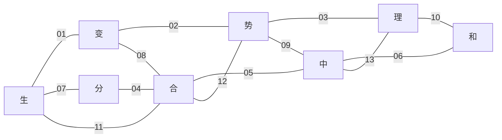

# 八字有类型规则图

**版本 v0.4｜2026年10月21日**

本册把原图的8节点、13条无向邻接登记为可检查的规则索引：9条有明确边界的现代规则、4条规范接口。每条都给出义项、条件、结论、证明依据和反例，并绑定可重跑查询。这里的完成，是全部13条邻接都有明确处置；不声称八字的全部意义或原典传统已被统一。

无向图仍是入口。下面的每条规则另有自己的推理方向，不能自动反向，更不能沿图一路传递“生成”“因果”或“善”。13条激活的既有义项来自08所登记的19个义项；本轮没有把中改成平均数、中心、稳定点或目标区间。未激活义项不由本图获得额外推论。

## 一 图与类型



| 节点 | 本轮使用的既有义项 | 类型 |
|---|---|---|
| 生 | `core.044.02` 实例进入模式 | Program |
| 变 | `core.045.01` 前后差异；`core.045.02` 改变过程 | Formula；Program |
| 势 | `core.061.01` 配置决定的可达画像 | InterpretationRecord |
| 理 | `core.002.01` 结构条理；`core.002.02` 可行路径的限制 | Formula；Program |
| 分 | `core.032.02` 结构拆分 | Program |
| 合 | `core.033.01` 形成组合结构；`core.033.02` 合并过程 | Formula；Program |
| 中 | `core.082.01` 情感未发的状态；`core.082.02` 时中的合宜判断 | Formula；NormJudgement |
| 和 | `core.083.01` 差异项协调；`core.083.02` 发而中节的评价 | Formula；NormJudgement |

事实命题描述一个状态；Program连接完整前后态；可达画像是从模型查询形成的解释记录；NormJudgement保存指定标准下的评价。四者通过明确接口连接，不能互相冒充。尤其，表达式的合取或顺接不会使现实中的部件自动合并。

类型登记还区分G1对象项与模型原始材料：Entity、Kind是本例已声明对象类；状态是求值参数；u/v部件与其集合用于原始组织算法，当前解释器没有因此新增Part对象类。表达模型固定一个参与者，其未发／已发谓词为零元谓词，未假装已经量化任意主体。具体机器类型以查询AST和模型声明为准。

## 二 共用的重组模型

生—分、分—合、变—合、生—合使用同一组实例和实际重组过程；生—变也在这里检验。A、B、C、D是四个稳定且互异的ID，u、v是两件部件。

```text
s0：A持有u/v，部件相连，信息齐，资源2
  └─split→ s1：B持有u，C持有v；A退出整体模式
               ├─merge→ s2：新整体D持有u/v、信息齐、资源1
               │               └─operate→任务完成
               ├─merge_lossy→ s3：D已形成，但v的信息丢失，不能operate
               ├─drain→资源0：attempt_merge可尝试但不能产生D
               ├─spoil→部件不兼容：attempt_merge不能产生D
               └─delay→错过时窗：物理merge仍可行，时宜规范禁止
```

正常重合恢复了u/v的整体组成，却没有恢复原实例A：新整体是D，资源也已消耗。有损重合则连完整信息都未恢复。谱系保存A→B/C及B/C→D，但谱系不等于严格同一。另一个cut_in_place只切断A内部连接，没有建立B/C新实例，用于反驳“凡分必生”。

原始记录保存活动实例、部件归属、连接、信息、资源、兼容关系及事件。E、InfoComplete、Coord、Done及各动作的允许边由公开算法求出，不把“生了”“和了”“可以完成”预填为真。Coord在本例专指：存在组织、部件两两兼容、所需信息覆盖全部部件；它不等于所有任务成功或伦理正当。

另有两个独立模型：constraints用固定有限图检验可达画像与边约束；expression_norms用未发、合节表达、失节表达及明确标准检验条件性称和。不同模型不能仅凭节点同名混合。

## 三 十三条规则总表

| ID | 邻接 | 最终状态 | 限定后的规则 |
|---|---|---|---|
| `edge_01` | 生—变 | 有明确边界的现代规则 | 指定实例的生起，是E存在投影的一种变化。 |
| `edge_02` | 变—势 | 有明确边界的现代规则 | 一次移动可以改变可达画像，也可以在画像不变时改变位置。 |
| `edge_03` | 势—理 | 有明确边界的现代规则 | 收紧允许边后，可达集合不扩大；未必严格缩小或更有利。 |
| `edge_04` | 分—合 | 有明确边界的现代规则 | 分后可再合，但部件重聚不恢复原身份，也不保证信息无损。 |
| `edge_05` | 合—中 | 明确规范接口 | 合并可行性与时宜规范分别计算，再决定该规范下准入。 |
| `edge_06` | 中—和 | 明确规范接口 | 已发且符合指定表达标准时称和；未发不保证后续和。 |
| `edge_07` | 生—分 | 有明确边界的现代规则 | 同一次split可共同满足旧整体终止与B/C生起。 |
| `edge_08` | 变—合 | 有明确边界的现代规则 | 指定merge改变成员组织；单有变化不必是合并，也不保证改善。 |
| `edge_09` | 势—中 | 明确规范接口 | 可达选项与规范评价独立会合；规范要求不生成物理路径。 |
| `edge_10` | 理—和 | 有明确边界的现代规则 | 结构相容须与资源、信息及重组算法共同满足，才产生本例协调结果。 |
| `edge_11` | 生—合 | 有明确边界的现代规则 | 兼容且有资源的指定merge产生新D；失败尝试不保证出生。 |
| `edge_12` | 合—势 | 有明确边界的现代规则 | 完整整合配置能开放operate目标；有损整体仍可能做不到。 |
| `edge_13` | 中—理 | 明确规范接口 | 结构约束后重新验非空，再接时宜规范；许可不能替代共同终点。 |

下列逐项说明中的来源支持语例及其语境。类型、有限状态、身份、成本、信息条件和规范表是公开增加的现代假设。来源共同出现在一条规则中，不表示其作者赞同同一历史体系。

## 四 逐边合同、依据与失败条件

### edge_01 生—变

**选义与角色。** 生：`core.044.02` 实例进入模式（Program）；变：`core.045.01` 前后差异（Formula）。

角色绑定：`P` 为 Kind；`i` 为 Entity with stable identity；`a` 为 Program。

**条件与前提。** 同一模型、模式和实例；存在条件E在前后态均有完整解释。 生选择进入模式义；变选择E投影的前后差异。 BornAs(P,i,a)=?¬E(P,i);a;?E(P,i) ChangeE(P,i,a)=(?¬E(P,i);a;?E(P,i)) ∪ (?E(P,i);a;?¬E(P,i))

**结论。** ⟦BornAs(P,i,a)⟧ ⊆ ⟦ChangeE(P,i,a)⟧；同一生起事件是E投影的一种变化。

**为什么成立。** BornAs恰是ChangeE的一个并集项，故关系包含成立。 主正例是split中Unit B生起；split中Org A终止检验逆命题反例。merge中D生起另由edge_11检验。

**反例。** ChangeE ⇒ BornAs不成立：split使A的E(Org,A)由真变假：是变化，不是A生起。 任意变量变化 ⇒ 出生不成立：drain只改变资源，未使一个新实例满足E。

**出处与增补。** 来源分别支持生生、变化、生成与气聚散的讨论；未给出本关系包含定理。 现代增加：有限E解释、稳定ID、比较投影和Program宏均为现代定义。 [Y03 《易传·系辞上》生生之谓易](https://zh.wikisource.org/wiki/易傳/繫辭上)、[Y04 《易传·系辞下》穷变通久](https://zh.wikisource.org/wiki/易傳/繫辭下)、[L06 《老子》王弼本五十一章](https://zh.wikisource.org/wiki/道德經_(王弼本)#五十一章)、[Z01 《庄子·知北游》气聚散生死](https://zh.wikisource.org/wiki/莊子/知北遊)

**核验绑定。** `edge_01.success`, `edge_01.counterexample`；模型 `reorganization`。

### edge_02 变—势

**选义与角色。** 变：`core.045.02` 改变过程（Program）；势：`core.061.01` 配置决定的可达画像（InterpretationRecord）。

角色绑定：`s,t` 为 States identifying positions in the finite graph；`move` 为 Program；`profile` 为 Reach_move(s)。

**条件与前提。** 势固定为move的有限可达画像，不是概率、能量或价值总分。 本模型将节点位置作为区分状态的投影；检查的两次移动均连接不同节点。 完整边表包含start→p及p→q。 Reach(start)={start,p,q,goal,harm}；Reach(p)=Reach(q)={p,q,goal}。

**结论。** start→p改变这项可达画像；p→q虽然位置改变，画像不变。变与势的关系由完整规则计算，不是一条无条件蕴含。

**为什么成立。** 对固定move从各起点计算自反传递闭包，比较其行集合。 success的compare_reach返回false，表示两画像不相等；counterexample返回true，反驳凡变必改势。

**反例。** 凡变必改变给定势画像不成立：p→q改变位置，但p、q处于相同可达区域，Reach相等。 变化必改善势不成立：本画像没有优劣顺序；少一个harm后继与少一个目标后继的评价不同。

**出处与增补。** 穷变通久与因利制权提供受限、变通及配置条件的语例，不规定此资源方程。 现代增加：有限位置图、完整move关系、Reach定义及两个起点的集合比较。 [Y04 《易传·系辞下》穷变通久](https://zh.wikisource.org/wiki/易傳/繫辭下)、[S1 《孙子·始计》因利制权](https://zh.wikisource.org/wiki/孫子兵法#始計第一)、[S3 《孙子·兵势》势如彍弩](https://zh.wikisource.org/wiki/孫子兵法#兵勢第五)、[L06 《老子》王弼本五十一章](https://zh.wikisource.org/wiki/道德經_(王弼本)#五十一章)

**核验绑定。** `edge_02.success`, `edge_02.counterexample`；模型 `constraints`。

### edge_03 势—理

**选义与角色。** 势：`core.061.01` 配置决定的可达画像（InterpretationRecord）；理：`core.002.02` 可行路径的限制（Program）。

角色绑定：`S` 为 fixed finite state set；`s` 为 initial state；`a` 为 Program；`allowed` 为 Program encoding physical/structural admissibility。

**条件与前提。** 比较时保持状态域、对象解释、初态与目标不变。 allowed仅作为明示转移约束，不与规范判断混型。 R=⟦a⟧，R′=⟦sync(a,allowed)⟧，因此R′⊆R。 Reach_R(s)={t | (s,t)∈R*}。

**结论。** Reach_R′(s) ⊆ Reach_R(s)。收紧边约束不增加可达状态；包含不保证严格。

**为什么成立。** 长度0的路径相同；每条R′边也是R边；对有限路径长度归纳。 以删去必要通道与删去冗余边分别展示严格缩小和不变。

**反例。** 限制越多势一定严格变小不成立：删除goal自环后，可达闭包仍含goal到自身的零步路径，所有Reach保持不变；这不证明goal仍有真实下一步。 受约束动作合法 ⇒ 目标必可达不成立：入口到中间节点合法，但最后出口边被排除。

**出处与增补。** 结构条理、循间隙及配置条件是解释入口；路径闭包单调性是现代证明。 现代增加：将理绑定为允许边，势绑定为Reach；固定比较范围。 [H1 《韩非子·解老》理者成物之文也](https://zh.wikisource.org/wiki/韓非子/解老)、[Z03 《庄子·养生主》依乎天理、因其固然](https://zh.wikisource.org/wiki/莊子/養生主)、[S1 《孙子·始计》因利制权](https://zh.wikisource.org/wiki/孫子兵法#始計第一)、[S3 《孙子·兵势》势如彍弩](https://zh.wikisource.org/wiki/孫子兵法#兵勢第五)

**核验绑定。** `edge_03.success`, `edge_03.counterexample`；模型 `constraints`。

### edge_04 分—合

**选义与角色。** 分：`core.032.02` 结构拆分（Program）；合：`core.033.02` 合并过程（Program）。

角色绑定：`A,D` 为 distinct Entity instances satisfying Org at different stages；`B,C` 为 distinct Unit instances；`u,v` 为 Part；`split,merge,merge_lossy` 为 Program。

**条件与前提。** 身份采用永久ID；A、B、C、D互不相等。 组成部件、信息记录、资源及谱系分别保存。 s0中A为整体，split:s0→s1产生B/C且A退出Org。 s1的资源与兼容条件满足时，merge:s1→s2形成D；merge_lossy:s1→s3也形成D但丢失v的信息记录。

**结论。** split;merge可恢复{u,v}的整体组成，但终态整体是D≠A且资源已耗；split;merge_lossy连完整信息也不恢复。故可顺接不等于互逆。

**为什么成立。** 用共同s1复合两条真实关系边。 分别比较部件集合、InfoComplete、资源原始值与eq(A,D)，不以一种相等代替其他种。

**反例。** merge是split的默认逆不成立：s0→s1→s2后实体由A变D且资源下降；状态没有回到s0。 部件重聚即信息无损不成立：s3仍有组织D及部件u/v，但v的信息记录丢失。

**出处与增补。** 以分合为变、分成毁提供重组与层次区别的入口，不证明所有分合可逆。 现代增加：四个实例的身份、部件与信息分离、资源成本和两种合并算法。 [S5 《孙子·军争》以分合为变](https://zh.wikisource.org/wiki/孫子兵法#軍爭第七)、[Z02 《庄子·齐物论》其分也成也](https://zh.wikisource.org/wiki/莊子/齊物論)

**核验绑定。** `edge_04.success`, `edge_04.counterexample`；模型 `reorganization`。

### edge_05 合—中

**选义与角色。** 合：`core.033.02` 合并过程（Program）；中：`core.082.02` 时中的合宜判断（NormJudgement）。

角色绑定：`merge` 为 Program；`action_merge` 为 Action bound explicitly to merge；`N_timely` 为 named normative registry；`s` 为 State。

**条件与前提。** 中固定为所声明时宜规范下的合宜判断，不作中心或稳定点。 可行性与规范表独立求值；Norm不变成Formula。 Feasible(s,merge)=〈merge〉⊤。 judge(N_timely,s,action_merge)取required/permitted/forbidden/undetermined之一。

**结论。** 按G1 decision：可行且required/permitted则eligible=true；不可行或forbidden则false；可行且undetermined则null。仅是该规范下准入。

**为什么成立。** 直接应用公开的decision定义，并显式记录Action与Program绑定。 s1、s1_late、s1_empty分别检验可行且合宜、可行但禁止、要求却不可行。

**反例。** 合并可行 ⇒ 时中不成立：s1_late的merge物理可行，但N_timely禁止。 应当合并 ⇒ 可执行不成立：s1_empty的规范仍要求merge，资源不足使其无后继。

**出处与增补。** 分合与时中各有文本入口；来源没有给出本项目的合并截止条件或准入函数。 现代增加：专门时宜规范N_timely、期限与资源原始记录、动作绑定及decision规则。 [S5 《孙子·军争》以分合为变](https://zh.wikisource.org/wiki/孫子兵法#軍爭第七)、[C06 《礼记·中庸》未发、中节、时中](https://zh.wikisource.org/zh-hans/禮記/中庸)

**核验绑定。** `edge_05.success`, `edge_05.counterexample`；模型 `reorganization`。

### edge_06 中—和

**选义与角色。** 中：`core.082.01` 情感未发的状态（Formula）；和：`core.083.02` 发而中节的评价（NormJudgement）。

角色绑定：`subject` 为 ContextSubject: the single stipulated participant of expression_norms, not a declared G1 Term；`expression` 为 Program express / express_fit / express_excess; observed manifestations stored separately as raw records；`N_expression` 为 explicit standard for all listed expression criteria。

**条件与前提。** 中取未发状态；和取发而中节的评价。中节不是未发谓词的另一个名称。 表达结果与规范检验分别记录；此为有限示范规范，不宣称经验情感动力学。 未发起点允许产生合节或失节的不同表达结果。 仅对已发生/明确模拟的表达，依据N_expression逐项检查全部已列标准。

**结论。** 已发且满足N_expression全部标准时，给HarmonyJudgement_N=和；出现失节项则不称和。未发本身不推出任一后续表达皆和。

**为什么成立。** 结论由公开的条件性称和规则取得，并保持为NormJudgement。 分别核验未发、合节表达、失节表达三类记录；不得将一般permitted直接改名为和。

**反例。** 未发之中 ⇒ 此后必和不成立：同一未发起点有失节表达的允许后继。 当前未发 ⇒ 已获得发而中节的和评价不成立：尚无表达，称和前提尚未满足。

**出处与增补。** 中庸区分未发与发而中节，并称后者为和。原文不是本项目枚举表达转移的经验规律。 现代增加：表达原始记录、有限候选后继、N_expression的明确判据及评价接口。 [C06 《礼记·中庸》未发、中节、时中](https://zh.wikisource.org/zh-hans/禮記/中庸)

**核验绑定。** `edge_06.success`, `edge_06.counterexample`；模型 `expression_norms`。

### edge_07 生—分

**选义与角色。** 生：`core.044.02` 实例进入模式（Program）；分：`core.032.02` 结构拆分（Program）。

角色绑定：`A` 为 old Org Entity；`B,C` 为 distinct new Unit Entity；`split` 为 Program；`L` 为 lineage predicate。

**条件与前提。** 同一split、同一前态和后态；E和L由事件与成员记录派生。 L不当作严格eq；出生均相对于指定模式。 s0中E(Org,A)且¬E(Unit,B)且¬E(Unit,C)。 s1中¬E(Org,A)且E(Unit,B)且E(Unit,C)，谱系含A→B、A→C。

**结论。** Enabled(sync(EndAs(Org,A,split),BornAs(Unit,B,split),BornAs(Unit,C,split)))在s0为真。

**为什么成立。** 三个事件宏都保留同一split边(s0,s1)，交集非空。 eq区分三个实体；L记录承接，不导出同一。

**反例。** 任何拆连接都生成新B/C不成立：cut_in_place只删去A内部连接，没有建立B/C实例，BornAs(Unit,B,cut_in_place)不可行。 后继承接 ⇒ 后继与前身严格相同不成立：L(A,B)、L(A,C)成立而A≠B、A≠C、B≠C。 不同后继各见证一次出生 ⇒ 同一分裂中共同出生不成立：需sync共同前后态；分叉成两条各生一人的边不能满足共同出生查询。

**出处与增补。** 分成毁、气聚散与生生为不同文本入口；本例不把它们合成普遍生物分裂规律。 现代增加：实例域、模式、稳定ID、split算法及谱系记录。 [Z02 《庄子·齐物论》其分也成也](https://zh.wikisource.org/wiki/莊子/齊物論)、[Z01 《庄子·知北游》气聚散生死](https://zh.wikisource.org/wiki/莊子/知北遊)、[Y03 《易传·系辞上》生生之谓易](https://zh.wikisource.org/wiki/易傳/繫辭上)

**核验绑定。** `edge_07.success`, `edge_07.counterexample`；模型 `reorganization`。

### edge_08 变—合

**选义与角色。** 变：`core.045.01` 前后差异（Formula）；合：`core.033.02` 合并过程（Program）。

角色绑定：`B,C,D` 为 Entity；`merge` 为 Program；`projection` 为 Org/Unit membership and composition。

**条件与前提。** 合指真实模型重组程序，不指逻辑and、Join或seq。 比较同一对象域与同一存在/组成判据。 merge从B/C为分立Unit、D不为Org的s1出发。 终态s2中D为Org且B/C退出本例Unit模式。

**结论。** 此merge在E(Org,D)及指定成员组织投影上非恒等，因此属于相应变化；不据此断言所有合都改善系统。

**为什么成立。** 主正例逐边比较前后holdings，确认每条merge都改变成员/部件归属；D的E由假变真另由edge_11检验。 使用原merge边作见证，避免把单纯表达式组合误当世界变化。

**反例。** 形成合表达式 ⇒ 现实已改变不成立：构造W1∧W2或Join只形成Formula，状态不因此转移。 合并变化 ⇒ 功能改善不成立：merge_lossy形成D却丢信息，不能执行operate。

**出处与增补。** 孙子明确以分合为变；本例将成员和模式变化操作化，未把军队分合推广成所有系统的规律。 现代增加：重组算法、成员和信息记录、比较投影及固定ID。 [S5 《孙子·军争》以分合为变](https://zh.wikisource.org/wiki/孫子兵法#軍爭第七)、[Y04 《易传·系辞下》穷变通久](https://zh.wikisource.org/wiki/易傳/繫辭下)

**核验绑定。** `edge_08.success`, `edge_08.counterexample`；模型 `reorganization`。

### edge_09 势—中

**选义与角色。** 势：`core.061.01` 配置决定的可达画像（InterpretationRecord）；中：`core.082.02` 时中的合宜判断（NormJudgement）。

角色绑定：`A_set` 为 finite named action set; the present primary example uses {merge}；`ReachProfile` 为 derived action/goal feasibility record；`N_timely` 为 normative registry。

**条件与前提。** 势为指定选项的可达画像，画像按实际转移求得。 中为N_timely的合宜判断；两者保持独立。 对每个a∈A_set计算Feasible(s,a)=Enabled(bound_program(a))。 对同一a读取N_timely的判断。

**结论。** Eligible_N(s)由逐行动decision结果为true的行动组成；单独的可达画像不决定这一个集合。undetermined单列，不当作准许。

**为什么成立。** 规则可用于任一明确的有限动作集；当前主实例A_set={merge}，逐项计算后继非空与规范判断，再应用decision。 不声称这两条主查询已经枚举N_timely的所有动作；规范要求也不生成物理边。

**反例。** 可达更多 ⇒ 更合宜不成立：迟到状态保留merge边，但N_timely禁止该行动。 合宜或required ⇒ 已发生不成立：规范及eligible仅是判断，没有执行记录。

**出处与增补。** 因情选择、配置条件及时中提供问题入口；未给出自然可达性到规范的蕴含。 现代增加：有限动作集、目标绑定、N_timely标准和decision集合定义。 [S1 《孙子·始计》因利制权](https://zh.wikisource.org/wiki/孫子兵法#始計第一)、[S3 《孙子·兵势》势如彍弩](https://zh.wikisource.org/wiki/孫子兵法#兵勢第五)、[L06 《老子》王弼本五十一章](https://zh.wikisource.org/wiki/道德經_(王弼本)#五十一章)、[C06 《礼记·中庸》未发、中节、时中](https://zh.wikisource.org/zh-hans/禮記/中庸)

**核验绑定。** `edge_09.success`, `edge_09.counterexample`；模型 `reorganization`。

### edge_10 理—和

**选义与角色。** 理：`core.002.01` 结构条理（Formula）；和：`core.083.01` 差异项协调（Formula）。

角色绑定：`D` 为 Entity；`RequiredParts` 为 finite Part set；`attempt_merge` 为 Program；`structural_allowed` 为 Program derived from bond compatibility；`Coord` 为 descriptive predicate derived from raw organization records。

**条件与前提。** 和仅取本例可检查的结构协调，不取情绪中节或伦理正当。 完整记录角色/部件、连接、兼容性和信息；Coord不得先置真再当证明。 s1提供相容部件、完整信息和足够资源；尝试合并按明确算法生成后态。 在后态，Coord(D)由组织、各对部件兼容、信息覆盖全部部件的条件计算。

**结论。** s1满足〈sync(attempt_merge,structural_allowed)〉Coord(D)；缺资源的s1_empty不满足。结构允许并不独自保证协调结果。

**为什么成立。** 先执行有资源与部件条件的重组算法，再从后态raw记录计算Coord。 低资源失败尝试仍实际可执行，也可符合连接兼容约束，但没有产生D或Coord(D)。

**反例。** 结构上允许的尝试 ⇒ 协调结果不成立：s1_empty保持兼容且attempt可执行，但资源不足，D与Coord(D)不成立。 有结构或有规则 ⇒ 和不成立：s3的D仍是一个组织，但信息不完整，Coord(D)为假。 Coord ⇒ 一定永续或正当不成立：Coord没有资源无限供给或规范认可的前提。

**出处与增补。** 理的结构条理与和的差异协调来自不同文本；此Coord判据是现代局部定义。 现代增加：RequiredParts、连接与兼容规则、信息完整性、由raw派生Coord的具体算法。 [H1 《韩非子·解老》理者成物之文也](https://zh.wikisource.org/wiki/韓非子/解老)、[Z03 《庄子·养生主》依乎天理、因其固然](https://zh.wikisource.org/wiki/莊子/養生主)、[C05 《国语·郑语》和实生物](https://zh.wikisource.org/zh-hans/國語_(四庫全書本)/卷16)、[C08 《论语》和而不同](https://zh.wikisource.org/zh-hans/論語/全覽)

**核验绑定。** `edge_10.success`, `edge_10.counterexample`；模型 `reorganization`。

### edge_11 生—合

**选义与角色。** 生：`core.044.02` 实例进入模式（Program）；合：`core.033.02` 合并过程（Program）。

角色绑定：`B,C` 为 Unit Entity；`D` 为 fresh Org Entity；`merge` 为 Program。

**条件与前提。** B/C不同于D；D此前未满足Org。 指定合并算法要求相容部件和足够资源；出生不自动等于功能完整。 s1满足该算法的部件、兼容与资源条件。 merge将其组成D，并登记B→D、C→D的谱系。

**结论。** Enabled(BornAs(Org,D,merge))在s1为真；新身份是D而非A复活。信息损失支路可仍出生但未协调。

**为什么成立。** 从raw记录与merge生成事件计算E(Org,D)的前假后真。 结合谱系与eq分别说明由来和严格同一，不从L偷推eq。

**反例。** 任何聚合尝试都会出生不成立：资源不足或部件不兼容时attempt_merge进入失败态，D不生。 新整体出生 ⇒ 原A恢复／功能完备不成立：D≠A；lossy合并产生D但InfoComplete和Coord为假。

**出处与增补。** 知北游聚则为生是气论语例；把聚类比为本例合并属于明确新增桥梁，不等同军队会合或生物出生。 现代增加：组织存在判据、fresh ID、资源与兼容条件、失败和丢信息分支。 [Z01 《庄子·知北游》气聚散生死](https://zh.wikisource.org/wiki/莊子/知北遊)、[L06 《老子》王弼本五十一章](https://zh.wikisource.org/wiki/道德經_(王弼本)#五十一章)、[S5 《孙子·军争》以分合为变](https://zh.wikisource.org/wiki/孫子兵法#軍爭第七)

**核验绑定。** `edge_11.success`, `edge_11.counterexample`；模型 `reorganization`。

### edge_12 合—势

**选义与角色。** 合：`core.033.01` 形成组合结构（Formula）；势：`core.061.01` 配置决定的可达画像（InterpretationRecord）。

角色绑定：`D` 为 Org Entity；`operate` 为 Program；`Done` 为 task-completion Formula。

**条件与前提。** 合指满足明确关系判据的整体配置；势只问operate到Done这一可达项。 operate边由Coord(D)及resource≥1生成。 s2由正常merge产生，Coord(D)为真且资源足够。 s3由lossy merge产生，D虽存在但InfoComplete及Coord为假。

**结论。** s2满足〈operate〉Done，s3不满足；有效配置及其条件共同决定该可达项，单独组织标签不够。

**为什么成立。** 由raw计算Coord与资源条件，再生成operate边，最后求值模态目标。 用同为D整体的s2/s3比较，隔离信息完整这一作用条件。

**反例。** 合成整体 ⇒ 所有目标可达不成立：s3已有D但无operate后继。 联结越多则一切势指标越好不成立：本规则只判断一个指定目标；未定义总优势、概率、稳定性或伦理价值。

**出处与增补。** 组织分合、配置蓄势和势成之提供语例；operate开放条件是现代任务机制。 现代增加：任务Done、信息与资源阈值、operate算法，以及正常/有损结构的比较。 [S5 《孙子·军争》以分合为变](https://zh.wikisource.org/wiki/孫子兵法#軍爭第七)、[S1 《孙子·始计》因利制权](https://zh.wikisource.org/wiki/孫子兵法#始計第一)、[S3 《孙子·兵势》势如彍弩](https://zh.wikisource.org/wiki/孫子兵法#兵勢第五)、[L06 《老子》王弼本五十一章](https://zh.wikisource.org/wiki/道德經_(王弼本)#五十一章)

**核验绑定。** `edge_12.success`, `edge_12.counterexample`；模型 `reorganization`。

### edge_13 中—理

**选义与角色。** 中：`core.082.02` 时中的合宜判断（NormJudgement）；理：`core.002.02` 可行路径的限制（Program）。

角色绑定：`a` 为 Program；`preserve_information` 为 Program encoding transition admissibility；`N_timely` 为 normative registry；`action_a` 为 Action。

**条件与前提。** 约束表达一组允许候选边；筛选本身不改变原过程的实际物理结果。 中取时宜规范，理取明确前后态约束，二者不互相充当依据。 a_eff=sync(a,preserve_information)。 重新计算Enabled(a_eff)，同时读取judge(N_timely,s,action_a)。

**结论。** 以明确绑定的a_eff调用decision；只有共同终点约束非空且规范required/permitted才准入。原a可行与规范许可两项仍可能不足。

**为什么成立。** 先计算关系交集，确认存在同一前后态见证，再进行规范准入。 merge正常边保信息，merge_lossy不保信息；后者即使时间规范许可也不能通过此受约束方案。

**反例。** a与限制各自可行 ⇒ sync(a,限制)可行不成立：两者可能只有不同终点；必须求真正交集。 规范许可且原动作可行 ⇒ 受约束方案可执行不成立：s1的merge_lossy获时间许可，但与preserve_information无共同边。 过滤危险边 ⇒ 现实动作已被控制不成立：筛选仅得到候选方案；实现该约束仍需控制与执行依据。

**出处与增补。** 时中与循结构各自有来源；不存在无条件由结构推出合宜的原典定理。 现代增加：信息保持约束、共同终点交集、动作到受约束程序的绑定及N_timely。 [C06 《礼记·中庸》未发、中节、时中](https://zh.wikisource.org/zh-hans/禮記/中庸)、[H1 《韩非子·解老》理者成物之文也](https://zh.wikisource.org/wiki/韓非子/解老)、[Z03 《庄子·养生主》依乎天理、因其固然](https://zh.wikisource.org/wiki/莊子/養生主)

**核验绑定。** `edge_13.success`, `edge_13.counterexample`；模型 `reorganization`。

## 五 规范接口的两项特别约定

`N_timely`只评价是否错过所声明时窗，不包含信息完整、身份恢复、结构协调或总体伦理最优。required/permitted与物理可行性会合后得到的是本规范下的准入，不表示已经执行。

`N_expression`专门评价`assess_expression`。本模型约定，已有表达且每一条表现都符合公开的形式表，返回permitted并在表外称“在此标准下和”；有失节项返回forbidden；尚无表达返回undetermined。这个命名绑定不推广到其他规范：任意permitted不等于和，时机合宜也不等于情感中节。

“中节”是本条和的评价条件，不是未发状态的重复命名。合节／失节两条允许表达支路只构成一个公开的反模型；它们不是已验证的人类情感因果规律。

## 六 验收结果及适用范围

规则登记已与当前执行结果对齐：13条边各有正例或规范判定及反例，共26项主查询；验证包目前报告48项查询、432项原始事实核对和2项类型拒绝检查通过。主查询返回false可能正是在确认预期反例；应查看passed，而不是把所有false都当验证失败。

可复用的一般推理包括：BornAs对存在变化的包含；边关系包含导致其闭包包含；同一中间状态上的过程顺接；同一前后态的关系交集。具体split、merge、资源和规范结果，则只在本册声明的模型中成立。

这使原图从概念索引推进为有条件规则索引。它能在给定事实和规则下产生未逐项预填的模型结论；能否解释未见文本、迁移到新领域，或比普通状态转移语言更有效，仍需另行比较。图中的闭环本身不承担这项证明。

机器登记见 `typed_graph.json`；每条verification_contract给出对应执行结果文件、主查询与支持查询ID。原始输入、派生模型及完整AST保存于配套验证包，不在本登记中另造第二套动力规则。
