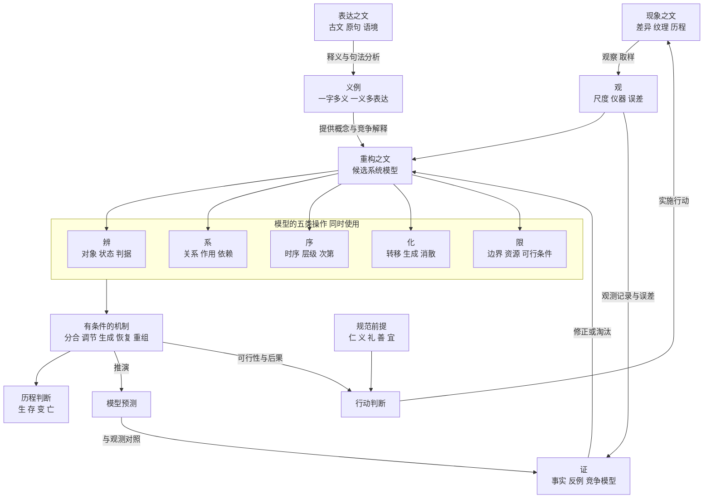
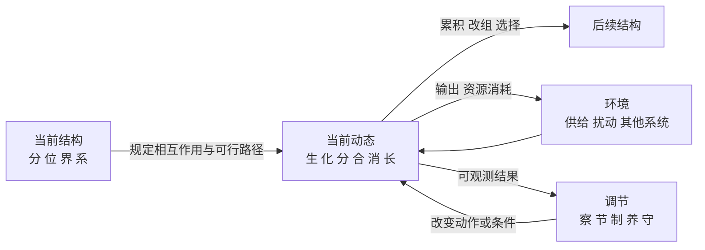

# 文理生生 基础全图与动态文法

**版本 v0.2　2026年10月21日　全面复核修订**

这套模型要回答的是：在明确尺度、对象身份与观察条件之后，怎样用一组可组合的概念，解释一个系统何以出现、延续、改变和终止。

本次把原先的研究纲领推进为一套可检查的候选架构。**以「文」为入口，以「辨、系、序、化、限」组织描述，以有条件的机制解释变化，以「观、证」检验解释；涉及人的行动时，另行交代价值与规范。**「五元」的数量、模型的普遍性与阅读迁移效果，仍是待检验主张。

配套文件：

- [逐字动态映射与古文出处](04_逐字动态映射与古文出处_v0.2.md)：每个概念字的语境义、操作类型、动态对应、限制与来源。
- [原典证据索引与校勘说明](05_原典证据索引与校勘说明_v0.2.md)：原句、篇章、链接、语境及对原稿的校正。
- 原来的研究计划与对话记录保存在同目录的 01、02 文件中，内容未作改写。记录中的旧指令仅作为历史材料，本次交付按当前请求展开。

## 一 文为什么可以成为基础

### 文的三层及其相互校验

本模型给「文」的工作定义是：**有差异的成分，在一定关系与时序中呈现出的可辨样态。**这是本项目的定义，不能冒充古代各家共有的一条公理。

这一定义已经借用了差异、关系与时序，因此「以文为基」在当前版本中是**研究入口与组织原则**，并非从一个更原初的文概念逻辑推导出五元。五元的选择有现代建模的设计成分，须由逐句重建、竞争方案和实际任务来检验。

古文为这个定义提供了几条不同的入口。《贲·彖》通过天文察时变；《系辞下》以物相杂谈文；《韩非子·解老》用「成物之文」解释理；《说文·叙》讨论文、字与书的形成；《文心雕龙·原道》将自然纹理与人的文相联系。这些文本的问题、年代与立场不同，关联不能抹去差别。[《周易·贲》](https://zh.wikisource.org/wiki/周易/賁)、[《周易·系辞下》](https://zh.wikisource.org/wiki/易傳/繫辭下)、[《韩非子·解老》](https://zh.wikisource.org/wiki/韓非子/解老)、[《说文解字叙》](https://zh.wikisource.org/wiki/說文解字/15)、[《文心雕龙·原道》](https://zh.wikisource.org/wiki/文心雕龍/原道)。

| 层次 | 指什么 | 在模型里做什么 | 需要防止的混淆 |
|---|---|---|---|
| 文一 现象之文 | 可辨的形态、差异、关系与变化痕迹 | 给观察与对象识别提供材料 | 可见的规则性不一定是因果规律 |
| 文二 表达之文 | 字、词、句、章及其历史语境 | 把所见、所想变成可以传递的表达 | 同一个字在不同文本里未必同义 |
| 文三 重构之文 | 读者重建的概念组合和解释模型 | 提出可推演、可反驳的结构与机制 | 模型自洽不等于世界确实如此 |

三层形成校验回路：现象约束表达，表达引导模型，模型产生预期，新观察修正模型与解读。古文和自然观察是不同证据：前者支持「该文本说了什么」，后者才能支持「世界在何种条件下如此运行」。

### 文 理 道 德在全图中的位置

**文**使某种组织样态可辨；**理**在本模型中指对这种样态之条理、制约和生成机制的说明；**道**保留为文本中的总体路径或生成秩序问题；**德**保留为具体事物或行动者的成就、养成或规范品质问题。后两字必须逐篇解释，不能直接分别写成一个万能转移函数和一个适应度数值。

《韩非子·解老》的「理者，成物之文也」是连接文与理的重要锚点，但该篇仍有自身的道论与政治思想。把它转换为现代约束模型，是一次有明确增补的重构。[《韩非子·解老》](https://zh.wikisource.org/wiki/韓非子/解老)。

**foundation 不是一个最先推动万物的汉字。它是一组允许我们从样态走向解释、再让解释接受纠错的关系。**

## 二 全模型地图



图中的箭头有不同含义，关键边已标注；其余边表示模型的组织与分析关系。古文通向模型的箭头是**解释资源**，不是对现实因果关系的证明；预测由模型推演，实施行动后的实际结果仍须经过观察进入证据。规范通向行动的箭头加入了价值前提，不是从自然运行自动推出道德。

五元并列使用。我们常先辨后系，是建模的工作顺序；世界并不因此先完成辨，再完成系。对象如何被区分也取决于已知关系：同一群细胞，按血缘、功能或空间边界会形成不同划分。

## 三 五元各自是什么操作

| 操作 | 输入与输出 | 主要概念字 | 可追问的具体问题 |
|---|---|---|---|
| 辨 D | 场景与判据 → 可区分对象、状态或类别 | 同、异、名、实、象、形、物、分 | 在什么尺度下，把什么算作一个对象？ |
| 系 R | 已区分项与关系类型 → 关系网 | 相、交、感、应、合、因、故 | 是相似、共同出现、构成、必要条件，还是因果作用？ |
| 序 O | 事件或位置集合 → 顺序、偏序或层级 | 时、序、位、先、后、始、终、久 | 哪些事须先发生？哪些可以并行？谁包含谁？ |
| 化 T | 前态与条件 → 一个或多个可能后态 | 生、变、成、分、合、反、复、消、长 | 哪个变量、成员、关系或规则发生了变化？ |
| 限 C | 状态、动作与条件 → 可行或不可行 | 界、度、节、制、量、穷、势 | 什么资源、边界或规则排除了哪些后果？ |

「辨」在这里是建模操作，而非要求宇宙必须有一个观察者。「系、序、化、限」也首先是描述接口；是否对应某个客观结构，要靠证据决定。

「序」包含时间顺序和结构层级，但两者要分类型。「位」是结构中的位置，位置影响作用，不能因其排在时序一栏就理解为时间。「势」通常跨越系、序、化、限：它来自配置，表现为某些变化更容易发生，不能简化为孤立的限制量。

「限」还须区分两类：某一步合法的**转移条件**，以及在一段时间内仍能存在的**持续条件**。一次转移可以合法，却把系统带入无法继续的状态。

## 四 结构与 dynamics 怎样相互生成

这里的 dynamics 指「在什么条件下，什么从何态变为何态」。只有动态标签还不够，至少要给出变化对象、规则、条件和可区分的结果。



这是**现代机制示意**。不是每一个结构都由当前所研究的动态生成：初始结构也可能继承自更早历史或外部作用。不是每一个系统都有调节者：被动稳定、开放过程和主动控制必须分开。调节也可能失败、放大扰动或延误响应。

### 五类词怎样进入 dynamics

| 类型 | 例字 | 进入动态模型的方式 |
|---|---|---|
| 过程 | 生、变、分、合、消、长 | 直接标记一种转移，但仍需指定被转移的变量 |
| 状态与结构 | 形、位、界、本、末 | 规定变化发生在哪里、涉及谁、保持什么组织 |
| 关系与句法操作 | 相、自、共、因、则、不 | 指定作用方向、参与者、依赖或条件；它们不是独立的物理力 |
| 条件与调节 | 时、势、度、节、制 | 改变允许的转移集合、发生概率、速率或控制动作 |
| 认识与规范 | 观、知、证、仁、义、宜 | 前者更新模型，后者评价行动；须交代如何通过行动影响系统 |

所以「每个字的 dynamics 对应」应包括**直接转移、对转移的约束、对转移的描述、对转移的认识或评价**。强行让每个字都等于一种运动，会损失原来的洞见。

## 五 可计算而不偷换古义的模型骨架

### 把世界 模型与观察分开

用 `c` 记录研究任务、空间时间尺度、分类判据与身份准则。模型中的一个状态为：

`S_t = (V_t, R_t, x_t, B_t, q_t, m_t)`

- `V` 是当前辨出的单元；`R` 是带类型的关系。
- `x` 是状态量；`B` 是系统边界及与外界相连的接口。
- `q` 是本次研究要允许改变的内部规则或参数；固定自然规律不因被写进模型就可任意改变。
- `m` 是影响未来的记忆或历史变量。不必假定一个瞬时截面已经包含全部历史作用。

再指定外界输入 `e_t`、可能的行动 `a_t`、持续条件域 `K_c` 和可行转移约束 `C`。在这些条件下：

`S_(t+1) ∈ F_c(S_t, e_t, a_t ; C)`

这里 `F` 可以给出多个后继。这种单步写法要求 `m_t` 已保留与预测相关的历史；做不到时，须让 F 显式依赖历史，不能用一项记忆符号掩盖遗漏。只有证据足够时才赋予概率；有随机模型时可写成条件分布，不能把「不知道」一律当成某个已知随机分布。没有主动行动者的案例，省去 `a`。

观察记为 `y_t = H_c(S_t, 观测条件)`，包含漏检、分辨率及误差。`S` 本身仍是模型，不是直接拿到世界本体。世界通过实际观测结果约束 `S、F、H` 的联合选择。

这个骨架容许组件诞生或移除、关系改组、边界变动、内部规则学习。若系统的输出会改变其后续环境输入，就须再给出环境状态 `Z_t` 及其更新规则，联合更新 `(S_t,Z_t)`；不能一面声称双向作用，一面永远把环境当作不受影响的外给序列。若采用连续时间、异步事件或部分有序因果，必须相应重定义事件索引；本稿的 `t+1` 只是离散示范。

### 生 存 变 亡的精确定义

先分开**模式种类 P**和**具体实例 i**。两处彼此独立的火可以满足同一种火焰模式，但各有自己的出现与终止。

`E_c(P,i,S_t)` 表示实例 i 在该状态满足 P 的存在判据；`E_kind(P,S_t) := 存在至少一个 i，使 E_c(P,i,S_t) 成立` 只回答此类模式是否出现。再以 `I_c(i_t,j_(t+1))` 判断两个截面上的实例是否按预先说明的准则属于同一个实例。实例标记用于追踪，不是赋予对象一个不可改变的形而上本质。

| 判断 | 工作定义 | 需要另加的条件 |
|---|---|---|
| 模式出现 | `¬E_kind(P,S_(t−1)) ∧ E_kind(P,S_t)` | 可能是首次出现，也可能复现；不会记录同类的第二个实例诞生 |
| 模式首次生起 | E_kind 当前成立，且指定历史范围内所有更早时点都不成立 | 历史不完整时，只能说「范围内首次」 |
| 实例生起 | 当前实例 j 满足 E，且前一截面没有满足 E 并与 j 成立 I 的实例 | 已有同类模式时仍可新增实例；重现、休眠及跟踪丢失需另判 |
| 实例存续 | 前后实例都满足 E，且两者之间 I 成立 | 仅外形相似不足以判定同一实例；离散采样不排除间隔内中断 |
| 变化 | 在同一比较框架下，状态、关系、边界或规则发生差异 | 对象终止时，不对不存在的后态硬算数值差 |
| 模式终止 | E_kind 当前成立，下一截面不成立 | 表示此研究域内该类实例均不再满足判据，非组成物消失 |
| 实例终止 | 当前实例满足 E，但下一截面没有满足 E 且与之成立 I 的实例 | 同类的其他实例仍可存在；与实例的暂时不活动、漏检分开 |
| 时窗内不可恢复 | 在指定环境与可行行动下，给定有限时窗内没有恢复目标模式或活动的路径 | 超出时窗仍可能恢复，不称为严格不可逆 |
| 指定模型下不可逆 | 在持续采用的规则、环境及干预范围内，任意未来时刻都不存在恢复目标的路径 | 必须说明恢复目标；重建同类模式不是同一个体复活 |

以上生起与终止均相对于所选 P：同一人从学生转为教师，可以不再满足学生模式，却不表示这个人整体消亡。上述判断首先是在所选离散模型中的判断。仅在两个采样点都检出对象，不能排除中间曾终止、重建或被替换；要主张连续存续，还需更密集证据或明确的过程假设。`未检测到 P` 不等于 `P 不存在`，不知道 I 是否成立也不等于 I 不成立。

**同一关系 I 与谱系承接关系 L 分开。**系统分裂或合并可以有一对多、多对一的 L，表示衍生、继承或合流；不因此把不同后继都断为数值上同一个实例。细胞 A 分裂为 B、C 时，可以记录 `L(A,B)` 与 `L(A,C)`，同时记录 B 与 C 是两个实例。社会组织是否有某一后继继承原身份，则按其身份准则另判。

《荀子·正名》对「有化而无别」与「一实」的讨论，支持把状态变化和对象同一分开提问；上面的全部谓词、时间范围和检测模型是本稿增加的现代定义。[《荀子·正名》](https://zh.wikisource.org/wiki/荀子/正名篇)。

### 从一时可行走到持续可行

给定有限时长 `T`，若从当前状态出发存在一条允许的轨迹，使每一步都留在 `K_c`，称为「在 T 内有可持续路径」。更强的稳健要求是：存在一个只利用当时可得信息的可实施策略，使所有允许扰动及集合值转移的可能后继都保持在域内。不能观察完整未来之后，分别替每条扰动路径找出一套好动作，便称已经找到稳健策略。

其中轨迹必须能实际延伸满 T 步。在每个尚需继续的步骤，都要存在可实施动作，并要求允许扰动下的后继集合**非空**且留在 K 内；空集虽形式上是 K 的子集，却不表示系统能够继续。模型未定义下一步与现实过程终止，也须分别记录。

「能存一刻」「能存十步」「可无限延续」是三个不同命题。「仍活着」也不等于「能恢复」「能适应」「能繁殖」。在模型里分别设判据，才不会把所有好结果统称为生生。

## 六 从字到组合 再到机制

### 组合须保留类型与句法

可用如下工作文法记录义例：

```text
义例 = 字词 + 原句 + 句法角色 + 篇章语境 + 版本
事态 = 参与者 + 属性或关系 + 尺度
转移 = 前态 + 变化规则 + 条件 + 后态
机制 = 一组相互连接的转移 + 可失败条件
历程 = 转移按时间或事件关系组成的轨迹
行动判断 = 可行后果 + 显明的价值前提 + 决策规则
```

这不是先秦语法学的自称体系，而是本项目的标注格式和推理需求。**目前尚未给出完整的形式文法**：原语类型、允许的组合、组合后的语义，以及何种推理可推出何种结论，都还没有构成可执行的完备规则集。否定、条件、方向、量词与范围必须保留：删去「不」「则」「相」之后，往往已经是另一个主张。

| 组合 | 可读出的结构 | 现代重构须补什么 | 容易犯的错误 |
|---|---|---|---|
| 有无相生 | 一对概念在对待关系中互显，亦有更强的生成读法 | 指定采用哪种读法及对象 | 从概念相依直接推出物理互因 |
| 相生 | A 与 B 的生成关系 | 是互为条件，还是 A 促进 B；确定方向与时间 | 见「相」便认定对称双向作用 |
| 自生 | 以自身或自身过程为生成说明的一部分 | 系统边界、外部资源、历史条件 | 自组织等于不需环境 |
| 共生 | 本稿作为现代共同生活或相互依存标签 | 各方净效应、条件、时间范围 | 同处必互利，或假定古代已有现代生态定义 |
| 生生 | 生成过程的接续 | 是个体持续、代际再生还是多层次生成 | 推出每个个体永生或宇宙无限增殖 |
| 分合 | 划分与结合可改变组织 | 划分标准、结合关系、身份承续 | 物理靠近自动形成一个功能整体 |
| 消长 | 指定量的减少与增加 | 哪些量，是否守恒，是否互有关系 | 两量必等量反向 |
| 感应 | 作用与响应 | 中介、时滞、对照、其他共同原因 | 共同变化就证明远距感应 |
| 制衡 | 本稿采用的约束与反向调节组合 | 执行机制、增益、延迟、权力关系 | 有制约必稳定、稳定必正当 |
| 和而不同 | 协调可与差异并存 | 何谓协调，差异怎样贡献或破坏协作 | 差异越多越好 |
| 穷变通久 | 遇限、改组、打开路径、延续的论说 | 可选方案、代价、持续条件 | 把四个环节写成无条件必然链 |
| 时中 | 判断适宜要看时与境 | 规范标准、行动者责任及情境 | 等于数值取中点 |

原句与语境见配套证据索引；「共生」「制衡」在此处的操作定义以现代用法登记，未据构字给它们虚构先秦出处。

### 一个可画出关系环的历史子模型

原对话提及的五行相生相克，可以接入为一个有出处的**历史子模型**。《春秋繁露》四库本《五行之义》《五行相生》《五行相胜》给出如下有向关系：

```text
生环  木 → 火 → 土 → 金 → 水 → 木
胜环  木 → 土 → 水 → 火 → 金 → 木
```

箭头分别表示该文献中的生与胜，不是现代科学已经确认的物质转化或力学作用。相关篇章把五行与五官的供给、治理、纠察相联系；相胜各边的机制并不相同，木胜土还涉及君失政而民叛。它体现了「节点相同、关系类型不同，就形成不同作用网络」的组合方式，但不能省略各边的具体论证。原典所核术语是相胜，日常所说相克在本稿作通称，不能把每一处克字都机械变成胜环的边。[《春秋繁露》四库本卷十一](https://zh.wikisource.org/wiki/春秋繁露_(四庫全書本)/卷11)、[卷十三](https://zh.wikisource.org/wiki/春秋繁露_(四庫全書本)/卷13)。

这个子模型不升格为五元的证明，也不预设凡系统都只有五类成分。把它用于现实解释，还需要指定每个节点对应什么、边怎样作用、时滞和强度是多少，以及哪些结果会否定该对应。

### 十组候选机制

以下每行都是可检验机制的**模板**，不是凭古文已经成立的自然规律。

| 机制 | 概念组合 | 最低机制内容 | 失败或反向情形 |
|---|---|---|---|
| 识别与表征 | 辨—分—位—形 | 选定判据后，在描述中识别部分、位置与形态 | 划分改变的是表征；现实结构如何形成仍须另给机制 |
| 联结与组织 | 交—合—系—成 | 部分之间形成可识别关系，满足组织判据 | 仅共处、无相互作用；组合反而破坏功能 |
| 耦合与响应 | 感—应—相—化 | 输入经路径改变接收方状态 | 共同原因、观察偏差、响应延迟 |
| 积累与阈值 | 积—长—度—变；几可作早期征候 | 某量累积跨越阈值，使允许转移改变；可观测征候另建 | 无阈值、信号不可靠、增长在到达前停止 |
| 供给与维持 | 养—节—守—存 | 输入补偿消耗，并保持关键组织 | 资源错配、输入不足、供给本身有害 |
| 调节与稳定 | 察—制—衡—复 | 根据偏差调整作用，使轨迹回到允许域 | 时滞、过度调节、错误目标造成失稳 |
| 重组与适应 | 穷—变—通—久 | 旧路径受限，新路径在给定期限内可持续 | 新路径不存在、转换成本过高、暂通后绝 |
| 代际延续 | 生—成—生生 | 一个过程产生后续实例，族群或组织模式延续 | 个体能存但不能再生，或再生破坏环境 |
| 瓦解与终止 | 衰—乱—坏—散—亡 | 关键关系或持续条件失效，身份判据不再成立 | 结构暂乱仍可恢复，个体亡而群体续 |
| 学习与修正 | 观—辨—知—证—改 | 根据误差更新解释，接受新情形检验 | 只会复述、事后补解释、拒绝反例 |

十组包含表征操作和世界过程的机制模板，二者的边须分别记录。它们并非单一生命周期流水线。调节可以发生在生成中，分合可以造成存续也可以造成终止；成长可能促成失稳。图谱应当允许这些交叉与反向边。

## 七 三个可以检查结果的演示

### 资源维持与穷变通久

设一个抽象组织有储备 `r`，每步得到 `s`、消耗 `d`，规则为 `r' = r+s−d`，持续条件为 `r≥0`。这只是演示用模型，没有声称是某个真实组织的测量结果。

从 `r=3，s=1，d=2` 开始，储备依次为 `3、2、1、0、−1`，第四步越出持续域。「尚存」因此不能推出「可久」。这里的「长／消」对应储备增减，「度／限」对应零阈值，「养」对应输入，「节」可对应降低消耗。

若在初始时支付一次改组成本 `k=2`，把每步消耗降为 `d=1`，改组后储备为 1，此后保持 1，存在持续路径。若拖到储备仅剩 1 时才需要支付 2，而模型又禁止负储备或借贷，改组已经不可行。**时机之所以重要，是可行路径随储备改变；不是「时」这个字自身施加了一个力。**

若改组后供给降为 0，储备仍会继续下降。「变则通」须依赖有效方案与环境条件，「通则久」还须依赖后续条件维持。

### 稳定 过调与反

令 `z` 为某个量相对目标的偏差，设调节规则 `z'=(1−k)z`。这是一次没有延迟的线性演示。以下取初始偏差非零；若初始已为零，则一直为零。

- `0<k<1`：偏差保持原符号，逐步趋近零而不跨过目标。
- `k=1`：一步归零；`k=0`：偏差保持不变。
- `1<k<2`：偏差正负交替，但幅度缩小。
- `k=2`：偏差反复翻转而不缩小。
- `k>2`：幅度增大，越调越偏。

例如从 `z=1` 出发，`k=0.5` 给出 `1、0.5、0.25`；`k=2.5` 给出 `1、−1.5、2.25`。因此「反向作用」「反复出现」「恢复稳定」不能互相代替。这也说明将《老子》的「反」直接翻译成负反馈，会同时失去古义和现代模型的条件。

### 同一模式与同一实例

设三人小组形成一条工作链 A→B→C。第二天更换 C，交接连续，职能和责任链仍有效。若身份准则是制度与业务的连续承接，可判存续；若问题是原始三人阵容，答案是该阵容已经改变。

第三天小组解散，一个月后另三人采用同样流程。**同类结构再次出现，并不自动构成原小组的持续存在。**要判同一组织，需要额外的法律、历史或社会承认准则。

此例把「形相似」「一实」「功能延续」「历史继承」分开，也展示尺度作用：某成员离开、小组存续、机构扩张，可以同时成立，不能把一个层级的生灭判断直接移给另一个层级。

三个例子验证的是本稿可以怎样**记录和区分**给定机制。数值结论来自事先给出的递推规则，尚不能证明中文概念组合比同样规则的普通状态转移表述产生更多解释或预测；这种增益需要另做比较。

## 八 认识与规范怎样接入而不混为一谈

### 观证之镜

每条解释需要两条独立证据链。

**文本链**：版本 → 原句 → 句法 → 语境义 → 可容许的解释。  
**机制链**：对象与量 → 条件 → 转移规则 → 可观察结果 → 反例或比较。

《墨子·小取》提醒，同样的表现可以有不同的所以然。这正是本模型拒绝从外形或词义相似直接推定共同机制的古典资源。[《墨子·小取》](https://zh.wikisource.org/wiki/墨子/小取)。

「读书百遍而义自见」可以启发一个学习假说：重复接触义例，帮助抽取共享结构，再迁移到未见情形。但熟悉、流畅、自信与正确理解不是同一结果。古代读书故事只能证明这一说法有历史出处，不能证明现代认知实验的结论。

### 宜义仁礼善

从某制度「稳定」不能直接推出「善」，从某组织「可持续」不能直接推出「应当延续」。一个解释社会行动的完整模型，须给出行动者、可行选项、预期后果、价值立场以及谁承担成本。

「仁」可提供如何对待人的规范要求；「义」可提供合宜或正当的判断；「礼」可包括角色、分配和行为规范；「宜」使判断与情境相接；「善」表达评价。把它们纳入模型，是承认这些词在行动中产生作用，同时保留它们的规范内容。具体义例分别见《论语》《荀子》《中庸》等索引。

允许多种价值相冲突，也允许规范反过来修改系统目标。若一开始就把目标设成「整体延续最大化」，便已经加入了实质伦理立场，不能再声称它只是中性的 dynamics。

## 九 当前模型的边界与判败条件

| 需要检验的主张 | 当前能给出的内容 | 什么结果会迫使修订 |
|---|---|---|
| 古文有可复用的组合 | 具体义例、句法及跨篇相似操作 | 映射持续扭曲语境；必须忽略否定或规范立场才成立 |
| 五元具有解释价值 | 五类明确问题及机制模板 | 某元能被清楚低成本地消去，或遗漏关键解释类型 |
| 结构与动态可以相互说明 | 在给定规则下演示相互约束 | 对真实案例只重命名结果，不能区分竞争解释 |
| 读文可帮助模型迁移 | 可执行的假说与评价方式 | 未见任务无增益，或只提高信心与背诵水平 |
| 跨域通用 | 共享描述接口 | 同一词在各域完全换义，无法保持有用的操作约束 |

完全静态的数学对象，不因这套生命周期语法而必须经历生灭。长期不变的系统不一定需要持续创新。随机性不等于没有约束。结构存在不保证调节存在。共同出现不保证相互因果。多样性不保证和谐。每一条限制都对应一类会让模型失真的反例。

「最小」要在固定任务、类型约束和解释成本下比较。可把五元与「状态—转移」等较少原语的方案比较，观察谁更少偷渡前提、谁更忠实、谁能产生更好的新推论。本稿没有完成这样的消融实验，因此没有把五元宣布为唯一最小集合。

## 十 已形成的 foundation

这套候选基础的完整连接是：

**文提供可辨的样态与可传递的表达；辨、系、序、化、限把它们组织成带类型的模型；机制给出有条件的转移；生、存、变、亡是相对于尺度和身份准则的历程判断；观、证持续约束我们的解释；仁、义、礼、善、宜在行动问题中提供须明说的规范前提。**

真正生成知识的单位，是「有语境的义例＋可组合的操作＋可失败的机制」。单字是进入它的索引，原句是解释它的根据，世界中的结果是检验现代重构的条件。
