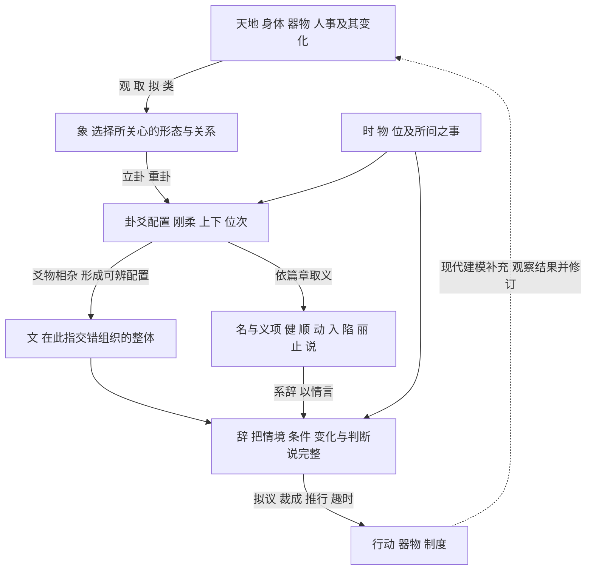

# 易传通过文连接卦象语词与系统

《易传》通过观物取象、卦爻配置、称名取类、系辞判断及适时变通，使事物、图式、语言与行动互相参照。**“文”可作为理解这套联系的入口：不同成分如何凭位置、交错与相互关系，形成可辨认、可解释的整体。**这是综合《系辞》《说卦》《彖》《象》提出的工作解释；各篇中“文”的具体意义仍随语境变化。

本项目所要建立的基本映射单位，可以据此定为：**某物在某时某位，与其他物形成何种关系，怎样变化，由此作出什么判断和行动。**113字提供其中的概念词汇，八卦提供取象与组合的图式，完整文辞保存条件、关系和判断。

## 一 从世界到卦象 再到文辞与行动

下图是对《易传》相关段落的综合重建。箭头分别表示取象、组成、释义、判断或应用，不能都读成因果生成。



《系辞上》分配这些环节的职责：“立象以尽意，设卦以尽情伪，系辞以尽其言，变而通之以尽利。”《系辞下》又以“八卦以象告，爻彖以情言”区分图式展示与文辞解释。两种表达协作，才能展开具体情境。[《系辞上》第十二章](https://zh.wikisource.org/wiki/易傳/繫辭上#第十二章)、[《系辞下》第九章](https://zh.wikisource.org/wiki/易傳/繫辭下#第九章)

这里仍包括占筮及吉凶判断。《系辞上》明确并列尚辞、尚变、尚象、尚占四种用法。将它用于现代系统研究，是选择并重建其中的表示与行动关系，不能把原典的占筮功能抹去，也不能由此认定其预测已获经验验证。[《系辞上》第十章](https://zh.wikisource.org/wiki/易傳/繫辭上#第十章)

## 二 文在三个语境中分别承担什么

| 语境 | 原文 | 在映射中的作用 |
|---|---|---|
| 对象呈现的纹理与文采 | “观鸟兽之文，与地之宜” | 观察者面对可区别、可取象的形态；文在这里属于所观察的对象 |
| 卦爻交错形成的配置 | “爻有等，故曰物；物相杂，故曰文” | 组成者具有等次并相互交错，整体意义取决于组织方式 |
| 文辞与人文实践 | “其辞文”；“文明以止，人文也” | 言辞的组织与表达，以及礼制、治理等人的实践，分别进入讨论 |

第一、三项相关句见[《系辞下》第二、五章](https://zh.wikisource.org/wiki/易傳/繫辭下)，第二项见[第八章](https://zh.wikisource.org/wiki/易傳/繫辭下#第八章)；人文句见[《贲·彖》](https://zh.wikisource.org/wiki/周易/賁)。这是按语境整理的三组用法，不是原典给出的一套“三文”分类。

“物相杂，故曰文”的近前文谈六爻、三材、不同位置。由此把文解释为有位次的差异组织，比把它仅理解为“字”更贴合该段。后一句“文不当，故吉凶生焉”又使配置进入评价：谁与谁相处、处在何位、适合何种情境，都关系到判断。原句说“吉凶生”，不宜删成“不当必凶”。

把这些用法进一步连成一种一般系统观，是本项目的抽象：**组成部分具有区别，关系赋予它们位置，整体因其配置而可读。**这一抽象有文本入口，却不能取消纹理、卦画、文辞和人事各自的对象与规则。

## 三 八卦怎样接到中文字与概念

《说卦》第七章直接给出一组卦名与性质的联系；第五章及各卦《彖》《象》再补充阶段、作用与情境。下表第三栏是可追问的系统问题，尚不是已经确定的动力方程。

| 卦 | 第七章的原文释义 | 可由此提出的系统问题 |
|---|---|---|
| 乾 ☰ | 健 | 施作怎样持续，何种条件限制其继续？ |
| 坤 ☷ | 顺 | 怎样承接、配合，并使事物有所成？ |
| 震 ☳ | 动 | 什么发生了启动或显著变动？ |
| 巽 ☴ | 入 | 什么进入什么，进入需要何种关系或条件？ |
| 坎 ☵ | 陷 | 陷于什么处境，能否在约束中继续行动？ |
| 离 ☲ | 丽 | 什么依附于什么，这种依存如何维持？ |
| 艮 ☶ | 止 | 什么应止于何处，何时止、何时行？ |
| 兑 ☱ | 说〔悦〕 | 愉悦、响应及共同活动如何发生？ |

出处：[《说卦》第七章](https://zh.wikisource.org/wiki/易傳/說卦#第七章)。第三栏结合各卦解释提出；相关短引与边界见[八卦原典与参照项目证据](13_八卦原典与参照项目证据_v0.1.md)第三、五节。“丽”的依附方向另有[《离·彖》](https://zh.wikisource.org/wiki/周易/離)“日月丽乎天，百谷草木丽乎土”支撑。

同一卦可以连接多组语词。例如离在第七章释为丽，在第五章又说“离也者，明也”；前者展开依附，后者展开显现。连接的篇章与义项应一同保存，不能只剩下一个字形标签。[《说卦》第五章](https://zh.wikisource.org/wiki/易傳/說卦#第五章)

“中文字系统”在这里需要保留三个层次：

- **字形与书写**：字形如何组成、演变、记录语言，是文字学问题。《系辞下》有由结绳转为书契、“盖取诸夬”的叙述；这是以六画夬卦解释书契的取象材料，不能独自证明全部汉字从卦画产生。
- **词与义项**：乾健、震动、艮止等，为卦象与词义建立有出处的连接。这是本项目113字词典主要承接的一层。
- **命题与文辞**：词义在句中获得对象、关系、条件与指向。例如“时止则止，时行则行”同时处理止、行及其时宜；完整含义需要整个关系式。

书契出处：[《系辞下》第二章](https://zh.wikisource.org/wiki/易傳/繫辭下#第二章)。止行出处：[《艮·彖》](https://zh.wikisource.org/wiki/周易/艮)。

## 四 组合文法如何从名进入辞

《系辞下》说“其称名也小，其取类也大”，又说“开而当名辨物，正言断辞”。具体名称可以引出较广的取类，但必须辨明它所指的物和所适用的情境。[《系辞下》第五章](https://zh.wikisource.org/wiki/易傳/繫辭下#第五章)

据此，本项目可以给概念词安排下列组合职责。这里的分类是现代文法设计，不是古代汉语词类表。

| 概念组 | 在组合中的职责 | 例子 |
|---|---|---|
| 阴 阳 刚 柔 | 指定当前采用的区别维度 | 刚柔怎样相处、相推 |
| 上 下 内 外 中 位 | 定位组成者及其关系 | 内健外顺；同功异位 |
| 交 杂 相 通 | 描述相互关系或关系产生的状态 | 天地交而万物通 |
| 动 静 行 止 往 来 变 | 描述活动、状态或前后变化 | 时止则止；一阖一辟 |
| 时 当 | 将描述或行动放入条件与评价 | 在什么情境中适当 |
| 吉 凶 利 害 悔 吝 | 保存该文辞中的判断 | 对谁、对何事、在何条件下作何判断 |

这些用语见《系辞上》第一至三章、第十一章，《系辞下》第七至九章及泰、艮《彖》。它们在不同句子中承担的职责可以变化，不能凭一字永久锁定其类型。

因此，最小完整记录应容纳：

> 对象及选定义项 → 所处位置与关系 → 时境和条件 → 允许或预期的变化 → 评价及行动指向。

这里至少有三种语言连接：**名指向某物，谓词描述某种性质或关系，辞将这些描述组成有条件、有指向的判断。**八卦取象为这三种连接提供共同参照，但一卦对应多个对象并不使它们成为同义词。乾为马、乾为首，不能推出马等于首，更不能把马的所有属性都转给首。[《说卦》第八、九章](https://zh.wikisource.org/wiki/易傳/說卦#第八章)

## 五 互相转化需要分清三个层次

| 转化发生在哪里 | 发生什么 | 需要什么依据 |
|---|---|---|
| 卦画结构 | 改变某爻、改变上下配置，得到另一个符号结构 | 明确操作及所用解释传统 |
| 情境与语义 | 同一性质因时、位、关系改变而取得不同判断 | 完整文辞、义项与上下文 |
| 实际系统 | 事物在具体条件下发生改变 | 对象、变量、驱动、条件及可检验的过程规则 |

《系辞下》“刚柔相推，变在其中矣”联结卦爻与变化；“变通者，趣时者也”把变通放入时宜。《系辞上》“化而裁之谓之变，推而行之谓之通”则包含裁成和实行。由此，变通既关乎表示中的变化，也关乎如何处理具体事情。[《系辞下》第一章](https://zh.wikisource.org/wiki/易傳/繫辭下#第一章)、[《系辞上》第十二章](https://zh.wikisource.org/wiki/易傳/繫辭上#第十二章)

“通其变，遂成天下之文”把数、变化与文联系起来，适合支持对复杂配置的研究；该段没有给出生成全部汉字字形、读音、意义的算法。[《系辞上》第十章](https://zh.wikisource.org/wiki/易傳/繫辭上#第十章)

在现代模型中，要声称两种转化真正对应，可以提出一个明确的核验问题：**现实系统变化之后再取象，与先取象再执行指定的符号变化，结果是否一致？**

例如，在已经限定为确定性规则、固定时间步和单值取象的模型中，设现实状态为 `s`，现实更新为 `F`，取象规则为 `β`，卦象更新为 `T`，便可检查：

```text
β(F(s)) = T(β(s))
```

这是一项现代对应条件，不是《易传》的原有方程。如果同一卦象涵盖的不同现实状态会走向不同卦象，就需要更多状态信息或多值转移。实际建模时，不能为了保住八种标签而删除决定变化的重要差别。

## 六 贲卦如何把图式展开成治理判断

贲是离下艮上。《彖》有“刚柔交错，天文也；文明以止，人文也”，继以“观乎天文，以察时变；观乎人文，以化成天下”。《象》说“山下有火，贲；君子以明庶政，无敢折狱”。这段材料同时出现组合、文、观察、变化及人的行动。[《贲·彖》《贲·象》](https://zh.wikisource.org/wiki/周易/賁)

可以把它的解释路径展开如下：

| 层次 | 贲中的具体内容 | 映射怎样推进 |
|---|---|---|
| 卦体 | 离下艮上 | 确定组成与上下关系 |
| 取象 | 山下有火 | 将卦体表达为可观的自然图式 |
| 语义资源 | 离有明义，艮有止义 | 提供显明与止限的解释方向 |
| 整体论述 | 文明以止；观人文而化成天下 | 将图式展开为人的组织与实践问题 |
| 具体判断 | 明庶政，无敢折狱 | 指向治理，并对断狱保留明确限制 |

表格是对传文的展开，不是声称“明＋止”两个词足以机械算出全部贲义；《彖》还讨论柔来文刚、分刚上文柔等整体结构。

这一例对文法尤其有用：**同一个“明”，需要与对象、活动范围和限制共同组合。**照明、显明政事、判断刑狱不是可任意互换的同一动作。文辞通过“明庶政”与“无敢折狱”把适用范围说出来。若映射到现代决策系统，可以据此研究信息可见性与行动权限的区别；那是公开的现代应用，而非原典已经规定的软件制度。

## 七 泰否与艮说明配置和时宜怎样改变整体意义

泰与否都包含乾、坤两个经卦。泰是下乾上坤，否是下坤上乾。泰《彖》说“天地交而万物通也，上下交而其志同也”；否《彖》说“天地不交而万物不通也”。相同组成者在不同整体配置中，得到不同关系解释。[《泰·彖》](https://zh.wikisource.org/wiki/周易/泰)、[《否·彖》](https://zh.wikisource.org/wiki/周易/否)

这为“文”的现代配置解释提供一个清楚的例子：保存乾、坤两个名称仍不够，还必须保存谁在何处、怎样相接以及整卦的解释。若用于组织沟通或物质流动模型，应把“交”明确绑定为实际交换，把“通”绑定为某种可达或畅通条件，再检验两者的关系。符号上下互换，本身不能替代现实中的通路形成机制。

艮则说明条件怎样进入变化。《说卦》释艮为止，而艮《彖》说“时止则止，时行则行，动静不失其时”。完整模式同时保留适时止与适时行，止是否持续取决于情境。把它接入系统模型时，可以定义停止条件、运行条件及对应过程；伦理上的“应当”还须与实际能发生的行为分别保存。[《艮·彖》](https://zh.wikisource.org/wiki/周易/艮)

## 八 怎样继续接入 dynamics 等现代概念

《易传》提供关于变化、关系、时位与判断的概念资源。现代动力学所研究的具体性质，应在公开补足模型之后计算。

| 现代问题 | 文本提供的研究入口 | 模型必须明确的内容 |
|---|---|---|
| dynamics 动力演化 | 动静、刚柔相推、往来、时物 | 状态、真实时间、更新规律、边界条件 |
| phase transition 相变 | 穷变、终始、结构转折可供比较 | 控制参数、序参量及相变判据；一般状态切换与相变分别判定 |
| attractor 吸引子 | 止、定、成及其时宜可供比较 | 动力规则、长期行为、吸引集合与吸引域 |
| feedback loop 反馈回路 | 相互作用、感应、往来可供比较 | 输出怎样返回影响输入，作用方向、延迟与条件 |

相关现代定义与原典出处分别见[13号证据册](13_八卦原典与参照项目证据_v0.1.md)第七、十节；[14号验证包](14_八卦动力学验证_v0.1/README.md)展示同一组八卦标签在不同规则下产生不同长期行为。因此，卦名适合作为解释入口；吸引性、反馈稳定性或相变性质由实际规则决定。

接入现有G1文法时，可依次保存：原文与篇章、所取义项、卦爻配置、现实变量与关系的绑定、状态命题、允许过程、规范判断。**“文”先在解释层说明关系怎样组织；经具体绑定之后，相关关系才能成为可求值的命题或过程。**

这样得到的 foundation 是一个保留出处和关系类型的表达体系：象使结构可见，名使所指可辨，辞使条件与判断可说，变通使解释进入行动；“文”让我们关注这些表达所组织的差异、位次与关系。

## 九 出处与解释层次

本文原典引文使用公开转录，以篇名及句起定位；网页章次随所链接版本，尤其《系辞下》采用该网页九章分法。固定文本入口为[《系辞上》](https://zh.wikisource.org/w/index.php?title=易傳/繫辭上&oldid=2611140)、[《系辞下》](https://zh.wikisource.org/w/index.php?title=易傳/繫辭下&oldid=2611136)、[《贲》](https://zh.wikisource.org/w/index.php?title=周易/賁&oldid=2405035)。

“文作为差异的关系组织”、总图、概念职责表、现代对应条件及G1接口，均为本项目的综合重建。《易传》自身的段落已就近标明。若进一步采用“言—象—意”作为系统解释层级，应同时注明王弼《周易略例·明象》的后世系统化；不能把王弼的完整论证全部署在《易传》名下。相关来源与参照项目记录见[13号证据册](13_八卦原典与参照项目证据_v0.1.md)第八节。
