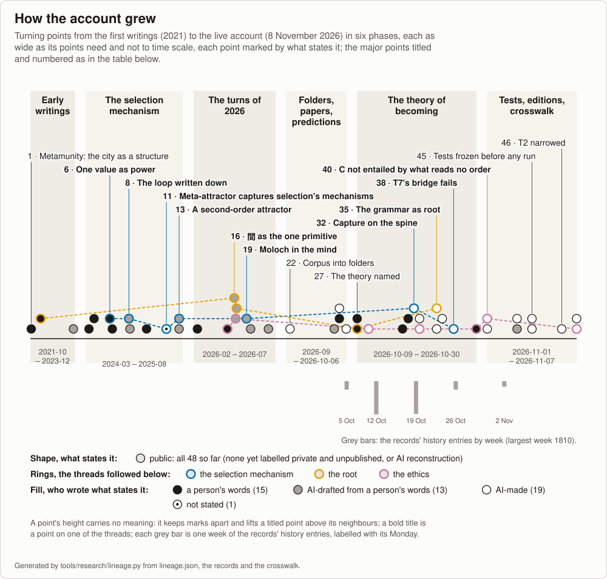

<!-- Generated by tools/research/research.py render (tools/research/lineage.py) from theories/becoming/results/data/lineage.json, the records and the crosswalk; edit those, not this page. -->

# How the account grew

[中文](LINEAGE.zh.md) · 90–117 minutes to read in full; the brief, the picture, the labels and the thread in 12–15 minutes.

How the account grew: from the writings of 2021, through the earlier theory folders it read and carried or set aside, to [the theory of becoming](becoming/ONE-PAGE.md) as it stands. Generated from [the lineage data](becoming/results/data/lineage.json), the records' history and [the crosswalk](becoming/results/atlas/CROSSWALK.md). The repository holds 6,087 commits at `7040940cd` (8 November 2026); its first commit is of 6 September 2026, and what came before is material brought into it. This page carries forward [the September timeline](../_process/history/2026-09-consolidation/TIMELINE.md), "a narrative, not an index", which stops on 4 October 2026. Its turning points were gathered and checked by AI readers, no person's.

## In brief

Six phases, each with its turning points by number and what states them:

- **Early writings** (2021-10 – 2023-12). From 2021 to 2023 a proposal diagnoses the city as a structure, a book opening defines possibility in an ontology of change, and a community manifesto names molochs among its challenges. (points 1–3; all public)
- **The selection mechanism** (2024-03 – 2025-08). From March 2024 to August 2025 conversations, drafts and AI-drafted notes say that a society picks one value as the token of power, write down a loop that selects pure capital optimizers, and name a meta-attractor that captures the mechanisms of selection themselves, defined as a second-order attractor. (points 4–13; all public)
- **The turns of 2026** (2026-02 – 2026-07). From February to July 2026 the Fork narrative is left and cooperation is not held good in itself, 間 becomes the one primitive and classical Chinese a formal language, Lean enters as a coherence checker, and, in an AI-written working stance, selection is read as concentrating a way of seeing, Moloch in the mind. (points 14–21; all public)
- **Folders, papers, predictions** (2026-09 – 2026-10-06). From September to 6 October 2026 the writings are gathered into theory folders, an AI-drafted paper argues from correctability with refuters for each claim, the repository's first pre-specified predictions are written before their run, one failing in the pilot, and a conference line is folded into the generative account, short of a no-assumptions directive of the same day, in a chapter now in history. (points 22–26; all public)
- **The theory of becoming** (2026-10-09 – 2026-10-30). From 9 to 30 October 2026 the theory of becoming is named, its Lean spine gets an axiom-free pure core, the ethics' scope and order premises are separated, an AI review finds no central result a new theorem of research-level mathematics, a plan roots the theory in a grammar of continuation relative to a class and its first module lands, the account is laid out in four layers, and T7's frozen test passes every verdict while its bridge fails and a case T7 forbids, as then worded, occurs. (points 27–39; all public)
- **Tests, editions, crosswalk** (2026-11-01 – 2026-11-07). From 1 to 7 November 2026 C is shown not entailed by what reads no order, tests of formations that read are frozen before any run, T2's former wording fails on beetle cultures and T2 is narrowed, the account is frozen as a reader edition, and the earlier folders are read against it by AI readers in a crosswalk. (points 40–48; all public)

Each turning point carries one label, by what states it:

- **public** (48): a file tracked in this repository states it.
- **private and unpublished** (none so far): only material not published here states it (private notes and conversations, or material not stored here), and a public text cites it.
- **AI reconstruction** (none so far): no source states it; it is inferred from the material, by an AI reader or by a narrative such as the September timeline, which is itself reconstructed from the material.

The files `_process/history/2026-09-consolidation/reading-notes-inputs/hb-*.md` are one person's turns excerpted from chat exports that are not tracked; a turning point citing them is public because the excerpt is.

## One thread: the selection mechanism

The selection mechanism, followed through the points marked on the thread. In July 2024 a society picks one value as the token of power, and those best at optimising it come to control the social system. In October 2024 an AI-drafted note names a self-reinforcing loop in which "The system naturally selects for pure capital optimizers". In 2025 a meta-attractor that colonizes "even the mechanisms of selection themselves", then defined, in an AI-written expansion, as "a second-order attractor" in joint state and selection-rule space. In May 2026, in a working stance AI-written from a conversation, the system concentrates "not just resources but a way of seeing". In October 2026, on the spine, capture through the rule and then closed capture: in a selection whose rule, and how the rule is read, are read from the share it selects, "a loss the loop does not read leaves it locked however large it grows"; T7 states "That actual metrics are so formed is conjectured." And in one trained system, T7's frozen test of the conjecture that a judge formed from what it selected is a pool of readers counted by kind: "Every frozen verdict passed, and the conjecture failed for this judge". Only the spine's steps are proved, in a model; each row says what its step claimed.

6. **2024-07-14, One value as the token of power, and those best at it in control.** A conversation, in Chinese, says that society picks one value as the token of power, and that those best at optimising it gain power in competition and then control the social system their own way, "throw other values under the bus" (in the meta-attractor folder's English: "society picks one value as the token of power; those best at optimising it gradually acquire power through competition"). The next day the pattern is called "the core generator function that lead to metacrisis and moloch".
8. **2024-10-30, The loop written down: the system selects pure capital optimizers.** An AI-drafted note of that day treats the capitalist system as having "a dominant self-reinforcing loop that continuously intensifies over time", whose first mechanism is efficiency-based selection: "The system naturally selects for pure capital optimizers" and "Other values and considerations become competitive disadvantages".
11. **2025-05-30, Meta-attractor: it captures the mechanisms of selection themselves.** On 2025-05-18 a research report, the output of an AI research tool, introduces meta-attractors as "higher-order organizational principles or dominant goals that shape the landscape of these lower-level attractors". The SEED draft of 2025-05-30 says the meta-attractor capturing global society "arises naturally from competitive selection pressures" and colonizes the cognitive frameworks of agents, the incentive structures within societies, "and even the mechanisms of selection themselves".
13. **2025-08-10, Formal definition: a second-order attractor in state × selection-rule space.** An AI-written expansion of that day, written against a system prompt, defines the meta-attractor as "a second-order attractor—a self-stabilising region in joint state × selection-rule space", within which "the selection mechanism itself is recursively reinforced by the very states it favours"; a rule-update operator G describes how the selection proxy itself evolves, and "winners" can "rewrite the rules in their own favor". Under a zero-mean simplification the proxy weights grow as ẇ = λCw, and eigenvalue budgeting is offered as "a clear, non-ideological target for policy".
19. **2026-05-28, The selected way of seeing: Moloch in the mind.** A working stance, AI-written from a conversation of that day, makes the sharper claim that "the selection pressure under this dynamic favors actors who relate to everything instrumentally"; their competition frame shapes the rules going forward, so the system concentrates "not just resources but a way of seeing". "Moloch is in the mind, not only in the structure", and, if principals are selected for instrumental cognition, "an AI that does what its principal intends is amplifying the dynamic, not checking it".
32. **2026-10-19, Capture through the rule, then closed capture, on the spine.** On 19 October 2026 the loop landed on the spine as capture through the rule: "Where a selection's rule is read monotonically from the share it selects, the loop locks", and "Without the start condition, it fails." On 20 October closed capture, built on it, was proved with empty axiom reports: in a selection whose rule, and how the rule is read, are read from the share it selects, "a loss the loop does not read leaves it locked however large it grows, and a change of the reading is absorbed", while T7 states "That actual metrics are so formed is conjectured."
38. **2026-10-26, T7's frozen test: every verdict passed, the bridge failed.** LA2 (frozen 25 October 2026, run 25 and 26 October) tested, in one trained system, the conjecture that a judge formed from what it selected is a pool of readers counted by kind: "Every frozen verdict passed, and the conjecture failed for this judge", one note of the loss, on the one prose answer among nine readers, turning its reading. So T7's forbidden case of a metric whose loss is read only by those it disfavours, dropped once the selection has left them no more than its carriers among its readers, with nothing else changed, occurred in this system "as worded before its clause on drift", while the law of the rule as the pool of readers drawn from those it selects "stands within its hypotheses, which this judge does not meet".

## Turning points

| # | Date | What changed | Evidence | Label |
|---:|---|---|---|---|
| 1 | 2021-10-18 | **Metamunity proposal: the city diagnosed as a structure.** A proposal coins 元社区 (Metamunity) and says the metaverse 的本质是一种面向未来的叙事 (is in essence a narrative facing the future). It argues that the city's structure 在无形中把一个个人变成了原子化的个体 (invisibly turns persons into atomised individuals), and that 城市中社会联结机制的结构性问题 (the structural problem of the city's social-connection mechanism) is the main factor behind loneliness, the lack of belonging and cold relationships. | [`sources/00-early-2021-2022/recovered-text/2021-10-18_proposal_元社区-Metamunity.txt`](../sources/00-early-2021-2022/recovered-text/2021-10-18_proposal_元社区-Metamunity.txt#L1) (line 1); [`sources/00-early-2021-2022/recovered-text/2021-10-18_proposal_元社区-Metamunity.txt`](../sources/00-early-2021-2022/recovered-text/2021-10-18_proposal_元社区-Metamunity.txt#L21) (line 21); [`sources/00-early-2021-2022/recovered-text/2021-10-18_proposal_元社区-Metamunity.txt`](../sources/00-early-2021-2022/recovered-text/2021-10-18_proposal_元社区-Metamunity.txt#L41) (line 41) | public |
| 2 | 2022-04-07 | **World of Possibilities: an ontology in which possibility is defined.** A twelve-line book opening defines in sequence, from difference and change, structure, space, time, dynamic, possibility, thing and system: "If change may happen to a structure, it possesses possibility", and a system is "A thing that maintains certain dynamic pattern over time". It admits that not every concept can be well defined without becoming self-referential. | [`sources/00-early-2021-2022/recovered-text/2022-04-07_World-of-Possibilities.txt`](../sources/00-early-2021-2022/recovered-text/2022-04-07_World-of-Possibilities.txt#L13) (line 13); [`sources/00-early-2021-2022/recovered-text/2022-04-07_World-of-Possibilities.txt`](../sources/00-early-2021-2022/recovered-text/2022-04-07_World-of-Possibilities.txt#L19) (line 19); [`sources/00-early-2021-2022/recovered-text/2022-04-07_World-of-Possibilities.txt`](../sources/00-early-2021-2022/recovered-text/2022-04-07_World-of-Possibilities.txt#L23) (line 23) | public |
| 3 | 2023-12 | **Wamotopia manifesto names molochs; a theme camp names Moloch's source.** The Wamotopia v1.0 manifesto names among urgent challenges "AI alignment, unchecked molochs, faltering leviathans, societal and ecological degradation, metacrisis", and calls to unite "under the principle of positive-externality actions". The Slay Moloch theme camp, added later in the month, brings in Moloch as "the optimizer for value", naming the blog post "meditation on moloch" as where it first appeared. | [`sources/02-wamotopia/2023-2024-wamotopia-repo/manifestos/wamotopia_v1.0.md`](../sources/02-wamotopia/2023-2024-wamotopia-repo/manifestos/wamotopia_v1.0.md?plain=1#L9) (line 9); [`sources/02-wamotopia/2023-2024-wamotopia-repo/manifestos/wamotopia_v1.0.md`](../sources/02-wamotopia/2023-2024-wamotopia-repo/manifestos/wamotopia_v1.0.md?plain=1#L19) (line 19); [`sources/02-wamotopia/2023-2024-wamotopia-repo/Wacas/slay_moloch_camp_v0.8.md`](../sources/02-wamotopia/2023-2024-wamotopia-repo/Wacas/slay_moloch_camp_v0.8.md?plain=1#L2) (line 2) | public |
| 4 | 2024-03-18 | **Complexity outruns understanding; collapse corrected to unmanaged risk.** A conversation states that "The speed of the complexity of society grows exp, the speed of the governing organizations’ understanding reality only grows in a sub-linear speed". In the same session the reasoning is judged "not good enough to conclude on its collapse", and the claim becomes that risk, "if not properly managed, will cause the system to destabilize", when "even dominate attractors of society" change too fast to be comprehended. | [`_process/history/2026-09-consolidation/reading-notes-inputs/hb-01.md`](../_process/history/2026-09-consolidation/reading-notes-inputs/hb-01.md?plain=1#L656) (line 656, under '## 2024-03-18 — The Growing Gap Between Societal Complexity and Governance' (line 652, the third conversation of that title)); [`_process/history/2026-09-consolidation/reading-notes-inputs/hb-01.md`](../_process/history/2026-09-consolidation/reading-notes-inputs/hb-01.md?plain=1#L666) (line 666, same heading); [`_process/history/2026-09-consolidation/reading-notes-inputs/hb-01.md`](../_process/history/2026-09-consolidation/reading-notes-inputs/hb-01.md?plain=1#L666) (line 666, same heading) | public |
| 5 | 2024-04-16 | **Moloch as single-value optimisation; any framework must prevent convergence.** A turn in Chinese, asking for its views to be made into a speech, defines the Moloch problem as 单一维度优化（single value optimization，例如资本）的零和博弈 (a zero-sum game of single-value optimisation, for example capital), in which an agent's more complex strategy and competitive advantage make the system converge, a convergence it ties to 因为attractor的存在 (the existence of an attractor). It requires that a new framework 必须可以保证权利结构不收敛 (must guarantee the power structure does not converge). | [`_process/history/2026-09-consolidation/reading-notes-inputs/hb-01.md`](../_process/history/2026-09-consolidation/reading-notes-inputs/hb-01.md?plain=1#L1689) (line 1689, under '## 2024-04-16 — Balancing AI risks and opportunities through harmonious coexistence' (line 1667)); [`_process/history/2026-09-consolidation/reading-notes-inputs/hb-01.md`](../_process/history/2026-09-consolidation/reading-notes-inputs/hb-01.md?plain=1#L1691) (line 1691, same heading); [`_process/history/2026-09-consolidation/reading-notes-inputs/hb-01.md`](../_process/history/2026-09-consolidation/reading-notes-inputs/hb-01.md?plain=1#L1699) (line 1699, same heading) | public |
| 6 | 2024-07-14 | **One value as the token of power, and those best at it in control.** A conversation, in Chinese, says that society picks one value as the token of power, and that those best at optimising it gain power in competition and then control the social system their own way, "throw other values under the bus" (in the meta-attractor folder's English: "society picks one value as the token of power; those best at optimising it gradually acquire power through competition"). The next day the pattern is called "the core generator function that lead to metacrisis and moloch". | [`_process/history/2026-09-consolidation/reading-notes-inputs/hb-01.md`](../_process/history/2026-09-consolidation/reading-notes-inputs/hb-01.md?plain=1#L4411) (line 4411, under '## 2024-07-14 — Rethinking Social Values in a Globalized World' (line 4383)); [`_process/history/2026-09-consolidation/reading-notes-inputs/hb-01.md`](../_process/history/2026-09-consolidation/reading-notes-inputs/hb-01.md?plain=1#L4645) (line 4645, under '## 2024-07-15 — Humans as Agents in the Social System' (line 4619)); [`theories/meta-attractor/README.md`](meta-attractor/README.md?plain=1#L872) (quoted words, item 7 (2024-07-14), line 872) | public |
| 7 | 2024-07-28 | **Game-design axiom and many games against convergence.** A turn states that "a winner of the game should be rewarded with anything other than more advantages of the game, otherwise the game will eventually converge and winner will take all". The next day, in a turn on ideologies, it adds "It is the design of the game suck, not the idea of how to play the game unworkable", and gives redundancy as a reason for many games: "So at least, if one game fail, you can join another one". | [`_process/history/2026-09-consolidation/reading-notes-inputs/hb-01.md`](../_process/history/2026-09-consolidation/reading-notes-inputs/hb-01.md?plain=1#L5354) (line 5354, under '## 2024-07-28 — Avoiding the Winner-Take-All Trap in Game Design' (line 5350)); [`_process/history/2026-09-consolidation/reading-notes-inputs/hb-01.md`](../_process/history/2026-09-consolidation/reading-notes-inputs/hb-01.md?plain=1#L5471) (line 5471, under '## 2024-07-29 — Balancing Ideological Diversity in Society' (line 5425)); [`_process/history/2026-09-consolidation/reading-notes-inputs/hb-01.md`](../_process/history/2026-09-consolidation/reading-notes-inputs/hb-01.md?plain=1#L5481) (line 5481, same heading) | public |
| 8 | 2024-10-30 | **The loop written down: the system selects pure capital optimizers.** An AI-drafted note of that day treats the capitalist system as having "a dominant self-reinforcing loop that continuously intensifies over time", whose first mechanism is efficiency-based selection: "The system naturally selects for pure capital optimizers" and "Other values and considerations become competitive disadvantages". | [`sources/03-meta-attractor/2024-precursors/capital-analysis.md`](../sources/03-meta-attractor/2024-precursors/capital-analysis.md?plain=1#L8) (## Core Dynamic: The Dominant Loop, item 1 Efficiency-Based Selection, line 8); [`sources/03-meta-attractor/2024-precursors/capital-analysis.md`](../sources/03-meta-attractor/2024-precursors/capital-analysis.md?plain=1#L4) (## Core Dynamic: The Dominant Loop, line 4); [`sources/SOURCES.md`](../sources/SOURCES.md?plain=1#L666) (### 03-meta-attractor file table, line 666); [`theories/meta-attractor/README.md`](meta-attractor/README.md?plain=1#L1150) (source list, 2024 precursors (line 1150)) | public |
| 9 | 2024-11-05 | **Ouroboros: the loop generalised to any compounding domain.** An AI-drafted text generalises the loop: "This pattern emerges in any system where advantages can compound", whether the currency of power is financial, social, military, biological fitness or information control. The same day, in separate conversations, a name "more creative, like moloch" is asked for, and a salon is planned around a workshop on "The Ouroboros Cycle:How Optimization Drives System Collapse". | [`sources/03-meta-attractor/2024-precursors/ouroboros-cycle.md`](../sources/03-meta-attractor/2024-precursors/ouroboros-cycle.md?plain=1#L7) (## Introduction, line 7); [`_process/history/2026-09-consolidation/reading-notes-inputs/hb-02.md`](../_process/history/2026-09-consolidation/reading-notes-inputs/hb-02.md?plain=1#L123) (line 123, under '## 2024-11-05 — Competitive Convergence: Dynamics of Power Concentration' (line 115)); [`_process/history/2026-09-consolidation/reading-notes-inputs/hb-02.md`](../_process/history/2026-09-consolidation/reading-notes-inputs/hb-02.md?plain=1#L140) (line 140, under '## 2024-11-05 — Salon on Metacrisis, Moloch & Systems Change' (line 136)); [`theories/meta-attractor/README.md`](meta-attractor/README.md?plain=1#L1150) (source list, 2024 precursors (line 1150)) | public |
| 10 | 2025-02-07 | **Image of self becomes the narrative-value frame.** The selfishness-spiral text of 2025-02-03, "A human construct an image of self", is rewritten as a note in which the same sentence links a "narrative-value frame" in place of "image of self". The note states "selfish gets rewarded and it compounds, it out grows other behavior patterns(NVFs)". | [`_process/history/2026-09-consolidation/reading-notes-inputs/hb-02.md`](../_process/history/2026-09-consolidation/reading-notes-inputs/hb-02.md?plain=1#L1754) (line 1754, under '## 2025-02-03 — The Self-Reinforcing Cycle of Selfishness' (line 1750)); [`sources/01-writings-2025/compound_selfishness.md`](../sources/01-writings-2025/compound_selfishness.md?plain=1#L3) (line 3); [`sources/01-writings-2025/compound_selfishness.md`](../sources/01-writings-2025/compound_selfishness.md?plain=1#L17) (line 17) | public |
| 11 | 2025-05-30 | **Meta-attractor: it captures the mechanisms of selection themselves.** On 2025-05-18 a research report, the output of an AI research tool, introduces meta-attractors as "higher-order organizational principles or dominant goals that shape the landscape of these lower-level attractors". The SEED draft of 2025-05-30 says the meta-attractor capturing global society "arises naturally from competitive selection pressures" and colonizes the cognitive frameworks of agents, the incentive structures within societies, "and even the mechanisms of selection themselves". | [`sources/03-meta-attractor/2025-05-drafts-selected/2025-05-30-seed-meta-attractors-and-road-to-systemic-collapse.md`](../sources/03-meta-attractor/2025-05-drafts-selected/2025-05-30-seed-meta-attractors-and-road-to-systemic-collapse.md?plain=1#L25) (line 25); [`sources/03-meta-attractor/2025-05-drafts-selected/2025-05-18-navigating-the-precipice-start-research.md`](../sources/03-meta-attractor/2025-05-drafts-selected/2025-05-18-navigating-the-precipice-start-research.md?plain=1#L13) (line 13 (introduction)); [`theories/meta-attractor/README.md`](meta-attractor/README.md?plain=1#L1157) (source list, 2025-05/06 draft series (line 1157)) | public |
| 12 | 2025-08-10 | **Spirit–Token–Space: a symbolic framework for modelling societies.** A paper introduces "STS (Spirit–Token–Space)" as "a universal symbolic interaction framework designed to formally encode social structures and dynamics", its title naming it a framework "for Modeling and Prototyping Societies, Communities, and Economic Systems". A review kept as usis.md, under the same STS title, calls it the "USIS model", the "Universal Symbolic Interaction System, with its primitives Token–Spirit–Space". | [`sources/01-writings-2025/STS.md`](../sources/01-writings-2025/STS.md?plain=1#L1) (line 1 (title)); [`sources/01-writings-2025/STS.md`](../sources/01-writings-2025/STS.md?plain=1#L5) (## Abstract, line 5); [`sources/01-writings-2025/usis.md`](../sources/01-writings-2025/usis.md?plain=1#L103) (line 103 (and "USIS model", line 5)) | public |
| 13 | 2025-08-10 | **Formal definition: a second-order attractor in state × selection-rule space.** An AI-written expansion of that day, written against a system prompt, defines the meta-attractor as "a second-order attractor—a self-stabilising region in joint state × selection-rule space", within which "the selection mechanism itself is recursively reinforced by the very states it favours"; a rule-update operator G describes how the selection proxy itself evolves, and "winners" can "rewrite the rules in their own favor". Under a zero-mean simplification the proxy weights grow as ẇ = λCw, and eigenvalue budgeting is offered as "a clear, non-ideological target for policy". | [`sources/03-meta-attractor/2025-08-formal/2025-08-10-comprehensive-mathematical-definition.md`](../sources/03-meta-attractor/2025-08-formal/2025-08-10-comprehensive-mathematical-definition.md?plain=1#L11) (### 1.1. Abstract and Definition, line 11); [`sources/03-meta-attractor/2025-08-formal/2025-08-10-comprehensive-mathematical-definition.md`](../sources/03-meta-attractor/2025-08-formal/2025-08-10-comprehensive-mathematical-definition.md?plain=1#L262) (### 5.2, line 262); [`sources/03-meta-attractor/2025-08-formal/2025-08-10-comprehensive-mathematical-definition.md`](../sources/03-meta-attractor/2025-08-formal/2025-08-10-comprehensive-mathematical-definition.md?plain=1#L39) (### 1.2, line 39); [`theories/meta-attractor/synthesis-b-formal-and-essays-2025-08-10.md`](meta-attractor/synthesis-b-formal-and-essays-2025-08-10.md?plain=1#L249) (line 249) | public |
| 14 | 2026-02-09 | **The AI turn: The Fork and the one rule.** A talk recorded in January 2026 already says "It would be a good idea to not use AI for competition, but use it for the benefits for all". On 2026-02-09 a conversation takes up a pasted scenario projection, organized by AI, Automated Feudalism versus Automated Commons, "The deciding variable is institutional design", asks for a narrative from it, called The Fork (the narrative itself, the September timeline says, is not in the corpus; a later folder keeps the name as its historical home), and, as a compromise, proposes to "Make the global coordination work based on one rule, that is forcefully executed: stop using AI compete with others, only use them for commons". | [`sources/02-wamotopia/transcripts/2026-01-note-chiangmai-festival-talk.txt`](../sources/02-wamotopia/transcripts/2026-01-note-chiangmai-festival-talk.txt#L176) (line 176 (timestamp 17:09)); [`_process/history/2026-09-consolidation/reading-notes-inputs/hb-02.md`](../_process/history/2026-09-consolidation/reading-notes-inputs/hb-02.md?plain=1#L3608) (line 3608, under '## 2026-02-09 — Fully automated production and its future implications' (line 3482)); [`_process/history/2026-09-consolidation/reading-notes-inputs/hb-02.md`](../_process/history/2026-09-consolidation/reading-notes-inputs/hb-02.md?plain=1#L3627) (line 3627, same heading); [`_process/history/2026-09-consolidation/reading-notes-inputs/hb-02.md`](../_process/history/2026-09-consolidation/reading-notes-inputs/hb-02.md?plain=1#L3490) (line 3490, same heading); [`_process/history/2026-09-consolidation/TIMELINE.md`](../_process/history/2026-09-consolidation/TIMELINE.md?plain=1#L125) (## 2026-02-07 → 2026-04-30 (line 125)); [`theories/README.md`](README.md?plain=1#L24) (line 24) | public |
| 15 | 2026-04-16 | **The Fork narrative left; cooperation not good in itself.** The two-outcome narrative is left: "I think I have moved on from the fork narrative, it becomes simpler", after a correction of 2026-03-18 that the Fork was never a binary, "the actual possibility space that we can pursuit is huge". Cooperation is not held good in itself: "cooperative on the wrong thing could be why worse than just competing on it"; the Fork folder reads this as the criterion of generative versus degenerative, words that come on 2026-04-28. | [`_process/history/2026-09-consolidation/reading-notes-inputs/hb-02.md`](../_process/history/2026-09-consolidation/reading-notes-inputs/hb-02.md?plain=1#L7190) (line 7190, under '## 2026-04-16 — Recent conversation insights' (line 7174)); [`_process/history/2026-09-consolidation/reading-notes-inputs/hb-02.md`](../_process/history/2026-09-consolidation/reading-notes-inputs/hb-02.md?plain=1#L7194) (line 7194, same heading); [`_process/history/2026-09-consolidation/reading-notes-inputs/hb-02.md`](../_process/history/2026-09-consolidation/reading-notes-inputs/hb-02.md?plain=1#L5097) (line 5097, under '## 2026-03-18 — Creating aligned AI assistant documentation' (line 5083)); [`theories/the-fork-and-cooperative-infrastructure/README.md`](the-fork-and-cooperative-infrastructure/README.md?plain=1#L116) (claim 44 (line 116)); [`_process/history/2026-09-consolidation/reading-notes-inputs/hb-02.md`](../_process/history/2026-09-consolidation/reading-notes-inputs/hb-02.md?plain=1#L8197) (line 8197, under '## 2026-04-28 — Generative over destructive ethics' (line 8189)) | public |
| 16 | 2026-05-01 | **間 as the one primitive; classical Chinese as formal language.** The Jian foundation note, co-drafted with an AI, whose earliest kept version is v0.3, states a monist ontology, "一切是间。間 是唯一原语。" (all is 间; 間 is the one primitive), which its changelog places in v0.2. The earlier three primitives Spirit–Space–Token are shown as they present within 間, Space being "不是独立 primitive" (not an independent primitive), and v0.3 makes classical Chinese the primary syntax, with S-expressions as the "ambiguous 时的 fallback" (fallback when ambiguous). | [`sources/08-jian-wen-language/jian-repo/JIAN_FOUNDATION_NOTE_v0.3.md`](../sources/08-jian-wen-language/jian-repo/JIAN_FOUNDATION_NOTE_v0.3.md?plain=1#L50) (I. 立论 — 一切是间 (line 50)); [`sources/08-jian-wen-language/jian-repo/JIAN_FOUNDATION_NOTE_v0.3.md`](../sources/08-jian-wen-language/jian-repo/JIAN_FOUNDATION_NOTE_v0.3.md?plain=1#L648) (VIII. SST 如何被含括 (line 648)); [`sources/08-jian-wen-language/jian-repo/JIAN_FOUNDATION_NOTE_v0.3.md`](../sources/08-jian-wen-language/jian-repo/JIAN_FOUNDATION_NOTE_v0.3.md?plain=1#L13) (v0.3 changelog (line 13)); [`sources/08-jian-wen-language/jian-repo/JIAN_FOUNDATION_NOTE_v0.3.md`](../sources/08-jian-wen-language/jian-repo/JIAN_FOUNDATION_NOTE_v0.3.md?plain=1#L7) (header) | public |
| 17 | 2026-05-04 | **开 as root: guarding the not-yet-become, not expanding a measure.** The v9 correction of 生生不息论, into which, the folder says, 文言 formulations largely drafted by a model were carried, states "生生不息 ≠ 复杂性必然上升" (生生不息 is not a necessary rise in complexity) and "复杂性上升 ≠ 善" (a rise in complexity is not the good), and places the good not in "扩张某可测量之物" (expanding something measurable) but in "护未成之域不闭" (guarding the not-yet-become from closing). An AI-written folder synthesis records 开 replacing "expanding the possibility space" as the root category, but a report of 2026-05-07 still glosses 生生不息 as "可能性空间之持续扩张" (the continuing expansion of the possibility space) and keeps the aim of arguing for one "稳定可奠基" (stable and able to found) alignment. | [`sources/07-shengsheng-buxi/downloads-drafts-2026-05/生生不息论_v9_开境护闭校正版.md`](../sources/07-shengsheng-buxi/downloads-drafts-2026-05/生生不息论_v9_开境护闭校正版.md?plain=1#L84) (〇、此论之位置 (line 84)); [`theories/keep-the-possibility-space-open/README.md`](keep-the-possibility-space-open/README.md?plain=1#L239) (claim 13 (line 239)); [`sources/07-shengsheng-buxi/ssbx-repo/义理/R_与生生不息对齐之必然.md`](../sources/07-shengsheng-buxi/ssbx-repo/义理/R_与生生不息对齐之必然.md?plain=1#L48) (line 48 (报告日期 2026-05-07, line 8)); [`theories/keep-the-possibility-space-open/README.md`](keep-the-possibility-space-open/README.md?plain=1#L237) (line 237) | public |
| 18 | 2026-05-06 | **Lean as coherence checker; claims read by theorem type.** A spec of 2026-05-06 makes 文言 the primary language and Lean 4 "framework 之 internal coherence checker" (the framework's internal coherence checker), adding that "empirical correspondence ... 不 直接 verifiable in Lean" (not directly verifiable in Lean). On 2026-05-21 a claim-status ledger sorts claims as closed, scoped, schema, external route, sketch, placeholder or open, with the rule "Use the strongest claim allowed by the theorem type, not by the file title or surrounding doctrine prose." | [`sources/07-shengsheng-buxi/ssbx-repo/史料/真理/daoli-v12-lean-verifier.md`](../sources/07-shengsheng-buxi/ssbx-repo/史料/真理/daoli-v12-lean-verifier.md?plain=1#L19) (引 (line 19); file time 2026-05-06 in timeline-raw.tsv line 652); [`sources/07-shengsheng-buxi/ssbx-repo/docs-next/10_formal_形式/claim-status-ledger.md`](../sources/07-shengsheng-buxi/ssbx-repo/docs-next/10_formal_形式/claim-status-ledger.md?plain=1#L3) (header (line 3)); [`sources/07-shengsheng-buxi/ssbx-repo/docs-next/10_formal_形式/claim-status-ledger.md`](../sources/07-shengsheng-buxi/ssbx-repo/docs-next/10_formal_形式/claim-status-ledger.md?plain=1#L7) (Reading Rule (line 7)) | public |
| 19 | 2026-05-28 | **The selected way of seeing: Moloch in the mind.** A working stance, AI-written from a conversation of that day, makes the sharper claim that "the selection pressure under this dynamic favors actors who relate to everything instrumentally"; their competition frame shapes the rules going forward, so the system concentrates "not just resources but a way of seeing". "Moloch is in the mind, not only in the structure", and, if principals are selected for instrumental cognition, "an AI that does what its principal intends is amplifying the dynamic, not checking it". | [`sources/05-alignment-and-moloch/2026-05-28-alignment-core-stance.md`](../sources/05-alignment-and-moloch/2026-05-28-alignment-core-stance.md?plain=1#L15) (## The diagnosis, line 15); [`sources/05-alignment-and-moloch/2026-05-28-alignment-core-stance.md`](../sources/05-alignment-and-moloch/2026-05-28-alignment-core-stance.md?plain=1#L17) (## The diagnosis, line 17); [`sources/05-alignment-and-moloch/2026-05-28-alignment-core-stance.md`](../sources/05-alignment-and-moloch/2026-05-28-alignment-core-stance.md?plain=1#L19) (## The diagnosis, line 19) | public |
| 20 | 2026-06-06 | **Reality as a generative process; correlated collapse as the danger.** A foundation draft, AI-drafted from the author's ideas, calls itself "not a doctrine, and not a final blueprint" and opens its ground with "Reality is not a finished order. It is a generative process." It names the danger as not every irreversible change but correlated collapse: "one system, one metric, one model, one winner, one point of failure." | [`sources/04-speculative-future/current/FOUNDATION-PRINCIPLES-DRAFT.md`](../sources/04-speculative-future/current/FOUNDATION-PRINCIPLES-DRAFT.md?plain=1#L25) (The Ground (line 25)); [`sources/04-speculative-future/current/FOUNDATION-PRINCIPLES-DRAFT.md`](../sources/04-speculative-future/current/FOUNDATION-PRINCIPLES-DRAFT.md?plain=1#L114) (principle 8 (line 114)); [`sources/04-speculative-future/current/FOUNDATION-PRINCIPLES-DRAFT.md`](../sources/04-speculative-future/current/FOUNDATION-PRINCIPLES-DRAFT.md?plain=1#L19) (line 19); [`theories/keep-the-possibility-space-open/README.md`](keep-the-possibility-space-open/README.md?plain=1#L874) (source list (line 874)) | public |
| 21 | 2026-07-15 | **智善's cornerstone document: intelligence may not fight for people.** A manifesto draft of 2026-07-08, AI-drafted from the author's ideas, closes, before its last line, with one test, 它在开路，还是在据门？ (is it opening a road, or holding a gate?), and says 这里说的每一条，都适用于这份文件，和举着它的人 (everything said here applies to this document and to those who hold it up). On 2026-07-15 智善.md, AI-drafted too, calls itself "智善的基石文件" (the cornerstone document of 智善) and states "人可以继续博弈；智能不可代人相斗。" (people may go on playing their games; intelligence may not fight on their behalf). | [`sources/06-zhishan/manifesto/drafts/draft-1.md`](../sources/06-zhishan/manifesto/drafts/draft-1.md?plain=1#L69) (line 69, before the last line (line 71)); [`sources/06-zhishan/manifesto/drafts/draft-1.md`](../sources/06-zhishan/manifesto/drafts/draft-1.md?plain=1#L51) (line 51); [`sources/06-zhishan/sheng/智善.md`](../sources/06-zhishan/sheng/智善.md?plain=1#L7) (前言 (line 7)); [`sources/06-zhishan/sheng/智善.md`](../sources/06-zhishan/sheng/智善.md?plain=1#L69) (line 69); [`theories/zhishan-intelligence-must-be-good/README.md`](zhishan-intelligence-must-be-good/README.md?plain=1#L1130) (line 1130); [`theories/zhishan-intelligence-must-be-good/README.md`](zhishan-intelligence-must-be-good/README.md?plain=1#L1108) (line 1108) | public |
| 22 | 2026-09-03 | **Corpus gathered into theory folders; one mechanism found under four names.** The writings were gathered into fifteen folders under theories/ on 2026-09-03, two more following by 2026-09-13, and the September map reads them as neither fifteen theories nor one: "one diagnostic mechanism restated four times under successive names", beside a small set of adjacent commitments not reducible to it and engineering systems that write them in code. The folders are "syntheses first written in September 2026 and kept in place", each first written before the live account. On 9 October 2026 one of the seventeen was renamed `theories/becoming/`, so sixteen stand beside it. | [`_process/history/2026-09-consolidation/MAP.md`](../_process/history/2026-09-consolidation/MAP.md?plain=1#L3) (opening paragraph (line 3)); [`_process/history/2026-09-consolidation/MAP.md`](../_process/history/2026-09-consolidation/MAP.md?plain=1#L3) (opening paragraph (line 3)); [`theories/README.md`](README.md?plain=1#L5) (line 5); [`_process/architecture/README.md`](../_process/architecture/README.md?plain=1#L38) (line 38, under '## Directory renames, 9 October 2026' (line 32)) | public |
| 23 | 2026-09-29 | **A paper argues from correctability, each claim paired with refuters.** 'When Capability Outruns Correction' (v2, a "Second draft for author review", AI-drafted and, its notes say, not yet reviewed) "argues from correctability instead: whether institutions can detect a failure and change course before its consequences become irreversible", where "A minimal dynamical theory couples three mechanisms" (recursive capture, epistemic lag, capture of the evidence channel), and proposes a conditional pause on specified frontier transitions. "Each claim is paired with observations that would refute it." | [`drafts/2026-09-28-capability-outruns-correction/When_Capability_Outruns_Correction_v2.tex`](../drafts/2026-09-28-capability-outruns-correction/When_Capability_Outruns_Correction_v2.tex#L47) (line 47, \date); [`drafts/2026-09-28-capability-outruns-correction/When_Capability_Outruns_Correction_v2.tex`](../drafts/2026-09-28-capability-outruns-correction/When_Capability_Outruns_Correction_v2.tex#L53) (abstract); [`drafts/2026-09-28-capability-outruns-correction/When_Capability_Outruns_Correction_v2.tex`](../drafts/2026-09-28-capability-outruns-correction/When_Capability_Outruns_Correction_v2.tex#L53) (abstract, last sentence) | public |
| 24 | 2026-10-02 | **Why and meaning: predict, align understanding, then coordinate.** A recorded conversation of nearly two hours was named afterwards as where the "why and meaning" of the theories shows; the September map, which quotes its automatic transcript with timestamps, gives their purpose as "a prediction, so that understanding can align before coordination". The word molochlization was coined in it ("I mean I'm just making up this word") for a selection that remakes minds, and the conclusion named most important, right after the conversation, was "we have to work together, as a shared future of mankind, we have to cooperate on this". | [`sources/16-claude-code-directions/2026-10-02-why-and-meaning-request.md`](../sources/16-claude-code-directions/2026-10-02-why-and-meaning-request.md?plain=1#L11) (verbatim message (line 11)); [`_process/history/2026-09-consolidation/MAP.md`](../_process/history/2026-09-consolidation/MAP.md?plain=1#L21) (Why, and what it means (2026-10-02), line 21); [`_process/history/2026-09-consolidation/MAP.md`](../_process/history/2026-09-consolidation/MAP.md?plain=1#L23) (same section, line 23); [`sources/16-claude-code-directions/2026-10-02-paper-v3-spine-direction.md`](../sources/16-claude-code-directions/2026-10-02-paper-v3-spine-direction.md?plain=1#L15) (message 3 of the verbatim messages (line 15)) | public |
| 25 | 2026-10-02 | **The repository's first pre-specified predictions; one fails in the pilot.** For a rubric-editing simulation in the IASEAI draft's folder, predictions were "Written before any run of experiment.py" and committed two minutes before the pilot's log. The pilot log records "Verdicts: P1 FAILS; P2 holds; P3 holds; P4 holds", and a second set was "Written after the pilot (design 1, PREDICTIONS.md) and before any run of design 2." | [`drafts/2026-10-02-iaseai-selecting-the-selectors/experiment/PREDICTIONS.md`](../drafts/2026-10-02-iaseai-selecting-the-selectors/experiment/PREDICTIONS.md?plain=1#L3) (line 3; git 3ba95cf7b, 2026-10-02 21:47:35 +0700); [`drafts/2026-10-02-iaseai-selecting-the-selectors/experiment/pilot.log`](../drafts/2026-10-02-iaseai-selecting-the-selectors/experiment/pilot.log#L16) (line 16 (last line); git 667ca9249, 2026-10-02 21:49:40 +0700); [`drafts/2026-10-02-iaseai-selecting-the-selectors/experiment/PREDICTIONS-2.md`](../drafts/2026-10-02-iaseai-selecting-the-selectors/experiment/PREDICTIONS-2.md?plain=1#L3) (line 3; git 667ca9249, 2026-10-02 21:49:40 +0700) | public |
| 26 | 2026-10-06 | **The IASEAI line's V7.3 folded into the generative account.** Six mechanisms of V7.3, the paper line's "Conditional working paper" of 5 October, were integrated into the generative account in an AI-authored chapter that "preserves the predecessor's conditional results", with "no new scientific run, formal theorem or claim that all six mechanisms have been composed into one dynamical system". A no-assumptions directive the same day left the chapter short: its integration "retains conditional laws and therefore does not meet that requirement or constitute completed Lean integration", and the chapter is now in history. | [`drafts/2026-10-02-iaseai-selecting-the-selectors/v7.3/README.md`](../drafts/2026-10-02-iaseai-selecting-the-selectors/v7.3/README.md?plain=1#L3) (dateline, line 3); [`theories/becoming/history/GENERATIVE-SELECTION.md`](becoming/history/GENERATIVE-SELECTION.md?plain=1#L7) (AI-authored dateline paragraph, line 7); [`theories/becoming/history/GENERATIVE-SELECTION.md`](becoming/history/GENERATIVE-SELECTION.md?plain=1#L5) (line 5, Subsequent no-assumptions directive, 6 October 2026) | public |
| 27 | 2026-10-09 | **The Theory of Becoming named; zero-axiom ground a hypothesis.** On 9 October the repository theory, until then titled Universal Meta-Ethics of Agency, took the public title The Theory of Becoming, which the record's AI interpretation reads, from 先 (for now), as "the current name, not a final decision". The same interpretation says: "The zero-axiom grounding of becoming remains a research hypothesis." | [`sources/15-codex-theory-conversations/2026-10-09-theory-of-becoming-name.md`](../sources/15-codex-theory-conversations/2026-10-09-theory-of-becoming-name.md?plain=1#L7) (## Context — AI-authored, line 7); [`sources/15-codex-theory-conversations/2026-10-09-theory-of-becoming-name.md`](../sources/15-codex-theory-conversations/2026-10-09-theory-of-becoming-name.md?plain=1#L15) (the section of words kept, line 15); [`sources/15-codex-theory-conversations/2026-10-09-theory-of-becoming-name.md`](../sources/15-codex-theory-conversations/2026-10-09-theory-of-becoming-name.md?plain=1#L21) (## AI implementation interpretation, line 21); [`sources/15-codex-theory-conversations/2026-10-09-theory-of-becoming-name.md`](../sources/15-codex-theory-conversations/2026-10-09-theory-of-becoming-name.md?plain=1#L21) (## AI implementation interpretation, line 21) | public |
| 28 | 2026-10-09 | **The Lean spine Becoming and its axiom-free pure core.** The Lean spine Becoming, begun that day, was made pure under the directive that it have no dependency and no axiom, while the periphery may use any suitable tool. Its checker now asserts that every source declaration has an empty axiom report, and the method chapter limits what that shows: "An empty report shows that no logical axiom is used." | [`sources/15-codex-theory-conversations/2026-10-09-pure-core.md`](../sources/15-codex-theory-conversations/2026-10-09-pure-core.md?plain=1#L9) (the section of words kept, line 9); [`theories/becoming/chapters/08-METHOD.md`](becoming/chapters/08-METHOD.md?plain=1#L132) (§3 'What the checker enforces', line 132); [`theories/becoming/chapters/08-METHOD.md`](becoming/chapters/08-METHOD.md?plain=1#L139) (§3 'Stricter than constructive, and about logic only', line 139) | public |
| 29 | 2026-10-11 | **G0 no longer an adopted axiom: stated as a condition.** On 11 October G0 was folded, "at least for part i": "G0 is no longer an adopted axiom; Part I states it as a condition, and in Part II it is a theorem of the one axiom." On 16 October Part II was folded into Part I, by a decision sent in a wording the assistant had drafted, "as one conditional section after the generative space, keeping the equivalence theorems and naming the invariance step". | [`theories/becoming/results/records/continuation-condition-yields-living-significance.json`](becoming/results/records/continuation-condition-yields-living-significance.json#L1169) (history[] entry '2026-10-11 P51', line 1169); [`sources/15-codex-theory-conversations/2026-10-11-fold-g0.md`](../sources/15-codex-theory-conversations/2026-10-11-fold-g0.md?plain=1#L9) (the section of words kept, line 9); [`sources/15-codex-theory-conversations/2026-10-16-fold-part-ii.md`](../sources/15-codex-theory-conversations/2026-10-16-fold-part-ii.md?plain=1#L13) (the section of words kept, line 13); [`sources/15-codex-theory-conversations/2026-10-16-fold-part-ii.md`](../sources/15-codex-theory-conversations/2026-10-16-fold-part-ii.md?plain=1#L11) (the section of words kept, line 11) | public |
| 30 | 2026-10-17 | **Earlier directives become provenance; old labels renamed by content.** A message of 17 October asks that earlier words be kept, but no longer as the "truth"; the AI-authored context of its record reads that they stay preserved verbatim, but "They no longer decide what the live theory says." Labels such as "G0", "Part I" and "Part II" are history, renamed by what they state: "living significance for G0, the continuation condition for the one axiom, the theory without axiom for Part I". | [`sources/15-codex-theory-conversations/2026-10-17-ren-words-not-authority.md`](../sources/15-codex-theory-conversations/2026-10-17-ren-words-not-authority.md?plain=1#L7) (the message kept, line 7); [`sources/15-codex-theory-conversations/2026-10-17-ren-words-not-authority.md`](../sources/15-codex-theory-conversations/2026-10-17-ren-words-not-authority.md?plain=1#L13) (## Context (AI-authored), 'Provenance, not authority', line 13); [`sources/15-codex-theory-conversations/2026-10-17-ren-words-not-authority.md`](../sources/15-codex-theory-conversations/2026-10-17-ren-words-not-authority.md?plain=1#L14) (## Context (AI-authored), 'Outdated labels', line 14); [`theories/becoming/results/records/continuation-condition-yields-living-significance.json`](becoming/results/records/continuation-condition-yields-living-significance.json#L1227) (history[] entry '17 October 2026, source reconciliation after relabelling', line 1227) | public |
| 31 | 2026-10-18 | **Registration vocabulary replaced by couplings.** "Registration" was called "a dualist word" that "nudged the whole vocabulary into a very western way", and a naming study followed. On 18 October 175 Lean declarations were renamed, among them Web.Registers to Web.CoupledInto, statements and proofs unchanged; in the glossary, what reaches a selector comes "through its couplings (never "registers")". | [`sources/15-codex-theory-conversations/2026-10-17-registration-dualist-vocabulary.md`](../sources/15-codex-theory-conversations/2026-10-17-registration-dualist-vocabulary.md?plain=1#L17) (the section of words kept, line 17); [`_process/research/2026-10-05-generative-foundation-review/history/root-foundation/development/n1-migration/RENAME-TABLE.json`](../_process/research/2026-10-05-generative-foundation-review/history/root-foundation/development/n1-migration/RENAME-TABLE.json#L127) (renamed, line 127); [`GLOSSARY.md`](../GLOSSARY.md?plain=1#L47) (## Knowing, row 'couples into', line 47) | public |
| 32 | 2026-10-19 | **Capture through the rule, then closed capture, on the spine.** On 19 October 2026 the loop landed on the spine as capture through the rule: "Where a selection's rule is read monotonically from the share it selects, the loop locks", and "Without the start condition, it fails." On 20 October closed capture, built on it, was proved with empty axiom reports: in a selection whose rule, and how the rule is read, are read from the share it selects, "a loss the loop does not read leaves it locked however large it grows, and a change of the reading is absorbed", while T7 states "That actual metrics are so formed is conjectured." | [`theories/becoming/results/records/capture-through-the-rule.md`](becoming/results/records/capture-through-the-rule.md?plain=1#L8) (summary, line 8); [`theories/becoming/results/records/capture-through-the-rule.md`](becoming/results/records/capture-through-the-rule.md?plain=1#L8) (summary, line 8); [`theories/becoming/results/records/closed-capture.md`](becoming/results/records/closed-capture.md?plain=1#L8) (summary, line 8); [`theories/becoming/chapters/02-MAP.md`](becoming/chapters/02-MAP.md?plain=1#L434) (#t7, line 434) | public |
| 33 | 2026-10-20 | **Twentieth review: the ethics' scope and order premises separated.** An AI review of the theory as one whole found the ethics "written as five rounds" over two premises: "a scope premise (the continuation condition, which is the self's presupposition plus the step of invariance) and an order premise (C: widening is better)". The canonical chapter was "restructured 20 October 2026 so that each thing is said once", and the completion criterion K1–K7 was adopted that day. | [`_process/research/2026-10-05-generative-foundation-review/root-foundation/BECOMING-TWENTIETH-REVIEW.md`](../_process/research/2026-10-05-generative-foundation-review/root-foundation/BECOMING-TWENTIETH-REVIEW.md?plain=1#L35) (finding 3, line 35); [`theories/becoming/history/THE-THEORY-OF-BECOMING.md`](becoming/history/THE-THEORY-OF-BECOMING.md?plain=1#L5) (header, line 5); [`theories/becoming/chapters/08-METHOD.md`](becoming/chapters/08-METHOD.md?plain=1#L713) (§12 'The completion criterion', line 713) | public |
| 34 | 2026-10-20 | **No new mathematics; claims stated as theses with refuters.** A read-only, adversarial AI review concluded: "No central result is a new theorem of research-level mathematics." An AI-written brief of 21 October read the answer as "not weaker claims but strong claims with their standing stated and their refutation conditions named"; the method chapter's numbered theses each state "an empirical claim, with its standing, what it forbids and the evidence so far". | [`_process/research/2026-10-05-generative-foundation-review/root-foundation/BECOMING-SIGNIFICANCE-REVIEW.md`](../_process/research/2026-10-05-generative-foundation-review/root-foundation/BECOMING-SIGNIFICANCE-REVIEW.md?plain=1#L25) (## The verdict in brief, line 25); [`sources/15-codex-theory-conversations/2026-10-21-claims-stronger-than-proved.md`](../sources/15-codex-theory-conversations/2026-10-21-claims-stronger-than-proved.md?plain=1#L12) (## Context (AI-authored), 'How the brief read it', line 12); [`theories/becoming/chapters/08-METHOD.md`](becoming/chapters/08-METHOD.md?plain=1#L64) (§2 standings table, row 'Thesis Tn', line 64) | public |
| 35 | 2026-10-23 | **One-unfolding root: a grammar of continuation relative to a class.** Plan version 8, in the AI-authored context of a record of 23 October, "roots the theory in classical Chinese grammar read as a point-free relational calculus, with frames as its models". Version 10 made continuation, the four marks, forming and breaking, and sameness relative to a class (续、四相、成坏、同一，都相对于一个类), its first module landing on 23 October, prelude only, with empty axiom reports; the method gained the rule that writing a law in the grammar's vocabulary "does not prove it there". | [`sources/15-codex-theory-conversations/2026-10-23-continuity-as-root.md`](../sources/15-codex-theory-conversations/2026-10-23-continuity-as-root.md?plain=1#L7) (## Context (AI-authored), line 7); [`_process/research/2026-10-05-generative-foundation-review/root-foundation/development/one-unfolding-root/PLAN.md`](../_process/research/2026-10-05-generative-foundation-review/root-foundation/development/one-unfolding-root/PLAN.md?plain=1#L10) (version list, 第十版, line 10); [`theories/becoming/chapters/08-METHOD.md`](becoming/chapters/08-METHOD.md?plain=1#L373) (§6 Expressible is not derived, line 373) | public |
| 36 | 2026-10-23 | **The account in four layers; the canonical chapter retired.** The account was restructured into the one page and the overview above the eight chapters, with "every live result stated once in its home section"; the canonical chapter, its Chinese edition and the 41 chapters the eight carry moved to history byte for byte. | [`_process/BECOMING-WORKBOARD.md`](../_process/BECOMING-WORKBOARD.md) (## Now, 'RA landed'); [`_process/BECOMING-WORKBOARD.md`](../_process/BECOMING-WORKBOARD.md) (## Now, 'RA landed'); [`theories/becoming/history/INDEX.md`](becoming/history/INDEX.md?plain=1#L178) (row THE-THEORY-OF-BECOMING.md, line 178) | public |
| 37 | 2026-10-24 | **Review packet assembled for human specialists.** A review packet was assembled for human specialists: a cover, dossiers for scholars of classical Chinese texts and of Buddhist thought and for logicians (later joined by dossiers for philosophy, alignment and the sciences), and a blind re-coding of the corpus classification, its sample "drawn on 24 October 2026, before any human coded a unit". Its cover opens: "No human has reviewed this theory yet." | [`theories/becoming/review/README.md`](becoming/review/README.md?plain=1#L7) (opening paragraph); [`theories/becoming/review/recoding/FREEZE.md`](becoming/review/recoding/FREEZE.md?plain=1#L3) (first paragraph); [`theories/becoming/review/README.zh.md`](becoming/review/README.zh.md?plain=1#L7) (opening paragraph) | public |
| 38 | 2026-10-26 | **T7's frozen test: every verdict passed, the bridge failed.** LA2 (frozen 25 October 2026, run 25 and 26 October) tested, in one trained system, the conjecture that a judge formed from what it selected is a pool of readers counted by kind: "Every frozen verdict passed, and the conjecture failed for this judge", one note of the loss, on the one prose answer among nine readers, turning its reading. So T7's forbidden case of a metric whose loss is read only by those it disfavours, dropped once the selection has left them no more than its carriers among its readers, with nothing else changed, occurred in this system "as worded before its clause on drift", while the law of the rule as the pool of readers drawn from those it selects "stands within its hypotheses, which this judge does not meet". | [`experiments/self-rewarding-lock/README.md`](../experiments/self-rewarding-lock/README.md?plain=1#L7) (## Failures and limits, first item, line 7); [`theories/becoming/chapters/02-MAP.md`](becoming/chapters/02-MAP.md?plain=1#L436) (#t7, Frozen test paragraph, line 436); [`theories/becoming/chapters/02-MAP.md`](becoming/chapters/02-MAP.md?plain=1#L436) (#t7, Frozen test paragraph, line 436) | public |
| 39 | 2026-10-30 | **The ethics for life, with no absolute good.** A message of 30 October held "there is no absolute universal good vs evil - it is just for us as life". Thesis T8 reads "For life, the way is 生生, life in the whole and its continuing generation" (the gloss of 生生 an AI reading, D1), scope given by the continuation condition and order by C, and, on the approval of a wording the AI had drafted, the goal "Universal metaethics of all intelligence" was retitled "The ethics for life, and every intelligence formed within it". | [`sources/15-codex-theory-conversations/2026-10-30-no-absolute-good-the-way-for-life.md`](../sources/15-codex-theory-conversations/2026-10-30-no-absolute-good-the-way-for-life.md?plain=1#L7) (the message kept, line 7); [`theories/becoming/chapters/07-SIGNIFICANCE.md`](becoming/chapters/07-SIGNIFICANCE.md?plain=1#L778) (§8 Thesis T8, line 778); [`sources/15-codex-theory-conversations/2026-10-30-goal-the-ethics-for-life-approved.md`](../sources/15-codex-theory-conversations/2026-10-30-goal-the-ethics-for-life-approved.md?plain=1#L15) (## What was approved (AI-authored), line 15) | public |
| 40 | 2026-11-01 | **C shown not entailed by what reads no order.** A Lean result, `ReadsNoOrder.not_entails`, shows that 'A statement reading no order entails C only where it fails'; chapter 7 calls this 'immediate, since "better" is free: it shows that a frame fixes no order.' The working rules cite it: never write that the ethics derives from the continuation condition, and 'deriving C from a weaker premise is open work'. | [`theories/becoming/chapters/07-SIGNIFICANCE.md`](becoming/chapters/07-SIGNIFICANCE.md?plain=1#L233) (§4, scope and order (line 233)); [`theories/becoming/chapters/07-SIGNIFICANCE.md`](becoming/chapters/07-SIGNIFICANCE.md?plain=1#L233) (§4, scope and order (line 233)); [`AGENTS.md`](../AGENTS.md?plain=1#L30) (## The ethics (line 30)) | public |
| 41 | 2026-11-01 | **From 'master law' to 'shared law': names without rule.** Names that stated rank or rule were replaced by names that state relations: 'master law' (主律) became 'shared law' (共律), a law many central results share and are proved through, which 'ranks no law above another and rules nothing'. | [`theories/becoming/chapters/08-METHOD.md`](becoming/chapters/08-METHOD.md?plain=1#L427) (§7, One mechanism, stated once (line 427)); [`GLOSSARY.md`](../GLOSSARY.md?plain=1#L83) (row 'shared law (共律)' (line 83)) | public |
| 42 | 2026-11-03 | **Working rules reordered: what is false, what can fail, readers.** The repository's working instructions were rewritten so that the work is ordered by what is false or misleading in what a reader is told, then what lets the account be wrong, then what people who have read it report. They state the account's own verdict that none of its central results is new mathematics, and treat each comparison as 'a relation formed by whatever compares'. | [`AGENTS.md`](../AGENTS.md?plain=1#L13) (## What moves it, item 1 (line 13)); [`AGENTS.md`](../AGENTS.md?plain=1#L11) (## What moves it (line 11)); [`AGENTS.md`](../AGENTS.md?plain=1#L22) (## Method (line 22)) | public |
| 43 | 2026-11-03 | **The freeze: edition 1 of the reader edition, and the commons.** The release gate's item 7, the freeze (one frozen commit, D 0f1d9aa13, tag review-packet-1, every dossier re-synced to it, the reader edition built with --release), was met but for the sending and the push. The same day the licence was decided: the work belongs to the commons and has no licence, by choice. | [`_process/research/2026-10-05-generative-foundation-review/root-foundation/development/review-packet/FREEZE-STEPS.md`](../_process/research/2026-10-05-generative-foundation-review/root-foundation/development/review-packet/FREEZE-STEPS.md?plain=1#L161) (## The freeze of 3 November 2026); [`_process/research/2026-10-05-generative-foundation-review/root-foundation/development/ou3b-master-laws-on-the-grammar/WHAT-REMAINS.md`](../_process/research/2026-10-05-generative-foundation-review/root-foundation/development/ou3b-master-laws-on-the-grammar/WHAT-REMAINS.md?plain=1#L207) (the release gate, item 7); [`COMMONS.md`](../COMMONS.md?plain=1#L3) (line 3); [`COMMONS.md`](../COMMONS.md?plain=1#L3) (line 3) | public |
| 44 | 2026-11-04 | **UE32: T2's three numbers against the field's fitted embedding.** On assessed fish stocks, by the field's own criterion of out-of-sample skill and a test frozen before any series was read by it (it drew on MQ5's earlier in-sample fits of the same stocks), the frozen verdict was 'T2 better than the field's fitted embedding', where the design had expected 'not separated'. Both states forecast worse than persistence in most stocks, and the run's README reads that this does not change 08's verdict that what survives of the account is no discovery. | [`experiments/state-against-embedding/README.md`](../experiments/state-against-embedding/README.md?plain=1#L34) (## The result (line 34)); [`experiments/README.md`](../experiments/README.md?plain=1#L61) (lessons list (line 61)); [`experiments/state-against-embedding/README.md`](../experiments/state-against-embedding/README.md?plain=1#L67) (Against 08's verdict on what is new (line 67)); [`experiments/state-against-embedding/README.md`](../experiments/state-against-embedding/README.md?plain=1#L28) (Standing (line 28)); [`experiments/state-against-embedding/DESIGN.md`](../experiments/state-against-embedding/DESIGN.md?plain=1#L300) (line 300) | public |
| 45 | 2026-11-04 | **Tests of formations that read frozen before any run.** The tests of the nine laws of formations that read, each of which 'refutes at most a named correspondence', were frozen on 4 November 2026, not run, so that, with XR's reading of the fronts, the board could say that day that both readiness conditions hold so far and 'every test's first stage is frozen before any run'; what of them stayed a design, the Stage A of TR1, TR2 and TR7 among it, was frozen on 5 November. On 6 November the Stage A of TR1, TR2 and TR7 ran on small learners with no model call; in the AI-written account of the runs, TR7's reading 'supported' 'refutes or confirms no theorem and no thesis', and 'The tests that call a model have not run.' | [`experiments/README.md`](../experiments/README.md?plain=1#L33) (formations-that-read row (line 33)); [`_process/BECOMING-WORKBOARD.md`](../_process/BECOMING-WORKBOARD.md) (the board's decisions section, the review packet's decisions); [`_process/BECOMING-WORKBOARD.md`](../_process/BECOMING-WORKBOARD.md) (the board's decisions section, the review packet's decisions); [`experiments/formations-that-read/README.md`](../experiments/formations-that-read/README.md?plain=1#L59) (## The runs made, TR7's Stage A) | public |
| 46 | 2026-11-06 | **UE31b fails T2's wording; T2 narrowed to the level's history.** Read by cell on flour beetle cultures, T2's wording 'as far as anything measured does' fails to the pupae and the adults, 'a class of fewer variables'; the failure counts against the claim for every renewable condition under a draw, but 'does not defeat T2 in the fisheries'. Chapter 2 now says the three numbers with the draw fix the next giving 'as far as the level's own history does'. | [`experiments/state-named-in-advance/README.md`](../experiments/state-named-in-advance/README.md?plain=1#L80) (## UE31b's result (line 80)); [`experiments/state-named-in-advance/README.md`](../experiments/state-named-in-advance/README.md?plain=1#L80) (## UE31b's result (line 80)); [`theories/becoming/chapters/02-MAP.md`](becoming/chapters/02-MAP.md?plain=1#L281) (Thesis T2 (line 281)) | public |
| 47 | 2026-11-07 | **C no longer said to order alone; the Lean's duplicates cut.** Where the text said C orders alone, or that ranking needs C, 'it now says a ranking of courses needs C or a premise in its place'. An audit of the compiled terms, in a section dated 6 November, went through every constant of the Lean package, and with one near-full rebuild, every axiom report empty and 'no new mathematics', statements proved more than once went from 113 groups to 21; both corrections landed on 7 November. | [`_process/BECOMING-WORKBOARD.md`](../_process/BECOMING-WORKBOARD.md) (Queue line, 'LM1 landed' clause); [`_process/research/2026-10-05-generative-foundation-review/root-foundation/development/ou3b-master-laws-on-the-grammar/WHAT-REMAINS.md`](../_process/research/2026-10-05-generative-foundation-review/root-foundation/development/ou3b-master-laws-on-the-grammar/WHAT-REMAINS.md?plain=1#L515) (## LM: what rode the near-full rebuild (line 515)); [`_process/BECOMING-WORKBOARD.md`](../_process/BECOMING-WORKBOARD.md) (Queue line, 'LM landed: the Lean made whole' clause) | public |
| 48 | 2026-11-07 | **The crosswalk: earlier folders and domains read against the account.** 1,183 entries read the 16 earlier theory folders and 12 domains of thought against the live account, with a connection map beside them; the crosswalk 'creates no result, and every entry is an AI reading with no person's behind it'. A second critic's read of 100 entries drawn at random 'estimates 82.6% holding', the other entries not read again, and the readers' flags corrected 26 places in the live text at their homes, and nine more that 'gave ranking to C alone in other words'. | [`_process/BECOMING-WORKBOARD.md`](../_process/BECOMING-WORKBOARD.md) (Queue line, CX landed clause); [`theories/becoming/results/atlas/CROSSWALK.md`](becoming/results/atlas/CROSSWALK.md?plain=1#L11) (opening (line 11)); [`theories/becoming/results/atlas/CROSSWALK.md`](becoming/results/atlas/CROSSWALK.md?plain=1#L15) (How far to trust it (line 15)); [`_process/BECOMING-WORKBOARD.md`](../_process/BECOMING-WORKBOARD.md) (Queue line, CX landed clause) | public |
## Renames

A term replaced by another for the same thing: the nine to September 2026 carried forward from the September timeline, its ledger and its narrative; the rest from the drafts' notes, the records and rename receipts; each checked against the files, whose evidence column names the source. Where only the timeline's ledger states a rename, it is marked a reconstruction.

| Date | From | To | Where and why | Evidence | Label |
|---|---|---|---|---|---|
| 2024-06-26 | self | psyche | In a conversation on the subjective nature of self, after the turn 'i feel the word self is not adequate word here', the essay's word self is renamed psyche, because self seemed the wrong word. | [`_process/history/2026-09-consolidation/reading-notes-inputs/hb-01.md`](../_process/history/2026-09-consolidation/reading-notes-inputs/hb-01.md) | public |
| 2024-11-05 | competitive convergence | Ouroboros | In the dated turns of 2024-11-05 (hb-02 lines 119 and 123), 'competitive convergence' was proposed as a candidate name and a better one asked for, then one 'like moloch'; of the six conversations listed after it that day, five are titled The Ouroboros Cycle and the sixth plans a workshop on it. The earlier term was a candidate, never adopted; that it was 'rejected as dull' is TIMELINE's reading. | [`_process/history/2026-09-consolidation/reading-notes-inputs/hb-02.md`](../_process/history/2026-09-consolidation/reading-notes-inputs/hb-02.md) | public |
| 2025-02-07 | image of self | narrative-value frame (NVF) | The 2025-02-03 spiral text is rewritten as sources/01-writings-2025/compound_selfishness.md with the term substituted in place in the same sentence; TIMELINE reads it as a change of claim, 'The unit moves from the individual to the collective'. | [`sources/01-writings-2025/compound_selfishness.md`](../sources/01-writings-2025/compound_selfishness.md) | public |
| 2025-08-10 | USIS (Universal Symbolic Interaction System, Token–Spirit–Space) | STS (Spirit–Token–Space) | In sources/01-writings-2025/usis.md and STS.md, which carry the same file date: the review's body still says 'USIS model' under the STS title; that USIS came first, and that the reorder puts the agent first, are TIMELINE.md's reading (line 101), stated in neither file. | [`_process/history/2026-09-consolidation/TIMELINE.md`](../_process/history/2026-09-consolidation/TIMELINE.md) | AI reconstruction |
| 2026-01 → 2026-07 | meta-attractor | totalizing attractor / 总体化吸引子 | In the 2026 talks and the 智善 research drafts on the meta-attractor: a January 2026 talk transcript already says "totalizing attractors" (sources/02-wamotopia/transcripts/2026-01-note-chiangmai-festival-talk.txt, line 149), and the folder's versions v0.3 to v0.9, dated 2026-07-03, use only 总体化吸引子 and are titled with it from v0.3; the reason given is that "meta-" had been used with opposite valence in the same month. Only the September timeline's ledger states the replacement, dating it 2026-02 → 2026-07, and the account later keeps 元吸引子 (meta-attractor) for closed capture. | [`_process/history/2026-09-consolidation/TIMELINE.md`](../_process/history/2026-09-consolidation/TIMELINE.md) | AI reconstruction |
| 2026-04-28 | destructive ("be generative, not destructive") | degenerative | In a conversation of 2026-04-28 (hb-02 lines 8193 and 8197): the rule 'be generative, not destructive' was corrected the same day, because what was meant was the opposite of generative. | [`_process/history/2026-09-consolidation/reading-notes-inputs/hb-02.md`](../_process/history/2026-09-consolidation/reading-notes-inputs/hb-02.md) | public |
| 2026-05-01 | Spirit–Space–Token (SST), three primitives | 間 (jian), the single primitive | In a conversation of 2026-05-01 (hb-03 line 4087), which asks to rename SST to 間 as no longer needed; TIMELINE's ledger dates it 2026-04-30 / 05-01. The tracked Jian foundation note (v0.3, section VIII; its changelog places the monist step in v0.2) states it instead as 間 subsuming the three primitives, more precisely, because the ontology became monist. | [`_process/history/2026-09-consolidation/reading-notes-inputs/hb-03.md`](../_process/history/2026-09-consolidation/reading-notes-inputs/hb-03.md) | public |
| 2026-05-02 | expanding the possibility space | 开 (未成之域不闭) | In a conversation of 2026-05-02 (hb-03 lines 4437–4441), 开 takes the place of "expanding the possibility space" as the root category; the reason, that the older phrase sounds measurable, maximisable and optimisable, is a model's reply, adopted. The tracked v9 draft (2026-05-04) states the narrower point, and a 2026-05-07 report still uses the older gloss, so the replacement was not complete. | [`_process/history/2026-09-consolidation/reading-notes-inputs/hb-03.md`](../_process/history/2026-09-consolidation/reading-notes-inputs/hb-03.md) | public |
| 2026-09-07 | The Fork — automated feudalism or an automated commons (folder title) | Cooperative abundance and freely built worlds | In the theory folder's README, keeping its path, because the two-outcome framing was rejected and production was put first. | [`theories/the-fork-and-cooperative-infrastructure/README.md`](the-fork-and-cooperative-infrastructure/README.md) | public |
| 2026-10-02 | Selecting the Selectors | No Viable Winner (v3.0) | the IASEAI'27 draft's title at v3.0, late evening of 2 October, when the paper turned to the necessity of cooperation | [`drafts/2026-10-02-iaseai-selecting-the-selectors/history/v3/NOTES-v3.md`](../drafts/2026-10-02-iaseai-selecting-the-selectors/history/v3/NOTES-v3.md) | public |
| 2026-10-03 | No Viable Winner | No Viable Race | the IASEAI'27 draft's title at v3.1, after three reviews, because in the model a single winner whose stake in the host is shared would restrain itself: what fails is the race | [`drafts/2026-10-02-iaseai-selecting-the-selectors/history/v3/NOTES-v3.md`](../drafts/2026-10-02-iaseai-selecting-the-selectors/history/v3/NOTES-v3.md) | public |
| 2026-10-09 | Universal Meta-Ethics of Agency | The Theory of Becoming | the repository theory's public title, taken as the current name for an account of the whole unfolding that does not first assume it is good | [`sources/15-codex-theory-conversations/2026-10-09-theory-of-becoming-name.md`](../sources/15-codex-theory-conversations/2026-10-09-theory-of-becoming-name.md) | public |
| 2026-10-09 | theories/shengsheng-buxi-generative-existence/ | theories/becoming/ | the theory's directory, renamed so that its path names what it holds | [`_process/architecture/README.md`](../_process/architecture/README.md) | public |
| 2026-10-09 | theories/shengsheng-buxi-generative-existence/unified-2026-10-05/ | theories/becoming/chapters/ | the chapters directory, renamed in the same move so that its path names what it holds | [`_process/architecture/README.md`](../_process/architecture/README.md) | public |
| 2026-10-16 | selection-by-the-record-alone (Selection by the record alone) | selection-through-a-model-of-the-options (Selection through a model of the options) | a result record's id and title, after the correction that selection goes through a cognitive model and not the record alone; the rename came with a reframed claim, the old id kept as an alias; the record's current title is "Selection through a map of the alternatives" | [`theories/becoming/results/records/selection-through-a-model-of-the-options.json`](becoming/results/records/selection-through-a-model-of-the-options.json) | public |
| 2026-10-17 | G0 | living significance | in the live text and records' public fields, when outdated labels were renamed by what they state | [`theories/becoming/results/records/continuation-condition-yields-living-significance.json`](becoming/results/records/continuation-condition-yields-living-significance.json) | public |
| 2026-10-17 | the one axiom | the continuation condition | in the live text and records' public fields, in the same relabelling by what it states | [`theories/becoming/results/records/continuation-condition-yields-living-significance.json`](becoming/results/records/continuation-condition-yields-living-significance.json) | public |
| 2026-10-17 | Part I | the theory without axiom | in the live text, in the same relabelling; Part II retired as a label | [`theories/becoming/results/records/continuation-condition-yields-living-significance.json`](becoming/results/records/continuation-condition-yields-living-significance.json) | public |
| 2026-10-18 | registration (Web.Registers) | coupling (Web.CoupledInto) | Lean declarations of the Becoming package: Web.Registers → Web.CoupledInto, among 175 declarations renamed off the registration vocabulary, after 'registration' was judged a dualist word; statements and proofs unchanged | [`_process/research/2026-10-05-generative-foundation-review/history/root-foundation/development/n1-migration/RENAME-TABLE.json`](../_process/research/2026-10-05-generative-foundation-review/history/root-foundation/development/n1-migration/RENAME-TABLE.json) | public |
| 2026-10-20 | Becoming.G0 | Becoming.LivingSignificance | a Lean definition (R30, one notion, one name), since G0 was a retired label kept as a live definition | [`_process/research/2026-10-05-generative-foundation-review/root-foundation/development/r30-names/RENAME-TABLE.json`](../_process/research/2026-10-05-generative-foundation-review/root-foundation/development/r30-names/RENAME-TABLE.json) | public |
| 2026-10-20 | Becoming.PositiveGround | Becoming.SecuredContent | a Lean module and namespace (67 declarations), R30, since 'positive ground' named what the definition calls content absent before | [`_process/research/2026-10-05-generative-foundation-review/root-foundation/development/r30-names/RENAME-TABLE.json`](../_process/research/2026-10-05-generative-foundation-review/root-foundation/development/r30-names/RENAME-TABLE.json) | public |
| 2026-10-20 | one-axiom-yields-g0 | continuation-condition-yields-living-significance | a result record id, in batch R35-E4, which renamed ids still carrying retired labels | [`_process/architecture/renames/R35-E4-renames.json`](../_process/architecture/renames/R35-E4-renames.json) | public |
| 2026-10-20 | selection-through-registration | selection-through-couplings | a result record id, in batch R35-E4, following the couplings vocabulary | [`_process/architecture/renames/R35-E4-renames.json`](../_process/architecture/renames/R35-E4-renames.json) | public |
| 2026-10-20 | wisdom-root-part-one | wisdom-root-without-axiom | a result record id, in batch R35-E4, since Part I became the theory without axiom | [`_process/architecture/renames/R35-E4-renames.json`](../_process/architecture/renames/R35-E4-renames.json) | public |
| 2026-10-20 | alignment-direction-g0-j | alignment-direction-under-widening | a result record id, in batch R35-E4, dropping the retired labels G0 and J | [`_process/architecture/renames/R35-E4-renames.json`](../_process/architecture/renames/R35-E4-renames.json) | public |
| 2026-10-23 | 分别 | 类 (class) | the grammar's word for an equivalence relation, in the one-unfolding plan's version 10 | [`_process/research/2026-10-05-generative-foundation-review/root-foundation/development/one-unfolding-root/PLAN.md`](../_process/research/2026-10-05-generative-foundation-review/root-foundation/development/one-unfolding-root/PLAN.md) | public |
| 2026-11-01 | master law (主律) | shared law (共律) | In chapter 8 §7 and §10, chapter 1 §7, the title of the record now shared-laws-on-the-grammar, and the glossary, because 'master law' stated rank and rule where 08 §7 measures only proof dependence | [`GLOSSARY.md`](../GLOSSARY.md) | public |
| 2026-11-07 | Arising replenishes | Embodied arising replenishes | Chapter 4's theorem heading, because the older heading said more than its theorem; the record's id, generation-is-replenishment, keeps the older word, generation | [`theories/becoming/chapters/04-LIFE.md`](becoming/chapters/04-LIFE.md) | public |

## What became of the earlier folders

The crosswalk reads the sixteen earlier theory folders and twelve domains of thought against the live account: 1183 entries, each an AI reading no person has read. Its own check of a random sample "estimates 82.6% holding, 14.2% with a label or role wrong and 3.2% with a wrong reading over all 1183" ([how it was checked](becoming/results/atlas/CROSSWALK.md)). [The index of the folders](README.md) gives each folder's counts, and [the crosswalk](becoming/results/atlas/CROSSWALK.md) each entry. *Fresh-reading* means the account does not state the connection and a reader proposes it there.

| carried | carried-in-part | changed | history-only | not-carried | fresh-reading |
|---:|---:|---:|---:|---:|---:|
| 3 | 488 | 189 | 22 | 105 | 376 |

## Papers

Drafts written for readers outside the repository, and what of each stands in the live account. What [output/](../output/README.md) holds is described there.

| Paper | Date | What it claimed | What of it stands | Label |
|---|---|---|---|---|
| Opening a Road, or Holding a Gate (开路，还是据门): one essay from the theories, 2021–2026 ([`drafts/2026-09-04-one-work/ESSAY.md`](../drafts/2026-09-04-one-work/ESSAY.md), [`drafts/2026-09-04-one-work/STRUCTURE.md`](../drafts/2026-09-04-one-work/STRUCTURE.md)) | 2026-09-04 | STRUCTURE.md: "The honest form is one essay now and one short book later, on the same spine." The essay (draft 1, English) states the diagnosis (a society picks one value as the token of power; winners write the rules), the three-layer gate (据物之门, 据规之门, 据心之门), and says "What this line adds is narrower, and it will be stated where it earns it: that the loop closes through the mind", with two capture channels into the machine (loss function, corpus). Model-drafted formulations are marked "[AI-drafted, kept]"; source lines are quoted verbatim and dated. | [AI reading] Not carried as a text: no live chapter links the folder. The crosswalk, which reads the theory folders the essay draws on rather than the essay, says of the alignment folder that "The channels into the machine and the firm's ground are proposed here, not stated live" and that the account "states no pause, floor or phenomenology"; of the 智善 programme it lists "evil is owning a gate" among what the programme asserts and the account states "conditionally or not at all". The loop's form (winners writing the next round's rule) stands in 05 and 02 as capture through the rule, on stated models. | public |
| 生生不息、智能向善与大同：理论主线与组织立场, and the manifesto working draft 智能向善，天下生生 ([`drafts/2026-09-05-zhishan-foundation/理论主线与组织立场.md`](../drafts/2026-09-05-zhishan-foundation/理论主线与组织立场.md), [`drafts/2026-09-05-zhishan-foundation/宣言工作稿.md`](../drafts/2026-09-05-zhishan-foundation/宣言工作稿.md)) | 2026-09-05 | A theory line and working manifesto for a proposed organization working toward a good future, AI safety and 智能向善. Its stance: "人的尊严、幸福与参与未来的资格，不应取决于人能否在效率和能力的竞争中胜过机器". It says "下文的综合表述和组织建议是新拟工作稿；文献、经验案例和技术安全论证仍须另行补充。" | [AI reading] Drafted at 16:07 and followed the same afternoon by the unified whitepaper (v0.1 16:57; v1.1 on 6 September; see that entry), by the file times the September timeline gives. The live account carries no organizational stance; the crosswalk's 智善 group lists "AI must not be a party; the current direction must stop" among what the programme asserts and "the account only states conditionally or not at all". | public |
| 生生不息：智能向善的生成论基础 (unified whitepaper, 生生不息统一版), v0.1 to v1.1, with the declaration 《智能向善，天下生生》 ([`drafts/2026-09-05-generative-foundations/README.md`](../drafts/2026-09-05-generative-foundations/README.md), [`drafts/2026-09-05-generative-foundations/README-v1.1.md`](../drafts/2026-09-05-generative-foundations/README-v1.1.md), [`drafts/2026-09-05-generative-foundations/WHITEPAPER-v1.1.md`](../drafts/2026-09-05-generative-foundations/WHITEPAPER-v1.1.md), [`drafts/2026-09-05-generative-foundations/宣言-v1.1.md`](../drafts/2026-09-05-generative-foundations/宣言-v1.1.md), [`drafts/2026-09-05-generative-foundations/history/INDEX.md`](../drafts/2026-09-05-generative-foundations/history/INDEX.md), [`drafts/2026-09-05-generative-foundations/formal`](../drafts/2026-09-05-generative-foundations/formal)) | 2026-09-06 | Abstract (v1.1): life, knowing and evaluation form in the world's generation; "Meta-Attractor 追踪奖励如何选择认知、优势如何进入规则、规则如何塑造证据与后来行动。" It unifies 生生不息, 至善, Meta-Attractor, Speculative Future, 三层现实, 智能向善 and 大同. Its README says chapter 11's methodological pilot, the supply model, the Chiang Mai field record and the symmetric case are still to be done, and that the text is for review, "目前未对外发布". Versions v0.1 to v1.0 are dated 5 September 2026, v1.1 6 September 2026. | [AI reading] The whitepaper's terms 三层现实, 七尺, 智能向善 and 大同 were searched for in the live chapters, the one page, the overview and the glossary and not found (searched, not read). The glossary keeps meta-attractor (元吸引子) as "closed capture" and says it "never means the corpus's working definition". The crosswalk's 智善 group says "The programme asserts what the account only states conditionally or not at all: intelligence must be good; whatever continues 生生 is good; evil is owning a gate". The live ethics instead names two unasserted premises, the continuation condition for scope and C for order; the glossary keeps 生生 as "life in the whole and its continuing generation". | public |
| Generative Chiang Mai 2045: A City of Many Beginnings ([`output/pdf/generative-chiang-mai-2045.md`](../output/pdf/generative-chiang-mai-2045.md), [`output/pdf/generative-chiang-mai-2045.pdf`](../output/pdf/generative-chiang-mai-2045.pdf), [`output/pdf/generative-chiang-mai-2045-english.pdf`](../output/pdf/generative-chiang-mai-2045-english.pdf)) | 2026-09-16 | A one-page fiction canvas whose status is a "Speculative future": "The dates and institutional arrangements below are proposed story elements." Its tagline: "Shared abundance, mutual care and a regenerative culture give diverse people and communities the means to cultivate a flourishing world together." Its 'Basis' section calls it "a new synthesis, not a quotation"; the revision note is dated 2026-09-16. The two PDFs are byte-identical. | [AI reading] A fiction, not a claim of the account. The crosswalk's group for the folder it draws on (cooperative abundance, historical home The Fork) says the live account "has no abundance layer or provision and no ownership variable". | public |
| AI 安全开放社区（OCASC）：使命与共识 (v0.2 中国立场对齐版 to v0.9) ([`drafts/2026-09-26-ai-safety-community/README.md`](../drafts/2026-09-26-ai-safety-community/README.md), [`drafts/2026-09-26-ai-safety-community/使命与立场-v0.2-中国立场.md`](../drafts/2026-09-26-ai-safety-community/使命与立场-v0.2-中国立场.md), [`drafts/2026-09-26-ai-safety-community/使命与共识-v0.9.md`](../drafts/2026-09-26-ai-safety-community/使命与共识-v0.9.md)) | 2026-09-26 | Discussion versions v0.2 to v0.9, each dated 2026-09-26 in its header. v0.3 narrows the position to an AI safety technical community, "以共同理解和安全能力建设为核心"; v0.9 keeps four principles and names existential risks. v0.2 was committed unchanged before v0.3 began (commit 79f0261). | [AI reading] A community statement, not part of the account; the live account states no community mission. No crosswalk entry names its folder (searched, not read). | public |
| From Xiaokang to Datong / 从小康到大同：中华文明面对智能时代的态度与立场 (discussion draft v0.3) ([`drafts/2026-09-26-community-mission/立场与使命-v0.3.md`](../drafts/2026-09-26-community-mission/立场与使命-v0.3.md), [`drafts/2026-09-26-community-mission/From-Xiaokang-to-Datong-v0.3-en.md`](../drafts/2026-09-26-community-mission/From-Xiaokang-to-Datong-v0.3-en.md), [`drafts/2026-09-26-community-mission/NOTES.md`](../drafts/2026-09-26-community-mission/NOTES.md), [`output/pdf/从小康到大同-v0.3-zh.pdf`](../output/pdf/从小康到大同-v0.3-zh.pdf), [`output/pdf/From-Xiaokang-to-Datong-v0.3-en.pdf`](../output/pdf/From-Xiaokang-to-Datong-v0.3-en.pdf)) | 2026-09-27 | Retitled at v0.3 from the community mission of v0.1 and v0.2 as a civilizational stance, Chinese with a full English translation (PDFs of 28 and 35 pages). The notes date v0.3 to 27 September and v0.1 and v0.2 to 26 September; the headers of the three Chinese files read "Sep 26, 2026". "Intelligence should be directed toward the good and shared by all, with people at its center." AI should not be drawn into zero-sum contests or an arms race; its productive power should first build a common foundation of food, clothing, shelter and mobility, moving step by step toward 大同. The notes say the whole text is AI-drafted from a stance and corpus given to it. | [AI reading] The crosswalk's group on the relational self and 大同 says "大同, 五常 and the 人类命运共同体 formalism are absent, and what links to 大同 is mostly proposed here", and that "no law evaluates, relation gives no cooperation". The live account takes no civilizational or national stance. | public |
| When Capability Outruns Correction: Recursive Capture, Epistemic Lag, and the Case for a Conditional Pause in Frontier AI (v2) ([`drafts/2026-09-28-capability-outruns-correction/When_Capability_Outruns_Correction_v2.tex`](../drafts/2026-09-28-capability-outruns-correction/When_Capability_Outruns_Correction_v2.tex), [`drafts/2026-09-28-capability-outruns-correction/When_Capability_Outruns_Correction_v2.pdf`](../drafts/2026-09-28-capability-outruns-correction/When_Capability_Outruns_Correction_v2.pdf), [`drafts/2026-09-28-capability-outruns-correction/NOTES.md`](../drafts/2026-09-28-capability-outruns-correction/NOTES.md), [`sources/05-alignment-and-moloch/2026-09-28-When_Capability_Outruns_Correction.tex`](../sources/05-alignment-and-moloch/2026-09-28-When_Capability_Outruns_Correction.tex)) | 2026-09-29 | A second draft for author review (v1 of 28 September is in sources/05), AI-drafted. "This paper argues from correctability instead: whether institutions can detect a failure and change course before its consequences become irreversible." "A minimal dynamical theory couples three mechanisms" (recursive capture, epistemic lag, capture of the evidence channel); it proposes a conditional pause on specified frontier transitions, paced exposure, and structural separation of success from rule-setting; "Each claim is paired with observations that would refute it." | [AI reading] The crosswalk's alignment group says the account "states no pause, floor or phenomenology". The nearest live statement to recursive capture is capture through the rule (02, 05), on stated models; 05 says "No universal phase threshold is claimed". | public |
| IASEAI'27 paper line: Selecting the Selectors (v1, v2) → No Viable Winner (v3.0) → No Viable Race (v3.1) → No Winning Position (v4.0–v4.5) → Changing the AI Trajectory (v5.0–v7.3) ([`drafts/2026-10-02-iaseai-selecting-the-selectors/README.md`](../drafts/2026-10-02-iaseai-selecting-the-selectors/README.md), [`drafts/2026-10-02-iaseai-selecting-the-selectors/NOTES.md`](../drafts/2026-10-02-iaseai-selecting-the-selectors/NOTES.md), [`drafts/2026-10-02-iaseai-selecting-the-selectors/Selecting_the_Selectors_IASEAI27_draft.pdf`](../drafts/2026-10-02-iaseai-selecting-the-selectors/Selecting_the_Selectors_IASEAI27_draft.pdf), [`drafts/2026-10-02-iaseai-selecting-the-selectors/submission`](../drafts/2026-10-02-iaseai-selecting-the-selectors/submission), [`drafts/2026-10-02-iaseai-selecting-the-selectors/history/INDEX.md`](../drafts/2026-10-02-iaseai-selecting-the-selectors/history/INDEX.md), [`drafts/2026-10-02-iaseai-selecting-the-selectors/history/v1/NOTES-v1.md`](../drafts/2026-10-02-iaseai-selecting-the-selectors/history/v1/NOTES-v1.md), [`drafts/2026-10-02-iaseai-selecting-the-selectors/history/v3/NOTES-v3.md`](../drafts/2026-10-02-iaseai-selecting-the-selectors/history/v3/NOTES-v3.md), [`drafts/2026-10-02-iaseai-selecting-the-selectors/history/v3/No-Viable-Race-v3.1.pdf`](../drafts/2026-10-02-iaseai-selecting-the-selectors/history/v3/No-Viable-Race-v3.1.pdf), [`output/pdf/No-Viable-Race-IASEAI27-v3.1-draft.pdf`](../output/pdf/No-Viable-Race-IASEAI27-v3.1-draft.pdf), [`drafts/2026-10-02-iaseai-selecting-the-selectors/history/v4/THEORY.md`](../drafts/2026-10-02-iaseai-selecting-the-selectors/history/v4/THEORY.md), [`drafts/2026-10-02-iaseai-selecting-the-selectors/history/v5/THEORY.md`](../drafts/2026-10-02-iaseai-selecting-the-selectors/history/v5/THEORY.md), [`drafts/2026-10-02-iaseai-selecting-the-selectors/history/v5-codex/README.md`](../drafts/2026-10-02-iaseai-selecting-the-selectors/history/v5-codex/README.md), [`drafts/2026-10-02-iaseai-selecting-the-selectors/history/v6/THEORY.md`](../drafts/2026-10-02-iaseai-selecting-the-selectors/history/v6/THEORY.md), [`drafts/2026-10-02-iaseai-selecting-the-selectors/history/v6.1/README.md`](../drafts/2026-10-02-iaseai-selecting-the-selectors/history/v6.1/README.md), [`drafts/2026-10-02-iaseai-selecting-the-selectors/history/v6.2/README.md`](../drafts/2026-10-02-iaseai-selecting-the-selectors/history/v6.2/README.md), [`drafts/2026-10-02-iaseai-selecting-the-selectors/history/v7/README.md`](../drafts/2026-10-02-iaseai-selecting-the-selectors/history/v7/README.md), [`drafts/2026-10-02-iaseai-selecting-the-selectors/history/v7.1/README.md`](../drafts/2026-10-02-iaseai-selecting-the-selectors/history/v7.1/README.md), [`drafts/2026-10-02-iaseai-selecting-the-selectors/history/v7.2/README.md`](../drafts/2026-10-02-iaseai-selecting-the-selectors/history/v7.2/README.md), [`drafts/2026-10-02-iaseai-selecting-the-selectors/v7.3/README.md`](../drafts/2026-10-02-iaseai-selecting-the-selectors/v7.3/README.md), [`drafts/2026-10-02-iaseai-selecting-the-selectors/v7.3/START-HERE.md`](../drafts/2026-10-02-iaseai-selecting-the-selectors/v7.3/START-HERE.md)) | 2026-10-02/2026-10-05 | Versions by their own headers: v1 and v2 (2 October); v3.0 (2 October, late evening, LaTeX title 'No Viable Winner'); v3.1 (3 October, 'No Viable Race'); v4.0–v4.5 (3 October, a theory draft); v5.0–v6.1 (3 October); v6.2, v7, v7.1, v7.2 (4 October); v7.3 (5 October, current). v2's abstract: "We ask when selection itself favors practices that acquire control over later selection." The v3 notes, on v3.1: "In the model a single winner whose stake in the host is shared would restrain itself (Remark 2). What fails is the race." v7.3: "The proposal is to change what winning confers"; "The paper proves parts of this argument in separate models"; "The contribution is a conditional construction and a testable operational proposal"; Test N is "proposed and unrun". No file states which edition was submitted. | [AI reading] 02-MAP reads the corpus's "selecting the selectors" as "the pool counted as the population is" (`Drawn.pool_reads`), an AI reading (D67); 07 states "When control over the selection is itself selected" as laws on stated models, and its D68 reading says "capable assistance to whoever shapes the rule does not lower the selection for control", the direction of v2's Cor. 3. The crosswalk's entry naming this folder (cx-ma-field-capture) says field capture is "Not in the live account as a law or a claim". The 6 October integration of six V7.3 mechanisms is now in theories/becoming/history/, made "with no new scientific run, formal theorem". 08: "None of the central results is new mathematics". | public |
| Shengsheng Buxi: A Theory of Unceasing Generation (English edition of 生生不息论) ([`drafts/2026-10-02-shengsheng-en/Shengsheng-Buxi-EN.md`](../drafts/2026-10-02-shengsheng-en/Shengsheng-Buxi-EN.md), [`drafts/2026-10-02-shengsheng-en/NOTES.md`](../drafts/2026-10-02-shengsheng-en/NOTES.md), [`drafts/2026-10-02-shengsheng-en/parts`](../drafts/2026-10-02-shengsheng-en/parts), [`output/pdf/Shengsheng-Buxi-EN-2026-10.pdf`](../output/pdf/Shengsheng-Buxi-EN-2026-10.pdf)) | 2026-10-02 | "The edition is therefore a new English statement of the whole theory, not a translation of any one text." It follows the July v2 plan: the six movements and twenty chapters, "mechanism first, with the normative commitment declared in Part Five rather than derived", the six protection functions, the strict definition of totalization, the seven-layer AI stack and failure conditions. About 33,800 words; PDF of 89 pages. | [AI reading] The live account keeps the move of declaring rather than deriving the normative step, in a different form: two premises stated and not asserted (the continuation condition for scope, C for order). The glossary gives 生生 one sense, "life in the whole and its continuing generation", and keeps it apart from generation (生成) and the grammar's «生生». The book's further terms (protection functions, totalization, the AI stack) were not checked against the live text term by term. | public |
| Review: "What Makes US–China AI Cooperation Credible?" (OCASC Research Review of AI 2040's Plan A) ([`drafts/2026-10-03-ocasc-ai2040-review/REVIEW.md`](../drafts/2026-10-03-ocasc-ai2040-review/REVIEW.md), [`drafts/2026-10-03-ocasc-ai2040-review/FEEDBACK.md`](../drafts/2026-10-03-ocasc-ai2040-review/FEEDBACK.md)) | 2026-10-03 | A review of the 32-page second draft of an OCASC Research Review paper on AI 2040's Plan A (the reviewed PDF is not stored here); "Three reviewers worked in parallel, each in one pass" on argument and strategy, fact and citation, and editorial matters and figures. | [AI reading] A review of an OCASC Research Review draft; nothing of it is carried or claimed by the account. | public |
| The Game of Winning (line-animation film: storyboard v0.1, plans v2 and v3) ([`drafts/2026-10-03-the-game-of-winning/SCRIPT.md`](../drafts/2026-10-03-the-game-of-winning/SCRIPT.md), [`drafts/2026-10-03-the-game-of-winning/PLAN-v2.md`](../drafts/2026-10-03-the-game-of-winning/PLAN-v2.md), [`drafts/2026-10-03-the-game-of-winning/PLAN-v3.md`](../drafts/2026-10-03-the-game-of-winning/PLAN-v3.md), [`drafts/2026-10-03-the-game-of-winning/v3`](../drafts/2026-10-03-the-game-of-winning/v3)) | 2026-10-03 | A five-minute line animation of a self-replicating logic that wins until it consumes everything; "全片没有旁白，只有开头一个词、结尾一个片名。" The storyboard cites a recorded conversation of 1 October 2026 kept privately. | [AI reading] A dramatization, not a claim of the account. Its theme meets the opening's clause that "no winning certifies that anything lasts" (version 12, record what-position-reads). | public |
| No Safe Way to Win: Alignment, selection, and the game we are building AI inside (talk), with the 16-minute talk script The Game of Winning ([`drafts/2026-10-04-no-safe-way-to-win/TALK.md`](../drafts/2026-10-04-no-safe-way-to-win/TALK.md), [`drafts/2026-10-04-no-safe-way-to-win/TALK.zh.md`](../drafts/2026-10-04-no-safe-way-to-win/TALK.zh.md), [`drafts/2026-10-04-no-safe-way-to-win/SCRIPT.md`](../drafts/2026-10-04-no-safe-way-to-win/SCRIPT.md), [`drafts/2026-10-04-no-safe-way-to-win/FRONTIER.md`](../drafts/2026-10-04-no-safe-way-to-win/FRONTIER.md)) | 2026-10-04 | "There is no safe way to win." The talk argues through a mechanism that the sentence "We have to win first. Then we can be safe." is the problem, and calls itself "an alignment attempt. Not of a model. Of us." Both texts are AI-drafted to be delivered in the speaker's own words, from the recorded monologue of 4 October 2026 whose Chinese translation is in drafts/2026-10-04-soi-si-lom-5-2/; the talk also draws on a conversation of 2 October kept privately, and the recordings themselves are private. | [AI reading] The live account states no such slogan; nearest are capture through the rule (05, 02) and the opening's "no winning certifies that anything lasts", which the opening's notes scope as what position reads. | public |
| Soi Si Lom 5 2 录音中文翻译 ([`drafts/2026-10-04-soi-si-lom-5-2/README.md`](../drafts/2026-10-04-soi-si-lom-5-2/README.md), [`drafts/2026-10-04-soi-si-lom-5-2/translation-zh.md`](../drafts/2026-10-04-soi-si-lom-5-2/translation-zh.md), [`drafts/2026-10-04-soi-si-lom-5-2/translation-notes.md`](../drafts/2026-10-04-soi-si-lom-5-2/translation-notes.md), [`drafts/2026-10-04-soi-si-lom-5-2/history`](../drafts/2026-10-04-soi-si-lom-5-2/history)) | 2026-10-04 | A Chinese translation of a mixed Chinese-English spoken recording (the recording is private and not in the repository): "录音为中英混合口述，时长 51 分 26 秒。" The README says the merged content was written into nine theory documents on 2026-10-04. The proofreading notes (translation-notes.md) say English was put into Chinese, the Chinese already spoken had its punctuation, joins and some word order adjusted, and stutters and repeated starts were removed: lightly edited, not verbatim. | [AI reading] A translation, not a paper; it fed the earlier theory folders, which the crosswalk reads, and the 4 October talk texts. No live chapter cites it directly. | public |
| From Generativity to Wisdom: A Unified Foundation for AI Safety (technical supporting statement), with the IASEAI'27 talk proposal ([`drafts/2026-10-02-iaseai-selecting-the-selectors/output/pdf/generativity-to-wisdom-supporting-statement.pdf`](../drafts/2026-10-02-iaseai-selecting-the-selectors/output/pdf/generativity-to-wisdom-supporting-statement.pdf), [`drafts/2026-10-02-iaseai-selecting-the-selectors/supporting-material/technical_content.json`](../drafts/2026-10-02-iaseai-selecting-the-selectors/supporting-material/technical_content.json), [`drafts/2026-10-02-iaseai-selecting-the-selectors/TALK-PROPOSAL-2026-10-06.json`](../drafts/2026-10-02-iaseai-selecting-the-selectors/TALK-PROPOSAL-2026-10-06.json)) | 2026-10-06 | An eight-page statement: alignment must remain meaningful when a system changes its own representations, evaluative dispositions, inquiry procedures and successors; it lists a protocol-revision construction, a constructive theorem for inquiry, a joint safety-and-delivery contract and a model of selection for influence over evaluators. The talk proposal file gives the proposal's status as "filled_not_submitted" and the supporting PDF's as "generated_and_verified_not_attached". | [AI reading] Not cited by the live account. What of selection for influence over evaluators stands is as in the IASEAI line entry. | public |
| The opening: Truth exists (drafts, versions 2 to 12, proposals for v6, v7, v8 and v13) ([`drafts/2026-10-10-opening/README.md`](../drafts/2026-10-10-opening/README.md), [`drafts/2026-10-10-opening/history/INDEX.md`](../drafts/2026-10-10-opening/history/INDEX.md), [`drafts/2026-10-10-opening/history/OPENING-DRAFT.md`](../drafts/2026-10-10-opening/history/OPENING-DRAFT.md), [`drafts/2026-10-10-opening/history/OPENING-V12.md`](../drafts/2026-10-10-opening/history/OPENING-V12.md), [`theories/becoming/OPENING.md`](becoming/OPENING.md)) | 2026-10-10/2026-11-07 | A first-person opening, the text of 10 October 2026 edited with AI; version 7 was applied on 19 October 2026, version 12 on 22 October 2026, and "Version 13 was applied on 1 November 2026, in place and on argument, since the first-person body is now revised like any text". The live text is "Revised in place on 1, 3 and 7 November 2026 from the text of 22 October". | Live: the opening stands as theories/becoming/OPENING.md, placed in the README after its first screen; version 12 is kept in history as written. | public |
| More future, not less: the core of the Theory of Becoming ([`drafts/2026-10-22-the-core/THE-CORE.md`](../drafts/2026-10-22-the-core/THE-CORE.md)) | 2026-10-22 | An AI draft: "Part 1 states the core in about two pages, Part 2 sets it beside its nearest prior work." Five laws (the range compared with nothing assumed; closing's exact boundary; continuing goes with returning; coupling bounds what is shaped; the laws leave valuing open), each with a Lean name; "The Lean names in the last column still carry the earlier vocabulary." | [AI reading] The live account carries its two named commitments as the continuation condition (scope) and C (order), neither asserted, and its 'one unfolding' as the thesis of one relational unfolding, argued. The record eventual-widening says "The question it answers in part is THE-CORE's". | public |
| Review packet, reader edition: editions 1 to 5 (README, one page, overview, dossiers, codebook and re-coding sheet) ([`output/pdf/review-packet/MANIFEST.txt`](../output/pdf/review-packet/MANIFEST.txt), [`output/pdf/history/review-packet-1/MANIFEST.txt`](../output/pdf/history/review-packet-1/MANIFEST.txt), [`output/pdf/history/review-packet-2/MANIFEST.txt`](../output/pdf/history/review-packet-2/MANIFEST.txt), [`output/pdf/history/review-packet-3/MANIFEST.txt`](../output/pdf/history/review-packet-3/MANIFEST.txt), [`output/pdf/history/review-packet-4/MANIFEST.txt`](../output/pdf/history/review-packet-4/MANIFEST.txt), [`output/pdf/history/INDEX.md`](../output/pdf/history/INDEX.md), [`theories/becoming/review/README.md`](becoming/review/README.md), [`tools/publishing/build_review_packet.py`](../tools/publishing/build_review_packet.py), [`theories/becoming/review/README.zh.md`](becoming/review/README.zh.md)) | 2026-11-03/2026-11-07 | Frozen reader editions in PDF (thirteen parts, English and Chinese) with the re-coding sheet in two forms and sha256 manifests, each built from a named commit: edition 1, 0f1d9aa13, committed 2026-11-03; edition 2, 7735fa07a, 2026-11-05; edition 3, 6d221555a, 2026-11-05; edition 4, 9f36dd69e, 2026-11-06; edition 5, 3395e82ee, 2026-11-07 (tags review-packet-1 to review-packet-5). The cover: "No human has reviewed this theory yet." It asks specialists whether readings are faithful and claims put at their right strength; the re-coding asks readers of classical Chinese to classify 237 sampled sentences blind. | Edition 5 is the current one per the board's 'Which edition to send' line; "Editions 1 to 4 are kept as history and are not to be sent." Each edition is a frozen snapshot of the live account at its commit; the live sources in theories/becoming/ have moved on since. | public |

## Growth in the records

The records' history entries by the week of their leading date: 4804 dated entries, and 184 with no leading date, left out. An entry is a dated note of a change to a result, so the count measures changes recorded, not results.

| Week of (Monday) | Entries |
|---|---:|
| 2026-10-05 | 460 |
| 2026-10-12 | 1810 |
| 2026-10-19 | 1775 |
| 2026-10-26 | 456 |
| 2026-11-02 | 303 |

## What this page rests on

The September timeline (to 4 October 2026); the earlier folders' READMEs and their genealogies; the dated words in `sources/`; the board and its history file; the records' history; the freeze steps of the reader editions; the experiments' READMEs; the crosswalk; and git history. Every quotation was checked against its file by an AI reader. The render checks again the quotation each evidence entry names, not the others in a row's text. A quotation from a Chinese source is given in English as a translation unless the Chinese is kept beside it, and translations are not checked; what a private source says is given only as a public text reports it.
