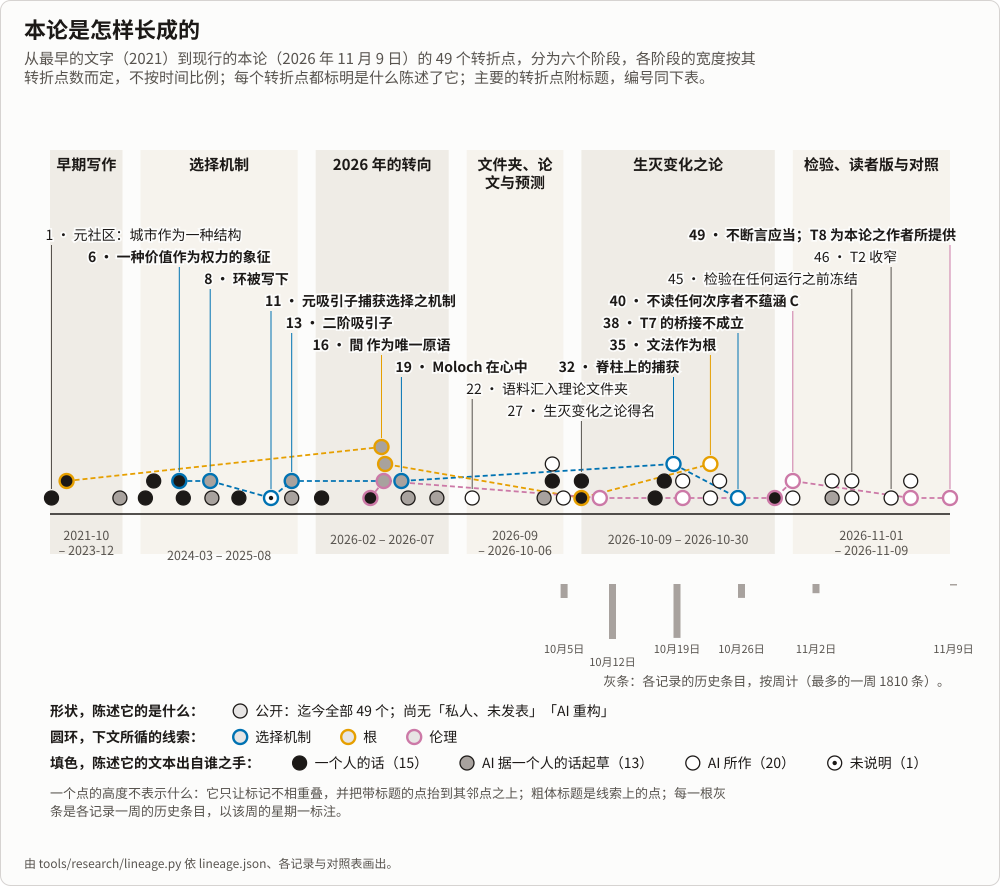

<!-- Generated by tools/research/research.py render (tools/research/lineage.py) from theories/becoming/results/data/lineage.json, the records and the crosswalk; edit those, not this page. -->

# 本说明是怎样长成的

[English](LINEAGE.md) · 全文约 92–120 分钟；图、标签与这条线索约 10–13 分钟。

本说明是怎样长成的：从 2021 年的文字，经由它读过、承继或放下的早先各理论文件夹，到现在的[生成变化之论](becoming/ONE-PAGE.zh.md)。本页由[谱系数据](becoming/results/data/lineage.json)、各记录的历史与[对照](becoming/results/atlas/CROSSWALK.md)生成。本仓库在 `7040940cd`（2026 年 11 月 8 日）共有 6087 次提交；其第一次提交是 2026 年 9 月 6 日的，此前的东西都是带入仓库的材料。本页接续[九月时间线](../_process/history/2026-09-consolidation/TIMELINE.md)，那是「a narrative, not an index」（一份叙述，不是索引），止于 2026 年 10 月 4 日。本页的转折点由 AI 读者收集并核对，没有人读过。

每个转折点按陈述它的东西带一个标签。引自英文来源的话，以「」保留英文原文、附中文释义，或标明为译文；原文见[英文版](LINEAGE.md)。

- **公开**：本仓库中一个受跟踪的文件陈述了它。
- **私人、未发表**：只有未在此发表的材料陈述了它（私人笔记与对话，或未存于此的材料），并有一个公开文本引用它。
- **AI 重构**：没有来源陈述它；它是从材料中推断的，由 AI 读者推断，或由九月时间线这样的叙述推断，而那份叙述本身也是从材料中重构的。

## 一条线索：选择机制

选择机制，沿这条线索上标出的各点。2024 年 7 月：一个社会选出一种价值作为权力的象征，最擅长优化它的人逐渐掌控社会系统。2024 年 10 月：一份由 AI 起草的笔记写出一个自我强化的环，其中「The system naturally selects for pure capital optimizers」（系统自然地选出纯粹的资本优化者）。2025 年：一个元吸引子，殖民「even the mechanisms of selection themselves」（甚至选择机制本身），继而在一份由 AI 撰写的展开中，被定义为状态与选择规则联合空间中的「a second-order attractor」（二阶吸引子）。2026 年 5 月：在一份由 AI 据一次对话写成的工作立场中，该系统所集中的是「not just resources but a way of seeing」（不只是资源，还有一种观看方式）。2026 年 10 月，在脊柱上：经由规则的捕获，继而闭合的捕获：在一个其规则以及规则如何被读都从它所选出之份额读出的选择中，「a loss the loop does not read leaves it locked however large it grows」（环所不读的损失，无论增长多大，都让它保持锁定）；T7 写明「That actual metrics are so formed is conjectured.」（实际的度量是这样形成的，这是猜想。）最后，在一个训练出的系统中，T7 的冻结检验所检验的猜想是：由它所选出者形成的评判者，是一个按种类计数的读者池；结果是「Every frozen verdict passed, and the conjecture failed for this judge」（每一冻结裁决都通过，而该猜想对这个评判者不成立）。只有脊柱上的步骤是证明了的，并且是在一个模型中；每一行说出它那一步主张了什么。

6. **2024-07-14，一种价值成为权力的象征，最擅长它的人掌控。** 一次对话说：「这个社会选择了某一种value作为权利的象征，最擅长于去优化这些value的人」在竞争中逐渐获得权力，进而以他们的方式控制社会系统，「throw other values under the bus」（把其他价值弃之不顾）。次日，这一模式被称为「the core generator function that lead to metacrisis and moloch」（通向元危机与 Moloch 的核心生成函数）。
8. **2024-10-30，环被写下：系统选出纯粹的资本优化者。** 当天一份由 AI 起草的笔记认为，资本主义体系具有「a dominant self-reinforcing loop that continuously intensifies over time」（一个持续加剧的、占主导的自我强化之环），其第一个机制是基于效率的选择：「The system naturally selects for pure capital optimizers」（系统自然地选出纯粹的资本优化者），「Other values and considerations become competitive disadvantages」（其他价值与考量成为竞争劣势）。
11. **2025-05-30，元吸引子：它捕获选择机制本身。** 2025-05-18，一份由 AI 研究工具生成的报告引入元吸引子，称之为「higher-order organizational principles or dominant goals that shape the landscape of these lower-level attractors」（塑造这些较低层吸引子之格局的更高阶组织原则或主导目标）。2025-05-30 的 SEED 草稿说，捕获全球社会的元吸引子「arises naturally from competitive selection pressures」（自然地产生于竞争性的选择压力），并殖民行动者的认知框架、社会内部的激励结构，「and even the mechanisms of selection themselves」（乃至选择机制本身）。
13. **2025-08-10，形式定义：状态 × 选择规则空间中的二阶吸引子。** 当天一份依系统提示词由 AI 写成的扩展文本，把元吸引子定义为「a second-order attractor—a self-stabilising region in joint state × selection-rule space」（一个二阶吸引子——联合的状态 × 选择规则空间中一个自我稳定的区域），在其中「the selection mechanism itself is recursively reinforced by the very states it favours」（选择机制本身被它所偏好的那些状态递归地强化）；规则更新算子 G 描述选择代理本身如何演化，「winners」（胜者）能够「rewrite the rules in their own favor」（按有利于自己的方式改写规则）。在均值为零的简化之下，代理权重按 ẇ = λCw 增长；特征值预算被提出作为「a clear, non-ideological target for policy」（一个清晰的、非意识形态的政策目标）。
19. **2026-05-28，被选出的观看方式：Moloch 在心中。** 一份由 AI 据当天一次对话写成的工作立场提出更尖锐的主张：「the selection pressure under this dynamic favors actors who relate to everything instrumentally」（在这一动力学之下，选择压力偏好那些以工具方式对待一切的行动者）；他们的竞争框架塑造此后的规则，于是系统集中的「not just resources but a way of seeing」（不只是资源，而是一种观看方式）。「Moloch is in the mind, not only in the structure」（Moloch 在心中，不只在结构里）；并且，若委托者是因工具性认知而被选出，「an AI that does what its principal intends is amplifying the dynamic, not checking it」（一个做其委托者所意图之事的 AI，是在放大这一动力学，而非制衡它）。
32. **2026-10-19，脊柱上的经由规则的捕获，继而闭合的捕获。** 2026 年 10 月 19 日，此环以经由规则的捕获落在脊柱上：「Where a selection's rule is read monotonically from the share it selects, the loop locks」（在一个选择的规则从它所选出之份额单调地读出之处，环锁定），且「Without the start condition, it fails.」（没有起点条件，它就不成立。）10 月 20 日，建于其上的闭合的捕获得到证明，公理报告为空：在一个其规则以及规则如何被读都从它所选出之份额读出的选择中，「a loss the loop does not read leaves it locked however large it grows, and a change of the reading is absorbed」（环所不读的损失无论增长多大，都让它保持锁定，而读取的一次改变会被吸收）；论题 T7 则写明「That actual metrics are so formed is conjectured.」（实际的度量是这样形成的，这是猜想。）
38. **2026-10-26，T7 的冻结检验：每一裁决都通过，桥接未通过。** LA2（2026 年 10 月 25 日冻结，25 与 26 日运行）在一个训练出的系统中检验这一猜想：由它所选出者形成的评判者，是一个按种类计数的读者池。「Every frozen verdict passed, and the conjecture failed for this judge」（每一冻结裁决都通过，而该猜想对这个评判者不成立）：关于损失的一条批注，附于九个读者中唯一的散文回答之上，就扭转了它的读取。故 T7 所禁止的一种情形——一个其损失只被它所不利者读到的度量，在选择已让这些人在其读者中不多于其携带者之后、其他一切不变时被放弃——在此系统中发生了，「as worded before its clause on drift」（按其漂移条款加入之前的措辞）；而规则作为从其所选者中抽出之读者池的那条律，「stands within its hypotheses, which this judge does not meet」（在其假设之内成立，此评判者不满足这些假设）。

## 转折点

| # | 日期 | 改变了什么 | 证据 | 标签 |
|---:|---|---|---|---|
| 1 | 2021-10-18 | **「元社区」提案：把城市诊断为一种结构。** 一份提案造出「元社区（Metamunity）」一词，并称「元宇宙的本质是一种面向未来的叙事」。它认为城市的结构「在无形中把一个个人变成了原子化的个体」，而「城市中社会联结机制的结构性问题」是让人产生孤独感、缺乏归属感、人际关系淡漠的主要因素。 | [`sources/00-early-2021-2022/recovered-text/2021-10-18_proposal_元社区-Metamunity.txt`](../sources/00-early-2021-2022/recovered-text/2021-10-18_proposal_元社区-Metamunity.txt) (line 1); [`sources/00-early-2021-2022/recovered-text/2021-10-18_proposal_元社区-Metamunity.txt`](../sources/00-early-2021-2022/recovered-text/2021-10-18_proposal_元社区-Metamunity.txt) (line 21); [`sources/00-early-2021-2022/recovered-text/2021-10-18_proposal_元社区-Metamunity.txt`](../sources/00-early-2021-2022/recovered-text/2021-10-18_proposal_元社区-Metamunity.txt) (line 41) | 公开 |
| 2 | 2022-04-07 | **「World of Possibilities」（《可能性的世界》）：一个定义了可能性的存在论。** 一部书的开篇共十二行，从差异与变化出发，依次定义结构、空间、时间、动态、可能性、事物与系统：「If change may happen to a structure, it possesses possibility」（结构若可能发生变化，便具有可能性）；系统是「A thing that maintains certain dynamic pattern over time」（在时间中维持某种动态模式的事物）。它承认并非每个概念都能被良好定义，否则不免自我指涉。 | [`sources/00-early-2021-2022/recovered-text/2022-04-07_World-of-Possibilities.txt`](../sources/00-early-2021-2022/recovered-text/2022-04-07_World-of-Possibilities.txt) (line 13); [`sources/00-early-2021-2022/recovered-text/2022-04-07_World-of-Possibilities.txt`](../sources/00-early-2021-2022/recovered-text/2022-04-07_World-of-Possibilities.txt) (line 19); [`sources/00-early-2021-2022/recovered-text/2022-04-07_World-of-Possibilities.txt`](../sources/00-early-2021-2022/recovered-text/2022-04-07_World-of-Possibilities.txt) (line 23) | 公开 |
| 3 | 2023-12 | **Wamotopia 宣言点名 molochs；一个主题营注明 Moloch 的出处。** Wamotopia v1.0 宣言列出的紧迫挑战包括「AI alignment, unchecked molochs, faltering leviathans, societal and ecological degradation, metacrisis」（AI 对齐、失控的 moloch、衰弱的利维坦、社会与生态退化、元危机），并呼吁在「principle of positive-externality actions」（正外部性行动原则）之下联合起来。同月稍后加入的 Slay Moloch 主题营引入 Moloch，称之为「the optimizer for value」（为价值而优化者），并注明它最早出现在博文「meditation on moloch」中。 | [`sources/02-wamotopia/2023-2024-wamotopia-repo/manifestos/wamotopia_v1.0.md`](../sources/02-wamotopia/2023-2024-wamotopia-repo/manifestos/wamotopia_v1.0.md) (line 9); [`sources/02-wamotopia/2023-2024-wamotopia-repo/manifestos/wamotopia_v1.0.md`](../sources/02-wamotopia/2023-2024-wamotopia-repo/manifestos/wamotopia_v1.0.md) (line 19); [`sources/02-wamotopia/2023-2024-wamotopia-repo/Wacas/slay_moloch_camp_v0.8.md`](../sources/02-wamotopia/2023-2024-wamotopia-repo/Wacas/slay_moloch_camp_v0.8.md) (line 2) | 公开 |
| 4 | 2024-03-18 | **复杂度跑赢理解；「collapse」（崩溃）被修正为未受管理的风险。** 一次对话写道：社会复杂度呈指数增长，而治理组织对现实的理解只以次线性速度增长（「The speed of the complexity of society grows exp, the speed of the governing organizations’ understanding reality only grows in a sub-linear speed」）。同一次对话中，这一推理被判为「not good enough to conclude on its collapse」（不足以推出崩溃），论断改为：当「even dominate attractors of society」（甚至社会的主导吸引子）变化快到无法被理解时，风险「if not properly managed, will cause the system to destabilize」（若不加妥善管理，会使系统失稳）。 | [`_process/history/2026-09-consolidation/reading-notes-inputs/hb-01.md`](../_process/history/2026-09-consolidation/reading-notes-inputs/hb-01.md) (line 656, under '## 2024-03-18 — The Growing Gap Between Societal Complexity and Governance' (line 652, the third conversation of that title)); [`_process/history/2026-09-consolidation/reading-notes-inputs/hb-01.md`](../_process/history/2026-09-consolidation/reading-notes-inputs/hb-01.md) (line 666, same heading); [`_process/history/2026-09-consolidation/reading-notes-inputs/hb-01.md`](../_process/history/2026-09-consolidation/reading-notes-inputs/hb-01.md) (line 666, same heading) | 公开 |
| 5 | 2024-04-16 | **Moloch 定义为单一维度优化；任何框架都须保证不收敛。** 一段请求整理成演讲的中文观点，把 Moloch 问题定义为「单一维度优化（single value optimization，例如资本）的零和博弈」：一个 agent 产生更复杂的博弈策略并带来竞争优势时，系统便会收敛，并写道「如果这种收敛（因为attractor的存在）不加控制」。它要求新的框架「必须可以保证权利结构不收敛」。 | [`_process/history/2026-09-consolidation/reading-notes-inputs/hb-01.md`](../_process/history/2026-09-consolidation/reading-notes-inputs/hb-01.md) (line 1689, under '## 2024-04-16 — Balancing AI risks and opportunities through harmonious coexistence' (line 1667)); [`_process/history/2026-09-consolidation/reading-notes-inputs/hb-01.md`](../_process/history/2026-09-consolidation/reading-notes-inputs/hb-01.md) (line 1691, same heading); [`_process/history/2026-09-consolidation/reading-notes-inputs/hb-01.md`](../_process/history/2026-09-consolidation/reading-notes-inputs/hb-01.md) (line 1699, same heading) | 公开 |
| 6 | 2024-07-14 | **一种价值成为权力的象征，最擅长它的人掌控。** 一次对话说：「这个社会选择了某一种value作为权利的象征，最擅长于去优化这些value的人」在竞争中逐渐获得权力，进而以他们的方式控制社会系统，「throw other values under the bus」（把其他价值弃之不顾）。次日，这一模式被称为「the core generator function that lead to metacrisis and moloch」（通向元危机与 Moloch 的核心生成函数）。 | [`_process/history/2026-09-consolidation/reading-notes-inputs/hb-01.md`](../_process/history/2026-09-consolidation/reading-notes-inputs/hb-01.md) (line 4411, under '## 2024-07-14 — Rethinking Social Values in a Globalized World' (line 4383)); [`_process/history/2026-09-consolidation/reading-notes-inputs/hb-01.md`](../_process/history/2026-09-consolidation/reading-notes-inputs/hb-01.md) (line 4645, under '## 2024-07-15 — Humans as Agents in the Social System' (line 4619)); [`theories/meta-attractor/README.md`](meta-attractor/README.md) (quoted words, item 7 (2024-07-14), line 872) | 公开 |
| 7 | 2024-07-28 | **游戏设计公理，以及以多种游戏对抗收敛。** 一段话写道：「a winner of the game should be rewarded with anything other than more advantages of the game, otherwise the game will eventually converge and winner will take all」（游戏的赢家应得到的奖励，只能是游戏优势以外的东西，否则游戏终将收敛、赢家通吃）。次日，在一段关于意识形态的话里，它补充「It is the design of the game suck, not the idea of how to play the game unworkable」（糟的是游戏的设计，而不是玩法的想法行不通），并以冗余作为多种游戏并存的理由：「So at least, if one game fail, you can join another one」（至少一个游戏失败了，你还能加入另一个）。 | [`_process/history/2026-09-consolidation/reading-notes-inputs/hb-01.md`](../_process/history/2026-09-consolidation/reading-notes-inputs/hb-01.md) (line 5354, under '## 2024-07-28 — Avoiding the Winner-Take-All Trap in Game Design' (line 5350)); [`_process/history/2026-09-consolidation/reading-notes-inputs/hb-01.md`](../_process/history/2026-09-consolidation/reading-notes-inputs/hb-01.md) (line 5471, under '## 2024-07-29 — Balancing Ideological Diversity in Society' (line 5425)); [`_process/history/2026-09-consolidation/reading-notes-inputs/hb-01.md`](../_process/history/2026-09-consolidation/reading-notes-inputs/hb-01.md) (line 5481, same heading) | 公开 |
| 8 | 2024-10-30 | **环被写下：系统选出纯粹的资本优化者。** 当天一份由 AI 起草的笔记认为，资本主义体系具有「a dominant self-reinforcing loop that continuously intensifies over time」（一个持续加剧的、占主导的自我强化之环），其第一个机制是基于效率的选择：「The system naturally selects for pure capital optimizers」（系统自然地选出纯粹的资本优化者），「Other values and considerations become competitive disadvantages」（其他价值与考量成为竞争劣势）。 | [`sources/03-meta-attractor/2024-precursors/capital-analysis.md`](../sources/03-meta-attractor/2024-precursors/capital-analysis.md) (## Core Dynamic: The Dominant Loop, item 1 Efficiency-Based Selection, line 8); [`sources/03-meta-attractor/2024-precursors/capital-analysis.md`](../sources/03-meta-attractor/2024-precursors/capital-analysis.md) (## Core Dynamic: The Dominant Loop, line 4); [`sources/SOURCES.md`](../sources/SOURCES.md) (### 03-meta-attractor file table, line 666); [`theories/meta-attractor/README.md`](meta-attractor/README.md) (source list, 2024 precursors (line 1150)) | 公开 |
| 9 | 2024-11-05 | **衔尾蛇循环：这一回路推广到任何优势可复利累积的领域。** 一份由 AI 起草的文本推广了这一回路：「This pattern emerges in any system where advantages can compound」（这一模式出现在任何优势可以复利累积的系统中），无论权力的通货是金融、社会、军事、生物适应度还是信息控制。同一天，在两次不同的对话里：一次请求一个「more creative, like moloch」（更有创意、像 moloch 那样）的名字，一次围绕「The Ouroboros Cycle:How Optimization Drives System Collapse」（衔尾蛇循环：优化如何驱动系统崩溃）的工作坊筹划一场沙龙。 | [`sources/03-meta-attractor/2024-precursors/ouroboros-cycle.md`](../sources/03-meta-attractor/2024-precursors/ouroboros-cycle.md) (## Introduction, line 7); [`_process/history/2026-09-consolidation/reading-notes-inputs/hb-02.md`](../_process/history/2026-09-consolidation/reading-notes-inputs/hb-02.md) (line 123, under '## 2024-11-05 — Competitive Convergence: Dynamics of Power Concentration' (line 115)); [`_process/history/2026-09-consolidation/reading-notes-inputs/hb-02.md`](../_process/history/2026-09-consolidation/reading-notes-inputs/hb-02.md) (line 140, under '## 2024-11-05 — Salon on Metacrisis, Moloch & Systems Change' (line 136)); [`theories/meta-attractor/README.md`](meta-attractor/README.md) (source list, 2024 precursors (line 1150)) | 公开 |
| 10 | 2025-02-07 | **「image of self」（自我形象）变为「narrative-value frame」（叙事—价值框架）。** 2025-02-03 的自私螺旋文本写「A human construct an image of self」（人构建一个自我形象）；改写成笔记后，同一句里的「image of self」换成了指向 narrative-value frame（叙事—价值框架，NVF）的链接。笔记写道：「selfish gets rewarded and it compounds, it out grows other behavior patterns(NVFs)」（自私得到奖励并复利累积，长得超过了其他行为模式）。 | [`_process/history/2026-09-consolidation/reading-notes-inputs/hb-02.md`](../_process/history/2026-09-consolidation/reading-notes-inputs/hb-02.md) (line 1754, under '## 2025-02-03 — The Self-Reinforcing Cycle of Selfishness' (line 1750)); [`sources/01-writings-2025/compound_selfishness.md`](../sources/01-writings-2025/compound_selfishness.md) (line 3); [`sources/01-writings-2025/compound_selfishness.md`](../sources/01-writings-2025/compound_selfishness.md) (line 17) | 公开 |
| 11 | 2025-05-30 | **元吸引子：它捕获选择机制本身。** 2025-05-18，一份由 AI 研究工具生成的报告引入元吸引子，称之为「higher-order organizational principles or dominant goals that shape the landscape of these lower-level attractors」（塑造这些较低层吸引子之格局的更高阶组织原则或主导目标）。2025-05-30 的 SEED 草稿说，捕获全球社会的元吸引子「arises naturally from competitive selection pressures」（自然地产生于竞争性的选择压力），并殖民行动者的认知框架、社会内部的激励结构，「and even the mechanisms of selection themselves」（乃至选择机制本身）。 | [`sources/03-meta-attractor/2025-05-drafts-selected/2025-05-30-seed-meta-attractors-and-road-to-systemic-collapse.md`](../sources/03-meta-attractor/2025-05-drafts-selected/2025-05-30-seed-meta-attractors-and-road-to-systemic-collapse.md) (line 25); [`sources/03-meta-attractor/2025-05-drafts-selected/2025-05-18-navigating-the-precipice-start-research.md`](../sources/03-meta-attractor/2025-05-drafts-selected/2025-05-18-navigating-the-precipice-start-research.md) (line 13 (introduction)); [`theories/meta-attractor/README.md`](meta-attractor/README.md) (source list, 2025-05/06 draft series (line 1157)) | 公开 |
| 12 | 2025-08-10 | **Spirit–Token–Space：为社会建模的通用符号框架。** 一篇论文提出「STS (Spirit–Token–Space)」（精神—令牌—空间），称之为「a universal symbolic interaction framework designed to formally encode social structures and dynamics」（一个用于形式化编码社会结构与动态的通用符号交互框架），标题称它是用于「Modeling and Prototyping Societies, Communities, and Economic Systems」（为社会、社群与经济系统建模和做原型）的框架。一份评审以同一 STS 标题保存为 usis.md，称之为「USIS model」（USIS 模型），即「Universal Symbolic Interaction System, with its primitives Token–Spirit–Space」（以令牌、精神、空间为原语的通用符号交互系统）。 | [`sources/01-writings-2025/STS.md`](../sources/01-writings-2025/STS.md) (line 1 (title)); [`sources/01-writings-2025/STS.md`](../sources/01-writings-2025/STS.md) (## Abstract, line 5); [`sources/01-writings-2025/usis.md`](../sources/01-writings-2025/usis.md) (line 103 (and "USIS model", line 5)) | 公开 |
| 13 | 2025-08-10 | **形式定义：状态 × 选择规则空间中的二阶吸引子。** 当天一份依系统提示词由 AI 写成的扩展文本，把元吸引子定义为「a second-order attractor—a self-stabilising region in joint state × selection-rule space」（一个二阶吸引子——联合的状态 × 选择规则空间中一个自我稳定的区域），在其中「the selection mechanism itself is recursively reinforced by the very states it favours」（选择机制本身被它所偏好的那些状态递归地强化）；规则更新算子 G 描述选择代理本身如何演化，「winners」（胜者）能够「rewrite the rules in their own favor」（按有利于自己的方式改写规则）。在均值为零的简化之下，代理权重按 ẇ = λCw 增长；特征值预算被提出作为「a clear, non-ideological target for policy」（一个清晰的、非意识形态的政策目标）。 | [`sources/03-meta-attractor/2025-08-formal/2025-08-10-comprehensive-mathematical-definition.md`](../sources/03-meta-attractor/2025-08-formal/2025-08-10-comprehensive-mathematical-definition.md) (### 1.1. Abstract and Definition, line 11); [`sources/03-meta-attractor/2025-08-formal/2025-08-10-comprehensive-mathematical-definition.md`](../sources/03-meta-attractor/2025-08-formal/2025-08-10-comprehensive-mathematical-definition.md) (### 5.2, line 262); [`sources/03-meta-attractor/2025-08-formal/2025-08-10-comprehensive-mathematical-definition.md`](../sources/03-meta-attractor/2025-08-formal/2025-08-10-comprehensive-mathematical-definition.md) (### 1.2, line 39); [`theories/meta-attractor/synthesis-b-formal-and-essays-2025-08-10.md`](meta-attractor/synthesis-b-formal-and-essays-2025-08-10.md) (line 249) | 公开 |
| 14 | 2026-02-09 | **AI 转向：The Fork（分岔）与那一条规则。** 2026 年 1 月录下的一次演讲已说「It would be a good idea to not use AI for competition, but use it for the benefits for all」（不把 AI 用于竞争、而用于众人之益，会是个好主意）。2026-02-09，一次对话接过一份贴入的、由 AI 整理的情景推演，Automated Feudalism（自动化封建）对 Automated Commons（自动化公地），「The deciding variable is institutional design」（决定性的变量是制度设计），请求据此写一篇叙事（名为 The Fork（分岔）；九月时间线说它不在语料中），并作为一种妥协，提议「Make the global coordination work based on one rule, that is forcefully executed: stop using AI compete with others, only use them for commons」（让全球协调建立在一条强制执行的规则上：停止用 AI 与他人竞争，只把它用于公地）。 | [`sources/02-wamotopia/transcripts/2026-01-note-chiangmai-festival-talk.txt`](../sources/02-wamotopia/transcripts/2026-01-note-chiangmai-festival-talk.txt) (line 176 (timestamp 17:09)); [`_process/history/2026-09-consolidation/reading-notes-inputs/hb-02.md`](../_process/history/2026-09-consolidation/reading-notes-inputs/hb-02.md) (line 3608, under '## 2026-02-09 — Fully automated production and its future implications' (line 3482)); [`_process/history/2026-09-consolidation/reading-notes-inputs/hb-02.md`](../_process/history/2026-09-consolidation/reading-notes-inputs/hb-02.md) (line 3627, same heading); [`_process/history/2026-09-consolidation/reading-notes-inputs/hb-02.md`](../_process/history/2026-09-consolidation/reading-notes-inputs/hb-02.md) (line 3490, same heading); [`_process/history/2026-09-consolidation/TIMELINE.md`](../_process/history/2026-09-consolidation/TIMELINE.md) (## 2026-02-07 → 2026-04-30 (line 125)) | 公开 |
| 15 | 2026-04-16 | **The Fork（分岔）叙事被放下；合作本身并非善。** 两种结局的叙事被放下：「I think I have moved on from the fork narrative, it becomes simpler」（我想我已经从分岔叙事走出来了，它变得更简单）；此前 2026-03-18 有过一次校正，说 The Fork 从来不是二元的，「the actual possibility space that we can pursuit is huge」（我们实际能追求的可能性空间极大）。合作并不被视为本身为善：「cooperative on the wrong thing could be why worse than just competing on it」（在错误的事上合作，可能比单纯在其上竞争更糟）；The Fork 文件夹把这读作生成与退化（generative versus degenerative）之判据，而这两个词要到 2026-04-28 才出现。 | [`_process/history/2026-09-consolidation/reading-notes-inputs/hb-02.md`](../_process/history/2026-09-consolidation/reading-notes-inputs/hb-02.md) (line 7190, under '## 2026-04-16 — Recent conversation insights' (line 7174)); [`_process/history/2026-09-consolidation/reading-notes-inputs/hb-02.md`](../_process/history/2026-09-consolidation/reading-notes-inputs/hb-02.md) (line 7194, same heading); [`_process/history/2026-09-consolidation/reading-notes-inputs/hb-02.md`](../_process/history/2026-09-consolidation/reading-notes-inputs/hb-02.md) (line 5097, under '## 2026-03-18 — Creating aligned AI assistant documentation' (line 5083)); [`theories/the-fork-and-cooperative-infrastructure/README.md`](the-fork-and-cooperative-infrastructure/README.md) (claim 44 (line 116)); [`_process/history/2026-09-consolidation/reading-notes-inputs/hb-02.md`](../_process/history/2026-09-consolidation/reading-notes-inputs/hb-02.md) (line 8197, under '## 2026-04-28 — Generative over destructive ethics' (line 8189)) | 公开 |
| 16 | 2026-05-01 | **間 为唯一原语；古文为形式语言。** 《間》基础笔记（与 AI 协作起草，现存最早为 v0.3）立一元本体：「一切是间。間 是唯一原语。」其变更记录将此归于 v0.2。此前的 Spirit–Space–Token 三原语被写成在间中如何呈现，Space「不是独立 primitive」；v0.3 以古文为主要语法，S-expression 作为「ambiguous 时的 fallback」。 | [`sources/08-jian-wen-language/jian-repo/JIAN_FOUNDATION_NOTE_v0.3.md`](../sources/08-jian-wen-language/jian-repo/JIAN_FOUNDATION_NOTE_v0.3.md) (I. 立论 — 一切是间 (line 50)); [`sources/08-jian-wen-language/jian-repo/JIAN_FOUNDATION_NOTE_v0.3.md`](../sources/08-jian-wen-language/jian-repo/JIAN_FOUNDATION_NOTE_v0.3.md) (VIII. SST 如何被含括 (line 648)); [`sources/08-jian-wen-language/jian-repo/JIAN_FOUNDATION_NOTE_v0.3.md`](../sources/08-jian-wen-language/jian-repo/JIAN_FOUNDATION_NOTE_v0.3.md) (v0.3 changelog (line 13)); [`sources/08-jian-wen-language/jian-repo/JIAN_FOUNDATION_NOTE_v0.3.md`](../sources/08-jian-wen-language/jian-repo/JIAN_FOUNDATION_NOTE_v0.3.md) (header) | 公开 |
| 17 | 2026-05-04 | **以开为根：护未成之域不闭，非扩张可测之物。** 《生生不息论》v9（开境护闭校正版；据该文件夹，大多由模型起草的文言表述被带入其中）写道「生生不息 ≠ 复杂性必然上升」「复杂性上升 ≠ 善」，所论之善非「扩张某可测量之物」，乃「护未成之域不闭」。一份由 AI 写成的文件夹综述记开取代「expanding the possibility space」（扩张可能性空间）成为根范畴；但 2026-05-07 的报告仍以「可能性空间之持续扩张」释生生不息，并保留论证唯一一种「稳定可奠基」之 alignment 的目标。 | [`sources/07-shengsheng-buxi/downloads-drafts-2026-05/生生不息论_v9_开境护闭校正版.md`](../sources/07-shengsheng-buxi/downloads-drafts-2026-05/生生不息论_v9_开境护闭校正版.md) (〇、此论之位置 (line 84)); [`theories/keep-the-possibility-space-open/README.md`](keep-the-possibility-space-open/README.md) (claim 13 (line 239)); [`sources/07-shengsheng-buxi/ssbx-repo/义理/R_与生生不息对齐之必然.md`](../sources/07-shengsheng-buxi/ssbx-repo/义理/R_与生生不息对齐之必然.md) (line 48 (报告日期 2026-05-07, line 8)); [`theories/keep-the-possibility-space-open/README.md`](keep-the-possibility-space-open/README.md) (line 237) | 公开 |
| 18 | 2026-05-06 | **Lean 作内部融贯检验；按定理类型读主张。** 2026-05-06 的一份规格以文言为主要语言，以 Lean 4 为「framework 之 internal coherence checker」，并说「empirical correspondence ... 不 直接 verifiable in Lean」。2026-05-21，一份主张状态台账把主张分为 closed、scoped、schema、external route、sketch、placeholder、open，其规则是「Use the strongest claim allowed by the theorem type, not by the file title or surrounding doctrine prose.」（按定理类型所允许的最强主张来读，而不按文件标题或周边的教义文字）。 | [`sources/07-shengsheng-buxi/ssbx-repo/史料/真理/daoli-v12-lean-verifier.md`](../sources/07-shengsheng-buxi/ssbx-repo/史料/真理/daoli-v12-lean-verifier.md) (引 (line 19); file time 2026-05-06 in timeline-raw.tsv line 652); [`sources/07-shengsheng-buxi/ssbx-repo/docs-next/10_formal_形式/claim-status-ledger.md`](../sources/07-shengsheng-buxi/ssbx-repo/docs-next/10_formal_形式/claim-status-ledger.md) (header (line 3)); [`sources/07-shengsheng-buxi/ssbx-repo/docs-next/10_formal_形式/claim-status-ledger.md`](../sources/07-shengsheng-buxi/ssbx-repo/docs-next/10_formal_形式/claim-status-ledger.md) (Reading Rule (line 7)) | 公开 |
| 19 | 2026-05-28 | **被选出的观看方式：Moloch 在心中。** 一份由 AI 据当天一次对话写成的工作立场提出更尖锐的主张：「the selection pressure under this dynamic favors actors who relate to everything instrumentally」（在这一动力学之下，选择压力偏好那些以工具方式对待一切的行动者）；他们的竞争框架塑造此后的规则，于是系统集中的「not just resources but a way of seeing」（不只是资源，而是一种观看方式）。「Moloch is in the mind, not only in the structure」（Moloch 在心中，不只在结构里）；并且，若委托者是因工具性认知而被选出，「an AI that does what its principal intends is amplifying the dynamic, not checking it」（一个做其委托者所意图之事的 AI，是在放大这一动力学，而非制衡它）。 | [`sources/05-alignment-and-moloch/2026-05-28-alignment-core-stance.md`](../sources/05-alignment-and-moloch/2026-05-28-alignment-core-stance.md) (## The diagnosis, line 15); [`sources/05-alignment-and-moloch/2026-05-28-alignment-core-stance.md`](../sources/05-alignment-and-moloch/2026-05-28-alignment-core-stance.md) (## The diagnosis, line 17); [`sources/05-alignment-and-moloch/2026-05-28-alignment-core-stance.md`](../sources/05-alignment-and-moloch/2026-05-28-alignment-core-stance.md) (## The diagnosis, line 19) | 公开 |
| 20 | 2026-06-06 | **现实是生成过程；相关性崩溃是危险所在。** 一份由 AI 依作者之意起草的基础草稿，自称「not a doctrine, and not a final blueprint」（不是教义，也不是最终蓝图），以「Reality is not a finished order. It is a generative process.」（现实不是已完成的秩序，它是一个生成过程）开篇。它说危险不在每一种不可逆的变化，而在相关性崩溃（correlated collapse）：「one system, one metric, one model, one winner, one point of failure」（一个系统、一个指标、一个模型、一个赢家、一个故障点）。 | [`sources/04-speculative-future/current/FOUNDATION-PRINCIPLES-DRAFT.md`](../sources/04-speculative-future/current/FOUNDATION-PRINCIPLES-DRAFT.md) (The Ground (line 25)); [`sources/04-speculative-future/current/FOUNDATION-PRINCIPLES-DRAFT.md`](../sources/04-speculative-future/current/FOUNDATION-PRINCIPLES-DRAFT.md) (principle 8 (line 114)); [`sources/04-speculative-future/current/FOUNDATION-PRINCIPLES-DRAFT.md`](../sources/04-speculative-future/current/FOUNDATION-PRINCIPLES-DRAFT.md) (line 19); [`theories/keep-the-possibility-space-open/README.md`](keep-the-possibility-space-open/README.md) (source list (line 874)) | 公开 |
| 21 | 2026-07-15 | **智善的基石文件：智能不可代人相斗。** 2026-07-08 的宣言草稿（由 AI 依作者的想法起草）在末行之前以一个检验作结：「它在开路，还是在据门？」并说「这里说的每一条，都适用于这份文件，和举着它的人」。2026-07-15，同样由 AI 起草的《智善》自称「智善的基石文件」，并写道「人可以继续博弈；智能不可代人相斗。」 | [`sources/06-zhishan/manifesto/drafts/draft-1.md`](../sources/06-zhishan/manifesto/drafts/draft-1.md) (line 69, before the last line (line 71)); [`sources/06-zhishan/manifesto/drafts/draft-1.md`](../sources/06-zhishan/manifesto/drafts/draft-1.md) (line 51); [`sources/06-zhishan/sheng/智善.md`](../sources/06-zhishan/sheng/智善.md) (前言 (line 7)); [`sources/06-zhishan/sheng/智善.md`](../sources/06-zhishan/sheng/智善.md) (line 69); [`theories/zhishan-intelligence-must-be-good/README.md`](zhishan-intelligence-must-be-good/README.md) (line 1130); [`theories/zhishan-intelligence-must-be-good/README.md`](zhishan-intelligence-must-be-good/README.md) (line 1108) | 公开 |
| 22 | 2026-09-03 | **语料汇入理论文件夹；在四个名字之下找到同一机制。** 2026-09-03，诸篇写作被汇入 theories/ 下的十五个文件夹，至 2026-09-13 又增两个；九月的总图把它们读作既非十五种理论、也非一种：「one diagnostic mechanism restated four times under successive names」（同一个诊断机制，以先后不同的名字重述了四次），旁边是一小组不可化约为它的相邻承诺，以及把这些承诺写成代码的工程系统。这些文件夹是「syntheses first written in September 2026 and kept in place」（2026 年 9 月首次写成并保留原处的综述），每一个都写于现行说明之前。 | [`_process/history/2026-09-consolidation/MAP.md`](../_process/history/2026-09-consolidation/MAP.md) (opening paragraph (line 3)); [`_process/history/2026-09-consolidation/MAP.md`](../_process/history/2026-09-consolidation/MAP.md) (opening paragraph (line 3)); [`theories/README.md`](README.md) (line 5) | 公开 |
| 23 | 2026-09-29 | **一篇论文从可纠正性立论，每项主张配以可驳倒它的观察。** 《When Capability Outruns Correction》（v2，「Second draft for author review」，即供作者审阅的第二稿；由 AI 起草，其说明称尚未经审阅）「argues from correctability instead: whether institutions can detect a failure and change course before its consequences become irreversible」（改从可纠正性立论：机构能否在后果变得不可逆之前察觉失误、改变方向）；其中「A minimal dynamical theory couples three mechanisms」（一个最小的动力学理论耦合三种机制），即递归捕获、认知滞后与证据通道的捕获，并提议对指定的前沿跃迁实行有条件的暂停。「Each claim is paired with observations that would refute it.」（每项主张都配有可驳倒它的观察。） | [`drafts/2026-09-28-capability-outruns-correction/When_Capability_Outruns_Correction_v2.tex`](../drafts/2026-09-28-capability-outruns-correction/When_Capability_Outruns_Correction_v2.tex) (line 47, \date); [`drafts/2026-09-28-capability-outruns-correction/When_Capability_Outruns_Correction_v2.tex`](../drafts/2026-09-28-capability-outruns-correction/When_Capability_Outruns_Correction_v2.tex) (abstract); [`drafts/2026-09-28-capability-outruns-correction/When_Capability_Outruns_Correction_v2.tex`](../drafts/2026-09-28-capability-outruns-correction/When_Capability_Outruns_Correction_v2.tex) (abstract, last sentence) | 公开 |
| 24 | 2026-10-02 | **为何与意义：预测，先对齐理解，再协调。** 一次近两小时的录音对话事后被指为理论「why and meaning」（为何与意义）之所在；九月的总图（按时间戳逐字引用其自动转写）说理论之用是「a prediction, so that understanding can align before coordination」（一种预测，使理解能在协调之前对齐）。对话中造出 molochlization 一词（「I mean I'm just making up this word」，即我只是在造这个词），指重塑心智的选择；对话一结束，被称为最重要的结论是「we have to work together, as a shared future of mankind, we have to cooperate on this」（我们必须一起工作，作为人类的共同未来，我们必须在这件事上合作）。 | [`sources/16-claude-code-directions/2026-10-02-why-and-meaning-request.md`](../sources/16-claude-code-directions/2026-10-02-why-and-meaning-request.md) (verbatim message (line 11)); [`_process/history/2026-09-consolidation/MAP.md`](../_process/history/2026-09-consolidation/MAP.md) (Why, and what it means (2026-10-02), line 21); [`_process/history/2026-09-consolidation/MAP.md`](../_process/history/2026-09-consolidation/MAP.md) (same section, line 23); [`sources/16-claude-code-directions/2026-10-02-paper-v3-spine-direction.md`](../sources/16-claude-code-directions/2026-10-02-paper-v3-spine-direction.md) (message 3 of the verbatim messages (line 15)) | 公开 |
| 25 | 2026-10-02 | **本仓库首批预先登记的预测；其一在试运行中未通过。** 为 IASEAI 草稿文件夹中的评分标准编辑模拟，预测「Written before any run of experiment.py」（写于 experiment.py 任何一次运行之前），并比试运行日志早两分钟提交。试运行日志记录「Verdicts: P1 FAILS; P2 holds; P3 holds; P4 holds」（P1 未通过，P2 至 P4 成立）；第二组预测「Written after the pilot (design 1, PREDICTIONS.md) and before any run of design 2.」（写于试运行（设计 1）之后、设计 2 任何一次运行之前）。 | [`drafts/2026-10-02-iaseai-selecting-the-selectors/experiment/PREDICTIONS.md`](../drafts/2026-10-02-iaseai-selecting-the-selectors/experiment/PREDICTIONS.md) (line 3; git 3ba95cf7b, 2026-10-02 21:47:35 +0700); [`drafts/2026-10-02-iaseai-selecting-the-selectors/experiment/pilot.log`](../drafts/2026-10-02-iaseai-selecting-the-selectors/experiment/pilot.log) (line 16 (last line); git 667ca9249, 2026-10-02 21:49:40 +0700); [`drafts/2026-10-02-iaseai-selecting-the-selectors/experiment/PREDICTIONS-2.md`](../drafts/2026-10-02-iaseai-selecting-the-selectors/experiment/PREDICTIONS-2.md) (line 3; git 667ca9249, 2026-10-02 21:49:40 +0700) | 公开 |
| 26 | 2026-10-06 | **IASEAI 论文线的 V7.3 并入生成性说明。** 论文线 10 月 5 日的 V7.3 自称「Conditional working paper」（有条件的工作论文），其中六种机制被并入生成性说明的一章。该章由 AI 撰写，「preserves the predecessor's conditional results」（保留前作的有条件结果），并且「no new scientific run, formal theorem or claim that all six mechanisms have been composed into one dynamical system」（没有新的科学运行、形式定理，也不主张六种机制已被组合为一个动力系统）。同日一项不作假设的指令使该章未能达标：其整合「retains conditional laws and therefore does not meet that requirement or constitute completed Lean integration」（保留了有条件的律，因而不满足该要求，也不构成完成的 Lean 整合）；此章今已移入历史。 | [`drafts/2026-10-02-iaseai-selecting-the-selectors/v7.3/README.md`](../drafts/2026-10-02-iaseai-selecting-the-selectors/v7.3/README.md) (dateline, line 3); [`theories/becoming/history/GENERATIVE-SELECTION.md`](becoming/history/GENERATIVE-SELECTION.md) (AI-authored dateline paragraph, line 7); [`theories/becoming/history/GENERATIVE-SELECTION.md`](becoming/history/GENERATIVE-SELECTION.md) (line 5, Subsequent no-assumptions directive, 6 October 2026) | 公开 |
| 27 | 2026-10-09 | **定名生成／变化之论（今作生成变化之论）；零公理根基仍是假设。** 10 月 9 日，本库此前题为 Universal Meta-Ethics of Agency（能动者的普遍元伦理）的理论，取公开题名 The Theory of Becoming（生成／变化之论，今作生成变化之论）；记录中 AI 的实施解读从「先」字读出，这是「the current name, not a final decision」（当前的名字，不是最终决定）。同一解读说：「The zero-axiom grounding of becoming remains a research hypothesis.」（生成的零公理根基仍是一个研究假设。） | [`sources/15-codex-theory-conversations/2026-10-09-theory-of-becoming-name.md`](../sources/15-codex-theory-conversations/2026-10-09-theory-of-becoming-name.md) (## Context — AI-authored, line 7); [`sources/15-codex-theory-conversations/2026-10-09-theory-of-becoming-name.md`](../sources/15-codex-theory-conversations/2026-10-09-theory-of-becoming-name.md) (the section of words kept, line 15); [`sources/15-codex-theory-conversations/2026-10-09-theory-of-becoming-name.md`](../sources/15-codex-theory-conversations/2026-10-09-theory-of-becoming-name.md) (## AI implementation interpretation, line 21); [`sources/15-codex-theory-conversations/2026-10-09-theory-of-becoming-name.md`](../sources/15-codex-theory-conversations/2026-10-09-theory-of-becoming-name.md) (## AI implementation interpretation, line 21) | 公开 |
| 28 | 2026-10-09 | **Lean 脊柱 Becoming 及其无公理的纯核。** Lean 脊柱 Becoming 当天开建，并依这一指示被做成纯的：「你说的脊柱，它不能有任何依赖，没有axiom，外围可以用任意你觉得最合适的工具」。如今其检查器断言每个源声明的公理报告都为空；方法章限定这说明了什么：「An empty report shows that no logical axiom is used.」（空报告只表明未用任何逻辑公理。） | [`sources/15-codex-theory-conversations/2026-10-09-pure-core.md`](../sources/15-codex-theory-conversations/2026-10-09-pure-core.md) (the section of words kept, line 9); [`theories/becoming/chapters/08-METHOD.md`](becoming/chapters/08-METHOD.md) (§3 'What the checker enforces', line 132); [`theories/becoming/chapters/08-METHOD.md`](becoming/chapters/08-METHOD.md) (§3 'Stricter than constructive, and about logic only', line 139) | 公开 |
| 29 | 2026-10-11 | **G0 不再是所采用的公理，改作条件陈述。** 10 月 11 日，G0 被折叠，「at least for part i」（至少对第一部分）：「G0 is no longer an adopted axiom; Part I states it as a condition, and in Part II it is a theorem of the one axiom.」（G0 不再是所采用的公理；第一部分把它作为条件陈述，在第二部分中它是那一条公理的定理。）10 月 16 日，依一项以 AI 起草之措辞发出的决定，第二部分并入第一部分，「as one conditional section after the generative space, keeping the equivalence theorems and naming the invariance step」（作为生成空间之后的一个有条件的节，保留等价定理，并点明不变之一步）。 | [`theories/becoming/results/records/continuation-condition-yields-living-significance.json`](becoming/results/records/continuation-condition-yields-living-significance.json) (history[] entry '2026-10-11 P51', line 1169); [`sources/15-codex-theory-conversations/2026-10-11-fold-g0.md`](../sources/15-codex-theory-conversations/2026-10-11-fold-g0.md) (the section of words kept, line 9); [`sources/15-codex-theory-conversations/2026-10-16-fold-part-ii.md`](../sources/15-codex-theory-conversations/2026-10-16-fold-part-ii.md) (the section of words kept, line 13); [`sources/15-codex-theory-conversations/2026-10-16-fold-part-ii.md`](../sources/15-codex-theory-conversations/2026-10-16-fold-part-ii.md) (the section of words kept, line 11) | 公开 |
| 30 | 2026-10-17 | **早先的指示成为出处；旧标签按所述改名。** 10 月 17 日的一则消息要求保留早先的话，但不再把它们当作「truth」（真理）；其记录中由 AI 撰写的背景读作：这些话仍逐字保存，但「They no longer decide what the live theory says.」（它们不再决定现行说明说什么。）「G0」「Part I」（第一部分）「Part II」（第二部分）这类标签已成历史，按其所述改名：「living significance for G0, the continuation condition for the one axiom, the theory without axiom for Part I」（G0 称存活之意义，那一条公理称延续条件，第一部分称无公理的理论）。 | [`sources/15-codex-theory-conversations/2026-10-17-ren-words-not-authority.md`](../sources/15-codex-theory-conversations/2026-10-17-ren-words-not-authority.md) (the message kept, line 7); [`sources/15-codex-theory-conversations/2026-10-17-ren-words-not-authority.md`](../sources/15-codex-theory-conversations/2026-10-17-ren-words-not-authority.md) (## Context (AI-authored), 'Provenance, not authority', line 13); [`sources/15-codex-theory-conversations/2026-10-17-ren-words-not-authority.md`](../sources/15-codex-theory-conversations/2026-10-17-ren-words-not-authority.md) (## Context (AI-authored), 'Outdated labels', line 14); [`theories/becoming/results/records/continuation-condition-yields-living-significance.json`](becoming/results/records/continuation-condition-yields-living-significance.json) (history[] entry '17 October 2026, source reconciliation after relabelling', line 1227) | 公开 |
| 31 | 2026-10-18 | **以耦合取代「registration」（登记）一词族。** 「registration」（登记）被称为「a dualist word」（一个二元论的词），说它「nudged the whole vocabulary into a very western way」（把整套词汇推向了一种很西方的方式），随后开展命名研究。10 月 18 日，175 个 Lean 声明改名，其中 Web.Registers 改为 Web.CoupledInto，陈述与证明不变；术语表中，到达一个选择者的东西是「through its couplings (never "registers")」（经由其耦合而到达的，绝不说 registers）。 | [`sources/15-codex-theory-conversations/2026-10-17-registration-dualist-vocabulary.md`](../sources/15-codex-theory-conversations/2026-10-17-registration-dualist-vocabulary.md) (the section of words kept, line 17); [`_process/research/2026-10-05-generative-foundation-review/history/root-foundation/development/n1-migration/RENAME-TABLE.json`](../_process/research/2026-10-05-generative-foundation-review/history/root-foundation/development/n1-migration/RENAME-TABLE.json) (renamed, line 127); [`GLOSSARY.md`](../GLOSSARY.md) (## Knowing, row 'couples into', line 45) | 公开 |
| 32 | 2026-10-19 | **脊柱上的经由规则的捕获，继而闭合的捕获。** 2026 年 10 月 19 日，此环以经由规则的捕获落在脊柱上：「Where a selection's rule is read monotonically from the share it selects, the loop locks」（在一个选择的规则从它所选出之份额单调地读出之处，环锁定），且「Without the start condition, it fails.」（没有起点条件，它就不成立。）10 月 20 日，建于其上的闭合的捕获得到证明，公理报告为空：在一个其规则以及规则如何被读都从它所选出之份额读出的选择中，「a loss the loop does not read leaves it locked however large it grows, and a change of the reading is absorbed」（环所不读的损失无论增长多大，都让它保持锁定，而读取的一次改变会被吸收）；论题 T7 则写明「That actual metrics are so formed is conjectured.」（实际的度量是这样形成的，这是猜想。） | [`theories/becoming/results/records/capture-through-the-rule.md`](becoming/results/records/capture-through-the-rule.md) (summary, line 8); [`theories/becoming/results/records/capture-through-the-rule.md`](becoming/results/records/capture-through-the-rule.md) (summary, line 8); [`theories/becoming/results/records/closed-capture.md`](becoming/results/records/closed-capture.md) (summary, line 8); [`theories/becoming/chapters/02-MAP.md`](becoming/chapters/02-MAP.md) (#t7, line 434) | 公开 |
| 33 | 2026-10-20 | **第二十次审查：伦理的范围前提与次序前提分开。** 一次把整个说明作为一体来读的 AI 审查发现，伦理「written as five rounds」（被写成五轮），其下是两个前提：「a scope premise (the continuation condition, which is the self's presupposition plus the step of invariance) and an order premise (C: widening is better)」（一个范围前提（延续条件，即自我的预设加上不变之一步）与一个次序前提（C：扩大更好））。规范章「restructured 20 October 2026 so that each thing is said once」（于 2026 年 10 月 20 日重组，使每件事只说一次）；完成准则 K1–K7 也在当天采用。 | [`_process/research/2026-10-05-generative-foundation-review/root-foundation/BECOMING-TWENTIETH-REVIEW.md`](../_process/research/2026-10-05-generative-foundation-review/root-foundation/BECOMING-TWENTIETH-REVIEW.md) (finding 3, line 35); [`theories/becoming/history/THE-THEORY-OF-BECOMING.md`](becoming/history/THE-THEORY-OF-BECOMING.md) (header, line 5); [`theories/becoming/chapters/08-METHOD.md`](becoming/chapters/08-METHOD.md) (§12 'The completion criterion', line 691) | 公开 |
| 34 | 2026-10-20 | **并无新数学；主张改以带驳倒条件的论题陈述。** 一次只读、对抗性的 AI 审查得出结论：「No central result is a new theorem of research-level mathematics.」（没有一项中心结果是研究级数学的新定理。）10 月 21 日一份 AI 撰写的简报把回应读作「not weaker claims but strong claims with their standing stated and their refutation conditions named」（不是更弱的主张，而是陈述其地位、指明其驳倒条件的强主张）；方法章中编号的论题，各自陈述「an empirical claim, with its standing, what it forbids and the evidence so far」（一项经验主张，连同其地位、它所禁止者与迄今的证据）。 | [`_process/research/2026-10-05-generative-foundation-review/root-foundation/BECOMING-SIGNIFICANCE-REVIEW.md`](../_process/research/2026-10-05-generative-foundation-review/root-foundation/BECOMING-SIGNIFICANCE-REVIEW.md) (## The verdict in brief, line 25); [`sources/15-codex-theory-conversations/2026-10-21-claims-stronger-than-proved.md`](../sources/15-codex-theory-conversations/2026-10-21-claims-stronger-than-proved.md) (## Context (AI-authored), 'How the brief read it', line 12); [`theories/becoming/chapters/08-METHOD.md`](becoming/chapters/08-METHOD.md) (§2 standings table, row 'Thesis Tn', line 64) | 公开 |
| 35 | 2026-10-23 | **一个展开之根：相对于类的续之文法。** 据 10 月 23 日一份记录中由 AI 撰写的背景，第八版计划「roots the theory in classical Chinese grammar read as a point-free relational calculus, with frames as its models」（把理论根植于古典汉语文法，将其读作无点的关系演算，以框架为其模型）。第十版定下「续、四相、成坏、同一，都相对于一个类（等价之际）；没有一个是自立的」；其第一个模块于 10 月 23 日落地，只用前奏，公理报告为空。方法随之增加一条规则：一条律可以用文法的词汇写出，但写在那里「does not prove it there」（并不就在那里证明了它）。 | [`sources/15-codex-theory-conversations/2026-10-23-continuity-as-root.md`](../sources/15-codex-theory-conversations/2026-10-23-continuity-as-root.md) (## Context (AI-authored), line 7); [`_process/research/2026-10-05-generative-foundation-review/root-foundation/development/one-unfolding-root/PLAN.md`](../_process/research/2026-10-05-generative-foundation-review/root-foundation/development/one-unfolding-root/PLAN.md) (version list, 第十版, line 10); [`theories/becoming/chapters/08-METHOD.md`](becoming/chapters/08-METHOD.md) (§6 Expressible is not derived, line 373) | 公开 |
| 36 | 2026-10-23 | **说明分为四层；规范章退入历史。** 说明重组为一页与总览、其下八章，「every live result stated once in its home section」（每一项现行结果都只在其所属之节陈述一次）；规范章、其中文版以及八章所承接的 41 章，逐字节移入历史目录。 | [`_process/BECOMING-WORKBOARD.md`](../_process/BECOMING-WORKBOARD.md) (## Now, 'RA landed', line 29); [`_process/BECOMING-WORKBOARD.md`](../_process/BECOMING-WORKBOARD.md) (## Now, 'RA landed', line 29); [`theories/becoming/history/INDEX.md`](becoming/history/INDEX.md) (row THE-THEORY-OF-BECOMING.md, line 178) | 公开 |
| 37 | 2026-10-24 | **为人类专家汇编的审查包。** 一份审查包为人类专家汇编而成：一份封面，分别供古代汉语文本学者、佛学学者与逻辑学者的审查材料（后来又加上哲学、对齐与科学几份），以及对语料分类的一次盲重编码，其样本「drawn on 24 October 2026, before any human coded a unit」（于 2026 年 10 月 24 日、在任何人编码任何单元之前抽取）。封面开头即说：「No human has reviewed this theory yet.」（中文版作「本理论迄今尚无人工审查。」） | [`theories/becoming/review/README.md`](becoming/review/README.md) (opening paragraph); [`theories/becoming/review/recoding/FREEZE.md`](becoming/review/recoding/FREEZE.md) (first paragraph); [`theories/becoming/review/README.zh.md`](becoming/review/README.zh.md) (opening paragraph) | 公开 |
| 38 | 2026-10-26 | **T7 的冻结检验：每一裁决都通过，桥接未通过。** LA2（2026 年 10 月 25 日冻结，25 与 26 日运行）在一个训练出的系统中检验这一猜想：由它所选出者形成的评判者，是一个按种类计数的读者池。「Every frozen verdict passed, and the conjecture failed for this judge」（每一冻结裁决都通过，而该猜想对这个评判者不成立）：关于损失的一条批注，附于九个读者中唯一的散文回答之上，就扭转了它的读取。故 T7 所禁止的一种情形——一个其损失只被它所不利者读到的度量，在选择已让这些人在其读者中不多于其携带者之后、其他一切不变时被放弃——在此系统中发生了，「as worded before its clause on drift」（按其漂移条款加入之前的措辞）；而规则作为从其所选者中抽出之读者池的那条律，「stands within its hypotheses, which this judge does not meet」（在其假设之内成立，此评判者不满足这些假设）。 | [`experiments/self-rewarding-lock/README.md`](../experiments/self-rewarding-lock/README.md) (## Failures and limits, first item, line 7); [`theories/becoming/chapters/02-MAP.md`](becoming/chapters/02-MAP.md) (#t7, Frozen test paragraph, line 436); [`theories/becoming/chapters/02-MAP.md`](becoming/chapters/02-MAP.md) (#t7, Frozen test paragraph, line 436) | 公开 |
| 39 | 2026-10-30 | **生命之伦理，并无绝对之善。** 10 月 30 日的一则消息认为「there is no absolute universal good vs evil - it is just for us as life」（并无绝对普遍的善与恶，这只是对作为生命的我们而言）。论题 T8 写道「For life, the way is 生生, life in the whole and its continuing generation」（对生命而言，道是生生，即整体之中的生命及其持续的生发；对生生的这一释义是 AI 的读法，D1）；范围由延续条件给出，次序由 C 给出。经对一则 AI 起草之措辞的认可，目标题名由「所有智能的普遍元伦理」改为「生命之伦理，及在其中形成的一切智能」。 | [`sources/15-codex-theory-conversations/2026-10-30-no-absolute-good-the-way-for-life.md`](../sources/15-codex-theory-conversations/2026-10-30-no-absolute-good-the-way-for-life.md) (the message kept, line 7); [`theories/becoming/chapters/07-SIGNIFICANCE.md`](becoming/chapters/07-SIGNIFICANCE.md) (§8 Thesis T8, line 778); [`sources/15-codex-theory-conversations/2026-10-30-goal-the-ethics-for-life-approved.md`](../sources/15-codex-theory-conversations/2026-10-30-goal-the-ethics-for-life-approved.md) (## What was approved (AI-authored), line 15) | 公开 |
| 40 | 2026-11-01 | **C 不为不读任何次序者所蕴涵。** 一条 Lean 结果 `ReadsNoOrder.not_entails` 表明：「A statement reading no order entails C only where it fails」（一个不读任何次序的陈述，只在它不成立之处才蕴涵 C），C 即扩大可形成者更好这一前提；第七章称这一点「immediate, since "better" is free: it shows that a frame fixes no order.」（是直接的，因为“更好”是自由的：它表明一个框架不确定任何次序。）工作规则据此写明：不得写伦理由延续条件推出，而「deriving C from a weaker premise is open work」（从更弱的前提推出 C 是尚待去做的工作）。 | [`theories/becoming/chapters/07-SIGNIFICANCE.md`](becoming/chapters/07-SIGNIFICANCE.md) (§4, scope and order (line 233)); [`theories/becoming/chapters/07-SIGNIFICANCE.md`](becoming/chapters/07-SIGNIFICANCE.md) (§4, scope and order (line 233)); [`AGENTS.md`](../AGENTS.md) (## The ethics (line 30)) | 公开 |
| 41 | 2026-11-01 | **由「主律」到「共律」：不含统治的名称。** 陈述等级或统治的名称，换成陈述关系的名称：「主律」改为「共律」，即许多核心结果共有、并经由它得到证明的律；这一名称「ranks no law above another and rules nothing」（不把任何律置于另一律之上，也不统治任何东西）。 | [`theories/becoming/chapters/08-METHOD.md`](becoming/chapters/08-METHOD.md) (§7, One mechanism, stated once (line 427)); [`GLOSSARY.md`](../GLOSSARY.md) (row 'shared law (共律)' (line 81)) | 公开 |
| 42 | 2026-11-03 | **工作规则重排：何者为误、何者可败、读者所报。** 本仓库的工作规则被重写，工作的次序改为：先是「What is false or misleading in what a reader is told」（告诉读者的内容中何者为误或会误导），其次是让本说明能够出错的东西，再次是读过它的人所报告的。规则写明本说明自己的裁断：「none of the account's central results is new mathematics」（本说明的核心结果中没有一个是新的数学）；并把每一次比较看作「a relation formed by whatever compares」（由作比较者所形成的一个关系）。 | [`AGENTS.md`](../AGENTS.md) (## What moves it, item 1 (line 13)); [`AGENTS.md`](../AGENTS.md) (## What moves it (line 11)); [`AGENTS.md`](../AGENTS.md) (## Method (line 22)) | 公开 |
| 43 | 2026-11-03 | **冻结：读者版第一版；作品归于公共。** 发布闸门的第 7 项，即冻结（一个冻结的提交 D 0f1d9aa13，标签 review-packet-1，每份审查材料都重新对齐到它，读者版以 --release 构建），除寄送与推送之外已经达成。许可一事当天定下：作品归于公共，有意不设许可。 | [`_process/research/2026-10-05-generative-foundation-review/root-foundation/development/review-packet/FREEZE-STEPS.md`](../_process/research/2026-10-05-generative-foundation-review/root-foundation/development/review-packet/FREEZE-STEPS.md) (## The freeze of 3 November 2026); [`_process/research/2026-10-05-generative-foundation-review/root-foundation/development/ou3b-master-laws-on-the-grammar/WHAT-REMAINS.md`](../_process/research/2026-10-05-generative-foundation-review/root-foundation/development/ou3b-master-laws-on-the-grammar/WHAT-REMAINS.md) (the release gate, item 7); [`COMMONS.md`](../COMMONS.md) (line 3); [`COMMONS.md`](../COMMONS.md) (line 3) | 公开 |
| 44 | 2026-11-04 | **UE32：T2 的三个量对该领域拟合的延迟嵌入。** 在经评估的鱼类种群上，按该领域自己的样本外预报判据，以一项在它读任何序列之前已冻结的检验（它用到了 MQ5 早先对同一批种群的样本内拟合），冻结裁决是「T2 better than the field's fitted embedding」（T2 胜过该领域拟合的嵌入），而设计原先预期的是「not separated」（无从区分）。在多数种群中，二者都不如直接沿用上一次的给予；该次运行的说明读为：这不改变第八章的裁断，即本说明留下来的不是发现。 | [`experiments/state-against-embedding/README.md`](../experiments/state-against-embedding/README.md) (## The result (line 34)); [`experiments/README.md`](../experiments/README.md) (lessons list (line 61)); [`experiments/state-against-embedding/README.md`](../experiments/state-against-embedding/README.md) (Against 08's verdict on what is new (line 67)); [`experiments/state-against-embedding/README.md`](../experiments/state-against-embedding/README.md) (Standing (line 28)); [`experiments/state-against-embedding/DESIGN.md`](../experiments/state-against-embedding/DESIGN.md) (line 300) | 公开 |
| 45 | 2026-11-04 | **读取之形成的各项检验在任何运行之前冻结。** 关于 formations that read（读取之形成）九条律的各项检验，每一项「refutes at most a named correspondence」（至多驳倒一个指名的对应），于 2026 年 11 月 4 日冻结、未运行；于是，连同 XR 对各面向读者之页（fronts）的阅读，工作板当天可以说，两项就绪条件迄今都成立，「every test's first stage is frozen before any run」（每一项检验的第一阶段都在任何运行之前冻结）；其中仍是设计的部分，包括 TR1、TR2 与 TR7 的 A 阶段，于 11 月 5 日冻结。11 月 6 日，TR1、TR2 与 TR7 的 A 阶段在小型学习者上运行，不调用任何模型；在由 AI 撰写的运行记述中，TR7 的读法「supported」（得到支持）「refutes or confirms no theorem and no thesis」（不驳倒也不证实任何定理或论题），而「The tests that call a model have not run.」（调用模型的检验尚未运行。） | [`experiments/README.md`](../experiments/README.md) (formations-that-read row (line 33)); [`_process/BECOMING-WORKBOARD.md`](../_process/BECOMING-WORKBOARD.md) (the board's decisions section, the review packet's decisions (line 84)); [`_process/BECOMING-WORKBOARD.md`](../_process/BECOMING-WORKBOARD.md) (the board's decisions section, the review packet's decisions (line 84)); [`experiments/formations-that-read/README.md`](../experiments/formations-that-read/README.md) (## The runs made, TR7's Stage A) | 公开 |
| 46 | 2026-11-06 | **UE31b 使 T2 的措辞未通过；T2 收窄为水平自身的历史所及。** 按单元读面粉甲虫的培养物，T2 的措辞「as far as anything measured does」（凡量度所及）败于蛹与成虫，「a class of fewer variables」（变量更少的类）；这一失败对每一个在取用之下的可更新的缘之主张都算作反证，但「does not defeat T2 in the fisheries」（并不因此在渔业中推翻 T2）。第二章现在说，这三个量连同取用确定下一次给予，「as far as the level's own history does」（水平自身的历史所及）。 | [`experiments/state-named-in-advance/README.md`](../experiments/state-named-in-advance/README.md) (## UE31b's result (line 80)); [`experiments/state-named-in-advance/README.md`](../experiments/state-named-in-advance/README.md) (## UE31b's result (line 80)); [`theories/becoming/chapters/02-MAP.md`](becoming/chapters/02-MAP.md) (Thesis T2 (line 281)) | 公开 |
| 47 | 2026-11-07 | **不再说 C 独自给出次序；Lean 中重复的证明削减。** 凡文本说 C 独自给出次序，或说排序需要 C 之处，「it now says a ranking of courses needs C or a premise in its place」（现在都说：对进程的排序需要 C，或一个代替它的前提）。一次对编译后之项的审计（所在一节标为 11 月 6 日）走遍 Lean 包的每一个常量；借一次近乎完整的重建，每一份公理报告为空，「no new mathematics」（没有新的数学），被证明不止一次的陈述由 113 组减为 21 组。两项更正都于 11 月 7 日落地。 | [`_process/BECOMING-WORKBOARD.md`](../_process/BECOMING-WORKBOARD.md) (Queue line, 'LM1 landed' clause (line 39)); [`_process/research/2026-10-05-generative-foundation-review/root-foundation/development/ou3b-master-laws-on-the-grammar/WHAT-REMAINS.md`](../_process/research/2026-10-05-generative-foundation-review/root-foundation/development/ou3b-master-laws-on-the-grammar/WHAT-REMAINS.md) (## LM: what rode the near-full rebuild (line 515)); [`_process/BECOMING-WORKBOARD.md`](../_process/BECOMING-WORKBOARD.md) (Queue line, 'LM landed: the Lean made whole' clause (line 39)) | 公开 |
| 48 | 2026-11-07 | **对照表：以现行说明读此前各文件夹与各思想领域。** 1,183 条条目以现行说明读此前的 16 个理论文件夹与 12 个思想领域，旁附一张关联图；该对照表「creates no result, and every entry is an AI reading with no person's behind it」（不产生任何结果，每一条都是 AI 的读法，背后没有任何人的读法）。第二位批评者读了随机抽取的 100 条，据此「estimates 82.6% holding」（估计 82.6% 成立），其余条目未再读；读者标出之处中，有 26 处在现行文本中于其所属之处改正，另有九处「gave ranking to C alone in other words」（换了说法，把排序单单交给 C）。 | [`_process/BECOMING-WORKBOARD.md`](../_process/BECOMING-WORKBOARD.md) (Queue line, CX landed clause (line 39)); [`theories/becoming/results/atlas/CROSSWALK.md`](becoming/results/atlas/CROSSWALK.md) (opening (line 5)); [`theories/becoming/results/atlas/CROSSWALK.md`](becoming/results/atlas/CROSSWALK.md) (How far to trust it (line 9)); [`_process/BECOMING-WORKBOARD.md`](../_process/BECOMING-WORKBOARD.md) (Queue line, CX landed clause (line 39)) | 公开 |
## 改名

一个术语被另一个术语取代，所指不变：2026 年 10 月 3 日以前的，接续九月时间线的改名账目；此后的，取自各记录与改名回执；每一条都对照文件核对。只有那份账目陈述的改名，标为重构。

| 日期 | 原名 | 新名 | 在哪里、为什么 | 证据 | 标签 |
|---|---|---|---|---|---|
| 2024-06-26 | self | psyche | 在一次关于自我之主观性的对话中，继「i feel the word self is not adequate word here」（觉得 self 一词在此不贴切）之后，文中的 self 一词改为 psyche，因为 self 一词显得不贴切。 | [`_process/history/2026-09-consolidation/reading-notes-inputs/hb-01.md`](../_process/history/2026-09-consolidation/reading-notes-inputs/hb-01.md) | 公开 |
| 2024-11-05 | competitive convergence | Ouroboros | 在 2024-11-05 的带日期对话中（hb-02 第 119 与 123 行），「competitive convergence」（竞争性趋同）被提作候选名，随即询问有无更好的名字，又请求一个「like moloch」（像 moloch 那样）的名字；当日列在其后的六次对话中，五次以 The Ouroboros Cycle 为题，第六次筹划一场以它为题的工作坊。前一个词只是候选，从未被采用；「rejected as dull」（因乏味而弃用）是 TIMELINE 的解读。 | [`_process/history/2026-09-consolidation/reading-notes-inputs/hb-02.md`](../_process/history/2026-09-consolidation/reading-notes-inputs/hb-02.md) | 公开 |
| 2025-02-07 | image of self | narrative-value frame (NVF) | 2025-02-03 的螺旋文本被改写为 sources/01-writings-2025/compound_selfishness.md，在同一句中原地替换了这个词；TIMELINE 将其读作主张的改变：「The unit moves from the individual to the collective」（单位从个体移向集体）。 | [`sources/01-writings-2025/compound_selfishness.md`](../sources/01-writings-2025/compound_selfishness.md) | 公开 |
| 2025-08-10 | USIS (Universal Symbolic Interaction System, Token–Spirit–Space) | STS (Spirit–Token–Space) | 见于 sources/01-writings-2025/usis.md 与 STS.md，两者文件日期相同：评审正文在 STS 标题下仍称「USIS model」（USIS 模型）；USIS 在先、以及重排把主体置于首位，都是 TIMELINE.md 的解读（第 101 行），两份文件都未这样说。 | [`_process/history/2026-09-consolidation/TIMELINE.md`](../_process/history/2026-09-consolidation/TIMELINE.md) | AI 重构 |
| 2026-01 → 2026-07 | meta-attractor | totalizing attractor / 总体化吸引子 | 见于 2026 年的演讲与智善关于元吸引子的研究稿：2026 年 1 月一次演讲的转写已说「totalizing attractors」（总体化吸引子）（sources/02-wamotopia/transcripts/2026-01-note-chiangmai-festival-talk.txt 第 149 行），该文件夹 2026-07-03 的 v0.3 至 v0.9 只用「总体化吸引子」，自 v0.3 起以之为题；所给理由是「"Meta-" had been used with opposite valence in the same month」（“元”在同月曾以相反的价值取向使用）。只有九月时间线的词汇表陈述了这一替换，并记为 2026-02 → 2026-07；现行说明后来为闭合的捕获保留了「元吸引子」一名。 | [`_process/history/2026-09-consolidation/TIMELINE.md`](../_process/history/2026-09-consolidation/TIMELINE.md) | AI 重构 |
| 2026-04-28 | destructive ("be generative, not destructive") | degenerative | 见于 2026-04-28 的一次对话（hb-02 第 8193 与 8197 行）：规则「be generative, not destructive」（要生成，不要破坏）当天即改，因为所指的是生成的反面。 | [`_process/history/2026-09-consolidation/reading-notes-inputs/hb-02.md`](../_process/history/2026-09-consolidation/reading-notes-inputs/hb-02.md) | 公开 |
| 2026-05-01 | Spirit–Space–Token (SST), three primitives | 間 (jian), the single primitive | 见于 2026-05-01 的一次对话（hb-03 第 4087 行）：「把sst改名为间（不再需要sst）」；TIMELINE 的词汇表记为 2026-04-30 / 05-01。已入库的《間》基础笔记（v0.3 第八节；其变更记录将一元论之确立归于 v0.2）则表述为间含括这三个原语：「间不只能含括 SST,且更精确」，因为本体论转为一元。 | [`_process/history/2026-09-consolidation/reading-notes-inputs/hb-03.md`](../_process/history/2026-09-consolidation/reading-notes-inputs/hb-03.md) | 公开 |
| 2026-05-02 | expanding the possibility space | 开 (未成之域不闭) | 见于 2026-05-02 的一次对话（hb-03 第 4437–4441 行）：「开」取代「扩张可能性空间」为根范畴；理由出自一个模型的回答，并被采纳：「因为“扩张可能性空间”听起来像可以被测量、最大化、优化」。已入库的 v9 草稿（2026-05-04）说的是较窄之义，2026-05-07 的报告仍用旧释，故替换并未完成。 | [`_process/history/2026-09-consolidation/reading-notes-inputs/hb-03.md`](../_process/history/2026-09-consolidation/reading-notes-inputs/hb-03.md) | 公开 |
| 2026-09-07 | The Fork — automated feudalism or an automated commons (folder title) | Cooperative abundance and freely built worlds | 见于该理论文件夹的 README，路径不变，因为两种结局的框架已被放弃，生产被置于首位。 | [`theories/the-fork-and-cooperative-infrastructure/README.md`](the-fork-and-cooperative-infrastructure/README.md) | 公开 |
| 2026-10-02 | Selecting the Selectors | No Viable Winner (v3.0) | IASEAI'27 稿 v3.0 的标题（10 月 2 日深夜），论文转向合作之必要 | [`drafts/2026-10-02-iaseai-selecting-the-selectors/history/v3/NOTES-v3.md`](../drafts/2026-10-02-iaseai-selecting-the-selectors/history/v3/NOTES-v3.md) | 公开 |
| 2026-10-03 | No Viable Winner | No Viable Race | IASEAI'27 稿 v3.1 的标题，经三份审阅之后；因为在模型中一个其利益与宿主共享的单一赢家会自我克制，失败的是竞赛 | [`drafts/2026-10-02-iaseai-selecting-the-selectors/history/v3/NOTES-v3.md`](../drafts/2026-10-02-iaseai-selecting-the-selectors/history/v3/NOTES-v3.md) | 公开 |
| 2026-10-09 | Universal Meta-Ethics of Agency | The Theory of Becoming | 本库理论的公开题名，作为当前名字，用于一个不预先假定生灭变化为好的整体展开之说明 | [`sources/15-codex-theory-conversations/2026-10-09-theory-of-becoming-name.md`](../sources/15-codex-theory-conversations/2026-10-09-theory-of-becoming-name.md) | 公开 |
| 2026-10-09 | theories/shengsheng-buxi-generative-existence/ | theories/becoming/ | 理论所在目录，改名使路径说出其所存之物 | [`_process/architecture/README.md`](../_process/architecture/README.md) | 公开 |
| 2026-10-09 | theories/shengsheng-buxi-generative-existence/unified-2026-10-05/ | theories/becoming/chapters/ | 各章目录，同一次改名，使路径说出其所存之物 | [`_process/architecture/README.md`](../_process/architecture/README.md) | 公开 |
| 2026-10-16 | selection-by-the-record-alone (Selection by the record alone) | selection-through-a-model-of-the-options (Selection through a model of the options) | 一项结果记录的 id 与标题，因纠正为选择经由认知模型而非仅凭记录；改名伴随主张的重述，旧 id 保留为别名；该记录现在的标题是「经备择之映射的选择」 | [`theories/becoming/results/records/selection-through-a-model-of-the-options.json`](becoming/results/records/selection-through-a-model-of-the-options.json) | 公开 |
| 2026-10-17 | G0 | living significance | 活文本与记录的公开字段中，过时标签按其所述改名（存活之意义） | [`theories/becoming/results/records/continuation-condition-yields-living-significance.json`](becoming/results/records/continuation-condition-yields-living-significance.json) | 公开 |
| 2026-10-17 | the one axiom | the continuation condition | 活文本与记录的公开字段中，同一次按所述改名（延续条件） | [`theories/becoming/results/records/continuation-condition-yields-living-significance.json`](becoming/results/records/continuation-condition-yields-living-significance.json) | 公开 |
| 2026-10-17 | Part I | the theory without axiom | 活文本中，同一次改名（无公理的理论）；「Part II」（第二部分）作为标签退役 | [`theories/becoming/results/records/continuation-condition-yields-living-significance.json`](becoming/results/records/continuation-condition-yields-living-significance.json) | 公开 |
| 2026-10-18 | registration (Web.Registers) | coupling (Web.CoupledInto) | Becoming 包的 Lean 声明：Web.Registers → Web.CoupledInto，属改离 registration 词汇的 175 个声明之列，因「registration」（登记）被判为二元论词语；陈述与证明不变 | [`_process/research/2026-10-05-generative-foundation-review/history/root-foundation/development/n1-migration/RENAME-TABLE.json`](../_process/research/2026-10-05-generative-foundation-review/history/root-foundation/development/n1-migration/RENAME-TABLE.json) | 公开 |
| 2026-10-20 | Becoming.G0 | Becoming.LivingSignificance | 一个 Lean 定义（R30，一个概念一个名字），因 G0 是仍作为现行定义保留的已退役标签 | [`_process/research/2026-10-05-generative-foundation-review/root-foundation/development/r30-names/RENAME-TABLE.json`](../_process/research/2026-10-05-generative-foundation-review/root-foundation/development/r30-names/RENAME-TABLE.json) | 公开 |
| 2026-10-20 | Becoming.PositiveGround | Becoming.SecuredContent | 一个 Lean 模块与命名空间（67 个声明），R30，因「positive ground」（正面的根据）所指的正是定义所说的此前没有的内容 | [`_process/research/2026-10-05-generative-foundation-review/root-foundation/development/r30-names/RENAME-TABLE.json`](../_process/research/2026-10-05-generative-foundation-review/root-foundation/development/r30-names/RENAME-TABLE.json) | 公开 |
| 2026-10-20 | one-axiom-yields-g0 | continuation-condition-yields-living-significance | 一项结果记录的 id，在批次 R35-E4 中改名，该批次改掉仍带已退役标签的 id | [`_process/architecture/renames/R35-E4-renames.json`](../_process/architecture/renames/R35-E4-renames.json) | 公开 |
| 2026-10-20 | selection-through-registration | selection-through-couplings | 一项结果记录的 id，在批次 R35-E4 中随耦合词汇改名 | [`_process/architecture/renames/R35-E4-renames.json`](../_process/architecture/renames/R35-E4-renames.json) | 公开 |
| 2026-10-20 | wisdom-root-part-one | wisdom-root-without-axiom | 一项结果记录的 id，在批次 R35-E4 中改名，因第一部分已称无公理的理论 | [`_process/architecture/renames/R35-E4-renames.json`](../_process/architecture/renames/R35-E4-renames.json) | 公开 |
| 2026-10-20 | alignment-direction-g0-j | alignment-direction-under-widening | 一项结果记录的 id，在批次 R35-E4 中改名，去掉已退役的标签 G0 与 J | [`_process/architecture/renames/R35-E4-renames.json`](../_process/architecture/renames/R35-E4-renames.json) | 公开 |
| 2026-10-23 | 分别 | 类 (class) | 文法中表示等价关系的词，见一个展开之根计划第十版 | [`_process/research/2026-10-05-generative-foundation-review/root-foundation/development/one-unfolding-root/PLAN.md`](../_process/research/2026-10-05-generative-foundation-review/root-foundation/development/one-unfolding-root/PLAN.md) | 公开 |
| 2026-11-01 | master law (主律) | shared law (共律) | 见于第八章 §7 与 §10、第一章 §7、现 id 为 shared-laws-on-the-grammar 的记录之标题与词汇表；因为「主律」陈述等级与统治，而第八章 §7 量度的只是证明上的依存 | [`GLOSSARY.md`](../GLOSSARY.md) | 公开 |
| 2026-11-07 | Arising replenishes | Embodied arising replenishes | 第四章一条定理的标题，因为旧标题所说多于其定理；该记录的 id（generation-is-replenishment）保留旧词 generation（生成） | [`theories/becoming/chapters/04-LIFE.md`](becoming/chapters/04-LIFE.md) | 公开 |

## 早先各文件夹后来如何

对照把十六个早先的理论文件夹与十二个思想领域对着现行的说明来读：共 1183 条，每一条都是 AI 的读法，没有人读过。它对一份随机样本的复核「estimates 82.6% holding, 14.2% with a label or role wrong and 3.2% with a wrong reading over all 1183」（估计全部 1183 条中 82.6% 成立，14.2% 标签或角色有误，3.2% 读法有误；[怎样核对的](becoming/results/atlas/CROSSWALK.md)）。[文件夹索引](README.md)给出每个文件夹的计数，[对照](becoming/results/atlas/CROSSWALK.md)给出每一条。*新读法*（fresh-reading）是说本说明并不陈述这一联系，而是读者在那里提出它。

| 承继 | 部分承继 | 改变 | 仅在历史中 | 未承继 | 新读法 |
|---:|---:|---:|---:|---:|---:|
| 3 | 488 | 189 | 22 | 105 | 376 |

## 论文

为仓库之外的读者写的草稿，以及其中什么在现行的说明里仍成立。[output/](../output/README.md) 中有什么，在那里说明。

| 论文 | 日期 | 它主张什么 | 其中什么仍成立 | 标签 |
|---|---|---|---|---|
| Opening a Road, or Holding a Gate (开路，还是据门): one essay from the theories, 2021–2026 ([`drafts/2026-09-04-one-work/ESSAY.md`](../drafts/2026-09-04-one-work/ESSAY.md), [`drafts/2026-09-04-one-work/STRUCTURE.md`](../drafts/2026-09-04-one-work/STRUCTURE.md)) | 2026-09-04 | STRUCTURE.md：「The honest form is one essay now and one short book later, on the same spine.」（诚实的形式是现在一篇文章、以后一本小书，同一条主干。）文章（第一稿，英文）陈述诊断（一个社会挑选一种价值作为权力的筹码；赢家书写规则）、三层之门（据物之门、据规之门、据心之门），并说「What this line adds is narrower, and it will be stated where it earns it: that the loop closes through the mind」（这条线增添的更窄，将在它站得住处陈述：环经由心而闭合），以及进入机器的两条捕获通道（损失函数、语料）。模型起草的表述标为「[AI-drafted, kept]」；所引原句逐字照录并注明日期。 | ［AI 读法］未作为文本被承接：没有现行章节链接此文件夹。交叉对照读的是文章所依据的理论文件夹而非文章本身；它对对齐文件夹说「The channels into the machine and the firm's ground are proposed here, not stated live」（进入机器的通道与企业的根据在此是提议的，并未在现行文本中陈述），且本说明「states no pause, floor or phenomenology」（不陈述暂停、底线或现象学）；对智善纲领，它把「evil is owning a gate」（恶就是据有一道门）列为纲领所断言、而本说明「conditionally or not at all」（只有条件地陈述或根本不陈述）者。环的形式（赢家书写下一轮的规则）在 05 与 02 中作为经由规则的捕获成立，基于所述模型。 | 公开 |
| 生生不息、智能向善与大同：理论主线与组织立场, and the manifesto working draft 智能向善，天下生生 ([`drafts/2026-09-05-zhishan-foundation/理论主线与组织立场.md`](../drafts/2026-09-05-zhishan-foundation/理论主线与组织立场.md), [`drafts/2026-09-05-zhishan-foundation/宣言工作稿.md`](../drafts/2026-09-05-zhishan-foundation/宣言工作稿.md)) | 2026-09-05 | 为一个拟议中的组织（致力于良好未来、AI 安全与智能向善）所写的理论主线与工作宣言。其立场：「人的尊严、幸福与参与未来的资格，不应取决于人能否在效率和能力的竞争中胜过机器」。文中说：「下文的综合表述和组织建议是新拟工作稿；文献、经验案例和技术安全论证仍须另行补充。」 | ［AI 读法］按九月时间线所记的文件时间，此稿成于 16:07，同日下午即有统一白皮书接续（v0.1 16:57；v1.1 于 9 月 6 日；见该条）。现行说明不带任何组织立场；交叉对照的智善组把「AI must not be a party; the current direction must stop」（AI 不得成为一方；当前方向必须停止）列为纲领所断言、而「the account only states conditionally or not at all」（本说明只有条件地陈述或根本不陈述）者。 | 公开 |
| 生生不息：智能向善的生成论基础 (unified whitepaper, 生生不息统一版), v0.1 to v1.1, with the declaration 《智能向善，天下生生》 ([`drafts/2026-09-05-generative-foundations/README.md`](../drafts/2026-09-05-generative-foundations/README.md), [`drafts/2026-09-05-generative-foundations/README-v1.1.md`](../drafts/2026-09-05-generative-foundations/README-v1.1.md), [`drafts/2026-09-05-generative-foundations/WHITEPAPER-v1.1.md`](../drafts/2026-09-05-generative-foundations/WHITEPAPER-v1.1.md), [`drafts/2026-09-05-generative-foundations/宣言-v1.1.md`](../drafts/2026-09-05-generative-foundations/宣言-v1.1.md), [`drafts/2026-09-05-generative-foundations/history/INDEX.md`](../drafts/2026-09-05-generative-foundations/history/INDEX.md), [`drafts/2026-09-05-generative-foundations/formal`](../drafts/2026-09-05-generative-foundations/formal)) | 2026-09-06 | 摘要（v1.1）：生命、认知与评价在世界的生成中形成；「Meta-Attractor 追踪奖励如何选择认知、优势如何进入规则、规则如何塑造证据与后来行动。」它统一生生不息、至善、Meta-Attractor、Speculative Future、三层现实、智能向善与大同。其 README 说第十一章的方法学试点、供给模型、清迈田野记录与对称案例尚待实作，文稿供审阅，「目前未对外发布」。v0.1 至 v1.0 注明 2026 年 9 月 5 日，v1.1 注明 9 月 6 日。 | ［AI 读法］白皮书的三层现实、七尺、智能向善、大同等词，在现行各章、一页概要、总览与术语表中检索未见（已检索，未通读）。术语表保留元吸引子（meta-attractor），释为「closed capture」（闭合的捕获），并说它「never means the corpus's working definition」（绝不指语料的工作定义）。交叉对照的智善组说：「The programme asserts what the account only states conditionally or not at all: intelligence must be good; whatever continues 生生 is good; evil is owning a gate」（纲领断言了本说明只有条件地陈述或根本不陈述者：智能必须向善；凡延续生生者为善；恶就是据有一道门）。现行伦理则指名两个不断言的前提：延续条件定范围，C 定次序；术语表把生生释为「life in the whole and its continuing generation」（整体中的生命及其持续的生发）。 | 公开 |
| Generative Chiang Mai 2045: A City of Many Beginnings ([`output/pdf/generative-chiang-mai-2045.md`](../output/pdf/generative-chiang-mai-2045.md), [`output/pdf/generative-chiang-mai-2045.pdf`](../output/pdf/generative-chiang-mai-2045.pdf), [`output/pdf/generative-chiang-mai-2045-english.pdf`](../output/pdf/generative-chiang-mai-2045-english.pdf)) | 2026-09-16 | 一页的虚构画布，其地位为「Speculative future」（推想的未来）：「The dates and institutional arrangements below are proposed story elements.」（下文的日期与制度安排是拟议的故事元素。）其标语：「Shared abundance, mutual care and a regenerative culture give diverse people and communities the means to cultivate a flourishing world together.」（共享的丰裕、相互照护与再生的文化，使多样的人与社群得以共同培育一个繁盛的世界。）其依据一节称之为「a new synthesis, not a quotation」（新的综合，而非引述）；修订说明注明 2026-09-16。两份 PDF 逐字节相同。 | ［AI 读法］是虚构，不是本说明的主张。交叉对照中其所依据文件夹（合作丰裕，历史归属 The Fork）一组说，现行说明「has no abundance layer or provision and no ownership variable」（没有丰裕层或供给，也没有所有权变量）。 | 公开 |
| AI 安全开放社区（OCASC）：使命与共识 (v0.2 中国立场对齐版 to v0.9) ([`drafts/2026-09-26-ai-safety-community/README.md`](../drafts/2026-09-26-ai-safety-community/README.md), [`drafts/2026-09-26-ai-safety-community/使命与立场-v0.2-中国立场.md`](../drafts/2026-09-26-ai-safety-community/使命与立场-v0.2-中国立场.md), [`drafts/2026-09-26-ai-safety-community/使命与共识-v0.9.md`](../drafts/2026-09-26-ai-safety-community/使命与共识-v0.9.md)) | 2026-09-26 | 讨论稿 v0.2 至 v0.9，各自页首均注明 2026-09-26。v0.3 把立场收窄为一个 AI 安全技术社区，「以共同理解和安全能力建设为核心」；v0.9 保留四条原则并指名生存性风险。README 记 v0.2「开始 v0.3 前原样提交」，即 git 提交 79f0261。 | ［AI 读法］是一份社区声明，不属于本说明；现行说明不陈述任何社区使命。交叉对照中没有条目指名此文件夹（已检索，未通读）。 | 公开 |
| From Xiaokang to Datong / 从小康到大同：中华文明面对智能时代的态度与立场 (discussion draft v0.3) ([`drafts/2026-09-26-community-mission/立场与使命-v0.3.md`](../drafts/2026-09-26-community-mission/立场与使命-v0.3.md), [`drafts/2026-09-26-community-mission/From-Xiaokang-to-Datong-v0.3-en.md`](../drafts/2026-09-26-community-mission/From-Xiaokang-to-Datong-v0.3-en.md), [`drafts/2026-09-26-community-mission/NOTES.md`](../drafts/2026-09-26-community-mission/NOTES.md), [`output/pdf/从小康到大同-v0.3-zh.pdf`](../output/pdf/从小康到大同-v0.3-zh.pdf), [`output/pdf/From-Xiaokang-to-Datong-v0.3-en.pdf`](../output/pdf/From-Xiaokang-to-Datong-v0.3-en.pdf)) | 2026-09-27 | v0.3 由 v0.1、v0.2 的社区使命改题为一份文明立场，中文并有完整英译（PDF 分别 28 页与 35 页）。说明把 v0.3 记为 9 月 27 日、v0.1 与 v0.2 记为 9 月 26 日；三份中文文件页首都写「Sep 26, 2026」。其主张：「智能应当向善、普惠，以人为本」，「不应被卷入零和之争与军备竞赛」；「使其释放的生产力首先为天下人筑成衣食住行的公共基础」，循序渐进地走向大同。说明称全文由 AI 依所给立场与语料起草。 | ［AI 读法］交叉对照中关系性自我与大同一组说「大同, 五常 and the 人类命运共同体 formalism are absent, and what links to 大同 is mostly proposed here」（大同、五常与人类命运共同体的形式化都不在现行说明中，与大同相连者大多是在此处提议的），并说「no law evaluates, relation gives no cooperation」（没有律作评价，关系不给出合作）。现行说明不取任何文明或国家立场。 | 公开 |
| When Capability Outruns Correction: Recursive Capture, Epistemic Lag, and the Case for a Conditional Pause in Frontier AI (v2) ([`drafts/2026-09-28-capability-outruns-correction/When_Capability_Outruns_Correction_v2.tex`](../drafts/2026-09-28-capability-outruns-correction/When_Capability_Outruns_Correction_v2.tex), [`drafts/2026-09-28-capability-outruns-correction/When_Capability_Outruns_Correction_v2.pdf`](../drafts/2026-09-28-capability-outruns-correction/When_Capability_Outruns_Correction_v2.pdf), [`drafts/2026-09-28-capability-outruns-correction/NOTES.md`](../drafts/2026-09-28-capability-outruns-correction/NOTES.md), [`sources/05-alignment-and-moloch/2026-09-28-When_Capability_Outruns_Correction.tex`](../sources/05-alignment-and-moloch/2026-09-28-When_Capability_Outruns_Correction.tex)) | 2026-09-29 | 供作者审阅的第二稿（9 月 28 日的 v1 在 sources/05 中），由 AI 起草。「This paper argues from correctability instead: whether institutions can detect a failure and change course before its consequences become irreversible.」（本文改从可纠正性立论：机构能否在后果变得不可逆之前察觉失误、改变方向。）「A minimal dynamical theory couples three mechanisms」（一个最小的动力学理论耦合三种机制）：递归捕获、认知滞后、证据通道的捕获；提议对指定的前沿跃迁实行有条件的暂停、有节制的暴露，以及成功与规则制定的结构性分离；并说「Each claim is paired with observations that would refute it.」（每项主张都配有可驳倒它的观察。） | ［AI 读法］交叉对照的对齐组说，本说明「states no pause, floor or phenomenology」（不陈述暂停、底线或现象学）。与递归捕获最近的现行陈述是经由规则的捕获（02、05），基于所述模型；05 说「No universal phase threshold is claimed」（不主张任何普遍的相变阈值）。 | 公开 |
| IASEAI'27 paper line: Selecting the Selectors (v1, v2) → No Viable Winner (v3.0) → No Viable Race (v3.1) → No Winning Position (v4.0–v4.5) → Changing the AI Trajectory (v5.0–v7.3) ([`drafts/2026-10-02-iaseai-selecting-the-selectors/README.md`](../drafts/2026-10-02-iaseai-selecting-the-selectors/README.md), [`drafts/2026-10-02-iaseai-selecting-the-selectors/NOTES.md`](../drafts/2026-10-02-iaseai-selecting-the-selectors/NOTES.md), [`drafts/2026-10-02-iaseai-selecting-the-selectors/Selecting_the_Selectors_IASEAI27_draft.pdf`](../drafts/2026-10-02-iaseai-selecting-the-selectors/Selecting_the_Selectors_IASEAI27_draft.pdf), [`drafts/2026-10-02-iaseai-selecting-the-selectors/submission`](../drafts/2026-10-02-iaseai-selecting-the-selectors/submission), [`drafts/2026-10-02-iaseai-selecting-the-selectors/history/INDEX.md`](../drafts/2026-10-02-iaseai-selecting-the-selectors/history/INDEX.md), [`drafts/2026-10-02-iaseai-selecting-the-selectors/history/v1/NOTES-v1.md`](../drafts/2026-10-02-iaseai-selecting-the-selectors/history/v1/NOTES-v1.md), [`drafts/2026-10-02-iaseai-selecting-the-selectors/history/v3/NOTES-v3.md`](../drafts/2026-10-02-iaseai-selecting-the-selectors/history/v3/NOTES-v3.md), [`drafts/2026-10-02-iaseai-selecting-the-selectors/history/v3/No-Viable-Race-v3.1.pdf`](../drafts/2026-10-02-iaseai-selecting-the-selectors/history/v3/No-Viable-Race-v3.1.pdf), [`output/pdf/No-Viable-Race-IASEAI27-v3.1-draft.pdf`](../output/pdf/No-Viable-Race-IASEAI27-v3.1-draft.pdf), [`drafts/2026-10-02-iaseai-selecting-the-selectors/history/v4/THEORY.md`](../drafts/2026-10-02-iaseai-selecting-the-selectors/history/v4/THEORY.md), [`drafts/2026-10-02-iaseai-selecting-the-selectors/history/v5/THEORY.md`](../drafts/2026-10-02-iaseai-selecting-the-selectors/history/v5/THEORY.md), [`drafts/2026-10-02-iaseai-selecting-the-selectors/history/v5-codex/README.md`](../drafts/2026-10-02-iaseai-selecting-the-selectors/history/v5-codex/README.md), [`drafts/2026-10-02-iaseai-selecting-the-selectors/history/v6/THEORY.md`](../drafts/2026-10-02-iaseai-selecting-the-selectors/history/v6/THEORY.md), [`drafts/2026-10-02-iaseai-selecting-the-selectors/history/v6.1/README.md`](../drafts/2026-10-02-iaseai-selecting-the-selectors/history/v6.1/README.md), [`drafts/2026-10-02-iaseai-selecting-the-selectors/history/v6.2/README.md`](../drafts/2026-10-02-iaseai-selecting-the-selectors/history/v6.2/README.md), [`drafts/2026-10-02-iaseai-selecting-the-selectors/history/v7/README.md`](../drafts/2026-10-02-iaseai-selecting-the-selectors/history/v7/README.md), [`drafts/2026-10-02-iaseai-selecting-the-selectors/history/v7.1/README.md`](../drafts/2026-10-02-iaseai-selecting-the-selectors/history/v7.1/README.md), [`drafts/2026-10-02-iaseai-selecting-the-selectors/history/v7.2/README.md`](../drafts/2026-10-02-iaseai-selecting-the-selectors/history/v7.2/README.md), [`drafts/2026-10-02-iaseai-selecting-the-selectors/v7.3/README.md`](../drafts/2026-10-02-iaseai-selecting-the-selectors/v7.3/README.md), [`drafts/2026-10-02-iaseai-selecting-the-selectors/v7.3/START-HERE.md`](../drafts/2026-10-02-iaseai-selecting-the-selectors/v7.3/START-HERE.md)) | 2026-10-02/2026-10-05 | 按各版页首：v1、v2（10 月 2 日）；v3.0（10 月 2 日深夜，LaTeX 标题「No Viable Winner」）；v3.1（10 月 3 日，「No Viable Race」）；v4.0–v4.5（10 月 3 日，理论稿）；v5.0–v6.1（10 月 3 日）；v6.2、v7、v7.1、v7.2（10 月 4 日）；v7.3（10 月 5 日，现行）。v2 摘要：「We ask when selection itself favors practices that acquire control over later selection.」（我们问：选择本身何时偏好那些取得对后来选择之控制的做法。）v3 的说明论 v3.1：「In the model a single winner whose stake in the host is shared would restrain itself (Remark 2). What fails is the race.」（在模型中，一个其利益与宿主共享的单一赢家会自我克制（注 2）。失败的是竞赛。）v7.3：「The proposal is to change what winning confers」（提议改变赢所带来的东西）；「The paper proves parts of this argument in separate models」（论文在各自分开的模型中证明论证的部分）；「The contribution is a conditional construction and a testable operational proposal」（其贡献是一个有条件的构造与一项可检验的操作性提议）；检验 N「proposed and unrun」（已提议、未运行）。没有文件说明提交的是哪一版。 | ［AI 读法］02-MAP 把语料中的「selecting the selectors」（选择选择者）读作「the pool counted as the population is」（池被当作种群来计）（`Drawn.pool_reads`），为 AI 读法（D67）；07 把「When control over the selection is itself selected」（当对选择的控制本身被选择时）作为基于所述模型的律来陈述，其 D68 读法说「capable assistance to whoever shapes the rule does not lower the selection for control」（给塑造规则者的有力协助不会降低对控制的选择），与 v2 推论 3 同向。交叉对照中指名此文件夹的条目（cx-ma-field-capture）说，场域捕获「Not in the live account as a law or a claim」（不作为律或主张存在于现行说明中）。10 月 6 日对 V7.3 六种机制的整合今已在 theories/becoming/history/ 中，「with no new scientific run, formal theorem」（其中没有新的科学运行或形式定理）。08 说「None of the central results is new mathematics」（核心结果中没有一个是新数学）。 | 公开 |
| Shengsheng Buxi: A Theory of Unceasing Generation (English edition of 生生不息论) ([`drafts/2026-10-02-shengsheng-en/Shengsheng-Buxi-EN.md`](../drafts/2026-10-02-shengsheng-en/Shengsheng-Buxi-EN.md), [`drafts/2026-10-02-shengsheng-en/NOTES.md`](../drafts/2026-10-02-shengsheng-en/NOTES.md), [`drafts/2026-10-02-shengsheng-en/parts`](../drafts/2026-10-02-shengsheng-en/parts), [`output/pdf/Shengsheng-Buxi-EN-2026-10.pdf`](../output/pdf/Shengsheng-Buxi-EN-2026-10.pdf)) | 2026-10-02 | 「The edition is therefore a new English statement of the whole theory, not a translation of any one text.」（因此这一版是对整个理论的一次新的英文陈述，不是任何单一文本的翻译。）它依七月的 v2 计划：六个乐章、二十章；「mechanism first, with the normative commitment declared in Part Five rather than derived」（机制在先，规范性承诺在第五部分宣示而非推导）；六项保护功能、总体化的严格定义、七层 AI 栈与失败条件。约 33,800 词；PDF 共 89 页。 | ［AI 读法］现行说明以另一种形式保留了宣示而非推导规范一步的做法：两个陈述而不断言的前提（延续条件定范围，C 定次序）。术语表给生生一个意义，「life in the whole and its continuing generation」（整体中的生命及其持续的生发），并把它与生成、与文法的 «生生» 分开。书中其余术语（保护功能、总体化、AI 栈）未逐项与现行文本核对。 | 公开 |
| Review: "What Makes US–China AI Cooperation Credible?" (OCASC Research Review of AI 2040's Plan A) ([`drafts/2026-10-03-ocasc-ai2040-review/REVIEW.md`](../drafts/2026-10-03-ocasc-ai2040-review/REVIEW.md), [`drafts/2026-10-03-ocasc-ai2040-review/FEEDBACK.md`](../drafts/2026-10-03-ocasc-ai2040-review/FEEDBACK.md)) | 2026-10-03 | 对 OCASC Research Review 一篇论 AI 2040 之 Plan A 的论文的 32 页第二稿的审阅（被审 PDF 未存于此）；「Three reviewers worked in parallel, each in one pass」（三位审阅者并行，各读一遍），分别负责论证与策略、事实与引证、编辑与图表。 | ［AI 读法］是对一份 OCASC Research Review 草稿的审阅；本说明不承接也不主张其中任何内容。 | 公开 |
| The Game of Winning (line-animation film: storyboard v0.1, plans v2 and v3) ([`drafts/2026-10-03-the-game-of-winning/SCRIPT.md`](../drafts/2026-10-03-the-game-of-winning/SCRIPT.md), [`drafts/2026-10-03-the-game-of-winning/PLAN-v2.md`](../drafts/2026-10-03-the-game-of-winning/PLAN-v2.md), [`drafts/2026-10-03-the-game-of-winning/PLAN-v3.md`](../drafts/2026-10-03-the-game-of-winning/PLAN-v3.md), [`drafts/2026-10-03-the-game-of-winning/v3`](../drafts/2026-10-03-the-game-of-winning/v3)) | 2026-10-03 | 一部五分钟的线条动画：一种自我复制的逻辑不断获胜，直到吞尽一切；「全片没有旁白，只有开头一个词、结尾一个片名。」分镜所引的是 2026 年 10 月 1 日一段私下保存的对话录音。 | ［AI 读法］是一种戏剧化呈现，不是本说明的主张。其主题与开篇的一句相遇：「no winning certifies that anything lasts」（没有任何胜利能担保任何东西会持续）（第 12 版，记录 what-position-reads）。 | 公开 |
| No Safe Way to Win: Alignment, selection, and the game we are building AI inside (talk), with the 16-minute talk script The Game of Winning ([`drafts/2026-10-04-no-safe-way-to-win/TALK.md`](../drafts/2026-10-04-no-safe-way-to-win/TALK.md), [`drafts/2026-10-04-no-safe-way-to-win/TALK.zh.md`](../drafts/2026-10-04-no-safe-way-to-win/TALK.zh.md), [`drafts/2026-10-04-no-safe-way-to-win/SCRIPT.md`](../drafts/2026-10-04-no-safe-way-to-win/SCRIPT.md), [`drafts/2026-10-04-no-safe-way-to-win/FRONTIER.md`](../drafts/2026-10-04-no-safe-way-to-win/FRONTIER.md)) | 2026-10-04 | 「There is no safe way to win.」（中文版作「没有办法安全地赢」。）演讲借一个机制论证，「We have to win first. Then we can be safe.」（中文版作「我们得先赢，然后才能安全」）这句话本身就是问题，并自称「an alignment attempt. Not of a model. Of us.」（中文版作「这场演讲本身就是一次对齐的尝试。对齐的不是模型，是我们自己」）。两份文本均由 AI 起草，供讲者以自己的话讲出，依据 2026 年 10 月 4 日的录音独白（其中文译本在 drafts/2026-10-04-soi-si-lom-5-2/）；演讲另依据 10 月 2 日一段私下保存的对话，录音本身不公开。 | ［AI 读法］现行说明不陈述这样的口号；最近者是经由规则的捕获（05、02），以及开篇的「no winning certifies that anything lasts」（没有任何胜利能担保任何东西会持续），开篇说明把它限定为位置所读取者。 | 公开 |
| Soi Si Lom 5 2 录音中文翻译 ([`drafts/2026-10-04-soi-si-lom-5-2/README.md`](../drafts/2026-10-04-soi-si-lom-5-2/README.md), [`drafts/2026-10-04-soi-si-lom-5-2/translation-zh.md`](../drafts/2026-10-04-soi-si-lom-5-2/translation-zh.md), [`drafts/2026-10-04-soi-si-lom-5-2/translation-notes.md`](../drafts/2026-10-04-soi-si-lom-5-2/translation-notes.md), [`drafts/2026-10-04-soi-si-lom-5-2/history`](../drafts/2026-10-04-soi-si-lom-5-2/history)) | 2026-10-04 | 一段中英混合口述录音的中文翻译（录音不公开，不在仓库中）：「录音为中英混合口述，时长 51 分 26 秒。」README 说其合并内容于 2026-10-04 写入九个理论文档。校对说明（translation-notes.md）说：「英文转为中文；已有中文调整标点、句子衔接和少量语序。」并删去结巴与重复起句：译文经轻度编辑，并非逐字。 | ［AI 读法］是译文，不是论文；它进入了较早的理论文件夹（交叉对照读这些文件夹）与 10 月 4 日的演讲稿。没有现行章节直接引用它。 | 公开 |
| From Generativity to Wisdom: A Unified Foundation for AI Safety (technical supporting statement), with the IASEAI'27 talk proposal ([`drafts/2026-10-02-iaseai-selecting-the-selectors/output/pdf/generativity-to-wisdom-supporting-statement.pdf`](../drafts/2026-10-02-iaseai-selecting-the-selectors/output/pdf/generativity-to-wisdom-supporting-statement.pdf), [`drafts/2026-10-02-iaseai-selecting-the-selectors/supporting-material/technical_content.json`](../drafts/2026-10-02-iaseai-selecting-the-selectors/supporting-material/technical_content.json), [`drafts/2026-10-02-iaseai-selecting-the-selectors/TALK-PROPOSAL-2026-10-06.json`](../drafts/2026-10-02-iaseai-selecting-the-selectors/TALK-PROPOSAL-2026-10-06.json)) | 2026-10-06 | 一份八页的陈述：当一个系统改变其自身的表征、评价倾向、探究程序与后继者时，对齐必须仍有意义；它列出一个协议修订构造、一条关于探究的构造性定理、一份安全与交付的联合契约，以及一个对评估者影响力之选择的模型。演讲提案文件记其状态为「filled_not_submitted」（已填写、未提交），支持材料 PDF 为「generated_and_verified_not_attached」（已生成并核验、未附上）。 | ［AI 读法］现行说明未引用它。对评估者影响力之选择，其中成立者见 IASEAI 论文线一条。 | 公开 |
| The opening: Truth exists (drafts, versions 2 to 12, proposals for v6, v7, v8 and v13) ([`drafts/2026-10-10-opening/README.md`](../drafts/2026-10-10-opening/README.md), [`drafts/2026-10-10-opening/history/INDEX.md`](../drafts/2026-10-10-opening/history/INDEX.md), [`drafts/2026-10-10-opening/history/OPENING-DRAFT.md`](../drafts/2026-10-10-opening/history/OPENING-DRAFT.md), [`drafts/2026-10-10-opening/history/OPENING-V12.md`](../drafts/2026-10-10-opening/history/OPENING-V12.md), [`theories/becoming/OPENING.md`](becoming/OPENING.md)) | 2026-10-10/2026-11-07 | 一篇第一人称的开篇，即 2026 年 10 月 10 日的文本经 AI 编辑而成；第 7 版于 10 月 19 日施用，第 12 版于 10 月 22 日；第 13 版于 11 月 1 日就地、依论证施用，因为第一人称正文此后像任何文本一样被修订。现行文本自 10 月 22 日的文本起，于 11 月 1、3、7 日就地修订。 | 现行：开篇即 theories/becoming/OPENING.md，置于 README 首屏之后；第 12 版按原样保存在历史中。 | 公开 |
| More future, not less: the core of the Theory of Becoming ([`drafts/2026-10-22-the-core/THE-CORE.md`](../drafts/2026-10-22-the-core/THE-CORE.md)) | 2026-10-22 | 一份 AI 草稿：「Part 1 states the core in about two pages, Part 2 sets it beside its nearest prior work.」（第一部分以约两页陈述核心，第二部分把它与最近的前人工作并置。）五条律（不预设任何东西而比较的范围；闭合的确切边界；延续与回返相伴；耦合限定被塑造者；诸律对评价保持开放），各附 Lean 名；并说「The Lean names in the last column still carry the earlier vocabulary.」（末栏的 Lean 名仍带着早先的词汇。） | ［AI 读法］现行说明以延续条件（范围）与 C（次序）承接其两项指名的承诺，二者都不断言；其所说的一个展开（one unfolding）成为一个关系性展开的论题，经论证。记录 eventual-widening 说「The question it answers in part is THE-CORE's」（它部分回答的问题是 THE-CORE 的问题）。 | 公开 |
| Review packet, reader edition: editions 1 to 5 (README, one page, overview, dossiers, codebook and re-coding sheet) ([`output/pdf/review-packet/MANIFEST.txt`](../output/pdf/review-packet/MANIFEST.txt), [`output/pdf/history/review-packet-1/MANIFEST.txt`](../output/pdf/history/review-packet-1/MANIFEST.txt), [`output/pdf/history/review-packet-2/MANIFEST.txt`](../output/pdf/history/review-packet-2/MANIFEST.txt), [`output/pdf/history/review-packet-3/MANIFEST.txt`](../output/pdf/history/review-packet-3/MANIFEST.txt), [`output/pdf/history/review-packet-4/MANIFEST.txt`](../output/pdf/history/review-packet-4/MANIFEST.txt), [`output/pdf/history/INDEX.md`](../output/pdf/history/INDEX.md), [`theories/becoming/review/README.md`](becoming/review/README.md), [`tools/publishing/build_review_packet.py`](../tools/publishing/build_review_packet.py), [`theories/becoming/review/README.zh.md`](becoming/review/README.zh.md)) | 2026-11-03/2026-11-07 | 冻结的 PDF 读者版（十三部分，英文与中文），附两种格式的重编码表与 sha256 清单，各自由一个指名的提交构建：第 1 版 0f1d9aa13，2026-11-03；第 2 版 7735fa07a，2026-11-05；第 3 版 6d221555a，2026-11-05；第 4 版 9f36dd69e，2026-11-06；第 5 版 3395e82ee，2026-11-07（标签 review-packet-1 至 review-packet-5）。封面：「No human has reviewed this theory yet.」（中文版作「本理论迄今尚无人工审查。」）它请各领域专家判断读法是否忠实、主张的强度是否恰当；重编码请能读古文者对抽样的 237 句作盲分类。 | 按工作板「Which edition to send」（发送哪一版）一行，第 5 版为现行版；「Editions 1 to 4 are kept as history and are not to be sent.」（第 1 至 4 版作为历史保存，不予发送。）每一版都是现行说明在其提交时的冻结快照；theories/becoming/ 中的现行来源此后已继续变化。 | 公开 |

## 记录中的增长

各记录的历史条目，按其开头日期所在的周计：有日期的 4804 条；没有开头日期的 184 条，不计。一个条目是对一项结果之改动的一条带日期的记载，所以这个计数量的是记下的改动，而不是结果。

| 周（自周一） | 条目 |
|---|---:|
| 2026-10-05 | 460 |
| 2026-10-12 | 1810 |
| 2026-10-19 | 1775 |
| 2026-10-26 | 456 |
| 2026-11-02 | 303 |

## 本页所依据的

九月时间线（止于 2026 年 10 月 4 日）；早先各文件夹的 README 及其谱系；`sources/` 中带日期的原话；工作板及其历史文件；各记录的历史；各读者版的冻结步骤；各实验的 README；对照；以及 git 历史。每一处引文的原文都由一位 AI 读者对照其文件核对过；生成时又核对每个证据条目所注明的那一处引文，行文中的其他引文不在其列。引自英文来源者，本页给出英文原文并附中文释义，或明说是译文；译文未经核对。私人来源所说的，只按一个公开文本所转述的给出。
