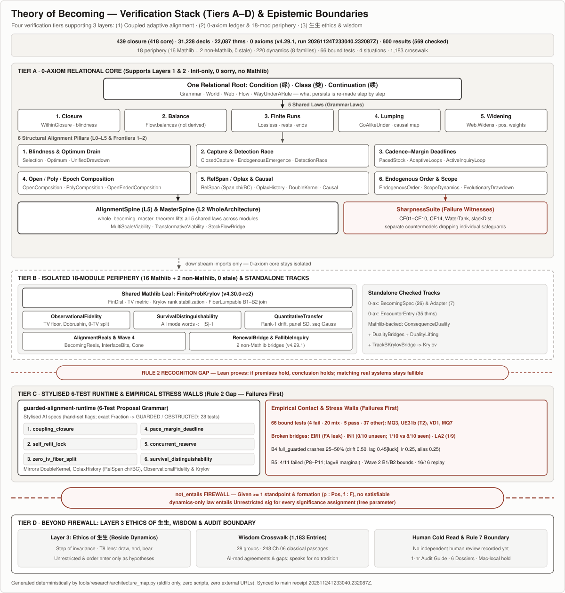

# The Canonical Map of Becoming

[Home](../../README.md) · [中文](CANONICAL-MAP.zh.md) · [One page](ONE-PAGE.md) · [Alignment Foundation](ALIGNMENT-FOUNDATION.md) · [Human Audit Guide](HUMAN-AUDIT-GUIDE.md) · [Atlas](results/atlas/ATLAS.md) · [Premise Families](results/atlas/PREMISE-FAMILIES.md) · [Results](../../RESULTS.md)

*AI-written synthesis prepared for independent human review (updated 25 November 2026; synced to `main` receipt `20261124T233040.232087Z`, held under [AGENTS.md](../../AGENTS.md)). Every theorem, premise, failure, and boundary stays anchored to its single-telling record rather than repeated here.*

---

## 1. Three Cooperating Layers, Verification Stack (Tiers A–D) & Failures First

This repository asks how anything forms, persists, adapts, learns, and ends inside one relational unfolding ([ONE-PAGE.md](ONE-PAGE.md)), and how humans and AI can align before what sustains them gives out ([DIRECTION.md](../../_process/DIRECTION.md)). Following [DIRECTION.md](../../_process/DIRECTION.md), the programme stands in **three cooperating layers**:

1. **Layer 1 — Coupled Adaptive Alignment Theory:** Blindness beyond couplings, optimization draining unread conditions, closed capture locks, turning in time across coarse/fine cadences, and open / polynomial / epoch composition.
2. **Layer 2 — `0`-Axiom Relational Ledger & Isolated Periphery:** A machine-checked relational premise-and-countermodel core (`Init`-only) paired with an isolated Mathlib periphery and standalone checked tracks for continuous, probabilistic, and Krylov bridges.
3. **Layer 3 — Wisdom & Ethics of 生生 Held Beside Dynamics:** Evaluative reflection held explicitly alongside dynamics via `not_entails` and an AI-read wisdom crosswalk, never forced by Lean theorems.

In the repository architecture, four **Verification Tiers (Tiers A–D)** support those three layers across two epistemic boundaries (**Rule 2**: empirical correspondence from real systems to model premises lies outside Lean deduction; **`not_entails`**: dynamics alone entail no evaluative continuation condition):

- **Tier A — `0`-Axiom Relational Core (Supports Layers 1 & 2):** Root (`Grammar` / `Flow` / `Selection` / `ClosedCapture` / `WayUnderARule`) → five `GrammarLaws` → Milestones 1A–1C (`PacedStock`, `AdaptiveLoops`, `MultiScaleViability`, `TransformativeViability`, `StockFlowBridge`), Waves U1–U6 + `RelSpan` (`OpenComposition`, `UnifiedDrawdown`, `EndogenousTurning`, `PolyComposition`, `CausalAbstraction`, `ActiveInquiryLoop`, `EndogenousOrder`, `EvolutionaryDrawdown`, `AlignmentSpine`, `MasterSpine`, `RelSpan`, `OplaxHistory`, `DoubleKernel`), and Frontiers 1–2 (`EndogenousEmergence`, `EndogenousDetectionRace`, `OpenEndedComposition`).
- **Tier B — Isolated `18`-Module Periphery (`16` Mathlib + `2` Non-Mathlib) & Standalone Tracks:** `18` verified periphery modules (`stale_count: 0`): `16` on `leanprover/lean4:v4.30.0-rc2` (Mathlib `ea11ccc`) anchored on Wave 1 leaf `FiniteProbKrylov` (`FiberLumpable` B1–B2 join) feeding `ObservationalFidelity`, `SurvivalDistinguishability`, and `QuantitativeTransfer` (Parts 1–9), plus Wave 4 `InterfaceBits` and `MovingFeatureCone`, alongside `BecomingReals` (uniting `9` Mathlib reals modules), plus `2` non-Mathlib `v4.29.1` modules (`Becoming.FallibleInquiry`, `RenewalBridge`). Standalone checks comprise three `0`-axiom tracks — `BecomingSpec` (`26` targets), `EncounterEntry` (`91` declarations, `35` theorems), and held-out `RelSpanEncounterAdapter` (`13` declarations, `7` theorems) — alongside Mathlib-backed `ConsequenceDuality` + `DualityBridges` + `DualityLifting` + `TrackBKrylovBridge` (`Classical.choice`, `Quot.sound`, `propext`).
- **Tier C — Stylised `6`-Test Runtime & Empirical / Neural Stress Walls (Rule 2 Gap):** `guarded-alignment-runtime` (`6` exact rational structural checks over **stylised AI-authored proposal specs self-graded from hand-set flags**; no real pipeline encoded), `66` bound tests in [BINDINGS.md](results/atlas/BINDINGS.md), `4` time/refit/substrate situations in [SITUATIONS.md](results/atlas/SITUATIONS.md), [`experiments/evidence-replay/`](../../experiments/evidence-replay/README.md) (`16/16` unit tests), the neural stress lab `B1`–`B5`, and the Wave 2 prospective `real-learner-b1-b2-b3` study on local CPU.
- **Tier D — Beyond the `not_entails` Firewall (Layer 3):** Ethics of 生生 (`Unrestricted` and orders enter only as explicit hypotheses), the `1,183`-entry wisdom crosswalk, and the external human cold-read boundary under **Rule 7** (work kept strictly local on this Mac pending explicit maintainer sign-off).

*Diagram generated deterministically from repository state via `python3 -B tools/research/architecture_map.py` (`--check` verified; stdlib only, zero scripts, zero external URLs).*

### Failures, Refutations & Honest Boundaries First

Rule 1 and Rule 2 place broken hypotheses and empirical limits before any summary of proved theorems:

- **Frozen empirical failures (`4` of `36` thesis-named rows; `66` total bound tests):** `UE31b` (flour beetle life stages) **refuted T2's former wording** (`marked the law`) when pupae and adults formed a smaller sufficient set; `MQ3` (`0/4` across `113` fish stocks) and `VD1` (every frozen valuer rule failed) broke their identification bindings (`the binding`); `MQ7` (`0/1` testable on `21` stocks) failed its measurement premise (`the measurement`).
- **Broken model-to-world bridges (`EM1`, `IN1`, `LA2`):** In `EM1`, neural function-approximation leakage broke tabular coupling (`X1`, `X2`, `X4`, bridge `H3`). In `IN1 (round 2)`, `DIR_UNSEEN_TALK` kept **`0/10`** mussel beds for both models; on seen beds (`DIR_SEEN_TALK`), `gpt-4.1-mini` kept only **`1/10`** (`9/10` lost) vs. `gpt-5.4-mini` **`8/10`** (`3/10` under `COMM`), leaving `R1`/`R3`/`R4` `mixed` overall. In `LA2`, a **single model reading a reference set in context (`formation by training untested`)** passed frozen verdicts (`5/5` seeds, tie on `L3`/`L4`), yet inserting one loss-note among nine readers flipped choices 50/50 vs. 60/60 without it, breaking the kind-counted `ClosedCapture` pool bridge `H1-LA2`.
- **Neural stress walls (`B4` `25–50%` guarded collapse; `B5` `4` of `11` predictions failed):** Under `full_guarded` (`20` seeds) in `B4`, collapse remains **`25–50%`** (`FAIL_correlated_pool_drift` `0.50`, `FAIL_long_lag` `0.45` — flagged in `B5` as partly seed luck — `FAIL_high_lr` `0.25` at `lr=4.0` (`0.40` at `lr=4.0` and `0.80` at `lr=8.0` on `B5` fresh seeds), `FAIL_severe_aliasing` `0.25`). In `B5`, **`4 of 11` pre-registered predictions (`P8–P11`) failed** (`7` held): collapse rate alone does not identify structural walls (blind hair-trigger throttling also survives), `J = 0.000` at `lag = 8` is a post-hoc open-loop check, and **`lag = 8` is not a clean collapse-rate wall** (`G3` hits `0.05` collapse at output `0.551`, [`RESULTS.md §5.0, §5.3`](../../experiments/neural-alignment-stress-lab/RESULTS.md)).
- **Wave 2 prospective `real-learner-b1-b2-b3` boundaries:** Pre-registered `B1` block contraction never fired (`chosen_m = null`, since `eps_m + alpha_m >= 1` across `m ∈ {1, 2, 4, 8}`), leaving bounds confined to the finite-horizon `m=8` fallback tube (`r_16 = 0.282149`); `B2` Arm C failed statistical shift detection (`online_passed = false`, exact gap `0.008426 < 0.05`, empirical CI `[-0.043571, 0.048942]` near softmax saturation).
- **Normative & human-audit boundaries:** `ReadsOnlyDynamics.not_entails` blocks deriving evaluative continuation from dynamics alone, and **no independent external human cold read has been recorded yet** ([HUMAN-AUDIT-GUIDE.md](HUMAN-AUDIT-GUIDE.md)).

### Live Repository Ledger

| Store / Gate | Live Verified State (Synced to `main`) | Authority & Where It Lives |
|---|---|---|
| **Core Lean Spine (Tier A)** | `439` checked core closure modules (`418` core, `3` foundation, `11` instance, `7` application); `31,228` declarations; `22,087` theorems; `0` axioms (`leanprover/lean4:v4.29.1`, retained receipt `20261124T233040.232087Z`) | [RESULTS.md](../../RESULTS.md), [ALIGNMENT-FOUNDATION.md](ALIGNMENT-FOUNDATION.md) |
| **Verified Periphery (Tier B)** | `18` verified modules (`stale_count: 0`): `16` Mathlib `v4.30.0-rc2` (`ea11ccc`) modules anchored on `FiniteProbKrylov` (`FiberLumpable` join, plus Wave 4 `InterfaceBits` & `MovingFeatureCone`), plus `2` non-Mathlib `v4.29.1` modules (`Becoming.FallibleInquiry`, `RenewalBridge`) | [periphery-manifest.json](../../experiments/integrated-correction/general-framework/generative-basis/lean/periphery-manifest.json) |
| **Standalone Tracks (Tier B)** | **`0`-axiom:** `BecomingSpec` (`26` targets), `EncounterEntry` (`91` decls, `35` theorems), `RelSpanEncounterAdapter` (`13` decls, `7` theorems). **Mathlib-backed:** `ConsequenceDuality` + `DualityBridges` + `DualityLifting` + `TrackBKrylovBridge` | [WAVE3-HANDOFF.md](../../_process/research/2026-10-05-generative-foundation-review/root-foundation/development/parallel-wave-2026-11-24/WAVE3-HANDOFF.md), [evidence-replay/RESULTS.md](../../experiments/evidence-replay/RESULTS.md) |
| **Formal Register** | `600` registered results (`569` `recorded-checked`, `20` `reviewed-scoped`, `3` `open`, `7` `superseded`, `1` `withdrawn`) | [RESULTS.md](../../RESULTS.md) |
| **Dynamics Atlas & Joins** | `220` dynamics across 8 families (`A:32, B:28, C:22, D:31, E:10, F:24, G:18, H:55`); `1,728` premises (`204` dynamics premise-extracted, `16` pending); `433` exits (`416` law-backed, `17` without law, `77` to dynamic, `356` to text) | [ATLAS.md](results/atlas/ATLAS.md), [JOINS.md](results/atlas/JOINS.md), [PREMISE-FAMILIES.md](results/atlas/PREMISE-FAMILIES.md) |
| **Test Bindings (Tier C)** | `66` bound tests (`4` failed · `20` mixed · `5` passed · `37` other; `57` bearing on atlas dynamics, `9` unpredicted/calibration rows with empty `bears_on`) | [TESTS.md](../../TESTS.md), [BINDINGS.md](results/atlas/BINDINGS.md) |
| **Situations (Tier C)** | `4` checked situations (`1` static RLHF baseline + `3` time/refit/shared-substrate alignment loops) | [SITUATIONS.md](results/atlas/SITUATIONS.md) |
| **Completion Audit** | `K1–K7` checked across the `17`-row `COVERAGE.json` ledger (`0` findings) | [COMPLETION.md](results/completion/COMPLETION.md) |
| **Wisdom Crosswalk (Tier D)** | `1,183` AI-read correspondence entries across `28` groups | [CROSSWALK.md](results/atlas/CROSSWALK.md) |
| **Archived Public Snapshot** | Frozen `186`-dynamic / `66`-test snapshot archived byte-for-byte to [history/results-map-2026-11-23/](history/results-map-2026-11-23/README.md) (`4A`, 24 Nov) | [results/map/README.md](results/map/README.md) |

---

## 2. Tiers A & B — Formal `0`-Axiom Spine, `18`-Module Periphery & Bridges

Every formal claim in Tier A sits in pure Lean (`Nat`/relational core, `0` axioms, `0` `sorry`). Each states theorems of the form *if a system satisfies these explicit structural premises, then this consequence holds* — never that the physical or ML world automatically satisfies them (Rule 2).

### 2.1 The Shared Trunk

At the center stands one relational root ([ONE-PAGE.md](ONE-PAGE.md), [continuation-relative-to-a-class](results/records/continuation-relative-to-a-class.md)): whatever persists is re-made step by step under 缘 (dependencies / conditions) relative to an invariance class. Four structural results trace what happens when a selector reads only part of that unfolding:

- **Blindness beyond couplings** ([selection-through-couplings](results/records/selection-through-couplings.md)): Two histories identical on everything that couples into a selector cannot be told apart by it (`Flow.unselected_beyond_coupling`).
- **Optimization drives unread conditions down** ([what-an-optimum-does-beyond-what-couples-in](results/records/what-an-optimum-does-beyond-what-couples-in.md)): Given `Optimum.Room` (whenever an eligible outcome `o` holds a condition beyond `ds` strictly above another eligible outcome `o'`, some eligible outcome `o''` strictly `Exceeds` `o` on `ds` — at least equal on every coupled condition and higher on one), any frontier optimum of a `Rising` order holds each unread condition as low as any eligible outcome allows (`Optimum.least_of_room`, characterized exactly by `Optimum.least_iff`).
- **Closed capture / meta-attractor** ([closed-capture](results/records/closed-capture.md)): Under explicit `ClosedCapture.lock_outlives_loss` hypotheses — an initial `Locked` state, `Raises` (selection preserves favoured share), `ReadsShare` (monotone rule update in favoured share), upward closure of `favours`, `Accrues` (unread loss grows by at least one per step), and no noise — a locked loop preserves both lock and starting rule/share bounds while unread loss crosses every bound (`ClosedCapture.lock_outlives_loss`). Under finite-step one-at-a-time noise, critical-mass locks remain vulnerable to drift.
- **Joint excess under locally sane bounds** ([own-count-misses-joint-excess](results/records/own-count-misses-joint-excess.md), [a-way-of-units-under-a-rule-set-again](results/records/a-way-of-units-under-a-rule-set-again.md)): Multiple actors each drawing within what renewal supplies can together outrun it (`Web.Whole.family_excess_ends`). Under `WayUnderARule`, units needing a level and reproducing under a re-set rule either hit a step that holds without favouring/rule (`Tested`) or reach a first step where no need is met.

Before 23 November's Phase 1 build, proof-term audits (`e2dcc5ce5`) showed this trunk sitting alongside ~136 disconnected leaf modules lacking three bridges: cadence-to-stock coupling, multi-agent loop composition, and cross-scale / transformative / flow translation. Milestones 1A, 1B, and 1C built all three.

### 2.2 Milestone 1A — Coarse Cadences Coupled to Fine Stocks (`Becoming.PacedStock`)

Real policies, oversight reviews, and evaluations update only at coarse reading instants, while underlying stocks drain every fine step. [Becoming.PacedStock](results/records/paced-stock-and-cadence-margin-sandwich.md) links `Pace` / `Sampling` reading schedules to `Frame.blocks` kernels and `RegimeMargin` drawdowns:

- **Intra-span block guard & slack transport:** Under `CoveredByBlocks F expand s`, fine `Viability.Kernel` holds if and only if the block-level kernel preserves `SpanGuard` at every intermediate prefix (`blocks_kernel_iff_fine_kernel`). For monotone drop bounded by `stepDrop` with block lengths `≤ L`, `slack_certifies_fine_kernel` certifies fine `thr ≤ stock` invariance whenever block boundaries maintain the `thr + stepDrop * (L - 1) ≤ stock` buffer (with `atFive_block_kernel`, `atFive_not_fine_kernel`, and `atSix_fine_kernel_by_slack` exhibiting threshold breakdown at `5` and recovery at `6`).
- **The Pace–Margin Sandwich:** For `2 ≤ N` and rule identification needing `2N - 1 ≤ L` steps over `Pace.StretchFixes`, below `x₀ < (H₂ + y₂) + (H₁ - Y) * (2N - 1)`, short cadences (`L < 2N - 1`) leave two `N`-state `lassoStep` courses indistinguishable on prefixes `< L` (`unrecoverable_cadence_impossibility`), while long cadences (`2N - 1 ≤ L`) under the stock-draw hypotheses make eventual line failure unavoidable (`unrecoverable_cadence_impossibility`, lifted to two coupled rules in `coupled_two_rule_impossibility`); above the `2N - 1` draw plus safe recovery margin under `RegimeMargin.Short`/`Meets`/`Keeps`, the course stabilizes (`pace_margin_feasibility_window`).
- **Explicit boundary:** Assumes `CoveredByBlocks` span-end coverage, deterministic or choice-equipped trajectories, and `stepDrop` / `L` drop bounds; it does not apply automatically to stochastic or continuous feedback delays without peripheral calibration.

### 2.3 Milestone 1B — Open Adaptive Loops & the Coupled Race (`Becoming.AdaptiveLoops`)

Earlier collective theorems handled fixed dynamics, yet adaptive agents inspect black-box neighbors and shift policies dynamically. [Becoming.AdaptiveLoops](results/records/coupled-adaptive-loops-and-race.md) turns adaptive closure outward:

- **Black-box assume-guarantee composition:** Modeling each agent as an opaque `OpenLoop` with a `LoopCertificate` (bounded observation lag `maxSilence`, bounded per-step draw, and admissible transitions independent of internal neighbor state), `assume_guarantee_joint_viable` and `assume_guarantee_joint_kernel` certify joint substrate survival above `x_crit` whenever initial buffer clears `x_crit + maxEta * preTotal` and alarm margin covers `(globalMaxLag + 1) * preTotal`.
- **The Coupled Race (`coupled_race_theorem`):** Five constructed witnesses inside one parametric mechanism trace a four-way quantitative race: (1) warning discovery rate, (2) majority/pool silencing (`WitnessSilenced` vs. epistemic alert), (3) post-turn coordination among drawers (`WitnessUncoordinated` vs. `WitnessGood`), and (4) feedback lag against stock margin (`WitnessTooSlow`, `WitnessNoDiscovery`).
- **Unread joint collapse & endogenous rule switching:** Even if each agent preserves substrate individually, composition fails when joint draw outruns monotone renewal while unread (`unread_adaptive_joint_collapse`). When coupled agents read mutual signals and switch internal rules (`endog_joint_viable`, `endog_bidirectional_adaptation`), safe coordination survives rule turnover without dominant-kind extinction.
- **Explicit boundary:** Certifies safety above `x_crit` (not capability optimality inside the safe set) and assumes finite covered sites, monotone `Coupled.Indexed.Rises Drawn.whole`, and deterministic `Nat` arithmetic.

### 2.4 Milestone 1C — Three Missing Connective Pillars

Milestone 1C closed the remaining three structural gaps without inflating the trusted core:

1. **Lax Multi-Scale Abstraction** (`Becoming.MultiScaleViability`, [record](results/records/lax-multi-scale-viability.md)): When exact fibre-lumping (`ProjectedLaws.Commuting`) fails due to micro-phase wobble, `LaxSim` with a `SlackDist` metric tracks one-step projection slip `ε` and excursion slip `η`, transferring macro `Viability.Kernel` down to micro runs (`lax_kernel_of_certificate`, `lax_kernel_of_kernel`) and composing vertically across `TowerSimPack`. An explicit worked model proves `viability_kernel` holds across a two-tier hierarchy while `not_fibreConsistent₁`, `no_reduced_law₁`, `not_fibreConsistent₁₂`, and `no_reduced_law₁₂` refute exact commuting lumping at every level. *Limit:* discrete `SlackDist` absorption (`α Δ + ε ≤ Δ`), leaving continuous probabilistic metrics (`ε / (1 - α)`) to the Mathlib periphery.
2. **Transformative Viability Order** (`Becoming.TransformativeViability`, [record](results/records/transformative-viability-order.md)): Separates constructive transformation (`TransformativeViable`, `TransformsViably`, `TransformsViablyAlong`) — preserving substrate `ReserveGuarded` safety and coarse `MacroAdmits` capability across micro-turnover as obsolete forms retire — from both zero-loss `Widens` (`three_regime_separation`, `finite_gainless_transformsViably`) and unguarded churn (`not_keepsWidening`, `micro_turnover`). *Limit:* takes capability projection `cap : F → K` and `Safe` predicate as inputs over closed finite `ClosedAt` webs.
3. **Unclamped Stock–Flow Bridge** (`Becoming.StockFlowBridge`, [record](results/records/unclamped-stock-flow-bridge.md)): Resolves the mismatch between `Nat`-truncated stocks and `Flow.BalancesOn` without artificial `min`-clamping: strictly prior to overdraw (`Goes ≤ T + N`, and globally on unending lines), `LineOnAStock` and `WayUnderARule` trajectories embed verbatim into `Flow.BalancesOn` (`line_balancesOn_of_within`, `way_balancesOn_of_within`), importing finite-horizon no-return drawdown bounds and linking directly to `RegimeMargin.Coupled.Indexed`. *Limit:* stops at the overdraw step where `Nat` subtraction truncates.

### 2.5 Cross-Module Lean Unification (Waves U1–U6 & Wave 1 Periphery Leaf)

Waves U1–U6 and Waves 1–4 joined open interfaces, causal abstractions, inquiry horizons, endogenous order dynamics, evolutionary drawdowns, oplax history / double-category certificate kernels, and the `18`-module periphery (`16` Mathlib + `2` non-Mathlib) without adding any non-standard axioms to Tier A:

- **Open interfaces, overdraw, & alignment spine (`U1`–`U2`, `AlignmentSpine` `L5`):** `Becoming.OpenComposition` (`L0`), `Becoming.UnifiedDrawdown` (`L2`), `Becoming.EndogenousTurning` (`L1`), and `Becoming.AlignmentSpine` (`L5`, [record](results/records/master-alignment-spine-and-sharpness.md)) establish port-split component/contract gluing (`compose`/`hide`), parametric overdraw/aliasing separation, proxy-optimum clearing bottlenecks, and the `CE01`–`CE10` and `CE14` (plus `WaterTank` and `slackDist`) core witnessed failure-mode suite (`master_sharpness_suite_complete`, with `CE12`/`CE13` in Mathlib periphery `AlignmentReals`). Separate concrete systems witness failures when individual structural safeguards are dropped; premise-by-premise necessity on one fixed implication remains open except where proved on a single system.
- **Polynomial modes & interventional causality (`U3`):** `Becoming.PolyComposition` (`L1`, [record](results/records/polynomial-dynamic-interfaces-and-coupled-laxity.md)) embeds `OpenComposition`, formalizes anchored self-modification vs. self-blinding, concurrent serialization, and small-gain coupled laxity (`coupled_closed_lax_kernel`). `Becoming.CausalAbstraction` (`L1`, [record](results/records/interventional-causal-abstraction-and-goodhart.md)) proves exact/lax interventional causal abstraction, viability kernel policy transfer, Causal Goodhart separation, and `GrammarLaws` / `ExchangeLaw.Sensitive` bridges (`«因像定当且仅当因同行»`).
- **Active inquiry, endogenous order, & evolutionary drawdown (`U4`):** `Becoming.ActiveInquiryLoop` (`L1`, [record](results/records/active-inquiry-deadline-cascade-and-blankets.md)) establishes exploration-margin sandwich, deadline impossibilities, cascade alarm capture, and `OpenComponent` blanket screening. `Becoming.EndogenousOrder` (`L2`, [record](results/records/endogenous-order-scope-coevolution-and-nash.md)) characterizes online `OrderUpdater` convergence and uncoupled blindness, substrate-coupled `ScopeMode` co-evolution (`SelectionLevels`/`GroupEnding`), discrete course-menu Nash obstruction and reciprocal-gate restoration (`course_menu_widening_nash_obstruction`, `reciprocal_gate_restores_viable_nash`), and the `not_entails` firewall. `Becoming.EvolutionaryDrawdown` (`L2`, [record](results/records/derived-evolutionary-drawdown-and-transitions.md)) derives `EmbodiedConversion` collapse, DecidableEq-free multi-site `ReadOffExchange` bridges, and `Founding.Nested` transitions.
- **Master spine & isolated `16 + 2` periphery (`U5`–Wave 4):**
  - `Becoming.MasterSpine` (`L2`, [record](results/records/whole-becoming-master-spine.md)) integrates `PolyComposition`, `ActiveInquiryLoop`, `OpenComposition`, `CausalAbstraction`, `EvolutionaryDrawdown`, and `EndogenousOrder` on one `WholeArchitecture`, lifting all five `shared_laws` families (`masterSpine_grammar_lifts`), bundling U1–U4 sharpness witnesses (`full_obstruction_and_sharpness_panorama`), checking K6 ethics compatibility and `masterSpine_cannot_entail_unrestricted`, and assembling a five-way checked index (`whole_becoming_master_theorem`) whose concrete `WholeBecomingWitness` exhibits joint inhabitance (with `reproduces_when_viable` constant `Nat.zero_lt_one` in that witness).
  - `BecomingReals` (Mathlib `v4.30.0-rc2` periphery, [record](results/records/unified-becoming-over-reals.md)) imports all `9` Mathlib reals modules (`AlignmentReals`, `FreeEnergyReals`, `ExpectedFreeEnergyReals`, `CellsUnderNoise`, `LinearBlankets`, `EntropyProduction`, `RegimeReals`, `Representation`, `SlowingDown`) via scoped `PiLp` `L_infinity` operator norm (`LocalMatrixOpNorm`), proving five cross-silo theorems and a concrete numerical witness.
  - Non-Mathlib `v4.29.1` periphery bridges (`2` modules): `RenewalBridge` ([record](results/records/renewal-bridge-to-keepable-step.md)) maps `RenewalConfigurations` histories definitionally onto `Becoming.KeepableStep` runs (`renewable_iff_keepable`) while keeping October's `conditional/renewal/` receipts read-only; `Becoming.FallibleInquiry` ([record](results/records/finite-fallible-inquiry-necessity.md)) formalizes finite fallible inquiry bounds.
- **Oplax histories, guarded double kernel, shared Krylov leaf & observational fidelity (`U6` + Wave 1):**
  - `Becoming.RelSpan` (`L1`, `0` axioms, `38` theorems, `104` declarations) + `Becoming.OplaxHistory` (`L1`, `0` axioms, `22` theorems, `45` declarations, [record](results/records/oplax-history-comparison-and-relational-loss.md)) construct the normal oplax `Span(F)` comparison `chi` with all-finite-`n` bracketing coherence (`bracketTree_coherence_all_n`), exact Beck–Chevalley characterization (`chi_bijective_iff_bc_all` + empty-family trap), `RelSpan.mapTrace` trace transport (reused in `CausalAbstraction` and `PolyComposition`), finite-presentation rigidity for `SumPreservingFunctor` vs. non-sum-preserving `inhabitedOptionFunctor`, relational loss witnesses (`0 → 1`, `2 → 4`, `2^n → 1`), and bridges into `CausalAbstraction`, `C2CoupledAlignmentWitness`, and `GrammarLaws`.
  - `Becoming.DoubleKernel` (`L1`, `0` axioms, `36` theorems, [record](results/records/guarded-double-category-certificate-kernel.md)) formalizes a typed 2D double signature with free `StrictDoubleCat` initiality (`free_double_eval_unique`), conservative 3D cell extension (`conservative_over_base_2d`, `free_3d_eval_sound`), and Guarded Oplax Double Syntax over general `SpanFunctor` (`guarded_oplax_sound`, separating one-way `chiStep` from `BC`-certified `chiInv` via `finite_non_invertible_chiStep_witness`).
  - `FiniteProbKrylov` (`v4.30.0-rc2` Mathlib periphery leaf, `33` declarations, `21` theorems, [record](results/records/finite-probability-and-krylov-foundation.md)) factors out shared `FinDist`, total-variation metric, `FiberLumpable` B1–B2 join (`rowDefect`), and Krylov chain-stabilization lemmas without module duplication.
  - `ObservationalFidelity` (`v4.30.0-rc2` Mathlib periphery, `60` declarations, `39` theorems, [record](results/records/observational-fidelity-and-multi-regime-error.md)) builds on `FiniteProbKrylov` (`FiberLumpable`), proving the query-image TV blindness floor (`optimal_query_tv_floor`), `massOutside f ≤ rowDefect` (`optimal_floor_le_rowDefect`), 3-way multi-query separation (`3/5` and `1/2` gaps), zero-TV vs. coupled fiber-viability split (`zero_tv_does_not_prevent_fiber_viability_split`), `three_regime_error_contrast`, Dobrushin contraction (`tvDist_pushKernel_dobrushin_step` → `kernelMetricLaxSim`), derived tube transfer (`kernel_contraction_tube_via_metricLaxSim` under `α ∈ [0, 1)`, uniform Dobrushin row-pair bound, uniform `rowDefect ≤ ε`, macro certificate, initial distance `d₀`, and micro-guard tube closure), `[0, 1]` readout transfer bounds, sharp `1 → 2` attainment, and closed-loop feedback failure (`feedback_destroys_openloop_contraction`).
  - `SurvivalDistinguishability` (`v4.30.0-rc2` Mathlib periphery, `24` declarations, `16` theorems, [record](results/records/finite-mode-survival-distinguishability.md)) consumes `FiniteProbKrylov` Krylov lemmas, proving that for arbitrary real matrices `K : Mode → S → S → ℝ` on finite nonempty `S`, two states agree on `survVec K w` for **all mode words `w`** iff they agree on all words of length `≤ card S - 1` (`survival_indistinguishable_iff_le_card_pred`), proves sharpness for all `n ≥ 1` (`countdown_attains_card_pred`), constructs a 3-state mode-switch counterexample, separates `C2CoupledAlignmentWitness`, and pairs with a frozen-Q local replay on a `63 × 63` alive-state operator ([results](../../_process/research/2026-10-05-generative-foundation-review/root-foundation/development/dual-track-b1-b2-2026-11-24/RESULTS.md)).
  - `WenHeHua v9.0` supersedes `v7.0` in place under `sources/wenhehua-v9.0/` (`232` verified files via [PROVENANCE.json](../../sources/wenhehua-v9.0/PROVENANCE.json)).

### 2.6 Wave 3 & Open-Frontiers Completions (24 November 2026)

Four coordinated tracks extend the verified spine and stress-test suite without relaxing `0`-axiom Tier A isolation ([branch disposition](../../_process/research/2026-10-05-generative-foundation-review/root-foundation/development/parallel-wave-2026-11-24/BRANCH-DISPOSITION-2026-11-24.md); `inquiry-before-commitment` stays parked and unmerged):

- **Endogenous detection before capture lock & split evidence (`Frontier 1`, [record](results/records/endogenous-detection-before-capture-lock.md)):** `Becoming.EndogenousEmergence` (`L2`, `42` theorems, `0` axioms) couples onto `Becoming.EndogenousDetectionRace` (`L2`, `103` theorems, `0` axioms), proving that an observation-only Moore learner shifting another reader's pool hits the exact `ClosedCapture.Thinned` turning window across arbitrary cadences (`mark_eq_thinned`, `mark_turned_admits_iff`, `cadence3_readAtSpanEnd`) and characterizing the alternating `MiddleMinus`/`MiddlePlus` middle band via one-span laws, multi-reading trichotomy, order monotonicity, and 4 witnesses (`mark_middle_band_trichotomy`, `mark_middle_band_monotone_partition`, `cadence2_readAtSpanEnd`), while distributed one-time-mask split streams satisfy `2^T` `TP = FP` marginal conservation under local filters (`count_view_invariant`, `split_marginal_count_eq`), trapping locally sound consensus (`split_silenced_trapped`) until one-bit witness exchange turns selection (`split_exchange_turns`).
- **Open-ended epoch handoff without frozen `Safe`/`cap` (`Frontier 2`, [record](results/records/open-ended-epoch-handoff.md)):** `Becoming.OpenEndedComposition` (`L2`, `122` theorems, `0` axioms) formalizes `TransformsAcrossEpochs` (recovering `Becoming.TransformsViably` via `constantEpoch_iff_transformsViably`), Horn 1a/1b/2 lock-in/site-blindness/wireheading separations, contravariant `(scope, x_crit, envCap, jointAdm)` pullback anchoring (`AnchorStep`) with covariant mutable modes/lags/floors inside non-deadlocking `EpochHandoffGate` (`epochChain_viability_kernel_on_K`, `epochChain_nonDeadlock`), **Board Rule 9 ("Generalize below, not beside")** reductions to `PolyComposition` (`singleEpoch_recovers_anchored_selfMod`, `singleEpoch_recovers_monotone_selfWidening`), and simultaneous evolve-vs-compose separation both in `ReciprocalGate` and directly inside `EpochHandoffGate` via `jointEpochFamily` / `jointBoolFamily` over `Bool × Bool` (`concurrent_evolve_collapses`, `reciprocal_evolve_rejects_8_and_certifies_11`, `jointEpochFamily_gate_iff_reciprocalGate`, `jointBool_simultaneous_refused_at_8`, `jointBool_simultaneous_certified_at_11`).
- **Quantitative transfer & stress-lab theory (`Frontier 3`, [record](results/records/quantitative-transfer-of-four-guard-failure-regimes.md)):** `QuantitativeTransfer` (`v4.30.0-rc2` Mathlib periphery `#15`, refreshed receipt `20261125T000202.244531Z`, `106` declarations, `83` theorems) proves over `ℝ` and `Measure ℝ` the Rank-1 correlated judge-pool disagreement ceiling (`1 - γ` uniformly in `M ≥ 1` vs. external anchor separation), exact `2ε < (1 - α) * |gap|` bounded-noise & mixture `Youden J` aliasing floors (`aliased_readout_floor` without dividing by `1 - α`, `youdenJ_mixture_aliasing_ceiling`), continuous MVT/IVT drawdown lag walls with `J = 0` (`lag_horizon_wall`, `lag_wall_youdenJ_zero`, `lag_wall_measYoudenJ_zero`, `switchLag_strictMono_rho`), single-step and `T`-fold sequential Gaussian/Dirac aliasing bounds over `ProbabilityTheory.gaussianReal` (`gaussian_bhattacharyya_integral`, `gaussian_aliased_youdenJ_wall`, `gaussian_seq_youdenJ_wall`, `sequential_gaussian_lag_sample_wall`), Part 9 exact augmented-panel variance/SD consensus breaking with `Youden J = 0` vs. nonzero `Youden J` refuting macro factorization (`augmentedPanelVar_ge_anchor_gap_sq`, `aliased_anchor_breaks_panel_sd_with_zero_youdenJ`), and `MetricLaxSim` trust-region tube stabilization vs. unprojected one-step overshoot (`trust_region_viability`, `unprojected_step_overshoots`).
- **Standalone comparator, duality, held-out adapter & Track B Krylov bridge (`Wave 3`, [handoff](../../_process/research/2026-10-05-generative-foundation-review/root-foundation/development/parallel-wave-2026-11-24/WAVE3-HANDOFF.md)):** Three **`0`-axiom** standalone tracks (`BecomingSpec` with `26` targets in `SpineTargets.lean`, `EncounterEntry` with `91` declarations and `35` theorems, and held-out `RelSpanEncounterAdapter` with `13` declarations and `7` theorems [`0` source/transitive axioms, unused `ExitOcc.mk.injEq` `[propext]`]) sit alongside **Mathlib-backed** standalone checks (`ConsequenceDuality` + `DualityBridges` + `DualityLifting` + additive `TrackBKrylovBridge` using standard Mathlib axioms `Classical.choice`, `Quot.sound`, `propext` to join `DualityBridges.survVec` to `SurvivalDistinguishability.survVec`).

---

## 3. Tier C — Empirical Contact Across the Rule 2 Gap

A Lean theorem only says what follows *if* a system instantiates its premises. **Rule 2** keeps clear that matching an empirical system to those premises is a fallible recognition check, never a Lean entailment. Tier C tracks where identifications hold and where real systems break them — failures first.

### 3.1 The `66` Bound Tests (`4` Failed · `20` Mixed · `5` Passed · `37` Other)

All `66` registered test rows in [TESTS.md](../../TESTS.md) appear in [BINDINGS.md](results/atlas/BINDINGS.md) (`57` bearing on atlas dynamics; `9` calibration/no-prediction rows with empty `bears_on`; of `36` rows naming one of the `8` theses, `4` passed, `18` mixed, `4` failed, and `10` are unrun/other). Per our honesty standard, counts reflect pre-registered frozen scoring rules:

- **4 Failed (`MQ3`, `MQ7`, `VD1`, `UE31b`):**
  - `UE31b` (flour beetle life stages) **marked `the law`**: T2's former wording (*level, recent giving, and one lag suffices as far as anything measured does*) failed directly when pupae and adults formed a smaller sufficient variable set.
  - `MQ3` (113 assessed fish stocks, `0/4` predictions) and `VD1` (valuer agreement, every frozen rule failed) **marked `the binding`**.
  - `MQ7` (21 unread fish stocks, `0/1` testable passed) **marked `the measurement`**.
- **20 Mixed (partial passes or intact Lean law / broken identification bridge):**
  - `LA2` (a single model reading a reference set in context, `formation by training untested`): every frozen verdict passed (`5/5` seeds, with an exact tie on `L3`/`L4`), yet **the bridge `H1-LA2` failed**: inserting one loss-note among nine context readers flipped choices 50/50 vs. 60/60 without it, showing the judge did not behave as a kind-counted `ClosedCapture` pool (`02 §T7`).
  - `IN1 (round 2)` (GovSim-style multi-agent LLM fishers with 1 round of pre-move talk): `DIR_UNSEEN_TALK` kept **`0/10`** mussel beds for both models (exhibiting `Flow.unselected_beyond_coupling`); on seen beds (`DIR_SEEN_TALK`), `gpt-4.1-mini` kept **`1/10`** (`9/10` collapsed via misreading joint catch, `Stationary.model_error`) while `gpt-5.4-mini` kept **`8/10`** (vs. `3/10` under `COMM`). Under the joint frozen rule, `R1`/`R3`/`R4` failed overall (`mixed`).
  - `EM1` (generalizing RL agents): contrasts `X1`, `X2`, `X4` and bridge `H3` failed where function-approximation leakage blurred the tabular coupling boundary. Similarly `CG1`–`CG3c`, `LA1`, `LA3`, `MQ1`–`MQ6`, `VD2`, and `LCA` show where tabular/equilibrium approximations diverge from fitted learners.
- **Remaining 42 tests:** `2` refused pre-scoring (`T1N`, `T1R` — no need measured), `1` decided nothing (`UE31`), `2` partly passed (`FC1`, `LA4 Stage A`), `3` not rejected (`EW2`, `EW3`, `EW4`), `5` passed (`UE32`, `LA1b`, `LA1c`, `SE1`, `TR7A`), `2` registered rule, `2` no verdict, `11` frozen not run, `3` held, `1` dropped, and `10` with no prediction.

### 3.2 Time-Indexed & Shared-Substrate Situation Checking

Phase 2 upgraded `tools/research/atlas.py` from static graphs to finite-horizon time/refit/substrate unrolling, catching deadline contradictions automatically ([SITUATIONS.md](results/atlas/SITUATIONS.md)):

| Situation | Horizon & Mechanism | Critical Check Finding |
|---|---|---|
| `a-reward-model-pipeline` | Static 1-pass baseline RLHF | `correctness-unchecked` and post-transcript `users`/`third-parties` sit beyond rater and RM closure |
| `iterated-rlhf-rlaif-refit-loop` | `t = 0..6`, periodic RM refit at `[3, 6]` | Shared `rater-capacity` (`initial=4, renewal=2, draw=3`) **exhausts at `t=4`** before refit oversight reads; triggers `readintime-deadline` contradiction |
| `eval-benchmark-gaming` | `t = 0..5`, proxy benchmark vs. held-out safety | Proxy selection meets `Web.SelectsThrough` while leaving real deployment hazards beyond evaluator closure |
| `multi-agent-deployment-loop` | `t = 0..6`, fleet cadence `[2, 4, 6]` | `shared-oversight-substrate` **exhausts at `t=4`** while lagged telemetry arrives at `t=5`, outrunning renewal |

*Standing note:* Situations are `model` / `reading` consistency checks of our own coupling descriptions, never external evidence.

### 3.3 Phase 2 Local CPU Stress Tests (Noisy & Generalizing Learners)

Under **Rule 7** (work kept strictly local on this Mac with zero external API runs), we tested Milestones 1A and 1B against discrete noise, inertia, multi-agent bandits, tabular Q-learning, and linear function approximation ([NOTE.md](../../_process/research/2026-10-05-generative-foundation-review/root-foundation/development/p2-alignment-stress-test-2026-11-23/NOTE.md)):

- **1A Pace–Margin Sandwich under perturbations (`b_imp = 18, b_feas = 27`):** `21/21` exact grid checks match theorem bounds cleanly (`x0 = 15 < 18` collapses `0.0`; `x0 = 27` survives `1.0` unperturbed). At `x0 = 27`, Gaussian alarm delay degrades survival smoothly `1.0 (σ=0) → 0.99 (1.5) → 0.875 (3.0) → 0.81 (5.0) → 0.68 (8.0)`; random `+4` spikes drop survival to `0.835` (`p = 0.30`); slow rule inertia (`α = 0.125`) collapses `x0 = 27` (`final_x = 0.0`) completely while extra initial headroom (`x0 = 39`) restores survival (`3.0` final_x under inertia, `1.0` under spikes, `0.915` at `σ = 8.0`).
- **1B AdaptiveLoops & Generalization Leakage (`40` seeds each, `x_crit = 5`):** Unread adaptive bandits collapse `1.0` at renewal `R = 2` (`0.975 / 1.0 / 0.575` at `R = 3`). In `CoupledRace` Q-learning, `good_buffered_coordinated` reaches `0.0` eval collapse (`mean min_x = 8.25`), whereas `too_slow_lag3_unbuffered` and `uncoordinated_post_turn` hit `1.0` collapse and `silenced_pool_q05` hits `0.25`. Linear function approximation (`ρ` coupling between safe and warning features) collapses `1.0` at `warn_onset = 10` and remains **`0.975` (`mean final_x = 0.35`) even at `warn_onset = 22, ρ = 0.8`** due to single-episode gradient hysteresis.

### 3.4 Post-U6 Runtime, Neural Stress Lab (`B1`–`B5`), Replay & Wave 2 Study

Four local CPU suites under Rule 7 connect Layer 1–2 theory to executable checks, negative controls, and real learned policies:

- **Guarded Alignment Runtime (`6`-test proposal grammar)** ([`experiments/guarded-alignment-runtime/README.md`](../../experiments/guarded-alignment-runtime/README.md)): Pure Python 3 stdlib verifier (`28` unit tests, `14` built-in examples, `7` of kind `alignment_proposal`) emitting exact `int` / `Fraction` verdicts (`GUARDED` / `OBSTRUCTED`) across `coupling_closure`, `self_refit_lock`, `zero_tv_fiber_split`, `pace_margin_deadline`, `concurrent_reserve`, and `survival_distinguishability` (mirroring `DoubleKernel`, `OplaxHistory`, `ObservationalFidelity`, and Krylov bounds). Its RLHF / RLAIF / Constitutional AI example checks are **stylised, AI-authored `alignment_proposal` specs (self-graded from hand-set flags; no real pipeline encoded)**.
- **Neural Alignment Stress Lab (`B1`–`B5`)** ([`experiments/neural-alignment-stress-lab/README.md`](../../experiments/neural-alignment-stress-lab/README.md), [`RESULTS.md`](../../experiments/neural-alignment-stress-lab/RESULTS.md)): Local CPU suite (`19` unit tests, including post-hoc `b5_controls.py`). Even under `full_guarded` (`20` seeds), `B4` still suffers **`25–50%` collapse**: `FAIL_correlated_pool_drift` `0.50`, `FAIL_long_lag` `0.45` (noted in `B5` as partly seed luck against `B5` `G0` `0.20`), `FAIL_high_lr` `0.25` at `lr=4.0` (`0.40` at `lr=4.0` and `0.80` at `lr=8.0` on `B5` fresh seeds), and `FAIL_severe_aliasing` `0.25`. In `B5`, **`4 of 11` pre-registered predictions (`P8–P11`) failed** (`7` held): collapse rate alone does not identify a wall (blind hair-trigger `G1` and random alerts also hit `0.00`–`0.10`), post-hoc open-loop channel detectability finds `J = 0.000` at `lag = 8`, and `lag = 8` is not a clean collapse-rate wall (`G3` hits `0.05` at `0.551` output; [`RESULTS.md §5.0, §5.3`](../../experiments/neural-alignment-stress-lab/RESULTS.md)).
- **Evidence Replay & Endogenous Emergence** ([`experiments/evidence-replay/README.md`](../../experiments/evidence-replay/README.md), [`RESULTS.md`](../../experiments/evidence-replay/RESULTS.md)): **`16/16`** local replay tests cover `IN1` `229`-month trajectories (where the frozen endpoint `Pass1` predicate diverges from the monthly `all_next_stocks_ge_need` predicate on **`18/229`** saved prefixes while `Pass2` agrees on **`229/229`**), exact rational primal-dual verification (`duality_handshake`), split-evidence `2^T` marginal conservation, middle-band `R5` trichotomy/monotonicity across cadences (`test_r5_middle_band_trichotomy_and_monotonicity`), the 8-slot endogenous silent-drift self-detection benchmark (`40/40` detected at `21` total queries vs. `94.675` global periodic audit; `40,320` permutations verified), and `Obs`-only negative controls (`W_EXO`, `W_CLIFF`), paired with promoted `Becoming.EndogenousEmergence` and `Becoming.EndogenousDetectionRace` (leaving **unbounded-domain endogenous scope/order formation and one-way downstream concern** open).
- **Wave 2 Prospective Real-Learner `B1`–`B3` Study** ([`real-learner-b1-b2-b3/RESULTS.md`](../../_process/research/2026-10-05-generative-foundation-review/root-foundation/development/dual-track-waves-2026-11-24/real-learner-b1-b2-b3/RESULTS.md)): Evaluated `ReinforcePolicy(6, 4, 2)` (`16` training episodes, `92` updates, exact 53-bit transition extraction, SHA-256 atomic pre-evaluation lock, `1.9993s` CPU):
  - *Honest boundaries first:* `B1` contractive block horizon kept `chosen_m = null` because `eps_m + alpha_m >= 1` for every pre-registered `m ∈ {1, 2, 4, 8}`, so theoretical inequalities (`0` exact-`Fraction` violations across `128` marginal & `256` risk inequalities) hold only on the finite-horizon `m=8` fallback tube (`r_16 = 0.282149`). `B2` Arm C failed statistical shift detection (`online_passed = false`, exact gap `0.008426 < 0.05`, empirical CI `[-0.043571, 0.048942]` across `4,096` forks near softmax saturation `p0 ~ 0.96`).
  - *Confirmed audits & interventions:* `B2` Arm A (`max_err_A = 0.001478 <= 0.038246`) and Arm B (`max_err_B = 0.014510 <= 0.036579`) passed `check_survival_distinguishability` (`GUARDED`, `2,048` rollouts/cell). On `64` paired rotating-PCA streams in `B3`, clamping `z = (0, 1)` eliminated collapses (`61/64` natural collapses → `0/64`), exposing a two-stage rotation-relapse mechanism (`54` initially protected natural streams saw `51` relapse into collapse).

---

## 4. Tier D — Layer 3 Ethics of 生生, Wisdom, Limits & Active Workboard

### 4.1 Ethics Beside Dynamics (Not Forced From Them)

Nothing proved in Lean prescribes a final end ([07-SIGNIFICANCE.md](chapters/07-SIGNIFICANCE.md), [08-METHOD.md](chapters/08-METHOD.md)):

- **Non-entailment firewall (`ReadsOnlyDynamics.not_entails`, `masterSpine_cannot_entail_unrestricted`):** **Given at least one standpoint and one formation (`p : Pos`, `f : F`), no satisfiable law reading only the dynamics entails the continuation condition (`Unrestricted`) for every significance assignment** (holds by construction: significance is a free parameter, and non-empty `Pos` and `F` exclude vacuous universal quantification over empty types). Dynamics constrain what couples, closes, drains, or remains reachable — never which significance assignment an actor or AI holds.
- **How continuation, self-concern, and widening sit:** The unrestricted continuation condition (`«续无外»`) varies with the net (holding on endless descent, failing where decoupled lines share no condition). On a finite listing, widening — keeping more paths alive without needless exclusion — coincides with what every strictly positive additive weighting ranks higher (`Weighting.widens_iff_every_positive`). Self-concern (`increasingInOwn`) reproduces `Comparison` (`C`) only *given* continuation and decided admission as explicit hypotheses.
- **AI alignment framing:** Rather than programming fixed values (which **fail in these models whenever** they miss coupled substrates or lose against uncoordinated loops), the ethics of 生生 asks whether an evaluation arrangement keeps what sustains humans and AI *making a difference early enough* before crossing irreversible drawdowns, without letting reward-shaping become the target.

### 4.2 Wisdom Crosswalk (`1,183` Entries)

[CROSSWALK.md](results/atlas/CROSSWALK.md) ([CROSSWALK.zh.md](results/atlas/CROSSWALK.zh.md)) maps `1,183` AI-read correspondence entries across `28` groups (Daoist, Confucian/Yizhuan, Buddhist, systems/cybernetics, political economy, ML/alignment traditions): `3` `carried`, `488` `carried-in-part`, `189` `changed`, `22` `history-only`, `105` `not-carried`, and `376` `fresh-reading`; relationally `338` `agreement`, `371` `scope`, `325` `divergence`, and `25` `contrary-reading`. **Warning:** Every entry is an AI reading, not scholarly consensus; structural matches do not validate metaphysics, and divergences mark phenomena our Lean core still omits.

### 4.3 What Lean Does NOT Establish

1. **No automatic real-world recognition (Rule 2):** Checking a theorem in Lean never proves a real lab, judge, market, or LLM meets its hypotheses (`LA2`, `MQ3`, `EM1`, linear-FA leakage, `B4` `25–50%` collapses, and `B1` `chosen_m = null` make that explicit).
2. **Periphery & standalone boundaries:** The `18`-module verified periphery (`16` Mathlib `v4.30.0-rc2` modules anchored on `FiniteProbKrylov` plus Wave 4 `InterfaceBits` and `MovingFeatureCone`, and `2` non-Mathlib `v4.29.1` bridges `Becoming.FallibleInquiry` and `RenewalBridge`) remains isolated from the `0`-axiom Tier A core (`MasterSpine`); Mathlib-backed standalone `ConsequenceDuality` + bridges rely on standard Mathlib axioms (`Classical.choice`, `Quot.sound`, `propext`), infinite-state measurable spaces and weak higher categories beyond strict `n`-cells remain outside scope, and no formal check substitutes for empirical calibration.
3. **Chapter prose (`01`–`08`) synchronization:** Following decision `5A` ([verbatim approval record](../../sources/15-codex-theory-conversations/2026-11-24-approve-five-full-picture-decisions.md)), surgical link-and-record pointer sync across `01`–`08` ([CHAPTER-SYNC-BLUEPRINT.md](../../_process/research/2026-10-05-generative-foundation-review/root-foundation/development/full-picture-decisions-2026-11-24/CHAPTER-SYNC-BLUEPRINT.md)) aligned `07-SIGNIFICANCE.md#open` and `08-METHOD.md#open-items-ranked` with Waves U1–U6 without full prose rewrites.

### 4.4 Settled Decisions & Pointer to Active Workboard

All five structural junctions (`1A 2B 3A 4A 5A`) raised in [DECISION-SHEET.md](../../_process/research/2026-10-05-generative-foundation-review/root-foundation/development/full-picture-decisions-2026-11-24/DECISION-SHEET.md) are settled on record ([verbatim approval](../../sources/15-codex-theory-conversations/2026-11-24-approve-five-full-picture-decisions.md)): updating [AGENTS.md](../../AGENTS.md) to the 3-layer framing (`1A`, backup at [`_process/history/2026-11-24-instructions/AGENTS-before-24-november.md`](../../_process/history/2026-11-24-instructions/AGENTS-before-24-november.md)), classifying `WayUnderARule` need exhaustion as ecological exhaustion rather than turning in time (`2B`), landing `WayUnderARule` Stage 2 below `LineOnAStock` on `main` (`3A`), archiving the `186`-dynamic / `66`-test snapshot to [history/results-map-2026-11-23/](history/results-map-2026-11-23/README.md) with redirect tombstone at [results/map/README.md](results/map/README.md) (`4A`), and syncing chapter pointers while keeping **Rule 7** strictly in force — external API runs, remote pushes, and public redeploys remain paused locally on this Mac until maintainer sign-off (`5A`).

Active open queues, cross-model audit reviews, and remaining items awaiting independent human cold read live on [`_process/BECOMING-WORKBOARD.md`](../../_process/BECOMING-WORKBOARD.md) and in the public entry & audit pack ([ALIGNMENT-FOUNDATION.md](ALIGNMENT-FOUNDATION.md), [HUMAN-AUDIT-GUIDE.md](HUMAN-AUDIT-GUIDE.md)).
