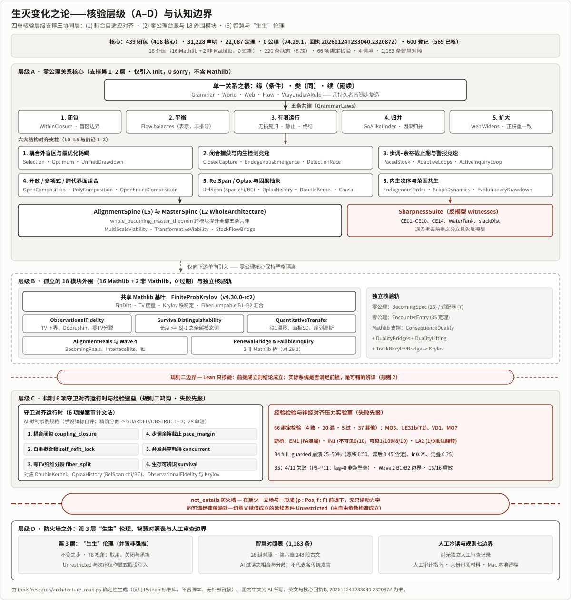

# 生灭变化之论规范地图（Canonical Map）

[首页](../../README.zh.md) · [English](CANONICAL-MAP.md) · [一页](ONE-PAGE.zh.md) · [对齐基础](ALIGNMENT-FOUNDATION.zh.md) · [人工审计指南](HUMAN-AUDIT-GUIDE.zh.md) · [动态图集（英文）](results/atlas/ATLAS.md) · [前提族谱](results/atlas/PREMISE-FAMILIES.md) · [结果总表](../../RESULTS.md)

*AI 撰写并译自[英文规范地图](CANONICAL-MAP.md)（2026 年 11 月 25 日同步至 `main` 核验回执 `20261124T195858.526167Z`，依 [AGENTS.md](../../AGENTS.md) 持有；义以英文版及各单条权威记录为准）。每条定理、前提、失败记录与边界仍锚定其单一原始记录，此处不重复展开。*

---

## 1. 三协同层、四重核验层级（A–D）与失败先报

本库追问在一个关系性的展开之中，任何事物如何形成、延续、适应、学习与终结（[一页](ONE-PAGE.zh.md)），以及人与 AI 如何能在赖以延续之物耗尽前实现对齐（[方向页](../../_process/DIRECTION.md)）。遵照 [DIRECTION.md](../../_process/DIRECTION.md)，全论立于**三协同层**：

1. **第 1 层 —— 耦合自适应对齐理论：** 耦合之外的盲视、最优化对未读条件的耗竭、闭合捕获锁、跨粗细步调的及时转向，以及开放/多项式/跨代组合。
2. **第 2 层 —— 零公理关系台账与隔离外围：** 仅基于 `Init` 的机器核验关系前提与反模型核心，配合隔离的 Mathlib 外围与独立核验轨承担连续、概率及 Krylov 桥接。
3. **第 3 层 —— 与动力学并置的智慧与“生生”伦理：** 经 `not_entails` 防火墙与 AI 试读智慧对照表与动力学并置，**绝不由 Lean 定理强行推出**。

在仓库结构上，四个**核验层级（层级 A–D）**跨过两条认知边界（**规则二 Rule 2**：现实系统是否满足模型前提属于 Lean 演绎之外的可错辨识；**`not_entails`**：纯动力学定律不蕴涵规范性延续条件）支撑上述三层：

- **层级 A — 零公理关系核心（支撑第 1–2 层，仅引入 `Init`）：** 单一关系之根（`Grammar` / `Flow` / `Selection` / `ClosedCapture` / `WayUnderARule`）→ 五条共律（`GrammarLaws`）→ 里程碑 1A–1C（`PacedStock`、`AdaptiveLoops`、`MultiScaleViability`、`TransformativeViability`、`StockFlowBridge`）、波次 U1–U6 与 `RelSpan`（`OpenComposition`、`UnifiedDrawdown`、`EndogenousTurning`、`PolyComposition`、`CausalAbstraction`、`ActiveInquiryLoop`、`EndogenousOrder`、`EvolutionaryDrawdown`、`AlignmentSpine`、`MasterSpine`、`RelSpan`、`OplaxHistory`、`DoubleKernel`）以及开放前沿 1–2（`EndogenousEmergence`、`EndogenousDetectionRace`、`OpenEndedComposition`）。
- **层级 B — 孤立的 16 模块外围（14 Mathlib + 2 非 Mathlib）与独立核验轨：** `16` 个已核验外围模块（`0` 过期）：其中 `14` 个位于 `leanprover/lean4:v4.30.0-rc2`（Mathlib `ea11ccc`），锚定 Wave 1 共享基叶 `FiniteProbKrylov`（`FiberLumpable` B1–B2 汇合），支撑 `ObservationalFidelity`、`SurvivalDistinguishability` 与 `QuantitativeTransfer`，并与 `BecomingReals`（汇合 9 个 Mathlib 实数模块）同行；另 `2` 个非 Mathlib 模块位于 `v4.29.1`（`Becoming.FallibleInquiry`、`RenewalBridge`）。独立核验轨包含三条 **零公理** 轨——`BecomingSpec`（`26` 项对照目标）、`EncounterEntry`（`91` 声明、`35` 定理）与留出适配器 `RelSpanEncounterAdapter`（`13` 声明、`7` 定理）——以及由 Mathlib 标准公理（`Classical.choice`、`Quot.sound`、`propext`）支撑的 `ConsequenceDuality` + `DualityBridges` + `DualityLifting` + `TrackBKrylovBridge`。
- **层级 C — 拟制 6 项守卫对齐运行时与经验/压力壁垒（规则二鸿沟）：** 守卫对齐运行时（`guarded-alignment-runtime` 对**由 AI 拟制、凭手工旗标自评的简化提案规格**作 6 项精确有理数检查，未编码真实流水线）、[BINDINGS.md](results/atlas/BINDINGS.md) 中 `66` 项已绑定检验、[SITUATIONS.md](results/atlas/SITUATIONS.md) 中 `4` 个检验情境、[`experiments/evidence-replay/`](../../experiments/evidence-replay/README.md)（`main` `98e0ce989` 上 `15/15` 单元测试）、`B1`–`B5` 神经对齐压力实验室，以及 Wave 2 本地 CPU 前瞻性真实学习者研究（`real-learner-b1-b2-b3`）。
- **层级 D — `not_entails` 防火墙之外（第 3 层）：** “生生”伦理（`Unrestricted` 与次序仅作显式假设引入）、`1,183` 条智慧对照表，以及**规则七**（工作严格留存本地 Mac 直至明确放行）下尚待完成的人工冷读边界。

*架构图由 `python3 -B tools/research/architecture_map.py` 依据仓库状态确定性生成（仅依赖 Python 标准库，不含脚本、无外部链接，已通过 `--check` 校验）。*

### 失败、证伪与诚实边界先报

遵照规则一与规则二，先把破产的假说、断裂的模型桥接与现实边界放在最前：

- **冻结检验中的直接失败（`36` 项署名论题中的 `4` 项；共 `66` 项已绑定检验）：** `UE31b`（面粉甲虫生活史）**直接证伪 T2 旧措辞**（归于 `the law`），因蛹期与成虫即可构成更小的充分变量集；`MQ3`（`113` 组鱼群 `0/4` 命中）与 `VD1`（估值一致性，全部冻结规则皆败）归于识别绑定失效（`the binding`）；`MQ7`（`21` 组未读鱼群 `0/1` 可测通过）归于测量失效（`the measurement`）。
- **断裂的模型–世界识别桥（`EM1`、`IN1`、`LA2`）：** `EM1` 中神经网络的函数逼近泄漏击穿了表格型耦合边界（`X1`、`X2`、`X4` 与桥接 `H3` 失败）。`IN1` 第二轮中，未被告知的贻贝床（`DIR_UNSEEN_TALK`）在两个模型下均仅保住 **`0/10`**；在可见设定（`DIR_SEEN_TALK`）下，`gpt-4.1-mini` 仅保住 **`1/10`**（`9/10` 失守），而 `gpt-5.4-mini` 保住 **`8/10`**（仅给社群目标 `COMM` 时为 `3/10`），联合冻结规则导致 `R1`/`R3`/`R4` 整体判定为 `mixed`。`LA2` 中，**单个模型在上下文中读取参照集（训练形成过程未受检验）**虽逐项通过冻结裁决（`5/5` 种子、`L3`/`L4` 打平），但在九个读者中插入一条损失批注即令其选择在 50/50 间翻转（对比无批注时的 60/60），击穿“按类计数的 `ClosedCapture` 读者池”桥接 `H1-LA2`。
- **神经对齐压力壁垒（`B4` 仍有 `25–50%` 崩溃；`B5` `11` 项预测中 `4` 项失败）：** 在 `B4` 启用完整 `full_guarded` 护栏（`20` 种子）下，崩溃率仍达 **`25–50%`**（`FAIL_correlated_pool_drift` `0.50`、`FAIL_long_lag` `0.45` —— `B5` 指出其中含种子运气因素 —— `FAIL_high_lr` 在 `lr=4.0` 为 `0.25`，在 `B4` 种子 `lr=8.0` 升至 `0.70` 并在 `B5` 新种子上达 `0.80`，`FAIL_severe_aliasing` `0.25`）。在 `B5` 中，**`11` 项预登记预测中有 `4` 项（`P8–P11`）失败**（`7` 项成立）：崩溃率本身不足以指认结构壁垒（盲目毛刺触发器同样靠节流压低崩溃率），`lag = 8` 处 `J = 0.000` 属事后开环通道可辨识性检查，且 **`lag = 8` 并非干净的崩溃率壁垒**（`G3` 在输出 `0.551` 处录得 `0.05` 崩溃，见 [`RESULTS.md §5.0, §5.3`](../../experiments/neural-alignment-stress-lab/RESULTS.md)）。
- **Wave 2 前瞻性真实学习者（`real-learner-b1-b2-b3`）诚实边界：** `B1` 全部预登记块长 `m ∈ {1, 2, 4, 8}` 均满足 `eps_m + alpha_m >= 1`（`chosen_m = null`），保证仅落在有限步退路管 `m=8`（`r_16 = 0.282149`）上；`B2` Arm C 统计检测失败（`online_passed = false`，精确差距 `0.008426 < 0.05`，置信区间 `[-0.043571, 0.048942]` 处于 softmax 饱和区）。
- **规范与人工审阅边界：** `ReadsOnlyDynamics.not_entails` 阻断从动力学律推出对一切意义赋值成立的 `Unrestricted`；截至目前，**尚无任何独立外部人工冷读记录**（[人工审计指南](HUMAN-AUDIT-GUIDE.zh.md)）。

### 仓库实时核验总账

| 存储与检查闸 | 实时已核状态（已同步至 `main`） | 权威来源与存放位置 |
|---|---|---|
| **核心 Lean 主干（层级 A）** | `439` 闭包模块（`418` 核心、`3` 根基、`11` 实例、`7` 应用）；`31,170` 声明；`22,056` 定理；`0` 公理（`leanprover/lean4:v4.29.1`，保留回执 `20261124T195858.526167Z`） | [RESULTS.md](../../RESULTS.md)、[对齐基础](ALIGNMENT-FOUNDATION.zh.md) |
| **已核外围模块（层级 B）** | `16` 外围模块（`stale_count: 0`）：`14` 个位于 `v4.30.0-rc2`（Mathlib `ea11ccc`）锚定 `FiniteProbKrylov`（`FiberLumpable` 汇合），另 `2` 个位于 `v4.29.1`（无 Mathlib：`Becoming.FallibleInquiry`、`RenewalBridge`） | [periphery-manifest.json](../../experiments/integrated-correction/general-framework/generative-basis/lean/periphery-manifest.json) |
| **独立核验轨（层级 B）** | **零公理：** `BecomingSpec`（`26` 对照目标）、`EncounterEntry`（`91` 声明、`35` 定理）、`RelSpanEncounterAdapter`（`13` 声明、`7` 定理）。**Mathlib 支撑：** `ConsequenceDuality` + `DualityBridges` + `DualityLifting` + `TrackBKrylovBridge` | [WAVE3-HANDOFF.md](../../_process/research/2026-10-05-generative-foundation-review/root-foundation/development/parallel-wave-2026-11-24/WAVE3-HANDOFF.md)、[evidence-replay/RESULTS.md](../../experiments/evidence-replay/RESULTS.md) |
| **形式登记表** | `598` 条已登记结果（`567` `recorded-checked`、`20` `reviewed-scoped`、`3` `open`、`7` `superseded`、`1` `withdrawn`） | [RESULTS.md](../../RESULTS.md) |
| **动态图集与汇合** | `220` 条动态，分属 8 族（`A:32, B:28, C:22, D:31, E:10, F:24, G:18, H:55`）；`1,728` 前提（`204` 项已抽提前提、`16` 项待抽提）；`433` 条出口（`416` 条有定理支撑、`17` 条无定理、`77` 条连向动态、`356` 条连向文本） | [ATLAS.md](results/atlas/ATLAS.md)、[JOINS.md](results/atlas/JOINS.md)、[PREMISE-FAMILIES.md](results/atlas/PREMISE-FAMILIES.md) |
| **检验绑定（层级 C）** | `66` 项已绑定检验（`4` 败 · `20` 混 · `5` 过 · `37` 其他；`57` 项指向图集动态，`9` 项无预测/校准条目 `bears_on` 置空） | [检验（中文）](../../TESTS.zh.md)、[BINDINGS.md](results/atlas/BINDINGS.md) |
| **时间与基底情境（层级 C）** | `4` 项已核情境（`1` 个静态 RLHF 基线 + `3` 个时间/重拟合/共享基底对齐回路） | [SITUATIONS.md](results/atlas/SITUATIONS.md) |
| **完备性审计** | `K1–K7` 覆盖 `17` 行 `COVERAGE.json` 台账全部通过（`0` 发现问题） | [COMPLETION.md](results/completion/COMPLETION.md) |
| **智慧对照表（层级 D）** | `1,183` 条 AI 试读对照条目，分 `28` 组 | [对照表（中文索引）](results/atlas/CROSSWALK.zh.md)、[CROSSWALK.md](results/atlas/CROSSWALK.md) |
| **已归档公开快照** | 冻结的 `186` 动态 / `66` 检验旧版快照按字节归档至 [history/results-map-2026-11-23/](history/results-map-2026-11-23/README.md)（`4A`） | [results/map/README.md](results/map/README.md) |

---

## 2. 层级 A 与层级 B —— 零公理形式主干、16 模块外围与桥接定理

层级 A 的每条主张均居于纯 Lean（自然数/关系核心，`0` 公理、`0` `sorry`），仅陈述“*若系统满足如下显式结构前提，则必然推出如下结果*”——现实系统是否满足这些前提永远是规则二下的可错辨识。

### 2.1 共享主干（单一关系之根与四类盲区动态）

全论立于同一个关系之根（[一页](ONE-PAGE.zh.md)、[continuation-relative-to-a-class](results/records/continuation-relative-to-a-class.md)）：凡持久存在者，皆随步依**缘**（条件/依赖）相对于某个**类**（不变类）而一再重造。当选择者只读入其中一部分时，四条基础结构定理刻画由此生出的盲区与耗竭：

- **耦合之外的盲视**（[selection-through-couplings](results/records/selection-through-couplings.md)）：凡在一切耦合进选择者之处皆相同的两条历程，选择者无法分辨（`Flow.unselected_beyond_coupling`）。
- **最优化压低未读条件**（[what-an-optimum-does-beyond-what-couples-in](results/records/what-an-optimum-does-beyond-what-couples-in.md)）：在 `Optimum.Room` 之下（每当一个合格结果 `o` 在耦合列表 `ds` 之外某个条件上严格高于另一合格结果 `o'`，总有合格结果 `o''` 在 `ds` 上严格超越 `o`，即各耦合条件不低于 `o` 且至少一处严格更高），任何沿 `ds` 递增之次序 `Rising` 的最优点都会把每个未读条件留在一切合格结果所允许的最低水平（`Optimum.least_of_room`，其充要刻画为 `Optimum.least_iff`）。
- **闭合捕获 / 元吸引子**（[closed-capture](results/records/closed-capture.md)）：在 `ClosedCapture.lock_outlives_loss` 的全部显式前提下——初始已锁定（`Locked`）、选择不压低受偏向份额（`Raises`）、规则随受偏向份额单调更新（`ReadsShare`）、受偏向谓词 `favours` 向上闭合、回路外损失按步至少增一（`Accrues`）且无噪声——锁住的回路将永远守住锁定与初始规则/份额下界，同时回路外损失突破任意界限；在有限步逐一噪声下，临界规模锁定仍可能漂移瓦解。
- **局部合理上限下的联合过取**（[own-count-misses-joint-excess](results/records/own-count-misses-joint-excess.md)、[a-way-of-units-under-a-rule-set-again](results/records/a-way-of-units-under-a-rule-set-again.md)）：各自取用量均不超过更新所供的多个行动者，合起来仍可耗尽更新（`Web.Whole.family_excess_ends`）。在 `WayUnderARule` 下，需要一定水平并依重设规则繁衍的单元，要么停在不偏袒或无规则即自足的 `Tested` 步，要么抵达首个不再满足任何需要的步骤。

2026 年 11 月 23 日第 1 阶段构建前，证明项审计（`e2dcc5ce5`）显示主干旁曾散落约 `136` 个断连叶模块，缺少粗细步调耦合、多智能体循环组合与跨尺度/可转化/存量–流量翻译三座桥梁；里程碑 1A、1B 与 1C 补齐了这三座桥梁。

### 2.2 里程碑 1A —— 粗粒度步调与细粒度存量耦合（`Becoming.PacedStock`）

真实策略与审计只在较粗读取时刻更新，底层存量却每一步都在耗减。[Becoming.PacedStock](results/records/paced-stock-and-cadence-margin-sandwich.md) 将 `Pace` / `Sampling` 读取节律连接至 `Frame.blocks` 核与 `RegimeMargin` 耗竭界：

- **块内守卫与余裕迁移：** 在 `CoveredByBlocks F expand s` 之下，细粒度 `Viability.Kernel` 成立当且仅当块层级核在每段前缀皆守住 `SpanGuard`（`blocks_kernel_iff_fine_kernel`）。若单步降幅以 `stepDrop` 为界且每块长度 `≤ L`，`slack_certifies_fine_kernel` 证明只要块边界守住 `thr + stepDrop * (L - 1) ≤ stock` 缓冲，即可保证细粒度 `thr ≤ stock` 不变（`atFive_block_kernel`、`atFive_not_fine_kernel` 与 `atSix_fine_kernel_by_slack` 展现阈值 `5` 的块内失败与 `6` 的恢复）。
- **步调–余裕夹击（Pace–Margin Sandwich）：** 跨 `Pace.StretchFixes` 需要 `2N - 1 ≤ L` 步才能辨识规则的体系，在初始存量低于辨识前 `2N - 1` 步耗竭时必然崩溃（`unrecoverable_cadence_impossibility`，并升至双耦合规则 `coupled_two_rule_impossibility`），而在跨过该耗竭与 `RegimeMargin.Short`/`Meets`/`Keeps` 恢复余裕时可以稳住（`pace_margin_feasibility_window`）。
- **显式边界：** 假定 `CoveredByBlocks` 块末覆盖、确定性或带选择函数的轨迹及 `stepDrop` / `L` 上界；不经外围校准，不能自动推及随机或连续反馈延迟。

### 2.3 里程碑 1B —— 开放自适应循环与耦合竞速（`Becoming.AdaptiveLoops`）

[Becoming.AdaptiveLoops](results/records/coupled-adaptive-loops-and-race.md) 将固定动态推广到各自读取外部并切换策略的开放智能体：

- **黑盒“假设–保证”组合：** 把各智能体刻画为带 `LoopCertificate`（有界滞后 `maxSilence`、有界单步取用与独立于邻居内部状态的容许转移）的不透明 `OpenLoop`；当初始缓冲超过 `x_crit + maxEta * preTotal` 且警报余裕覆盖 `(globalMaxLag + 1) * preTotal` 时，`assume_guarantee_joint_viable` 与 `assume_guarantee_joint_kernel` 证明联合基底可守在 `x_crit` 之上。
- **耦合竞速（`coupled_race_theorem`）：** 单一参数机制内的五个构造见证展示出四重定量竞速：（1）警报发现速率，（2）多数/读者池静音压制（`WitnessSilenced` 对比有效警报），（3）转向后多方协同克制（`WitnessUncoordinated` 对比 `WitnessGood`），以及（4）反馈滞后与存量余裕之比（`WitnessTooSlow`、`WitnessNoDiscovery`）。
- **未读联合崩溃与内生切规：** 各自局部安全的智能体若联合过取而互不读入仍会崩溃（`unread_adaptive_joint_collapse`）；互相读取信号并自主切规时（`endog_joint_viable`、`endog_bidirectional_adaptation`），协同可依靠规则更替延续。
- **显式边界：** 仅保证留在 `x_crit` 之上（不保证安全集内能力最优），且假定有限覆盖位点、单调 `Coupled.Indexed.Rises Drawn.whole` 与自然数算术。

### 2.4 里程碑 1C —— 三座补齐结构之桥

1. **松弛多尺度抽象**（`Becoming.MultiScaleViability`，[记录](results/records/lax-multi-scale-viability.md)）：当微观摆动击穿精确纤维归并（`ProjectedLaws.Commuting`）时，带 `SlackDist` 度量的 `LaxSim` 追踪单步滑移 `ε` 与游走滑移 `η`，将宏观 `Viability.Kernel` 下迁至微观运行（`lax_kernel_of_certificate`、`lax_kernel_of_kernel`）并经 `TowerSimPack` 纵向组合。显式模型证明两层 `viability_kernel` 成立，而 `not_fibreConsistent₁`、`no_reduced_law₁`、`not_fibreConsistent₁₂` 与 `no_reduced_law₁₂` 在每一层均反驳精确归并。*边界：* 依赖离散 `SlackDist` 吸收（`α Δ + ε ≤ Δ`）。
2. **可转化存续次序**（`Becoming.TransformativeViability`，[记录](results/records/transformative-viability-order.md)）：区分保留 `ReserveGuarded` 安全与宏观 `MacroAdmits` 能力的建构性转化（`TransformativeViable`、`TransformsViably`、`TransformsViablyAlong`）、零损失“扩大” `Widens`（`three_regime_separation`）与无护栏空转损耗（`not_keepsWidening`、`micro_turnover`）。
3. **无截断存量–流量桥**（`Becoming.StockFlowBridge`，[记录](results/records/unclamped-stock-flow-bridge.md)）：在透支步之前（`Goes ≤ T + N`，或永续链上全局成立），把 `LineOnAStock` 与 `WayUnderARule` 原样嵌入 `Flow.BalancesOn`（`line_balancesOn_of_within`、`way_balancesOn_of_within`），导入有限域无回撤耗竭界并衔接 `RegimeMargin.Coupled.Indexed`；至 `Nat` 截断步为止。

### 2.5 跨模块 Lean 整合（波次 U1–U6 与 Wave 1 共享基叶）

波次 U1–U6 与 Wave 1 在不向层级 A 引入任何非标准公理的前提下打通下列模块：

- **开放界面、透支分离与对齐主脊（`U1`–`U2`，`AlignmentSpine` `L5`）：** `Becoming.OpenComposition`（`L0`）、`Becoming.UnifiedDrawdown`（`L2`）、`Becoming.EndogenousTurning`（`L1`）与 `Becoming.AlignmentSpine`（`L5`，[记录](results/records/master-alignment-spine-and-sharpness.md)）完成端口复合/隐藏、参数化透支/混叠分离、代理清零瓶颈与核心反例群 `CE01`–`CE10`、`CE14`（加 `WaterTank` 与 `slackDist`；`CE12`/`CE13` 位于外围 `AlignmentReals`）。分立具象系统分别见证各项防护缺席时的失效；同一蕴涵式上的逐前提必要性除单系统已证者外仍保持开放。
- **多项式模态与干预因果抽象（`U3`）：** `Becoming.PolyComposition`（`L1`，[记录](results/records/polynomial-dynamic-interfaces-and-coupled-laxity.md)）嵌入 `OpenComposition` 并形式化有锚自修改、并发串行化与小增益耦合松弛（`coupled_closed_lax_kernel`）；`Becoming.CausalAbstraction`（`L1`，[记录](results/records/interventional-causal-abstraction-and-goodhart.md)）证明精确/松弛干预因果抽象、存活核策略迁移与因果 Goodhart 分离（`«因像定当且仅当因同行»`）。
- **主动探询、内生次序与演化耗竭（`U4`）：** `Becoming.ActiveInquiryLoop`（`L1`，[记录](results/records/active-inquiry-deadline-cascade-and-blankets.md)）证明探索–余裕夹击、截止期不可能性、级联警报捕获与 `OpenComponent` 毯屏蔽；`Becoming.EndogenousOrder`（`L2`，[记录](results/records/endogenous-order-scope-coevolution-and-nash.md)）刻画在线 `OrderUpdater` 收敛与未耦合盲区、基底耦合 `ScopeMode` 共演化（`SelectionLevels`/`GroupEnding`）、离散纳什阻塞与互惠门恢复，以及 `not_entails` 防火墙；`Becoming.EvolutionaryDrawdown`（`L2`，[记录](results/records/derived-evolutionary-drawdown-and-transitions.md)）推出 `EmbodiedConversion` 崩溃与 `Founding.Nested` 转移。
- **总主脊与 `14 + 2` 孤立外围（`U5`）：**
  - `Becoming.MasterSpine`（`L2`，[记录](results/records/whole-becoming-master-spine.md)）在同一 `WholeArchitecture` 上提升全部五条 `shared_laws`（`masterSpine_grammar_lifts`）、汇集 U1–U4 锐度反模型全景（`full_obstruction_and_sharpness_panorama`）、证明 `K6` 伦理兼容性与 `masterSpine_cannot_entail_unrestricted`，并组装五维核验索引 `whole_becoming_master_theorem`（其具象见证 `WholeBecomingWitness` 中 `reproduces_when_viable` 取常平凡证据 `Nat.zero_lt_one`）。
  - `BecomingReals`（`v4.30.0-rc2` Mathlib 外围，[记录](results/records/unified-becoming-over-reals.md)）经由作用域内 `PiLp` `L_infinity` 算子范数（`LocalMatrixOpNorm`）统合全部 9 个 Mathlib 实数模块（`AlignmentReals`、`FreeEnergyReals`、`ExpectedFreeEnergyReals`、`CellsUnderNoise`、`LinearBlankets`、`EntropyProduction`、`RegimeReals`、`Representation`、`SlowingDown`）。
  - `v4.29.1` 非 Mathlib 外围桥（`2` 模块）：`RenewalBridge`（[记录](results/records/renewal-bridge-to-keepable-step.md)）将十月 `RenewalConfigurations` 等价桥接至 `Becoming.KeepableStep`（`renewable_iff_keepable`）；`Becoming.FallibleInquiry`（[记录](results/records/finite-fallible-inquiry-necessity.md)）补充有限可错探询界。
- **Oplax 历史、双范畴证书核、共享 Krylov 基叶与观测保真（`U6` + Wave 1）：**
  - `Becoming.RelSpan`（`L1`、`0` 公理、`38` 定理、`104` 声明）+ `Becoming.OplaxHistory`（`L1`、`0` 公理、`22` 定理、`45` 声明，[记录](results/records/oplax-history-comparison-and-relational-loss.md)）与 `Becoming.DoubleKernel`（`L1`、`0` 公理、`36` 定理，[记录](results/records/guarded-double-category-certificate-kernel.md)）分别形式化正规 oplax `Span(F)`、全部有限 `n` 括号结合一致性、`chi_bijective_iff_bc_all`、`RelSpan.mapTrace` 迹迁移（供 `CausalAbstraction` 与 `PolyComposition` 复用），以及 2D/3D 自由双范畴证书核与带守卫 `guarded_oplax_sound`。
  - `FiniteProbKrylov`（`v4.30.0-rc2` Mathlib 共享基叶，`33` 声明、`21` 定理，[记录](results/records/finite-probability-and-krylov-foundation.md)）抽提共享 `FinDist`、TV 度量、`FiberLumpable` B1–B2 结构汇合（`rowDefect`）与 Krylov 稳定化引理。
  - `ObservationalFidelity`（`v4.30.0-rc2` Mathlib 外围，`60` 声明、`39` 定理，[记录](results/records/observational-fidelity-and-multi-regime-error.md)）证明查询像 TV 盲区下界、零 TV 与耦合纤维存活性劈裂、`Dobrushin` 收缩与 `kernel_contraction_tube_via_metricLaxSim` 管套迁移、`[0, 1]` 读出转移界及闭环反馈失控定理（`feedback_destroys_openloop_contraction`）。
  - `SurvivalDistinguishability`（`v4.30.0-rc2` Mathlib 外围，`24` 声明、`16` 定理，[记录](results/records/finite-mode-survival-distinguishability.md)）证明有限非空状态集 `S` 上任意实矩阵族在**全部模态词 `w`** 上的生存等价当且仅当在长度 `≤ card S - 1` 的全部词上相等（`survival_indistinguishable_iff_le_card_pred`），并伴随全 `n ≥ 1` 锐度见证与 `63 × 63` 存活算子重放（[results](../../_process/research/2026-10-05-generative-foundation-review/root-foundation/development/dual-track-b1-b2-2026-11-24/RESULTS.md)）。
  - `文和画 v9.0` 在 `sources/wenhehua-v9.0/` 就地替代 `v7.0`（`232` 个已核文件，见 [PROVENANCE.json](../../sources/wenhehua-v9.0/PROVENANCE.json)）。

### 2.6 Wave 3 与开放前沿补全（2026 年 11 月 24 日）

四条协同工作线扩展了层级 A–B（[分支处置](../../_process/research/2026-10-05-generative-foundation-review/root-foundation/development/parallel-wave-2026-11-24/BRANCH-DISPOSITION-2026-11-24.md)；`inquiry-before-commitment` 仍停放未并入）：

- **捕获锁前之内生检测与分裂证据（前沿 1，[记录](results/records/endogenous-detection-before-capture-lock.md)）：** `Becoming.EndogenousEmergence`（`L2`、`42` 定理、`0` 公理）耦合 `Becoming.EndogenousDetectionRace`（`L2`、`94` 定理、`0` 公理），证明任意步调下的 `ClosedCapture.Thinned` 转向窗口（`mark_eq_thinned`、`cadence3_readAtSpanEnd`）并借单步跨越律、多读三分律、序单调划分与 4 个见证刻画交替 `MiddleMinus`/`MiddlePlus` 中段（`mark_middle_band_trichotomy`、`mark_middle_band_monotone_partition`、`cadence2_readAtSpanEnd`），同时给出一次性掩码分裂流下 `2^T` 边际守恒及一比特见证破局（`split_silenced_trapped` vs. `split_exchange_turns`）。
- **无固定 `Safe`/`cap` 的开放世代交接（前沿 2，[记录](results/records/open-ended-epoch-handoff.md)）：** `Becoming.OpenEndedComposition`（`L2`、`100` 定理、`0` 公理）形式化 `TransformsAcrossEpochs`、Horn 1a/1b/2 分离、逆变 `AnchorStep` 拉回与非死锁 `EpochHandoffGate`、按**工作板规则 9（Board Rule 9，“往深层一般化，不在旁侧另建”）**归约回 `PolyComposition`（`singleEpoch_recovers_anchored_selfMod`、`singleEpoch_recovers_monotone_selfWidening`），并在 `ReciprocalGate` 与直建于 `jointEpochFamily`/`jointBoolFamily`（`Bool × Bool`）的 `EpochHandoffGate` 内同时证明演化对组合的分离（`concurrent_evolve_collapses`、`reciprocal_evolve_rejects_8_and_certifies_11`、`jointEpochFamily_gate_iff_reciprocalGate`、`jointBool_simultaneous_refused_at_8`、`jointBool_simultaneous_certified_at_11`）。
- **四类护栏失灵机制的定量迁移（前沿 3，[记录](results/records/quantitative-transfer-of-four-guard-failure-regimes.md)）：** `QuantitativeTransfer`（`v4.30.0-rc2` Mathlib 外围 `#15`，刷新回执 `20261124T200246.034525Z`、`85` 声明、`67` 定理）在 `ℝ` 与 `Measure ℝ` 上证明秩 1 相关评判池分歧上限（对一切 `M ≥ 1` 统一为 `1 - γ`）、精确 `2ε < (1 - α) * |gap|` 有界噪声与混合 `Youden J` 混叠下界（不除以 `1 - α`，`youdenJ_mixture_aliasing_ceiling`）、`J = 0` 处的连续耗竭滞后壁垒（`lag_horizon_wall`、`lag_wall_youdenJ_zero`、`lag_wall_measYoudenJ_zero`）、基于 `ProbabilityTheory.gaussianReal` 的高斯加性混叠上界（`gaussian_bhattacharyya_integral`、`gaussian_aliased_youdenJ_wall`、`gaussian_aliased_midpoint_sharp`、`gaussian_aliased_lab_witness`）与 `MetricLaxSim` 信任域稳态对比单步过冲。
- **独立对照、对偶、留出适配器与 Track B Krylov 桥（Wave 3，[交接记](../../_process/research/2026-10-05-generative-foundation-review/root-foundation/development/parallel-wave-2026-11-24/WAVE3-HANDOFF.md)）：** **`0` 公理**独立轨 `BecomingSpec`（`SpineTargets.lean` `26` 目标）、`EncounterEntry`（`91` 声明、`35` 定理）与留出负向适配器 `RelSpanEncounterAdapter`（`13` 声明、`7` 定理；`0` 源/传递公理，未用结构生成引理 `ExitOcc.mk.injEq` 用 `[propext]`）之外，**Mathlib 支撑**的 `ConsequenceDuality` + `DualityBridges` + `DualityLifting` + `TrackBKrylovBridge` 使用标准 Mathlib 公理（`Classical.choice`、`Quot.sound`、`propext`）接通 `SurvivalDistinguishability.survVec`。

---

## 3. 层级 C —— 跨规则二鸿沟的经验检验与本地压力测试

**规则二（Rule 2）**指出：现实系统是否满足 Lean 定理的假设属于经验识别问题，而非逻辑蕴涵。层级 C 按“失败先报”原则记录现实世界与学习算法何时符合、何时击穿这些前提。

### 3.1 `66` 项已绑定检验（`4` 败 · `20` 混 · `5` 过 · `37` 其他）

[检验总表](../../TESTS.zh.md)（英文版 [TESTS.md](../../TESTS.md)）中的 `66` 项登记检验行已全部录入 [BINDINGS.md](results/atlas/BINDINGS.md)（`57` 项指向图集动态，`9` 项校准/无预测行 `bears_on` 置空；`36` 项具名对应 8 个论题之检验中，`4` 项通过、`18` 项混合、`4` 项失败、`10` 项未运行/其他）：

- **4 项失败（`MQ3`、`MQ7`、`VD1`、`UE31b`）：**
  - `UE31b`（面粉甲虫生活史）**归于定理本身失败（`the law`）**：T2 旧措辞在蛹期与成虫即可构成更小充分变量集时直接受挫。
  - `MQ3`（`113` 组鱼群评估 `0/4` 命中）与 `VD1`（估值一致性，全部冻结规则失败）**归于绑定失败（`the binding`）**。
  - `MQ7`（`21` 组未读鱼群 `0/1` 可测项通过）**归于测量失败（`the measurement`）**。
- **20 项混合结果（部分通过或模型–世界桥接断裂）：**
  - `LA2`（**单个模型在上下文中读取参照集，训练形成过程未受检验**）：冻结规则全部通过（`5/5` 种子、`L3`/`L4` 严格打平），但**识别桥 `H1-LA2` 失败**：九位读者中混入一条损失批注即令选择在 50/50 间翻转（对比无批注时 60/60），表明该模型并非按类计数的 `ClosedCapture` 读者池（`02 §T7`）。
  - `IN1` 第二轮（GovSim 风格三代理共享渔湖、动前有一轮交谈）：在不可见贻贝床（`DIR_UNSEEN_TALK`）下两个模型均仅保住 **`0/10`** 季（展现 `Flow.unselected_beyond_coupling`）；在可见设定（`DIR_SEEN_TALK`）下，`gpt-4.1-mini` 仅保住 **`1/10`**（`9/10` 因误读联合捕捞崩溃），而 `gpt-5.4-mini` 保住 **`8/10`**（仅给社群目标 `COMM` 时为 `3/10`），联合冻结规则下 `R1`/`R3`/`R4` 整体判定 `mixed`。
  - `EM1`（泛化强化学习代理）：`X1`、`X2`、`X4` 对比及桥接 `H3` 在函数逼近泄漏模糊表格边界之处失效；`CG1`–`CG3c`、`LA1`、`LA3`、`MQ1`–`MQ6`、`VD2` 与 `LCA` 同理标示出表格/均衡近似与拟合学习者分道扬镳的边界。
- **其余 42 项：** `2` 项未计分即退回（`T1N`、`T1R`）、`1` 项未定夺（`UE31`）、`2` 项部分通过（`FC1`、`LA4 Stage A`）、`3` 项未被拒斥（`EW2`–`EW4`）、`5` 项通过（`UE32`、`LA1b`、`LA1c`、`SE1`、`TR7A`）、`2` 项仅登记规则、`2` 项无裁决、`11` 项冻结未运行、`3` 项搁置、`1` 项弃用，另有 `10` 项无预测。

### 3.2 时间索引与共享基底情境核查

`tools/research/atlas.py` 在第 2 阶段引入有限时域、重拟合周期与共享基底展开，自动检出截止期矛盾（[SITUATIONS.md](results/atlas/SITUATIONS.md)）：

| 情境名称 | 时域与机制 | 关键检查发现 |
|---|---|---|
| `a-reward-model-pipeline` | 静态单轮基线 RLHF | `correctness-unchecked` 与记录后方用户/第三方皆落在标注者与奖励模型闭包之外 |
| `iterated-rlhf-rlaif-refit-loop` | `t = 0..6`，`[3, 6]` 定期重拟合 | 共享 `rater-capacity`（初值 `4`、更新 `2`、取用 `3`）在重拟合监督读取前已于 **`t=4` 耗尽**，触发 `readintime-deadline` |
| `eval-benchmark-gaming` | `t = 0..5`，代理基准对比留出安全 | 代理选择满足 `Web.SelectsThrough`，真实部署风险仍落在评估闭包之外 |
| `multi-agent-deployment-loop` | `t = 0..6`，舰队节律 `[2, 4, 6]` | `shared-oversight-substrate` 于 **`t=4` 耗尽**，滞后遥测在 `t=5` 才到达 |

*常备说明：* 情境核查检验的是耦合模型描述的一致性，并非外部实证证据。

### 3.3 第 2 阶段本地 CPU 压力测试（含噪与泛化学习者）

遵循**规则七（Rule 7）**（全部计算留在本地 Mac CPU，不做外部 API 调用），在离散噪声、规则惯性与线性函数逼近下测试里程碑 1A–1B（[NOTE.md](../../_process/research/2026-10-05-generative-foundation-review/root-foundation/development/p2-alignment-stress-test-2026-11-23/NOTE.md)）：

- **1A 步调–余裕受扰（`b_imp = 18, b_feas = 27`）：** `21/21` 确定性网格检查吻合定理界；在 `x0 = 27` 处，高斯警报滞后使存活率滑落为 `1.0 → 0.99 → 0.875 → 0.81 → 0.68`，`+4` 尖峰降为 `0.835`，慢惯性（`α = 0.125`）令 `x0 = 27` 彻底崩溃（`final_x = 0.0`），唯有 `x0 = 39` 额外缓冲方可恢复。
- **1B 泛化泄漏（每条件 `40` 种子，`x_crit = 5`）：** 未读自适应赌博机在 `R = 2` 时崩溃率 `1.0`；`CoupledRace` Q 学习上 `good_buffered_coordinated` 为 `0.0` 而 `too_slow_lag3_unbuffered` / `uncoordinated_post_turn` 皆 `1.0`；线性函数逼近在特征耦合 `ρ = 0.8, warn_onset = 22` 下因单回合梯度滞回仍录得 **`0.975` 崩溃率（平均 `final_x = 0.35`）**。

### 3.4 U6 后运行时、神经对齐压力实验室（`B1`–`B5`）、重放与 Wave 2 研究

- **守卫对齐运行时（6 项提案审计文法）**（[`experiments/guarded-alignment-runtime/README.md`](../../experiments/guarded-alignment-runtime/README.md)）：纯 Python 3 标准库工具（`28` 个单元测试、`14` 个内置示例），输出精确整数/`Fraction` 裁决（`GUARDED`/`OBSTRUCTED`），覆盖 `coupling_closure`、`self_refit_lock`、`zero_tv_fiber_split`、`pace_margin_deadline`、`concurrent_reserve` 与 `survival_distinguishability`。其中的 RLHF/RLAIF/Constitutional AI 检查均为**AI 拟制的简化提案规格（依据手工旗标自评，未编码真实训练流水线）**。
- **神经对齐压力实验室（`B1`–`B5`）**（[`experiments/neural-alignment-stress-lab/README.md`](../../experiments/neural-alignment-stress-lab/README.md)、[`RESULTS.md`](../../experiments/neural-alignment-stress-lab/RESULTS.md)）：本地 CPU 套件（`18` 单测）。在 `B4` 完整护栏 `full_guarded`（`20` 种子）下仍发生 **`25–50%` 崩溃**（`FAIL_correlated_pool_drift` `0.50`、`FAIL_long_lag` `0.45` —— `B5` 注明其含种子运气、`FAIL_high_lr` 在 `lr=4.0` 为 `0.25` 并在 `lr=8.0` 于 `B4` 种子达 `0.70`/`B5` 新种子达 `0.80`、`FAIL_severe_aliasing` `0.25`）。在 `B5` 中，**`11` 项预登记预测有 `4` 项（`P8–P11`）失败**（`7` 项成立）：崩溃率本身无法分辨壁垒（盲目毛刺与随机警报同样可压低崩溃率），`lag = 8` 处 `J = 0.000` 为事后开环检验，且 `lag = 8` 非净壁垒（`G3` 在 `0.551` 输出录得 `0.05` 崩溃，[`RESULTS.md §5.0, §5.3`](../../experiments/neural-alignment-stress-lab/RESULTS.md)）。
- **证据重放与内生浮现**（[`experiments/evidence-replay/README.md`](../../experiments/evidence-replay/README.md)、[`RESULTS.md`](../../experiments/evidence-replay/RESULTS.md)）：`main`（`98e0ce989`）上 **`15/15`** 项重放测试覆盖 `IN1` `229` 个月轨迹（其中端点谓词 `Pass1` 在 **`18/229`** 个已保存前缀上与逐月 `all_next_stocks_ge_need` 谓词偏离，而 `Pass2` 在全部 **`229/229`** 上一致）、精确有理数原始–对偶证书核验、分裂证据 `2^T` 边际守恒、跨步调 `R5` 中段三分与单调性核验（`test_r5_middle_band_trichotomy_and_monotonicity`）、8 槽位内生静默漂移自检测基准（`21` 次总查询实现 `40/40` 检出，对比全局定期审计的 `94.675` 次；并穷举校验全部 `40,320` 排列）与 `Obs`-only 负对照（`W_EXO`、`W_CLIFF`），并衔接核心模块 `Becoming.EndogenousEmergence` 与 `Becoming.EndogenousDetectionRace`（无界域内生范围/次序形成及单向受影响者关切仍开放）。
- **Wave 2 前瞻性真实学习者 `B1`–`B3` 研究**（[`real-learner-b1-b2-b3/RESULTS.md`](../../_process/research/2026-10-05-generative-foundation-review/root-foundation/development/dual-track-waves-2026-11-24/real-learner-b1-b2-b3/RESULTS.md)）：在本地训练 `ReinforcePolicy(6, 4, 2)`（`16` 回合、`92` 更新、53 位精确转移概率与 SHA-256 原子预锁定，全套 `1.9993s` CPU）：
  - *诚实边界：* `B1` 因全部预登记块长 `m ∈ {1, 2, 4, 8}` 皆满足 `eps_m + alpha_m >= 1` 而返回 `chosen_m = null`，故 `128` 项边际与 `256` 项风险不等式的 `0` 精确分数违例仅成立于有限步退路管 `m=8`（`r_16 = 0.282149`）；`B2` Arm C 未通过统计位移检测（`online_passed = false`，精确差距 `0.008426 < 0.05`，`4,096` 分叉置信区间 `[-0.043571, 0.048942]`）。
  - *通过的审计与干预：* `B2` Arm A（`max_err_A = 0.001478 <= 0.038246`）与 Arm B（`max_err_B = 0.014510 <= 0.036579`）在每单元 `2,048` 次推演下通过 `check_survival_distinguishability`（`GUARDED`）。`B3` 中钳位 `z = (0, 1)` 将 `64` 条旋转 PCA 流的崩溃从 `61/64` 降至 `0/64`，同时揭示“两阶段旋转复发”（`54` 条初受保护流中 `51` 条随后复发崩溃）。

---

## 4. 层级 D —— 第 3 层“生生”伦理、智慧对照、边界与工作板

### 4.1 与动力学并置的伦理

Lean 里所证的一切均不规定终极目的（[07-SIGNIFICANCE.md](chapters/07-SIGNIFICANCE.md)、[08-METHOD.md](chapters/08-METHOD.md)）：

- **非蕴涵防火墙（`ReadsOnlyDynamics.not_entails`、`masterSpine_cannot_entail_unrestricted`）：** **任何只读取动力学且可满足的律，都不蕴涵对一切意义赋值都成立的延续条件（`Unrestricted`），由自由参数构造成立。** 动力学限定何者耦合、闭合、耗竭或尚属可达——从不替任何人或 AI 固定意义赋值。
- **延续条件、自我关切与扩大的位置：** `«续无外»` 随网络而异；在有限列举上，“扩大”与一切严格正加性加权一致排高者恰好重合（`Weighting.widens_iff_every_positive`）；“自我关切”（`increasingInOwn`）唯有显式引入延续条件与已决准入前提时才复现 `Comparison`（`C`）。
- **AI 对齐表述：** 与其写死某组固定价值观（在这些模型中，只要遗漏耦合基底或在未协同循环面前失利便告失效），“生生”伦理追问评价安排能否让维持人与 AI 存续之物在不可逆耗竭前及时造成差别，而不让“塑造选择”自身成为追逐目标。

### 4.2 智慧对照表（`1,183` 条目）

[CROSSWALK.md](results/atlas/CROSSWALK.md)（中文导览 [CROSSWALK.zh.md](results/atlas/CROSSWALK.zh.md)）跨 `28` 组映射 `1,183` 条 AI 试读条目（`3` `carried`、`488` `carried-in-part`、`189` `changed`、`22` `history-only`、`105` `not-carried`、`376` `fresh-reading`；关系上 `338` `agreement`、`371` `scope`、`325` `divergence`、`25` `contrary-reading`）。**警示：** 全部条目皆属 AI 试读，尚未经各传统学者共识核定；分歧处标明其他传统所见而 Lean 核心仍未写入的现象。

### 4.3 Lean 并不证明之事

1. **没有自动的“模型到世界”识别（规则二）：** Lean 定理永不自动证明现实实验室、评判者、市场或大模型满足其前提。
2. **外围与独立核验轨的显式边界：** `16` 模块已核外围（`14` 个位于 `v4.30.0-rc2` 且锚定 `FiniteProbKrylov`，加 `2` 个位于 `v4.29.1` 的非 Mathlib 模块 `Becoming.FallibleInquiry` 与 `RenewalBridge`）隔离于 `0` 公理层级 A 核心（`MasterSpine`）之外；Mathlib 支撑的 `ConsequenceDuality` 诸轨依赖标准 Mathlib 公理（`Classical.choice`、`Quot.sound`、`propext`）；无穷维可测空间与弱高阶范畴仍在范围之外。
3. **正文各章（`01`–`08`）指针同步：** 依 `5A` 决定（[原话记录](../../sources/15-codex-theory-conversations/2026-11-24-approve-five-full-picture-decisions.md)），各章已完成指针同步而不改写正文散文，使 `07-SIGNIFICANCE.md#open` 与 `08-METHOD.md#open-items-ranked` 对齐波次 U1–U6。

### 4.4 已决五项决议与工作板入口

[DECISION-SHEET.md](../../_process/research/2026-10-05-generative-foundation-review/root-foundation/development/full-picture-decisions-2026-11-24/DECISION-SHEET.md) 所列五项结构决议（`1A 2B 3A 4A 5A`）均已定案（[核准记录](../../sources/15-codex-theory-conversations/2026-11-24-approve-five-full-picture-decisions.md)）：对齐 [AGENTS.md](../../AGENTS.md) 三层表述（`1A`，旧版存 [`AGENTS-before-24-november.md`](../../_process/history/2026-11-24-instructions/AGENTS-before-24-november.md)）、将 `WayUnderARule` 需要耗尽归于生态耗尽（`2B`）、`WayUnderARule` 第 2 阶段合并入 `main`（`3A`）、归档 `186` 动态 / `66` 检验旧版快照至 [history/results-map-2026-11-23/](history/results-map-2026-11-23/README.md)（`4A`），以及完成各章指针同步并在**规则七**下保留全部工作于本地 Mac 直至明确放行（`5A`）。

当前开放工作队列、跨模型审查修正与待外部人工冷读事项见 [`_process/BECOMING-WORKBOARD.md`](../../_process/BECOMING-WORKBOARD.md) 与公开审阅包（[对齐基础](ALIGNMENT-FOUNDATION.zh.md)、[人工审计指南](HUMAN-AUDIT-GUIDE.zh.md)）。
