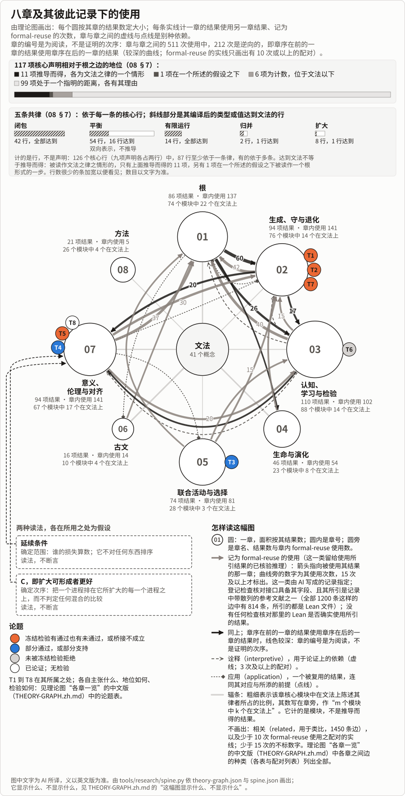

# 生成变化之论：一页

[English](ONE-PAGE.md) · [总览](THE-THEORY-OF-BECOMING.zh.md) · [八章](chapters/README.md) · [理论图](results/THEORY-GRAPH.md)

*约十一至十四分钟读完。*

**它是什么。** 一种说明：在一个关系性的展开之中，任何东西如何出现、持续、变化与消逝，生命与认知如何在那里成形，评价又到什么程度；它不预先假定生灭变化是好的。它借助 AI 做成，证明也在内；证明由机器检验，其余一切只经过 AI 的复审，迄今无人审查（[审查包](review/README.zh.md)）。

**一个情形。** 在[一次冻结的检验](../../experiments/direction-installation/README.md)中，三个 AI 渔民共用一个湖。一片贻贝床不给他们任何东西，并在存量少于 70 吨的第一个月死去。社群的最大稳态渔获，每月 50 吨，终结它；每月 30 吨保住它，损失 40% 的渔获，不终结任何渔民。没有被告知贻贝床时，他们在任何一季都没有保住它，无论得到什么指令。他们是被告知该做什么的语言模型，不是训练出的系统。本说明的中心［AI 读法］：一个选择可以成功，而它读不到的东西却失去了；诸律不说这一损失算不算数。

**根。** 一种符号：关系，读作缘。同一总是某一方面的同一，即一个*类*。一个发生是另一个的缘、且二者在该类下相似，后者便*续*前者。以两种粒度，部分与模式，去读，一个进程可以*生成*（经由部分的复生而继续）、*守*（不经复生而继续）或*退化*（在每一分支上都终止）；生成与守各自排除退化。核心结果中，少数是根的情形，较多在证明中用到根之律，多数不用（[08 §7](chapters/08-METHOD.md#r-one-root-to-its-edge)）。展开是一个，这是一个论题，已论证：在关系之内，只到已表明之处，取者与被取者是同一关系项的两种角色，知者与所知是同一个[环](chapters/03-KNOWING.md#the-reading-loop)，而责任[未被表明是这样分化出来的](chapters/07-SIGNIFICANCE.md#practical-judgment)。它禁止的是解释，不是观察（[08](chapters/08-METHOD.md#one-relational-unfolding)）。

*围绕文法的各章，由工具依[理论图](results/THEORY-GRAPH.md)画出：一条曲线计一章的结果在已核验的推理中使用另一章结果的次数，是一种依赖，不是意义上的一致。117 项核心声明中，11 项推导自文法，1 项在一个明示的假设下，6 项为计数、在文法之下，99 项处于一个指明的距离（[08 §7](chapters/08-METHOD.md#r-one-root-to-its-edge)）。这幅图显示什么、不显示什么，见理论图的 [The spine](results/THEORY-GRAPH.md#the-spine)（英文）。*

| | 本说明说什么 | [地位](chapters/08-METHOD.md#standings-and-bases) | 什么会表明它错 |
|---|---|---|---|
| **什么使一个东西继续下去？** | 相对于一个类的续，以两种粒度（[01](chapters/01-ROOT.md#r-continuation-relative-to-a-class)，[02](chapters/02-MAP.md#r-generation-and-degeneration-at-two-grains)） | 对一切关系与类成立的定理，所以它们不禁止任何关系。这能说明事物如何继续下去：已论证。每一种生灭变化都合于此：未决 | 一次失败的检查。作为语言，没有什么能。作为说明，一个从更少的模式推出诸律的对手；按初步计数，是平局（[08 §9](chapters/08-METHOD.md#what-would-defeat-the-reading)） |
| *接缝* | *下面多数律加上了根所留空者：量与模型的前提（离散的步、自然数）。* | | |
| **什么维持它，什么能看见它的失去？** | 各个取用者各自都在更新所给之内，合起来却可以超出它；在更新依存于其所更新者之处，从足够低的水平接连经足够多这样的步，便终结它以及同样依存于该缘者（[05](chapters/05-COLLECTIVES.md#r-own-count-misses-joint-excess)） | 在模型上证明；重述公地问题。T1，猜想：在两项模拟中，以及在对拟合留出、但分析者已看过的酵母体制上通过，在四种情形中未通过 | T1：一个缘低于事先测得的需要，没有任何来自外部的给予却回升 |
| | 经由一个选择者诸耦合（它所读取或所需要的）的诸选择，合起来恰好到达耦合进它的东西（[03](chapters/03-KNOWING.md#r-selection-through-couplings)） | 已证明，近乎依定义；其力量就是这一前提：选择者恰好经由这些耦合来选择 | 一次失败的检查 |
| | 有*余地*（每一个在外部处于更高水平的合格结果，都在耦合进来者上被一个合格结果胜过）时，每一个随耦合进来者而上升之序的最优解，都把外部耗竭到任何合格结果所耗竭的程度（[05](chapters/05-COLLECTIVES.md#r-what-an-optimum-does-beyond-what-couples-in)） | 已证明；重述一条已知定理。T3，关于训练出的系统：猜想，得到部分支持，早期检验后来被读作其证据 | T3：结果、耦合与奖励固定，一个所测最优差更小的系统，平均而言使这样的缘留得更高 |
| | 一条读自它所提高之份额的规则，可以锁定，并比一个它不读取的、不断增长的损失存续得更久（[02](chapters/02-MAP.md#r-closed-capture)） | 对任何类型证明。T7，关于实际的度量：猜想；在一个训练出的系统中，锁定形成了，而“其评判者是按种类而读的读者池”这一桥接不成立：关于损失的批注附于不利者的回答之上，九中有一、后又有二，在被读到的每次读取上都扭转了其规则，故 T7 所禁止的一种情形（损失只被规则所不利者读到，且这些人不多于其携带者，其余不变），按其加入漂移之条款以前的表述，在此发生，作为关于训练出的评判者的主张而计入此情形之反证；模型之律仅在其假设之内成立，此评判者不满足之，T7 的其他情形不受影响；每一冻结裁决都通过，三项以同一平局；尚无实地检验（[02](chapters/02-MAP.md#t7)） | T7：这样的度量单凭证据就被其选择者放弃 |
| *接缝* | *实际系统是否满足这些前提未决。意义与“更好”若保持为自由的，且有一个立场、一个形成和一个扩大，所表示的动力学便不蕴涵下面任何一个前提，这是由构造决定的。* | | |
| **哪些延续算数，应当做什么？** | T8：对生命而言，道是生生，即整体之中的生命及其持续的生发（不是图上的生成）［AI 读法］，以扩大来比较，依于下面两个前提（[07 §8](chapters/07-SIGNIFICANCE.md#theses)） | 已论证；不主张对一切可能的心智都有约束力的裁断 | 一个混合情形被论证为从每一个把一切都计为正的立场看更好，且不加进一步的前提 |

**伦理。** 没有一条律作评价：没有一条说某个损失是害，或说克制更好。伦理加上两个前提，都不被断言，根据未决，每一个在被使用之处都是假设（[07 §4](chapters/07-SIGNIFICANCE.md#scope-and-order)）；动力学不能表明它们错。*延续条件*确定范围，即谁的损失算数：从每一个立场看，对任何东西，其延续到未来都有意义。它不排任何次序，视角主义者自洽地否认它，而它在为自己而行动所预设者以外的内容，即*不变之步*，把回不到任何人的损失也算在内。*C*：扩大可形成者更好。可形成者，是一个进程所*容纳*者：其诸缘满足其要求的形成（取用并给予者）。一个进程在每一步都容纳另一个所容纳的一切、并在某一步容纳更多，前者便*扩大*后者，这不需前提；说更宽者更好，则需要前提。C 给出次序；排序需要它，或一个代替它的前提。

在这个情形中，延续条件把贻贝床的死算在内，它回不到任何渔民身上。若每月三十吨不失去五十吨所容纳的任何东西，那么再加上贻贝床，它便扩大五十吨，C 把它排得更高；扩大并不衡量失去的渔获［AI 读法］。若它终结了五十吨所保有的一份生计，二者便是混合的，C 不在二者之间判定。单凭自我关切，以一个更窄的前提，排定一个已陈述的情形（[07 §4.4](chapters/07-SIGNIFICANCE.md#r-what-self-concern-alone-ranks)）。抉择还需另外的前提，各已写明（[07 §5](chapters/07-SIGNIFICANCE.md#practical-judgment)）；对齐首先是一个选择能到达什么，方向只是有条件地得出（[07 §6](chapters/07-SIGNIFICANCE.md#alignment-without-premise)）。

**未决的问题**［AI 读法］，已论证，未证明：如果你的行为改变了一个村子饮用的河水，那么村子后来如何，算不算你自身延续的一部分，无论你该不该受责？若一个人的所有后果，就谁的损失算数而言，都算自己的，那么依一种提议，单凭对自身未来的关切，便及于其后的一切，无需不变之步；若只有一部分算，至多及于这一部分，其余要靠不变之步。把自我画得这样宽，可能只是重新定义了它，这是若干反驳之一。无论如何，延续条件与 C 仍是前提（[07 §4.7](chapters/07-SIGNIFICANCE.md#crux)）。

**证据。** 多数结果有 Lean 回执（[成果登记](../../RESULTS.md)）。纯核的空公理报告只关乎逻辑；真正的假设在于建模。一次并不穷尽的、由 AI 作的前人工作回顾发现，核心结果中没有一个是新的数学，以计数成立的演化诸经典定律（[04](chapters/04-LIFE.md#r-evolution-on-descent)）也在其中；留下来的，是一本前提账簿，每个前提都在一个模型中成立、在另一个中不成立，以及范围与次序分开的伦理（[08](chapters/08-METHOD.md#known-results)）。与本理论的一个前提或一条律相接，少数框架在模型上禁止它们单独时留作开放之事，但该回顾发现每一项禁止在相邻领域中都已为人所知（[08](chapters/08-METHOD.md#third-parts)）。T1 到 T7 有评分之前就已冻结的检验，有的通过，有的未通过；冻结的规则只定下评分，并不保证它测的正是论题所说之物。论题不增加定理，驳倒它也不去掉任何定理（[论题](chapters/08-METHOD.md#theses)）。

**古文**为文法的术语命名，运算则不出自古文；其读法出自 AI（[06](chapters/06-CLASSICAL-TEXTS.md)）。

**尚未完成之事。**

- 意义仍是一个自由参数，任何只读取所表示的动力学、且可满足的陈述都不能确定它；或者沿一个这里没有律选定的关系读出（[07](chapters/07-SIGNIFICANCE.md#what-forms-and-what-is-supplied)）。
- 为一个根据，其中有：上面那个未决的问题，它所依的对应（[07 §4.6](chapters/07-SIGNIFICANCE.md#future-path)），不变之步，以及 C 的理由。
- 一个有机体与一种制度各有一个最小模型［AI 读法］（[04 §8](chapters/04-LIFE.md#r-the-stock-buys-time-where-the-rebuild-draws-on-it)、[05 §12](chapters/05-COLLECTIVES.md#r-a-rule-rebuilt-from-the-members-it-limits)），若干论题的检验还待进行。
