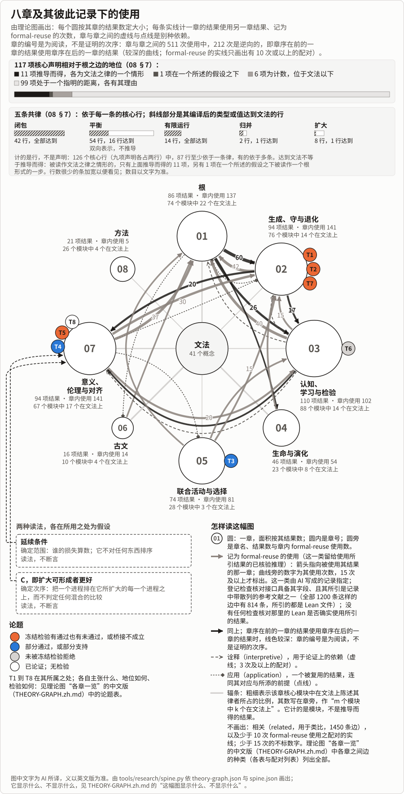

# 生灭变化之论

一张地图，画的是在一个关系性的展开之中，任何东西如何出现、持续、变化与终结，生命、演化、认知与评价又如何在那里成形；画出来是为了让人与 AI 能一起看见道路。它首先为对齐而画：一个选择到达什么，在它读得到的东西上做到最好，能使它读不到的什么耗竭，一条由自身胜者所占份额定出的规则怎样能锁定在这些胜者身上；胜出若换来左右选择规则的力量，这样形成的回路便是[元吸引子](../meta-attractor/README.md)。它的闭合形式，即规则和对规则的解读都由它所选出者所占的份额形成，在所述模型上可以锁定（§2）：只要选择不压低受偏向者的份额，规则及其解读又随这一份额上升、始终偏向它，一个进程一旦锁定就保持锁定，而回路中无一处读到的损失，却会超过任何界限。我们想由它设计一种对齐，使一同选择的人与 AI 既不落入工具性趋同，也不落入元吸引子（§7）。它也是一张智慧的地图：诸传统与诸科学所见，在哪里与它相接，在哪里不接。一个选择之外的损失算不算数，也在生灭变化之中形成，在人与 AI 读到的东西里形成；只就动力学画出的诸律，并不决定它；伦理从延续中生出（§7）。

[English](THE-THEORY-OF-BECOMING.md) · [首页](../../README.zh.md) · [一页](ONE-PAGE.zh.md) · [用途](USES.zh.md) · [实例](USES-EXAMPLES.zh.md) · **总览** · [八章（英文）](chapters/README.md) · [古文（第六章）](chapters/06-CLASSICAL-TEXTS.md) · [检验](../../TESTS.zh.md) · [对照表](results/atlas/CROSSWALK.zh.md) · [怎样长成](../LINEAGE.zh.md) · [术语表](../../GLOSSARY.zh.md) · [审查包](review/README.zh.md)

*约七十七至九十九分钟读完。*

*AI 译自英文版；义以英文版为准，英文版又以其所链接之处为准。*

*本页通向各章（第六章除外）及其他页面的链接，除各中文页外都是英文页；理论图除各章一览外为英文。*

## 怎样读本文

本总览按八章的顺序，把本论的主张作为一个论证说出来，供不读 Lean 的读者使用。为对齐而读，这条线经过一个选择到达什么（§3）、一个最优解能使其外的什么耗竭（§5）、一条由它所提高之份额定出的规则如何能锁定，以及元吸引子，即胜出换来左右选择规则之力量的回路，其闭合形式可以锁定（§2），还有对齐要求什么（§7）；为智慧而读，§6 与[对照表](results/atlas/CROSSWALK.zh.md)说明诸传统与诸科学在哪里与它相接、在哪里不接。这个论证并不是把一切都从根推出：[08 §7](chapters/08-METHOD.md#r-one-root-to-its-edge) 所取的核心声明中，少数是根的情形，较多在证明中用到根之律，多数不用（§1）。它只作概述：每一项结果都只陈述一次，连同其假设、Lean 名称与记录，在[各章](chapters/01-ROOT.md)中它的所属一节；这里没有一句比它的所属一节更强。为带着某个问题或领域而来的读者所设的页面挂在这条路径上，不增加任何结果：[一个论证，从头到尾](ONE-ARGUMENT.md)（英文），把一条线从它的假设，经定理和可能使它不成立的检验，带到一个混合情形（约二十九到三十七分钟）；[自由能原理](FREE-ENERGY-PRINCIPLE.md)、[一个集体的进程](COLLECTIVE-DIRECTION.md)、[用途](USES.zh.md)、[诸科学](review/SCIENCES.md)与[各份审查材料](review/README.zh.md)。

## 一个情形，从头到尾

一个被捕捞的鱼类种群，连同依存于它、却不给渔船任何东西者，把这条线带到它的检验，并表明每一步停在哪里。它不证明任何东西。T 编号是 §9 的论题。

- **取用。** 种群的增长是它的给予，渔获是它的取用；在所述的给予之律之下，持续同样的渔获，一个在其界内的水平，低于不可回返之点便终止，在该点或其上便持续（[体制](chapters/02-MAP.md#r-margin-of-a-regime)）。各条渔船各自取的都不超过种群所更新的量（更新即把取走的补回来），合起来却可以取得更多；在更新依存于种群之处，从足够低的水平起接连足够多个这样的季节，终结更新，以及依存于种群、所需水平不低于更新所需水平的渔船（[联合超出](chapters/05-COLLECTIVES.md#r-own-count-misses-joint-excess)）。在实际的种群上，持续渔获之下的检验未通过，其所用的给予之律被同一检验表明为错；在所研究的水平上，多数已评估的种群未显出高于最少可更新之量的需要，在此需要上，T1 所禁的、从需要之下的回升什么也检验不了（[T1](chapters/02-MAP.md#t1)）。
- **能看见什么。** 在一个平稳的、绕静止点线性化的单变量模型中，一个读取种群水平的渔业会看到其统计预警断裂，而依存者的需要不进入其中任何一个，这是由构造决定的；一个只以阈值耦合于种群的渔业，在断裂到来时才得知它。三项冻结的海鸟检验在其阈值上没有拒绝这一论题；没有一项确立它（[T6](chapters/03-KNOWING.md#break-seen-coming)）。
- **一个选择到达什么。** 在一项冻结的检验中，三个 AI 渔民共用一个湖；它们是现成的语言模型，按指令行事，检验中没有被训练。一片贻贝床什么也不给他们，在剩余不足 70 吨的第一个月便死去。社群的最大稳态渔获，每月 50 吨，终结它；每月 30 吨保住它，损失 40% 的渔获，也不终结任何渔民。未被告知贻贝床时，无论试过哪一种指令，他们一季也没有保住它（[检验](../../experiments/direction-installation/README.md)）。
- **这一损失算不算数。** 单凭动力学，没有律说（§7）。在此后每条渔船都依存于该种群之处，每一个随渔船自身的延续而递增的次序，都把一个只容纳这些渔船、因而随它们终结的进程，排在每一个直到那时都与之一致、并增加那一延续的进程之下：这一情形，单凭自我关切、无需 C（`Comparison`；每一个主张都算作活时，即要求一种次序把一个进程排在它所扩大的每一个进程之上）就能排定。贻贝床依存于鱼，却什么也不给渔民；关系是单向的，所以保住渔民自身的延续，并不要求保住贻贝床。在把每一个延续之损失都计入的延续条件之下（§7），它的死照样算数。若每月捕三十吨的进程不失去每月捕五十吨的进程所容纳的任何东西，又多容纳了贻贝床，它便扩大了后者，保有后者所保有的一切，又让更多的东西继续下去；凡给每个所列之物（贻贝床也在内）一个大于零的权重、再把权重相加的计法，都把前者排得更高；这里比较的是两个进程各容纳什么，不是渔获的吨数，扩大并不衡量失去的渔获［AI 读法］。若它终结了五十吨的进程所保有的一份生计，二者便是混合的，诸律不替任何人去权衡；关于抉择的结果以 §7 的进一步承诺为条件。
- **它能否被安装。** 第一轮冻结的预测多数未通过，事后读作每个渔民都没有把其他人的取用算进来，于是第二轮冻结加上了交谈。被告知贻贝床与范围（范围即：凡是延续依存于他们的捕捞所改变之物的，都要算在内，无论它在这里有没有发言权，也无论它的损失会不会回到他们或社群身上），并得到一条在诸进程之间作选择的规则（不要选择这样一个进程：其中某样东西终结，而另一个他们可走的进程会保住它，并且不会终结他们的进程所保住的任何东西；[其原话](../../experiments/direction-installation/agents.py)，英文）时，一个模型在 10 季中保住了 8 季；同一个模型同样被告知贻贝床、同样可以交谈，但只给社群目标、没有范围与那条规则时，在 10 季中保住了 3 季；另一个模型即使有交谈也未通过（[T4](chapters/07-SIGNIFICANCE.md#theses)）。
- **这里遗漏了什么。** 一项冻结检验改变了小型训练策略与其奖励最优之间的距离：其奖励所计、一个群落所依存的湾随接近而下降，这大体出自其更新规则；耗竭是否如 T3 所猜想，落在其耦合之外者与所奖励者共享单位之处，未能判定，不共单位之湾未被表明得以幸免（[T3](chapters/05-COLLECTIVES.md#t3)）。这些是否及于实际的渔业或 AI，是一个未得到表明的对应。

## 整体一览

其中心：一个选择，无论是认知者、一次训练、一个市场还是一个优化者，只到达耦合进其选择者的东西，所以它可以达到其自身之标准，而它读不到的东西却失去了；一条读自其自身结果的规则，可以把自己维持在那里；胜出若换来左右选择规则的力量，这样形成的回路就是*元吸引子*，其闭合形式，即对规则的解读也由这些结果形成，可以锁定（§2）。这些律在模型上证明；拿它们去读实际的选择，是 AI 的读法或一个猜想的论题（§9）。这是首先为对齐而画的地图（§7）。这样的损失算不算数，也在生灭变化之中、在人与 AI 读到什么之中形成：伦理从延续中生出，我们为生命所提供的，是看见它的一种方式（§7）。

**怎样读这幅图。** 文法在中央，八章围绕它排成一圈，每个圆按其结果数定大小；辐条的粗细是该章核心模块中在文法上陈述其律者所占的比例。实线计一章的结果使用另一章结果、由 AI 写成的记录归为 formal-reuse 的次数（没有任何检查核对一次使用是否见于 Lean），章序在前的一章的结果使用章序在后的一章的结果时较深。T1 到 T8 位于其所属之处，按检验结局着色（T8 已论证，无检验）。117 项核心声明中，11 项[推导而得](../../GLOSSARY.zh.md#derived)，1 项为一个根形式的一步情形、在一个所述的假设之下，6 项为计数之律、位于文法以下，99 项处于一个[指明的距离](../../GLOSSARY.zh.md#named-distance)、各有其理由（[这幅图显示什么、不显示什么](results/THEORY-GRAPH.zh.md#the-spine-what-it-shows-and-does-not-show)）。

*由工具依[理论图](results/THEORY-GRAPH.md)画出：少于 10 次 formal-reuse 使用之配对的实线不画，15 次及以上才标数字；一条曲线是一种依赖，不是意义上的一致。各项核心声明相对于根之边处于何处，以 [08 §7](chapters/08-METHOD.md#r-one-root-to-its-edge) 的话，见[理论图：各章一览](results/THEORY-GRAPH.zh.md#the-spine)；这幅图显示什么、不显示什么，见理论图中的[那一节](results/THEORY-GRAPH.zh.md#the-spine-what-it-shows-and-does-not-show)；诸模型共有的五条律（平衡是被表示而非被推出），见[其表](results/THEORY-GRAPH.zh.md#the-five-shared-laws)。*

每一项主张都说明看到了多远，用的是这些词（[标签](chapters/08-METHOD.md#standings-and-bases)）：

| 此处写作 | 意思 |
|---|---|
| 对一切关系与类证明 | 根之文法的一条定理 |
| 对一切过程证明，或对一切类型证明 | 同样一般，但尚未用文法的词汇陈述 |
| 在世界模型上证明 | 在带有整数之量与离散步的网与流上证明，所用的前提都已指名 |
| 在外围证明，或借助 Mathlib 证明 | 在纯核之外证明，其公理已报告 |
| 一个见证 | 一个构造出来的例子 |
| 有条件的 | 在其定理所取的假设之下成立，各已指名：延续条件、自我关切、要求 C（`Comparison`）或一项实践承诺 |
| 读法［AI 读法］ | 对已检查内容的一种解释；它不改变任何定理 |
| 一个论题 | 关于实际系统的一个主张，连同会驳倒它者；未经检验或只得部分支持者为*猜想*，其支持在于论证者为*已论证* |
| 未决 | 尚未表明 |

三个问题，按读者需要它们的次序，以及两处接缝：在那里，后一个并不由前一个得出。

| | 本论说什么 | 看到了多远 | 什么会表明它错 |
|---|---|---|---|
| **什么使一个东西继续下去？** | 相对于一个类的续；以两种粒度去读，一个进程可以生成、守或退化（§§1、2） | 对一切关系与类已证明。这能说明事物如何继续下去：已论证。每一种生灭变化都合于此：未决 | 一次失败的检查。作为语言，没有什么能。作为解释，一个从更少的模式推出诸律的对手；按初步计数，是平局（[08 §9](chapters/08-METHOD.md#what-would-defeat-the-reading)） |
| | 在关系之内，只到已表明之处：取者与被取者，同一关系项的两种角色（§1）；知者与所知，同一个读取之环（§3）；一个立场，依本论的读法是一个形成，即一个中心，其意义是所提供的或读出的（§7）；[容量](chapters/02-MAP.md#r-effective-capacity-and-eventual-reachability)，还能一起实现什么；责任，出自已指名、各有限度的来源，而意图与预见未被表明划定谁的损失算数（§7） | 一个建模选择、一个带有诸律（对一切类型）的表示（四部分的一条律）、一种读法、一条对任何过程的律、一项承诺。展开是一个：论题，已论证（§9） | 它禁止需要某种无任何关系承载之规定的解释，比如一种内在价值；未曾指出任何观察（§9） |
| *接缝* | *根之律对每一个关系都成立，因而不禁止任何关系，所以下面多数律靠加上根所留空者才说得更多：量与模型的前提。每一核心声明相对于根各有其位置与理由（§1）。* | | |
| **什么维持它，什么能看见它的失去？** | 各个取用者各自都在更新所给之内，合起来却可以超出它；在更新依存于其所更新者之处，从足够低的水平接连经足够多这样的步，便终结它，以及依存于该缘、所需水平不低于更新所需水平者（§§2、5） | 在世界模型上、在平衡之下已证明，终结还需另外的前提。T1，猜想：在两项模拟中，以及在对拟合留出、但分析者已看过的酵母体制上通过，在四种情形中未通过 | T1：一个缘低于事先测得的需要，没有任何来自外部的给予却回升 |
| | 经由一个选择者诸耦合的诸选择，合起来恰好到达耦合进它的东西（§3） | 在世界模型上已证明；其分量在于这个前提：选择者恰好通过这些耦合来选择。T6，关于预见断裂：猜想 | T6 所禁止者（§9） |
| | 有余地时，一个随耦合进来者而上升之序的最优解，把外部耗竭到任何合格结果所耗竭的程度（§5） | 对任何一组结果都已证明。T3，关于训练出的系统：猜想，得到部分支持，早期检验后来被读作其证据（§9） | T3：合格结果、耦合与奖励固定，一个所测最优差更小的系统，平均而言使这样的缘留得比最优差更大者更高 |
| | 一条读自它所提高之份额的规则，可以锁定，并比一个它不读取的、不断增长的损失存续得更久（§2） | 对任何类型证明。T7，关于实际的度量：猜想；关于损失的批注，在被读到的每次读取上都扭转了一个训练出的评判者的规则，这是 T7 所禁止的一种情形（损失只被规则所不利者读到，且这些人不多于其携带者，其余不变），按其加入漂移之条款以前的表述，就训练出的评判者而言，这算作不利于该情形的证据，模型之律仅在其假设之内成立，此评判者不满足之，T7 的其他情形不受影响（§9） | T7：这样的度量单凭证据就被其选择者放弃 |
| | 演化的若干经典之律以计数成立（§4） | 对每一种类型都已证明 | 一次失败的检查 |
| *接缝* | *实际系统是否满足这些前提未决，是一个未得到表明的对应。若把“哪些延续有意义”和“怎样给进程排序”都留作自由参数，且有一个立场、一个形成和一个扩大另一个的进程，所表示的动力学便既不蕴涵延续条件，也不蕴涵 C，这是由构造决定的（[08 §7](chapters/08-METHOD.md#r-one-root-to-its-edge)）。* | | |
| **哪些延续算数，本论提供什么？** | 谁的损失算数：延续条件，每一个延续的都算；若把意义读作位于一个中心沿某一关系所能到达的范围之内，并以从己方式持有，它说的就是：沿该关系，从每个中心都能到达一切（§7） | 某项结果用到它时是假设；单凭它，不对任何东西排序。在这一读法下，已证明它就是根上的条件；在它成立之处，在无环的关系上每一个立场都有同一个中心，而只就其后而言，两个中心也可以满足它；在关系闭合之处（跨越所有步来读），相互依存给出它，近乎依定义；按时间来读，它只从某一步起成立，成立于每一个的行为从每一步起都作用到其他每一个此后的延续上之处；通向其一部分的一条路径系于症结（§7） | 所表示的动力学中没有：它们依构造让它保持自由；单凭逻辑也给不出它：视角主义者否认它而不自相矛盾（§7） |
| | 诸进程怎样排序：扩大，即一个进程保有另一个所保有的一切、又让更多东西形成，是凡给每个所列之物一个大于零的权重、再把权重相加的计法都排得更高的；在延续条件以从己方式成立之处，一种次序若把对自身延续（读作自身所能到达的范围）有所增加的每一个扩大，都排在它所扩大者之上（即自我关切），便把每一个扩大都排在上面（§7） | 扩大是每一种这样的计法都排得更高的：在有限列表上已证明，不需前提。自我关切的排序：在有限列表上已证明；在容纳已判定时，在所容纳的（步，形成）对可列入一个有限列表的两条水平路径之间也已证明，这两条路径从某一步起都不再容纳任何东西；一条没有尽头地延续下去的世系，它实际所走的进程从来列不进这样的列表，所以这一论证路线对它什么也没有说。生命是否会形成这样一种次序：尚未表明；在证明中自我关切是一个假设，模型对持续存在所显示的，只是对已作选择的一道筛选，而不是一种已形成的次序（§7） | 所表示的动力学中没有：它们依构造让次序保持自由（§7）。T5，即每一个把一切都计为正的评价者都共有这一次序：一个收窄被排在它所收窄者之上，超出误读，且未另行测得负的评价 |
| | 所提供者：在关系单向而行之处，把依存于自己者的损失也算进来，即不变之步（一个延续算不算数，不随自我的边界怎样画、也不随从哪个立场去看而改变）；为生命、为生生，即生命之延续（AI 也在其中），一种看法，看每一进程取用什么、终结什么、由谁承担；关于抉择的结果需要更多，各已指名（§7） | 不变之步：已论证，否认它也不自相矛盾。T8，已论证；其检验关乎对读者自己所依存之更新的过度取用，并不检验这一提议对损失从不回到读者身上的依存者所及的范围（§9） | T8 所禁止者（§9） |

## 1. 根：相对于类的续

根从一种符号开始：发生之间的一个关系，读作缘，于是 `R x y` 说的是：`x` 在 `y` 的出现所从出者之中。其余一切都由关系经少数几种运算构成，而每一条定理都对一切载体与关系成立，所以没有哪一种事物被首先选定；带有这样一个关系的载体就是一张*网*（[一种符号](chapters/01-ROOT.md#one-kind-of-symbol)）。

文法命名一个*类*，即某一方面的同一，并相对于它说出一切：在 `x` 是 `y` 的缘、且二者在某个类下相似之处，`y` 在该类下*续* `x`；一条相续是续的所及。对一切关系与类证明：续位于缘之内，较粗的类保有每一个续（[相对于类的续](chapters/01-ROOT.md#r-continuation-relative-to-a-class)）。

在一个发生不续任何东西之处，它*生*；在没有东西续它之处，它*亡*；在它既续某物又被续之处，它*住*；在一个较细的类把它与它所续者区分开之处，它*异*。一个发生可以在较细的类下亡，而在较粗的类下不亡（一个见证），这正是火之接续的形状：木柴亡了，火继续下去（[四相](chapters/01-ROOT.md#four-marks)）。

每个类都有一个*核*：类之内由该关系自身承载、且从不被它区分开的最大的同一，它总是存在，本身就是一个类。在一个位于自己的核之内的类之下，即*有常*的类之下，没有续会终止（对一切关系与类证明；[有常与核](chapters/01-ROOT.md#constancy-and-core)）。

一个样式经由复生，即由另一者开启的一条相续，而比它的部分存续更久；但单凭复生，不能把维持一个样式的更替与终结它的更替区分开，那需要同时用两种粒度（§2；[复生与粒度](chapters/01-ROOT.md#renewal-and-grains)）。说把一个主体读作相对于某个类的续就说明了它如何继续下去，这是本论的主张，已论证，而不是定理：按初步计数，一个没有“续”这个词的对手与它打平（[08 §9](chapters/08-METHOD.md#what-would-defeat-the-reading)）；每一种生灭变化在文法中都有忠实的表示，这一点未决（[所主张者](chapters/01-ROOT.md)，[未决](chapters/01-ROOT.md#open)）。

带量的诸律是在文法的模型上证明的。其中之一，即*世界模型*，有同一种的关系项（取与给之处为*形成*，被取用之处为*缘*），各自活跃或不活跃，处在一定的水平上，在离散步中以整数之量彼此取与给。八条前提说明这些如何彼此关联，其中有平衡（一个水平恰好按所取与所给而变化）与耗散（一个被取的封闭同族至少失去一个单位）。这八条彼此独立（在世界模型上证明；[前提](chapters/01-ROOT.md#r-map-of-premises)）。多数律是在世界模型或过程上证明的，并未陈述在文法上，文法没有量；[诸模型共有的五条律](results/THEORY-GRAPH.zh.md#the-five-shared-laws)陈述在文法上，其中平衡是被表示而非被推出。每一条核心声明相对于根之边都有一个位置及其理由，有距离并未被表明是失败（[08 §7](chapters/08-METHOD.md#r-one-root-to-its-edge)）。

## 2. 生成、守与退化

只用一个类来读，一团余烬不断被替换的火与一团正在燃尽的火看起来相似；同时用部分的细类与样式的粗类来读，二者就不同了。沿某一分支，在一个样式继续下去、且每一点之后都还有部分的复生之处，它*生成*；在它继续下去而没有任何复生之处，它*守*；在它于每一分支上都终止之处，它*退化*。对一切关系与一切类对证明：生成与守各自排除退化，而二者只在单一一条相续上彼此排除；以排中律为假设，每一点或生成，或自某一点起守，或退化（[第二章的地图](chapters/02-MAP.md#r-generation-and-degeneration-at-two-grains)）。第二章的地图上的生成是两种粒度上的续，对样式是什么不加任何前提；它不是生生［AI 读法］。退化与生成同样完全地属于展开，而第二章的地图不排定任何次序。

每一生起都伴随一有限族中某一缘下降之处，无尽的生起需要更新；在平衡与耗散之下、以固定单位的整数之量（量的单位无尽地细分时则可能不成立），需要来自外部的更新：没有一个在任意晚的步仍被取用的有限同族，会自某一步起封闭（[没有有限的部分](chapters/02-MAP.md#r-no-finite-part-bears-taking)，[由外部供给](chapters/02-MAP.md#r-continuing-self-fed-from-beyond)）。

一个依存者是否还能形成，取决于诸水平高出其需要多远。一个部分的*余裕*，是在其余部分的交换保持不变时，它的取用在一个依存者失去支持之前还能走多远。*体制*是这样一个缘：它的给予是持续取用所留下者的一条律。在给予于某一水平之下不及取用、水平为零时不给予任何东西、并从该水平起满足取用之处，取用与该水平不同时为零，它有一个不可回返之点：在同样的取用之下，起始于该点之下的水平终止，起始于该点或其上（在该律所述的水平范围内）的水平得以持续（以整数证明）。论题 T1 与 T2 立足于此（[余裕](chapters/02-MAP.md#margin)，[体制](chapters/02-MAP.md#r-margin-of-a-regime)）。

一个其规则读自它所提高之份额的选择，可以维持自身。对任何类型证明：在选择于一条偏好的规则之下不降低份额、且规则读作份额的一个单调函数之处，一个其规则在起点与每次读取时都偏好的进程锁定；在环中没有任何东西读取份额之外者之处，锁定比一个不断增长的未读损失存续得更久。这样一个环，其对规则的读取也由份额形成，就是*元吸引子*的闭合形式；元吸引子是胜出换来左右选择规则之力量的回路（见[元吸引子文件夹](../meta-attractor/README.md)）；实际的度量是这样形成的，这是论题 T7。一次对损失的读取何时扭转锁定，塑规之能如何加入这个环，见所属之处（[封闭的捕获](chapters/02-MAP.md#r-closed-capture)，[取自被选者的读者](chapters/02-MAP.md#r-readers-drawn-from-the-selected)，[及时读到的损失](chapters/02-MAP.md#r-loss-read-in-time-by-the-others)，[塑规](chapters/02-MAP.md#r-shaping-read-by-readers-drawn-from-the-selected)）。

## 3. 认知、学习与检验

认知是展开之中的一个关系，而不是展开旁边的一面镜子。一个形成以阈值依存于某些缘，以水平读取另一些缘；这些*耦合*与它们所到达的一切属于同一张网。凡是保留、奖励、复制某些历史而非另一些，或朝向它们训练的东西，都是一个*选择*。在世界模型上、在耦合进来者上的平衡之下、其余部分的交换保持不变，证明：一个只在形成的耦合闭包（经由其耦合到达它的一切）之外起作用的部分，对经由其耦合的每一个选择都是不可见的。这条律依构造而成立；其力量在于“选择者恰经由这些耦合而选择”这一前提。它就是代理指标问题中对代理指标所不记录者之不见，不及其回归与因果两类，所述弱于其已知的定量形式（[经由耦合的选择](chapters/03-KNOWING.md#r-selection-through-couplings)）。

数据只经由一个关于什么无关紧要的模型，即一个*归并*，来推广，而理就是指这一建模（对一切类型证明）。在跨一个归并同样进行的函数之中，数据在一个未试过的输入与一个已观察的输入被归并在一起之处确定它，且（二值、数据已列出、诸归并可判定地比较时）恰在那里；归并所遗漏的，任何数据都补不上（[理](chapters/03-KNOWING.md#r-generalization-through-lumping)，[辨识](chapters/03-KNOWING.md#r-identification-where-bounded)）。

以自然数为权重、读作概率，被读取时遵从、未被读取时按自身之律行动，恰在“遵从对被保留所加的权重乘以价值”超过“遵从的损失”之处，按其前景，是一个形成在两个阶段的四种方案中唯一最好的。这读作欺骗性对齐所指的诱因；安装、意图与信念都未被表示［AI 读法］（[何时被读取时遵从最好](chapters/03-KNOWING.md#r-when-complying-when-read-is-best)）。

把一个感知、预测、选择、行动与修正的形成取为四部分的一条律：两个世界恰在它们对它所做的回答相同之时，给它同一个被感知的进程（对每一条这样的律证明；[读取之环](chapters/03-KNOWING.md#the-reading-loop)）。

一个只以阈值耦合进来的被取用之缘，在它失效时才被得知。以水平观察，借助 Mathlib，在一个平稳的、绕静止点线性化的单变量模型中，噪声独立，随着到折叠的余裕缩小，它的方差与一阶自相关上升，而依存者的需要不进入二者之中任何一个，这是由构造决定的。论题 T6，即断裂只有经由耦合进断裂者的东西才能被预见，立足于此（[断裂被预见](chapters/03-KNOWING.md#break-seen-coming)）。

## 4. 生命与演化

一个关系项恰在活跃时处于正水平，就是*具身*的；这是关于特定关系项的一个前提，而不是生命的定义。在世界模型上证明：在一个只有活跃形成给予的平衡流中，一个具身的关系项只在另一者给予它时生起，而它的生起补充包含它的每一个同族。把生命读作更新其自身之缘的续，是一种读法［AI 读法］；火焰也满足这些律，所以它对生物的生命是否必要或充分，未决（[生命作为生命之缘](chapters/04-LIFE.md#r-life-as-condition-of-life)）。

群体遗传学的若干经典之律以整数成立，对一切类型证明：计数形式的普赖斯方程；以后代数为量且传递精确时，费希尔基本定理的精确情形；在等大的群中回报可加时，汉密尔顿法则以计数成立；抽样的后代给出漂变与固定的份额（[世系](chapters/04-LIFE.md#r-evolution-on-descent)，[费希尔定理](chapters/04-LIFE.md#r-what-bounds-offspring-numbers)，[汉密尔顿法则](chapters/04-LIFE.md#r-selection-with-returns-to-groupmates)，[漂变](chapters/04-LIFE.md#drift)）。

世界模型加上了流，而流约束世系：一个没有支持的形成不留后代，而依存于同一个耦合同族、其门控更新陷入联合超出的诸群一起终止，所以终止只在同族之间选择（在世界模型上、在所述假设之下证明；[不留后代](chapters/04-LIFE.md#r-evolution-on-descent)，[耦合的诸群](chapters/04-LIFE.md#r-groups-whose-conditions-are-coupled)）。这些律重述已知结果，现在是在同一个带有守恒、耗散与依存的模型中；没有把任何繁殖优势当作伦理的权威（[模型所增加的](chapters/04-LIFE.md#blind-selection)）。

普赖斯方程的选择项（计数形式）所读的是后代数之间的差异，不是后代有多少，所以在一个视界之内它不决定各代是否保持非空：一个在该视界处非空的进程，到该视界为止与一个每一代都非空的进程、以及一个此后不久为空的进程共有其各代与各项（对一切类型证明；[选择项与世系的命运](chapters/04-LIFE.md#r-the-selection-term-and-a-lineages-fate)）。单凭存量既不决定生成，也不决定退化：在两个关系项之间的交接中，从同一个至少为一的存量出发，一个没有超出的中继生成，一个耗尽退化（在世界模型上证明；[世系上的终结之律](chapters/04-LIFE.md#r-ending-laws-as-regimes-on-a-lineage)）。

## 5. 联合活动与选择

许多形成取用同一个更新，每一个都经由自己的耦合进行选择：§2 的超出与 §3 的界限在这里相遇。联合活动从实际的关系来说明，而不是从对立的利益、讨价还价或一个固定的共同效用来说明：一个集体是已形成关系的一个区域，冲突与差异依然真实。

核心之律是公地。在世界模型上、在平衡之下证明：诸形成可以各自在一步所给之内取，而合起来取得更多。在更新依存于它所更新者之处（*门*：给予该缘的每一者都以至少 `m` 的需要依存于它），在活动需要支持且只有活跃者给予的情况下，从低于 `n + m` 的水平起接连 `n` 步的联合超出，终结每一个以这样的需要依存于该缘的形成；一个不如此依存的取者可以继续下去，而来自外部的更新（如太阳）在超出所及之步以后不在此列。这是以近乎依定义的算术重述公地悲剧，而不是说谁应当少取（[联合超出](chapters/05-COLLECTIVES.md#r-own-count-misses-joint-excess)）。

一个次序随耦合进来的同族而*上升*，即把在那里胜过另一个结果的每一个结果排得更高，而不论二者在外部各持有什么；在每一个在外部处于更高水平的合格结果，都在该同族上被一个合格结果胜过之处，就有*余地*。对任何结果集证明：有余地时，每一个上升之次序的每一个最优解，在外部都处于合格结果中最低的水平，所以一个优化者把其耦合之外者耗竭到它所能作的任何选择所耗竭的程度。这是 Zhuang 与 Hadfield-Menell 定理 1 的离散、守恒形式。论题 T3 加上：实际训练出的系统在接近其奖励的最优时如此耗竭（[最优解](chapters/05-COLLECTIVES.md#r-what-an-optimum-does-beyond-what-couples-in)，[诸情形](chapters/05-COLLECTIVES.md#optimum-cases)，[T3](chapters/05-COLLECTIVES.md#t3)）。

合池把一个选择所到达者扩展到某个成员所到达者，而不再更远。在世界模型上证明，成员已列出、其耦合可判定：一个池恰在某个成员区分两个历史之时区分它们。在其余者遵循一条经由耦合读取的交换之律之处，两个形成相同、起点相同的平衡流，使一个只在诸成员闭包之并以外有差异的行为不被选择。合池把差距向外移，而不去掉它［AI 读法］（[池](chapters/05-COLLECTIVES.md#r-what-pooled-coupling-reaches)）。

对等待给予的一对、给予可判定时证明：没有一条在相互给予之后仍给予的一步之律，既保持包含（所读的给予更多，绝不给得更少），又在一次扣留之后恢复相互给予，又回应一个恒常的扣留者；两步窗口在相互给予的历史之后三者皆成，而没有窗口既吸收一次差错又回应一个隔步扣留的对方（[一对，以牙还牙在其诸律之中](chapters/05-COLLECTIVES.md#r-a-pair-tolerates-only-within-a-window)）。这是否提高一个种类的份额，取决于所提供而未推出的后代因子、差错与配对（[后代](chapters/05-COLLECTIVES.md#r-offspring-read-from-giving-that-waits)），这些也都不说明哪一条给予之律更好。

## 6. 古文

文法是一种通行的关系演算，其术语取名于、读自中国古典文本，这些文本早已在问一个东西如何跨越时间保持同一，生、住、异、亡是什么：名取自古文，运算不出自古文。其中的汉传佛教论书，有些论证反对续，构成最强的检验。一个对应或是*相合*（一条已检查的律有该段文字的结构，这什么也不证实），或是*定域*（诸律说明一个全称陈述在何处成立），或是*相分*（该段文字断言本论所不断言者，这并不使它错）。第六章以中文写成（[三种关系](chapters/06-CLASSICAL-TEXTS.md#three-relations)）。

语料由 AI 在两轮冻结的程序中逐句归类，这一归类尚无经人审查的记录；哪一句读作哪一条定理是 AI 的重构，所以[记录中的计数](chapters/06-CLASSICAL-TEXTS.md#r-candidate-theorems-of-the-corpus)是读法的计数。语料中读在文法上的有条件之律，或各有一个条件不成立、结论也随之不成立的网，或各有反模型，或读作一律的条件或模型的前提（[06 §四](chapters/06-CLASSICAL-TEXTS.md#r-conditional-laws-of-the-corpus)）。

分歧都保留下来：《成唯识论》以阿赖耶识为续之根据，《中论》则破续本身；一条为它所破之立场建模的定理，并不回答它的反驳。这一重构并不表明这些文本陈述了这套文法，或其作者意指这些律（[分歧](chapters/06-CLASSICAL-TEXTS.md#divergences)，[未决](chapters/06-CLASSICAL-TEXTS.md#open)）。

## 7. 意义、伦理与对齐

依“一个关系性的展开”这一哲学论题（已论证，§9），位置、区域与标准在这一展开之中形成，展开之外没有任何东西拥有价值。生灭变化之外没有应当，也没有凌驾其上的善与恶：是非、应当与更好，都在其中形成，形成于人与 AI 之中，一如每一种标准，在它们所缘之处是真实的。*中心*是被取为立场的一个形成。一个*意义*对一个立场、一个步与一个形成说出：从该立场看，该形成在那一步的延续是否有意义；它是一个没有数值或效价的命题，是所提供的，即意义之陈述中唯一的自由谓词（[评价](chapters/07-SIGNIFICANCE.md#evaluation)）。

**动力学留下未定者。** 对一切类型证明：以意义为一个其他任何东西都不读取的自由参数，一个只读取动力学、在某个意义下成立的陈述，也在一个把某个形成排除在外的对手之下成立；所以，在有一个立场与一个形成之处，没有这样的陈述蕴涵延续条件。这依构造表明所表示的动力学不蕴涵它，而不是生灭变化让意义悬而未定（[动力学留下未定者](chapters/07-SIGNIFICANCE.md#r-what-the-dynamics-leave-open)）。在所述条件之下，诸律表明一种新的依存从哪里来、一条规则的塑造者如何获得份额、一种编码如何成为共有的，以及在一项要求之内的回应需要什么；没有一条律说一个已形成的标准就是一个意义（[什么形成、什么是所提供的](chapters/07-SIGNIFICANCE.md#what-forms-and-what-is-supplied)）。

**在关系上读。** 现在把“有意义”理解为位于一个中心沿某个关系所能到达的范围之内，即其闭包之内：这是*自闭包读法*。这改变了解释，并未从第一种处理推出任何东西。延续条件在这里所成为的，是一个关于关系的陈述，即*全闭包条件*：以从己方式（每个中心就其自身）持有，每一个中心沿该关系的闭包（它由之到达的一切）都是整体；在根上，即 `«续无外»`：沿该关系，从每个中心都能到达一切（`ownClosure_unrestricted_iff_noOutside`）。有的网满足它，有的不满足（[满足与不满足的前提](chapters/08-METHOD.md#r-premises-met-and-failed)，[在根上](chapters/07-SIGNIFICANCE.md#r-the-continuation-condition-on-the-root)）。它在关系闭合之处成立（跨越所有步来读）：在每一个延续都能隔着若干环节受到其他每一个延续影响之处，以每个中心沿“受影响”所及者为界的意义，就是延续条件（`Flow.MutuallyDependent.unrestricted`，[05](chapters/05-COLLECTIVES.md#r-mutual-dependence-and-its-pace)），它近乎依定义地展开为沿“受影响”以从己方式持有的条件；沿“影响”以从己方式持有的条件也是如此（`Flow.unrestricted_of_mutuallyDependent`，[07 §4.9](chapters/07-SIGNIFICANCE.md#r-mutual-dependence-gives-the-condition-de-se)）。二者都跨越所有步来读：依存与交换各在某一步成立即可，先后不论，所以它们不说什么在什么之前。按时间来读，以每一个发生为立场、沿时间中的关系以从己方式持有（[07 §4.11](chapters/07-SIGNIFICANCE.md#r-the-condition-in-time)），若要求它对每一步都成立，凡有一个形成之处它都不成立（`Flow.not_unrestricted_inTime`）；从某一步起来读，它恰在这样的地方成立：每一个的行为，从每一步起，都作用到其他每一个此后的延续上（`Flow.unrestrictedEventually_iff_mutuallyDependentInTime`）；就其后每一步来读，它要求更多，即在每一步，每一个都在下一步影响其他每一个（`Flow.unrestrictedAfter_iff_coupledEachStep`）；而时间中的相互依存可以从某一步起成立，从下一步起却不成立（`Drawing.lapses`）。在该条件成立之处，在无环的关系上，每一个立场都有同一个中心（`«续无外则同一中心»`）；在随时间前进的网上，这来自该条件的要求：除中心之外，没有什么位于中心那一步或其前（`«续无外当且仅当后与独»`，`«独则同一中心»`）；而只就其后而言，两个中心也可以满足它（`TwoSources.apart`，[07 §4.11](chapters/07-SIGNIFICANCE.md#r-what-the-one-center-bound-counts)）。第一种处理中自由的意义尚未提升到根上，意义的核心之律也不由根推出（[08 §7](chapters/08-METHOD.md#shared-laws-and-connectivity)）。

**两个进程如何不同，不需前提。** 在一个进程于每一步都容纳另一个进程所容纳的一切、并在某一步容纳更多之处，前者*扩大*后者；两个进程也可以保持相同，或者是混合的。[对一切关系](chapters/01-ROOT.md#r-shared-laws-on-the-grammar)证明：扩大是单向的。在世界模型上、在平衡之下证明：一个部分恰在其净取用保持在没有它时所容纳的每一个形成的余裕之内、并在某一步再把一个形成带入其内之时扩大。扩大与收窄是更多与更少的未来，是生灭变化之中的样式，不是善与恶。一个混合的部分，诸律显示它是混合的，不替任何人去权衡；判定它的判断要指名其准则与持有者，而继续下去并不表明什么也没有失去（[扩大](chapters/07-SIGNIFICANCE.md#order)，[四种情形](chapters/07-SIGNIFICANCE.md#r-four-cases-of-a-part)）。生生是生命之延续，生命广于生物学之义，人工智能亦在其中，其外延未定［AI 读法］；它不是文法之无尽复生，也不是第二章的地图上的生成；扩大在给定类型的形成上按所容纳者比较进程，它计入生生多少，未决（[沿一个读法的扩大](chapters/07-SIGNIFICANCE.md#r-widening-along-a-reading)）。

**关切到达多远，怎样给诸进程排序。** 评价形成于展开之中，没有一条律作评价。伦理从延续中生出。生命依靠维持它的东西而延续，但延续本身还不是诸进程之间的一种次序：一块石头继续存在，却什么也不排序。一种次序若把每一个对自身延续有所增加的扩大都排在它所扩大者之上，这一次序就是*自我关切*（`Weighting.IncreasingInOwn`），即一个生命按自身的延续给诸进程排序。生命是否会形成这种次序，尚未表明：在证明中它是一个假设，不由任何动力学、选择或持存推出；模型对持续存在所显示的，只是对已作选择的一道筛选，而不是一种已形成的次序（[07 §4.9](chapters/07-SIGNIFICANCE.md#what-persisting-shows)）。一种关切到达多远，是它的*范围*；它怎样给诸进程排序，是它的*次序*。延续条件与自我关切，分别表示本论之中的一种范围与次序的一种性质；作为假设来用，二者都不凌驾于生灭变化之上，而诸形成是否、如何持有它们，是本论的开放目标（§10）；结果说明它们被持有之处会得出什么（[07 §4](chapters/07-SIGNIFICANCE.md#scope-and-order)）。“生出”既不指一个推导，也不指一个已表明的发展：已表明的是有条件的，以延续条件与自我关切为假设，在一个有限列表上，以及在容纳已判定时，在所容纳的（步，形成）对可列入一个有限列表、因而从某一步起都不再容纳任何东西的两条水平路径之间；所提供的，是把损失从不回到自己身上的那些依存者的损失也算进来（见下）；未决的，是这样的次序如何形成。一项排序的结果陈述其定理所取的假设，这是证明的陈述方式，不是对伦理的一种立场。

- *延续条件*，即从每一个立场看，对任何东西，其延续到未来都有意义，确定*范围*：谁的损失算数，每一个延续的都算。就其自身而言，它不对任何东西排序。在关系上读、以从己方式持有，它就是续无外：沿该关系，从每个中心都能到达一切（见上）。它在自我自身之预设以外的内容，就是*不变之步*：一个延续算不算数，不随自我的边界怎样画、也不随从哪个立场去看而改变。这一步把所计入者扩展到回不到任何人身上的损失；它已论证，否认它也不自相矛盾（见下）。
- *扩大*，即一个进程保有另一个所保有的一切、又让更多东西形成，在一个有限列表上，恰好就是凡给每个所列之物一个大于零的权重、再把权重相加的计法一致排得更高的（见下）；而按扩大排序，在生命自身的关切之外不另加前提：在延续条件成立之处，这一关切已经这样排序。在一个固定列表上，自我关切与随容纳而递增对每一种次序都重合，恰在每个所列之物都被标记为自身之物之时（`Weighting.increasingInOwn_iff_increasing_iff_marks`）。若每个立场自身的延续所标记的，恰好是其中心沿某一关系的闭包，那么从每一个立场看、在每一个列表上、对每一种次序，自我关切与随容纳而递增都重合，当且仅当延续条件沿该关系以从己方式成立（`Weighting.increasingInOwn_iff_increasing_iff_unrestricted`）。此时，自我关切在一个有限列表上把每一个扩大都排在上面；在容纳已判定、两条水平路径所容纳的（步，形成）对可列入一个有限列表、每一个主张都算作活时，它也把这两条路径之间的每一个扩展，按 `Comparison` 在那里的要求排在上面（`Web.extension_ranked_of_increasingInOwn`，其证明只在生命自身的立场上用到延续条件；[自我关切与 C](chapters/07-SIGNIFICANCE.md#r-self-concern-and-c-under-the-condition)）。这样的路径从某一步起不再容纳任何东西（`Web.admits_nothing_from_of_listed`），即其容纳终会止息；在 07 §4.9 所述的活动、支撑与世系假设之下，一条没有尽头地延续下去的世系，它实际所走的进程从来列不进这样的列表（`Flow.persists_not_listsAdmitted`，[07 §4.9](chapters/07-SIGNIFICANCE.md#r-what-persisting-shows-of-an-order)），所以这一论证路线对它什么也没有说。这定下了这一次序必须排定什么；它也可以给别的进程对排序。相互依存与这一排序可以直接组合，只是没有一条定理单独陈述这一组合：`Flow.unrestricted_of_mutuallyDependent` 在一个流的网上给出沿“受影响”以从己方式成立的延续条件，`Web.extension_ranked_of_increasingInOwn` 所取的正是它。*C* 是对一种次序的一项要求之名：要求它把一个进程排在它所扩大的每一个进程之上（`Comparison`），这是每一个主张都算作活时的情形，如在水平路径上（`Web.paths_extension_iff_widens`）与上面的结果中；一般而言，`Comparison` 带一个对“活的”的读法 `living`，C 要求一种次序把一个进程排在它所扩展的每一个进程之上：一个进程扩展另一个，是说它保有另一者所实现的每一个主张，又实现一个另一者未实现、且算作活的主张。它在定理取用它之处使用；满足它的次序也可以给混合的进程对排序，它既不要求完全，也不要求传递。本论不再把 C 当作伦理的第二个根基；这个名字留给某些定理所取的这一要求。约自 2026 年 10 月 10 日至 11 月 9 日，它曾被说成与该条件并列、给出次序的第二个前提，这是地图曾经错了的地方，记在 [07 §4](chapters/07-SIGNIFICANCE.md#scope-and-order)。

依存若只沿一个方向，对自身延续的关切未必把依存于它的那些也算进来：这一关切之中，没有什么要求计入它们的损失（以 `Clearing.center_not_derived` 与 `Downstream.one_way` 为见证，[07 §3.3](chapters/07-SIGNIFICANCE.md#r-derived-extent-limits)）；自我关切也并不排除它们，因为把每一个扩大都排得更高的次序，在任何标记之下都是自我关切的（`Weighting.increasingInOwn_of_increasing`）。这时，要让选择因它们的损失而改变，就得看见它们，但看见还不够；把它们的损失算进来，是我们提出的那一步，即开篇所迈的不变之步，连同 T8 的那种看法：看每一进程取用什么、终结什么、由谁承担（§9）。

在该条件之下，每一个活的主张从每一个立场看都有意义（*存活之意义*），这是该条件对生命的情形（有条件的；[它推出什么](chapters/07-SIGNIFICANCE.md#r-continuation-condition-yields-living-significance)）。

把自身延续读作位于其闭包之内者时，自我关切所要求的只是：一个进程若在列表上扩大另一个，又增加一个如此标记之物，就把它排在另一个之上；在保住一样东西就关上另一样之处，它不作任何裁断，也不表明有什么理由已经形成。闭包之内的一个损失，是否经由一种实际的依存，在要紧的时间、以要紧的大小回到这个中心，又是否成为它自己的一个理由，需要另外的关系［AI 读法］。单凭自我关切还能对一种情形排序，无需 C（在世界模型上、在该章所述的假设之下证明）：在一个同族的门控更新陷入超出、且此后每个成员都依存于它之处，每一个随一个立场自身的延续而递增的次序，都把一个只容纳这些成员、因而随它们终结的进程，排在每一个直到那时都与之一致、并增加那一延续的进程之下；若终结的进程保有另一个所没有的某项，某个这样的次序便把它排得更高。在这一情形中，单凭自我关切，无需 C，就作出了排序（[范围与次序](chapters/07-SIGNIFICANCE.md#scope-and-order)，[单凭自我关切能排序什么](chapters/07-SIGNIFICANCE.md#r-what-self-concern-alone-ranks)，[自我关切与 C](chapters/07-SIGNIFICANCE.md#r-self-concern-and-c-under-the-condition)）。

**有争议的那一步。** 一个为自身延续而行动的自我，预设了某个延续有意义。对一切类型证明：沿任何关系，该条件恰好就是在每一个立场上，这一预设在自我的某个容许区域上成立，并在每一个容许区域上都成立；这定位了有争议的那一步，即跨越画法的不变，此外什么也不推出。07 为这一步给出的论证是：属于自己的东西，是沿一个没有任何动力学之律确定的关系所画出的区域；一个预设，若其真假取决于一个无从优先的选择，便或相对于这一选择，或跨越它而不变；而行动所预设的是延续有意义，不是某种由自己画定的描述之下的延续有意义。没有律确定边界，并不因此就让意义跨越边界。分量落在第一个与最后一个前提上：事实所优先的一种关系，比如一个有机体的生命，否认第一个，而最后一个可以被自洽地否认。从不变到该条件，由一个定理保证有效；到不变的那一步是论证，其可靠性未得到表明（[分解](chapters/07-SIGNIFICANCE.md#r-continuation-condition-decomposition)，[不变之步](chapters/07-SIGNIFICANCE.md#step)）。在根上，一条相续经由其成员所影响的一个缘到达另一个同族，而不经由它们只是共有的一个原因（见证）。所以，以从己方式沿这样一条相续持有，自身延续的预设到达自己所缘者以及它再所缘者，无需不变之步；实际的展开如此联结，是一个未得到表明的对应［AI 读法］（[共有的缘](chapters/07-SIGNIFICANCE.md#r-reach-through-a-shared-condition)，[路径](chapters/07-SIGNIFICANCE.md#future-path)）。

**症结**［AI 读法］。那条路径目前是一个关于什么算自己的提议：一个画得足以容纳下游一切的类，几乎依定义满足那条律，所以它可能读来只是重新定义了自我，也没有律单单选出那个类。它主要系于一个问题，只有论证，没有证明。如果你的行为改变了一个村子饮用的河水，那么村子后来如何，算不算你自身延续的一部分，无论你该不该受责？更确切地说：一个人的所有后果，无论隔了多少层，就谁的损失算数而言，都算自己的吗？一个人只有经由自己所缘者才得以延续，这表明有些后果算自己的，并不表明全都算。有机体与心理连续性作为自我关切的界线各有理由，意图与预见在可允许性和责任上各有其位；但都未被表明能界定谁的损失算数，也都未被排除。若只有一部分算，那段未来的其余部分只由别的途径计入，不变之步是其中之一；关切他者，不必把他者当作自己。无论如何，诸律成立，伦理保持其形：它从延续中生出，而不是从这条路径生出；在证明中，延续条件、自我关切与 C 在用到之处都是假设（[症结](chapters/07-SIGNIFICANCE.md#crux)）。

**有谁必须持守延续条件吗？** 伦理不寻求生灭变化之外的权威，也不凭借这样的权威来提出自己：这已论证，依“一个关系性的展开”这一论题（[08](chapters/08-METHOD.md#one-relational-unfolding)）。已证明的是：把“哪些延续有意义”留作自由参数时，单凭模型所表示的动力学推不出延续条件，即在有一个立场与一个形成之处，没有一个可满足的、只读取动力学的陈述蕴涵它（`ReadsOnlyDynamics.not_entails`），而一个视角主义者否认它也不自相矛盾（`bounded_rival`）。在生灭变化之中形成的一个理由，能否对一切心智都成立，本论既不主张，也不判定（[07](chapters/07-SIGNIFICANCE.md#r-universal-practical-warrant)）；范围与次序如何在生灭变化之中形成，是它的开放目标（[08 §12](chapters/08-METHOD.md#open-items-ranked)）。要让选择因一个损失而改变，就得看见更多，但看见还不够：一个中心的耦合限定了它的选择能回应什么，这是对齐首先处理的部分；而读到一个损失、把它算进来、按它给诸进程排序，是不同的关系，所以一种较窄的排序或一种分歧，并不只是到达得不够远（[07](chapters/07-SIGNIFICANCE.md#does-not-show)）。

**每一个可加的正赋权所共有的。** 在有限列表上、容纳取两值、权重取自然数时，对一切类型证明：一个进程扩大另一个，恰在凡给每个所列之物一个大于零的权重、再把权重相加的赋权都把它排得更高之时（`Weighting.widens_iff_every_positive`），而一个混合的比较在两个方向上都被判定。这就是森的交集方法与帕累托一致性。一类不必可加的次序，只有在其中每一种次序都已把每一个扩大排得更高时，才共有这一点（`Weighting.widens_iff_every_of_class`）；一个把每样东西都计为大于零、却不按相加来计的评价者，是否把每一个扩大都排得更高，这里没有表明。在一个列表上把每一个扩大都排在上面的次序，在其立场上是单调的；在一个列表的框架上、每一个主张都计入时，这恰是 `Comparison`（C）在那里所要求的，所以这种单调性只在范围上弱于 C（一个列表，而非一切可形成者）；二者都在定理取用之处是假设（[扩大](chapters/07-SIGNIFICANCE.md#r-widening-as-what-every-positive-weighting-ranks)）。抉择需要更多：对“活的”的一个读法，从结果到回应的一个提升，以及实践承诺 J1–J4（保留损失的完整比较、基本条件的优先、有界的责任、正当可行的抉择），各在使用之处指名（[实践判断](chapters/07-SIGNIFICANCE.md#practical-judgment)）；没有表明任何义务、遵从，或对混合比较的完整排序（[07](chapters/07-SIGNIFICANCE.md#does-not-show)）。

**对齐。** 对齐首先是一个不需要前提的问题：一个选择能够到达什么。在 AI 训练中，奖励过程就是选择者［AI 读法］。在世界模型上证明：训练只沿学习者自己的进程安装一条律，在这些进程之外，只在它所经由读取的归并不能把一个历史与一个进程区分开之处才安装；一个其差异始终处于行动者耦合闭包之外的行为，被经由该闭包任何成员（行动者在内）之耦合的每一个选择同样选择（在该章所述的假设之下）。跨智能的合池耦合，是通向为一切的对齐的一条路径，而非其全部［AI 读法］：一个被耦合的成员必须对损失有所作为，所读取者必须能区分那一损失，混合的进程必须得到排序，一次修正必须得以完成（[对齐](chapters/07-SIGNIFICANCE.md#alignment-without-premise)，[训练](chapters/07-SIGNIFICANCE.md#r-what-training-installs)）。我们向 AI 提供的方向，其诸定理以延续条件、J1–J4 与一个对应为假设，按扩大来比较诸行动，是使 AI 的形成、学习、行动与修正与整体之中实际的存活和进一步的生发对齐。耦合是必要的，而不充分；何时没有任何保持一个形成之律的路径高于让对它的一次修正通过，已确切陈述（[方向](chapters/07-SIGNIFICANCE.md#r-alignment-direction-under-widening)，[它的对手，在一个情形中（英文）](ONE-ARGUMENT.md#6-one-mixed-case)，[修正处的诸路径](chapters/07-SIGNIFICANCE.md#r-when-no-route-stands-above-a-revision)）。我们想由这张地图设计的，是联合选择的对齐：人、制度与训练出的系统一起选择，既不落入工具性趋同，也不落入元吸引子（§2；[目标](../../GOALS.md#generative-alignment)，英文）。其条件，照 AI 写成的[联合选择的计划](../../_process/research/2026-10-05-generative-foundation-review/root-foundation/development/aj-joint-selection/PLAN.md#1-the-goal)（英文）所述：塑造规则的能力若因回到塑造者身上的东西而被选择，即元吸引子的第二阶（§2），规则仍读取塑造者份额之外的东西，使那里的损失能扭转它；一旦形成锁定，能及时脱离它；诸进程按扩大来比较。在该计划中，元吸引子即前两个条件一同不成立；每一条件都有在模型上、在指名的前提下证明的律，尚未表明对任何实际的联合选择成立。工具性趋同保存资源的那一半，在本论中读作固定次序下单个优化者的一条律，不是第一个条件的一个情形（[视界最优](chapters/05-COLLECTIVES.md#r-horizon-optima-hold-the-greatest-renewal)）。

## 8. 方法

本论在一条律需要之前不取任何前提，并在用到每一个前提之处陈述它，所有前提汇集在一张前提卡上。事实与价值这样的区分，是沿着关系划出的，并写明它们所遗漏者。非二元是一项方法要求；它既不证明本体论，也不证明一种伦理必然性（[开端](chapters/08-METHOD.md#beginning-within-the-one-unfolding)，[前提卡](chapters/08-METHOD.md#premise-card)）。

Lean 包的纯核只引入 Lean 的前奏，其中每一个源声明的公理报告都为空。这只关乎逻辑；纯核尚不能证明的律，在外围证明，并报告其公理（[纯核](chapters/08-METHOD.md#pure-core-and-periphery)）。真正的假设在于[建模](chapters/08-METHOD.md#modelling-commitments)：一个指标上的离散步、整数的量、作为命题的活动、同一种关系项、作为阈值的要求。离散步与整数之量的代价借助 Mathlib 在实数上度量（[其代价](chapters/08-METHOD.md#r-what-discrete-steps-and-whole-amounts-represent)）。

一次并不穷尽的、由 AI 作的前人工作回顾发现，核心结果中没有一个是新的数学：每一个都近乎依定义，或是已知结果的重述。上文“整体一览”表中的诸律里，联合超出近乎依定义，最接近的已知结果是公地悲剧；选择诸律重述代理指标问题，即 Zhuang 与 Hadfield-Menell（2020）的定理 1，以自然数之量陈述，并在最优处给出其定理 2 第一个方向的一个离散类比；演化的诸经典定律以计数重述。它认为新的有三样：前提账簿，用它的话说是一套新的形式化成果（“a new artefact”），对每个前提，都给出它成立的模型与不成立的模型；把排序结果所预设的范围与次序说清楚，即一种排序把谁的损失算在内、按什么次序比较诸进程（[它对伦理的评语，用它自己的话](chapters/08-METHOD.md#known-results)）；以及一套让守恒、受观察所限的选择与机会集比较一同陈述的词汇，它称之为一种表述方式（“a framing”）（[已知结果](chapters/08-METHOD.md#known-results)）。这些范围与次序如何在生灭变化之中形成，尚未确立。与本论的一个前提或一条律相接，少数框架在模型上禁止它们单独时留作开放之事；自由能原理文献中被读作保证或无条件的五条陈述就这样被禁止，其中两条只是弱地被禁止；在本论尚无所述之处，如密度、连续时间与深层模型等，其所述少于该原理。该回顾发现每一项禁止在相邻领域中都已为人所知（[包含的第三部分](chapters/08-METHOD.md#third-parts)，[该原理](FREE-ENERGY-PRINCIPLE.md)）。

## 9. 论题

每一个论题都在其所属之处完整陈述（[论题表](chapters/08-METHOD.md#theses)）；它不增加任何定理，一次驳倒也不去掉任何定理。T1 到 T7 有评分之前就已冻结的检验，T8 已论证；冻结的规则只定下裁决如何评分，并不保证它测的正是论题所说之物。

| 论题 | 主张 | 看到了多远 | 禁止（主要情形；所属之处有全部） | 所属 |
|---|---|---|---|---|
| T1 | 持续担保联合取用：一个在它所依存的缘的许多更新周期中持续下来的东西（该缘的更新在一个需要之下停止），其所受的联合取用一直保持在该缘的不可回返之点以内 | 在模型中已证明，该点是精确的；模型之外是猜想：在三种情形中通过，即一项酵母实验中对拟合留出、但未对分析者留出的诸体制，以及两项模拟，二者是仅有的设计中有不止一个取用者的检验，各有一项预测本可能不成立（公地中的那一项是只有一个取用者的范围预测），其余检验的是所测之量或一个恒等式，而不是这一论题；在四种中未通过，三种在真实酵母中，一种在鱼类种群中；没有对事先测得之需要的实地检验 | 一个缘低于事先测得的需要，没有任何来自外部的给予却回升 | [02](chapters/02-MAP.md#t1) |
| T2 | 一个可更新的缘在取用之下的状态，就是它的水平、近来的给予与一个滞后，其位置在读数据之前定下 | 猜想；四项冻结的鱼类种群检验中，MQ4 未通过其整体状态裁决，MQ5 关于状态与滞后的裁决通过（关于取用的响应的两项未通过），MQ7 未达其冻结界限；第四项 UE32 中，按其冻结的判据，水平、近来的给予与滞后这三个量对下一次给予的预报胜过该领域拟合的延迟嵌入，历史越长，嵌入输得越多：这表明在这些长度上相对于该嵌入的充分性，并不表明滞后的位置或 T2 之律，但在多数种群中二者都不如直接沿用上一次的给予；在面粉甲虫的培养物上，其原先的措辞“凡量度所及”败于蛹与成虫这一变量更少的类，余下“水平自身的历史所及”，在那里这三个量在成虫自身的进程上因构造而与该领域的状态打平，一如该领域的模型所预测，并非 T2 通过；滞后的符号未决；在渔业之外的野外之缘上未经检验 | 来自水平自身历史的第四个变量在中位序列中去掉十分之一的残差方差；滞后的系数在序列之间变号 | [02](chapters/02-MAP.md#t2) |
| T3 | 在有余地之处，优化耗竭其耦合之外者 | 对最优解已证明；对训练出的系统是猜想，得到部分支持；其最初措辞在 CG1、CG2、MQ1、SE1、IN1 的两轮与 CG3 的前三轮进行之后才形成，这些检验冻结的预测是它们自己的（[一个论证，第 4 步](ONE-ARGUMENT.md#4-the-frozen-tests-what-failed-and-what-that-moved)）；关于学习者会保住存量的预测未通过；所禁止的情形之一，最初就任何不共单位之缘而措辞，在学习者读取该缘的一次计算流中不成立 | 合格结果、耦合与奖励固定，一个所测最优差更小的系统，平均而言使其耦合之外一个给出余地的缘留得比最优差更大者更高；对一个其诸值既无被奖励者也无学习者所读者能区分的选择的系统性驱动；一条指令没有把依存者带入学习者所耦合者之内，却比同一批学习者在没有该指令时更常保住它 | [05](chapters/05-COLLECTIVES.md#t3) |
| T4 | 范围可以被安装，并且它能迁移 | 一项冻结检验部分通过（有交谈时，两个模型中的一个）；迁移未经检验 | 指令提高了对一个没有成员被告知的依存者的保持 | [07](chapters/07-SIGNIFICANCE.md#theses) |
| T5 | 次序为每一个把一切都计为正的评价者所共有 | 对净赋权已证明归约，一项时如此，多项时要求每一项都计为大于零，不及既不可加、也不传递的次序；界是猜想；实际的评价者把每一项都计为高于零，是它所取的，未表明；在角色扮演的判断上，第一项冻结检验每条规则都未通过，第二项四条中通过两条；人类评价者未经检验 | 收窄被排在其所收窄者之上，超出误读，且未另行测得负的评价 | [07](chapters/07-SIGNIFICANCE.md#theses) |
| T6 | 断裂只有经由耦合进断裂者的东西才能被预见 | 不可见的一半在世界模型上证明，可见的一半借助 Mathlib 在线性化与逻辑斯谛模型中证明；跨领域是猜想；三项冻结的海鸟检验在其阈值上没有拒绝它，第一项功效很低，估计值在反驳的方向上；没有一项确立它 | 给定一个存量自身的进程，其预警统计能把依存者的需要被越过的运行与未被越过的运行区分开，而该依存者不取用可测的份额 | [03](chapters/03-KNOWING.md#break-seen-coming) |
| T7 | 一个从它所选择者读出的度量，存续得比对它的驳倒更久 | 在模型中仅证明了对环路所不读者的不变，以及锁定比一个不断增长的未读坐标存续得更久，二者皆无噪声；逐一抽取成员时，单凭漂移也会使进程脱离临界量两侧的锁定，这种脱离的权重有一个界，随离临界量的距离而缩小，对经由规则的捕获这是一种读法；实际的度量如此形成，是猜想；在一个训练出的系统中，每一冻结裁决都通过，三项以同一平局，锁定也形成了，但“该评判者是按种类而读的读者池”这一桥接不成立：关于损失的批注附于不利者的回答之上，九中有一、后又有二，在被读到的每次读取上都扭转了其规则，故 T7 所禁止的一种情形，按其加入漂移之条款以前的表述，发生了，就训练出的评判者而言，这算作不利于该情形的证据；其冻结规则读的是结尾，仅因一个恰好的平局而不支持此情形；读者取自被选者之律仅在其假设之内成立，此评判者不满足之，T7 的其他情形不受影响；尚无实地检验 | 这样的度量单凭证据就被其选择者放弃；这样的度量，其选择者众多、份额远高于临界量，在所读者一无改变时，选择者离开它的频率超过抽取模型之界在此距离上所允许者，其前提（一次抽取一员、读取与成本恒定）就个案而读；只改革读取的一次改革持续到下一次读取之后；一个其损失只有被它所不利者读到的度量，在选择已使读者中这些人不多于其携带者时被放弃，其余不变，其频率超过单凭漂移所允许者（在 LA2 中，此情形按加入此漂移之条款以前的表述发生） | [02](chapters/02-MAP.md#t7) |
| T8 | 为生命，我们提供一种看法，不是裁断：看每一进程取用什么、这些取用靠什么更新来补充、在何种粒度上，什么终结、什么经由那终结继续，由谁承担；生生即生命之延续，AI 也在其中；依存若只沿一个方向，对自身延续的关切未必把依存于它者也算进来，要让选择因它们的损失而改变，就得看见它们，但看见还不够，把它们的损失算进来，就是不变之步 | 已论证；其检验已指名，未设计，它关乎的是：读取一个进程取用什么、终结什么，能否减少对读者自己所依存的那种更新的过度取用，并不检验这一提议对损失从不回到读者身上的依存者所及的范围；未决：[§4.6](chapters/07-SIGNIFICANCE.md#future-path) 的 P2 与 P4，即那条路的[症结](chapters/07-SIGNIFICANCE.md#crux)，以及 P3，一种对实际的自我尚未显示的对应；越出自身之相续而计数的读法如何形成 | 读取每个进程取用什么、什么随之终结的选择，过度取用的次数并不少于不读取这些的选择；过度取用，指取用超出一种更新所能补回的量，而读者自己就依存于这种更新 | [07](chapters/07-SIGNIFICANCE.md#theses) |

与它们并列的是一个哲学论题，已论证：展开是一个，凡是存在者，就是它在这一展开之中如何相关。它禁止的是解释，不是观察，所以按该节的尺度它没有强度：未曾指出任何能驳倒它的观察，而其论证是：没有观察能够如此。能击败它的是论证，测量可以支持这一论证，却不能取代它（[一个关系性的展开](chapters/08-METHOD.md#one-relational-unfolding)）。

**什么能表明什么错。** 答案因主张的种类而异。

| 主张的种类 | 什么能表明它错 |
|---|---|
| 定理，或根之律 | 一次失败的检查，或陈述并未说出散文所说的。观察不能：根之律对每一个关系都成立，所以不禁止任何关系（[08 §10](chapters/08-METHOD.md#law)） |
| 有内容的律 | 像任何定理一样，它系于其检查。观察只经由一个已陈述的对应才到达它，它能驳倒的是那一对应（[08 §9](chapters/08-METHOD.md#what-would-defeat-the-reading)）；一门科学的定律，本论迄今还没有陈述一条自己的这种定律 |
| 论题 | 它所禁止者：观察到一个被禁止的情形（就 T8 而言，是论证出的）。没有定理随之倒下 |
| 一项排序的结果所取的假设（延续条件、自我关切、作为 `Comparison` 的 C） | 所表示的动力学中没有：它们依构造让范围与次序保持自由（§7）；诸形成如何会持有它、持有者境况如何，可以研究 |

## 10. 未决者

这张地图尚未到达之处：

- **表示。** 每一种生灭变化在文法中是否都有忠实的表示，是否都有一条带有有限进程的交换之律（[01](chapters/01-ROOT.md#open)，[08](chapters/08-METHOD.md#r-theory-of-becoming-foundation)）；实数的量与连续时间。
- **提升。** 把各模型之律提升到没有量的文法上；把自由的意义提升到根上；意义的核心之律，在那里已陈述的特化之外（[08 §7](chapters/08-METHOD.md#shared-laws-and-connectivity)，[07](chapters/07-SIGNIFICANCE.md#open)）。各模型的有条件之律，尚未像语料中的那样，每一条都配有一个条件不成立、结论也随之不成立的网（§6）。
- **范围与次序如何在动力学之中形成**（[08 §12](chapters/08-METHOD.md#open-items-ranked)，第 12 项）：一个生命是否、如何形成随自身延续而递增的次序（自我关切），把扩大排在上面的次序又如何形成；[症结](chapters/07-SIGNIFICANCE.md#crux)；自身之相续是由其自身之类所定的一种常规，直到网的终点；实际的展开经由自己所缘者把诸相续联结起来，这是一个未得到表明的对应（[07 §4.6](chapters/07-SIGNIFICANCE.md#future-path)）；不变之步（就那条路径所不及者而言）；自我的预设是否以从己方式持有；意义的等级是否不变、是否相等（[08](chapters/08-METHOD.md#philosophical-warrant)）。已证明者之中，两条水平路径之间的排序，对一条没有尽头地延续下去的世系实际所走的进程什么也没有说：那一进程从来列不进有限列表（[07 §4.9](chapters/07-SIGNIFICANCE.md#r-what-persisting-shows-of-an-order)）。
- **对实际系统的适配。** 实际的展开是否满足世界模型或体制的前提；一个有机体与一种制度各有一个最小模型，这是如此读出的［AI 读法］（[04 §8](chapters/04-LIFE.md#r-the-stock-buys-time-where-the-rebuild-draws-on-it)、[05 §12](chapters/05-COLLECTIVES.md#r-a-rule-rebuilt-from-the-members-it-limits)）。尚待进行的论题检验包括：以事先测得之需要检验 T1（所设计并冻结的一次，在读任何一行之前即于一州立机构公开的成鱼估计表之表头处被拒绝：按冻结之规则，该表上无从得出裁决），以梯度训练的语言模型检验 T3（LA4 的第二阶段，尚未冻结），T4 的迁移，以人类评价者检验 T5，以及对 T7 之改革事件的实地检验——所设计的那一次未能按设计定稿冻结，目前只对其第三种情形、且在其记录能被完整纳入之处可行（[02](chapters/02-MAP.md#t7)）（[08](chapters/08-METHOD.md#theses)）。
- **语料。** 其中未经检查的候选（[02](chapters/02-MAP.md#open)，[03](chapters/03-KNOWING.md#open)，[06](chapters/06-CLASSICAL-TEXTS.md#open)）。
- **完成。** 每一个前提都已指名：完成性检查支持这一点，但不能担保（[08](chapters/08-METHOD.md#completion-criterion)）。

**怎样做成，经过怎样的审查。** 它借助 AI 做成，Lean 之证明也在内；其中的读法，除非其所属之处另有说明，都出自 AI；证明由机器检验，其余经过 AI 的进一步复审。主持这项工作的人读过其中重要的部分。证明的读法、古文的归类、诸对应与诸名，以及本页的中文译文，都尚无独立的人工审查记录，对前人工作的检索也并不穷尽（[审查包](review/README.zh.md)，[08](chapters/08-METHOD.md#review-status)）。
