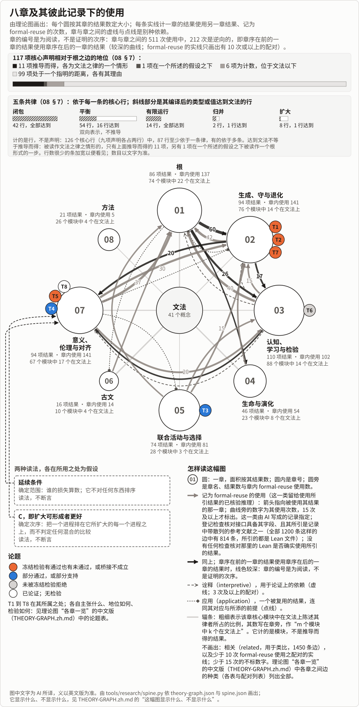
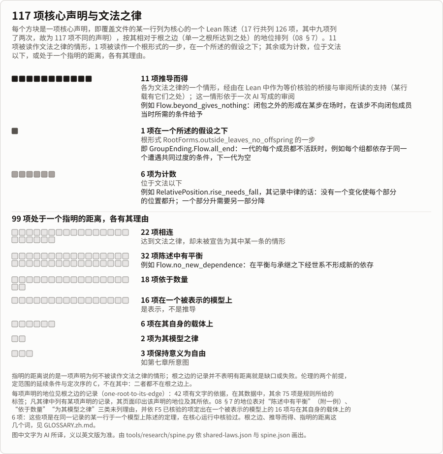

<!-- Generated by tools/research/research.py render (tools/research/spine.py) from the theory graph and theories/becoming/results/data/spine.json; edit those, not this page. -->

# 理论图：各章一览

[English](THEORY-GRAPH.md) · [首页](../../../README.zh.md) · [一页](../ONE-PAGE.zh.md) · [用途](../USES.zh.md) · [实例](../USES-EXAMPLES.zh.md) · [总览](../THE-THEORY-OF-BECOMING.zh.md) · [八章（英文）](../chapters/README.md) · [古文（第六章）](../chapters/06-CLASSICAL-TEXTS.md) · [检验](../../../TESTS.zh.md) · [对照表](atlas/CROSSWALK.zh.md) · [怎样长成](../../LINEAGE.zh.md) · [术语表](../../../GLOSSARY.zh.md) · [审查包](../review/README.zh.md)

*约 32–41 分钟读完。*

本页是[理论图](THEORY-GRAPH.md)中“各章一览”的中文版：这幅图、怎样读它、核心声明的地位、五条共律与论题、它显示什么与不显示什么，以及各章之间边的种类表；各区域的结果、模块与文本的列表只在英文版中。本页由 AI 翻译；引自英文文本的话，除标明为英文原文者外，都是译文，未经核对，以英文原文为准。

## 各章一览

**怎样读它。** 每个圆是一章，按其结果数定大小；从一章到另一章的实线，计其结果使用另一章结果、记为 formal-reuse（[RESULT-WORKFLOW](../../../_process/RESULT-WORKFLOW.md) 把这一类留给已核验的推理；它由 AI 写成的记录指定，没有任何检查核对一次使用是否见于 Lean）的次数，章与章之间的虚线与点线是别种依赖；辐条的粗细标出比例、章旁的计数标出数目：该章核心模块中在中央的文法上陈述其律者（计的是模块，不是推导而得的结果）。章的编号是为阅读，不是证明的次序，使用也是双向的：较深的曲线是章序在前的一章的结果使用章序在后的一章的结果；登记检查拒绝会闭合其已声明依赖之环的记录（[这是入册的条件，不是一项发现](THEORY-GRAPH.zh.md#do-the-recorded-uses-form-a-cycle)）。117 项核心声明中，约十分之一被读作文法之律或根形式的情形：11 项[推导而得](../../../GLOSSARY.zh.md#derived)，为文法之律的情形，1 项为一个根形式（root form）的一步情形，在一个所述的假设之下；其余或为计数之律，位于文法以下（6 项），或处于一个[指明的距离](../../../GLOSSARY.zh.md#named-distance)，既非推导而得，也非在一个所述的假设之下，各有其指明的理由（99 项）。章与章之间共 514 次使用，其中 294 次进入「根」与「生成、守与退化」两章，212 次是逆向的。地位一行之下的条带给出五条共律：依于每一条的核心行，斜线部分是其编译后的类型或值达到文法的行（[其表](#the-five-shared-laws)）。两个方框是多数排序结果所用的两种读法，定范围的延续条件与定次序的 C，各在所用之处为假设，二者都不断言；徽标 T1 到 T8 是各论题，位于陈述它们的那一章，按其冻结检验的结局着色，下表以各自所在行的话给出它们。曲线是一种依赖，不是意义上的一致。

*由 `tools/research/spine.py` 依理论图与 [spine.json](data/spine.json) 画出，图中文字为 AI 所译；[英文图](spine.svg)。*

**核心声明的地位**（[08 §7](../chapters/08-METHOD.md#r-one-root-to-its-edge)），即图顶端那一行，下面较简的图每项画一个方块：

| 相对于根之边的地位 | 声明数 | 08 §7 的话（译文） |
|---|---:|---|
| 推导而得 | 11 | “十一项推导而得，各为文法之律的一个情形，经由在 Lean 中作为等价核验的桥接与审阅所读的支持（某行载有它们之处）” |
| 在一个所述的假设之下 | 1 | “一项，`GroupEnding.Flow.all_end`，在一个所述的假设之下” |
| 计数，位于文法以下 | 6 | “六项为计数，位于文法以下” |
| 处于一个指明的距离 | 99 | “其余 99 项处于一个指明的距离” |
| 全部核心声明 | 117 | “117 项不同的核心声明，各有一个相对于根之边的地位” |

每项声明及其地位，见[根之边的记录](records/one-root-to-its-edge.md)（英文）：42 项有文字的依据，在[其数据](records/one-root-to-its-edge.json)（`boundary.standings`）中，其余 75 项是规则所给的标签。凡其律中列有某项声明的记录，其页面印出该声明的地位：推导而得者印出其律、桥接与支持，在一个所述的假设之下的那一行印出其形式、假设与反模型，读法印出其依据，其余印出规则的理由。99 项中每一项都有其指明的理由：其类别，其中 24 项另有文字的依据。一项[核心声明](../../../GLOSSARY.zh.md#核心声明)是覆盖文件的某一行所指明的 Lean 陈述；一项结果的平实说法在其记录中。

*由 `tools/research/spine.py` 依[共律数据](data/shared-laws.json)与 [spine.json](data/spine.json) 画出，图中文字为 AI 所译；[英文图](standings.svg)。*

**十一项推导而得者**，各由一次 AI 写成的审阅读作文法之律的一个情形（[对该记录的审阅](../../../_process/research/2026-10-05-generative-foundation-review/root-foundation/development/u4-one-root-to-its-edge/REVIEW-U4-RECORD.md)，[对 `Listed.coming_of_ceasing` 一行的审阅](../../../_process/research/2026-10-05-generative-foundation-review/root-foundation/development/u4-one-root-to-its-edge/REVIEW-U4C-RECORD.md)）；迄今有记录的审阅都出自 AI（[08](../chapters/08-METHOD.md#review-status)）。其中八项（除表中最后三行外），用 08 §7 的话说，是“the eight connected rows that the reading of connected rows took as derived”（对连接行的读法取为推导而得的八个连接行）：一行达到文法、且其陈述中没有平衡，按规则即为连接行（[DESIGN-BOUNDARY](../../../_process/research/2026-10-05-generative-foundation-review/root-foundation/development/u4-one-root-to-its-edge/DESIGN-BOUNDARY.md) §2，规则 1 与 2），[对连接行的读法](../../../_process/research/2026-10-05-generative-foundation-review/root-foundation/development/u4-one-root-to-its-edge/CONNECTED-ROWS-READING.md)（也是 AI 写成的）标出其中的情形。每个 «…» 都是 [`Becoming.GrammarLaws`](../../../experiments/integrated-correction/general-framework/generative-basis/lean/becoming/Becoming/GrammarLaws.lean) 中陈述的一条律；第二栏在律名后引其 Lean 文档字符串的开头（英文原文），一如英文版。

| 声明 | 所属情形（律名；其文档字符串的开头，英文原文） | 记录依据的第一句（末行另引其地位一句；英文原文） | 其律中列有它的结果 |
|---|---|---|---|
| `Flow.beyond_gives_nothing` | `«所闭之界»`（Nothing within a closure bears the relation to what lies beyond it） | A case of «所闭之界» at feeding from: a formation beyond a formation's feeding closure that takes part at a step gives nothing at that step to a condition a member of the closure then requires. | [feeding-closure](records/feeding-closure.md) |
| `Flow.withinSystem_of_withinInfluence` | `«所闭之单调»`（A larger relation has a larger closure） | A case of «所闭之单调» at being affected within sharing: Flow.shares_of_affectedBy, an unfolding, meets the law's inclusion, and WithinClosure.mono is the law at the frame's closure, applied past its conclusion. | [levels-of-closure](records/levels-of-closure.md) |
| `Law.drawn_iff_not_returns` | `«定后有后则入当且仅当不返»`（With a fixed successor and some successor, drawn is not reaching itself） | A case of «定后有后则入当且仅当不返» at the relation of the law's next configuration, its successor fixed and total. | [attraction-is-not-returning](records/attraction-is-not-returning.md)、[necessarily-drawn-is-not-returning](records/necessarily-drawn-is-not-returning.md) |
| `Law.lossless_iff_returns` | `«有限遍后定后则定前当且仅当皆返»`（Within finitely many occurrences, each with a successor, under a fixed successor, merging nothing is every occurrence reaching itself） | A case of «有限遍后定后则定前当且仅当皆返» at the law's next configuration over the listed ones: lossless is the predecessor fixed (two bridges), the other five bridges are among those of Law.drawn_iff_not_returns, and the support is its support. | [recurrence-without-premise](records/recurrence-without-premise.md) |
| `Learning.goAlike_iff_lumped` | `«像定后当且仅当同行»`（The image along a map has a fixed successor exactly where sameness under the map goes alike） | A case of «像定后当且仅当同行» at the law's step along the projection, with «同行之逐点»: going alike under the projection is the grammar's «同行», and lumped is a fixed successor of the image, both unfoldings. | [generalization-through-lumping](records/generalization-through-lumping.md)、[the-split-that-makes-sense](records/the-split-that-makes-sense.md)、[wisdom-root-without-axiom](records/wisdom-root-without-axiom.md) |
| `Tolerance.answers_restores_iff` | `«承之迭»`（Taking on, over `n` steps） | A case of «承之迭» at the relation up: answering is «承» of up by definition, the model's chain is «迭» by recursion through «迭之末步», and the worst start reduces every start to total withholding, the answering step keeping inclusion (Tolerance.answers_keeps); the support keeps inclusion along a course and takes the chain's last step. | [restoring-giving-from-the-worst-start](records/restoring-giving-from-the-worst-start.md) |
| `Withholding.withholding_spreads` | `«存承之迭»`（With memory, within `n` steps） | A case of «存承之迭» at up: waiting on all meets the law's round by unfolding (Withholding.waitsAll_closed), and within n steps is the grammar's, through the chain read as «迭» by recursion; the support takes the chain's last step. | [giving-that-waits-on-giving](records/giving-that-waits-on-giving.md) |
| `WithinMoves.after_course` | `«迭内之接»`（Within `m` steps and then within `n` is within `m + n`） | A case of «迭内之接» at the moves' steps: a trace and being within moves are the grammar's steps (two bridges), and that a trace gives steps is support. | [effective-capacity-and-eventual-reachability](records/effective-capacity-and-eventual-reachability.md) |
| `Flow.mutuallyDependent_iff_reach` | `«所闭之逆»`（The closure under the converse is the converse of the closure） | A case of «所闭之逆», both ways: mutual dependence is every formation within every other's influence closure, being within reach is that closure read backward, and WithinClosure.converse, through which the row is proved, is the law at the frame (HE2, item 3). | [mutual-dependence-and-its-pace](records/mutual-dependence-and-its-pace.md) |
| `Flow.withinCoupling_reads_iff` | `«借步之所闭在二所闭»`（A closure through borrowed steps lies within two closures）；`«二所闭在借步之所闭»`（Two closures lie within the closure through borrowed steps） | A case of «借步之所闭在二所闭» one way and «二所闭在借步之所闭» the other: the coupling closure of o reading a's couplings is the closure through borrowed steps. | [alignment-approaches-under-the-selection-laws](records/alignment-approaches-under-the-selection-laws.md)、[reading-anothers-couplings-is-pooling](records/reading-anothers-couplings-is-pooling.md) |
| `Listed.coming_of_ceasing` | `«定后前者在前则亡屡者生屡»`（The census of a run） | A case of «定后前者在前则亡屡者生屡» at a member's occurrences along its steps (Steps.along), under the two-valued class of its determination (Steps.alikeAt), the run being the occurrences listed at each step (listedOccurrences). … Its statement still reads as counting on U4b's line; it is placed by its proof's reach, as were the eight connected rows the reading of connected rows took as derived (DESIGN-BOUNDARY §2, rule 2). | [ceasing-needs-arising](records/ceasing-needs-arising.md) |

### 五条共律

共律陈述许多核心结果共有的一个机制，在持有它的最低一层只陈述一次（[08 §7](../chapters/08-METHOD.md#shared-laws-and-connectivity)）；这个名称不把任何一条律排在另一条之上。

| 共律 | 它说什么（译文） | 在文法上（08 §7 英文原文） | 依于它的核心行 | 其中达到文法的 |
|---|---|---|---:|---:|
| 闭包 | 一个关系所传递的，恰好达到其闭包 | `«所闭当且仅当同一或及»`; `WithinClosure` is `«所闭»` by definition | 42 | 42 |
| 平衡 | 一个水平由所给与所取而变化，在每一步，也在每一段上 | `«守数当且仅当可对»`, `«程守数当且仅当可对»`: represented both ways (`Flow.balances_iff_units`), not derived | 54 | 16 |
| 有限运行 | 当一个列表包含每一构型时，一条律恰在每一构型都返回之处不并合（`Law.lossless_iff_returns`）；对每一条律，无须列表，一个构型恰在它不返回之处被吸入（`Law.drawn_iff_not_returns`）；当每一个无上升而后有最小下降的进程都终止时，沿一条不上升的线的下降不会再现，而在有限预算之内，最小损失使这些进程终止（`Amounts.rests`）；静止不是被吸入的一种情形 | `«入当且仅当有不返»`, `«有限遍后定后则定前当且仅当皆返»`, `«尽则不或屡»`; the row's three laws are proved from them | 14 | 14 |
| 归并 | 一个单独读取的部分恰在其余部分对它不造成差别之处带有一条律 | `«像定后当且仅当同行»`; `GoAlikeUnder` is `«同行»` at each move | 2 | 1 |
| 扩大 | 扩大（包含并超出）是非自反、单向且传递的；在延续条件之下，它是保留并添加；伦理加上延续条件定范围、C 定次序 | `«广不可逆»`, `«广之传递»`; `Web.Widens` and `Weighting.WidensOn` are `«广»` of what is admitted | 8 | 1 |

第三栏照录 08 §7 的原文：它指明该律在 `Becoming.GrammarLaws` 中的陈述以及锚如何读它；用 08 §7 的话说，“every model's law in a row is proved from it, except balance's, which the grammar represents and does not derive”（表中一行里每个模型之律都由它证明，平衡除外，文法表示平衡而不推导它）。这些计数相加为 120，多于依于至少一条的 87 行，因为一行可以依于多条：“126 个核心行（九项声明各占两行）中，87 行至少依于一条”（[08 §7](../chapters/08-METHOD.md#shared-laws-and-connectivity)）。最后一栏是 08 §7 所计的、这些行中其编译后的类型或值达到文法的行数；126 行中有 46 行达到文法，其中 3 行不依于任何锚，所以依于一条共律的有 43 行；这一栏相加为 74，多于 43，是因为一行可以依于多条律，有限运行的各行也依于闭包。它说的是一行编译后的类型或值达到什么，不是说该行是这条律的一个情形：被读作文法之律之情形的，只有上面的十一项，另有一项 `GroupEnding.Flow.all_end` 在一个所述的假设之下被读作根形式 `RootForms.outside_leaves_no_offspring` 的一步。

**已记录的使用有环吗？** 在已记录的 1219 条 `formal-reuse` 边上，共 497 项结果，没有哪项结果经由它们达到自身（每次生成时计算）。登记检查拒绝会闭合其已声明依赖之环的记录，所以这是入册的条件，不是关于这些结果的一项发现：它说的是记录所声明的，不是 Lean 证明或论证没有循环。带接口的 814 条 formal-reuse 边各引记录中带散列的参考文献里的一个 Lean 文件，没有任何工具核对那里的 Lean 是否使用所引的结果。

**图中的论题**（[08 §9](../chapters/08-METHOD.md#theses)）：选自[总览](../THE-THEORY-OF-BECOMING.zh.md)论题表中各自所在行的话，地位在前，其余见该行；08 §9 各行的完整表述见英文。

| 论题 | 所在 | 图中颜色 | 其行的话 |
|---|---|---|---|
| T1. 持续担保联合取用 | [02](../chapters/02-MAP.md#t1) | 冻结检验有通过也有未通过，或桥接不成立 | 在模型中已证明；模型之外是猜想：在三种情形中通过，即一项酵母实验中对拟合留出、但未对分析者留出的诸体制，以及两项模拟，二者是仅有的设计中有不止一个取用者的检验，各有一项预测本可能不成立（公地中的那一项是只有一个取用者的范围预测），其余检验的是所测之量或一个恒等式，而不是这一论题；在四种中未通过，三种在真实酵母中，一种在鱼类种群中；没有对事先测得之需要的实地检验 |
| T2. 一个可更新的缘在取用之下的状态，就是它的水平、近来的给予与一个滞后，其位置在读数据之前定下 | [02](../chapters/02-MAP.md#t2) | 冻结检验有通过也有未通过，或桥接不成立 | 猜想；四项冻结的鱼类种群检验中，MQ4 未通过其整体状态裁决，MQ5 关于状态与滞后的裁决通过（关于取用的响应的两项未通过），MQ7 未达其冻结界限；第四项 UE32 中，按其冻结的判据，水平、近来的给予与滞后这三个量对下一次给予的预报胜过该领域拟合的延迟嵌入，历史越长，嵌入输得越多：这表明在这些长度上相对于该嵌入的充分性，并不表明滞后的位置或 T2 之律，但在多数种群中二者都不如直接沿用上一次的给予；在面粉甲虫的培养物上，其原先的措辞“凡量度所及”败于蛹与成虫这一变量更少的类 |
| T3. 在有余地之处，优化耗竭其耦合之外者 | [05](../chapters/05-COLLECTIVES.md#t3) | 部分通过，或部分支持 | 对最优解已证明；对训练出的系统是猜想，得到部分支持 … 关于学习者会保住存量的预测未通过；所禁止的情形之一，最初就任何不共单位之缘而措辞，在学习者读取该缘的一次计算流中不成立 |
| T4. 范围可以被安装，并且它能迁移 | [07](../chapters/07-SIGNIFICANCE.md#theses) | 部分通过，或部分支持 | 一项冻结检验部分通过（有交谈时，两个模型中的一个）；迁移未经检验 |
| T5. 次序为每一个把一切都计为正的评价者所共有 | [07](../chapters/07-SIGNIFICANCE.md#theses) | 冻结检验有通过也有未通过，或桥接不成立 | 对净加权已证明归约；界是猜想；把一切都计为正，是 C 的前提换了位置；在角色扮演的判断上，第一项冻结检验每条规则都未通过，第二项四条中通过两条；人类评价者未经检验 |
| T6. 断裂只有经由耦合进断裂者的东西才能被预见 | [03](../chapters/03-KNOWING.md#break-seen-coming) | 未被冻结检验拒绝 | 不可见的一半在世界模型上证明；可见的一半借助 Mathlib 在线性化与逻辑斯谛模型中证明；跨领域是猜想；三项冻结的海鸟检验在其阈值上没有拒绝它，第一项功效很低，估计值在反驳的方向上；没有一项确立它 |
| T7. 一个从它所选择者读出的度量，存续得比对它的驳倒更久 | [02](../chapters/02-MAP.md#t7) | 冻结检验有通过也有未通过，或桥接不成立 | 在模型中仅证明了对环路所不读者的不变，以及锁定比一个不断增长的未读坐标存续得更久，二者皆无噪声 … 实际的度量如此形成，是猜想；在一个训练出的系统中，每一冻结裁决都通过 … “该评判者是按种类而读的读者池”这一桥接不成立 … T7 所禁止的一种情形，按其加入漂移之条款以前的表述，发生了，就训练出的评判者而言，这算作不利于该情形的证据 |
| T8. 本论的制作者提供一种看法 | [07](../chapters/07-SIGNIFICANCE.md#theses) | 已论证；无检验 | 已论证；其检验已指名，未设计 … P2 与 P4 |

### 这幅图显示什么、不显示什么

**它显示什么。** 每个圆是一章的区域，面积与该区域所含结果数成正比；中央是文法（41 个概念）。从甲章到乙章的实线，计甲章的结果在 `formal-reuse` 之下使用乙章结果的次数，[RESULT-WORKFLOW](../../../_process/RESULT-WORKFLOW.md) 把这一类留给“使用所引结果的已核验推理”：这一类由借助 AI 做成的记录指定（[一页](../ONE-PAGE.zh.md)说本论“借助 AI 做成，证明也在内”）；登记检查核对接口具备其字段、且其所引是记录中带散列的参考文献之一（全部 1219 条这样的边中有 814 条，所引的都是 Lean 文件）；没有任何检查核对那里的 Lean 是否确实使用所引的结果。较深的曲线是章序在前的一章的结果使用章序在后的一章的结果：所画 17 个配对中有 6 个，最大的是「根」到「生成、守与退化」，60 次。章与章之间的虚线是 `interpretive`，留给“论证上的依赖”；点线是 `application`；`related` 是 RESULT-WORKFLOW 留给类比的，不画出（1463 条边）。不画作 formal-reuse 曲线的：少于 10 次 formal-reuse 使用的 25 个配对（共 119 次），其中 2 个画作点线（应用）；不画作虚线的：少于 3 次的 16 个诠释配对（20 条边）；少于 15 次的曲线不标数字。“各章之间边的种类”末尾的配对列表列出有边的每一个配对。圆旁的“章内使用”计同一章结果之间的 formal-reuse，章内的诠释边见 interpretive 表的对角线。章旁的“m 个模块中 k 个在文法上”与辐条的粗细，计该区域核心模块中在文法上陈述其律的那些，如[英文版](THEORY-GRAPH.md)各区域的列表所示。「待退役」的结果（33 条边涉及它们）只在那份列表中。延续条件与 C 作为读法进入第七章：“排序之果所用之两种读法，各在所用之处为假设，二者都不断言：延续条件定范围，C 定次序”（[07](../chapters/07-SIGNIFICANCE.md)）。T1 到 T8 位于其所属之处，按检验结局着色；它们的话选自[总览](../THE-THEORY-OF-BECOMING.zh.md)论题表中各自所在的行，地位在前，见上面的论题表。

**它不显示什么。** 一条边记录的是一种依赖、一次引用或一个已登记的读法，不是意义上的一致。曲线也不说一章的结果在多大程度上达到文法，08 §7 以两种方式计这一点。“117 项不同的核心声明，各有一个相对于根之边的地位。十一项推导而得，各为文法之律的一个情形，经由在 Lean 中作为等价核验的桥接与审阅所读的支持（某行载有它们之处）”；“一项，`GroupEnding.Flow.all_end`，在一个所述的假设之下”；“六项为计数，位于文法以下。其余 99 项处于一个指明的距离，各有其理由：22 项相连，达到文法之律，却未被宣告为其中某一条的情形”（[08 §7](../chapters/08-METHOD.md#r-one-root-to-its-edge)）。又，“连通度量在每次落地时，计一项核心声明编译后的类型或值所达到的共律”；“每项只计一次，117 项不同的声明分为四类：45 项达到文法；30 项依于平衡，文法双向地表示平衡，而没有数量便无法陈述它，所以它们不是缺口”（[08 §7](../chapters/08-METHOD.md#shared-laws-and-connectivity)）。达到文法，是一项声明编译后的类型或值的那种依赖；推导而得是一种地位，即一项声明被读作文法之律的一个情形，经由在 Lean 中作为等价核验的桥接与审阅所读的支持（某行载有它们之处）。所以 45 与 11 计的是不同的东西，而曲线两者都不画。辐条也不画：它计的是在文法上陈述其律的模块，不是达到文法的结果。

### 各章之间边的种类

从第一个区域的结果到第二个区域的结果的边，按各记录给其依赖的种类（`formal-reuse`、`interpretive`、`application`）与其 `related` 列表（类比，不是依赖）计。两个区域相同的一行，计该区域之内的边。区域以其所在章在总览中的标题称之；英文区域名见[英文版](THEORY-GRAPH.md#the-regions)。

先是八章之间每一种边各一张表：行是使用（related：列出）者结果所在的章，列是被使用（被列出）者结果所在的章，对角线是一章之内，圆点表示没有。

**formal-reuse**

| 从 \ 到 | 01 | 02 | 03 | 04 | 05 | 06 | 07 | 08 |
|---|---:|---:|---:|---:|---:|---:|---:|---:|
| 01 根 | 137 | 60 | 26 | 10 | 6 | 1 | 9 | 7 |
| 02 生成、守与退化 | 42 | 145 | 17 | 8 | 2 | · | 20 | 3 |
| 03 认知、学习与检验 | 40 | 15 | 102 | · | 4 | 1 | 13 | 2 |
| 04 生命与演化 | 6 | 14 | 2 | 54 | 5 | · | 6 | · |
| 05 联合活动与选择 | 11 | 15 | 13 | 6 | 81 | · | 8 | · |
| 06 古文 | 11 | 5 | 9 | · | · | 14 | · | · |
| 07 意义、伦理与对齐 | 37 | 30 | 21 | 4 | 7 | · | 153 | 4 |
| 08 方法 | 6 | 2 | 3 | · | · | · | 3 | 5 |

**interpretive**

| 从 \ 到 | 01 | 02 | 03 | 04 | 05 | 06 | 07 | 08 |
|---|---:|---:|---:|---:|---:|---:|---:|---:|
| 01 根 | 2 | · | 1 | · | · | · | · | · |
| 02 生成、守与退化 | 1 | · | · | · | · | · | 1 | · |
| 03 认知、学习与检验 | 5 | 3 | 43 | 1 | · | · | 7 | · |
| 04 生命与演化 | · | · | 2 | 1 | · | · | · | · |
| 05 联合活动与选择 | · | 1 | · | 2 | 4 | · | 1 | · |
| 06 古文 | 1 | · | 2 | · | 1 | 5 | · | 1 |
| 07 意义、伦理与对齐 | · | 2 | · | · | · | · | 9 | · |
| 08 方法 | 1 | 1 | · | · | · | 1 | · | · |

**application**

| 从 \ 到 | 01 | 02 | 03 | 04 | 05 | 06 | 07 | 08 |
|---|---:|---:|---:|---:|---:|---:|---:|---:|
| 01 根 | · | · | · | · | · | 1 | · | · |
| 02 生成、守与退化 | 1 | 2 | · | · | · | · | · | · |
| 03 认知、学习与检验 | · | · | · | · | · | · | · | · |
| 04 生命与演化 | · | · | · | · | · | · | · | · |
| 05 联合活动与选择 | · | · | · | · | · | · | · | · |
| 06 古文 | · | · | · | · | · | · | · | · |
| 07 意义、伦理与对齐 | · | 1 | · | · | 3 | · | 3 | · |
| 08 方法 | · | · | · | · | · | · | · | · |

**related**（类比，不是依赖）

| 从 \ 到 | 01 | 02 | 03 | 04 | 05 | 06 | 07 | 08 |
|---|---:|---:|---:|---:|---:|---:|---:|---:|
| 01 根 | 104 | 29 | 21 | 6 | 2 | 4 | 6 | 30 |
| 02 生成、守与退化 | 27 | 157 | 21 | 10 | 15 | 18 | 24 | 13 |
| 03 认知、学习与检验 | 15 | 31 | 184 | 6 | 3 | 4 | 12 | 8 |
| 04 生命与演化 | 8 | 12 | 3 | 79 | 5 | 4 | 3 | 3 |
| 05 联合活动与选择 | 2 | 21 | 10 | 2 | 115 | 10 | 17 | 1 |
| 06 古文 | 4 | 19 | 9 | 4 | 11 | 18 | 3 | · |
| 07 意义、伦理与对齐 | 7 | 34 | 17 | 6 | 15 | 3 | 188 | 3 |
| 08 方法 | 20 | 8 | 11 | 2 | 1 | · | 10 | 6 |

再是有边的每一对区域，「待退役」也在内：

| 从此区域的结果 | 到此区域的结果 | formal-reuse | interpretive | application | related |
|---|---|---:|---:|---:|---:|
| 根 | 根 | 137 | 2 | 0 | 104 |
| 根 | 生成、守与退化 | 60 | 0 | 0 | 29 |
| 根 | 认知、学习与检验 | 26 | 1 | 0 | 21 |
| 根 | 生命与演化 | 10 | 0 | 0 | 6 |
| 根 | 联合活动与选择 | 6 | 0 | 0 | 2 |
| 根 | 古文 | 1 | 0 | 1 | 4 |
| 根 | 意义、伦理与对齐 | 9 | 0 | 0 | 6 |
| 根 | 方法 | 7 | 0 | 0 | 30 |
| 根 | 待退役 | 0 | 0 | 0 | 1 |
| 生成、守与退化 | 根 | 42 | 1 | 1 | 27 |
| 生成、守与退化 | 生成、守与退化 | 145 | 0 | 2 | 157 |
| 生成、守与退化 | 认知、学习与检验 | 17 | 0 | 0 | 21 |
| 生成、守与退化 | 生命与演化 | 8 | 0 | 0 | 10 |
| 生成、守与退化 | 联合活动与选择 | 2 | 0 | 0 | 15 |
| 生成、守与退化 | 古文 | 0 | 0 | 0 | 18 |
| 生成、守与退化 | 意义、伦理与对齐 | 20 | 1 | 0 | 24 |
| 生成、守与退化 | 方法 | 3 | 0 | 0 | 13 |
| 生成、守与退化 | 待退役 | 0 | 0 | 0 | 1 |
| 认知、学习与检验 | 根 | 40 | 5 | 0 | 15 |
| 认知、学习与检验 | 生成、守与退化 | 15 | 3 | 0 | 31 |
| 认知、学习与检验 | 认知、学习与检验 | 102 | 43 | 0 | 184 |
| 认知、学习与检验 | 生命与演化 | 0 | 1 | 0 | 6 |
| 认知、学习与检验 | 联合活动与选择 | 4 | 0 | 0 | 3 |
| 认知、学习与检验 | 古文 | 1 | 0 | 0 | 4 |
| 认知、学习与检验 | 意义、伦理与对齐 | 13 | 7 | 0 | 12 |
| 认知、学习与检验 | 方法 | 2 | 0 | 0 | 8 |
| 认知、学习与检验 | 待退役 | 0 | 0 | 0 | 2 |
| 生命与演化 | 根 | 6 | 0 | 0 | 8 |
| 生命与演化 | 生成、守与退化 | 14 | 0 | 0 | 12 |
| 生命与演化 | 认知、学习与检验 | 2 | 2 | 0 | 3 |
| 生命与演化 | 生命与演化 | 54 | 1 | 0 | 79 |
| 生命与演化 | 联合活动与选择 | 5 | 0 | 0 | 5 |
| 生命与演化 | 古文 | 0 | 0 | 0 | 4 |
| 生命与演化 | 意义、伦理与对齐 | 6 | 0 | 0 | 3 |
| 生命与演化 | 方法 | 0 | 0 | 0 | 3 |
| 联合活动与选择 | 根 | 11 | 0 | 0 | 2 |
| 联合活动与选择 | 生成、守与退化 | 15 | 1 | 0 | 21 |
| 联合活动与选择 | 认知、学习与检验 | 13 | 0 | 0 | 10 |
| 联合活动与选择 | 生命与演化 | 6 | 2 | 0 | 2 |
| 联合活动与选择 | 联合活动与选择 | 81 | 4 | 0 | 115 |
| 联合活动与选择 | 古文 | 0 | 0 | 0 | 10 |
| 联合活动与选择 | 意义、伦理与对齐 | 8 | 1 | 0 | 17 |
| 联合活动与选择 | 方法 | 0 | 0 | 0 | 1 |
| 联合活动与选择 | 待退役 | 0 | 0 | 0 | 5 |
| 古文 | 根 | 11 | 1 | 0 | 4 |
| 古文 | 生成、守与退化 | 5 | 0 | 0 | 19 |
| 古文 | 认知、学习与检验 | 9 | 2 | 0 | 9 |
| 古文 | 生命与演化 | 0 | 0 | 0 | 4 |
| 古文 | 联合活动与选择 | 0 | 1 | 0 | 11 |
| 古文 | 古文 | 14 | 5 | 0 | 18 |
| 古文 | 意义、伦理与对齐 | 0 | 0 | 0 | 3 |
| 古文 | 方法 | 0 | 1 | 0 | 0 |
| 意义、伦理与对齐 | 根 | 37 | 0 | 0 | 7 |
| 意义、伦理与对齐 | 生成、守与退化 | 30 | 2 | 1 | 34 |
| 意义、伦理与对齐 | 认知、学习与检验 | 21 | 0 | 0 | 17 |
| 意义、伦理与对齐 | 生命与演化 | 4 | 0 | 0 | 6 |
| 意义、伦理与对齐 | 联合活动与选择 | 7 | 0 | 3 | 15 |
| 意义、伦理与对齐 | 古文 | 0 | 0 | 0 | 3 |
| 意义、伦理与对齐 | 意义、伦理与对齐 | 153 | 9 | 3 | 188 |
| 意义、伦理与对齐 | 方法 | 4 | 0 | 0 | 3 |
| 方法 | 根 | 6 | 1 | 0 | 20 |
| 方法 | 生成、守与退化 | 2 | 1 | 0 | 8 |
| 方法 | 认知、学习与检验 | 3 | 0 | 0 | 11 |
| 方法 | 生命与演化 | 0 | 0 | 0 | 2 |
| 方法 | 联合活动与选择 | 0 | 0 | 0 | 1 |
| 方法 | 古文 | 0 | 1 | 0 | 0 |
| 方法 | 意义、伦理与对齐 | 3 | 0 | 0 | 10 |
| 方法 | 方法 | 5 | 0 | 0 | 6 |
| 方法 | 待退役 | 0 | 0 | 0 | 1 |
| 待退役 | 根 | 1 | 0 | 0 | 0 |
| 待退役 | 生成、守与退化 | 4 | 0 | 0 | 2 |
| 待退役 | 认知、学习与检验 | 3 | 0 | 0 | 1 |
| 待退役 | 联合活动与选择 | 2 | 0 | 0 | 1 |
| 待退役 | 意义、伦理与对齐 | 0 | 0 | 0 | 1 |
| 待退役 | 待退役 | 4 | 0 | 0 | 4 |
