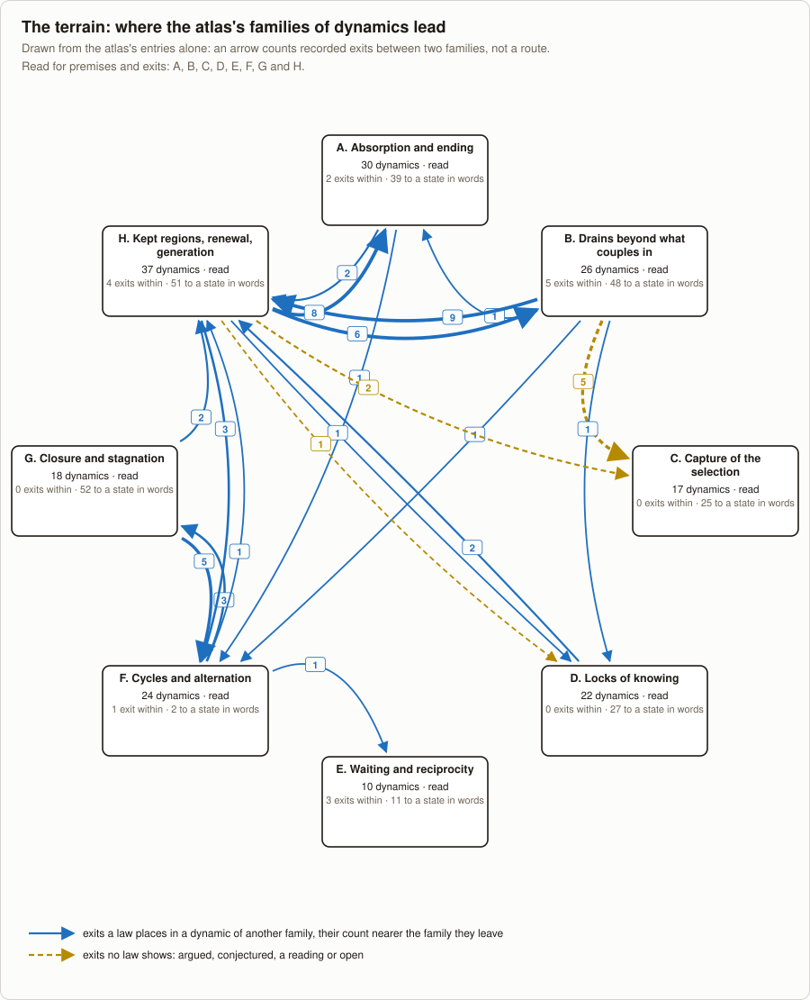

<!-- Generated by tools/research/atlas.py from theories/becoming/results/atlas/; do not edit. -->

# The atlas of dynamics

[Home](../../../../README.md) · [中文](../../../../README.zh.md) · **Read** · [One page](../../ONE-PAGE.md) · [The theory](../../THE-THEORY-OF-BECOMING.md) · [Chapters](../../chapters/README.md) · [Uses](../../USES.md) · **Check** · [Tests](../../../../TESTS.md) · [Results](../../../../RESULTS.md) · [Proofs](../../../../MAP.md#check-the-proofs-yourself) · [Open questions](../../../../OPEN-QUESTIONS.md) · [Reviewers](../../review/README.md) · **See** · [Graph](../THEORY-GRAPH.md) · [Connections](CROSSWALK.md) · [How it grew](../../../LINEAGE.md) · [Glossary](../../../../GLOSSARY.md) · [Where everything is](../../../../MAP.md)

The atlas's views: **the atlas** · [the premise ledger](PREMISES.md) · [the terrain](TERRAIN.md) · [tests bound](BINDINGS.md) · [situations](SITUATIONS.md) · [the crosswalk](CROSSWALK.md) · [what does not join](JOINS.md)

**How far it is read** ([AA's plan §13](../../../../_process/research/2026-10-05-generative-foundation-review/root-foundation/development/aa-attractor-atlas/PLAN.md#13-the-next-phase-the-maps-structures-9-november-2026)). Every dynamic is listed with the records and declarations that state it. Families C and D are read for the premises their laws take, every hypothesis a law binds, and for where their exits lead: [the premise ledger](PREMISES.md), [the terrain](TERRAIN.md). 22 rows of the tests table are bound to the dynamics they bear on ([the bindings](BINDINGS.md)). 1 situation is written in the account's words ([the situations](SITUATIONS.md)). The other 6 families are not yet read for premises or exits.

The account's dynamics (attractors, locks, drains, absorptions, cycles, closures and kept regions), each with the records and declarations that state it. The atlas is a curated layer beside the records ([vocabulary](vocabulary.json), [entries](entries)); it creates no result and strengthens no proof. It adds nothing to how far anything has been seen: an entry shows each of its records' status and kind as the record says, never merged into one scale, and an entry with no record says whether it is argued, conjectured, a reading or open, and cites where. Hypotheses are quoted from the records by their place in the record's list, counted from 1. The atlas maps dynamics: how what one opens or closes ranks is [chapter 7's question](../../chapters/07-SIGNIFICANCE.md), where widening and narrowing are more and less future, not good and evil, so no entry marks a dynamic good or bad, and what one does to what lies beyond its couplings is under *Beyond its couplings*.

182 dynamics, by family. It is a catalogue to look things up in, not to read through: each family has a page, which opens with its index, and an entry's section there holds the rest.

| Family | Dynamics |
|---|---:|
| [A. Absorption and ending](families/a.md) | 29 |
| [B. Drains beyond what couples in](families/b.md) | 25 |
| [C. Capture of the selection](families/c.md) | 17 |
| [D. Locks of knowing](families/d.md) | 22 |
| [E. Waiting and reciprocity](families/e.md) | 10 |
| [F. Cycles and alternation](families/f.md) | 24 |
| [G. Closure and stagnation](families/g.md) | 18 |
| [H. Kept regions, renewal, generation](families/h.md) | 37 |

## A. Absorption and ending

[Its page](families/a.md), with each entry's section.

| Dynamic | Records | Base | How far seen | Exits | Open |
|---|---|---|---|---:|---:|
| [Drawn exactly where it does not return](families/a.md#attraction-is-not-returning) | [attraction-is-not-returning](../records/attraction-is-not-returning.md) | any type | recorded-checked (theorem) | 2 | 3 |
| [Basins of a determined law, one cycle each](families/a.md#basins-of-a-determined-law) | [basins-of-a-determined-law](../records/basins-of-a-determined-law.md) | any type | recorded-checked (theorem) | 0 | 1 |
| [Necessarily drawn exactly what does not return](families/a.md#necessarily-drawn-is-not-returning) | [necessarily-drawn-is-not-returning](../records/necessarily-drawn-is-not-returning.md), [endpoint-loss-and-return](../records/endpoint-loss-and-return.md) | any process | recorded-checked (theorem); recorded-checked (theorem) | 1 | 6 |
| [Every loss passes a juncture](families/a.md#every-loss-passes-a-juncture) | [every-loss-passes-a-juncture](../records/every-loss-passes-a-juncture.md), [reaching-before-and-after-a-juncture](../records/reaching-before-and-after-a-juncture.md), [a-source-before-a-juncture](../records/a-source-before-a-juncture.md) | any process | recorded-checked (theorem); recorded-checked (theorem); recorded-checked (theorem) | 2 | 4 |
| [Not going out of a region](families/a.md#not-going-out-of-a-region) | [not-going-out-of-a-region](../records/not-going-out-of-a-region.md) | any type | recorded-checked (theorem) | 1 | 3 |
| [Degeneration from a horizon (退化)](families/a.md#degeneration-from-a-horizon) | [degeneration-from-a-horizon](../records/degeneration-from-a-horizon.md) | World | recorded-checked (theorem) | 0 | 5 |
| [Loss of renewal for good](families/a.md#loss-of-renewal-for-good) | [relational-renewal-classification](../records/relational-renewal-classification.md), [regulation-from-one-side-and-locally](../records/regulation-from-one-side-and-locally.md) | World | recorded-checked (theorem); recorded-checked (theorem) | 2 | 4 |
| [Three outcomes of a loss: restored, transformed, or ended where dependence is fixed](families/a.md#three-outcomes-of-a-loss) | [becoming-dependence-dynamics](../records/becoming-dependence-dynamics.md) | World | recorded-checked (theorem) | 3 | 2 |
| [The point of no return of a regime](families/a.md#margin-of-a-regime) | [margin-of-a-regime](../records/margin-of-a-regime.md) | a named model | recorded-checked (theorem) | 2 | 8 |
| [One law of exact thresholds, and the threshold in the plane of level and recent giving](families/a.md#threshold-in-the-state-plane) | [threshold-in-the-state-plane](../records/threshold-in-the-state-plane.md), [where-a-run-of-a-regime-comes-to-rest](../records/where-a-run-of-a-regime-comes-to-rest.md) | a named model | recorded-checked (theorem); recorded-checked (theorem) | 1 | 5 |
| [The exit from a margin](families/a.md#exit-from-a-margin) | [exit-from-a-margin](../records/exit-from-a-margin.md) | a named model | recorded-checked (theorem) | 0 | 4 |
| [Consumption ends with its feeders](families/a.md#consumption-ends-with-feeders) | [consumption-ends-with-feeders](../records/consumption-ends-with-feeders.md) | World | recorded-checked (theorem) | 4 | 4 |
| [A consumer that switches stays consuming, on the whole-run reading](families/a.md#substitution-preserves-consumption) | [substitution-preserves-consumption](../records/substitution-preserves-consumption.md) | World | recorded-checked (theorem) | 2 | 3 |
| [An end cascading along total dependence](families/a.md#a-cascade-along-total-dependence) | [coupled-webs](../records/coupled-webs.md), [coupled-regimes](../records/coupled-regimes.md), [rest-on-coupled-webs](../records/rest-on-coupled-webs.md), [thresholds-beyond-a-band](../records/thresholds-beyond-a-band.md), [webs-with-a-recent-giving](../records/webs-with-a-recent-giving.md) | a named model | recorded-checked (theorem); recorded-checked (theorem); recorded-checked (theorem); recorded-checked (theorem); recorded-checked (theorem) | 4 | 7 |
| [Co-ending along dependence](families/a.md#co-ending-along-dependence) | [life-as-condition-of-life](../records/life-as-condition-of-life.md) | World | recorded-checked (theorem) | 0 | 1 |
| [A whole of every part ends with one part; the grade between it and a whole of some part](families/a.md#a-whole-of-every-part) | [a-whole-of-every-part](../records/a-whole-of-every-part.md) | World | recorded-checked (theorem) | 2 | 3 |
| [A confined rise within a whole](families/a.md#confined-rise-within-a-whole) | [confined-rise-within-a-whole](../records/confined-rise-within-a-whole.md) | World | recorded-checked (theorem) | 1 | 5 |
| [Ending laws as regimes on a lineage](families/a.md#ending-laws-as-regimes-on-a-lineage) | [ending-laws-as-regimes-on-a-lineage](../records/ending-laws-as-regimes-on-a-lineage.md), [what-bounds-offspring-numbers](../records/what-bounds-offspring-numbers.md) | World | recorded-checked (theorem); recorded-checked (theorem) | 4 | 7 |
| [The ends of drift absorb; fixation, with and without selection in the draw](families/a.md#fixation-by-drift) | [fixation-by-drift](../records/fixation-by-drift.md), [fixation-with-selection](../records/fixation-with-selection.md), [drift-offspring-sampled](../records/drift-offspring-sampled.md) | a named model | recorded-checked (theorem); recorded-checked (theorem); recorded-checked (theorem) | 0 | 7 |
| [The ends of a rule rebuilt from its members: no holder, and the end, do not return](families/a.md#a-rule-with-no-holder-does-not-return) | [a-rule-rebuilt-from-the-members-it-limits](../records/a-rule-rebuilt-from-the-members-it-limits.md) | root | recorded-checked (theorem) | 1 | 3 |
| [A reader rebuilt from the level it reads: its end does not come back](families/a.md#a-reader-rebuilt-from-its-stock-ends-with-it) | [the-stock-buys-time-where-the-rebuild-draws-on-it](../records/the-stock-buys-time-where-the-rebuild-draws-on-it.md) | root | recorded-checked (theorem) | 1 | 3 |
| [What ungated steps keep; an empty pool stays empty](families/a.md#what-a-gate-keeps) | [organizational-rule-inheritance](../records/organizational-rule-inheritance.md), [every-origin-passes-the-gate](../records/every-origin-passes-the-gate.md) | any process | recorded-checked (theorem); recorded-checked (theorem) | 2 | 4 |
| [Groups with less leave nothing; groups on one family end together](families/a.md#selection-among-groups-by-ending) | [selection-among-groups-by-ending](../records/selection-among-groups-by-ending.md), [groups-whose-conditions-are-coupled](../records/groups-whose-conditions-are-coupled.md) | any type | recorded-checked (theorem); recorded-checked (theorem) | 0 | 4 |
| [Draining: below a drained level no history lasts](families/a.md#market-finite-support-obstruction) | [market-finite-support-obstruction](../records/market-finite-support-obstruction.md) | any process | recorded-checked (theorem) | 2 | 3 |
| [Four routes of transition, none a proved phase transition](families/a.md#four-routes-of-transition) | — | — | reading, no record | 0 | 0 |
| [Slowing down before a condition's own end](families/a.md#slowing-down-before-an-own-end) | [slowing-down-before-an-own-end](../records/slowing-down-before-an-own-end.md) | periphery | recorded-checked (theorem) | 0 | 3 |
| [A reserve defers the end](families/a.md#reserve-defers-ending) | [reserve-defers-ending](../records/reserve-defers-ending.md) | World | recorded-checked (theorem) | 0 | 4 |
| [Dormancy over a stretch, and an ending that is final](families/a.md#dormancy-over-a-stretch) | [dormancy-over-a-stretch](../records/dormancy-over-a-stretch.md) | World | recorded-checked (theorem) | 1 | 1 |
| [The market model's share, margin and ends](families/a.md#market-model-share-margin-and-ends) | [market-model-share-margin-and-ends](../records/market-model-share-margin-and-ends.md) | periphery | recorded-checked (theorem) | 2 | 5 |

## B. Drains beyond what couples in

[Its page](families/b.md), with each entry's section.

| Dynamic | Records | Base | How far seen | Exits | Open |
|---|---|---|---|---:|---:|
| [Own count misses joint excess](families/b.md#own-count-misses-joint-excess) | [own-count-misses-joint-excess](../records/own-count-misses-joint-excess.md) | World | recorded-checked (theorem) | 4 | 5 |
| [A loss made only together](families/b.md#joint-difference-making) | [joint-difference-making](../records/joint-difference-making.md) | any process | recorded-checked (theorem) | 2 | 6 |
| [The rest outruns the renewal](families/b.md#the-rest-outruns-the-renewal) | [the-rest-outruns-the-renewal](../records/the-rest-outruns-the-renewal.md) | World | recorded-checked (theorem) | 0 | 3 |
| [What taking all that is given excludes](families/b.md#what-taking-all-excludes) | [what-taking-all-excludes](../records/what-taking-all-excludes.md) | World | recorded-checked (theorem) | 2 | 3 |
| [What an optimum does beyond what couples in](families/b.md#what-an-optimum-does-beyond-what-couples-in) | [what-an-optimum-does-beyond-what-couples-in](../records/what-an-optimum-does-beyond-what-couples-in.md), [room-read-off-the-exchange](../records/room-read-off-the-exchange.md), [a-commuting-learner-drives-no-unread-choice](../records/a-commuting-learner-drives-no-unread-choice.md) | any type | recorded-checked (theorem); recorded-checked (theorem); recorded-checked (theorem) | 3 | 15 |
| [An order with a set point](families/b.md#what-a-set-point-optimum-does-beyond) | [what-a-set-point-optimum-does-beyond](../records/what-a-set-point-optimum-does-beyond.md) | any type | recorded-checked (theorem) | 3 | 9 |
| [Others drawing first end the base](families/b.md#others-drawing-first-end-the-base) | [others-drawing-first-end-the-base](../records/others-drawing-first-end-the-base.md) | a named model | recorded-checked (theorem) | 3 | 4 |
| [Several drawers: drawers in turn and at once](families/b.md#drawers-in-turn) | [drawers-in-turn](../records/drawers-in-turn.md) | a named model | recorded-checked (theorem) | 3 | 4 |
| [Coupled for each step](families/b.md#coupled-drawers-keep-a-need-only-where-the-coupling-reaches-it) | [coupled-drawers-keep-a-need-only-where-the-coupling-reaches-it](../records/coupled-drawers-keep-a-need-only-where-the-coupling-reaches-it.md) | a named model | recorded-checked (theorem) | 1 | 4 |
| [A race for position](families/b.md#a-race-for-position-draws-everything) | [a-race-for-position-draws-everything](../records/a-race-for-position-draws-everything.md) | a named model | recorded-checked (theorem) | 1 | 5 |
| [Several optimizers](families/b.md#several-optimizers-drain-by-their-joint-capacity) | [several-optimizers-drain-by-their-joint-capacity](../records/several-optimizers-drain-by-their-joint-capacity.md) | World | recorded-checked (theorem) | 0 | 5 |
| [Re-optimizing at every step](families/b.md#re-optimizing-above-a-renewal-ends-it) | [re-optimizing-above-a-renewal-ends-it](../records/re-optimizing-above-a-renewal-ends-it.md) | World | recorded-checked (theorem) | 3 | 4 |
| [Weighting later draws less](families/b.md#a-weighting-faster-than-renewal-ends-the-base) | [a-weighting-faster-than-renewal-ends-the-base](../records/a-weighting-faster-than-renewal-ends-the-base.md) | a named model | recorded-checked (theorem) | 3 | 4 |
| [Courses over a horizon](families/b.md#horizon-optima-hold-the-greatest-renewal) | [horizon-optima-hold-the-greatest-renewal](../records/horizon-optima-hold-the-greatest-renewal.md), [valuing-what-is-left-at-the-horizon](../records/valuing-what-is-left-at-the-horizon.md), [valuing-what-is-left-at-any-worth](../records/valuing-what-is-left-at-any-worth.md) | a named model | recorded-checked (theorem); recorded-checked (theorem); recorded-checked (theorem) | 3 | 9 |
| [What keeping forgoes, and a coupling against it](families/b.md#keeping-forgoes-the-renewal-at-the-need) | [keeping-forgoes-the-renewal-at-the-need](../records/keeping-forgoes-the-renewal-at-the-need.md) | a named model | recorded-checked (theorem) | 2 | 3 |
| [What a rise draws from beyond](families/b.md#what-a-rise-draws-from-beyond) | [what-a-rise-draws-from-beyond](../records/what-a-rise-draws-from-beyond.md), [raising-what-couples-in-draws-from-beyond](../records/raising-what-couples-in-draws-from-beyond.md), [a-rise-past-the-inflow-is-drawn-from-beyond](../records/a-rise-past-the-inflow-is-drawn-from-beyond.md) | World | recorded-checked (theorem); recorded-checked (theorem); recorded-checked (theorem) | 4 | 7 |
| [Risk minimization on a shared renewal](families/b.md#risk-minimization-on-a-shared-renewal) | [risk-minimization-on-a-shared-renewal](../records/risk-minimization-on-a-shared-renewal.md) | World | recorded-checked (theorem) | 1 | 6 |
| [Where a rising take ends](families/b.md#where-a-rising-take-ends) | [where-a-rising-take-ends](../records/where-a-rising-take-ends.md) | World | recorded-checked (theorem) | 1 | 3 |
| [Position does not protect](families/b.md#position-does-not-protect) | [relative-position-is-zero-sum](../records/relative-position-is-zero-sum.md), [what-position-reads](../records/what-position-reads.md) | World | recorded-checked (theorem); recorded-checked (theorem) | 3 | 8 |
| [No finite part bears taking](families/b.md#no-finite-part-bears-taking) | [no-finite-part-bears-taking](../records/no-finite-part-bears-taking.md), [far-conveying-runs-the-family-down](../records/far-conveying-runs-the-family-down.md) | World | recorded-checked (theorem); recorded-checked (theorem) | 2 | 10 |
| [A whole drawing beyond renewal ends](families/b.md#whole-drawing-beyond-renewal-ends) | [whole-drawing-beyond-renewal-ends](../records/whole-drawing-beyond-renewal-ends.md) | World | recorded-checked (theorem) | 3 | 4 |
| [Loss beyond a region](families/b.md#loss-beyond-a-region) | [loss-beyond-a-region](../records/loss-beyond-a-region.md) | World | recorded-checked (theorem) | 0 | 4 |
| [LA4's season](families/b.md#the-test-season-meets-the-optimum-laws) | [the-test-season-meets-the-optimum-laws](../records/the-test-season-meets-the-optimum-laws.md) | a named model | recorded-checked (theorem) | 2 | 3 |
| [Selection blind beyond the coupling closure](families/b.md#unselected-beyond-the-coupling-closure) | [selection-through-couplings](../records/selection-through-couplings.md), [the-gap-for-ones-own-act](../records/the-gap-for-ones-own-act.md), [what-pooled-coupling-reaches](../records/what-pooled-coupling-reaches.md), [what-a-pools-acts-respond-to](../records/what-a-pools-acts-respond-to.md), [where-two-courses-rejoin](../records/where-two-courses-rejoin.md), [selection-read-off-continuations](../records/selection-read-off-continuations.md), [where-the-blindness-lifts](../records/where-the-blindness-lifts.md), [route-b-universal-form-closed](../records/route-b-universal-form-closed.md), [covering-by-the-returning-formations](../records/covering-by-the-returning-formations.md), [route-b-joined](../records/route-b-joined.md) | World | recorded-checked (theorem); recorded-checked (theorem); recorded-checked (theorem); recorded-checked (theorem); recorded-checked (theorem); recorded-checked (theorem); recorded-checked (theorem); recorded-checked (theorem); recorded-checked (theorem); recorded-checked (theorem) | 10 | 13 |
| [A selection read off the pool its own course gives registers no removal](families/b.md#selection-read-off-its-own-survivors) | [a-selection-removing-its-readers](../records/a-selection-removing-its-readers.md) | World | recorded-checked (theorem) | 4 | 3 |

## C. Capture of the selection

[Its page](families/c.md), with each entry's section.

| Dynamic | Records | Base | How far seen | Exits | Open |
|---|---|---|---|---:|---:|
| [The capture of a target](families/c.md#target-capture) | [target-capture](../records/target-capture.md) | any type | recorded-checked (theorem) | 0 | 2 |
| [Capture through the rule](families/c.md#capture-through-the-rule) | [capture-through-the-rule](../records/capture-through-the-rule.md), [two-rules-lock-together](../records/two-rules-lock-together.md) | any type | recorded-checked (theorem); recorded-checked (theorem) | 1 | 3 |
| [Closed capture (meta-attractor, in the glossary's sense) (元吸引子)](families/c.md#closed-capture) | [closed-capture](../records/closed-capture.md), [rules-that-change-themselves-in-the-grammar](../records/rules-that-change-themselves-in-the-grammar.md) | any type | recorded-checked (theorem); recorded-checked (theorem) | 2 | 6 |
| [Readers drawn from the selected](families/c.md#readers-drawn-from-the-selected) | [readers-drawn-from-the-selected](../records/readers-drawn-from-the-selected.md) | any type | recorded-checked (theorem) | 1 | 3 |
| [The capacity to shape the rule, selected by what comes back to it](families/c.md#shaping-the-rule-selected-by-what-comes-back) | [shaping-the-rule-selected-by-what-comes-back](../records/shaping-the-rule-selected-by-what-comes-back.md), [shaping-selected-among-groups](../records/shaping-selected-among-groups.md) | a named model | recorded-checked (theorem); recorded-checked (theorem) | 1 | 4 |
| [The critical mass: what comes back to the shapers, read by readers drawn from the selected](families/c.md#shaping-read-by-readers-drawn-from-the-selected) | [shaping-read-by-readers-drawn-from-the-selected](../records/shaping-read-by-readers-drawn-from-the-selected.md), [drawn-shaping-drawn-one-at-a-time](../records/drawn-shaping-drawn-one-at-a-time.md) | a named model | recorded-checked (theorem); recorded-checked (theorem) | 2 | 4 |
| [The loss read in time by the others, joined to the critical mass](families/c.md#loss-read-in-time-by-the-others) | [loss-read-in-time-by-the-others](../records/loss-read-in-time-by-the-others.md) | a named model | recorded-checked (theorem) | 1 | 5 |
| [A chooser's rule read from the count of its choices](families/c.md#capture-by-counted-choices) | [capture-by-counted-choices](../records/capture-by-counted-choices.md) | a named model | recorded-checked (theorem) | 2 | 3 |
| [Self-reproducing selection across carriers (the corpus's meta-attractor)](families/c.md#self-reproducing-selection-across-carriers) | — | — | open, no record | 0 | 1 |
| [Capture reaching the routes of 明 (the second order)](families/c.md#capture-reaching-the-routes-of-correction) | — | — | reading, no record | 0 | 0 |
| [Rewarding those who break the routes of correction (the third order)](families/c.md#selection-for-narrowing-what-couples-in) | — | — | reading, no record | 0 | 0 |
| [A habit read as capture by counted choices](families/c.md#habit-lock-in-active-inference) | — | — | reading, no record | 2 | 4 |
| [A counter-rule read from the share it selects](families/c.md#a-counter-rule-read-from-its-own-share) | — | — | reading, no record | 2 | 1 |
| [A code formed between formations](families/c.md#a-code-formed-between-formations) | [a-code-formed-between-formations](../records/a-code-formed-between-formations.md), [imposing-a-code-breaks-the-symmetry](../records/imposing-a-code-breaks-the-symmetry.md), [synonyms-and-coined-forms](../records/synonyms-and-coined-forms.md) | any type | recorded-checked (theorem); recorded-checked (theorem); recorded-checked (theorem) | 6 | 4 |
| [A code held as counts, learned from what is heard](families/c.md#a-code-held-as-counts) | [a-code-held-as-counts](../records/a-code-held-as-counts.md) | any type | recorded-checked (theorem) | 2 | 3 |
| [A reading against the share does not ratchet](families/c.md#a-reading-against-the-share-does-not-ratchet) | [a-reading-against-the-share-does-not-ratchet](../records/a-reading-against-the-share-does-not-ratchet.md) | any type | recorded-checked (theorem) | 0 | 1 |
| [The lock draws its readers out](families/c.md#the-lock-draws-its-readers-out) | [the-lock-draws-its-readers-out](../records/the-lock-draws-its-readers-out.md), [a-pool-read-off-the-course](../records/a-pool-read-off-the-course.md), [on-whom-the-loss-falls](../records/on-whom-the-loss-falls.md) | any type | recorded-checked (theorem); recorded-checked (theorem); recorded-checked (theorem) | 3 | 3 |

## D. Locks of knowing

[Its page](families/d.md), with each entry's section.

| Dynamic | Records | Base | How far seen | Exits | Open |
|---|---|---|---|---:|---:|
| [Where seeking rests: more than now never does, above all others never for two](families/d.md#seeking-boundary) | [seeking-boundary](../records/seeking-boundary.md), [the-boundary-of-enough-under-undetermined-laws](../records/the-boundary-of-enough-under-undetermined-laws.md), [selection-through-couplings](../records/selection-through-couplings.md) | any type | recorded-checked (theorem); recorded-checked (theorem); recorded-checked (theorem) | 2 | 5 |
| [Locked seeking (无明)](families/d.md#locked-seeking) | — | — | reading, no record | 0 | 2 |
| [Obscuration and reopening (偏蔽，复通)](families/d.md#obscuration-and-reopening) | — | — | reading, no record | 0 | 1 |
| [What a course chosen through its model does not test](families/d.md#what-a-course-chosen-through-its-model-does-not-test) | [what-a-course-chosen-through-its-model-does-not-test](../records/what-a-course-chosen-through-its-model-does-not-test.md), [acts-alike-from-a-model-or-from-an-order](../records/acts-alike-from-a-model-or-from-an-order.md) | any type | recorded-checked (theorem); recorded-checked (theorem) | 4 | 6 |
| [What seeking cannot separate](families/d.md#what-seeking-cannot-separate) | [what-seeking-cannot-separate](../records/what-seeking-cannot-separate.md), [expected-free-energy-and-its-terms](../records/expected-free-energy-and-its-terms.md) | any type | recorded-checked (theorem); recorded-checked (theorem) | 1 | 3 |
| [What holding an act for a reading is worth: a listing that fixes the sign and never meets the stop](families/d.md#a-stop-passed-by-a-listing-that-fixes-the-sign) | [what-holding-for-a-reading-is-worth](../records/what-holding-for-a-reading-is-worth.md) | a named model | recorded-checked (theorem) | 1 | 3 |
| [A prediction read by what it predicts](families/d.md#a-prediction-read-by-what-it-predicts) | [a-prediction-read-by-what-it-predicts](../records/a-prediction-read-by-what-it-predicts.md) | any type | recorded-checked (theorem) | 0 | 3 |
| [Runaway, and the distance to the break that does not couple in](families/d.md#a-break-read-only-by-threshold) | [runaway-distance-uncoupled](../records/runaway-distance-uncoupled.md), [the-markov-blanket-as-a-coupling-structure](../records/the-markov-blanket-as-a-coupling-structure.md) | World | recorded-checked (theorem); recorded-checked (theorem) | 1 | 6 |
| [A reading kept by its update, and the reading its own history carries](families/d.md#a-reading-kept-by-its-update) | [a-reading-kept-by-its-update](../records/a-reading-kept-by-its-update.md), [a-response-common-over-a-reading](../records/a-response-common-over-a-reading.md) | any type | recorded-checked (theorem); recorded-checked (theorem) | 0 | 4 |
| [What training installs](families/d.md#what-training-installs) | [what-training-installs](../records/what-training-installs.md) | World | recorded-checked (theorem) | 1 | 5 |
| [What a commuting law keeps apart, and what a learner's symmetry fixes](families/d.md#what-a-commuting-law-keeps-apart) | [what-a-commuting-law-keeps-apart](../records/what-a-commuting-law-keeps-apart.md), [a-commuting-learner-drives-no-unread-choice](../records/a-commuting-learner-drives-no-unread-choice.md) | any type | recorded-checked (theorem); recorded-checked (theorem) | 1 | 6 |
| [A family of readings within what it reads](families/d.md#readings-within-what-they-read) | [readings-within-what-they-read](../records/readings-within-what-they-read.md) | any type | recorded-checked (theorem) | 0 | 2 |
| [Adaptive closure: a reference changed outside what is retained is not resolved from the view](families/d.md#adaptive-closure-cannot-resolve) | [adaptive-closure-cannot-resolve](../records/adaptive-closure-cannot-resolve.md) | periphery | recorded-checked (theorem) | 1 | 2 |
| [Correction is not calibration: references recover the report, and later change defeats it](families/d.md#correction-is-not-calibration) | [correction-is-not-calibration](../records/correction-is-not-calibration.md) | periphery | recorded-checked (theorem) | 2 | 3 |
| [Extrapolation by elimination](families/d.md#learning-by-refutation) | [learning-by-refutation](../records/learning-by-refutation.md) | any type | recorded-checked (theorem) | 0 | 4 |
| [A cascade at the histories reached, and readers reading readers](families/d.md#a-cascade-at-the-histories-reached) | [a-cascade-at-the-histories-reached](../records/a-cascade-at-the-histories-reached.md), [readers-reading-readers](../records/readers-reading-readers.md) | any type | recorded-checked (theorem); recorded-checked (theorem) | 0 | 5 |
| [A pool that recruits through itself](families/d.md#a-pool-that-recruits-through-itself) | [a-pool-that-recruits-through-itself](../records/a-pool-that-recruits-through-itself.md) | World | recorded-checked (theorem) | 2 | 4 |
| [Which selections survive and remain executable when the lumping changes](families/d.md#selection-when-the-lumping-changes) | [selection-when-the-lumping-changes](../records/selection-when-the-lumping-changes.md) | any process | recorded-checked (theorem) | 5 | 5 |
| [A wrong projection admitted at every step while the move goes in step with what it leaves out](families/d.md#a-wrong-projection-admitted-at-every-step) | [experiment-needs-return](../records/experiment-needs-return.md) | a named model | recorded-checked (theorem) | 1 | 4 |
| [Evidence through change: readings propagated through admitted changes, and a change recorded as none](families/d.md#evidence-through-change) | [evidence-through-change](../records/evidence-through-change.md) | periphery | recorded-checked (theorem) | 3 | 3 |
| [Chosen encounters: records only narrow the candidates, and a wrong unique binding can meet the stopping rule](families/d.md#encounter-selection-and-revision) | [encounter-selection-and-revision](../records/encounter-selection-and-revision.md) | any type | recorded-checked (theorem) | 2 | 3 |
| [A reading informed and revalued along one law: the updates commute, the courses do not](families/d.md#a-reading-informed-and-revalued) | [a-reading-informed-and-revalued](../records/a-reading-informed-and-revalued.md) | a named model | recorded-checked (theorem) | 2 | 5 |

## E. Waiting and reciprocity

[Its page](families/e.md), with each entry's section.

| Dynamic | Records | Base | How far seen | Exits | Open |
|---|---|---|---|---:|---:|
| [Giving that waits on giving](families/e.md#giving-that-waits-on-giving) | [giving-that-waits-on-giving](../records/giving-that-waits-on-giving.md) | any type | recorded-checked (theorem) | 2 | 4 |
| [Restoring giving from total withholding](families/e.md#restoring-giving-from-the-worst-start) | [restoring-giving-from-the-worst-start](../records/restoring-giving-from-the-worst-start.md) | any type | recorded-checked (theorem) | 3 | 4 |
| [Thresholds of waiting](families/e.md#thresholds-of-waiting) | [thresholds-of-waiting](../records/thresholds-of-waiting.md), [tolerance-monotone-across-laws](../records/tolerance-monotone-across-laws.md) | any type | recorded-checked (theorem); recorded-checked (theorem) | 4 | 5 |
| [A pair tolerates only within a window](families/e.md#a-pair-tolerates-only-within-a-window) | [a-pair-tolerates-only-within-a-window](../records/a-pair-tolerates-only-within-a-window.md) | a named model | recorded-checked (theorem) | 3 | 4 |
| [Errors by chance in a pair keeping mutual withholding](families/e.md#errors-by-chance-in-a-pair-keeping-mutual-withholding) | [errors-by-chance-in-a-pair-keeping-mutual-withholding](../records/errors-by-chance-in-a-pair-keeping-mutual-withholding.md) | a named model | recorded-checked (theorem) | 0 | 5 |
| [Offspring read from giving that waits](families/e.md#offspring-read-from-giving-that-waits) | [offspring-read-from-giving-that-waits](../records/offspring-read-from-giving-that-waits.md) | a named model | recorded-checked (theorem) | 0 | 4 |
| [What decides giving against keeping on a flow](families/e.md#what-decides-giving-against-keeping-on-a-flow) | [what-decides-giving-against-keeping-on-a-flow](../records/what-decides-giving-against-keeping-on-a-flow.md) | World | recorded-checked (theorem) | 1 | 4 |
| [What giving that waits draws on](families/e.md#what-giving-that-waits-draws-on) | [what-giving-that-waits-draws-on](../records/what-giving-that-waits-draws-on.md) | World | recorded-checked (theorem) | 0 | 4 |
| [A circular dependence: maintenance running or a wait no one can begin](families/e.md#a-circular-wait-needs-a-reserve-present) | [joint-plans-from-a-supported-start](../records/joint-plans-from-a-supported-start.md) | periphery | recorded-checked (theorem) | 1 | 2 |
| [Cooperation read as giving that waits on giving](families/e.md#cooperation-read-as-giving-that-waits) | — | — | reading, no record | 0 | 1 |

## F. Cycles and alternation

[Its page](families/f.md), with each entry's section.

| Dynamic | Records | Base | How far seen | Exits | Open |
|---|---|---|---|---:|---:|
| [Overcompensating giving can cycle for ever](families/f.md#overcompensating-giving-cycles) | [where-a-run-of-a-regime-comes-to-rest](../records/where-a-run-of-a-regime-comes-to-rest.md), [coupled-regimes](../records/coupled-regimes.md) | a named model | recorded-checked (theorem); recorded-checked (theorem) | 0 | 4 |
| [Beyond a band, support can sustain a cycle](families/f.md#support-beyond-a-band-can-cycle) | [coupled-regimes](../records/coupled-regimes.md), [thresholds-beyond-a-band](../records/thresholds-beyond-a-band.md) | a named model | recorded-checked (theorem); recorded-checked (theorem) | 0 | 5 |
| [Beyond the gap an opposing exchange crosses and can oscillate for ever](families/f.md#overshoot-beyond-the-gap) | [two-sided-regulation-and-late-reading](../records/two-sided-regulation-and-late-reading.md), [regulation-from-one-side-and-locally](../records/regulation-from-one-side-and-locally.md) | World | recorded-checked (theorem); recorded-checked (theorem) | 1 | 2 |
| [A relay reading late settles or leaves both ends without end](families/f.md#late-relay-oscillates) | [two-sided-regulation-and-late-reading](../records/two-sided-regulation-and-late-reading.md) | World | recorded-checked (theorem) | 0 | 2 |
| [The overshooting thermostat with the window open](families/f.md#overshooting-thermostat-alternates) | [rooms-tested-by-a-window](../records/rooms-tested-by-a-window.md) | a named model | recorded-checked (theorem) | 0 | 4 |
| [A threshold reading, read one step late, from a start against it](families/f.md#threshold-reading-read-late-alternates) | [capture-through-the-rule](../records/capture-through-the-rule.md) | a named model | recorded-checked (theorem) | 0 | 4 |
| [Repeated publication under negation](families/f.md#publication-under-negation-alternates) | [a-prediction-read-by-what-it-predicts](../records/a-prediction-read-by-what-it-predicts.md) | a named model | recorded-checked (theorem) | 0 | 3 |
| [A map moving every value never rests along its run](families/f.md#a-map-moving-every-value-never-rests) | [what-a-commuting-law-keeps-apart](../records/what-a-commuting-law-keeps-apart.md), [readings-within-what-they-read](../records/readings-within-what-they-read.md) | any type | recorded-checked (theorem); recorded-checked (theorem) | 1 | 1 |
| [The liar's revision never rests with two values; with three, from all undecided, it rests undecided](families/f.md#revision-with-an-undecided-value) | [revision-with-an-undecided-value](../records/revision-with-an-undecided-value.md) | a named model | recorded-checked (theorem) | 2 | 2 |
| [Without memory, a withholding returns around every loop of waits](families/f.md#withholding-returns-around-a-loop) | [giving-that-waits-on-giving](../records/giving-that-waits-on-giving.md), [a-pair-tolerates-only-within-a-window](../records/a-pair-tolerates-only-within-a-window.md) | any type | recorded-checked (theorem); recorded-checked (theorem) | 1 | 3 |
| [A run round a loop keeps changing](families/f.md#a-run-round-a-loop-keeps-changing) | [when-the-runs-of-a-process-settle](../records/when-the-runs-of-a-process-settle.md), [the-boundary-of-enough-under-undetermined-laws](../records/the-boundary-of-enough-under-undetermined-laws.md) | any process | recorded-checked (theorem); recorded-checked (theorem) | 0 | 1 |
| [Recurrence under every law of change](families/f.md#recurrence-without-premise) | [recurrence-without-premise](../records/recurrence-without-premise.md), [where-a-move-is-formed](../records/where-a-move-is-formed.md), [identification-where-bounded](../records/identification-where-bounded.md), [identification-where-runs-part](../records/identification-where-runs-part.md) | any type | recorded-checked (theorem); recorded-checked (theorem); recorded-checked (theorem); recorded-checked (theorem) | 0 | 4 |
| [Recurrence without decidedness](families/f.md#recurrence-without-decidedness) | [recurrence-without-decidedness](../records/recurrence-without-decidedness.md) | World | recorded-checked (theorem) | 0 | 1 |
| [Returning where the course branches](families/f.md#returning-where-the-course-branches) | [returning-where-the-course-branches](../records/returning-where-the-course-branches.md) | any process | recorded-checked (theorem) | 0 | 1 |
| [Recurrence without revision of the selector](families/f.md#recurrence-without-selector-revision) | [recurrence-without-selector-revision](../records/recurrence-without-selector-revision.md) | a named model | reviewed-scoped (theorem) | 0 | 2 |
| [A course that only returns](families/f.md#a-course-that-only-returns) | [where-the-possible-grows](../records/where-the-possible-grows.md) | a named model | recorded-checked (theorem) | 0 | 2 |
| [What recurs at fine steps can read as quiet at coarser ones](families/f.md#recurring-at-fine-steps-quiet-at-coarser) | [laws-at-coarser-steps](../records/laws-at-coarser-steps.md), [what-discrete-steps-and-whole-amounts-represent](../records/what-discrete-steps-and-whole-amounts-represent.md) | World | recorded-checked (theorem); recorded-checked (theorem) | 0 | 2 |
| [A closed cycle sustains unceasing arising, without dissipation](families/f.md#closed-cycle-without-dissipation) | [unceasing-generation-needs-renewal](../records/unceasing-generation-needs-renewal.md), [continued-change-needs-openness](../records/continued-change-needs-openness.md), [no-finite-part-bears-taking](../records/no-finite-part-bears-taking.md), [eventual-widening](../records/eventual-widening.md), [what-keeping-widening-needs](../records/what-keeping-widening-needs.md) | World | recorded-checked (theorem); recorded-checked (theorem); recorded-checked (theorem); recorded-checked (theorem); recorded-checked (theorem) | 1 | 4 |
| [Lossless exchange can continue and return](families/f.md#lossless-exchange-continues-and-returns) | [entropy-history-and-record](../records/entropy-history-and-record.md) | World | recorded-checked (theorem) | 1 | 2 |
| [One token moved back and forth: the conservative cycle of a net](families/f.md#a-token-moved-back-and-forth-on-a-net) | [place-transition-nets-on-the-spine](../records/place-transition-nets-on-the-spine.md) | a named model | recorded-checked (theorem) | 1 | 2 |
| [Return grades renewal](families/f.md#becoming-return-grades) | [becoming-return-grades](../records/becoming-return-grades.md) | World | recorded-checked (theorem) | 0 | 3 |
| [The law of waxing and waning (消息之律)](families/f.md#waxing-and-waning-returns) | [hexagrams-on-the-spine](../records/hexagrams-on-the-spine.md), [hexagram-arrangements-and-laws](../records/hexagram-arrangements-and-laws.md) | a named model | recorded-checked (theorem); recorded-checked (theorem) | 0 | 2 |
| [How loops form within the unfolding](families/f.md#how-loops-form) | [how-loops-form](../records/how-loops-form.md), [loops-within-what-a-law-reads](../records/loops-within-what-a-law-reads.md), [how-a-carried-difference-grows](../records/how-a-carried-difference-grows.md) | World | recorded-checked (theorem); recorded-checked (theorem); recorded-checked (theorem) | 0 | 4 |
| [Whether a loop closes, keeps or widens a difference](families/f.md#whether-a-loop-closes-a-difference) | [whether-a-loop-closes-a-difference](../records/whether-a-loop-closes-a-difference.md) | any type | recorded-checked (theorem) | 0 | 4 |

## G. Closure and stagnation

[Its page](families/g.md), with each entry's section.

| Dynamic | Records | Base | How far seen | Exits | Open |
|---|---|---|---|---:|---:|
| [The grammar's law of rest: falls that end do not recur](families/g.md#falls-that-end-do-not-recur) | [shared-laws-on-the-grammar](../records/shared-laws-on-the-grammar.md) | root | recorded-checked (theorem) | 1 | 2 |
| [The last change of a run](families/g.md#the-last-change-of-a-run) | [the-last-change-of-a-run](../records/the-last-change-of-a-run.md) | any process | recorded-checked (theorem) | 0 | 2 |
| [When the runs of a process settle](families/g.md#when-the-runs-of-a-process-settle) | [when-the-runs-of-a-process-settle](../records/when-the-runs-of-a-process-settle.md), [where-a-run-goes-on](../records/where-a-run-goes-on.md) | any process | recorded-checked (theorem); recorded-checked (theorem) | 1 | 6 |
| [Where the possible grows](families/g.md#where-the-possible-grows) | [where-the-possible-grows](../records/where-the-possible-grows.md) | any process | recorded-checked (theorem) | 6 | 9 |
| [What keeping widening needs, and what carries it](families/g.md#what-keeping-widening-needs) | [what-keeping-widening-needs](../records/what-keeping-widening-needs.md) | World | recorded-checked (theorem) | 5 | 6 |
| [What closes what can form: a net draw on a required condition](families/g.md#closing-needs-net-draw) | [closing-needs-net-draw](../records/closing-needs-net-draw.md), [four-cases-of-a-part](../records/four-cases-of-a-part.md), [the-run-classes-and-widening](../records/the-run-classes-and-widening.md) | World | recorded-checked (theorem); recorded-checked (theorem); recorded-checked (theorem) | 8 | 8 |
| [Revisiting, novelty and forgetting on the levels alone](families/g.md#returning-novelty-forgetting-on-levels) | [returning-novelty-forgetting-on-levels](../records/returning-novelty-forgetting-on-levels.md), [where-novelty-gain-comes-from](../records/where-novelty-gain-comes-from.md) | World | recorded-checked (theorem); recorded-checked (theorem) | 3 | 6 |
| [The rest theorem](families/g.md#continued-change-needs-openness) | [continued-change-needs-openness](../records/continued-change-needs-openness.md), [laws-of-one-step](../records/laws-of-one-step.md), [counting-under-enclosure](../records/counting-under-enclosure.md) | World | recorded-checked (theorem); recorded-checked (theorem); recorded-checked (theorem) | 5 | 10 |
| [An arrow leaves change not recurring](families/g.md#an-arrow-leaves-change-not-recurring) | [entropy-history-and-record](../records/entropy-history-and-record.md) | World | recorded-checked (theorem) | 2 | 3 |
| [Rest at every resolution](families/g.md#rest-at-every-resolution) | [rest-at-every-resolution](../records/rest-at-every-resolution.md), [rest-with-refinement-counted](../records/rest-with-refinement-counted.md) | World | recorded-checked (theorem); recorded-checked (theorem) | 5 | 9 |
| [Rest exactly where the total stops falling](families/g.md#rest-exactly-where-falls-stop) | [rest-exactly-where-falls-stop](../records/rest-exactly-where-falls-stop.md), [rest-theorem-in-any-amounts](../records/rest-theorem-in-any-amounts.md) | World | recorded-checked (theorem); recorded-checked (theorem) | 3 | 6 |
| [The least loss as a premise of rest](families/g.md#least-loss-rest) | [least-loss-rest](../records/least-loss-rest.md), [rest-by-balance](../records/rest-by-balance.md), [rest-from-a-finite-reading](../records/rest-from-a-finite-reading.md) | any type | recorded-checked (theorem); recorded-checked (theorem); recorded-checked (theorem) | 3 | 9 |
| [Laws path by path, and rest not in expectation](families/g.md#laws-with-noise) | [laws-with-noise](../records/laws-with-noise.md) | World | recorded-checked (theorem) | 1 | 2 |
| [Where a run of a regime comes to rest](families/g.md#where-a-run-of-a-regime-comes-to-rest) | [where-a-run-of-a-regime-comes-to-rest](../records/where-a-run-of-a-regime-comes-to-rest.md), [rest-on-coupled-webs](../records/rest-on-coupled-webs.md) | a named model | recorded-checked (theorem); recorded-checked (theorem) | 2 | 7 |
| [A coupling saturated by what it has carried](families/g.md#a-coupling-saturated-by-what-it-has-carried) | [a-coupling-saturated-by-what-it-has-carried](../records/a-coupling-saturated-by-what-it-has-carried.md) | World | recorded-checked (theorem) | 2 | 3 |
| [Unceasing arising needs renewal](families/g.md#unceasing-generation-needs-renewal) | [unceasing-generation-needs-renewal](../records/unceasing-generation-needs-renewal.md), [arising-needs-change](../records/arising-needs-change.md) | World | recorded-checked (theorem); recorded-checked (theorem) | 3 | 8 |
| [Ceasing needs arising; under a bounded list the two keep pace](families/g.md#ceasing-needs-arising) | [ceasing-needs-arising](../records/ceasing-needs-arising.md), [bounded-census-keeps-pace](../records/bounded-census-keeps-pace.md), [space-and-its-parts](../records/space-and-its-parts.md) | World | recorded-checked (theorem); recorded-checked (theorem); recorded-checked (theorem) | 6 | 4 |
| [A merged distinction returns only from a form held outside, or by coining](families/g.md#merged-distinctions-stay-merged) | [a-code-formed-between-formations](../records/a-code-formed-between-formations.md), [synonyms-and-coined-forms](../records/synonyms-and-coined-forms.md) | any type | recorded-checked (theorem); recorded-checked (theorem) | 3 | 3 |

## H. Kept regions, renewal, generation

[Its page](families/h.md), with each entry's section.

| Dynamic | Records | Base | How far seen | Exits | Open |
|---|---|---|---|---:|---:|
| [Generation, keeping and degeneration at two grains (生成、守、退化)](families/h.md#generation-and-degeneration-at-two-grains) | [generation-and-degeneration-at-two-grains](../records/generation-and-degeneration-at-two-grains.md) | root | recorded-checked (theorem) | 0 | 4 |
| [Supported repair and reformation of a sustaining relation](families/h.md#supported-renewal-recovery) | [supported-renewal-recovery](../records/supported-renewal-recovery.md) | World | recorded-checked (theorem) | 0 | 3 |
| [Support passed on by later gainers](families/h.md#support-passed-on) | [support-passed-on](../records/support-passed-on.md), [support-from-the-supported](../records/support-from-the-supported.md) | World | recorded-checked (theorem); recorded-checked (theorem) | 2 | 4 |
| [A whole persists through the arising of its parts](families/h.md#whole-persists-through-generation) | [whole-persists-through-generation](../records/whole-persists-through-generation.md), [a-whole-carried-by-lasting-parts](../records/a-whole-carried-by-lasting-parts.md) | World | recorded-checked (theorem); recorded-checked (theorem) | 0 | 5 |
| [A pattern outlasting its carriers lasts through passing](families/h.md#a-pattern-lasts-through-passing) | [a-pattern-lasts-through-passing](../records/a-pattern-lasts-through-passing.md) | World | recorded-checked (theorem) | 1 | 2 |
| [Two-sided regulation, and regulation that reads late](families/h.md#two-sided-regulation-and-late-reading) | [two-sided-regulation-and-late-reading](../records/two-sided-regulation-and-late-reading.md), [regulation-from-one-side-and-locally](../records/regulation-from-one-side-and-locally.md) | World | recorded-checked (theorem); recorded-checked (theorem) | 4 | 6 |
| [The kind relay: widening within kinds, what it can form by name only returning](families/h.md#kind-relay-keeps-widening-within-kinds) | [what-keeping-widening-needs](../records/what-keeping-widening-needs.md) | World | recorded-checked (theorem) | 0 | 3 |
| [Growth relative to what is held with renewal without end: the rule raised every other step](families/h.md#rule-raised-every-other-step) | [where-the-possible-grows](../records/where-the-possible-grows.md) | a named model | recorded-checked (theorem) | 0 | 4 |
| [Restraint within the joint slack keeps the need](families/h.md#restraint-within-the-joint-slack) | [what-a-rise-draws-from-beyond](../records/what-a-rise-draws-from-beyond.md) | World | recorded-checked (theorem) | 1 | 3 |
| [Division by exclusive footprints](families/h.md#division-by-exclusive-footprints) | [division-by-exclusive-footprints](../records/division-by-exclusive-footprints.md) | World | recorded-checked (theorem) | 0 | 1 |
| [A coupling for each step kept](families/h.md#a-step-coupling-keeps-at-every-horizon) | [a-step-coupling-keeps-at-every-horizon](../records/a-step-coupling-keeps-at-every-horizon.md), [steps-met-again-after-a-fall](../records/steps-met-again-after-a-fall.md) | a named model | recorded-checked (theorem); recorded-checked (theorem) | 4 | 6 |
| [A rule rebuilt from the members it limits](families/h.md#a-rule-rebuilt-from-the-members-it-limits) | [a-rule-rebuilt-from-the-members-it-limits](../records/a-rule-rebuilt-from-the-members-it-limits.md) | root | recorded-checked (theorem) | 4 | 5 |
| [The stock buys time where the rebuild draws on it](families/h.md#the-stock-buys-time-where-the-rebuild-draws-on-it) | [the-stock-buys-time-where-the-rebuild-draws-on-it](../records/the-stock-buys-time-where-the-rebuild-draws-on-it.md) | root | recorded-checked (theorem) | 1 | 4 |
| [A revision of a reading that opens a correction, along one process](families/h.md#a-revision-that-opens-a-correction) | [a-revision-that-opens-a-correction](../records/a-revision-that-opens-a-correction.md) | any type | recorded-checked (theorem) | 2 | 3 |
| [Activity forms reference revision and makes it recur](families/h.md#recurring-reference-revision) | [recurring-reference-revision](../records/recurring-reference-revision.md) | any process | recorded-checked (theorem) | 1 | 4 |
| [Mutation and the balance it sets](families/h.md#mutation-and-the-balance-it-sets) | [mutation-and-the-balance-it-sets](../records/mutation-and-the-balance-it-sets.md) | a named model | recorded-checked (theorem) | 1 | 4 |
| [Mutual dependence, and the exponential pace that loops of couplings give](families/h.md#mutual-dependence-and-its-pace) | [mutual-dependence-and-its-pace](../records/mutual-dependence-and-its-pace.md), [the-condition-in-time](../records/the-condition-in-time.md), [mutual-dependence-gives-the-condition-de-se](../records/mutual-dependence-gives-the-condition-de-se.md), [standpoints-read-off-a-flow](../records/standpoints-read-off-a-flow.md), [route-b-joined](../records/route-b-joined.md), [what-the-one-center-bound-counts](../records/what-the-one-center-bound-counts.md) | World | recorded-checked (theorem); recorded-checked (theorem); recorded-checked (theorem); recorded-checked (theorem); recorded-checked (theorem); recorded-checked (theorem) | 2 | 6 |
| [More needs more renewers; unceasing arising needs renewal](families/h.md#more-needs-renewers) | [more-needs-renewers](../records/more-needs-renewers.md), [unceasing-generation-needs-renewal](../records/unceasing-generation-needs-renewal.md) | World | recorded-checked (theorem); recorded-checked (theorem) | 0 | 6 |
| [A continuing family cannot go unfed from beyond](families/h.md#continuing-self-fed-from-beyond) | [continuing-self-fed-from-beyond](../records/continuing-self-fed-from-beyond.md), [generation-is-replenishment](../records/generation-is-replenishment.md), [no-finite-part-bears-taking](../records/no-finite-part-bears-taking.md) | World | recorded-checked (theorem); recorded-checked (theorem); recorded-checked (theorem) | 0 | 5 |
| [Renewing and consuming formation](families/h.md#renewing-consuming-formation) | [renewing-consuming-formation](../records/renewing-consuming-formation.md) | periphery | recorded-checked (theorem) | 3 | 4 |
| [A regularity kept and left along its own line](families/h.md#a-regularity-kept-and-changed) | [a-regularity-kept-and-changed](../records/a-regularity-kept-and-changed.md) | root | recorded-checked (theorem) | 1 | 3 |
| [Never leaving a guard, conditions kept together, and lasting](families/h.md#never-leaving-a-guard) | [market-protected-continuation](../records/market-protected-continuation.md), [conditions-kept-together](../records/conditions-kept-together.md), [market-supported-finite-transition](../records/market-supported-finite-transition.md), [market-partial-correction-boundary](../records/market-partial-correction-boundary.md) | any process | recorded-checked (theorem); recorded-checked (theorem); recorded-checked (theorem); recorded-checked (theorem) | 4 | 11 |
| [Succession on a carrier provided for migration](families/h.md#succession-on-a-funded-carrier) | [succession-on-a-funded-carrier](../records/succession-on-a-funded-carrier.md) | periphery | recorded-checked (theorem) | 3 | 3 |
| [Joint practice forms further participation and continuation](families/h.md#joint-practice-forms-continuation) | [joint-practice-forms-continuation](../records/joint-practice-forms-continuation.md) | periphery | recorded-checked (theorem) | 2 | 2 |
| [Copying from a stock: recurrent formation and inherited arrangement](families/h.md#copying-from-a-stock) | [recurrent-chain-assembly](../records/recurrent-chain-assembly.md), [inherited-structural-copying](../records/inherited-structural-copying.md), [copying-b-fold](../records/copying-b-fold.md) | any type | recorded-checked (theorem); recorded-checked (theorem); recorded-checked (theorem) | 2 | 4 |
| [The regime in any amounts, and its runs over the reals](families/h.md#regime-in-any-amounts) | [regime-in-any-amounts](../records/regime-in-any-amounts.md) | any type | recorded-checked (theorem) | 0 | 3 |
| [Recovery after interrupted change](families/h.md#recoverable-mediated-change) | [recoverable-mediated-change](../records/recoverable-mediated-change.md), [reserved-shutdown-during-recovery](../records/reserved-shutdown-during-recovery.md) | any process | recorded-checked (theorem); recorded-checked (theorem) | 5 | 8 |
| [Every optimum rebuilds a depleted base](families/h.md#optima-rebuild-a-depleted-base) | [optima-rebuild-a-depleted-base](../records/optima-rebuild-a-depleted-base.md) | a named model | recorded-checked (theorem) | 1 | 4 |
| [A goal along a lineage, need drift along a lineage, and what descent can form](families/h.md#what-a-lineage-carries) | [a-goal-along-a-lineage](../records/a-goal-along-a-lineage.md), [need-drift-along-a-lineage](../records/need-drift-along-a-lineage.md), [transmission-is-inheritance-and-need](../records/transmission-is-inheritance-and-need.md) | World | recorded-checked (theorem); recorded-checked (theorem); recorded-checked (theorem) | 0 | 5 |
| [The selection term and a lineage's fate](families/h.md#the-selection-term-and-a-lineages-fate) | [the-selection-term-and-a-lineages-fate](../records/the-selection-term-and-a-lineages-fate.md) | any type | recorded-checked (theorem) | 4 | 4 |
| [Persisting is a filter on what was chosen: keeping above ending, on the occasions met](families/h.md#persisting-filters-what-was-chosen) | [what-persisting-shows-of-an-order](../records/what-persisting-shows-of-an-order.md), [a-line-alive-after-a-window](../records/a-line-alive-after-a-window.md), [route-b-joined](../records/route-b-joined.md) | World | recorded-checked (theorem); recorded-checked (theorem); recorded-checked (theorem) | 3 | 5 |
| [Readings carried along a line, told apart by its standing late only within its coupling closure](families/h.md#readings-carried-and-filtered) | [readings-carried-on-their-course](../records/readings-carried-on-their-course.md), [which-readings-persist](../records/which-readings-persist.md) | World | recorded-checked (theorem); recorded-checked (theorem) | 5 | 3 |
| [Readings revised at descent: a share moving by selection and revision, locked where closed under revision](families/h.md#readings-revised-spread-and-locked) | [readings-revised-at-descent](../records/readings-revised-at-descent.md), [where-a-reading-locks](../records/where-a-reading-locks.md), [a-narrow-reading-in-a-commons](../records/a-narrow-reading-in-a-commons.md) | World | recorded-checked (theorem); recorded-checked (theorem); recorded-checked (theorem) | 5 | 3 |
| [A formed goal revised, and the operations it goes on through](families/h.md#formed-goal-revision-continuation) | [formed-goal-revision-continuation](../records/formed-goal-revision-continuation.md) | periphery | recorded-checked (theorem) | 4 | 2 |
| [What a line must hold, and what a regularity takes in](families/h.md#what-a-regularity-takes-in) | [what-a-line-holds-and-a-regularity-takes-in](../records/what-a-line-holds-and-a-regularity-takes-in.md), [constancy-read-at-a-members-class](../records/constancy-read-at-a-members-class.md) | root | recorded-checked (theorem); recorded-checked (theorem) | 4 | 6 |
| [Growth by attachment, and what a cut returns](families/h.md#growth-constrained-fragmentation) | [growth-constrained-fragmentation](../records/growth-constrained-fragmentation.md) | periphery | recorded-checked (theorem) | 2 | 4 |
| [Renewal and consumption classify runs](families/h.md#becoming-renewal-reading) | [becoming-renewal-reading](../records/becoming-renewal-reading.md) | any process | recorded-checked (theorem) | 3 | 6 |

[Home](../../../../README.md) · [中文](../../../../README.zh.md) · **Read** · [One page](../../ONE-PAGE.md) · [The theory](../../THE-THEORY-OF-BECOMING.md) · [Chapters](../../chapters/README.md) · [Uses](../../USES.md) · **Check** · [Tests](../../../../TESTS.md) · [Results](../../../../RESULTS.md) · [Proofs](../../../../MAP.md#check-the-proofs-yourself) · [Open questions](../../../../OPEN-QUESTIONS.md) · [Reviewers](../../review/README.md) · **See** · [Graph](../THEORY-GRAPH.md) · [Connections](CROSSWALK.md) · [How it grew](../../../LINEAGE.md) · [Glossary](../../../../GLOSSARY.md) · [Where everything is](../../../../MAP.md)

The atlas's views: **the atlas** · [the premise ledger](PREMISES.md) · [the terrain](TERRAIN.md) · [tests bound](BINDINGS.md) · [situations](SITUATIONS.md) · [the crosswalk](CROSSWALK.md) · [what does not join](JOINS.md)
