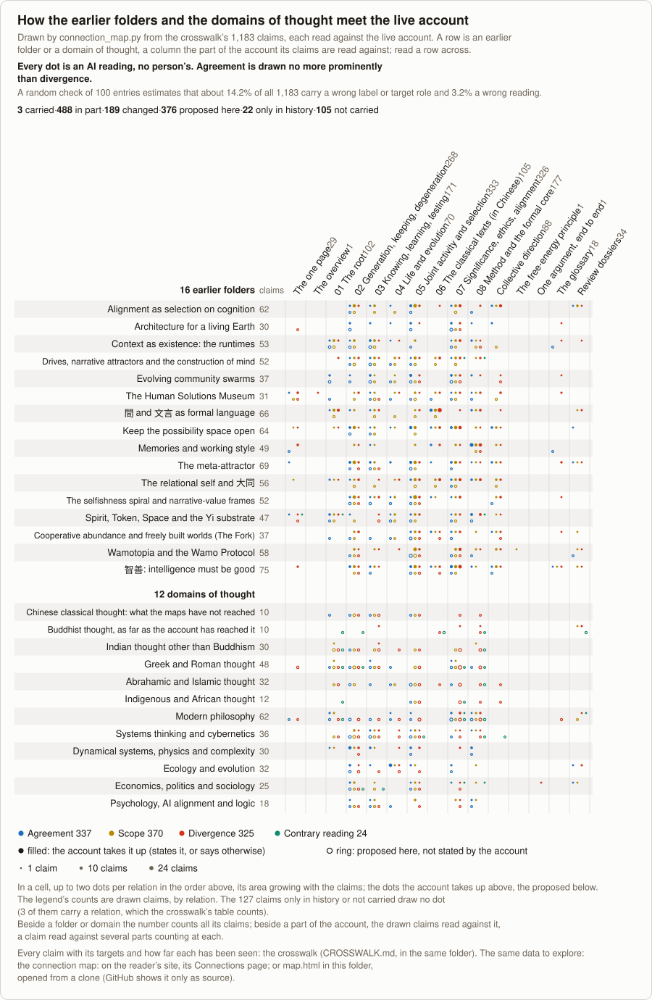

<!-- Generated by tools/research/atlas.py from theories/becoming/results/atlas/; do not edit. -->

# The crosswalk

[the results](../README.md) · [the atlas of dynamics](ATLAS.md) · **the crosswalk** · [the connection map](map.html)

*Drawn by connection_map.py from the claims below: each thread joins a folder or domain to the part of the account its claims are read against, coloured by relation, and every thread is an AI reading, no person’s. To explore the same data, open [the connection map](map.html) from a clone; GitHub shows it only as source.*

Each earlier theory folder and each domain of thought: what it claimed in its own terms, and what became of that in the live account. The evidence layer, not for reading through. It creates no result, and every entry is an AI reading with no person's behind it. A shared word is not a correspondence, structural agreement is not agreement in meaning, and no tradition is spoken for. Not carried is an outcome, not a defect. Where a source is not stored here, what is said of it comes from the AI's knowledge and has not been checked against a text.

**What became of it:** *carried*; *carried-in-part*; *changed*; *history-only*; *not-carried*; *fresh-reading*. *Fresh-reading* means the account does not state the connection and a reader proposes it here. **Relations**, from [06](../../chapters/06-CLASSICAL-TEXTS.md#three-relations): *agreement*; *scope*; *divergence*; *contrary-reading*. Agreement says what it is agreement with: a checked **law**, a **thesis or method**, or a **reading**, where the join is a reader's or descends from the source. Only what a target carries counts as a connection.

**How far to trust it.** Each item had a mapper, a reviser, a checker told to refute, a repair after a critic and a comparison across items. A second critic then read 100 entries drawn at random, up to 6 from each kind of verdict, against both sides: 83 held, 15 had a label or a target's role wrong and 2 had a wrong reading. Weighted by how many entries each kind of verdict holds, that estimates 82.6% holding, 14.2% with a label or role wrong and 3.2% with a wrong reading over all 1183; its fixes are applied, and the other entries were not read again. The first critic's sample (59) was aimed at suspects and gives no rate. Where the source is not stored here, a critic's check was memory against memory.

1183 entries in 28 groups, each on its own page:

| Group | Entries | carried | carried-in-part | changed | history-only | not-carried | fresh-reading | agreement | scope | divergence | contrary-reading | agreement of law | agreement of thesis-or-method | agreement of reading |
|---|---:|---:|---:|---:|---:|---:|---:|---:|---:|---:|---:|---:|---:|---:|
| [Alignment as selection on cognition (心中的摩洛克)](crosswalk/alignment-selection-on-cognition.md) | 62 | 0 | 36 | 11 | 0 | 6 | 9 | 14 | 29 | 13 | 0 | 11 | 0 | 3 |
| [Architecture for a living Earth](crosswalk/architecture-for-a-living-earth.md) | 30 | 0 | 11 | 4 | 1 | 1 | 13 | 21 | 1 | 6 | 0 | 6 | 3 | 12 |
| [Context as existence: the runtimes (语境即存在 · 上下文运行时)](crosswalk/context-as-existence-runtimes.md) | 53 | 0 | 18 | 11 | 3 | 4 | 17 | 16 | 21 | 9 | 0 | 6 | 1 | 9 |
| [Drives, narrative attractors and the construction of mind](crosswalk/drives-narrative-attractors-and-mind.md) | 52 | 0 | 15 | 13 | 1 | 11 | 12 | 7 | 21 | 11 | 1 | 1 | 0 | 6 |
| [Evolving community swarms](crosswalk/evolving-community-swarms.md) | 37 | 0 | 18 | 2 | 0 | 3 | 14 | 25 | 4 | 5 | 0 | 11 | 4 | 10 |
| [The Human Solutions Museum (人类解决问题的方法博物馆)](crosswalk/human-solutions-museum.md) | 31 | 0 | 9 | 7 | 0 | 6 | 9 | 5 | 10 | 10 | 0 | 1 | 1 | 3 |
| [間 and 文言 as formal language (間 · 文言 · 文), with the algebra of hexagrams](crosswalk/jian-and-wenyan-as-formal-language.md) | 66 | 1 | 27 | 29 | 2 | 2 | 5 | 11 | 20 | 31 | 0 | 3 | 7 | 1 |
| [Keep the possibility space open (开, 护开不闭)](crosswalk/keep-the-possibility-space-open.md) | 64 | 0 | 46 | 10 | 0 | 5 | 3 | 19 | 25 | 15 | 0 | 9 | 4 | 6 |
| [Memories and working style: how the work was made, and what only the memories record](crosswalk/memories-and-working-style.md) | 49 | 0 | 27 | 16 | 0 | 3 | 3 | 17 | 12 | 17 | 0 | 2 | 14 | 1 |
| [The meta-attractor (元吸引子 / 总体化吸引子)](crosswalk/meta-attractor.md) | 69 | 2 | 48 | 5 | 3 | 2 | 9 | 27 | 29 | 8 | 0 | 14 | 3 | 10 |
| [The relational self and 大同](crosswalk/relational-self-and-datong.md) | 56 | 0 | 23 | 14 | 1 | 9 | 9 | 7 | 23 | 16 | 0 | 2 | 4 | 1 |
| [The selfishness spiral and narrative-value frames](crosswalk/selfishness-spiral-and-narrative-value-frames.md) | 52 | 0 | 30 | 5 | 0 | 10 | 7 | 9 | 24 | 9 | 0 | 4 | 1 | 4 |
| [Spirit, Token, Space and the Yi substrate (間 · 一/太極)](crosswalk/spirit-space-token-and-yi-substrate.md) | 47 | 0 | 18 | 13 | 0 | 4 | 12 | 15 | 13 | 14 | 1 | 2 | 9 | 4 |
| [Cooperative abundance and freely built worlds (historical home: The Fork)](crosswalk/the-fork-and-cooperative-infrastructure.md) | 37 | 0 | 13 | 5 | 0 | 7 | 12 | 13 | 10 | 7 | 0 | 0 | 2 | 11 |
| [Wamotopia and the Wamo Protocol (瓦猫)](crosswalk/wamotopia-and-the-wamo-protocol.md) | 58 | 0 | 18 | 13 | 0 | 9 | 18 | 8 | 28 | 13 | 0 | 0 | 0 | 8 |
| [智善: intelligence must be good](crosswalk/zhishan-intelligence-must-be-good.md) | 75 | 0 | 47 | 16 | 1 | 3 | 8 | 22 | 27 | 22 | 0 | 8 | 7 | 7 |
| [Chinese classical thought: what the existing maps have not reached](crosswalk/chinese-classical.md) | 10 | 0 | 0 | 0 | 0 | 0 | 10 | 2 | 4 | 4 | 0 | 0 | 0 | 2 |
| [Buddhist thought, as far as the account has reached it](crosswalk/buddhist.md) | 10 | 0 | 2 | 1 | 1 | 0 | 6 | 0 | 2 | 3 | 5 | 0 | 0 | 0 |
| [Indian thought other than Buddhism: Gītā, Upaniṣads, karma doctrine, Jain, Sāṃkhya-Yoga, Nyāya-Vaiśeṣika, Vedānta, Cārvāka, Arthaśāstra](crosswalk/other-indian.md) | 30 | 0 | 1 | 1 | 2 | 0 | 26 | 1 | 10 | 15 | 2 | 0 | 0 | 1 |
| [Greek and Roman thought](crosswalk/greek-roman.md) | 48 | 0 | 2 | 0 | 2 | 0 | 44 | 11 | 14 | 19 | 4 | 5 | 2 | 4 |
| [Abrahamic and Islamic thought](crosswalk/abrahamic-islamic.md) | 32 | 0 | 0 | 0 | 1 | 3 | 28 | 8 | 5 | 13 | 2 | 0 | 0 | 8 |
| [Indigenous and African thought](crosswalk/indigenous-african.md) | 12 | 0 | 0 | 0 | 0 | 2 | 10 | 1 | 2 | 6 | 1 | 0 | 0 | 1 |
| [Modern philosophy: process, recognition, capital, individuation, responsibility, conatus, identity, structure, capability](crosswalk/modern-philosophy.md) | 62 | 0 | 12 | 4 | 2 | 2 | 42 | 20 | 4 | 28 | 6 | 9 | 4 | 7 |
| [Systems thinking and cybernetics](crosswalk/systems-cybernetics.md) | 36 | 0 | 11 | 2 | 0 | 3 | 20 | 9 | 14 | 9 | 1 | 1 | 0 | 8 |
| [Dynamical systems, physics and complexity](crosswalk/dynamics-physics-complexity.md) | 30 | 0 | 17 | 4 | 1 | 5 | 3 | 15 | 2 | 7 | 0 | 13 | 0 | 2 |
| [Ecology and evolution](crosswalk/ecology-evolution.md) | 32 | 0 | 22 | 1 | 0 | 1 | 8 | 22 | 2 | 7 | 0 | 16 | 1 | 5 |
| [Economics, politics and sociology](crosswalk/economics-politics-sociology.md) | 25 | 0 | 10 | 1 | 1 | 3 | 10 | 7 | 8 | 4 | 2 | 3 | 0 | 4 |
| [Psychology, AI alignment and logic](crosswalk/psychology-alignment-logic.md) | 18 | 0 | 7 | 1 | 0 | 1 | 9 | 6 | 7 | 4 | 0 | 3 | 0 | 3 |

A link to a correspondence made while the crosswalk was one page lands on its group's row here; on the group's page the correspondence has the same id (`crosswalk/<group>.md#<id>`).

[the results](../README.md) · [the atlas of dynamics](ATLAS.md) · **the crosswalk** · [the connection map](map.html)
