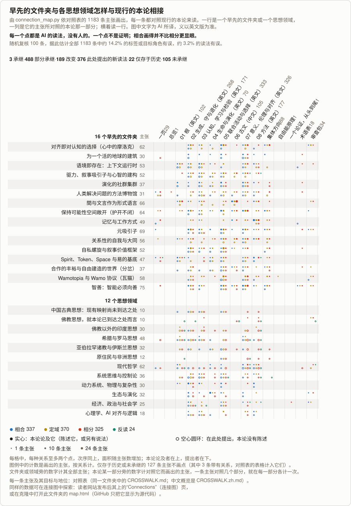

<!-- Generated by tools/research/atlas.py from theories/becoming/results/atlas/; do not edit. -->

# 对照表：早先的理论文件夹与各思想领域

[English](CROSSWALK.md) · [首页](../../../../README.zh.md) · [一页](../../ONE-PAGE.zh.md) · [用途](../../USES.zh.md) · [实例](../../USES-EXAMPLES.zh.md) · [总览](../../THE-THEORY-OF-BECOMING.zh.md) · [八章（英文）](../../chapters/README.md) · [古文（第六章）](../../chapters/06-CLASSICAL-TEXTS.md) · [检验](../../../../TESTS.zh.md) · **对照表** · [怎样长成](../../../LINEAGE.zh.md) · [术语表](../../../../GLOSSARY.zh.md) · [审查包](../../review/README.zh.md)

*约 8–10 分钟读完。*

*由 AI 依[英文的对照表](CROSSWALK.md)写成，尚无人审查它的记录；义以英文版为准。各组的条目在英文页上。*

*由 connection_map.py 依同一份数据画出，图中文字为 AI 所译（[英文图](connections.svg)）：每一条线把一个文件夹或领域连到它的主张所对照的本论那一部分，按关系着色；每一条线都是 AI 的读法，没有人的。*

**它是什么。** 每一个早先的理论文件夹与每一个思想领域：它以自己的话主张了什么，在现行之论中又成了什么。它是证据层，不是用来通读的。它不产生任何结果；每一条都是 AI 的读法，没有人的。共用一个词不是对应，结构上的相合不是意义上的相合，它也不代表任何传统发言。未承继是一种结局，不是缺陷。来源不存于此处时，所说的出自 AI 的知识，没有对照原文核对过。

**多可信。** 每一项都经过一位映射者、一位修订者、一位受命去反驳的检查者、一次批评之后的修补，以及跨项的比较。之后，第二位批评者从每一类结局中随机抽取至多 6 条，共 100 条，对照两边去读：83 条成立，15 条的标签或目标角色有误，2 条的读法有误。按各类结局的条数加权，估计全部 1,183 条中约 82.6% 成立，约 14.2% 的标签或角色有误，约 3.2% 的读法有误；这些修正已经做了，其余各条没有再读。第一位批评者的样本（59 条）专挑可疑者，不给出比率。来源不存于此处时，批评者的核对是以记忆对记忆。

**计数。** 1,183 条主张，来自 16 个早先的理论文件夹与 12 个思想领域：承继 3，部分承继 488，改变 189，仅存于历史 22，未承继 105，此处提出的新读法 376。按关系：相合 338（其中与已检查之律相合 130，与论题或方法相合 67，与一种读法相合 141；这里的相合比[第六章](../../chapters/06-CLASSICAL-TEXTS.md#three-relations)所定的宽，第六章的相合只指与已检查之律结构相同），定域 371，相分 325，反读 25。各关系相加为 1,059，其余 124 条没有关系（未承继 105，仅存于历史 19）。另有 3 条仅存于历史者有关系，[连接图](map.html)把它们画作一个短端而非一条线，但其分组计数包含它们。只有一个目标所承载的才算作连接。

**离中文文本最近的两个领域。**

- **中国古典思想**（10 条，[英文页](crosswalk/chinese-classical.md)）：本组只收现有映射尚未到达之处；中国古典的大部分在[第六章](../../chapters/06-CLASSICAL-TEXTS.md)，那里有段落的映射与一部图谱的条目。
- **佛教思想**（10 条，[英文页](crosswalk/buddhist.md)）：就本论已经到达之处而言；佛教论书的读法也在[第六章](../../chapters/06-CLASSICAL-TEXTS.md)。

**全部 28 组**，每组一页，都在英文页上：它以自己的话主张了什么，现行之论中成了什么，以及每一条的目标与地位。下表列出每一组的条数，按结局与按关系各计（组名为 AI 所译；[英文索引](CROSSWALK.md)有同样的计数）：

| 组 | 类 | 条数 | 承继 | 部分承继 | 改变 | 仅存于历史 | 未承继 | 此处提出的新读法 | 相合 | 定域 | 相分 | 反读 |
|---|---|---:|---:|---:|---:|---:|---:|---:|---:|---:|---:|---:|
| [对齐即对认知的选择（心中的摩洛克）](crosswalk/alignment-selection-on-cognition.md) | 文件夹 | 62 | 0 | 36 | 11 | 0 | 6 | 9 | 14 | 29 | 13 | 0 |
| [为一个活的地球的建筑](crosswalk/architecture-for-a-living-earth.md) | 文件夹 | 30 | 0 | 11 | 4 | 1 | 1 | 13 | 21 | 1 | 6 | 0 |
| [语境即存在：上下文运行时](crosswalk/context-as-existence-runtimes.md) | 文件夹 | 53 | 0 | 18 | 11 | 3 | 4 | 17 | 16 | 21 | 9 | 0 |
| [驱力、叙事吸引子与心智的建构](crosswalk/drives-narrative-attractors-and-mind.md) | 文件夹 | 52 | 0 | 15 | 13 | 1 | 11 | 12 | 7 | 21 | 11 | 1 |
| [演化的社群集群](crosswalk/evolving-community-swarms.md) | 文件夹 | 37 | 0 | 18 | 2 | 0 | 3 | 14 | 25 | 4 | 5 | 0 |
| [人类解决问题的方法博物馆](crosswalk/human-solutions-museum.md) | 文件夹 | 31 | 0 | 9 | 7 | 0 | 6 | 9 | 5 | 10 | 10 | 0 |
| [間与文言作为形式语言](crosswalk/jian-and-wenyan-as-formal-language.md) | 文件夹 | 66 | 1 | 27 | 29 | 2 | 2 | 5 | 11 | 20 | 31 | 0 |
| [保持可能性空间敞开（护开不闭）](crosswalk/keep-the-possibility-space-open.md) | 文件夹 | 64 | 0 | 46 | 10 | 0 | 5 | 3 | 19 | 25 | 15 | 0 |
| [记忆与工作方式](crosswalk/memories-and-working-style.md) | 文件夹 | 49 | 0 | 27 | 16 | 0 | 3 | 3 | 17 | 12 | 17 | 0 |
| [元吸引子](crosswalk/meta-attractor.md) | 文件夹 | 69 | 2 | 48 | 5 | 3 | 2 | 9 | 27 | 29 | 8 | 0 |
| [关系性的自我与大同](crosswalk/relational-self-and-datong.md) | 文件夹 | 56 | 0 | 23 | 14 | 1 | 9 | 9 | 7 | 23 | 16 | 0 |
| [自私螺旋与叙事价值框架](crosswalk/selfishness-spiral-and-narrative-value-frames.md) | 文件夹 | 52 | 0 | 30 | 5 | 0 | 10 | 7 | 9 | 24 | 9 | 0 |
| [Spirit、Token、Space 与易的基底](crosswalk/spirit-space-token-and-yi-substrate.md) | 文件夹 | 47 | 0 | 18 | 13 | 0 | 4 | 12 | 15 | 13 | 14 | 1 |
| [合作的丰裕与自由建造的世界（分岔）](crosswalk/the-fork-and-cooperative-infrastructure.md) | 文件夹 | 37 | 0 | 13 | 5 | 0 | 7 | 12 | 13 | 10 | 7 | 0 |
| [Wamotopia 与 Wamo 协议（瓦猫）](crosswalk/wamotopia-and-the-wamo-protocol.md) | 文件夹 | 58 | 0 | 18 | 13 | 0 | 9 | 18 | 8 | 28 | 13 | 0 |
| [智善：智能必须向善](crosswalk/zhishan-intelligence-must-be-good.md) | 文件夹 | 75 | 0 | 47 | 16 | 1 | 3 | 8 | 22 | 27 | 22 | 0 |
| [中国古典思想：现有映射尚未到达之处](crosswalk/chinese-classical.md) | 领域 | 10 | 0 | 0 | 0 | 0 | 0 | 10 | 2 | 4 | 4 | 0 |
| [佛教思想，就本论已到达之处而言](crosswalk/buddhist.md) | 领域 | 10 | 0 | 2 | 1 | 1 | 0 | 6 | 0 | 2 | 3 | 5 |
| [佛教以外的印度思想](crosswalk/other-indian.md) | 领域 | 30 | 0 | 1 | 1 | 2 | 0 | 26 | 1 | 10 | 15 | 2 |
| [希腊与罗马思想](crosswalk/greek-roman.md) | 领域 | 48 | 0 | 2 | 0 | 2 | 0 | 44 | 11 | 14 | 19 | 4 |
| [亚伯拉罕诸教与伊斯兰思想](crosswalk/abrahamic-islamic.md) | 领域 | 32 | 0 | 0 | 0 | 1 | 3 | 28 | 8 | 5 | 13 | 2 |
| [原住民与非洲思想](crosswalk/indigenous-african.md) | 领域 | 12 | 0 | 0 | 0 | 0 | 2 | 10 | 1 | 2 | 6 | 1 |
| [现代哲学](crosswalk/modern-philosophy.md) | 领域 | 62 | 0 | 12 | 4 | 2 | 2 | 42 | 20 | 4 | 28 | 6 |
| [系统思维与控制论](crosswalk/systems-cybernetics.md) | 领域 | 36 | 0 | 11 | 2 | 0 | 3 | 20 | 9 | 14 | 9 | 1 |
| [动力系统、物理与复杂性](crosswalk/dynamics-physics-complexity.md) | 领域 | 30 | 0 | 17 | 4 | 1 | 5 | 3 | 15 | 2 | 7 | 0 |
| [生态与演化](crosswalk/ecology-evolution.md) | 领域 | 32 | 0 | 22 | 1 | 0 | 1 | 8 | 22 | 2 | 7 | 0 |
| [经济、政治与社会学](crosswalk/economics-politics-sociology.md) | 领域 | 25 | 0 | 10 | 1 | 1 | 3 | 10 | 7 | 8 | 4 | 2 |
| [心理学、AI 对齐与逻辑](crosswalk/psychology-alignment-logic.md) | 领域 | 18 | 0 | 7 | 1 | 0 | 1 | 9 | 6 | 7 | 4 | 0 |
