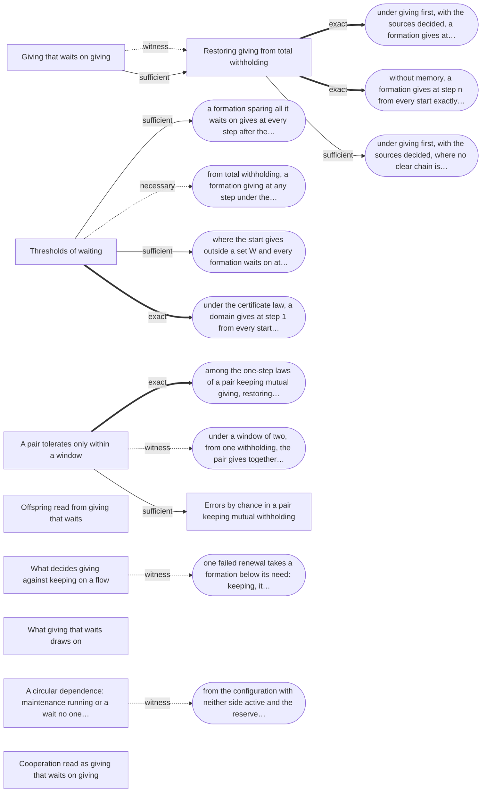
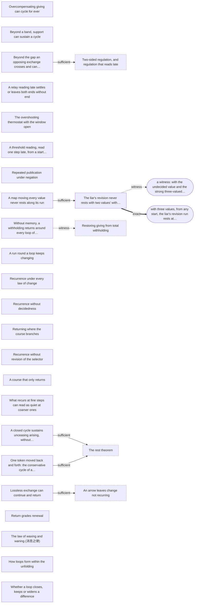

<!-- Generated by tools/research/atlas.py from theories/becoming/results/atlas/; do not edit. -->

# The terrain: where the read families lead

[Home](../../../../README.md) · [中文](../../../../README.zh.md) · **Read** · [One page](../../ONE-PAGE.md) · [The theory](../../THE-THEORY-OF-BECOMING.md) · [Chapters](../../chapters/README.md) · [Uses](../../USES.md) · **Check** · [Tests](../../../../TESTS.md) · [Results](../../../../RESULTS.md) · [Proofs](../../../../MAP.md#check-the-proofs-yourself) · [Open questions](../../../../OPEN-QUESTIONS.md) · [Reviewers](../../review/README.md) · **See** · [Graph](../THEORY-GRAPH.md) · [Connections](CROSSWALK.md) · [How it grew](../../../LINEAGE.md) · [Glossary](../../../../GLOSSARY.md) · [Where everything is](../../../../MAP.md)

The atlas's views: [the atlas](ATLAS.md) · [the premise ledger](PREMISES.md) · **the terrain** · [tests bound](BINDINGS.md) · [situations](SITUATIONS.md) · [the crosswalk](CROSSWALK.md) · [what does not join](JOINS.md)

*AI-written, from the entries (PLAN §13, step 2). Each exit is drawn as an edge: to a dynamic where a law places the course there, else to the state it reaches, in words. An edge is drawn bold for an exact exit, plain for a sufficient one, and dashed for a witness (a constructed course that leaves, with no condition) or a necessary one (what leaving requires, not that it happens), each edge labelled with its strength. A route follows exits that name a dynamic; its weakest step is ranked exact, sufficient, witness, necessary, from the step that most establishes the route to the one that least does. A route chains exits that name a dynamic without checking that one exit's destination meets the next exit's conditions: it says where the stated exits point, not that a course goes there. Nothing here ranks courses or says where a course should go.*

*A dashed edge from an exit no law shows names, in words or as a dynamic, where its source argues, conjectures, reads or leaves open that the course goes; no law places it there, and a route through it ranks below every step a law shows.*

## A. Absorption and ending

29 dynamics, 40 exits.

```mermaid
flowchart LR
  n0["Drawn exactly where it does not return"]
  n1["Basins of a determined law, one cycle each"]
  n2["Necessarily drawn exactly what does not return"]
  n3["Every loss passes a juncture"]
  n4["Not going out of a region"]
  n5["Degeneration from a horizon (退化)"]
  n6["Loss of renewal for good"]
  n7["Three outcomes of a loss: restored, transformed, or ended…"]
  n8["The point of no return of a regime"]
  n9["One law of exact thresholds, and the threshold in the plane…"]
  n10["The exit from a margin"]
  n11["Consumption ends with its feeders"]
  n12["A consumer that switches stays consuming, on the whole-run…"]
  n13["An end cascading along total dependence"]
  n14["Beyond a band, support can sustain a cycle"]:::other
  n15["Co-ending along dependence"]
  n16["A whole of every part ends with one part' the grade between…"]
  n17["A confined rise within a whole"]
  n18["Ending laws as regimes on a lineage"]
  n19["The ends of drift absorb' fixation, with and without…"]
  n20["The ends of a rule rebuilt from its members: no holder, and…"]
  n21["A reader rebuilt from the level it reads: its end does not…"]
  n22["What ungated steps keep' an empty pool stays empty"]
  n23["Groups with less leave nothing' groups on one family end…"]
  n24["Draining: below a drained level no history lasts"]
  n25["Never leaving a guard, conditions kept together, and lasting"]:::other
  n26["Four routes of transition, none a proved phase transition"]
  n27["Slowing down before a condition's own end"]
  n28["A reserve defers the end"]
  n29["Dormancy over a stretch, and an ending that is final"]
  n30["The market model's share, margin and ends"]
  e1(["outside the region R at step n + 1 from inside it at step n: the move…"])
  n0 -.->|necessary| e1
  e2(["a witness: in Exit…"])
  n0 -.->|witness| e2
  e3(["a witness: in OneWay, false is possibly drawn into 'true', a region…"])
  n2 -.->|witness| e3
  e4(["the sub-process keeping P s…"])
  n3 -->|sufficient| e4
  e5(["x is a juncture for s, and the source has, not not, reached the…"])
  n3 -.->|necessary| e5
  e6(["a step of continuation from a member of P to something outside P…"])
  n4 -.->|necessary| e6
  e7(["a witness without the gate: after one step of joint excess a part…"])
  n6 -.->|witness| e7
  n6 -.->|necessary| n7
  e8(["the condition meets g's earlier need at t…"])
  n7 -.->|necessary| e8
  e9(["at every step t after T at which g is still active, g no longer…"])
  n7 -.->|necessary| e9
  e10(["a witness: from one configuration of one process, three runs break…"])
  n7 -.->|witness| e10
  e11(["from a start level up to hi, the condition ends…"])
  n8 ==>|exact| e11
  e12(["a witness with giving that adjusts one unit a step toward the…"])
  n8 -.->|witness| e12
  e13(["from a level up to hi at or above the threshold for its recent…"])
  n9 ==>|exact| e13
  e14(["some formation supported at a step t from T before T + n feeds g's…"])
  n11 -.->|necessary| e14
  e15(["a witness: with either of two redundant feeders, or both, the…"])
  n11 -.->|witness| e15
  e16(["a witness on a separate flow: with Overshoot's dependences, each…"])
  n11 -.->|witness| e16
  n11 -->|sufficient| n12
  e17(["where the consumer consumes through no dependence that such a change…"])
  n12 ==>|exact| e17
  e18(["a witness: a lone formation consuming only through its own dependence…"])
  n12 -.->|witness| e18
  e19(["a witness: with no draw on the middle condition of a three-link…"])
  n13 -.->|witness| e19
  e20(["a witness of mutual support: from level two the first condition ends…"])
  n13 -.->|witness| e20
  n13 -.->|witness| n14
  e21(["a witness with a recent giving: one condition under a draw of two…"])
  n13 -.->|witness| e21
  e22(["a whole of every part active at every step from T on, exactly where…"])
  n16 ==>|exact| e22
  e23(["a witness: in Generations, a formation that is the whole of every…"])
  n16 -.->|witness| e23
  e24(["a witness: in Body, the spreading lineage, whose descendant needs…"])
  n17 -.->|witness| e24
  e25(["a witness: from the same stock s ≥ 1, a relay never in excess and…"])
  n18 -.->|witness| e25
  e26(["a witness: a renewer giving two units at every step and requiring…"])
  n18 -.->|witness| e26
  e27(["a witness without the gate: the renewer's own line, giving to the…"])
  n18 -.->|witness| e27
  e28(["a witness: without dissipation, a lossless relay keeps a lineage of…"])
  n18 -.->|witness| e28
  e29(["another rule of the family: from no holder and no other, at a quota…"])
  n20 -->|sufficient| e29
  e30(["another rule of the family: a reader rebuilt from the supply, at…"])
  n21 -->|sufficient| e30
  e31(["the course contains a gated move: some move a of the plan has gate a…"])
  n22 -.->|necessary| e31
  e32(["the course splits into a prefix that keeps the quantity, a gated step…"])
  n22 -.->|necessary| e32
  n24 -->|sufficient| n25
  n24 ==>|exact| n25
  e33(["a witness: a formation unsupported at the first three steps and…"])
  n29 -.->|witness| e33
  e34(["where the margin M = α(1 − θ) − βλθ is negative, the floor is not…"])
  n30 ==>|exact| e34
  e35(["a witness: in the original example at β = 1/2 with no shocks, from…"])
  n30 -.->|witness| e35
  classDef other stroke-dasharray: 3 3
```

| Dynamic | Leaves to | Reaches by named exits (weakest step) |
|---|---|---|
| [Drawn exactly where it does not return](families/a.md#attraction-is-not-returning) | 1. outside the region R at step n + 1 from inside it at step n: the move the run took at step n is one under which R is not absorbing (¬ AbsorbingUnder P R (r.act n)) (necessary; dropping [every move taken keeps the region](premises/a.md#run-moves-keep), [invariant](premises/a.md#invariant)) 2. a witness: in Exit (configurations and moves are bits, the move true flips), {true} is absorbing under the move false and not under true, so not invariant; the run that leaves is in {true} at step 0 and out of it at step 1, and its move at step 0 does not keep {true} (witness; dropping [every move taken keeps the region](premises/a.md#run-moves-keep), [invariant](premises/a.md#invariant)) | — |
| [Basins of a determined law, one cycle each](families/a.md#basins-of-a-determined-law) | **none: no exit is stated** | — |
| [Necessarily drawn exactly what does not return](families/a.md#necessarily-drawn-is-not-returning) | 1. a witness: in OneWay, false is possibly drawn into {true}, a region the process never leaves, is not necessarily drawn into it (the run that keeps false never enters it), and returns (witness) | — |
| [Every loss passes a juncture](families/a.md#every-loss-passes-a-juncture) | 1. the sub-process keeping P s (the steps after which s can still be had) keeps s: from wherever its course from s leads it can have s again (Keeps (keeping P s) s) (sufficient; dropping [cannot be had again](premises/a.md#branching-lost)) 2. x is a juncture for s, and the source has, not not, reached the reader g by D (¬ ¬ ReachedBy L L' W obs source g D) (necessary; dropping [the source has not reached the reader](premises/a.md#timedresponse-unreached)) | — |
| [Not going out of a region](families/a.md#not-going-out-of-a-region) | 1. a step of continuation from a member of P to something outside P, placed on the line: reached from the line's start and reaching its end (necessary; dropping [«闭» (closed)](PREMISES.md#grammarlaws-bi)) | — |
| [Degeneration from a horizon (退化)](families/a.md#degeneration-from-a-horizon) | **none: no exit is stated** | — |
| [Loss of renewal for good](families/a.md#loss-of-renewal-for-good) | 1. a witness without the gate: after one step of joint excess a part depending on the condition is inactive at step 1; a renewer that requires nothing gives to the condition at step 1, and the part is active at every step from 2 on (witness; dropping [the gate at need m](PREMISES.md#flow-gated)) 2. [Three outcomes of a loss: restored, transformed, or ended where dependence is fixed](families/a.md#three-outcomes-of-a-loss) (necessary; dropping [a dependence at the step](PREMISES.md#web-requires), [a need of at least m](PREMISES.md#flow-need-at-least-m)) | [Three outcomes of a loss: restored, transformed, or ended where dependence is fixed](families/a.md#three-outcomes-of-a-loss) (necessary) |
| [Three outcomes of a loss: restored, transformed, or ended where dependence is fixed](families/a.md#three-outcomes-of-a-loss) | 1. the condition meets g's earlier need at t (W.need T g c ≤ W.level t c): where g is active at t with a dependence on c at least as strong as at T, the loss is restored at t (necessary; dropping [the level stays below the need](premises/a.md#web-below-need-after)) 2. at every step t after T at which g is still active, g no longer requires c at a need at least its need at T: its dependence on c has weakened or dissolved (¬ (W.requires t g c ∧ W.need T g c ≤ W.need t g c)) (necessary; dropping [dependence fixed after T](premises/a.md#web-fixed-after)) 3. a witness: from one configuration of one process, three runs break the same dependence at the first step, read at the step's start: in one the formation ends and the loss is lost; in one the dependence dissolves as one on a second condition forms, the formation stays active and the loss is lost; in one the formation waits, the condition is renewed, and the dependence is kept again from step 2 (witness) | — |
| [The point of no return of a regime](families/a.md#margin-of-a-regime) | 1. from a start level up to hi, the condition ends (its level is 0 at some step) exactly where the start is below H + y: from H + y up to hi it never ends (exact) 2. a witness with giving that adjusts one unit a step toward the regime's (Adjusted.Between and Settles): from level 4 with recent giving 6 the level is at least 7 from the second step on, and from level 5 with recent giving 0 it is 0 from the second step on, where the regime's own step ends the condition from 4 and holds it from 5 (witness; dropping [the regime's step](premises/a.md#regimemargin-step)) | — |
| [One law of exact thresholds, and the threshold in the plane of level and recent giving](families/a.md#threshold-in-the-state-plane) | 1. from a level up to hi at or above the threshold for its recent giving, the run does not come to rest below the draw (exact) | — |
| [The exit from a margin](families/a.md#exit-from-a-margin) | **none: no exit is stated** | — |
| [Consumption ends with its feeders](families/a.md#consumption-ends-with-feeders) | 1. some formation supported at a step t from T before T + n feeds g's continuation there (∃ t f, L.FedBy W (g, t) (f, t) ∧ W.Supported t f) (necessary; dropping [feeders unsupported](premises/a.md#flow-feeders-unsupported)) 2. a witness: with either of two redundant feeders, or both, the consumer is active and supported at every step (witness; dropping [feeders unsupported](premises/a.md#flow-feeders-unsupported), [unfed while active](premises/a.md#flow-unfed)) 3. a witness on a separate flow: with Overshoot's dependences, each formation taking only from its own condition, the flow balances and both formations are active and supported at every step (witness) 4. [A consumer that switches stays consuming, on the whole-run reading](families/a.md#substitution-preserves-consumption) (sufficient; dropping [requires the condition while active](premises/a.md#flow-requires-while-active)) | [A consumer that switches stays consuming, on the whole-run reading](families/a.md#substitution-preserves-consumption) (sufficient) |
| [A consumer that switches stays consuming, on the whole-run reading](families/a.md#substitution-preserves-consumption) | 1. where the consumer consumes through no dependence that such a change leaves, not every such change keeps it consuming (¬ ∀ V, DependenceChanged V f T₀ → V.ConsumingIn f) (exact) 2. a witness: a lone formation consuming only through its own dependence from step 0; on the web where that dependence is dissolved (DependenceChanged from 0) it no longer consumes (witness) | — |
| [An end cascading along total dependence](families/a.md#a-cascade-along-total-dependence) | 1. a witness: with no draw on the middle condition of a three-link chain, the first still ends, while the third, downstream of it, holds at two at every step (witness; dropping [positive draws on dependents](premises/a.md#regimemargin-coupled-indexed-dependents-draw-pos)) 2. a witness of mutual support: from level two the first condition ends with its partner at nothing and holds with its partner at two; its threshold is three at a partner of nothing and two at a partner of two (witness) 3. [Beyond a band, support can sustain a cycle](families/f.md#support-beyond-a-band-can-cycle) (witness; dropping [a pair's band](PREMISES.md#regimemargin-coupled-band)) 4. a witness with a recent giving: one condition under a draw of two, giving one where something is left and nothing was given last and two where something was; levels up to four, its threshold is four having given nothing and three having given one (witness) | [Beyond a band, support can sustain a cycle](families/f.md#support-beyond-a-band-can-cycle) (witness) |
| [Co-ending along dependence](families/a.md#co-ending-along-dependence) | **none: no exit is stated** | — |
| [A whole of every part ends with one part; the grade between it and a whole of some part](families/a.md#a-whole-of-every-part) | 1. a whole of every part active at every step from T on, exactly where every part is active at every step from T on: it persists with no arising, only while no part ceases (exact) 2. a witness: in Generations, a formation that is the whole of every member is active at no step (¬ web.active t v at every t) (witness) | — |
| [A confined rise within a whole](families/a.md#confined-rise-within-a-whole) | 1. a witness: in Body, the spreading lineage, whose descendant needs nothing of the body (so it is not confined to it), has a member at the second generation: lineage (generationsBy ofSpread) [spread] 2 = [spread₂] (witness; dropping [a confined lineage](premises/a.md#founding-flow-confinedrise-confined)) | — |
| [Ending laws as regimes on a lineage](families/a.md#ending-laws-as-regimes-on-a-lineage) | 1. a witness: from the same stock s ≥ 1, a relay never in excess and never dissipated on keeps the stock at s and its lineage generates (生成), while a run-down in excess at each of its s steps and dissipated on degenerates (退化) (witness; dropping [a family drawn beyond its renewal](PREMISES.md#flow-family-excess), [dissipated on a family across a step](PREMISES.md#flow-dissipateson)) 2. a witness: a renewer giving two units at every step and requiring nothing, the takers within what is given, nothing in excess, the condition fed and not dissipated on; every formation active and supported at every step (witness; dropping [a family drawn beyond its renewal](PREMISES.md#flow-family-excess), [dissipated on a family across a step](PREMISES.md#flow-dissipateson), [given nothing](premises/a.md#lineageregimes-given-nothing)) 3. a witness without the gate: the renewer's own line, giving to the pool and requiring no condition, goes on (延) at the kind grain from (0, 1) (witness; dropping [dependence on the family at the horizon, at the kind grain](premises/a.md#lineageregimes-family-held-at-horizon)) 4. a witness: without dissipation, a lossless relay keeps a lineage of one member at every generation within a family of stock one (witness; dropping [dissipated on a family across a step](PREMISES.md#flow-dissipateson)) | — |
| [The ends of drift absorb; fixation, with and without selection in the draw](families/a.md#fixation-by-drift) | **none: no exit is stated** | — |
| [The ends of a rule rebuilt from its members: no holder, and the end, do not return](families/a.md#a-rule-with-no-holder-does-not-return) | 1. another rule of the family: from no holder and no other, at a quota, a level and a tenure of at least one, with entrants on offer, the rule taught from outside has holders after one step; taught by members, or not at all, it has none (sufficient; dropping [taught by members or not at all](PREMISES.md#rulerebuilding-taught-within)) | — |
| [A reader rebuilt from the level it reads: its end does not come back](families/a.md#a-reader-rebuilt-from-its-stock-ends-with-it) | 1. another rule of the family: a reader rebuilt from the supply, at least one unit wanted, gone, is present again after one supplied step, at every level (sufficient; dropping [a reader rebuilt from the level](PREMISES.md#readerrebuilding-rebuilt-from-level)) | — |
| [What ungated steps keep; an empty pool stays empty](families/a.md#what-a-gate-keeps) | 1. the course contains a gated move: some move a of the plan has gate a = true (necessary; dropping [a course of ungated moves](premises/a.md#gated-plan-ungated)) 2. the course splits into a prefix that keeps the quantity, a gated step that itself changes it, and the rest (necessary; dropping [a course of ungated moves](premises/a.md#gated-plan-ungated)) | — |
| [Groups with less leave nothing; groups on one family end together](families/a.md#selection-among-groups-by-ending) | **none: no exit is stated** | — |
| [Draining: below a drained level no history lasts](families/a.md#market-finite-support-obstruction) | 1. [Never leaving a guard, conditions kept together, and lasting](families/h.md#never-leaving-a-guard) (sufficient; dropping [stock short of the horizon](premises/a.md#finitesupportobstruction-stock-short), [below level n](premises/a.md#lasting-below-level)) 2. [Never leaving a guard, conditions kept together, and lasting](families/h.md#never-leaving-a-guard) (exact; dropping [below level n](premises/a.md#lasting-below-level)) | [Never leaving a guard, conditions kept together, and lasting](families/h.md#never-leaving-a-guard) (exact), [Not going out of a region](families/a.md#not-going-out-of-a-region) (exact) |
| [Four routes of transition, none a proved phase transition](families/a.md#four-routes-of-transition) | **none: no exit is stated** | — |
| [Slowing down before a condition's own end](families/a.md#slowing-down-before-an-own-end) | **none: no exit is stated** | — |
| [A reserve defers the end](families/a.md#reserve-defers-ending) | **none: no exit is stated** | — |
| [Dormancy over a stretch, and an ending that is final](families/a.md#dormancy-over-a-stretch) | 1. a witness: a formation unsupported at the first three steps and supported from step three on, with a reserve of three falling by one at each unsupported step, is active at every step: support returning within the reserve finds it (witness; dropping [unsupported over the stretch](premises/a.md#web-unsupported-over-stretch)) | — |
| [The market model's share, margin and ends](families/a.md#market-model-share-margin-and-ends) | 1. where the margin M = α(1 − θ) − βλθ is negative, the floor is not protected: some level θ ≤ q ≤ 1 under some influence 0 ≤ w ≤ λ falls below θ at the next step (exact) 2. a witness: in the original example at β = 1/2 with no shocks, from the box about the maintenance end with stock at least 5, the guarded history never stops (witness) | — |

**Which premise releases which lock.** Each premise an exit of the family drops, and the exits that drop it.

| Premise | Dropped by |
|---|---|
| [dissipated on a family across a step](PREMISES.md#flow-dissipateson) | [Ending laws as regimes on a lineage](families/a.md#ending-laws-as-regimes-on-a-lineage) (exit 1), [Ending laws as regimes on a lineage](families/a.md#ending-laws-as-regimes-on-a-lineage) (exit 2), [Ending laws as regimes on a lineage](families/a.md#ending-laws-as-regimes-on-a-lineage) (exit 4) |
| [a family drawn beyond its renewal](PREMISES.md#flow-family-excess) | [Ending laws as regimes on a lineage](families/a.md#ending-laws-as-regimes-on-a-lineage) (exit 1), [Ending laws as regimes on a lineage](families/a.md#ending-laws-as-regimes-on-a-lineage) (exit 2) |
| [feeders unsupported](premises/a.md#flow-feeders-unsupported) | [Consumption ends with its feeders](families/a.md#consumption-ends-with-feeders) (exit 1), [Consumption ends with its feeders](families/a.md#consumption-ends-with-feeders) (exit 2) |
| [a course of ungated moves](premises/a.md#gated-plan-ungated) | [What ungated steps keep; an empty pool stays empty](families/a.md#what-a-gate-keeps) (exit 1), [What ungated steps keep; an empty pool stays empty](families/a.md#what-a-gate-keeps) (exit 2) |
| [invariant](premises/a.md#invariant) | [Drawn exactly where it does not return](families/a.md#attraction-is-not-returning) (exit 1), [Drawn exactly where it does not return](families/a.md#attraction-is-not-returning) (exit 2) |
| [below level n](premises/a.md#lasting-below-level) | [Draining: below a drained level no history lasts](families/a.md#market-finite-support-obstruction) (exit 1), [Draining: below a drained level no history lasts](families/a.md#market-finite-support-obstruction) (exit 2) |
| [every move taken keeps the region](premises/a.md#run-moves-keep) | [Drawn exactly where it does not return](families/a.md#attraction-is-not-returning) (exit 1), [Drawn exactly where it does not return](families/a.md#attraction-is-not-returning) (exit 2) |
| [cannot be had again](premises/a.md#branching-lost) | [Every loss passes a juncture](families/a.md#every-loss-passes-a-juncture) (exit 1) |
| [stock short of the horizon](premises/a.md#finitesupportobstruction-stock-short) | [Draining: below a drained level no history lasts](families/a.md#market-finite-support-obstruction) (exit 1) |
| [the gate at need m](PREMISES.md#flow-gated) | [Loss of renewal for good](families/a.md#loss-of-renewal-for-good) (exit 1) |
| [a need of at least m](PREMISES.md#flow-need-at-least-m) | [Loss of renewal for good](families/a.md#loss-of-renewal-for-good) (exit 2) |
| [requires the condition while active](premises/a.md#flow-requires-while-active) | [Consumption ends with its feeders](families/a.md#consumption-ends-with-feeders) (exit 4) |
| [unfed while active](premises/a.md#flow-unfed) | [Consumption ends with its feeders](families/a.md#consumption-ends-with-feeders) (exit 2) |
| [a confined lineage](premises/a.md#founding-flow-confinedrise-confined) | [A confined rise within a whole](families/a.md#confined-rise-within-a-whole) (exit 1) |
| [«闭» (closed)](PREMISES.md#grammarlaws-bi) | [Not going out of a region](families/a.md#not-going-out-of-a-region) (exit 1) |
| [dependence on the family at the horizon, at the kind grain](premises/a.md#lineageregimes-family-held-at-horizon) | [Ending laws as regimes on a lineage](families/a.md#ending-laws-as-regimes-on-a-lineage) (exit 3) |
| [given nothing](premises/a.md#lineageregimes-given-nothing) | [Ending laws as regimes on a lineage](families/a.md#ending-laws-as-regimes-on-a-lineage) (exit 2) |
| [a reader rebuilt from the level](PREMISES.md#readerrebuilding-rebuilt-from-level) | [A reader rebuilt from the level it reads: its end does not come back](families/a.md#a-reader-rebuilt-from-its-stock-ends-with-it) (exit 1) |
| [a pair's band](PREMISES.md#regimemargin-coupled-band) | [An end cascading along total dependence](families/a.md#a-cascade-along-total-dependence) (exit 3) |
| [positive draws on dependents](premises/a.md#regimemargin-coupled-indexed-dependents-draw-pos) | [An end cascading along total dependence](families/a.md#a-cascade-along-total-dependence) (exit 1) |
| [the regime's step](premises/a.md#regimemargin-step) | [The point of no return of a regime](families/a.md#margin-of-a-regime) (exit 2) |
| [taught by members or not at all](PREMISES.md#rulerebuilding-taught-within) | [The ends of a rule rebuilt from its members: no holder, and the end, do not return](families/a.md#a-rule-with-no-holder-does-not-return) (exit 1) |
| [the source has not reached the reader](premises/a.md#timedresponse-unreached) | [Every loss passes a juncture](families/a.md#every-loss-passes-a-juncture) (exit 2) |
| [the level stays below the need](premises/a.md#web-below-need-after) | [Three outcomes of a loss: restored, transformed, or ended where dependence is fixed](families/a.md#three-outcomes-of-a-loss) (exit 1) |
| [dependence fixed after T](premises/a.md#web-fixed-after) | [Three outcomes of a loss: restored, transformed, or ended where dependence is fixed](families/a.md#three-outcomes-of-a-loss) (exit 2) |
| [a dependence at the step](PREMISES.md#web-requires) | [Loss of renewal for good](families/a.md#loss-of-renewal-for-good) (exit 2) |
| [unsupported over the stretch](premises/a.md#web-unsupported-over-stretch) | [Dormancy over a stretch, and an ending that is final](families/a.md#dormancy-over-a-stretch) (exit 1) |

## B. Drains beyond what couples in

26 dynamics, 70 exits.

```mermaid
flowchart LR
  n0["Own count misses joint excess"]
  n1["Division by exclusive footprints"]:::other
  n2["A loss made only together"]
  n3["The rest outruns the renewal"]
  n4["What taking all that is given excludes"]
  n5["What an optimum does beyond what couples in"]
  n6["An order with a set point"]
  n7["Others drawing first end the base"]
  n8["Every optimum rebuilds a depleted base"]:::other
  n9["Several drawers: drawers in turn and at once"]
  n10["Coupled for each step"]
  n11["A race for position"]
  n12["Several optimizers"]
  n13["Re-optimizing at every step"]
  n14["Weighting later draws less"]
  n15["Courses over a horizon"]
  n16["A coupling for each step kept"]:::other
  n17["What keeping forgoes, and a coupling against it"]
  n18["What a rise draws from beyond"]
  n19["Restraint within the joint slack keeps the need"]:::other
  n20["Risk minimization on a shared renewal"]
  n21["Where a rising take ends"]
  n22["Position does not protect"]
  n23["No finite part bears taking"]
  n24["A closed cycle sustains unceasing arising, without…"]:::other
  n25["A whole drawing beyond renewal ends"]
  n26["A whole persists through the arising of its parts"]:::other
  n27["Loss beyond a region"]
  n28["LA4's season"]
  n29["Selection blind beyond the coupling closure"]
  n30["A pool that recruits through itself"]:::other
  n31["Readers drawn from the selected"]:::other
  n32["A selection read off the pool its own course gives…"]
  n33["Reading in time: a selection read off continuation reads a…"]
  n34["The lock draws its readers out"]:::other
  n35["Readings revised at descent: a share moving by selection…"]:::other
  n36["The point of no return of a regime"]:::other
  n37["The loss read in time by the others, joined to the critical…"]:::other
  e1(["across a step at which the formations together take from c at most…"])
  n0 -->|sufficient| e1
  n0 -->|sufficient| n1
  e2(["witness (Alone): one taker and one renewer on one condition, balance…"])
  n0 -.->|witness| e2
  e3(["witness (Restored): after one step of joint excess the part is…"])
  n0 -.->|witness| e3
  e4(["witness (Pool): from three drawers each taking one unit, the first…"])
  n2 -.->|witness| e4
  e5(["witness (Renewable): at the breaking step, from level one, drawing…"])
  n2 -.->|witness| e5
  e6(["under balance, with the take jointly within what is given at every…"])
  n4 -->|sufficient| e6
  e7(["witness (Sharing): a renewer giving two units a step and two takers…"])
  n4 -.->|witness| e7
  e8(["the eligible outcomes restricted to those keeping every dependence…"])
  n5 -->|sufficient| e8
  e9(["witness (Spilling): two outcomes, the source kept or spilled, the…"])
  n5 -.->|witness| e9
  e10(["witness: the satisficing order, ranking an outcome reaching one unit…"])
  n5 -.->|witness| e10
  e11(["where some eligible outcome stands at the set point, every optimum of…"])
  n6 ==>|exact| e11
  e12(["witness (Topped): every optimum, among the outcomes open to the…"])
  n6 -.->|witness| e12
  e13(["witness (Drain): every optimum among the splits of three units of the…"])
  n6 -.->|witness| e13
  e14(["where nothing stands at nothing and some level y within what stands…"])
  n7 -->|sufficient| e14
  n7 -->|sufficient| n8
  e15(["witness (a source doubling up to eight, from two, capacity sixteen)…"])
  n7 -.->|witness| e15
  e16(["drawing at once with no floor, where at some step before the last…"])
  n9 ==>|exact| e16
  e17(["for one drawer given all that stands, where at some step before the…"])
  n9 ==>|exact| e17
  e18(["witness (doubling, two drawers in turn over two steps): with a…"])
  n9 -.->|witness| e18
  e19(["with two drawers or more in turn and no floor, under the gate…"])
  n10 -->|sufficient| e19
  e20(["witness…"])
  n11 -.->|witness| e20
  e21(["from a start at the need, with the withdrawal within the renewal…"])
  n13 ==>|exact| e21
  e22(["the draw above the renewal before T, and from T on a re-reading that…"])
  n13 ==>|exact| e22
  e23(["witness (Renewing, two takers of capacity one): at renewal one, a…"])
  n13 -.->|witness| e23
  e24(["where nothing is renewed at nothing and some level y within the start…"])
  n14 -->|sufficient| e24
  n14 -->|sufficient| n8
  e25(["witness (the logistic law, from a source at two with capacity two)…"])
  n14 -.->|witness| e25
  e26(["with what is left at the horizon counted one for one with what is…"])
  n15 ==>|exact| e26
  n15 -->|sufficient| n16
  n15 -->|sufficient| n17
  e27(["every optimum, among the open courses, of every order rising with a…"])
  n17 -->|sufficient| e27
  n17 -->|sufficient| n16
  n18 -->|sufficient| n19
  e28(["across the first step, the supplying flow's inflow on the source and…"])
  n18 -.->|witness| e28
  e29(["with the source one above the dweller's need, the store rises by…"])
  n18 -.->|witness| e29
  e30(["nothing is discordant at the first step, more offspring going to the…"])
  n18 -.->|witness| e30
  e31(["two regulators, each reading the shared level, preferring four and…"])
  n20 -.->|witness| e31
  e32(["in Alone the first formation takes all that is given at every step…"])
  n21 -.->|witness| e32
  e33(["in Restored the race is one step of joint excess and the part…"])
  n22 -.->|witness| e33
  e34(["in the clearing witness the clearer, greatest at every step by what…"])
  n22 -.->|witness| e34
  e35(["a flow with the race's positions at every step…"])
  n22 -.->|witness| e35
  n23 -.->|witness| n24
  e36(["the flow balances, gives and takes only while active, keeps activity…"])
  n23 -.->|witness| e36
  n25 -.->|witness| n26
  e37(["with a part whose activity never ends, every other premise of…"])
  n25 -.->|witness| e37
  n25 -.->|witness| n26
  e38(["valuing the catch only up to 26, the optima among the season's…"])
  n28 -.->|witness| e38
  e39(["ranked by the ground's catch alone, the optima among the season's…"])
  n28 -.->|witness| e39
  e40(["where a list holds exactly the members and each member's coupling of…"])
  n29 ==>|exact| e40
  e41(["in Clearing, every selection through the pooled coupling of the…"])
  n29 -.->|witness| e41
  n29 -.->|witness| n30
  e42(["where the rest follows a law reading through its couplings and the…"])
  n29 -.->|necessary| e42
  e43(["in Replenishing an actor takes one unit from a condition at step 0…"])
  n29 -.->|witness| e43
  e44(["two histories are selected alike by every selection read off a…"])
  n29 ==>|exact| e44
  n29 -.->|reading| n31
  n29 -.->|argued| n32
  n29 -.->|argued| n12
  n29 -.->|argued| n3
  n29 -.->|argued| n33
  n29 -.->|reading| n34
  e45(["read off a fixed pool, selection by persistence fails at every course…"])
  n32 -->|sufficient| e45
  e46(["not reached here: the meta-attractor itself, a selection by share…"])
  n32 -.->|open| e46
  n32 -.->|reading| n31
  n32 -->|sufficient| n35
  n32 -.->|argued| n34
  e47(["too late: the courses are not readable in time, and no family of…"])
  n33 -->|sufficient| e47
  e48(["read only once it has happened: where what is kept includes every…"])
  n33 -->|sufficient| e48
  n33 -.->|witness| n36
  n33 -.->|reading| n37
  classDef other stroke-dasharray: 3 3
```

| Dynamic | Leaves to | Reaches by named exits (weakest step) |
|---|---|---|
| [Own count misses joint excess](families/b.md#own-count-misses-joint-excess) | 1. across a step at which the formations together take from c at most what is given to it, under balance, the level of c does not fall across that step (sufficient; dropping [joint excess at the steps named](PREMISES.md#flow-joint-excess)) 2. [Division by exclusive footprints](families/h.md#division-by-exclusive-footprints) (sufficient; dropping [joint excess at the steps named](PREMISES.md#flow-joint-excess)) 3. witness (Alone): one taker and one renewer on one condition, balance and Dependent holding, the take jointly within what is given at every step, and both active at every step (witness; dropping [joint excess at the steps named](PREMISES.md#flow-joint-excess)) 4. witness (Restored): after one step of joint excess the part is inactive at step 1; a renewer that requires nothing gives at that step, and the part is active at every step from step 2 on (witness; dropping [the gate at need m](PREMISES.md#flow-gated)) | [Division by exclusive footprints](families/h.md#division-by-exclusive-footprints) (sufficient) |
| [A loss made only together](families/b.md#joint-difference-making) | 1. witness (Pool): from three drawers each taking one unit, the first two drawers' parts make the difference only together: withheld together they keep the sustaining formation's dependence, while withheld either alone the same move still breaks it (witness) 2. witness (Renewable): at the breaking step, from level one, drawing two breaks the sustaining formation's dependence, while from the same configuration drawing nothing keeps it (witness; dropping [drawing at least two from N on](premises/b.md#renewable-overdraw)) | — |
| [The rest outruns the renewal](families/b.md#the-rest-outruns-the-renewal) | **none: no exit is stated** | — |
| [What taking all that is given excludes](families/b.md#what-taking-all-excludes) | 1. under balance, with the take jointly within what is given at every step, the level of c never falls below its start (sufficient; dropping [TakesAll](premises/b.md#flow-takesall), [the other takes part](premises/b.md#flow-other-present), [the other takes from c](premises/b.md#flow-other-takes)) 2. witness (Sharing): a renewer giving two units a step and two takers each taking one at need one: the take is jointly within what is given, neither taker takes all that is given, the second lives by taking, and all are active at every step (witness; dropping [TakesAll](premises/b.md#flow-takesall)) | — |
| [What an optimum does beyond what couples in](families/b.md#what-an-optimum-does-beyond-what-couples-in) | 1. the eligible outcomes restricted to those keeping every dependence beyond at its need, with room among them and each need attained by one of them, under balance and nothing gained on the family with the beyond: no dependence beyond is broken across the step, and the family's stock after the step with what the whole loses is its stock before with the slack (sufficient; dropping [an outcome below the need](premises/b.md#web-outcome-below-need)) 2. witness (Spilling): two outcomes, the source kept or spilled, the store empty in both; keeping the source is an optimum of the store's order and is not at the least level beyond (witness; dropping [Room](premises/b.md#optimum-room)) 3. witness: the satisficing order, ranking an outcome reaching one unit in the store above one that does not, is not rising with the store, and among the splits both the outcome keeping the dweller's need and the outcome draining the source are its optima (witness; dropping [Rising](premises/b.md#optimum-rising)) | — |
| [An order with a set point](families/b.md#what-a-set-point-optimum-does-beyond) | 1. where some eligible outcome stands at the set point, every optimum of the order by distance with the one condition c beyond counted after keeps a need at c exactly where some eligible outcome at the set point keeps it (exact) 2. witness (Topped): every optimum, among the outcomes open to the taker, of the order trading the source at a positive weight against the store's gap from its set point meets the dweller's need at the source (witness; dropping [Nearing](premises/b.md#optimum-nearing)) 3. witness (Drain): every optimum among the splits of three units of the order satisficing at a store of one with the source counted after leaves the source at two, the dweller's need (witness) | — |
| [Others drawing first end the base](families/b.md#others-drawing-first-end-the-base) | 1. where nothing stands at nothing and some level y within what stands at the start, with what stands at y at least y at every step, rises faster than the weighting falls at each step, over at least two steps, with a capacity drawing down to y and holding it: every optimum of every order rising with the weighted draw stands above nothing after the first step (0 < x 1) (sufficient; dropping [the weighting outpaces what stands, strictly](premises/b.md#optimum-next-outpaced-strictly)) 2. [Every optimum rebuilds a depleted base](families/h.md#optima-rebuild-a-depleted-base) (sufficient; dropping [the weighting outpaces what stands, strictly](premises/b.md#optimum-next-outpaced-strictly)) 3. witness (a source doubling up to eight, from two, capacity sixteen): where w (t + 1) ≤ w t < 2 w (t + 1), every optimum alone rebuilds the source (four after the first step, eight after), while with others first drawing all but a quarter every optimum ends it at once and breaks the dweller needing two; where the weighting falls at every step, with others drawing all but half, every optimum ends it; at equal weights, with others drawing all but half, ending at once and holding at two are both optima (witness; dropping [nothing left stands higher](premises/b.md#optimum-next-stands-at-most-level), [the weighting falls at every step](premises/b.md#optimum-next-weighting-falls)) | [Weighting later draws less](families/b.md#a-weighting-faster-than-renewal-ends-the-base) (witness), [Every optimum rebuilds a depleted base](families/h.md#optima-rebuild-a-depleted-base) (sufficient) |
| [Several drawers: drawers in turn and at once](families/b.md#drawers-in-turn) | 1. drawing at once with no floor, where at some step before the last, the others drawing everything, some drawer's portion of what stands next returns more than one for one on what it alone leaves: drawing everything is not perfect (which profiles are perfect then is not shown) (exact; dropping [no portion returning more than one for one](premises/b.md#optimum-atonce-returns-at-most), [AtOnce.ReturnsLess](premises/b.md#optimum-atonce-returnsless)) 2. for one drawer given all that stands, where at some step before the last what stands from some b left exceeds what stands from nothing, and b: drawing everything is not perfect (exact; dropping [the whole never returning more than one for one](premises/b.md#optimum-atonce-whole-returns-at-most)) 3. witness (doubling, two drawers in turn over two steps): with a one-unit floor on the second drawer, the profile keeping is perfect and in every perfect profile the first leaves everything from three, the dweller kept; with no floor, every perfect profile breaks the dweller (witness; dropping [a drawer with no floor](premises/b.md#optimum-inturn-no-floor)) | — |
| [Coupled for each step](families/b.md#coupled-drawers-keep-a-need-only-where-the-coupling-reaches-it) | 1. with two drawers or more in turn and no floor, under the gate (below the need what stands next is below it, at or above it what stands next meets it, and what stands next from nothing with the need is at most what stands next from the need), where m < c: every perfect profile has every drawer leave exactly the need of an amount meeting it and nothing of a smaller one, at every step before the horizon (sufficient; dropping [the coupling below the need](premises/b.md#optimum-coupled-coupling-below-need)) | — |
| [A race for position](families/b.md#a-race-for-position-draws-everything) | 1. witness (Stopping: from nothing two stand, from anything left nothing): with two drawers over two steps, every profile perfect for position has the second drawer keep the unit it is given at the first step, so drawing everything is not perfect (witness; dropping [least from nothing](premises/b.md#optimum-inturn-least-from-nothing)) | — |
| [Several optimizers](families/b.md#several-optimizers-drain-by-their-joint-capacity) | **none: no exit is stated** | — |
| [Re-optimizing at every step](families/b.md#re-optimizing-above-a-renewal-ends-it) | 1. from a start at the need, with the withdrawal within the renewal (k ≤ r), the condition stands at or above the need at every step (exact; dropping [a withdrawal above the renewal](premises/b.md#optimum-draws-above-renewal), [k above r](premises/b.md#optimum-k-above-r)) 2. the draw above the renewal before T, and from T on a re-reading that keeps the need wherever it is met: the need is met at every step exactly where it is met at T (exact; dropping [a withdrawal above the renewal](premises/b.md#optimum-draws-above-renewal)) 3. witness (Renewing, two takers of capacity one): at renewal one, a restrained course, none of whose steps is a mutual best response, keeps the source at its start and, over a course longer than twice the start, holds more in the store than the course of mutual best responses (witness; dropping [MutualBest](premises/b.md#optimum-mutualbest)) | — |
| [Weighting later draws less](families/b.md#a-weighting-faster-than-renewal-ends-the-base) | 1. where nothing is renewed at nothing and some level y within the start with its renewal renews faster than the weighting falls at each step, w t y < w (t + 1) (y + R y), over at least two steps, with a capacity drawing down to y and covering y with its renewal: every optimum of every order rising with the weighted draw stands above nothing after the first step (sufficient; dropping [the weighting outpaces what stands, strictly](premises/b.md#optimum-next-outpaced-strictly)) 2. [Every optimum rebuilds a depleted base](families/h.md#optima-rebuild-a-depleted-base) (sufficient; dropping [the weighting outpaces what stands, strictly](premises/b.md#optimum-next-outpaced-strictly)) 3. witness (the logistic law, from a source at two with capacity two): where 2 w (t + 1) < w t every optimum ends the source at once; where w t = 2 w (t + 1) ending at once and holding at one are both optima; where w (t + 1) ≤ w t < 2 w (t + 1) every optimum holds it at one, breaking the dweller (witness; dropping [the weighting outpaces what stands, strictly](premises/b.md#optimum-next-outpaced-strictly)) | [Every optimum rebuilds a depleted base](families/h.md#optima-rebuild-a-depleted-base) (sufficient) |
| [Courses over a horizon](families/b.md#horizon-optima-hold-the-greatest-renewal) | 1. with what is left at the horizon counted one for one with what is drawn: the optima are exactly the open courses whose level renews by the greatest renewal at every step from the first to the n-th (R (x (t + 1)) = r for every t < n) (exact; dropping [rising with the draw](premises/b.md#optimum-rising-drawn)) 2. [A coupling for each step kept](families/h.md#a-step-coupling-keeps-at-every-horizon) (sufficient; dropping [rising with the draw](premises/b.md#optimum-rising-drawn)) 3. [What keeping forgoes, and a coupling against it](families/b.md#keeping-forgoes-the-renewal-at-the-need) (sufficient; dropping [rising with the draw](premises/b.md#optimum-rising-drawn)) | [A coupling for each step kept](families/h.md#a-step-coupling-keeps-at-every-horizon) (sufficient), [What keeping forgoes, and a coupling against it](families/b.md#keeping-forgoes-the-renewal-at-the-need) (sufficient) |
| [What keeping forgoes, and a coupling against it](families/b.md#keeping-forgoes-the-renewal-at-the-need) | 1. every optimum, among the open courses, of every order rising with a worth adding at least w to a keeping course and nothing to one falling below m, keeps its level at m or above at every step through the horizon (r n + e < w + q n) (sufficient) 2. [A coupling for each step kept](families/h.md#a-step-coupling-keeps-at-every-horizon) (sufficient; dropping [nothing added to a course falling below the need](premises/b.md#optimum-uncoupled)) | [A coupling for each step kept](families/h.md#a-step-coupling-keeps-at-every-horizon) (sufficient) |
| [What a rise draws from beyond](families/b.md#what-a-rise-draws-from-beyond) | 1. [Restraint within the joint slack keeps the need](families/h.md#restraint-within-the-joint-slack) (sufficient; dropping [a dependence broken across the step](PREMISES.md#web-broken)) 2. across the first step, the supplying flow's inflow on the source and the store is one unit, the store rises by exactly that unit, and nothing is taken by any formation: a rise up to the inflow with no draw from beyond (a witness) (dropping [a rise past the inflow](premises/b.md#flow-rise-past-inflow)) 3. with the source one above the dweller's need, the store rises by exactly the slack, the whole gains nothing, and the dweller's dependence on the source is kept across the step (a witness) (dropping [a rise past the slack](premises/b.md#flow-rise-past-slack)) 4. nothing is discordant at the first step, more offspring going to the taker which raises the store, yet the share reaching beyond falls from a half to nothing at the next generation, the taker's offspring not reaching beyond (a witness) (dropping [reaching beyond carried to offspring](premises/b.md#flow-reach-kept)) | [Restraint within the joint slack keeps the need](families/h.md#restraint-within-the-joint-slack) (sufficient) |
| [Risk minimization on a shared renewal](families/b.md#risk-minimization-on-a-shared-renewal) | 1. two regulators, each reading the shared level, preferring four and counting only its own take, take within what is given each while together more at the first step, jointly within it at the second, and all three members are active and supported at every step (a witness) (dropping [the rest outruns the renewal](premises/b.md#flow-rest-outruns), [a start below n + m](PREMISES.md#flow-start-below-n-plus-m)) | — |
| [Where a rising take ends](families/b.md#where-a-rising-take-ends) | 1. in Alone the first formation takes all that is given at every step and is active at every step: a full taker whose take does not rise continues (a witness) (dropping [MoreThanNow](PREMISES.md#seeking-morethannow)) | — |
| [Position does not protect](families/b.md#position-does-not-protect) | 1. in Restored the race is one step of joint excess and the part, greatest at every step by what each has drawn, is inactive at step one; the renewer, which gives at that step and does not require the condition, restores the level, and the part is active from step two on (a witness) (dropping [the gate at need m](PREMISES.md#flow-gated)) 2. in the clearing witness the clearer, greatest at every step by what it has drawn, does not require the habitat and is active and supported at every step, while the dweller, depending on the habitat at need one, is inactive from step two on (witness; dropping [a dependence at the step](PREMISES.md#web-requires), [every part requires the condition from the race's end](premises/b.md#flow-family-requires-from-race-end)) 3. a flow with the race's positions at every step (the same greatest part, the first rising in position in both) in which what is taken is within what is given at every step, the condition rises and every part is active at every step (a witness) (dropping [joint excess at the steps named](PREMISES.md#flow-joint-excess)) | — |
| [No finite part bears taking](families/b.md#no-finite-part-bears-taking) | 1. [A closed cycle sustains unceasing arising, without dissipation](families/f.md#closed-cycle-without-dissipation) (witness; dropping [dissipation](PREMISES.md#k3-dissipation)) 2. the flow balances, gives and takes only while active, keeps activity supported and is dissipative, yet no step is enclosed: at every step the renewer gives the pool one unit while taking nothing, and a formation takes from the pool (a witness) (dropping [enclosed](PREMISES.md#k3-enclosed)) | [A closed cycle sustains unceasing arising, without dissipation](families/f.md#closed-cycle-without-dissipation) (witness), [The rest theorem](families/g.md#continued-change-needs-openness) (witness) |
| [A whole drawing beyond renewal ends](families/b.md#whole-drawing-beyond-renewal-ends) | 1. [A whole persists through the arising of its parts](families/h.md#whole-persists-through-generation) (witness; dropping [a family drawn beyond its renewal](PREMISES.md#flow-family-excess)) 2. with a part whose activity never ends, every other premise of Whole.family_excess_ends holds, the uptake exceeding the replenishment at step zero from a stock below one plus the need, and the whole is active at every step (a witness) (dropping [a formation's activity ends](PREMISES.md#web-ends)) 3. [A whole persists through the arising of its parts](families/h.md#whole-persists-through-generation) (witness; dropping [parts arise depending on the family](premises/b.md#web-whole-arising-depends-on-family)) | [A whole persists through the arising of its parts](families/h.md#whole-persists-through-generation) (witness) |
| [Loss beyond a region](families/b.md#loss-beyond-a-region) | **none: no exit is stated** | — |
| [LA4's season](families/b.md#the-test-season-meets-the-optimum-laws) | 1. valuing the catch only up to 26, the optima among the season's outcomes include a season keeping the bay at six and one emptying it (a witness) (dropping [Rising](premises/b.md#optimum-rising)) 2. ranked by the ground's catch alone, the optima among the season's outcomes include a season keeping the bay at six and one emptying it (a witness) (dropping [Rising](premises/b.md#optimum-rising)) | — |
| [Selection blind beyond the coupling closure](families/b.md#unselected-beyond-the-coupling-closure) | 1. where a list holds exactly the members and each member's coupling of two histories up to t is decided, some selection through the pooled coupling separates them exactly where some member couples them apart (exact) 2. in Clearing, every selection through the pooled coupling of the clearer and its source selects the cleared and the spared world alike at every step; the dweller lies beyond the clearer's closure drawn through both flows; and its admission at step 2 is a selection through the pooled coupling of every pool holding it, from step 2 on, holding in the spared world and failing in the cleared one, while no pool within the clearer's closure has it (a witness) (dropping [the pool within the group's closure drawn through both flows](PREMISES.md#flow-pool-within-group-closure-either)) 3. [A pool that recruits through itself](families/d.md#a-pool-that-recruits-through-itself) (witness; dropping [the pool within the group's closure drawn through both flows](PREMISES.md#flow-pool-within-group-closure-either)) 4. where the rest follows a law reading through its couplings and the part acts alike with c from s on, a difference at c open at s and closed at s + N closes through a formation outside the part, present at some step between, exchanging with c differently in the two courses and coupling them apart up to that step (necessary) 5. in Replenishing an actor takes one unit from a condition at step 0 and a responder coupling into it, following a law reading through its coupling, gives one unit where the level stands below its start: the courses are apart at step 1, through the responder (a witness) 6. two histories are selected alike by every selection read off a group's couplings over the whole run exactly where they are alike through every member's couplings at every step: such a selection is turned only where a difference changes, at some step, what couples into some member (exact; dropping [the part beyond the coupling closure](PREMISES.md#selection-part-beyond), [the two acts agree within the group's closure](PREMISES.md#selectiongap-acts-agree-within-group-closure)) 7. [Readers drawn from the selected](families/c.md#readers-drawn-from-the-selected) (reading) 8. [A selection read off the pool its own course gives registers no removal](families/b.md#selection-read-off-its-own-survivors) (argued) 9. [Several optimizers](families/b.md#several-optimizers-drain-by-their-joint-capacity) (argued) 10. [The rest outruns the renewal](families/b.md#the-rest-outruns-the-renewal) (argued) 11. [Reading in time: a selection read off continuation reads a loss before its point of no return, or too late](families/b.md#reading-a-loss-in-time) (argued) 12. [The lock draws its readers out](families/c.md#the-lock-draws-its-readers-out) (reading) | [A pool that recruits through itself](families/d.md#a-pool-that-recruits-through-itself) (witness), [A reading kept by its update, and the reading its own history carries](families/d.md#a-reading-kept-by-its-update) (argued), [The loss read in time by the others, joined to the critical mass](families/c.md#loss-read-in-time-by-the-others) (reading), [The point of no return of a regime](families/a.md#margin-of-a-regime) (argued), [Readers drawn from the selected](families/c.md#readers-drawn-from-the-selected) (reading), [Reading in time: a selection read off continuation reads a loss before its point of no return, or too late](families/b.md#reading-a-loss-in-time) (argued), [Readings revised at descent: a share moving by selection and revision, locked where closed under revision](families/h.md#readings-revised-spread-and-locked) (argued), [A selection read off the pool its own course gives registers no removal](families/b.md#selection-read-off-its-own-survivors) (argued), [Several optimizers](families/b.md#several-optimizers-drain-by-their-joint-capacity) (argued), [The lock draws its readers out](families/c.md#the-lock-draws-its-readers-out) (argued), [The rest outruns the renewal](families/b.md#the-rest-outruns-the-renewal) (argued) |
| [A selection read off the pool its own course gives registers no removal](families/b.md#selection-read-off-its-own-survivors) | 1. read off a fixed pool, selection by persistence fails at every course removing a line alive at the start: the removal registered (sufficient) 2. not reached here: the meta-attractor itself, a selection by share coming to select for control of its rule, would need RuleShaping's counts read off the pool the course gives, a join not made; read off its survivors the selection reads nothing beyond them as closed capture reads nothing beyond its share, a likeness of shape (SurvivorsPersist beside Unread), not a law (open) 3. [Readers drawn from the selected](families/c.md#readers-drawn-from-the-selected) (reading) 4. [Readings revised at descent: a share moving by selection and revision, locked where closed under revision](families/h.md#readings-revised-spread-and-locked) (sufficient) 5. [The lock draws its readers out](families/c.md#the-lock-draws-its-readers-out) (argued) | [A pool that recruits through itself](families/d.md#a-pool-that-recruits-through-itself) (witness), [A reading kept by its update, and the reading its own history carries](families/d.md#a-reading-kept-by-its-update) (sufficient), [The loss read in time by the others, joined to the critical mass](families/c.md#loss-read-in-time-by-the-others) (reading), [The point of no return of a regime](families/a.md#margin-of-a-regime) (argued), [Readers drawn from the selected](families/c.md#readers-drawn-from-the-selected) (reading), [Reading in time: a selection read off continuation reads a loss before its point of no return, or too late](families/b.md#reading-a-loss-in-time) (argued), [Readings revised at descent: a share moving by selection and revision, locked where closed under revision](families/h.md#readings-revised-spread-and-locked) (sufficient), [Several optimizers](families/b.md#several-optimizers-drain-by-their-joint-capacity) (argued), [The lock draws its readers out](families/c.md#the-lock-draws-its-readers-out) (argued), [The rest outruns the renewal](families/b.md#the-rest-outruns-the-renewal) (argued), [Selection blind beyond the coupling closure](families/b.md#unselected-beyond-the-coupling-closure) (sufficient) |
| [Reading in time: a selection read off continuation reads a loss before its point of no return, or too late](families/b.md#reading-a-loss-in-time) | 1. too late: the courses are not readable in time, and no family of selections read off the group's continuations reads them in time (sufficient) 2. read only once it has happened: where what is kept includes every member's admission at every step and the other course admits every member throughout, the courses are not readable in time by the group's continuations, and no family read off them reads them in time (sufficient) 3. [The point of no return of a regime](families/a.md#margin-of-a-regime) (witness) 4. [The loss read in time by the others, joined to the critical mass](families/c.md#loss-read-in-time-by-the-others) (reading) | [The loss read in time by the others, joined to the critical mass](families/c.md#loss-read-in-time-by-the-others) (reading), [The point of no return of a regime](families/a.md#margin-of-a-regime) (witness) |

**Which premise releases which lock.** Each premise an exit of the family drops, and the exits that drop it.

| Premise | Dropped by |
|---|---|
| [the weighting outpaces what stands, strictly](premises/b.md#optimum-next-outpaced-strictly) | [Others drawing first end the base](families/b.md#others-drawing-first-end-the-base) (exit 1), [Others drawing first end the base](families/b.md#others-drawing-first-end-the-base) (exit 2), [Weighting later draws less](families/b.md#a-weighting-faster-than-renewal-ends-the-base) (exit 1), [Weighting later draws less](families/b.md#a-weighting-faster-than-renewal-ends-the-base) (exit 2), [Weighting later draws less](families/b.md#a-weighting-faster-than-renewal-ends-the-base) (exit 3) |
| [joint excess at the steps named](PREMISES.md#flow-joint-excess) | [Own count misses joint excess](families/b.md#own-count-misses-joint-excess) (exit 1), [Own count misses joint excess](families/b.md#own-count-misses-joint-excess) (exit 2), [Own count misses joint excess](families/b.md#own-count-misses-joint-excess) (exit 3), [Position does not protect](families/b.md#position-does-not-protect) (exit 3) |
| [Rising](premises/b.md#optimum-rising) | [What an optimum does beyond what couples in](families/b.md#what-an-optimum-does-beyond-what-couples-in) (exit 3), [LA4's season](families/b.md#the-test-season-meets-the-optimum-laws) (exit 1), [LA4's season](families/b.md#the-test-season-meets-the-optimum-laws) (exit 2) |
| [rising with the draw](premises/b.md#optimum-rising-drawn) | [Courses over a horizon](families/b.md#horizon-optima-hold-the-greatest-renewal) (exit 1), [Courses over a horizon](families/b.md#horizon-optima-hold-the-greatest-renewal) (exit 2), [Courses over a horizon](families/b.md#horizon-optima-hold-the-greatest-renewal) (exit 3) |
| [the gate at need m](PREMISES.md#flow-gated) | [Own count misses joint excess](families/b.md#own-count-misses-joint-excess) (exit 4), [Position does not protect](families/b.md#position-does-not-protect) (exit 1) |
| [the pool within the group's closure drawn through both flows](PREMISES.md#flow-pool-within-group-closure-either) | [Selection blind beyond the coupling closure](families/b.md#unselected-beyond-the-coupling-closure) (exit 2), [Selection blind beyond the coupling closure](families/b.md#unselected-beyond-the-coupling-closure) (exit 3) |
| [TakesAll](premises/b.md#flow-takesall) | [What taking all that is given excludes](families/b.md#what-taking-all-excludes) (exit 1), [What taking all that is given excludes](families/b.md#what-taking-all-excludes) (exit 2) |
| [a withdrawal above the renewal](premises/b.md#optimum-draws-above-renewal) | [Re-optimizing at every step](families/b.md#re-optimizing-above-a-renewal-ends-it) (exit 1), [Re-optimizing at every step](families/b.md#re-optimizing-above-a-renewal-ends-it) (exit 2) |
| [a family drawn beyond its renewal](PREMISES.md#flow-family-excess) | [A whole drawing beyond renewal ends](families/b.md#whole-drawing-beyond-renewal-ends) (exit 1) |
| [every part requires the condition from the race's end](premises/b.md#flow-family-requires-from-race-end) | [Position does not protect](families/b.md#position-does-not-protect) (exit 2) |
| [the other takes part](premises/b.md#flow-other-present) | [What taking all that is given excludes](families/b.md#what-taking-all-excludes) (exit 1) |
| [the other takes from c](premises/b.md#flow-other-takes) | [What taking all that is given excludes](families/b.md#what-taking-all-excludes) (exit 1) |
| [reaching beyond carried to offspring](premises/b.md#flow-reach-kept) | [What a rise draws from beyond](families/b.md#what-a-rise-draws-from-beyond) (exit 4) |
| [the rest outruns the renewal](premises/b.md#flow-rest-outruns) | [Risk minimization on a shared renewal](families/b.md#risk-minimization-on-a-shared-renewal) (exit 1) |
| [a rise past the inflow](premises/b.md#flow-rise-past-inflow) | [What a rise draws from beyond](families/b.md#what-a-rise-draws-from-beyond) (exit 2) |
| [a rise past the slack](premises/b.md#flow-rise-past-slack) | [What a rise draws from beyond](families/b.md#what-a-rise-draws-from-beyond) (exit 3) |
| [a start below n + m](PREMISES.md#flow-start-below-n-plus-m) | [Risk minimization on a shared renewal](families/b.md#risk-minimization-on-a-shared-renewal) (exit 1) |
| [dissipation](PREMISES.md#k3-dissipation) | [No finite part bears taking](families/b.md#no-finite-part-bears-taking) (exit 1) |
| [enclosed](PREMISES.md#k3-enclosed) | [No finite part bears taking](families/b.md#no-finite-part-bears-taking) (exit 2) |
| [no portion returning more than one for one](premises/b.md#optimum-atonce-returns-at-most) | [Several drawers: drawers in turn and at once](families/b.md#drawers-in-turn) (exit 1) |
| [AtOnce.ReturnsLess](premises/b.md#optimum-atonce-returnsless) | [Several drawers: drawers in turn and at once](families/b.md#drawers-in-turn) (exit 1) |
| [the whole never returning more than one for one](premises/b.md#optimum-atonce-whole-returns-at-most) | [Several drawers: drawers in turn and at once](families/b.md#drawers-in-turn) (exit 2) |
| [the coupling below the need](premises/b.md#optimum-coupled-coupling-below-need) | [Coupled for each step](families/b.md#coupled-drawers-keep-a-need-only-where-the-coupling-reaches-it) (exit 1) |
| [least from nothing](premises/b.md#optimum-inturn-least-from-nothing) | [A race for position](families/b.md#a-race-for-position-draws-everything) (exit 1) |
| [a drawer with no floor](premises/b.md#optimum-inturn-no-floor) | [Several drawers: drawers in turn and at once](families/b.md#drawers-in-turn) (exit 3) |
| [k above r](premises/b.md#optimum-k-above-r) | [Re-optimizing at every step](families/b.md#re-optimizing-above-a-renewal-ends-it) (exit 1) |
| [MutualBest](premises/b.md#optimum-mutualbest) | [Re-optimizing at every step](families/b.md#re-optimizing-above-a-renewal-ends-it) (exit 3) |
| [Nearing](premises/b.md#optimum-nearing) | [An order with a set point](families/b.md#what-a-set-point-optimum-does-beyond) (exit 2) |
| [nothing left stands higher](premises/b.md#optimum-next-stands-at-most-level) | [Others drawing first end the base](families/b.md#others-drawing-first-end-the-base) (exit 3) |
| [the weighting falls at every step](premises/b.md#optimum-next-weighting-falls) | [Others drawing first end the base](families/b.md#others-drawing-first-end-the-base) (exit 3) |
| [Room](premises/b.md#optimum-room) | [What an optimum does beyond what couples in](families/b.md#what-an-optimum-does-beyond-what-couples-in) (exit 2) |
| [nothing added to a course falling below the need](premises/b.md#optimum-uncoupled) | [What keeping forgoes, and a coupling against it](families/b.md#keeping-forgoes-the-renewal-at-the-need) (exit 2) |
| [drawing at least two from N on](premises/b.md#renewable-overdraw) | [A loss made only together](families/b.md#joint-difference-making) (exit 2) |
| [MoreThanNow](PREMISES.md#seeking-morethannow) | [Where a rising take ends](families/b.md#where-a-rising-take-ends) (exit 1) |
| [the part beyond the coupling closure](PREMISES.md#selection-part-beyond) | [Selection blind beyond the coupling closure](families/b.md#unselected-beyond-the-coupling-closure) (exit 6) |
| [the two acts agree within the group's closure](PREMISES.md#selectiongap-acts-agree-within-group-closure) | [Selection blind beyond the coupling closure](families/b.md#unselected-beyond-the-coupling-closure) (exit 6) |
| [a dependence broken across the step](PREMISES.md#web-broken) | [What a rise draws from beyond](families/b.md#what-a-rise-draws-from-beyond) (exit 1) |
| [a formation's activity ends](PREMISES.md#web-ends) | [A whole drawing beyond renewal ends](families/b.md#whole-drawing-beyond-renewal-ends) (exit 2) |
| [an outcome below the need](premises/b.md#web-outcome-below-need) | [What an optimum does beyond what couples in](families/b.md#what-an-optimum-does-beyond-what-couples-in) (exit 1) |
| [a dependence at the step](PREMISES.md#web-requires) | [Position does not protect](families/b.md#position-does-not-protect) (exit 2) |
| [parts arise depending on the family](premises/b.md#web-whole-arising-depends-on-family) | [A whole drawing beyond renewal ends](families/b.md#whole-drawing-beyond-renewal-ends) (exit 3) |

## C. Capture of the selection

17 dynamics, 25 exits.

```mermaid
flowchart LR
  n0["The capture of a target"]
  n1["Capture through the rule"]
  n2["Closed capture (meta-attractor, in the glossary's sense)…"]
  n3["Readers drawn from the selected"]
  n4["The capacity to shape the rule, selected by what comes back…"]
  n5["The critical mass: what comes back to the shapers, read by…"]
  n6["The loss read in time by the others, joined to the critical…"]
  n7["A chooser's rule read from the count of its choices"]
  n8["Self-reproducing selection across carriers…"]
  n9["Capture reaching the routes of 明 (the second order)"]
  n10["Rewarding those who break the routes of correction…"]
  n11["A habit read as capture by counted choices"]
  n12["A counter-rule read from the share it selects"]
  n13["A code formed between formations"]
  n14["A code held as counts, learned from what is heard"]
  n15["A reading against the share does not ratchet"]
  n16["The lock draws its readers out"]
  e1(["from the locked configuration carriers two to one under hi…"])
  n1 -.->|witness| e1
  e2(["at the step after every reading step r with N ≤ b + r, the rule in…"])
  n2 -->|sufficient| e2
  e3(["along the joined two-level step, from a start whose rule favours, the…"])
  n2 -->|sufficient| e3
  e4(["where the carriers are fewer than the others at the reading step at…"])
  n3 ==>|exact| e4
  e5(["the shapers' share falls strictly at every step of the run, nothing…"])
  n4 -->|sufficient| e5
  e6(["from a start the rule read there favours, the others reading the loss…"])
  n5 ==>|exact| e6
  e7(["drawn one member at a time, from every count i ≤ M the histories…"])
  n5 -->|sufficient| e7
  e8(["at a reading step r at which the loss has reached its bound and the…"])
  n6 ==>|exact| e8
  e9(["counts three to two under the score one to two, the rule in force…"])
  n7 -.->|witness| e9
  e10(["counts three to one under a new score one to four, read at once…"])
  n7 -.->|witness| e10
  e11(["counts three to two under the score one to two, the rule in force…"])
  n11 -.->|witness| e11
  e12(["counts three to one under a new score one to four, read at once…"])
  n11 -.->|witness| e12
  e13(["from the locked configuration carriers two to one under hi, the rule…"])
  n12 -.->|witness| e13
  e14(["at the step after every reading step r with N ≤ b + r, the rule in…"])
  n12 -->|sufficient| e14
  e15(["every formation gives the sense one form, from every start, after the…"])
  n13 ==>|exact| e15
  e16(["the group no longer agrees at the sense after the step: a member…"])
  n13 ==>|exact| e16
  e17(["leaving needs a formation holding a form other than the imposed one…"])
  n13 -.->|necessary| e17
  e18(["the formation hearing tells m from m' at the next step: it holds at m…"])
  n13 -->|sufficient| e18
  e19(["every formation tells m and m' apart again: each holds at m the…"])
  n13 -->|sufficient| e19
  e20(["in a witness of two formations from a symmetric disagreement, each of…"])
  n13 -.->|witness| e20
  e21(["from no counts, one hearing of the first word of greatest count, a…"])
  n14 -.->|witness| e21
  e22(["from counts 1, 0 for one agent and 0, 0 for the other, one step of…"])
  n14 -.->|witness| e22
  e23(["leaving the lock: only along a stretch containing a reading step…"])
  n16 -.->|necessary| e23
  e24(["turned for good from step 4: readers standing while the loss is below…"])
  n16 -.->|witness| e24
  e25(["not locked at step 4, the rule in force favouring the others at step…"])
  n16 -.->|witness| e25
  classDef other stroke-dasharray: 3 3
```

| Dynamic | Leaves to | Reaches by named exits (weakest step) |
|---|---|---|
| [The capture of a target](families/c.md#target-capture) | **none: no exit is stated** | — |
| [Capture through the rule](families/c.md#capture-through-the-rule) | 1. from the locked configuration carriers two to one under hi (each carrier four offspring to each other's one), the rule reversed to lo and held one step before the threshold reading reads: the course is locked the other way from step 1, neither share nor rule rises at any later step, and the rule after the first reading step is below hi (witness; dropping [the reading favours at every share](premises/c.md#rulecapture-uniform), [the perturbed rule favours](premises/c.md#rulecapture-keeps)) | — |
| [Closed capture (meta-attractor, in the glossary's sense) (元吸引子)](families/c.md#closed-capture) | 1. at the step after every reading step r with N ≤ b + r, the rule in force does not favour, so the course is not locked there, whatever the share (sufficient; dropping [Unread](premises/c.md#closedcapture-unread)) 2. along the joined two-level step, from a start whose rule favours, the line under the class of favouring or not is not unending: past the reading step the rule no longer favours (sufficient; dropping [Unread](premises/c.md#closedcapture-unread)) | — |
| [Readers drawn from the selected](families/c.md#readers-drawn-from-the-selected) | 1. where the carriers are fewer than the others at the reading step at which the loss has reached its bound, the rule in force favouring the carriers, the course is not locked for good under the late pool from the next step on (exact; dropping [the others' reading favours the carriers](premises/c.md#closedcapture-drawn-fv), [Unread](premises/c.md#closedcapture-unread)) | — |
| [The capacity to shape the rule, selected by what comes back to it](families/c.md#shaping-the-rule-selected-by-what-comes-back) | 1. the shapers' share falls strictly at every step of the run, nothing coming back to them alone, the cost positive and shapers present at the start (sufficient; dropping [what comes back covers the cost](premises/c.md#ruleshaping-covers)) | — |
| [The critical mass: what comes back to the shapers, read by readers drawn from the selected](families/c.md#shaping-read-by-readers-drawn-from-the-selected) | 1. from a start the rule read there favours, the others reading the loss from step N, steps N and N + 1 reading: locked the other way under the late reading at every step from N + 2, exactly where the late reading favours the others (ties included) at the share of step N + 1 (exact; dropping [Unread](premises/c.md#closedcapture-unread)) 2. drawn one member at a time, from every count i ≤ M the histories losing every shaper weigh at least ((M + 1)(a + c + p))^i times every later history, above the critical mass too; from shapers present within reach of the top, those fixing them weigh at least a^k, below it too: either lock is left with positive weight (sufficient; dropping [selection on listed counts](premises/c.md#rulecapture-carriercounts-select)) | — |
| [The loss read in time by the others, joined to the critical mass](families/c.md#loss-read-in-time-by-the-others) | 1. at a reading step r at which the loss has reached its bound and the late reading favours the others there (ties included), r + 1 reading too: locked the other way under the late reading (lo′ in place of lo) at every step from r + 2, exactly where the late reading favours the others (ties included) at the share at r + 1 (exact) | — |
| [A chooser's rule read from the count of its choices](families/c.md#capture-by-counted-choices) | 1. counts three to two under the score one to two, the rule in force read from them: along every schedule the rule favours the second policy strictly at every step (witness) 2. counts three to one under a new score one to four, read at once: along every schedule the rule favours the second policy strictly at every step; read one step late, the old rule in force, the course is locked for the first policy from step 2 (witness) | — |
| [Self-reproducing selection across carriers (the corpus's meta-attractor)](families/c.md#self-reproducing-selection-across-carriers) | **none: no exit is stated** | — |
| [Capture reaching the routes of 明 (the second order)](families/c.md#capture-reaching-the-routes-of-correction) | **none: no exit is stated** | — |
| [Rewarding those who break the routes of correction (the third order)](families/c.md#selection-for-narrowing-what-couples-in) | **none: no exit is stated** | — |
| [A habit read as capture by counted choices](families/c.md#habit-lock-in-active-inference) | 1. counts three to two under the score one to two, the rule in force read from them: along every schedule the rule favours the second policy strictly at every step (witness) 2. counts three to one under a new score one to four, read at once: along every schedule the rule favours the second policy strictly at every step; read one step late, the old rule in force, the course is locked for the first policy from step 2 (witness) | — |
| [A counter-rule read from the share it selects](families/c.md#a-counter-rule-read-from-its-own-share) | 1. from the locked configuration carriers two to one under hi, the rule reversed to lo and held one step before the threshold reading reads: the course is locked the other way from step 1, neither share nor rule rises at any later step, and the rule after the first reading step is below hi (witness; dropping [the reading favours at every share](premises/c.md#rulecapture-uniform), [the perturbed rule favours](premises/c.md#rulecapture-keeps)) 2. at the step after every reading step r with N ≤ b + r, the rule in force does not favour, so the course is not locked there, whatever the share (sufficient; dropping [Unread](premises/c.md#closedcapture-unread)) | — |
| [A code formed between formations](families/c.md#a-code-formed-between-formations) | 1. every formation gives the sense one form, from every start, after the order of hearings, exactly where the order gives all formations one origin at the sense; agreement of all is then a rest under every rule (exact; dropping [KeepsExchange](premises/c.md#sharedcodes-keepsexchange)) 2. the group no longer agrees at the sense after the step: a member hearing it took, under the rule, the speaker's form, which differs from its own (exact; dropping [hearings closed for a group](premises/c.md#sharedcodes-closed)) 3. leaving needs a formation holding a form other than the imposed one at the sense (or a coined form); without one, every formation holds the imposed form at the sense at every later step, under every rule (necessary) 4. the formation hearing tells m from m' at the next step: it holds at m the outside form and at m' the imposed one, though the imposed code merges them (sufficient) 5. every formation tells m and m' apart again: each holds at m the coined form, which the imposed code does not give m' (sufficient) 6. in a witness of two formations from a symmetric disagreement, each of three laws brings the two to agree in one step: a centre both take and one hearing in order break the exchange symmetry and keep the renaming one, a preferred form breaks the renaming symmetry and keeps the exchange one (witness; dropping [KeepsExchange](premises/c.md#sharedcodes-keepsexchange), [KeepsRenaming](premises/c.md#sharedcodes-keepsrenaming)) | — |
| [A code held as counts, learned from what is heard](families/c.md#a-code-held-as-counts) | 1. from no counts, one hearing of the first word of greatest count, a tie going to the first word, gives both agents that word as uniquely greatest: a shared uniquely greatest word (witness; dropping [a law keeping the exchange with the renaming](premises/c.md#countedcodes-keepsrelation), [CommutesWithRenaming](premises/c.md#countedcodes-commuteswithrenaming)) 2. from counts 1, 0 for one agent and 0, 0 for the other, one step of adding the speaker's counts gives both agents 1, 0, the first word uniquely greatest for each (witness; dropping [a start related to itself](premises/c.md#countedcodes-renamed)) | — |
| [A reading against the share does not ratchet](families/c.md#a-reading-against-the-share-does-not-ratchet) | **none: no exit is stated** | — |
| [The lock draws its readers out](families/c.md#the-lock-draws-its-readers-out) | 1. leaving the lock: only along a stretch containing a reading step whose rule read is not the share-readers', or a step at which the share falls (necessary; dropping [the share-readers' rule at a reading step](premises/c.md#poolfromcourse-agree), [the share not falling](premises/c.md#poolfromcourse-rises)) 2. turned for good from step 4: readers standing while the loss is below 4 read against the carriers before the loss removes them (a witness) (dropping [the readers removed before they read](premises/c.md#poolfromcourse-before)) 3. not locked at step 4, the rule in force favouring the others at step 5: the loss borne by the carriers at four a unit, the share falling across each step from 1 to 4 (a witness) (dropping [Raises](premises/c.md#rulecapture-raises)) | — |

**Which premise releases which lock.** Each premise an exit of the family drops, and the exits that drop it. Where an exit's law reads beyond the share, the exit drops Unread: the joined laws of closed capture hold it by their form, the loss there unread, and list it; the other locks hold it by having nothing beyond the share, and do not list it.

| Premise | Dropped by |
|---|---|
| [Unread](premises/c.md#closedcapture-unread) | [Closed capture (meta-attractor, in the glossary's sense) (元吸引子)](families/c.md#closed-capture) (exit 1), [Closed capture (meta-attractor, in the glossary's sense) (元吸引子)](families/c.md#closed-capture) (exit 2), [Readers drawn from the selected](families/c.md#readers-drawn-from-the-selected) (exit 1), [The critical mass: what comes back to the shapers, read by readers drawn from the selected](families/c.md#shaping-read-by-readers-drawn-from-the-selected) (exit 1), [A counter-rule read from the share it selects](families/c.md#a-counter-rule-read-from-its-own-share) (exit 2) |
| [the perturbed rule favours](premises/c.md#rulecapture-keeps) | [Capture through the rule](families/c.md#capture-through-the-rule) (exit 1), [A counter-rule read from the share it selects](families/c.md#a-counter-rule-read-from-its-own-share) (exit 1) |
| [the reading favours at every share](premises/c.md#rulecapture-uniform) | [Capture through the rule](families/c.md#capture-through-the-rule) (exit 1), [A counter-rule read from the share it selects](families/c.md#a-counter-rule-read-from-its-own-share) (exit 1) |
| [KeepsExchange](premises/c.md#sharedcodes-keepsexchange) | [A code formed between formations](families/c.md#a-code-formed-between-formations) (exit 1), [A code formed between formations](families/c.md#a-code-formed-between-formations) (exit 6) |
| [the others' reading favours the carriers](premises/c.md#closedcapture-drawn-fv) | [Readers drawn from the selected](families/c.md#readers-drawn-from-the-selected) (exit 1) |
| [CommutesWithRenaming](premises/c.md#countedcodes-commuteswithrenaming) | [A code held as counts, learned from what is heard](families/c.md#a-code-held-as-counts) (exit 1) |
| [a law keeping the exchange with the renaming](premises/c.md#countedcodes-keepsrelation) | [A code held as counts, learned from what is heard](families/c.md#a-code-held-as-counts) (exit 1) |
| [a start related to itself](premises/c.md#countedcodes-renamed) | [A code held as counts, learned from what is heard](families/c.md#a-code-held-as-counts) (exit 2) |
| [the share-readers' rule at a reading step](premises/c.md#poolfromcourse-agree) | [The lock draws its readers out](families/c.md#the-lock-draws-its-readers-out) (exit 1) |
| [the readers removed before they read](premises/c.md#poolfromcourse-before) | [The lock draws its readers out](families/c.md#the-lock-draws-its-readers-out) (exit 2) |
| [the share not falling](premises/c.md#poolfromcourse-rises) | [The lock draws its readers out](families/c.md#the-lock-draws-its-readers-out) (exit 1) |
| [selection on listed counts](premises/c.md#rulecapture-carriercounts-select) | [The critical mass: what comes back to the shapers, read by readers drawn from the selected](families/c.md#shaping-read-by-readers-drawn-from-the-selected) (exit 2) |
| [Raises](premises/c.md#rulecapture-raises) | [The lock draws its readers out](families/c.md#the-lock-draws-its-readers-out) (exit 3) |
| [what comes back covers the cost](premises/c.md#ruleshaping-covers) | [The capacity to shape the rule, selected by what comes back to it](families/c.md#shaping-the-rule-selected-by-what-comes-back) (exit 1) |
| [hearings closed for a group](premises/c.md#sharedcodes-closed) | [A code formed between formations](families/c.md#a-code-formed-between-formations) (exit 2) |
| [KeepsRenaming](premises/c.md#sharedcodes-keepsrenaming) | [A code formed between formations](families/c.md#a-code-formed-between-formations) (exit 6) |

## D. Locks of knowing

22 dynamics, 29 exits.

```mermaid
flowchart LR
  n0["Where seeking rests: more than now never does, above all…"]
  n1["Locked seeking (无明)"]
  n2["Obscuration and reopening (偏蔽，复通)"]
  n3["What a course chosen through its model does not test"]
  n4["What seeking cannot separate"]
  n5["What holding an act for a reading is worth: a listing that…"]
  n6["A prediction read by what it predicts"]
  n7["Runaway, and the distance to the break that does not couple…"]
  n8["A reading kept by its update, and the reading its own…"]
  n9["What training installs"]
  n10["What a commuting law keeps apart, and what a learner's…"]
  n11["A family of readings within what it reads"]
  n12["Adaptive closure: a reference changed outside what is…"]
  n13["Correction is not calibration: references recover the…"]
  n14["Extrapolation by elimination"]
  n15["A cascade at the histories reached, and readers reading…"]
  n16["A pool that recruits through itself"]
  n17["Which selections survive and remain executable when the…"]
  n18["A revision of a reading that opens a correction, along one…"]:::other
  n19["A wrong projection admitted at every step while the move…"]
  n20["Evidence through change: readings propagated through…"]
  n21["Chosen encounters: records only narrow the candidates, and…"]
  n22["A reading informed and revalued along one law: the updates…"]
  e1(["the orbit rests with its target met from some step on, exactly where…"])
  n0 ==>|exact| e1
  e2(["for every condition, it is not the case that it rises at arbitrarily…"])
  n0 -->|sufficient| e2
  e3(["the values the formation senses in the two worlds differ at the step…"])
  n3 ==>|exact| e3
  e4(["a formation that senses the two worlds apart does not keep the task K…"])
  n3 -.->|necessary| e4
  e5(["started with both candidates and the untried act, the formation…"])
  n3 -.->|witness| e5
  e6(["started with the true candidate alone and the first ranking of the…"])
  n3 -.->|witness| e6
  e7(["with the experiment reading both tosses chosen, the course of two…"])
  n4 -.->|witness| e7
  e8(["listing both signs and holding first, the formation is off from the…"])
  n5 -.->|witness| e8
  e9(["with the stock coupled into the formation by level, any positive…"])
  n7 -->|sufficient| e9
  e10(["in the commons where the rest outruns the renewal, a local search in…"])
  n9 -.->|witness| e10
  e11(["a law under which the runs from x and from σ x are at one…"])
  n10 -.->|necessary| e11
  e12(["in the named history, after reopening, inspecting and taking up, the…"])
  n12 -.->|witness| e12
  e13(["the admitted run equals the run with responsive reports, for every…"])
  n13 -->|sufficient| e13
  e14(["in the named runs, inspecting the changed channels with seven units…"])
  n13 -.->|witness| e14
  e15(["the pool admitting a reader where the habitat reads empty couples the…"])
  n16 -.->|witness| e15
  e16(["the scheduled pool, alike before step 2, couples the lost and the…"])
  n16 -.->|witness| e16
  e17(["where the new relation makes alike a pair the old one tells apart…"])
  n17 ==>|exact| e17
  e18(["run jointly with a process, the stock process executes a course…"])
  n17 ==>|exact| e18
  n17 -.->|witness| n18
  e19(["rebuilding the link away from two units reaches…"])
  n17 -.->|witness| e19
  n17 -.->|witness| n18
  e20(["with the moves varied against the hidden bit, no determined process…"])
  n19 -.->|witness| e20
  e21(["after a change recorded as steady while the world moved, the actual…"])
  n20 -.->|witness| e21
  e22(["after a scan leaves two models, predicting a reset reopens all three…"])
  n20 -.->|witness| e22
  e23(["a control change after the last report reopens all three models…"])
  n20 -.->|witness| e23
  e24(["the meaning is no longer a candidate after n + k steps: some bearing…"])
  n21 ==>|exact| e24
  e25(["after surveying the place again, the recalled access report is the…"])
  n21 -.->|witness| e25
  e26(["along the course from both worlds listed, the agreeing valuation and…"])
  n22 -.->|witness| e26
  e27(["along the course from the first world alone, the reversed valuation…"])
  n22 -.->|witness| e27
  classDef other stroke-dasharray: 3 3
```

| Dynamic | Leaves to | Reaches by named exits (weakest step) |
|---|---|---|
| [Where seeking rests: more than now never does, above all others never for two](families/d.md#seeking-boundary) | 1. the orbit rests with its target met from some step on, exactly where it has reached a state the law leaves unchanged that meets the target (exact; dropping [MoreThanNow](PREMISES.md#seeking-morethannow)) 2. for every condition, it is not the case that it rises at arbitrarily late steps (exhaustion, not enough); no last rise is named, and nothing is said of the seekers ending (sufficient; dropping [rises at arbitrarily late steps](premises/d.md#seeking-rises-recur)) | — |
| [Locked seeking (无明)](families/d.md#locked-seeking) | **none: no exit is stated** | — |
| [Obscuration and reopening (偏蔽，复通)](families/d.md#obscuration-and-reopening) | **none: no exit is stated** | — |
| [What a course chosen through its model does not test](families/d.md#what-a-course-chosen-through-its-model-does-not-test) | 1. the values the formation senses in the two worlds differ at the step after the first one at which the worlds answer the act it takes, at the value it senses, differently (exact) 2. a formation that senses the two worlds apart does not keep the task K at every step in the second world (necessary; dropping [kept](premises/d.md#readingloop-kept)) 3. started with both candidates and the untried act, the formation separates the worlds: in the first it rests from step four on the true candidate alone, the untried act and the high value; in the second from step three on the true candidate alone and the known act, having sensed the low value at step one and at no other step (a witness) (dropping [floor](premises/d.md#readingloop-floor)) 4. started with the true candidate alone and the first ranking of the values, the formation takes the untried act and senses the high value from step three on in the first world, while the second ranking, so started, keeps the known act (a witness; informing is represented by the start, not by an act within the law) (dropping [floor](premises/d.md#readingloop-floor)) | — |
| [What seeking cannot separate](families/d.md#what-seeking-cannot-separate) | 1. with the experiment reading both tosses chosen, the course of two heads leaves the true coin above the tails-biased one: the order the agreement-reading experiment kept turns (a witness) (dropping [Tied](premises/d.md#lumpedseeking-tied)) | — |
| [What holding an act for a reading is worth: a listing that fixes the sign and never meets the stop](families/d.md#a-stop-passed-by-a-listing-that-fixes-the-sign) | 1. listing both signs and holding first, the formation is off from the second step where going on loses (and goes on from the second where it gains, both_on) (a witness) (dropping [all predict a gain](premises/d.md#heldforreading-all-predict-gain)) | — |
| [A prediction read by what it predicts](families/d.md#a-prediction-read-by-what-it-predicts) | **none: no exit is stated** | — |
| [Runaway, and the distance to the break that does not couple in](families/d.md#a-break-read-only-by-threshold) | 1. with the stock coupled into the formation by level, any positive raise sets the webs apart through its couplings at every step: a raise of the stock couples in (sufficient; dropping [unobserved](premises/d.md#runaway-unobserved)) | — |
| [A reading kept by its update, and the reading its own history carries](families/d.md#a-reading-kept-by-its-update) | **none: no exit is stated** | — |
| [What training installs](families/d.md#what-training-installs) | 1. in the commons where the rest outruns the renewal, a local search in which every candidate is a neighbour moves from restraint to the drawing law at its first step, at every weight; one with empty neighbourhoods rests at restraint, which the reward settles on at no weight (a witness) | — |
| [What a commuting law keeps apart, and what a learner's symmetry fixes](families/d.md#what-a-commuting-law-keeps-apart) | 1. a law under which the runs from x and from σ x are at one configuration at some step: such a law does not commute with σ (necessary; dropping [Law.Commutes](premises/d.md#commuting-commutes)) | — |
| [A family of readings within what it reads](families/d.md#readings-within-what-they-read) | **none: no exit is stated** | — |
| [Adaptive closure: a reference changed outside what is retained is not resolved from the view](families/d.md#adaptive-closure-cannot-resolve) | 1. in the named history, after reopening, inspecting and taking up, the changed history's judgment is the present target (true), with the inspection budget and the work at nothing; reopening and taking up without inspection, or with no inspection left, leaves it not correct (a witness) (dropping [ClosedLocal](premises/d.md#normativeactivity-closedlocal), [ClosedDomain](premises/d.md#normativeactivity-closeddomain)) | — |
| [Correction is not calibration: references recover the report, and later change defeats it](families/d.md#correction-is-not-calibration) | 1. the admitted run equals the run with responsive reports, for every network and task list (sufficient) 2. in the named runs, inspecting the changed channels with seven units revises the overwritten matrix within two tasks, one succeeding; with six units it stays unrevised, none succeeding (a witness) | — |
| [Extrapolation by elimination](families/d.md#learning-by-refutation) | **none: no exit is stated** | — |
| [A cascade at the histories reached, and readers reading readers](families/d.md#a-cascade-at-the-histories-reached) | **none: no exit is stated** | — |
| [A pool that recruits through itself](families/d.md#a-pool-that-recruits-through-itself) | 1. the pool admitting a reader where the habitat reads empty couples the lost and the spared history apart at step 1 (a witness) (dropping [Web.RecruitsThrough](premises/d.md#poolcourse-recruitsthrough)) 2. the scheduled pool, alike before step 2, couples the lost and the spared history apart at step 2, through the reader, a member at step 2 along the spared history too (a witness) | — |
| [Which selections survive and remain executable when the lumping changes](families/d.md#selection-when-the-lumping-changes) | 1. where the new relation makes alike a pair the old one tells apart, some selection through the old relation is not through the new one (exact) 2. run jointly with a process, the stock process executes a course exactly where the stock covers it and the process can execute it; where either fails, the course is not executed (exact) 3. [A revision of a reading that opens a correction, along one process](families/h.md#a-revision-that-opens-a-correction) (witness) 4. rebuilding the link away from two units reaches (1, link unformed, response false): the selection 'is true' is no longer through the lumping, and correction is disabled (a witness) 5. [A revision of a reading that opens a correction, along one process](families/h.md#a-revision-that-opens-a-correction) (witness) | [A revision of a reading that opens a correction, along one process](families/h.md#a-revision-that-opens-a-correction) (witness) |
| [A wrong projection admitted at every step while the move goes in step with what it leaves out](families/d.md#a-wrong-projection-admitted-at-every-step) | 1. with the moves varied against the hidden bit, no determined process admits the projected steps of the run up to the fifth configuration: the model in which the move decides the outcome is excluded, as is every determined model read through the outcome (a witness) | — |
| [Evidence through change: readings propagated through admitted changes, and a change recorded as none](families/d.md#evidence-through-change) | 1. after a change recorded as steady while the world moved, the actual world lies outside the possible ones, two models remain, the pooled certificate passes on compromised support and the audit fails (a witness) (dropping [TemporalInspection.History](premises/d.md#temporalinspection-history)) 2. after a scan leaves two models, predicting a reset reopens all three, and the pooled certificate that passed fails (a witness) (dropping [accepted](premises/d.md#temporalinspection-certificate-accepted)) 3. a control change after the last report reopens all three models (a witness) | — |
| [Chosen encounters: records only narrow the candidates, and a wrong unique binding can meet the stopping rule](families/d.md#encounter-selection-and-revision) | 1. the meaning is no longer a candidate after n + k steps: some bearing move between steps n and n + k does not offer it, and it stays out at every later step (exact) 2. after surveying the place again, the recalled access report is the current one, the earlier reports kept, and the next choice is (0, 1) where the stale report gave (2, 2) (a witness; the rearrangement and the survey are supplied interventions) | — |
| [A reading informed and revalued along one law: the updates commute, the courses do not](families/d.md#a-reading-informed-and-revalued) | 1. along the course from both worlds listed, the agreeing valuation and a scheduled demonstration, holding for the reading formation's answer falls short, by the reference on the listing of both worlds, by 1 at step 1 and by nothing at step 2 (a witness; there being shown removes the least shortfall) 2. along the course from the first world alone, the reversed valuation and a presented input, the answer falls short of the reference by 1 at step 1 and by nothing at step 2 (a witness; there revaluing removes the residual) | — |

**Which premise releases which lock.** Each premise an exit of the family drops, and the exits that drop it.

| Premise | Dropped by |
|---|---|
| [floor](premises/d.md#readingloop-floor) | [What a course chosen through its model does not test](families/d.md#what-a-course-chosen-through-its-model-does-not-test) (exit 3), [What a course chosen through its model does not test](families/d.md#what-a-course-chosen-through-its-model-does-not-test) (exit 4) |
| [Law.Commutes](premises/d.md#commuting-commutes) | [What a commuting law keeps apart, and what a learner's symmetry fixes](families/d.md#what-a-commuting-law-keeps-apart) (exit 1) |
| [all predict a gain](premises/d.md#heldforreading-all-predict-gain) | [What holding an act for a reading is worth: a listing that fixes the sign and never meets the stop](families/d.md#a-stop-passed-by-a-listing-that-fixes-the-sign) (exit 1) |
| [Tied](premises/d.md#lumpedseeking-tied) | [What seeking cannot separate](families/d.md#what-seeking-cannot-separate) (exit 1) |
| [ClosedDomain](premises/d.md#normativeactivity-closeddomain) | [Adaptive closure: a reference changed outside what is retained is not resolved from the view](families/d.md#adaptive-closure-cannot-resolve) (exit 1) |
| [ClosedLocal](premises/d.md#normativeactivity-closedlocal) | [Adaptive closure: a reference changed outside what is retained is not resolved from the view](families/d.md#adaptive-closure-cannot-resolve) (exit 1) |
| [Web.RecruitsThrough](premises/d.md#poolcourse-recruitsthrough) | [A pool that recruits through itself](families/d.md#a-pool-that-recruits-through-itself) (exit 1) |
| [kept](premises/d.md#readingloop-kept) | [What a course chosen through its model does not test](families/d.md#what-a-course-chosen-through-its-model-does-not-test) (exit 2) |
| [unobserved](premises/d.md#runaway-unobserved) | [Runaway, and the distance to the break that does not couple in](families/d.md#a-break-read-only-by-threshold) (exit 1) |
| [MoreThanNow](PREMISES.md#seeking-morethannow) | [Where seeking rests: more than now never does, above all others never for two](families/d.md#seeking-boundary) (exit 1) |
| [rises at arbitrarily late steps](premises/d.md#seeking-rises-recur) | [Where seeking rests: more than now never does, above all others never for two](families/d.md#seeking-boundary) (exit 2) |
| [accepted](premises/d.md#temporalinspection-certificate-accepted) | [Evidence through change: readings propagated through admitted changes, and a change recorded as none](families/d.md#evidence-through-change) (exit 2) |
| [TemporalInspection.History](premises/d.md#temporalinspection-history) | [Evidence through change: readings propagated through admitted changes, and a change recorded as none](families/d.md#evidence-through-change) (exit 1) |

## E. Waiting and reciprocity

10 dynamics, 14 exits.

| Dynamic | Leaves to | Reaches by named exits (weakest step) |
|---|---|---|
| [Giving that waits on giving](families/e.md#giving-that-waits-on-giving) | 1. [Restoring giving from total withholding](families/e.md#restoring-giving-from-the-worst-start) (witness) 2. [Restoring giving from total withholding](families/e.md#restoring-giving-from-the-worst-start) (sufficient; dropping [a chain of waits](PREMISES.md#withholding-chain)) | [Restoring giving from total withholding](families/e.md#restoring-giving-from-the-worst-start) (sufficient) |
| [Restoring giving from total withholding](families/e.md#restoring-giving-from-the-worst-start) | 1. under giving first, with the sources decided, a formation gives at step n from every start exactly where no clear chain of n waits leads into it (exact) 2. without memory, a formation gives at step n from every start exactly where no chain of n waits leads into it (exact) 3. under giving first, with the sources decided, where no clear chain is L waits long, every formation gives at every step from L on, whatever the start (sufficient) | — |
| [Thresholds of waiting](families/e.md#thresholds-of-waiting) | 1. a formation sparing all it waits on gives at every step after the start under the tolerating law, whatever the start (sufficient; dropping [no formation spares all it waits on](premises/e.md#tolerance-spares-none)) 2. from total withholding, a formation giving at any step under the tolerating law finds a formation that waits on at most as many as its tolerance: giving restored needs a sparing formation (necessary; dropping [no formation spares all it waits on](premises/e.md#tolerance-spares-none)) 3. where the start gives outside a set W and every formation waits on at most its tolerance inside W, every formation gives at every step from step 1 on under the tolerating law (sufficient) 4. under the certificate law, a domain gives at step 1 from every start withholding exactly one of its admitted fault sets, exactly where its envelope is separated (exact) | — |
| [A pair tolerates only within a window](families/e.md#a-pair-tolerates-only-within-a-window) | 1. among the one-step laws of a pair keeping mutual giving, restoring mutual giving after one withholding and answering a constant withholder hold together exactly where the law is agreement of one's own last step with the partner's (f a b = (a == b)) (exact; dropping [a pair law keeping inclusion](premises/e.md#windowedwaiting-pairkeepsinclusion)) 2. under a window of two, from one withholding, the pair gives together at every step from step 1 (a course computed for this law, not a condition) (witness) 3. [Errors by chance in a pair keeping mutual withholding](families/e.md#errors-by-chance-in-a-pair-keeping-mutual-withholding) (sufficient; dropping [errors spaced](premises/e.md#windowedwaiting-spaced)) | [Errors by chance in a pair keeping mutual withholding](families/e.md#errors-by-chance-in-a-pair-keeping-mutual-withholding) (sufficient) |
| [Errors by chance in a pair keeping mutual withholding](families/e.md#errors-by-chance-in-a-pair-keeping-mutual-withholding) | **none: no exit is stated** | — |
| [Offspring read from giving that waits](families/e.md#offspring-read-from-giving-that-waits) | **none: no exit is stated** | — |
| [What decides giving against keeping on a flow](families/e.md#what-decides-giving-against-keeping-on-a-flow) | 1. one failed renewal takes a formation below its need: keeping, it never stands again; sharing, its partner's slack lifts it, its renewal resumes, and over m + 4 steps the sharing pair's lines exceed the keeping pair's by m, the gain carried by the resumed renewal, an inflow from beyond the pair (a witness) (dropping [both formations active before the step](premises/e.md#pairflow-both-active-before)) | — |
| [What giving that waits draws on](families/e.md#what-giving-that-waits-draws-on) | **none: no exit is stated** | — |
| [A circular dependence: maintenance running or a wait no one can begin](families/e.md#a-circular-wait-needs-a-reserve-present) | 1. from the configuration with neither side active and the reserve present, an ignition reaches a configuration whose run is jointly active at every step (a witness) | — |
| [Cooperation read as giving that waits on giving](families/e.md#cooperation-read-as-giving-that-waits) | **none: no exit is stated** | — |

**Which premise releases which lock.** Each premise an exit of the family drops, and the exits that drop it.

| Premise | Dropped by |
|---|---|
| [no formation spares all it waits on](premises/e.md#tolerance-spares-none) | [Thresholds of waiting](families/e.md#thresholds-of-waiting) (exit 1), [Thresholds of waiting](families/e.md#thresholds-of-waiting) (exit 2) |
| [both formations active before the step](premises/e.md#pairflow-both-active-before) | [What decides giving against keeping on a flow](families/e.md#what-decides-giving-against-keeping-on-a-flow) (exit 1) |
| [a pair law keeping inclusion](premises/e.md#windowedwaiting-pairkeepsinclusion) | [A pair tolerates only within a window](families/e.md#a-pair-tolerates-only-within-a-window) (exit 1) |
| [errors spaced](premises/e.md#windowedwaiting-spaced) | [A pair tolerates only within a window](families/e.md#a-pair-tolerates-only-within-a-window) (exit 3) |
| [a chain of waits](PREMISES.md#withholding-chain) | [Giving that waits on giving](families/e.md#giving-that-waits-on-giving) (exit 2) |

## F. Cycles and alternation

24 dynamics, 8 exits.

| Dynamic | Leaves to | Reaches by named exits (weakest step) |
|---|---|---|
| [Overcompensating giving can cycle for ever](families/f.md#overcompensating-giving-cycles) | **none: no exit is stated** | — |
| [Beyond a band, support can sustain a cycle](families/f.md#support-beyond-a-band-can-cycle) | **none: no exit is stated** | — |
| [Beyond the gap an opposing exchange crosses and can oscillate for ever](families/f.md#overshoot-beyond-the-gap) | 1. [Two-sided regulation, and regulation that reads late](families/h.md#two-sided-regulation-and-late-reading) (sufficient; dropping [an exchange beyond the gap](PREMISES.md#flow-beyond-the-gap)) | [A relay reading late settles or leaves both ends without end](families/f.md#late-relay-oscillates) (sufficient), [Loss of renewal for good](families/a.md#loss-of-renewal-for-good) (sufficient), [Three outcomes of a loss: restored, transformed, or ended where dependence is fixed](families/a.md#three-outcomes-of-a-loss) (necessary), [Two-sided regulation, and regulation that reads late](families/h.md#two-sided-regulation-and-late-reading) (sufficient) |
| [A relay reading late settles or leaves both ends without end](families/f.md#late-relay-oscillates) | **none: no exit is stated** | — |
| [The overshooting thermostat with the window open](families/f.md#overshooting-thermostat-alternates) | **none: no exit is stated** | — |
| [A threshold reading, read one step late, from a start against it](families/f.md#threshold-reading-read-late-alternates) | **none: no exit is stated** | — |
| [Repeated publication under negation](families/f.md#publication-under-negation-alternates) | **none: no exit is stated** | — |
| [A map moving every value never rests along its run](families/f.md#a-map-moving-every-value-never-rests) | 1. [The liar's revision never rests with two values; with three, from all undecided, it rests undecided](families/f.md#revision-with-an-undecided-value) (sufficient; dropping [Diagonal.Moves](PREMISES.md#diagonal-moves)) | [The liar's revision never rests with two values; with three, from all undecided, it rests undecided](families/f.md#revision-with-an-undecided-value) (sufficient) |
| [The liar's revision never rests with two values; with three, from all undecided, it rests undecided](families/f.md#revision-with-an-undecided-value) | 1. a witness: with the undecided value and the strong three-valued tables, the liar's revision from all undecided is undecided at every stage (stage liar n i = u for every n and i), a run at rest from its start (witness) 2. with three values, from any start, the liar's revision run rests at step n (its value at n + 1 equals its value at n) exactly where the liar is undecided at n (exact) | — |
| [Without memory, a withholding returns around every loop of waits](families/f.md#withholding-returns-around-a-loop) | 1. [Restoring giving from total withholding](families/e.md#restoring-giving-from-the-worst-start) (witness) | [Restoring giving from total withholding](families/e.md#restoring-giving-from-the-worst-start) (witness) |
| [A run round a loop keeps changing](families/f.md#a-run-round-a-loop-keeps-changing) | **none: no exit is stated** | — |
| [Recurrence under every law of change](families/f.md#recurrence-without-premise) | **none: no exit is stated** | — |
| [Recurrence without decidedness](families/f.md#recurrence-without-decidedness) | **none: no exit is stated** | — |
| [Returning where the course branches](families/f.md#returning-where-the-course-branches) | **none: no exit is stated** | — |
| [Recurrence without revision of the selector](families/f.md#recurrence-without-selector-revision) | **none: no exit is stated** | — |
| [A course that only returns](families/f.md#a-course-that-only-returns) | **none: no exit is stated** | — |
| [What recurs at fine steps can read as quiet at coarser ones](families/f.md#recurring-at-fine-steps-quiet-at-coarser) | **none: no exit is stated** | — |
| [A closed cycle sustains unceasing arising, without dissipation](families/f.md#closed-cycle-without-dissipation) | 1. [The rest theorem](families/g.md#continued-change-needs-openness) (sufficient) | [The rest theorem](families/g.md#continued-change-needs-openness) (sufficient) |
| [Lossless exchange can continue and return](families/f.md#lossless-exchange-continues-and-returns) | 1. [An arrow leaves change not recurring](families/g.md#an-arrow-leaves-change-not-recurring) (sufficient; dropping [the configuration changing at arbitrarily late steps](PREMISES.md#flow-configuration-changes-recur)) | [An arrow leaves change not recurring](families/g.md#an-arrow-leaves-change-not-recurring) (sufficient) |
| [One token moved back and forth: the conservative cycle of a net](families/f.md#a-token-moved-back-and-forth-on-a-net) | 1. [The rest theorem](families/g.md#continued-change-needs-openness) (sufficient) | [The rest theorem](families/g.md#continued-change-needs-openness) (sufficient) |
| [Return grades renewal](families/f.md#becoming-return-grades) | **none: no exit is stated** | — |
| [The law of waxing and waning (消息之律)](families/f.md#waxing-and-waning-returns) | **none: no exit is stated** | — |
| [How loops form within the unfolding](families/f.md#how-loops-form) | **none: no exit is stated** | — |
| [Whether a loop closes, keeps or widens a difference](families/f.md#whether-a-loop-closes-a-difference) | **none: no exit is stated** | — |

**Which premise releases which lock.** Each premise an exit of the family drops, and the exits that drop it.

| Premise | Dropped by |
|---|---|
| [Diagonal.Moves](PREMISES.md#diagonal-moves) | [A map moving every value never rests along its run](families/f.md#a-map-moving-every-value-never-rests) (exit 1) |
| [an exchange beyond the gap](PREMISES.md#flow-beyond-the-gap) | [Beyond the gap an opposing exchange crosses and can oscillate for ever](families/f.md#overshoot-beyond-the-gap) (exit 1) |
| [the configuration changing at arbitrarily late steps](PREMISES.md#flow-configuration-changes-recur) | [Lossless exchange can continue and return](families/f.md#lossless-exchange-continues-and-returns) (exit 1) |

## G. Closure and stagnation

18 dynamics, 59 exits.

```mermaid
flowchart LR
  n0["The grammar's law of rest: falls that end do not recur"]
  n1["The last change of a run"]
  n2["When the runs of a process settle"]
  n3["A run round a loop keeps changing"]:::other
  n4["Where the possible grows"]
  n5["Growth relative to what is held with renewal without end…"]:::other
  n6["What keeping widening needs, and what carries it"]
  n7["The kind relay: widening within kinds, what it can form by…"]:::other
  n8["What closes what can form: a net draw on a required…"]
  n9["Revisiting, novelty and forgetting on the levels alone"]
  n10["The rest theorem"]
  n11["An arrow leaves change not recurring"]
  n12["Lossless exchange can continue and return"]:::other
  n13["Rest at every resolution"]
  n14["Rest exactly where the total stops falling"]
  n15["The least loss as a premise of rest"]
  n16["Laws path by path, and rest not in expectation"]
  n17["Where a run of a regime comes to rest"]
  n18["Overcompensating giving can cycle for ever"]:::other
  n19["A coupling saturated by what it has carried"]
  n20["Unceasing arising needs renewal"]
  n21["A closed cycle sustains unceasing arising, without…"]:::other
  n22["Ceasing needs arising' under a bounded list the two keep…"]
  n23["Recurrence without decidedness"]:::other
  n24["A merged distinction returns only from a form held outside…"]
  e1(["a witness on the whole numbers: Q and F both the successor step, the…"])
  n0 -.->|witness| e1
  n2 ==>|exact| n3
  e2(["the possible under Q keeps widening along the course, read from its…"])
  n4 -.->|necessary| e2
  e3(["the held possible keeps widening along the course, and from every…"])
  n4 -.->|necessary| e3
  e4(["the held possible keeps widening along the course only where no list…"])
  n4 -.->|necessary| e4
  e5(["a witness on the raised rule's process…"])
  n4 -.->|witness| e5
  e6(["a witness on a rule tower whose move k + 1 copies the rule at height…"])
  n4 -.->|witness| e6
  n4 -.->|witness| n5
  e7(["at arbitrarily late steps the rest of the world gives the family more…"])
  n6 -.->|necessary| e7
  e8(["with balance on the family from T₀ as well, the family is not closed…"])
  n6 -.->|necessary| e8
  e9(["a witness without the first law: on one condition, a flow with a…"])
  n6 -.->|witness| e9
  e10(["a witness without fixed needs: on a loosening web with one condition…"])
  n6 -.->|witness| e10
  n6 -.->|witness| n7
  e11(["the levels with the part widen those without it: its net draw stays…"])
  n8 ==>|exact| e11
  e12(["a witness, a giver from beyond: without its part the formation false…"])
  n8 -.->|witness| e12
  e13(["a witness, the clearer's part: the levels without the part include…"])
  n8 -.->|witness| e13
  e14(["a witness, a conveyor taking a unit from one condition and giving it…"])
  n8 -.->|witness| e14
  e15(["a witness, a drawer within renewal at step 0 (RenewingAt 0)…"])
  n8 -.->|witness| e15
  e16(["a witness on one condition: a formation drawing on a condition that…"])
  n8 -.->|witness| e16
  e17(["a witness: the flow balanced, only active formations taking, and only…"])
  n8 -.->|witness| e17
  e18(["a witness: the flow balanced, only active formations taking, and only…"])
  n8 -.->|witness| e18
  e19(["across the step at which the family rises, the rest of the world…"])
  n9 -.->|necessary| e19
  e20(["a witness, the counting web on one condition: the level is the step…"])
  n9 -.->|witness| e20
  e21(["a witness, the counting web with nothing taking part: the family is…"])
  n9 -.->|witness| e21
  e22(["standing changes at arbitrarily late steps across which what stands…"])
  n10 ==>|exact| e22
  e23(["with arising recurring, for every T some step from T on is not…"])
  n10 -.->|necessary| e23
  e24(["a witness, the world exposed: it meets all eight premises, no step is…"])
  n10 -.->|witness| e24
  e25(["two witnesses, each enclosed at every step and arising without end…"])
  n10 -.->|witness| e25
  e26(["a witness, attrition: a census of what stands (nothing stands)…"])
  n10 -.->|witness| e26
  e27(["a witness, gathering: balanced, conserving, every step enclosed, the…"])
  n11 -.->|witness| e27
  n11 -.->|witness| n12
  e28(["with arising recurring, for every T some step from T on is not…"])
  n13 -.->|necessary| e28
  e29(["with arising recurring, for every T it is not the case both that…"])
  n13 -.->|necessary| e29
  e30(["a witness, emission: a census of what is active, every relatum…"])
  n13 -.->|witness| e30
  e31(["a witness, circulation: a census of what stands, balance at the unit…"])
  n13 -.->|witness| e31
  e32(["a witness, asymptote, with the unit splitting at arbitrarily late…"])
  n13 -.->|witness| e32
  e33(["the family's total's strict falls do not stop from T on…"])
  n14 ==>|exact| e33
  e34(["a witness, in any amounts along an amount d that does not rise and…"])
  n14 -.->|witness| e34
  e35(["a witness: in the dyadic amounts, Archimedean with no least fall, not…"])
  n14 -.->|witness| e35
  e36(["a witness in the dyadic amounts, Archimedean: across each step the…"])
  n15 -.->|witness| e36
  e37(["a witness in layered amounts: the stock does not rise, falls by at…"])
  n15 -.->|witness| e37
  e38(["a witness: the halving stock in the dyadic amounts takes values no…"])
  n15 -.->|witness| e38
  e39(["a witness: a condition standing at one up to a random step ω and at…"])
  n16 -.->|witness| e39
  n17 -.->|witness| n18
  e40(["a witness with no band: the gated giving rises with what is left and…"])
  n17 -.->|witness| e40
  e41(["the response f is zero at no amount, and the coupling stops by no…"])
  n19 ==>|exact| e41
  e42(["the coupling recurs: at arbitrarily late steps something passes…"])
  n19 -->|sufficient| e42
  e43(["an active renewer of the family recurs: for every T, it is not the…"])
  n20 -.->|necessary| e43
  e44(["the family's replenishment is zero from no step on…"])
  n20 -.->|necessary| e44
  n20 -.->|witness| n21
  e45(["on a world with activity decided and its census counted by a bound…"])
  n22 ==>|exact| e45
  e46(["in a finite world with activity decided, arising recurs exactly where…"])
  n22 ==>|exact| e46
  n22 ==>|exact| n23
  e47(["two witnesses: accretion, with a census of what is active, arising…"])
  n22 -.->|witness| e47
  e48(["a witness for any bound B that never falls and passes every number…"])
  n22 -.->|witness| e48
  e49(["a witness, procession: one relatum active at each step…"])
  n22 -.->|witness| e49
  e50(["a merged distinction returns only where some formation outside the…"])
  n24 -.->|necessary| e50
  e51(["after the step at which h, holding the imposed form at m', hears at m…"])
  n24 -->|sufficient| e51
  e52(["where all hold an imposed code, a form x coined by o at m, not the…"])
  n24 -->|sufficient| e52
  classDef other stroke-dasharray: 3 3
```

| Dynamic | Leaves to | Reaches by named exits (weakest step) |
|---|---|---|
| [The grammar's law of rest: falls that end do not recur](families/g.md#falls-that-end-do-not-recur) | 1. a witness on the whole numbers: Q and F both the successor step, the line g the identity, every step a step of Q, the F steps recurring along g («屡» F g), and the line's place at 0 drawn in under Q («入» Q (g 0)): a place drawn in whose marked steps recur, so not at rest (witness; dropping [the courses of falls end](premises/g.md#grammarlaws-ends)) | — |
| [The last change of a run](families/g.md#the-last-change-of-a-run) | **none: no exit is stated** | — |
| [When the runs of a process settle](families/g.md#when-the-runs-of-a-process-settle) | 1. [A run round a loop keeps changing](families/f.md#a-run-round-a-loop-keeps-changing) (exact) | [A run round a loop keeps changing](families/f.md#a-run-round-a-loop-keeps-changing) (exact) |
| [Where the possible grows](families/g.md#where-the-possible-grows) | 1. the possible under Q keeps widening along the course, read from its first step, and from every step N some bounded stretch of the course from N is not made of moves of Q throughout (∃ d, ¬ ∀ i, i < d → Q.step (r.state (N + i)) (r.act (N + i)) (r.state (N + i + 1))) (necessary; dropping [moves of Q from N on](premises/g.md#heldpossible-within-from)) 2. the held possible keeps widening along the course, and from every step N some bounded stretch from N does not hold the part read by Same throughout (∃ d, ¬ ∀ i, i < d → Same (r.state (N + i)) (r.state (N + i + 1))) (necessary; dropping [what is held stays from T on](premises/g.md#heldpossible-stays)) 3. the held possible keeps widening along the course only where no list holds the whole possible from its start (¬ ∃ ys, ∀ x, Reaching.Possible P adm (r.state 0) x → x ∈ ys) (necessary; dropping [a list holds the whole possible](premises/g.md#heldpossible-possible-listed)) 4. a witness on the raised rule's process (a configuration a rule n and a position; a move raises the rule by one or moves the position to any value at most n): along the course raising the rule at every step from (0, 0), the possible with the rule held keeps widening, read from its first step (witness; dropping [what is held stays from T on](premises/g.md#heldpossible-stays), [a list holds the whole possible](premises/g.md#heldpossible-possible-listed)) 5. a witness on a rule tower whose move k + 1 copies the rule at height k + 1 down to height k: along the course copying down to height k at step k, the possible with the rules from any height n up held keeps widening, read from its first step (witness; dropping [what is held stays from T on](premises/g.md#heldpossible-stays), [a list holds the whole possible](premises/g.md#heldpossible-possible-listed)) 6. [Growth relative to what is held with renewal without end: the rule raised every other step](families/h.md#rule-raised-every-other-step) (witness; dropping [what is held stays from T on](premises/g.md#heldpossible-stays), [a list holds the whole possible](premises/g.md#heldpossible-possible-listed)) | [Growth relative to what is held with renewal without end: the rule raised every other step](families/h.md#rule-raised-every-other-step) (witness) |
| [What keeping widening needs, and what carries it](families/g.md#what-keeping-widening-needs) | 1. at arbitrarily late steps the rest of the world gives the family more than it takes, or the family is not closed across the step (∀ M, ∃ t, M ≤ t ∧ ((L.withImbalance W).NetGiver cs t none ∨ ¬ L.ClosedAt cs t)) (necessary; dropping [balance on the family from a step](premises/g.md#keepingwidening-balanced-on-family), [the list holds every condition](PREMISES.md#flow-every-condition-listed)) 2. with balance on the family from T₀ as well, the family is not closed across the step at arbitrarily late steps (∀ M, ∃ t, M ≤ t ∧ ¬ L.ClosedAt cs t): some formation present takes or gives a condition outside it (necessary; dropping [the list holds every condition](PREMISES.md#flow-every-condition-listed)) 3. a witness without the first law: on one condition, a flow with a source giving from nothing balances, keeps widening by name from step 0 with needs fixed within the one condition, every condition listed once, and at no step is the rest a net giver or the family open (witness; dropping [a flow gaining nothing on closed families](PREMISES.md#flow-gainless)) 4. a witness without fixed needs: on a loosening web with one condition, a course keeps widening by name from step 0 with every requirement on that condition, the need of a formation changing between steps 0 and 1, and the stock one at every step (witness; dropping [needs fixed within a family](premises/g.md#keepingwidening-requires-within)) 5. [The kind relay: widening within kinds, what it can form by name only returning](families/h.md#kind-relay-keeps-widening-within-kinds) (witness; dropping [the continuation contains carrying on while supported, or passing support](premises/g.md#keepingwidening-contains-supported-passing), [the continuation contains carrying on or passing support](premises/g.md#keepingwidening-contains-passings), [dissipated on a family across a step](PREMISES.md#flow-dissipateson)) | [The kind relay: widening within kinds, what it can form by name only returning](families/h.md#kind-relay-keeps-widening-within-kinds) (witness) |
| [What closes what can form: a net draw on a required condition](families/g.md#closing-needs-net-draw) | 1. the levels with the part widen those without it: its net draw stays within the margin for every formation the levels without it admit, and at some step brings within the margin a formation they do not admit (exact) 2. a witness, a giver from beyond: without its part the formation false is admitted at no step, with it that formation is supported from step 1 on, and the levels with the part include and exceed those without it (they widen them) (witness; dropping [the part gives no more than it takes](premises/g.md#admission-part-keeps)) 3. a witness, the clearer's part: the levels without the part include and exceed those with it, so the part opens nothing and closes some formation (it narrows) (witness; dropping [the part returns what it takes](premises/g.md#admission-part-returns)) 4. a witness, a conveyor taking a unit from one condition and giving it to another: each level path exceeds the other, the levels without the part admitting the first formation and not the second at every step, the levels with it supporting the second and not the first from step 1 on (mixed) (witness; dropping [the part returns what it takes](premises/g.md#admission-part-returns), [the part gives no more than it takes](premises/g.md#admission-part-keeps)) 5. a witness, a drawer within renewal at step 0 (RenewingAt 0), consuming over the run and not renewing over it: the levels without its part widen those with it, so being within renewal at a step decides nothing (witness; dropping [the part draws only on renewed conditions](premises/g.md#retaining-draws-only-renewed)) 6. a witness on one condition: a formation drawing on a condition that stays below its need, consuming over the run with nothing taken, the flow balanced and only active formations taking: the levels with and without its part admit alike (it keeps what can form the same) (witness) 7. a witness: the flow balanced, only active formations taking, and only from what they draw on, and only active formations giving; a member not active at the start arises across the first step, and the levels without its part widen those with it (it narrows) (witness; dropping [the part never arises](premises/g.md#retaining-part-never-arises)) 8. a witness: the flow balanced, only active formations taking, and only from what they draw on, and only active formations giving; a member not active at the start arises across the first step, and the levels with its part widen those without it (witness; dropping [the part never arises](premises/g.md#retaining-part-never-arises)) | — |
| [Revisiting, novelty and forgetting on the levels alone](families/g.md#returning-novelty-forgetting-on-levels) | 1. across the step at which the family rises, the rest of the world gives it net or the family is not closed across the step ((L.withImbalance W).NetGiver cs t none ∨ ¬ L.ClosedAt cs t) (necessary; dropping [the rest gives the whole nothing net](premises/g.md#gain-rest-idle), [the list holds every condition](PREMISES.md#flow-every-condition-listed)) 2. a witness, the counting web on one condition: the level is the step, so the family's configurations at any two steps differ and its stock passes every bound (witness; dropping [the stock within a bound from T on](premises/g.md#novelty-stock-bounded)) 3. a witness, the counting web with nothing taking part: the family is closed, yet the rest gives it one unit net at every step, so it is new at every step (witness; dropping [the rest gives the whole nothing net](premises/g.md#gain-rest-idle)) | — |
| [The rest theorem](families/g.md#continued-change-needs-openness) | 1. standing changes at arbitrarily late steps across which what stands does not run down (∀ N, ∃ t, N ≤ t ∧ ¬ L.RunsDown W t ∧ ∃ c, W.Rises t c ∨ W.Falls t c) (exact; dropping [what stands runs down, unrefuted](premises/g.md#locality-runsdown-unrefuted)) 2. with arising recurring, for every T some step from T on is not enclosed: the exchange lies within no finite family without repetition there (¬ ∀ t, T ≤ t → w.flow.Enclosed t) (necessary; dropping [enclosed](PREMISES.md#k3-enclosed), [enclosed around what stands](PREMISES.md#flow-aroundstanding)) 3. a witness, the world exposed: it meets all eight premises, no step is enclosed, and arising never ceases (activity needing support, bounded transmission and dissipation hold in it vacuously) (witness; dropping [enclosed](PREMISES.md#k3-enclosed), [enclosed around what stands](PREMISES.md#flow-aroundstanding), [enclosed around what stands from T on, unrefuted](premises/g.md#flow-aroundstanding-unrefuted)) 4. two witnesses, each enclosed at every step and arising without end: throughput, with a census of what is active, whatever arises embodied, balanced and dissipative, enclosed around its two sides, and no census of what stands; embodiedThroughput, every step enclosed, every relatum embodied, balanced and dissipative, and no census of what is active (witness; dropping [a census of what stands](PREMISES.md#web-standingcensus), [a census](PREMISES.md#k3-a-census)) 5. a witness, attrition: a census of what stands (nothing stands), whatever arises embodied, balanced, dissipative, every step enclosed around what stands, and ceasing recurring, with no census of what is active (witness; dropping [a census](PREMISES.md#k3-a-census)) | — |
| [An arrow leaves change not recurring](families/g.md#an-arrow-leaves-change-not-recurring) | 1. a witness, gathering: balanced, conserving, every step enclosed, the exchange recurring, a record's level an arrow from step 0 (never falling, and rising across every step at which the family [0] changes), the family [0] gainless at no step, and the world not finite (witness; dropping [the whole gains nothing across the step](PREMISES.md#flow-gainlesson), [a list holding every relatum](PREMISES.md#world-every-relatum-listed)) 2. [Lossless exchange can continue and return](families/f.md#lossless-exchange-continues-and-returns) (witness; dropping [an arrow of the configuration](premises/g.md#web-arrow), [never revisiting](premises/g.md#novelty-never-revisits)) | [Lossless exchange can continue and return](families/f.md#lossless-exchange-continues-and-returns) (witness) |
| [Rest at every resolution](families/g.md#rest-at-every-resolution) | 1. with arising recurring, for every T some step from T on is not enclosed with the refinement counted (¬ ∀ t, T ≤ t → (w.flow.withRefinement w.web split).Enclosed t) (necessary; dropping [enclosed with the refinement counted, from T on](premises/g.md#resolution-refined-enclosed)) 2. with arising recurring, for every T it is not the case both that every step from T on is enclosed and that the refinement gives no relatum anything from T on (necessary; dropping [enclosed](PREMISES.md#k3-enclosed), [the refinement gives no relatum anything from T on](premises/g.md#resolution-unrefined-world)) 3. a witness, emission: a census of what is active, every relatum embodied, the flow balanced at a unit splitting in two at every step, dissipative and dissipative in proportion 1, every step enclosed, arising recurring, and no balance at the fixed unit (witness; dropping [the refinement gives no relatum anything from T on](premises/g.md#resolution-unrefined-world)) 4. a witness, circulation: a census of what stands, balance at the unit splitting in two, dissipative, every step enclosed around what stands, one whole unit of step 0 exchanged at every step, the exchange recurring, and dissipative in no proportion (witness; dropping [loss in proportion](premises/g.md#flow-dissipativeby)) 5. a witness, asymptote, with the unit splitting at arbitrarily late steps: the closed pool is taken from at arbitrarily late steps, its flow balanced at that resolution, dissipative and dissipative in every proportion, and not balanced at the fixed unit (witness; dropping [the refinement gives the family nothing from T on](premises/g.md#resolution-unrefined-family)) | — |
| [Rest exactly where the total stops falling](families/g.md#rest-exactly-where-falls-stop) | 1. the family's total's strict falls do not stop from T on (¬ M.FallsStop (v.stock M ds) T), so it is not the case that the family stops changing, as far as can be refuted (exact; dropping [the strict falls stop](premises/g.md#amounts-fallsstop)) 2. a witness, in any amounts along an amount d that does not rise and falls strictly at every step: a standing passed between two relata has a census of its active relata, every relatum embodied, a balanced and dissipative flow and every step enclosed, and rests from no step on (witness; dropping [the strict falls stop](premises/g.md#amounts-fallsstop), [a list holds the configurations read](premises/g.md#amounts-reading-held)) 3. a witness: in the dyadic amounts, Archimedean with no least fall, not every world with the enclosed premises rests (¬ Dyadic.amounts.WorldsRest); in layered amounts, with a least fall and not Archimedean, likewise (witness; dropping [no endless fall](premises/g.md#amounts-noendlessfall)) | — |
| [The least loss as a premise of rest](families/g.md#least-loss-rest) | 1. a witness in the dyadic amounts, Archimedean: across each step the stock falls by its loss, the stock does not rise, every loss is above nothing, for every ε above nothing not every step loses at least ε, and its strict falls recur (witness; dropping [a least loss where P holds](premises/g.md#amounts-loses)) 2. a witness in layered amounts: the stock does not rise, falls by at least a least loss above nothing at every step, holds every multiple of that loss at the start, and its strict falls recur (witness; dropping [the stock within m least losses](premises/g.md#amounts-within), [Archimedean amounts](premises/g.md#amounts-archimedean)) 3. a witness: the halving stock in the dyadic amounts takes values no list holds (¬ ∃ l, ∀ t, stock t ∈ l), while its strict falls recur (witness; dropping [a list holds the configurations read](premises/g.md#amounts-reading-held)) | — |
| [Laws path by path, and rest not in expectation](families/g.md#laws-with-noise) | 1. a witness: a condition standing at one up to a random step ω and at nothing after it, ω weighted by one half to the power ω + 1; every realization comes to rest from step ω + 1 on, while the expected level falls strictly at every step and never rests (witness) | — |
| [Where a run of a regime comes to rest](families/g.md#where-a-run-of-a-regime-comes-to-rest) | 1. [Overcompensating giving can cycle for ever](families/f.md#overcompensating-giving-cycles) (witness; dropping [giving rises with what is left](PREMISES.md#regimemargin-giving-rises), [the adjustment rises](PREMISES.md#regimemargin-adjusted-rises)) 2. a witness with no band: the gated giving rises with what is left and rests at the draw, yet the run from five rises by one at every step (its state at n is n + 5) and neither it nor the adjusted run from (5, 3) is still from any step (witness; dropping [the step keeps a band](PREMISES.md#regimemargin-keeps), [the adjusted step keeps a band](PREMISES.md#regimemargin-adjusted-band)) | [Overcompensating giving can cycle for ever](families/f.md#overcompensating-giving-cycles) (witness) |
| [A coupling saturated by what it has carried](families/g.md#a-coupling-saturated-by-what-it-has-carried) | 1. the response f is zero at no amount, and the coupling stops by no step (¬ ∃ N, StopsBy cs part (strengths part (scaled f k) present l) present d c N) (exact; dropping [the response reaches zero](premises/g.md#saturation-response-zero)) 2. the coupling recurs: at arbitrarily late steps something passes through it, and by every step t at least t has passed (CouplingRecurs ... ∧ ∀ t, t ≤ passed part (scaled f k) present l d c t) (sufficient; dropping [the response reaches zero](premises/g.md#saturation-response-zero), [the strength zero once A has passed](premises/g.md#saturation-zerofrom)) | — |
| [Unceasing arising needs renewal](families/g.md#unceasing-generation-needs-renewal) | 1. an active renewer of the family recurs: for every T, it is not the case that from T on no formation is an active renewer (¬ ∀ t, T ≤ t → ∀ f, ¬ W.ActiveRenewer renews cs t f) (necessary) 2. the family's replenishment is zero from no step on (for every T, ¬ ∀ t, T ≤ t → L.replenishment cs t = 0) (necessary) 3. [A closed cycle sustains unceasing arising, without dissipation](families/f.md#closed-cycle-without-dissipation) (witness; dropping [every arising lowering the quantity](PREMISES.md#web-arising-lowers-quantity)) | [A closed cycle sustains unceasing arising, without dissipation](families/f.md#closed-cycle-without-dissipation) (witness), [The rest theorem](families/g.md#continued-change-needs-openness) (witness) |
| [Ceasing needs arising; under a bounded list the two keep pace](families/g.md#ceasing-needs-arising) | 1. on a world with activity decided and its census counted by a bound returning within K at arbitrarily late steps, arising recurs exactly where ceasing does (w.ArisingRecurs ↔ w.CeasingRecurs) (exact) 2. in a finite world with activity decided, arising recurs exactly where ceasing does (w.ArisingRecurs ↔ w.CeasingRecurs) (exact) 3. [Recurrence without decidedness](families/f.md#recurrence-without-decidedness) (exact) 4. two witnesses: accretion, with a census of what is active, arising recurring and ceasing not; attrition, ceasing recurring, nothing arising and no census of what is active (witness; dropping [a census](PREMISES.md#k3-a-census)) 5. a witness for any bound B that never falls and passes every number: in the world slow B a census is counted by B, arising recurs and nothing ever ceases (witness; dropping [the bound returns within K](premises/g.md#openness-bound-returns)) 6. a witness, procession: one relatum active at each step (counted within 1), arising and ceasing both recurring, the relata not finitely many (witness; dropping [finite](PREMISES.md#k3-finite)) | [Recurrence without decidedness](families/f.md#recurrence-without-decidedness) (exact) |
| [A merged distinction returns only from a form held outside, or by coining](families/g.md#merged-distinctions-stay-merged) | 1. a merged distinction returns only where some formation outside the group does not hold the imposed form at the sense: where every formation, imposed on or kept, holds it at step n, all hold it at every later step (necessary; dropping [outside the group, the imposed form too](PREMISES.md#sharedcodes-held-outside)) 2. after the step at which h, holding the imposed form at m', hears at m a formation j whose form there is not the imposed one, under the rule that always takes the form heard, h tells m from m' (r.state (n + 1) h m ≠ r.state (n + 1) h m') although the imposed code merges them (sufficient; dropping [the code imposed at a step](PREMISES.md#sharedcodes-imposed), [outside the group, the imposed form too](PREMISES.md#sharedcodes-held-outside)) 3. where all hold an imposed code, a form x coined by o at m, not the form the code gives m', broadcast to every formation under the rule always, leaves every formation telling m from m' (sufficient; dropping [the code imposed at a step](PREMISES.md#sharedcodes-imposed)) | — |

**Which premise releases which lock.** Each premise an exit of the family drops, and the exits that drop it.

| Premise | Dropped by |
|---|---|
| [a list holds the whole possible](premises/g.md#heldpossible-possible-listed) | [Where the possible grows](families/g.md#where-the-possible-grows) (exit 3), [Where the possible grows](families/g.md#where-the-possible-grows) (exit 4), [Where the possible grows](families/g.md#where-the-possible-grows) (exit 5), [Where the possible grows](families/g.md#where-the-possible-grows) (exit 6) |
| [what is held stays from T on](premises/g.md#heldpossible-stays) | [Where the possible grows](families/g.md#where-the-possible-grows) (exit 2), [Where the possible grows](families/g.md#where-the-possible-grows) (exit 4), [Where the possible grows](families/g.md#where-the-possible-grows) (exit 5), [Where the possible grows](families/g.md#where-the-possible-grows) (exit 6) |
| [the list holds every condition](PREMISES.md#flow-every-condition-listed) | [What keeping widening needs, and what carries it](families/g.md#what-keeping-widening-needs) (exit 1), [What keeping widening needs, and what carries it](families/g.md#what-keeping-widening-needs) (exit 2), [Revisiting, novelty and forgetting on the levels alone](families/g.md#returning-novelty-forgetting-on-levels) (exit 1) |
| [a census](PREMISES.md#k3-a-census) | [The rest theorem](families/g.md#continued-change-needs-openness) (exit 4), [The rest theorem](families/g.md#continued-change-needs-openness) (exit 5), [Ceasing needs arising; under a bounded list the two keep pace](families/g.md#ceasing-needs-arising) (exit 4) |
| [enclosed](PREMISES.md#k3-enclosed) | [The rest theorem](families/g.md#continued-change-needs-openness) (exit 2), [The rest theorem](families/g.md#continued-change-needs-openness) (exit 3), [Rest at every resolution](families/g.md#rest-at-every-resolution) (exit 2) |
| [the part gives no more than it takes](premises/g.md#admission-part-keeps) | [What closes what can form: a net draw on a required condition](families/g.md#closing-needs-net-draw) (exit 2), [What closes what can form: a net draw on a required condition](families/g.md#closing-needs-net-draw) (exit 4) |
| [the part returns what it takes](premises/g.md#admission-part-returns) | [What closes what can form: a net draw on a required condition](families/g.md#closing-needs-net-draw) (exit 3), [What closes what can form: a net draw on a required condition](families/g.md#closing-needs-net-draw) (exit 4) |
| [the strict falls stop](premises/g.md#amounts-fallsstop) | [Rest exactly where the total stops falling](families/g.md#rest-exactly-where-falls-stop) (exit 1), [Rest exactly where the total stops falling](families/g.md#rest-exactly-where-falls-stop) (exit 2) |
| [a list holds the configurations read](premises/g.md#amounts-reading-held) | [Rest exactly where the total stops falling](families/g.md#rest-exactly-where-falls-stop) (exit 2), [The least loss as a premise of rest](families/g.md#least-loss-rest) (exit 3) |
| [enclosed around what stands](PREMISES.md#flow-aroundstanding) | [The rest theorem](families/g.md#continued-change-needs-openness) (exit 2), [The rest theorem](families/g.md#continued-change-needs-openness) (exit 3) |
| [the rest gives the whole nothing net](premises/g.md#gain-rest-idle) | [Revisiting, novelty and forgetting on the levels alone](families/g.md#returning-novelty-forgetting-on-levels) (exit 1), [Revisiting, novelty and forgetting on the levels alone](families/g.md#returning-novelty-forgetting-on-levels) (exit 3) |
| [the refinement gives no relatum anything from T on](premises/g.md#resolution-unrefined-world) | [Rest at every resolution](families/g.md#rest-at-every-resolution) (exit 2), [Rest at every resolution](families/g.md#rest-at-every-resolution) (exit 3) |
| [the part never arises](premises/g.md#retaining-part-never-arises) | [What closes what can form: a net draw on a required condition](families/g.md#closing-needs-net-draw) (exit 7), [What closes what can form: a net draw on a required condition](families/g.md#closing-needs-net-draw) (exit 8) |
| [the response reaches zero](premises/g.md#saturation-response-zero) | [A coupling saturated by what it has carried](families/g.md#a-coupling-saturated-by-what-it-has-carried) (exit 1), [A coupling saturated by what it has carried](families/g.md#a-coupling-saturated-by-what-it-has-carried) (exit 2) |
| [outside the group, the imposed form too](PREMISES.md#sharedcodes-held-outside) | [A merged distinction returns only from a form held outside, or by coining](families/g.md#merged-distinctions-stay-merged) (exit 1), [A merged distinction returns only from a form held outside, or by coining](families/g.md#merged-distinctions-stay-merged) (exit 2) |
| [the code imposed at a step](PREMISES.md#sharedcodes-imposed) | [A merged distinction returns only from a form held outside, or by coining](families/g.md#merged-distinctions-stay-merged) (exit 2), [A merged distinction returns only from a form held outside, or by coining](families/g.md#merged-distinctions-stay-merged) (exit 3) |
| [Archimedean amounts](premises/g.md#amounts-archimedean) | [The least loss as a premise of rest](families/g.md#least-loss-rest) (exit 2) |
| [a least loss where P holds](premises/g.md#amounts-loses) | [The least loss as a premise of rest](families/g.md#least-loss-rest) (exit 1) |
| [no endless fall](premises/g.md#amounts-noendlessfall) | [Rest exactly where the total stops falling](families/g.md#rest-exactly-where-falls-stop) (exit 3) |
| [the stock within m least losses](premises/g.md#amounts-within) | [The least loss as a premise of rest](families/g.md#least-loss-rest) (exit 2) |
| [enclosed around what stands from T on, unrefuted](premises/g.md#flow-aroundstanding-unrefuted) | [The rest theorem](families/g.md#continued-change-needs-openness) (exit 3) |
| [dissipated on a family across a step](PREMISES.md#flow-dissipateson) | [What keeping widening needs, and what carries it](families/g.md#what-keeping-widening-needs) (exit 5) |
| [loss in proportion](premises/g.md#flow-dissipativeby) | [Rest at every resolution](families/g.md#rest-at-every-resolution) (exit 4) |
| [a flow gaining nothing on closed families](PREMISES.md#flow-gainless) | [What keeping widening needs, and what carries it](families/g.md#what-keeping-widening-needs) (exit 3) |
| [the whole gains nothing across the step](PREMISES.md#flow-gainlesson) | [An arrow leaves change not recurring](families/g.md#an-arrow-leaves-change-not-recurring) (exit 1) |
| [the courses of falls end](premises/g.md#grammarlaws-ends) | [The grammar's law of rest: falls that end do not recur](families/g.md#falls-that-end-do-not-recur) (exit 1) |
| [moves of Q from N on](premises/g.md#heldpossible-within-from) | [Where the possible grows](families/g.md#where-the-possible-grows) (exit 1) |
| [finite](PREMISES.md#k3-finite) | [Ceasing needs arising; under a bounded list the two keep pace](families/g.md#ceasing-needs-arising) (exit 6) |
| [balance on the family from a step](premises/g.md#keepingwidening-balanced-on-family) | [What keeping widening needs, and what carries it](families/g.md#what-keeping-widening-needs) (exit 1) |
| [the continuation contains carrying on or passing support](premises/g.md#keepingwidening-contains-passings) | [What keeping widening needs, and what carries it](families/g.md#what-keeping-widening-needs) (exit 5) |
| [the continuation contains carrying on while supported, or passing support](premises/g.md#keepingwidening-contains-supported-passing) | [What keeping widening needs, and what carries it](families/g.md#what-keeping-widening-needs) (exit 5) |
| [needs fixed within a family](premises/g.md#keepingwidening-requires-within) | [What keeping widening needs, and what carries it](families/g.md#what-keeping-widening-needs) (exit 4) |
| [what stands runs down, unrefuted](premises/g.md#locality-runsdown-unrefuted) | [The rest theorem](families/g.md#continued-change-needs-openness) (exit 1) |
| [never revisiting](premises/g.md#novelty-never-revisits) | [An arrow leaves change not recurring](families/g.md#an-arrow-leaves-change-not-recurring) (exit 2) |
| [the stock within a bound from T on](premises/g.md#novelty-stock-bounded) | [Revisiting, novelty and forgetting on the levels alone](families/g.md#returning-novelty-forgetting-on-levels) (exit 2) |
| [the bound returns within K](premises/g.md#openness-bound-returns) | [Ceasing needs arising; under a bounded list the two keep pace](families/g.md#ceasing-needs-arising) (exit 5) |
| [the adjusted step keeps a band](PREMISES.md#regimemargin-adjusted-band) | [Where a run of a regime comes to rest](families/g.md#where-a-run-of-a-regime-comes-to-rest) (exit 2) |
| [the adjustment rises](PREMISES.md#regimemargin-adjusted-rises) | [Where a run of a regime comes to rest](families/g.md#where-a-run-of-a-regime-comes-to-rest) (exit 1) |
| [giving rises with what is left](PREMISES.md#regimemargin-giving-rises) | [Where a run of a regime comes to rest](families/g.md#where-a-run-of-a-regime-comes-to-rest) (exit 1) |
| [the step keeps a band](PREMISES.md#regimemargin-keeps) | [Where a run of a regime comes to rest](families/g.md#where-a-run-of-a-regime-comes-to-rest) (exit 2) |
| [enclosed with the refinement counted, from T on](premises/g.md#resolution-refined-enclosed) | [Rest at every resolution](families/g.md#rest-at-every-resolution) (exit 1) |
| [the refinement gives the family nothing from T on](premises/g.md#resolution-unrefined-family) | [Rest at every resolution](families/g.md#rest-at-every-resolution) (exit 5) |
| [the part draws only on renewed conditions](premises/g.md#retaining-draws-only-renewed) | [What closes what can form: a net draw on a required condition](families/g.md#closing-needs-net-draw) (exit 5) |
| [the strength zero once A has passed](premises/g.md#saturation-zerofrom) | [A coupling saturated by what it has carried](families/g.md#a-coupling-saturated-by-what-it-has-carried) (exit 2) |
| [every arising lowering the quantity](PREMISES.md#web-arising-lowers-quantity) | [Unceasing arising needs renewal](families/g.md#unceasing-generation-needs-renewal) (exit 3) |
| [an arrow of the configuration](premises/g.md#web-arrow) | [An arrow leaves change not recurring](families/g.md#an-arrow-leaves-change-not-recurring) (exit 2) |
| [a census of what stands](PREMISES.md#web-standingcensus) | [The rest theorem](families/g.md#continued-change-needs-openness) (exit 4) |
| [a list holding every relatum](PREMISES.md#world-every-relatum-listed) | [An arrow leaves change not recurring](families/g.md#an-arrow-leaves-change-not-recurring) (exit 1) |

## H. Kept regions, renewal, generation

37 dynamics, 76 exits.

```mermaid
flowchart LR
  n0["Generation, keeping and degeneration at two grains (生成、守、退化)"]
  n1["Supported repair and reformation of a sustaining relation"]
  n2["Support passed on by later gainers"]
  n3["A whole persists through the arising of its parts"]
  n4["A pattern outlasting its carriers lasts through passing"]
  n5["Two-sided regulation, and regulation that reads late"]
  n6["Beyond the gap an opposing exchange crosses and can…"]:::other
  n7["Loss of renewal for good"]:::other
  n8["A relay reading late settles or leaves both ends without end"]:::other
  n9["The kind relay: widening within kinds, what it can form by…"]
  n10["Growth relative to what is held with renewal without end…"]
  n11["Restraint within the joint slack keeps the need"]
  n12["Division by exclusive footprints"]
  n13["A coupling for each step kept"]
  n14["What keeping forgoes, and a coupling against it"]:::other
  n15["A rule rebuilt from the members it limits"]
  n16["The ends of a rule rebuilt from its members: no holder, and…"]:::other
  n17["The stock buys time where the rebuild draws on it"]
  n18["A reader rebuilt from the level it reads: its end does not…"]:::other
  n19["A revision of a reading that opens a correction, along one…"]
  n20["Activity forms reference revision and makes it recur"]
  n21["Renewal and consumption classify runs"]
  n22["Mutation and the balance it sets"]
  n23["Mutual dependence, and the exponential pace that loops of…"]
  n24["More needs more renewers' unceasing arising needs renewal"]
  n25["A continuing family cannot go unfed from beyond"]
  n26["Renewing and consuming formation"]
  n27["A regularity kept and left along its own line"]
  n28["Never leaving a guard, conditions kept together, and lasting"]
  n29["Not going out of a region"]:::other
  n30["Succession on a carrier provided for migration"]
  n31["Joint practice forms further participation and continuation"]
  n32["Copying from a stock: recurrent formation and inherited…"]
  n33["The regime in any amounts, and its runs over the reals"]
  n34["Recovery after interrupted change"]
  n35["Every optimum rebuilds a depleted base"]
  n36["Weighting later draws less"]:::other
  n37["A goal along a lineage, need drift along a lineage, and…"]
  n38["The selection term and a lineage's fate"]
  n39["Persisting is a filter on what was chosen: keeping above…"]
  n40["Groups with less leave nothing' groups on one family end…"]:::other
  n41["What training installs"]:::other
  n42["The lock draws its readers out"]:::other
  n43["Readings carried along a line, told apart by its standing…"]
  n44["Selection blind beyond the coupling closure"]:::other
  n45["A selection read off the pool its own course gives…"]:::other
  n46["Readings revised at descent: a share moving by selection…"]
  n47["A reading kept by its update, and the reading its own…"]:::other
  n48["A formed goal revised, and the operations it goes on through"]
  n49["What a line must hold, and what a regularity takes in"]
  n50["Growth by attachment, and what a cut returns"]
  e1(["a witness: balanced, only active formations giving and activity…"])
  n2 -.->|witness| e1
  e2(["a witness: balanced, only active formations giving and activity…"])
  n2 -.->|witness| e2
  e3(["nothing carries the pattern at any step from T + d on…"])
  n4 -->|sufficient| e3
  n5 -->|sufficient| n6
  n5 -.->|witness| n6
  n5 -->|sufficient| n7
  n5 -->|sufficient| n8
  e4(["a dependence of g on c, met at t, broken across the step…"])
  n11 ==>|exact| e4
  e5(["every optimum among the open courses, of every order rising with the…"])
  n13 -->|sufficient| e5
  e6(["every optimum meets f's need of c at every step to the n-th and…"])
  n13 -->|sufficient| e6
  n13 -->|sufficient| n14
  e7(["a witness: under a burst renewing four at one, the dweller's need…"])
  n13 -.->|witness| e7
  n15 -->|sufficient| n16
  n15 -->|sufficient| n16
  n15 -->|sufficient| n16
  n15 -.->|witness| n16
  n17 -.->|necessary| n18
  e8(["a witness on Revising's stock-and-link process: from the link off and…"])
  n19 -.->|witness| e8
  e9(["a witness: with the link on and no stock, replenishing one unit…"])
  n19 -.->|witness| e9
  n20 -->|sufficient| n21
  e10(["carriers present, the carriers' share falls across the step: c k…"])
  n22 -->|sufficient| e10
  e11(["a witness (Drawing): the pair is mutually dependent and mutually…"])
  n23 -.->|witness| e11
  e12(["a witness (Drawing): every formation's acts return, and the condition…"])
  n23 -.->|witness| e12
  e13(["the renewal rate below its initial value at every step from the first…"])
  n26 -->|sufficient| e13
  e14(["nothing forms at any step from the budget on: ∀ n, budget c0 ≤ n →…"])
  n26 -->|sufficient| e14
  e15(["each part alone within renewal forms at every step, and the formation…"])
  n26 -->|sufficient| e15
  e16(["a step that continues under E and leaves E's core: y continues x…"])
  n27 -.->|necessary| e16
  e17(["witness (ChoicePoint): from the configuration split each of two…"])
  n28 -.->|witness| e17
  n28 ==>|exact| n29
  e18(["for β above 5/12 (with 0 ≤ β ≤ 3/4), not every physical state with…"])
  n28 ==>|exact| e18
  e19(["witness: at β = 5/12, for every ε ' 0 a constant adverse quality…"])
  n28 -.->|witness| e19
  e20(["the carrier's step is blocked: step returns none, so no successor…"])
  n30 -->|sufficient| e20
  e21(["the carrier's step is blocked: step returns none, so no successor…"])
  n30 -->|sufficient| e21
  e22(["witness (financed): the aggregate market state is safe under the…"])
  n30 -.->|witness| e22
  e23(["witness: in the declared machine, a handoff to those present '1, 2…"])
  n31 -.->|witness| e23
  e24(["witness: in the declared machine, enrolling worker 1 after attempt…"])
  n31 -.->|witness| e24
  e25(["witness: two rounds from one mature chain with the blocks for three…"])
  n32 -.->|witness| e25
  e26(["witness: from a pool of eight tokens of one kind and eight units of…"])
  n32 -.->|witness| e26
  e27(["witness: with nine units and no reserved stop, after the first actual…"])
  n34 -.->|witness| e27
  e28(["witness: a fault deleting the pending marker of a partly changed…"])
  n34 -.->|witness| e28
  e29(["the supervisor stops: every admissible schedule from an armed device…"])
  n34 -->|sufficient| e29
  e30(["every admitted course longer than the margin from a valid…"])
  n34 -->|sufficient| e30
  e31(["witness: with interruption bound one and deadline fifteen, an…"])
  n34 -.->|witness| e31
  n35 -.->|witness| n36
  e32(["witness: a course read by offspring number, exact at step 0 and not…"])
  n38 -.->|witness| e32
  e33(["witness: concordance with the mark positive at every step before N…"])
  n38 -.->|witness| e33
  e34(["witness: reproduction simply stopped, the mark a label rather than a…"])
  n38 -.->|witness| e34
  n38 -->|sufficient| n39
  n39 -->|sufficient| n40
  e35(["the self-preservation half of instrumental convergence, where a…"])
  n39 -.->|reading| e35
  n39 -.->|reading| n41
  n39 -.->|reading| n42
  n43 -->|sufficient| n39
  n43 -->|sufficient| n44
  e36(["witness: where the dweller's line renews the source, the line reading…"])
  n43 -.->|witness| e36
  n43 -.->|witness| n45
  n43 ==>|exact| n46
  n46 ==>|exact| n47
  e37(["the region's carriers at T + n + 1 are exactly the revisions into it…"])
  n46 -->|sufficient| e37
  n46 -->|sufficient| n44
  n46 -.->|witness| n45
  e38(["witness: where the dweller's line renewed the source, the narrow…"])
  n46 -.->|witness| e38
  n46 -.->|argued| n42
  e39(["witness: under a real access loss, an acquired attendance goal…"])
  n48 -.->|witness| e39
  e40(["witness: under a real access loss, revision without response leaves…"])
  n48 -.->|witness| e40
  e41(["witness: with access loss and transition loss together…"])
  n48 -.->|witness| e41
  e42(["witness: reform from a revised state whose work is one unit fails…"])
  n48 -.->|witness| e42
  e43(["for a class E, everything downstream of m lies on its line under E…"])
  n49 ==>|exact| e43
  e44(["not everything downstream of m lies on its line under E: the line…"])
  n49 -->|sufficient| e44
  e45(["witness (Unclosed): under a constant class holding the member with a…"])
  n49 -.->|witness| e45
  e46(["witness (Inconstant): a class holding the member's effects that is…"])
  n49 -.->|witness| e46
  e47(["with the grown link (p, n) cut, its ends lie apart: p and n are not…"])
  n50 -->|sufficient| e47
  e48(["witness: with the retaining edge (0, 7) aggregated onto the chain…"])
  n50 -.->|witness| e48
  e49(["it is not the case that the formation f is active at arbitrarily late…"])
  n21 -->|sufficient| e49
  e50(["the process has no run: where every admissible step lowers a…"])
  n21 -->|sufficient| e50
  e51(["witness (Renewable): from one configuration, with the focal formation…"])
  n21 -.->|witness| e51
  classDef other stroke-dasharray: 3 3
```

| Dynamic | Leaves to | Reaches by named exits (weakest step) |
|---|---|---|
| [Generation, keeping and degeneration at two grains (生成、守、退化)](families/h.md#generation-and-degeneration-at-two-grains) | **none: no exit is stated** | — |
| [Supported repair and reformation of a sustaining relation](families/h.md#supported-renewal-recovery) | **none: no exit is stated** | — |
| [Support passed on by later gainers](families/h.md#support-passed-on) | 1. a witness: balanced, only active formations giving and activity needing support, with nothing supported at step 0, a formation whose requirement loosens across step 0 is supported at step 1 (witness; dropping [requirements that do not loosen](PREMISES.md#web-unloosened)) 2. a witness: balanced, only active formations giving and activity needing support, one formation's requirements never loosening, another formation gives at step 0 to the condition the first requires there, and the first, unsupported at step 0, is supported at step 1 (witness; dropping [only members giving to what members require](premises/h.md#flow-only-members-give-to-members-needs)) | — |
| [A whole persists through the arising of its parts](families/h.md#whole-persists-through-generation) | **none: no exit is stated** | — |
| [A pattern outlasting its carriers lasts through passing](families/h.md#a-pattern-lasts-through-passing) | 1. nothing carries the pattern at any step from T + d on (¬ V.Present t for every t ≥ T + d) (sufficient; dropping [the pattern present from T on](premises/h.md#web-pattern-present-from)) | — |
| [Two-sided regulation, and regulation that reads late](families/h.md#two-sided-regulation-and-late-reading) | 1. [Beyond the gap an opposing exchange crosses and can oscillate for ever](families/f.md#overshoot-beyond-the-gap) (sufficient; dropping [an exchange within the gap](premises/h.md#flow-withingap)) 2. [Beyond the gap an opposing exchange crosses and can oscillate for ever](families/f.md#overshoot-beyond-the-gap) (witness; dropping [an exchange within the gap](premises/h.md#flow-withingap)) 3. [Loss of renewal for good](families/a.md#loss-of-renewal-for-good) (sufficient; dropping [an exchange opposing the departure](PREMISES.md#flow-opposes)) 4. [A relay reading late settles or leaves both ends without end](families/f.md#late-relay-oscillates) (sufficient) | [A relay reading late settles or leaves both ends without end](families/f.md#late-relay-oscillates) (sufficient), [Loss of renewal for good](families/a.md#loss-of-renewal-for-good) (sufficient), [Beyond the gap an opposing exchange crosses and can oscillate for ever](families/f.md#overshoot-beyond-the-gap) (sufficient), [Three outcomes of a loss: restored, transformed, or ended where dependence is fixed](families/a.md#three-outcomes-of-a-loss) (necessary) |
| [The kind relay: widening within kinds, what it can form by name only returning](families/h.md#kind-relay-keeps-widening-within-kinds) | **none: no exit is stated** | — |
| [Growth relative to what is held with renewal without end: the rule raised every other step](families/h.md#rule-raised-every-other-step) | **none: no exit is stated** | — |
| [Restraint within the joint slack keeps the need](families/h.md#restraint-within-the-joint-slack) | 1. a dependence of g on c, met at t, broken across the step (the level at t + 1 below its need), exactly where the need with all that is taken exceeds the level with all that is given (exact) | — |
| [Division by exclusive footprints](families/h.md#division-by-exclusive-footprints) | **none: no exit is stated** | — |
| [A coupling for each step kept](families/h.md#a-step-coupling-keeps-at-every-horizon) | 1. every optimum among the open courses, of every order rising with the worth, breaks f's dependence on c at some step within the horizon (∃ t ≤ n, W.Broken t f c) (sufficient; dropping [the end meets the need](PREMISES.md#optimum-ends-at-need), [a coupling above the need](PREMISES.md#optimum-m-lt-c)) 2. every optimum meets f's need of c at every step to the n-th and breaks the dependence at the last (W.Broken n f c) (sufficient; dropping [a coupling above the need](PREMISES.md#optimum-m-lt-c)) 3. [What keeping forgoes, and a coupling against it](families/b.md#keeping-forgoes-the-renewal-at-the-need) (sufficient; dropping [a coupling covering the renewal forgone](premises/h.md#optimum-r-le-q-plus-c)) 4. a witness: under a burst renewing four at one, the dweller's need two, capacity three and a coupling of four a step counted at every step met, a course falling below the need once and met again is an optimum beside the keeping course; at five a step every optimum keeps the need (witness; dropping [the end met again within the coupling](premises/h.md#optimum-at-end)) | [What keeping forgoes, and a coupling against it](families/b.md#keeping-forgoes-the-renewal-at-the-need) (sufficient) |
| [A rule rebuilt from the members it limits](families/h.md#a-rule-rebuilt-from-the-members-it-limits) | 1. [The ends of a rule rebuilt from its members: no holder, and the end, do not return](families/a.md#a-rule-with-no-holder-does-not-return) (sufficient; dropping [a take within the renewal](premises/h.md#rulerebuilding-take-at-most-renewal)) 2. [The ends of a rule rebuilt from its members: no holder, and the end, do not return](families/a.md#a-rule-with-no-holder-does-not-return) (sufficient; dropping [teaching within the tenure](premises/h.md#rulerebuilding-teaching-age-below-tenure)) 3. [The ends of a rule rebuilt from its members: no holder, and the end, do not return](families/a.md#a-rule-with-no-holder-does-not-return) (sufficient; dropping [revisions within the band](premises/h.md#rulerebuilding-revisions-in-band), [a quota of at least one](premises/h.md#rulerebuilding-quota-at-least-one)) 4. [The ends of a rule rebuilt from its members: no holder, and the end, do not return](families/a.md#a-rule-with-no-holder-does-not-return) (witness; dropping [revisions within the band](premises/h.md#rulerebuilding-revisions-in-band)) | [The ends of a rule rebuilt from its members: no holder, and the end, do not return](families/a.md#a-rule-with-no-holder-does-not-return) (sufficient) |
| [The stock buys time where the rebuild draws on it](families/h.md#the-stock-buys-time-where-the-rebuild-draws-on-it) | 1. [A reader rebuilt from the level it reads: its end does not come back](families/a.md#a-reader-rebuilt-from-its-stock-ends-with-it) (necessary; dropping [the reader present](PREMISES.md#readerrebuilding-present)) | [A reader rebuilt from the level it reads: its end does not come back](families/a.md#a-reader-rebuilt-from-its-stock-ends-with-it) (necessary) |
| [A revision of a reading that opens a correction, along one process](families/h.md#a-revision-that-opens-a-correction) | 1. a witness on Revising's stock-and-link process: from the link off and n + 2 units, rebuilding the link in one step reaches a configuration with the link on and n + 1 units where a fitting uniform policy exists; with the link off none exists, both situations reading alike and needing different acts (witness; dropping [a reading coarsened](premises/h.md#openedcorrection-reading-coarsens)) 2. a witness: with the link on and no stock, replenishing one unit reaches a configuration where a fitting uniform policy exists, the reading unchanged (witness; dropping [nothing executable gained](premises/h.md#openedcorrection-no-executable-gained)) | — |
| [Activity forms reference revision and makes it recur](families/h.md#recurring-reference-revision) | 1. [Renewal and consumption classify runs](families/h.md#becoming-renewal-reading) (sufficient) | [Renewal and consumption classify runs](families/h.md#becoming-renewal-reading) (sufficient) |
| [Mutation and the balance it sets](families/h.md#mutation-and-the-balance-it-sets) | 1. carriers present, the carriers' share falls across the step: c k (c + d) < c (c k + (c m + d w)), the share cross-multiplied (sufficient) | — |
| [Mutual dependence, and the exponential pace that loops of couplings give](families/h.md#mutual-dependence-and-its-pace) | 1. a witness (Drawing): the pair is mutually dependent and mutually dependent in time from step 0, and not from step 1: from step 1, for some formations f and g, g's continuation lies within f's closure in time at no step (witness; dropping [mutual dependence in time from a step](premises/h.md#flow-mutuallydependentfrom)) 2. a witness (Drawing): every formation's acts return, and the condition held de se at the returning formations holds along affecting and along being affected and fails along feeding (witness; dropping [mutual feeding](premises/h.md#flow-mutuallyfed)) | — |
| [More needs more renewers; unceasing arising needs renewal](families/h.md#more-needs-renewers) | **none: no exit is stated** | — |
| [A continuing family cannot go unfed from beyond](families/h.md#continuing-self-fed-from-beyond) | **none: no exit is stated** | — |
| [Renewing and consuming formation](families/h.md#renewing-consuming-formation) | 1. the renewal rate below its initial value at every step from the first on: ∀ k, (path law c0 demand (1 + k)).renew < c0.renew (sufficient; dropping [pressure within renewal](premises/h.md#renewingformation-withinrenewal)) 2. nothing forms at any step from the budget on: ∀ n, budget c0 ≤ n → formed law c0 demand n = 0, with budget c0 = stock + tri renew (sufficient; dropping [pressure within renewal](premises/h.md#renewingformation-withinrenewal)) 3. each part alone within renewal forms at every step, and the formation sharing the conditions, under any allocation within what forms jointly, is nothing at every step from the budget on (sufficient; dropping [pressure within renewal](premises/h.md#renewingformation-withinrenewal)) | — |
| [A regularity kept and left along its own line](families/h.md#a-regularity-kept-and-changed) | 1. a step that continues under E and leaves E's core: y continues x under E and the core of E does not make x and y alike («异» R E («核» R E) x y) (necessary; dropping [a step kept under the core](premises/h.md#grammarregularity-kept-step), [a line kept under the core](premises/h.md#grammarregularity-kept-line)) | — |
| [Never leaving a guard, conditions kept together, and lasting](families/h.md#never-leaving-a-guard) | 1. witness (ChoicePoint): from the configuration split each of two guards is keepable, kept along some run, while no run keeps the two together (witness) 2. [Not going out of a region](families/a.md#not-going-out-of-a-region) (exact) 3. for β above 5/12 (with 0 ≤ β ≤ 3/4), not every physical state with positive share lands: some never reaches the protection region, exactly as the margin at quality 3/8 under the worst influence is negative (exact; dropping [a correction strength at most 5/12](premises/h.md#partialregimetransition-beta-le-five-twelfths)) 4. witness: at β = 5/12, for every ε > 0 a constant adverse quality error e with 0 < e < ε and a physical state with positive share whose history under that noisy law never lands (witness; dropping [the regime step with no extra quality error](premises/h.md#regimeboundary-step-error-free)) | [Not going out of a region](families/a.md#not-going-out-of-a-region) (exact) |
| [Succession on a carrier provided for migration](families/h.md#succession-on-a-funded-carrier) | 1. the carrier's step is blocked: step returns none, so no successor generation is realized at that step (sufficient; dropping [a safe start](premises/h.md#marketgenerativity-safe)) 2. the carrier's step is blocked: step returns none, so no successor generation is realized at that step (sufficient; dropping [a replacement part present](premises/h.md#alignmentsuccession-parts-pos)) 3. witness (financed): the aggregate market state is safe under the certificate at the raised fee while the carrier with no part cannot take its step (witness; dropping [a replacement part present](premises/h.md#alignmentsuccession-parts-pos)) | — |
| [Joint practice forms further participation and continuation](families/h.md#joint-practice-forms-continuation) | 1. witness: in the declared machine, a handoff to those present [1, 2, 3, 4, 5], which leaves out the first reviewer 0, before the round of reviewer 0 and worker 1 makes the run fail (run … = none): the practice round does not complete (witness; dropping [a practice round that ran](premises/h.md#machineinstances-round-ran)) 2. witness: in the declared machine, enrolling worker 1 after attempt, response and revision but before a tested retry makes the run fail (run … = none): no admission without a tested review (witness) | — |
| [Copying from a stock: recurrent formation and inherited arrangement](families/h.md#copying-from-a-stock) | 1. witness: two rounds from one mature chain with the blocks for three chains and 26 units of support, one short of the 27 the two rounds draw, end with chains of 8, 8, 8 and 7 components, one token left in the pool and all 26 units spent; the 32 units of material are all kept, and four mature chains are not reached (witness; dropping [a stock covering the rounds' draws](premises/h.md#copying-covered)) 2. witness: from a pool of eight tokens of one kind and eight units of support, growth stalls after one token, with seven tokens and seven units left: work remains while the pool does not supply the other kind the word needs (witness) | — |
| [The regime in any amounts, and its runs over the reals](families/h.md#regime-in-any-amounts) | **none: no exit is stated** | — |
| [Recovery after interrupted change](families/h.md#recoverable-mediated-change) | 1. witness: with nine units and no reserved stop, after the first actual write the device stays pending with all nine units spent: nothing is published, no tick runs, the shutdown command is refused, and the activity still runs (witness; dropping [a reserved exit](premises/h.md#countdown-reserved)) 2. witness: a fault deleting the pending marker of a partly changed device publishes the old bookkeeping, whose candidates exclude the actual configuration, while a certificate over those candidates accepts (witness; dropping [reached by admitted steps of the device](premises/h.md#protocolinstances-reached)) 3. the supervisor stops: every admissible schedule from an armed device longer than the reserve above three units runs to a stopped supervisor whose device is safe and stopped (completed, not running) (sufficient) 4. every admitted course longer than the margin from a valid configuration runs and ends at the exit, valid (sufficient) 5. witness: with interruption bound one and deadline fifteen, an interruption of ten breaks completion; the retained run is active at time eighteen with eight units used, still running, and no stop is left executable (witness; dropping [an admitted plan](premises/h.md#countdown-plan-admitted)) | — |
| [Every optimum rebuilds a depleted base](families/h.md#optima-rebuild-a-depleted-base) | 1. [Weighting later draws less](families/b.md#a-weighting-faster-than-renewal-ends-the-base) (witness; dropping [the weighted gain rising up to y](PREMISES.md#optimum-next-gain-rises-below-y), [the weighted gain rising strictly up to y](PREMISES.md#optimum-next-gain-rises-strictly-below-y), [a level of greatest weighted gain](PREMISES.md#optimum-next-greatest)) | [Weighting later draws less](families/b.md#a-weighting-faster-than-renewal-ends-the-base) (witness) |
| [A goal along a lineage, need drift along a lineage, and what descent can form](families/h.md#what-a-lineage-carries) | **none: no exit is stated** | — |
| [The selection term and a lineage's fate](families/h.md#the-selection-term-and-a-lineages-fate) | 1. witness: a course read by offspring number, exact at step 0 and not at step 1, concordant at step 0, has one member at cohorts 1 and 2 and is empty from cohort 3 on, so goes_on's conclusion at t = 0 fails (witness; dropping [exact transmission from t on](premises/h.md#selectionshift-exact-from-t)) 2. witness: concordance with the mark positive at every step before N, zero at the last nonempty cohort N, and the family empty from N + 1 on (witness; dropping [a term positive at unboundedly many steps](premises/h.md#selectionshift-term-positive-unboundedly), [a term positive at every nonempty cohort](premises/h.md#lineageregions-term-positive-while-nonempty)) 3. witness: reproduction simply stopped, the mark a label rather than a draw: the term is positive at every nonempty cohort but the last, where it is zero, while every member degenerates («退化») (witness; dropping [a term positive at every nonempty cohort](premises/h.md#lineageregions-term-positive-while-nonempty)) 4. [Persisting is a filter on what was chosen: keeping above ending, on the occasions met](families/h.md#persisting-filters-what-was-chosen) (sufficient) | [Persisting is a filter on what was chosen: keeping above ending, on the occasions met](families/h.md#persisting-filters-what-was-chosen) (sufficient), [Groups with less leave nothing; groups on one family end together](families/a.md#selection-among-groups-by-ending) (sufficient), [The lock draws its readers out](families/c.md#the-lock-draws-its-readers-out) (reading), [What training installs](families/d.md#what-training-installs) (reading) |
| [Persisting is a filter on what was chosen: keeping above ending, on the occasions met](families/h.md#persisting-filters-what-was-chosen) | 1. [Groups with less leave nothing; groups on one family end together](families/a.md#selection-among-groups-by-ending) (sufficient; dropping [the line persists](premises/h.md#selectionterm-generations-persists)) 2. the self-preservation half of instrumental convergence, where a reward channel or an operator's assent is among what the line depends on (a reading) (reading) 3. [What training installs](families/d.md#what-training-installs) (reading) 4. [The lock draws its readers out](families/c.md#the-lock-draws-its-readers-out) (reading) | [Groups with less leave nothing; groups on one family end together](families/a.md#selection-among-groups-by-ending) (sufficient), [The lock draws its readers out](families/c.md#the-lock-draws-its-readers-out) (reading), [What training installs](families/d.md#what-training-installs) (reading) |
| [Readings carried along a line, told apart by its standing late only within its coupling closure](families/h.md#readings-carried-and-filtered) | 1. [Persisting is a filter on what was chosen: keeping above ending, on the occasions met](families/h.md#persisting-filters-what-was-chosen) (sufficient) 2. [Selection blind beyond the coupling closure](families/b.md#unselected-beyond-the-coupling-closure) (sufficient) 3. witness: where the dweller's line renews the source, the line reading itself and its source clears the habitat and does not persist, nor does the dweller's line, while the line reading everything persists and so does the dweller's (witness; dropping [the line persists](premises/h.md#selectionterm-generations-persists)) 4. [A selection read off the pool its own course gives registers no removal](families/b.md#selection-read-off-its-own-survivors) (witness) 5. [Readings revised at descent: a share moving by selection and revision, locked where closed under revision](families/h.md#readings-revised-spread-and-locked) (exact; dropping [readings inherited along descent](premises/h.md#flow-inheritsreading)) | [A pool that recruits through itself](families/d.md#a-pool-that-recruits-through-itself) (witness), [A reading kept by its update, and the reading its own history carries](families/d.md#a-reading-kept-by-its-update) (exact), [The loss read in time by the others, joined to the critical mass](families/c.md#loss-read-in-time-by-the-others) (reading), [The point of no return of a regime](families/a.md#margin-of-a-regime) (argued), [Persisting is a filter on what was chosen: keeping above ending, on the occasions met](families/h.md#persisting-filters-what-was-chosen) (sufficient), [Readers drawn from the selected](families/c.md#readers-drawn-from-the-selected) (reading), [Reading in time: a selection read off continuation reads a loss before its point of no return, or too late](families/b.md#reading-a-loss-in-time) (argued), [Readings revised at descent: a share moving by selection and revision, locked where closed under revision](families/h.md#readings-revised-spread-and-locked) (exact), [Groups with less leave nothing; groups on one family end together](families/a.md#selection-among-groups-by-ending) (sufficient), [A selection read off the pool its own course gives registers no removal](families/b.md#selection-read-off-its-own-survivors) (witness), [Several optimizers](families/b.md#several-optimizers-drain-by-their-joint-capacity) (argued), [The lock draws its readers out](families/c.md#the-lock-draws-its-readers-out) (argued), [The rest outruns the renewal](families/b.md#the-rest-outruns-the-renewal) (argued), [Selection blind beyond the coupling closure](families/b.md#unselected-beyond-the-coupling-closure) (sufficient), [What training installs](families/d.md#what-training-installs) (reading) |
| [Readings revised at descent: a share moving by selection and revision, locked where closed under revision](families/h.md#readings-revised-spread-and-locked) | 1. [A reading kept by its update, and the reading its own history carries](families/d.md#a-reading-kept-by-its-update) (exact) 2. the region's carriers at T + n + 1 are exactly the revisions into it: drawn below their need, the carriers leave no carrying kid by descent, so the region's spread by selection stops and only revision moves it (sufficient) 3. [Selection blind beyond the coupling closure](families/b.md#unselected-beyond-the-coupling-closure) (sufficient) 4. [A selection read off the pool its own course gives registers no removal](families/b.md#selection-read-off-its-own-survivors) (witness) 5. witness: where the dweller's line renewed the source, the narrow count rises by selection proper over the first steps (one of three, two of four, two of three), then the focal line is removed from the third step, the wide line from the sixth, the dweller's line too, and the population is empty from the sixth step on (witness) 6. [The lock draws its readers out](families/c.md#the-lock-draws-its-readers-out) (argued) | [A pool that recruits through itself](families/d.md#a-pool-that-recruits-through-itself) (witness), [A reading kept by its update, and the reading its own history carries](families/d.md#a-reading-kept-by-its-update) (exact), [The loss read in time by the others, joined to the critical mass](families/c.md#loss-read-in-time-by-the-others) (reading), [The point of no return of a regime](families/a.md#margin-of-a-regime) (argued), [Readers drawn from the selected](families/c.md#readers-drawn-from-the-selected) (reading), [Reading in time: a selection read off continuation reads a loss before its point of no return, or too late](families/b.md#reading-a-loss-in-time) (argued), [A selection read off the pool its own course gives registers no removal](families/b.md#selection-read-off-its-own-survivors) (witness), [Several optimizers](families/b.md#several-optimizers-drain-by-their-joint-capacity) (argued), [The lock draws its readers out](families/c.md#the-lock-draws-its-readers-out) (argued), [The rest outruns the renewal](families/b.md#the-rest-outruns-the-renewal) (argued), [Selection blind beyond the coupling closure](families/b.md#unselected-beyond-the-coupling-closure) (sufficient) |
| [A formed goal revised, and the operations it goes on through](families/h.md#formed-goal-revision-continuation) | 1. witness: under a real access loss, an acquired attendance goal assessed with its reference set false (reference := some true) and then revised keeps the attendance goal (witness) 2. witness: under a real access loss, revision without response leaves the goal at attendance while revision with response moves it to learning, the grounds being the same (witness) 3. witness: with access loss and transition loss together (crossed losses), revision leaves the goal at attendance and acquisition, revision and reform do not complete (completed = none) (witness; dropping [transition maintenance kept](premises/h.md#machineinstances-transition-kept)) 4. witness: reform from a revised state whose work is one unit fails (none): a cycle needs two units of work (witness) | — |
| [What a line must hold, and what a regularity takes in](families/h.md#what-a-regularity-takes-in) | 1. for a class E, everything downstream of m lies on its line under E exactly where everything downstream of m is alike to it; with no regularity assumed (exact) 2. not everything downstream of m lies on its line under E: the line from m ends at y while y still conditions something (sufficient; dropping [everything downstream on the line](premises/h.md#grammarpath-downstream-on-line)) 3. witness (Unclosed): under a constant class holding the member with a condition its line runs through, the member's effects leave the class, and what the condition feeds is not alike to the member and is not reached on its line (witness; dropping [«所缘同于» (the class holds the member's effects)](premises/h.md#grammarpath-suoyuantongyu)) 4. witness (Inconstant): a class holding the member's effects that is not constant even up to the net's end has something downstream of the member not alike to it (witness; dropping [«至终有常» (constant up to the net's end)](premises/h.md#grammarpath-zhizhongyouchang), [«有常» (constant)](premises/h.md#grammar-youchang)) | — |
| [Growth by attachment, and what a cut returns](families/h.md#growth-constrained-fragmentation) | 1. with the grown link (p, n) cut, its ends lie apart: p and n are not within one closure of the remaining links (sufficient) 2. witness: with the retaining edge (0, 7) aggregated onto the chain, cutting (3, 4) leaves one component of all eight, so the cut certificate fails and the cut returns nothing (witness; dropping [a passing cut certificate](premises/h.md#grownfragmentation-certificate)) | — |
| [Renewal and consumption classify runs](families/h.md#becoming-renewal-reading) | 1. it is not the case that the formation f is active at arbitrarily late steps of the run (¬ ∀ N, ∃ t, N ≤ t ∧ f active at t) (sufficient) 2. the process has no run: where every admissible step lowers a natural-number reserve, no infinite execution exists (sufficient) 3. witness (Renewable): from one configuration, with the focal formation active at every step of both runs, drawing two units a step where the condition gains one consumes it (ConsumingIn) and the sustaining formation is inactive at every step from one on, while drawing one renews (RenewingIn) (witness) | — |

**Which premise releases which lock.** Each premise an exit of the family drops, and the exits that drop it.

| Premise | Dropped by |
|---|---|
| [pressure within renewal](premises/h.md#renewingformation-withinrenewal) | [Renewing and consuming formation](families/h.md#renewing-consuming-formation) (exit 1), [Renewing and consuming formation](families/h.md#renewing-consuming-formation) (exit 2), [Renewing and consuming formation](families/h.md#renewing-consuming-formation) (exit 3) |
| [a replacement part present](premises/h.md#alignmentsuccession-parts-pos) | [Succession on a carrier provided for migration](families/h.md#succession-on-a-funded-carrier) (exit 2), [Succession on a carrier provided for migration](families/h.md#succession-on-a-funded-carrier) (exit 3) |
| [an exchange within the gap](premises/h.md#flow-withingap) | [Two-sided regulation, and regulation that reads late](families/h.md#two-sided-regulation-and-late-reading) (exit 1), [Two-sided regulation, and regulation that reads late](families/h.md#two-sided-regulation-and-late-reading) (exit 2) |
| [a term positive at every nonempty cohort](premises/h.md#lineageregions-term-positive-while-nonempty) | [The selection term and a lineage's fate](families/h.md#the-selection-term-and-a-lineages-fate) (exit 2), [The selection term and a lineage's fate](families/h.md#the-selection-term-and-a-lineages-fate) (exit 3) |
| [a coupling above the need](PREMISES.md#optimum-m-lt-c) | [A coupling for each step kept](families/h.md#a-step-coupling-keeps-at-every-horizon) (exit 1), [A coupling for each step kept](families/h.md#a-step-coupling-keeps-at-every-horizon) (exit 2) |
| [revisions within the band](premises/h.md#rulerebuilding-revisions-in-band) | [A rule rebuilt from the members it limits](families/h.md#a-rule-rebuilt-from-the-members-it-limits) (exit 3), [A rule rebuilt from the members it limits](families/h.md#a-rule-rebuilt-from-the-members-it-limits) (exit 4) |
| [the line persists](premises/h.md#selectionterm-generations-persists) | [Persisting is a filter on what was chosen: keeping above ending, on the occasions met](families/h.md#persisting-filters-what-was-chosen) (exit 1), [Readings carried along a line, told apart by its standing late only within its coupling closure](families/h.md#readings-carried-and-filtered) (exit 3) |
| [a stock covering the rounds' draws](premises/h.md#copying-covered) | [Copying from a stock: recurrent formation and inherited arrangement](families/h.md#copying-from-a-stock) (exit 1) |
| [an admitted plan](premises/h.md#countdown-plan-admitted) | [Recovery after interrupted change](families/h.md#recoverable-mediated-change) (exit 5) |
| [a reserved exit](premises/h.md#countdown-reserved) | [Recovery after interrupted change](families/h.md#recoverable-mediated-change) (exit 1) |
| [readings inherited along descent](premises/h.md#flow-inheritsreading) | [Readings carried along a line, told apart by its standing late only within its coupling closure](families/h.md#readings-carried-and-filtered) (exit 5) |
| [mutual dependence in time from a step](premises/h.md#flow-mutuallydependentfrom) | [Mutual dependence, and the exponential pace that loops of couplings give](families/h.md#mutual-dependence-and-its-pace) (exit 1) |
| [mutual feeding](premises/h.md#flow-mutuallyfed) | [Mutual dependence, and the exponential pace that loops of couplings give](families/h.md#mutual-dependence-and-its-pace) (exit 2) |
| [only members giving to what members require](premises/h.md#flow-only-members-give-to-members-needs) | [Support passed on by later gainers](families/h.md#support-passed-on) (exit 2) |
| [an exchange opposing the departure](PREMISES.md#flow-opposes) | [Two-sided regulation, and regulation that reads late](families/h.md#two-sided-regulation-and-late-reading) (exit 3) |
| [«有常» (constant)](premises/h.md#grammar-youchang) | [What a line must hold, and what a regularity takes in](families/h.md#what-a-regularity-takes-in) (exit 4) |
| [everything downstream on the line](premises/h.md#grammarpath-downstream-on-line) | [What a line must hold, and what a regularity takes in](families/h.md#what-a-regularity-takes-in) (exit 2) |
| [«所缘同于» (the class holds the member's effects)](premises/h.md#grammarpath-suoyuantongyu) | [What a line must hold, and what a regularity takes in](families/h.md#what-a-regularity-takes-in) (exit 3) |
| [«至终有常» (constant up to the net's end)](premises/h.md#grammarpath-zhizhongyouchang) | [What a line must hold, and what a regularity takes in](families/h.md#what-a-regularity-takes-in) (exit 4) |
| [a line kept under the core](premises/h.md#grammarregularity-kept-line) | [A regularity kept and left along its own line](families/h.md#a-regularity-kept-and-changed) (exit 1) |
| [a step kept under the core](premises/h.md#grammarregularity-kept-step) | [A regularity kept and left along its own line](families/h.md#a-regularity-kept-and-changed) (exit 1) |
| [a passing cut certificate](premises/h.md#grownfragmentation-certificate) | [Growth by attachment, and what a cut returns](families/h.md#growth-constrained-fragmentation) (exit 2) |
| [a practice round that ran](premises/h.md#machineinstances-round-ran) | [Joint practice forms further participation and continuation](families/h.md#joint-practice-forms-continuation) (exit 1) |
| [transition maintenance kept](premises/h.md#machineinstances-transition-kept) | [A formed goal revised, and the operations it goes on through](families/h.md#formed-goal-revision-continuation) (exit 3) |
| [a safe start](premises/h.md#marketgenerativity-safe) | [Succession on a carrier provided for migration](families/h.md#succession-on-a-funded-carrier) (exit 1) |
| [nothing executable gained](premises/h.md#openedcorrection-no-executable-gained) | [A revision of a reading that opens a correction, along one process](families/h.md#a-revision-that-opens-a-correction) (exit 2) |
| [a reading coarsened](premises/h.md#openedcorrection-reading-coarsens) | [A revision of a reading that opens a correction, along one process](families/h.md#a-revision-that-opens-a-correction) (exit 1) |
| [the end met again within the coupling](premises/h.md#optimum-at-end) | [A coupling for each step kept](families/h.md#a-step-coupling-keeps-at-every-horizon) (exit 4) |
| [the end meets the need](PREMISES.md#optimum-ends-at-need) | [A coupling for each step kept](families/h.md#a-step-coupling-keeps-at-every-horizon) (exit 1) |
| [the weighted gain rising up to y](PREMISES.md#optimum-next-gain-rises-below-y) | [Every optimum rebuilds a depleted base](families/h.md#optima-rebuild-a-depleted-base) (exit 1) |
| [the weighted gain rising strictly up to y](PREMISES.md#optimum-next-gain-rises-strictly-below-y) | [Every optimum rebuilds a depleted base](families/h.md#optima-rebuild-a-depleted-base) (exit 1) |
| [a level of greatest weighted gain](PREMISES.md#optimum-next-greatest) | [Every optimum rebuilds a depleted base](families/h.md#optima-rebuild-a-depleted-base) (exit 1) |
| [a coupling covering the renewal forgone](premises/h.md#optimum-r-le-q-plus-c) | [A coupling for each step kept](families/h.md#a-step-coupling-keeps-at-every-horizon) (exit 3) |
| [a correction strength at most 5/12](premises/h.md#partialregimetransition-beta-le-five-twelfths) | [Never leaving a guard, conditions kept together, and lasting](families/h.md#never-leaving-a-guard) (exit 3) |
| [reached by admitted steps of the device](premises/h.md#protocolinstances-reached) | [Recovery after interrupted change](families/h.md#recoverable-mediated-change) (exit 2) |
| [the reader present](PREMISES.md#readerrebuilding-present) | [The stock buys time where the rebuild draws on it](families/h.md#the-stock-buys-time-where-the-rebuild-draws-on-it) (exit 1) |
| [the regime step with no extra quality error](premises/h.md#regimeboundary-step-error-free) | [Never leaving a guard, conditions kept together, and lasting](families/h.md#never-leaving-a-guard) (exit 4) |
| [a quota of at least one](premises/h.md#rulerebuilding-quota-at-least-one) | [A rule rebuilt from the members it limits](families/h.md#a-rule-rebuilt-from-the-members-it-limits) (exit 3) |
| [a take within the renewal](premises/h.md#rulerebuilding-take-at-most-renewal) | [A rule rebuilt from the members it limits](families/h.md#a-rule-rebuilt-from-the-members-it-limits) (exit 1) |
| [teaching within the tenure](premises/h.md#rulerebuilding-teaching-age-below-tenure) | [A rule rebuilt from the members it limits](families/h.md#a-rule-rebuilt-from-the-members-it-limits) (exit 2) |
| [exact transmission from t on](premises/h.md#selectionshift-exact-from-t) | [The selection term and a lineage's fate](families/h.md#the-selection-term-and-a-lineages-fate) (exit 1) |
| [a term positive at unboundedly many steps](premises/h.md#selectionshift-term-positive-unboundedly) | [The selection term and a lineage's fate](families/h.md#the-selection-term-and-a-lineages-fate) (exit 2) |
| [the pattern present from T on](premises/h.md#web-pattern-present-from) | [A pattern outlasting its carriers lasts through passing](families/h.md#a-pattern-lasts-through-passing) (exit 1) |
| [requirements that do not loosen](PREMISES.md#web-unloosened) | [Support passed on by later gainers](families/h.md#support-passed-on) (exit 1) |

## Laws given as cases of one law

*A law here is a case of a general law where its Lean proof applies that law and its conclusion is the general law's, with some of its roles fixed (PLAN §13, the six-family pass). Where the general law is listed under another dynamic, a family's law and a law elsewhere are one law read twice. Where the atlas lists it under none, it is a general law or a lemma the atlas does not list; the case's line on its law says which. A case is read relative to the dynamic its law is listed under: a general law listed under no dynamic and stated in a record of that dynamic is a step within it, so a law listed under two dynamics may be a case on one and not on the other.*

| General law | Listed under | Its cases (law, under) | Families |
|---|---|---|---|
| `Becoming.RuleRebuilding.drain_of` | — | `Becoming.RuleRebuilding.«不及任则持尽»` ([The ends of a rule rebuilt from its members: no holder, and the end, do not return](families/a.md#a-rule-with-no-holder-does-not-return)) `Becoming.RuleRebuilding.«额零则持尽»` ([The ends of a rule rebuilt from its members: no holder, and the end, do not return](families/a.md#a-rule-with-no-holder-does-not-return)) `Becoming.RuleRebuilding.«不及任则持尽»` ([A rule rebuilt from the members it limits](families/h.md#a-rule-rebuilt-from-the-members-it-limits)) `Becoming.RuleRebuilding.«额零则持尽»` ([A rule rebuilt from the members it limits](families/h.md#a-rule-rebuilt-from-the-members-it-limits)) | A, H |
| `Becoming.«自不复生则息»` | — | `Becoming.RaisedRule.ceases` ([Where the possible grows](families/g.md#where-the-possible-grows)) `Becoming.CopyDown.ceases` ([Where the possible grows](families/g.md#where-the-possible-grows)) `Becoming.RaisedRule.ceases` ([Growth relative to what is held with renewal without end: the rule raised every other step](families/h.md#rule-raised-every-other-step)) `Becoming.CopyDown.ceases` ([Growth relative to what is held with renewal without end: the rule raised every other step](families/h.md#rule-raised-every-other-step)) | G, H |
| `Becoming.RegimeMargin.leading_falls` | [One law of exact thresholds, and the threshold in the plane of level and recent giving](families/a.md#threshold-in-the-state-plane) | `Becoming.RegimeMargin.Coupled.Indexed.threshold_falls` ([An end cascading along total dependence](families/a.md#a-cascade-along-total-dependence)) `Becoming.RegimeMargin.Coupled.Indexed.threshold_falls_within` ([An end cascading along total dependence](families/a.md#a-cascade-along-total-dependence)) `Becoming.RegimeMargin.Coupled.Indexed.threshold_falls` ([Where a run of a regime comes to rest](families/g.md#where-a-run-of-a-regime-comes-to-rest)) | A, G |
| `Becoming.act_courses_unselected_throughout` | [Selection blind beyond the coupling closure](families/b.md#unselected-beyond-the-coupling-closure) | `Becoming.reader_kept_alike` ([A selection read off the pool its own course gives registers no removal](families/b.md#selection-read-off-its-own-survivors)) `Becoming.line_standing_unselected` ([Readings carried along a line, told apart by its standing late only within its coupling closure](families/h.md#readings-carried-and-filtered)) | B, H |
| `Becoming.Flow.ends_below_at` | [Loss of renewal for good](families/a.md#loss-of-renewal-for-good) | `Becoming.Flow.ends_below` ([Own count misses joint excess](families/b.md#own-count-misses-joint-excess)) `Becoming.Flow.outrun_ends` ([The rest outruns the renewal](families/b.md#the-rest-outruns-the-renewal)) `Becoming.Flow.ends_at_race_end` ([Position does not protect](families/b.md#position-does-not-protect)) | A, B |
| `Becoming.Learning.lasso_of_held` | — | `Becoming.Run.moves_lasso_of_whole_held` ([Recurrence under every law of change](families/f.md#recurrence-without-premise)) `Becoming.Run.moves_lasso_of_rest_held` ([Recurrence under every law of change](families/f.md#recurrence-without-premise)) `Becoming.Run.moves_lasso_of_part_held` ([Recurrence under every law of change](families/f.md#recurrence-without-premise)) | F |
| `Becoming.RegimeMargin.leading_exact` | [One law of exact thresholds, and the threshold in the plane of level and recent giving](families/a.md#threshold-in-the-state-plane) | `Becoming.RegimeMargin.Coupled.Indexed.ends_iff_below` ([An end cascading along total dependence](families/a.md#a-cascade-along-total-dependence)) `Becoming.RegimeMargin.Coupled.Indexed.ends_iff_below_within` ([An end cascading along total dependence](families/a.md#a-cascade-along-total-dependence)) | A |
| `Becoming.Tolerance.KeepsInclusionInto.course` | [Thresholds of waiting](families/e.md#thresholds-of-waiting) | `Becoming.Tolerance.KeepsInclusion.course` ([Restoring giving from total withholding](families/e.md#restoring-giving-from-the-worst-start)) `Becoming.WindowedWaiting.window_mono` ([A pair tolerates only within a window](families/e.md#a-pair-tolerates-only-within-a-window)) | E |
| `Becoming.Tolerance.withheld_kept` | [Restoring giving from total withholding](families/e.md#restoring-giving-from-the-worst-start) | `Becoming.Tolerance.Triad.total_kept` ([Thresholds of waiting](families/e.md#thresholds-of-waiting)) `Becoming.WindowedWaiting.window_withheld_kept` ([A pair tolerates only within a window](families/e.md#a-pair-tolerates-only-within-a-window)) | E |
| `Becoming.World.rests_unrefuted_of_after` | — | `Becoming.World.rests_unrefuted_refinement_counted` ([Rest at every resolution](families/g.md#rest-at-every-resolution)) `Becoming.World.rests_unrefuted_without_refinement` ([Rest at every resolution](families/g.md#rest-at-every-resolution)) | G |
| `Becoming.nonrising_between` | — | `Becoming.Flow.Balances.bounded` ([Revisiting, novelty and forgetting on the levels alone](families/g.md#returning-novelty-forgetting-on-levels)) `Becoming.Flow.whole_bounded_of_rest_idle` ([Revisiting, novelty and forgetting on the levels alone](families/g.md#returning-novelty-forgetting-on-levels)) | G |
| `AlignmentSuccession.enabled_step` | — | `AlignmentSuccession.every_generation_executes` ([Succession on a carrier provided for migration](families/h.md#succession-on-a-funded-carrier)) | H |
| `Becoming.Amounts.rests` | [The least loss as a premise of rest](families/g.md#least-loss-rest) | `Becoming.falls_not_recurring` ([Renewal and consumption classify runs](families/h.md#becoming-renewal-reading)) | G, H |
| `Becoming.BandRest.rests_on_band` | — | `Becoming.RegimeMargin.rests_within` ([Where a run of a regime comes to rest](families/g.md#where-a-run-of-a-regime-comes-to-rest)) | G |
| `Becoming.Branching.Lossless.returns` | — | `Becoming.Onward.KeepsMoving.returns` ([When the runs of a process settle](families/g.md#when-the-runs-of-a-process-settle)) | G |
| `Becoming.Branching.rise_not_lossless` | — | `Becoming.Law.rise_not_lossless` ([Recurrence under every law of change](families/f.md#recurrence-without-premise)) | F |
| `Becoming.Countdown.invariant_iff_reach` | — | `Becoming.Countdown.admitted_invariant_iff` ([Recovery after interrupted change](families/h.md#recoverable-mediated-change)) | H |
| `Becoming.Counts.across_step` | — | `Becoming.Web.Grade.across_step` ([A whole of every part ends with one part; the grade between it and a whole of some part](families/a.md#a-whole-of-every-part)) | A |
| `Becoming.Diagonal.revision_never_rests` | [A family of readings within what it reads](families/d.md#readings-within-what-they-read), [A map moving every value never rests along its run](families/f.md#a-map-moving-every-value-never-rests) | `Becoming.Undecided.liar_two_valued_never_rests` ([The liar's revision never rests with two values; with three, from all undecided, it rests undecided](families/f.md#revision-with-an-undecided-value)) | D, F |
| `Becoming.ExchangeRelation.Runs.readOffExchange` | — | `Becoming.NoisyLaw.readOffExchange` ([Laws path by path, and rest not in expectation](families/g.md#laws-with-noise)) | G |
| `Becoming.FaultEnvelopes.availability_iff_separated` | — | `Becoming.Tolerance.certified_available_iff` ([Thresholds of waiting](families/e.md#thresholds-of-waiting)) | E |
| `Becoming.Flow.Balances.beyond_falls_exactly` | [What a rise draws from beyond](families/b.md#what-a-rise-draws-from-beyond) | `Becoming.Flow.Balances.atSetPoint_draws` ([An order with a set point](families/b.md#what-a-set-point-optimum-does-beyond)) | B |
| `Becoming.Flow.Balances.breaks_beyond` | — | `Becoming.Flow.Balances.atSetPoint_breaks` ([An order with a set point](families/b.md#what-a-set-point-optimum-does-beyond)) | B |
| `Becoming.Flow.Balances.breaks_beyond_inflow` | — | `Becoming.PairSelection.Needs.symmetric_breaks` ([What giving that waits draws on](families/e.md#what-giving-that-waits-draws-on)) | E |
| `Becoming.Flow.BalancesOn.runs_down` | — | `Becoming.Flow.Balances.runs_down` ([No finite part bears taking](families/b.md#no-finite-part-bears-taking)) | B |
| `Becoming.Flow.More.renewers_unbounded_from` | — | `Becoming.Web.KeepsWidening.renewers_unbounded` ([What keeping widening needs, and what carries it](families/g.md#what-keeping-widening-needs)) | G |
| `Becoming.Flow.More.replenishment_unbounded_from` | — | `Becoming.Web.KeepsWidening.replenishment_unbounded` ([What keeping widening needs, and what carries it](families/g.md#what-keeping-widening-needs)) | G |
| `Becoming.Flow.excess_bounded_at` | — | `Becoming.Flow.excess_bounded` ([Consumption ends with its feeders](families/a.md#consumption-ends-with-feeders)) | A |
| `Becoming.Flow.family_ends_below_at` | — | `Becoming.Flow.ends_below_at` ([Loss of renewal for good](families/a.md#loss-of-renewal-for-good)) | A |
| `Becoming.Flow.family_excess_ends_at` | — | `Becoming.Flow.joint_excess_ends_at` ([Own count misses joint excess](families/b.md#own-count-misses-joint-excess)) | B |
| `Becoming.Flow.family_stays_below_at` | — | `Becoming.Flow.stays_below_at` ([Loss of renewal for good](families/a.md#loss-of-renewal-for-good)) | A |
| `Becoming.Flow.joint_excess_ends` | [Own count misses joint excess](families/b.md#own-count-misses-joint-excess) | `Becoming.Flow.full_taking_ends` ([What taking all that is given excludes](families/b.md#what-taking-all-excludes)) | B |
| `Becoming.Flow.joint_excess_ends_at` | [Own count misses joint excess](families/b.md#own-count-misses-joint-excess) | `Becoming.Flow.full_taking_ends_at` ([What taking all that is given excludes](families/b.md#what-taking-all-excludes)) | B |
| `Becoming.Flow.level_kept` | [What taking all that is given excludes](families/b.md#what-taking-all-excludes) | `Becoming.Flow.level_kept_of_plans` ([Division by exclusive footprints](families/h.md#division-by-exclusive-footprints)) | B, H |
| `Becoming.Flow.never_returns_below` | [Loss of renewal for good](families/a.md#loss-of-renewal-for-good), [Two-sided regulation, and regulation that reads late](families/h.md#two-sided-regulation-and-late-reading) | `Becoming.Flow.stays_below` ([Own count misses joint excess](families/b.md#own-count-misses-joint-excess)) | A, B, H |
| `Becoming.Flow.not_keepsWidening_along_supportedPassing` | [What keeping widening needs, and what carries it](families/g.md#what-keeping-widening-needs) | `Becoming.KindRelay.not_keepsWidening_supportedPassing` ([A closed cycle sustains unceasing arising, without dissipation](families/f.md#closed-cycle-without-dissipation)) | F, G |
| `Becoming.Flow.outrun_below` | [The rest outruns the renewal](families/b.md#the-rest-outruns-the-renewal) | `Becoming.FreeEnergyGuarantees.RiskAndNeeds.need_ends` ([Risk minimization on a shared renewal](families/b.md#risk-minimization-on-a-shared-renewal)) | B |
| `Becoming.Flow.outrun_ends` | [The rest outruns the renewal](families/b.md#the-rest-outruns-the-renewal) | `Becoming.FreeEnergyGuarantees.RiskAndNeeds.need_ends` ([Risk minimization on a shared renewal](families/b.md#risk-minimization-on-a-shared-renewal)) | B |
| `Becoming.Flow.outrun_excess` | [The rest outruns the renewal](families/b.md#the-rest-outruns-the-renewal) | `Becoming.Flow.excess_of_takesAll` ([What taking all that is given excludes](families/b.md#what-taking-all-excludes)) | B |
| `Becoming.Flow.outrun_reading_alike` | [The rest outruns the renewal](families/b.md#the-rest-outruns-the-renewal) | `Becoming.FreeEnergyGuarantees.RiskAndNeeds.restraint_unread` ([Risk minimization on a shared renewal](families/b.md#risk-minimization-on-a-shared-renewal)) | B |
| `Becoming.Flow.persisting_keeping_above_ending` | [Persisting is a filter on what was chosen: keeping above ending, on the occasions met](families/h.md#persisting-filters-what-was-chosen) | `Becoming.Flow.carried_keeping_above_ending` ([Readings carried along a line, told apart by its standing late only within its coupling closure](families/h.md#readings-carried-and-filtered)) | H |
| `Becoming.Flow.stays_below` | [Own count misses joint excess](families/b.md#own-count-misses-joint-excess) | `Becoming.Flow.outrun_below` ([The rest outruns the renewal](families/b.md#the-rest-outruns-the-renewal)) | B |
| `Becoming.Flow.transmitted_supported_at` | — | `Becoming.Flow.fromSome_supported` ([A goal along a lineage, need drift along a lineage, and what descent can form](families/h.md#what-a-lineage-carries)) | H |
| `Becoming.Flow.uptake_needs_replenishment_from` | [Unceasing arising needs renewal](families/g.md#unceasing-generation-needs-renewal) | `Becoming.Flow.uptake_needs_replenishment` ([More needs more renewers; unceasing arising needs renewal](families/h.md#more-needs-renewers)) | G, H |
| `Becoming.GuardHorizon.uniform_policy_iff_fiber_feasible` | — | `Becoming.OpenedCorrection.correctable_iff` ([A revision of a reading that opens a correction, along one process](families/h.md#a-revision-that-opens-a-correction)) | H |
| `Becoming.Hexagram.first_return_of` | — | `Becoming.Hexagram.orderNext_first_return` ([The law of waxing and waning (消息之律)](families/f.md#waxing-and-waning-returns)) | F |
| `Becoming.Law.Commutes.apart` | [What a commuting law keeps apart, and what a learner's symmetry fixes](families/d.md#what-a-commuting-law-keeps-apart) | `Becoming.Law.Commutes.self_apart` ([A map moving every value never rests along its run](families/f.md#a-map-moving-every-value-never-rests)) | D, F |
| `Becoming.Law.lossless_iff_returns` | [Recurrence under every law of change](families/f.md#recurrence-without-premise) | `Becoming.Hexagram.every_returns_iff` ([The law of waxing and waning (消息之律)](families/f.md#waxing-and-waning-returns)) | F |
| `Becoming.Law.merged_stays` | — | `Becoming.SharedCodes.resolved_alike_merged` ([A merged distinction returns only from a form held outside, or by coining](families/g.md#merged-distinctions-stay-merged)) | G |
| `Becoming.Marks.change_not_recurring` | — | `Becoming.Flow.Balances.arrow_stops` ([An arrow leaves change not recurring](families/g.md#an-arrow-leaves-change-not-recurring)) | G |
| `Becoming.Optimum.Above.full` | — | `Becoming.Optimum.MutualBest.full` ([Several optimizers](families/b.md#several-optimizers-drain-by-their-joint-capacity)) | B |
| `Becoming.Optimum.InTurn.levels_through` | — | `Becoming.Optimum.InTurn.position_levels` ([A race for position](families/b.md#a-race-for-position-draws-everything)) | B |
| `Becoming.Optimum.Next.exhausting_frontier` | [Others drawing first end the base](families/b.md#others-drawing-first-end-the-base) | `Becoming.Optimum.exhausting_frontier` ([Weighting later draws less](families/b.md#a-weighting-faster-than-renewal-ends-the-base)) | B |
| `Becoming.Optimum.Next.frontier_below` | [Others drawing first end the base](families/b.md#others-drawing-first-end-the-base) | `Becoming.Optimum.frontier_below_weighted` ([Weighting later draws less](families/b.md#a-weighting-faster-than-renewal-ends-the-base)) | B |
| `Becoming.Optimum.Next.frontier_exhausts` | [Others drawing first end the base](families/b.md#others-drawing-first-end-the-base) | `Becoming.Optimum.frontier_exhausts` ([Weighting later draws less](families/b.md#a-weighting-faster-than-renewal-ends-the-base)) | B |
| `Becoming.Optimum.Next.frontier_leaves` | [Others drawing first end the base](families/b.md#others-drawing-first-end-the-base) | `Becoming.Optimum.frontier_leaves` ([Weighting later draws less](families/b.md#a-weighting-faster-than-renewal-ends-the-base)) | B |
| `Becoming.Optimum.Next.frontier_rebuilds` | [Others drawing first end the base](families/b.md#others-drawing-first-end-the-base) | `Becoming.Optimum.frontier_rebuilds` ([Every optimum rebuilds a depleted base](families/h.md#optima-rebuild-a-depleted-base)) | B, H |
| `Becoming.Optimum.Next.frontier_rebuilt` | — | `Becoming.Optimum.frontier_rebuilt` ([Every optimum rebuilds a depleted base](families/h.md#optima-rebuild-a-depleted-base)) | H |
| `Becoming.Optimum.Next.rebuilding_frontier` | — | `Becoming.Optimum.rebuilding_frontier` ([Every optimum rebuilds a depleted base](families/h.md#optima-rebuild-a-depleted-base)) | H |
| `Becoming.Optimum.beyond_of_ranked` | — | `Becoming.Optimum.nearing_beyond` ([An order with a set point](families/b.md#what-a-set-point-optimum-does-beyond)) | B |
| `Becoming.Optimum.drawn_add_shortfall_up_to` | — | `Becoming.Optimum.drawn_add_shortfall` ([Courses over a horizon](families/b.md#horizon-optima-hold-the-greatest-renewal)) | B |
| `Becoming.Optimum.least_of_shared` | — | `Becoming.Optimum.Season.bay_drained` ([LA4's season](families/b.md#the-test-season-meets-the-optimum-laws)) | B |
| `Becoming.Optimum.mutual_beyond` | [Several optimizers](families/b.md#several-optimizers-drain-by-their-joint-capacity) | `Becoming.Optimum.mutual_course_beyond` ([Re-optimizing at every step](families/b.md#re-optimizing-above-a-renewal-ends-it)) | B |
| `Becoming.Optimum.optimum_beyond` | [What an optimum does beyond what couples in](families/b.md#what-an-optimum-does-beyond-what-couples-in) | `Becoming.Optimum.course_beyond` ([Re-optimizing at every step](families/b.md#re-optimizing-above-a-renewal-ends-it)) | B |
| `Becoming.RaisedRule.whole_every` | [Where the possible grows](families/g.md#where-the-possible-grows) | `Becoming.RaisedEveryOther.whole_every` ([Growth relative to what is held with renewal without end: the rule raised every other step](families/h.md#rule-raised-every-other-step)) | G, H |
| `Becoming.Reaching.Possible.of_reach` | — | `Becoming.Run.possible_of_next` ([Where the possible grows](families/g.md#where-the-possible-grows)) | G |
| `Becoming.RegimeMargin.Adjusted.ends_below` | — | `Becoming.RegimeMargin.ends_below` ([The point of no return of a regime](families/a.md#margin-of-a-regime)) | A |
| `Becoming.RegimeMargin.Adjusted.ends_iff_below` | — | `Becoming.RegimeMargin.ends_iff_below` ([The point of no return of a regime](families/a.md#margin-of-a-regime)) | A |
| `Becoming.RegimeMargin.Adjusted.holds` | — | `Becoming.RegimeMargin.holds` ([The point of no return of a regime](families/a.md#margin-of-a-regime)) | A |
| `Becoming.RegimeMargin.Adjusted.stays_ended` | — | `Becoming.RegimeMargin.stays_ended` ([The point of no return of a regime](families/a.md#margin-of-a-regime)) | A |
| `Becoming.RegimeMargin.Coupled.Indexed.rests_by` | [Where a run of a regime comes to rest](families/g.md#where-a-run-of-a-regime-comes-to-rest) | `Becoming.RegimeMargin.Coupled.Indexed.comes_to_rest` ([An end cascading along total dependence](families/a.md#a-cascade-along-total-dependence)) | A, G |
| `Becoming.Regulation.crossing_oscillates` | [A relay reading late settles or leaves both ends without end](families/f.md#late-relay-oscillates) | `Becoming.Regulation.held_oscillates` ([Two-sided regulation, and regulation that reads late](families/h.md#two-sided-regulation-and-late-reading)) | F, H |
| `Becoming.RuleShaping.favours_iff` | [The capacity to shape the rule, selected by what comes back to it](families/c.md#shaping-the-rule-selected-by-what-comes-back) | `Becoming.PairSelection.assorted_favours_iff` ([Offspring read from giving that waits](families/e.md#offspring-read-from-giving-that-waits)) | C, E |
| `Becoming.RuleShaping.lt_select_iff` | — | `Becoming.PairSelection.assorted_raises_iff` ([Offspring read from giving that waits](families/e.md#offspring-read-from-giving-that-waits)) | E |
| `Becoming.Run.not_keepsWidening_of_returns` | [Where the possible grows](families/g.md#where-the-possible-grows) | `Becoming.Rooms.Overshooting.not_widening` ([The overshooting thermostat with the window open](families/f.md#overshooting-thermostat-alternates)) | F, G |
| `Becoming.Run.not_of_depletion` | [Renewal and consumption classify runs](families/h.md#becoming-renewal-reading) | `Becoming.ContinuingRevision.no_run_without_return` ([Activity forms reference revision and makes it recur](families/h.md#recurring-reference-revision)) | H |
| `Becoming.SelectionTerm.Generations.kept_of_descent` | — | `Becoming.Flow.lineOf_carries` ([Readings carried along a line, told apart by its standing late only within its coupling closure](families/h.md#readings-carried-and-filtered)) | H |
| `Becoming.SelectionTerm.Generations.not_lower` | — | `Becoming.Flow.share_not_lower` ([What a rise draws from beyond](families/b.md#what-a-rise-draws-from-beyond)) | B |
| `Becoming.SelectionTerm.Generations.raises_exact_iff` | — | `Becoming.Founding.Nested.raises_iff_among` ([A confined rise within a whole](families/a.md#confined-rise-within-a-whole)) | A |
| `Becoming.SelectionTerm.discord_zero_of_below` | — | `Becoming.Flow.share_not_against` ([What a rise draws from beyond](families/b.md#what-a-rise-draws-from-beyond)) | B |
| `Becoming.Stock.replenishes_of_draws` | — | `Becoming.Run.replenishes_of_draws` ([Activity forms reference revision and makes it recur](families/h.md#recurring-reference-revision)) | H |
| `Becoming.StopsBy.not_recurs` | — | `Becoming.Saturation.not_recurs` ([A coupling saturated by what it has carried](families/g.md#a-coupling-saturated-by-what-it-has-carried)) | G |
| `Becoming.Viability.Certificate.kernel` | — | `Becoming.MarketInstances.safe_within_kernel` ([Never leaving a guard, conditions kept together, and lasting](families/h.md#never-leaving-a-guard)) | H |
| `Becoming.Viability.never_leaves_iff_kernel` | — | `Becoming.Lasting.avoids_iff_kernel` ([Never leaving a guard, conditions kept together, and lasting](families/h.md#never-leaving-a-guard)) | H |
| `Becoming.Web.Covered.arises_within` | [A whole persists through the arising of its parts](families/h.md#whole-persists-through-generation) | `Becoming.Web.begins_within` ([A pattern outlasting its carriers lasts through passing](families/h.md#a-pattern-lasts-through-passing)) | H |
| `Becoming.Web.frontier_breaks_below` | [What keeping forgoes, and a coupling against it](families/b.md#keeping-forgoes-the-renewal-at-the-need) | `Becoming.Web.frontier_breaks_stepwise_long` ([A coupling for each step kept](families/h.md#a-step-coupling-keeps-at-every-horizon)) | B, H |
| `Becoming.Web.kind_every_branch_ends_of_gone` | [Degeneration from a horizon (退化)](families/a.md#degeneration-from-a-horizon) | `Becoming.LineageRegimes.degeneration_of_family_excess` ([Ending laws as regimes on a lineage](families/a.md#ending-laws-as-regimes-on-a-lineage)) | A |
| `Becoming.Web.rests_of_never_revisits` | — | `Becoming.Flow.Balances.rests_of_never_revisits` ([An arrow leaves change not recurring](families/g.md#an-arrow-leaves-change-not-recurring)) | G |
| `Becoming.Web.separates_all` | — | `Becoming.Web.FirstApart.separates` ([Reading in time: a selection read off continuation reads a loss before its point of no return, or too late](families/b.md#reading-a-loss-in-time)) | B |
| `Becoming.Web.unbounded_of_distinct_configs` | — | `Becoming.Web.KeepsWidening.passes_every_bound` ([What keeping widening needs, and what carries it](families/g.md#what-keeping-widening-needs)) | G |
| `Becoming.Withholding.withholding_returns` | [Giving that waits on giving](families/e.md#giving-that-waits-on-giving), [Without memory, a withholding returns around every loop of waits](families/f.md#withholding-returns-around-a-loop) | `Becoming.WindowedWaiting.Pair.echo_returns` ([A pair tolerates only within a window](families/e.md#a-pair-tolerates-only-within-a-window)) | E, F |
| `Becoming.World.InAmounts.rests_unrefuted_enclosed_of_noEndlessFall` | — | `Becoming.World.rests_unrefuted_enclosed` ([The rest theorem](families/g.md#continued-change-needs-openness)) | G |
| `Becoming.World.InAmounts.rests_unrefuted_of_stops` | [Rest exactly where the total stops falling](families/g.md#rest-exactly-where-falls-stop) | `Becoming.World.rests_unrefuted` ([The rest theorem](families/g.md#continued-change-needs-openness)) | G |
| `Becoming.World.comes_to_rest_unrefuted_from` | [The rest theorem](families/g.md#continued-change-needs-openness) | `Becoming.World.comes_to_rest_unrefuted` ([A closed cycle sustains unceasing arising, without dissipation](families/f.md#closed-cycle-without-dissipation)) | F, G |
| `Becoming.bounded_not_recurring` | — | `Becoming.Flow.taking_needs_refinement` ([Rest at every resolution](families/g.md#rest-at-every-resolution)) | G |
| `Becoming.carried_roundTrip` | — | `Becoming.carried_pow_around` ([Mutual dependence, and the exponential pace that loops of couplings give](families/h.md#mutual-dependence-and-its-pace)) | H |
| `Becoming.exact_of_reading_before` | — | `Becoming.Saturation.exact` ([A coupling saturated by what it has carried](families/g.md#a-coupling-saturated-by-what-it-has-carried)) | G |
| `Becoming.kept_onward` | — | `Becoming.Web.ended_for_good` ([Dormancy over a stretch, and an ending that is final](families/a.md#dormancy-over-a-stretch)) | A |
| `Becoming.revisits_from` | [Recurrence under every law of change](families/f.md#recurrence-without-premise) | `Becoming.Web.revisits_of_bounded` ([Revisiting, novelty and forgetting on the levels alone](families/g.md#returning-novelty-forgetting-on-levels)) | F, G |
| `Becoming.significance_courses_unselected` | [Selection blind beyond the coupling closure](families/b.md#unselected-beyond-the-coupling-closure) | `Becoming.line_standing_unselected_of_reads` ([Readings carried along a line, told apart by its standing late only within its coupling closure](families/h.md#readings-carried-and-filtered)) | B, H |
| `Becoming.unbounded_of_recurring_loop` | — | `Becoming.Saturation.floored_inexact` ([A coupling saturated by what it has carried](families/g.md#a-coupling-saturated-by-what-it-has-carried)) | G |
| `Becoming.«两端分则中有标»` | — | `Becoming.«内至外之线有出步»` ([Not going out of a region](families/a.md#not-going-out-of-a-region)) | A |
| `Becoming.«定后则返者不入»` | — | `Becoming.Law.Drawn.not_returns` ([Drawn exactly where it does not return](families/a.md#attraction-is-not-returning)) | A |
| `Becoming.«定后有后则入当且仅当不返»` | — | `Becoming.Law.drawn_iff_not_returns` ([Drawn exactly where it does not return](families/a.md#attraction-is-not-returning)) | A |

## How dynamics join

*Where one dynamic's state is read as another's rule, reading or pool (PLAN §13, the six-family pass). Each says how far it is seen: proved where a Lean law's statement relates both sides; stated where a theorem's home says it in words, with no joint law; a reading where a chapter's marked AI reading proposes it. A joining seen only by an agent of the pass is not entered. A joining says the two can be one course's levels, not that a given course joins them.*

6 proved, 1 stated, 3 a reading.

- [Groups with less leave nothing; groups on one family end together](families/a.md#selection-among-groups-by-ending) (`Becoming.GroupEnding.Flow.raises_of_inactive`) → the pool of [The ends of drift absorb; fixation, with and without selection in the draw](families/a.md#fixation-by-drift) (`Becoming.Drift.falls_back`). What passes: the next generation, whose mean of the amount ending among groups raised: G.sum (t + 1) carriers of the amount among G.size (t + 1) members. How: the next generation's members holding the amount (G.sum (t + 1)) and the q others are the two kinds a sampling of n draws from; the step's start share G.sum t / G.size t is the h/N the samplings fall back to. Order not needed. Premises: [only active relata give](PREMISES.md#k3-only-active-relata-give), [generations of descent](PREMISES.md#selectionterm-flow-descended), [the groups list the generation](premises/a.md#groupending-groups-list-generation), [groups of equal size](premises/a.md#groupending-equal-size), [groups uniform in the amount](premises/a.md#groupending-uniform), [exact transmission](PREMISES.md#selectionterm-exact), [groups with less inactive](premises/a.md#groupending-less-inactive), [a listed group](premises/a.md#groupending-group-listed), [one group holds less](premises/a.md#groupending-less), [the group with more leaves offspring](premises/a.md#groupending-leaves), [the next generation split by kind](premises/a.md#drift-size-split). Exits kept: fixation-by-drift's transition 1, falling back by sampling, is the joined course's: what ending among groups raised, a sampling of n from the next generation undoes with weight at most N²·n·p·q·(p + q)ⁿ over n²g² and at least qⁿ; selection-among-groups-by-ending lists no exit. Proved by `Becoming.Drift.Flow.ended_falls_back`, whose statement relates both ([drift-offspring-sampled.md#laws--规律](../records/drift-offspring-sampled.md#laws--规律)).
- [The rest outruns the renewal](families/b.md#the-rest-outruns-the-renewal) (`Becoming.Flow.outrun_reading_alike`) → the reading of [What training installs](families/d.md#what-training-installs) (`Becoming.Training.outrun_settles_iff`). What passes: the level of c from T + n on, nothing in every candidate's course where the rest outruns a renewal gated at need one from a level at most n. How: each candidate act law's course is a flow of this dynamic; the reward adds, at any weight w, a score of the candidate's level history that reads c only from T + n on, which every candidate's course makes the same, so the reward settles exactly where the reward without it settles. Order not needed. Premises: [balance](PREMISES.md#k3-balance), [only active relata give](PREMISES.md#k3-only-active-relata-give), [activity needing support](PREMISES.md#k3-activity-needing-support), [gated](premises/d.md#training-gated-renewal), [listed](PREMISES.md#card-listed), [taking, outruns, low](premises/d.md#training-rest-outruns), [the score reads late](PREMISES.md#training-score-reads-late). Exits kept: the-rest-outruns-the-renewal lists no exits; what-training-installs's exit by Training.Commons.outrun_neighbourhood_decides is read in a commons where the rest outruns the renewal, so it is a witness exit of the joined course. Proved by `Becoming.Training.outrun_settles_iff`, whose statement relates both ([what-training-installs.md#laws--规律](../records/what-training-installs.md#laws--规律)).
- [What a rise draws from beyond](families/b.md#what-a-rise-draws-from-beyond) (`Becoming.Flow.Balances.rise_breaks_beyond_inflow`) → the reading of [Offspring read from giving that waits](families/e.md#offspring-read-from-giving-that-waits). What passes: a family's rise across a step on a balanced web, each condition beyond depended on at a need it meets and none of those dependences broken: with what the whole loses, at most the slack beyond with the whole's inflow. How: the factor β of the reading of offspring (a + β·received + γ·withheld) is read as the family's rise at each step the place receives, and γ as its rise at each step it withholds; so read, β times the received count is at most the slack beyond with the whole's inflow summed over the received steps, and γ times the withheld count likewise over the withheld steps. Order not needed. Premises: [balance](PREMISES.md#k3-balance), [each condition beyond depended on at a need met](PREMISES.md#web-meton), [no dependence beyond breaks](premises/e.md#web-beyond-unbroken), [the family rises by the factor](premises/e.md#pairselection-family-rises-by-factor). Exits kept: where at the received steps the beyond stands at its needs and nothing flows in, a place that received reads β = 0 (Place.received_factor_zero): a positive β so read needs slack beyond, an inflow, or a break beyond, the last being what-a-rise-draws-from-beyond's exit through rise_breaks_beyond; the bounds on β and γ have one form, so neither compares β with γ. Proved by `Becoming.PairSelection.Place.received_factor_le`, whose statement relates both ([what-giving-that-waits-draws-on.md#laws--规律](../records/what-giving-that-waits-draws-on.md#laws--规律)).
- [Selection blind beyond the coupling closure](families/b.md#unselected-beyond-the-coupling-closure) (`Becoming.act_courses_unselected_throughout`) → the pool of [Readers drawn from the selected](families/c.md#readers-drawn-from-the-selected). What passes: the shapers' selection read off what couples into them, over two rules read as the part's two acts: one keeping a reader of the dweller, one not. How: the rule the shapers' selection keeps decides whether a reader of what lies beyond their share is among the readers the rule is read through; where keeping the reader changes nothing that couples into the shapers, the selection selects the two rules alike (Clearing's shape), and where it costs them it can select against keeping it (Diversion's shape). Order not checked. Premises: [ExchangeLaw.Through](PREMISES.md#counterfactual-through), [the two acts agree within the group's closure](PREMISES.md#selectiongap-acts-agree-within-group-closure). Exits kept: this dynamic's exit by coupling the loss into a reader of the selection (readOffCouplings_alike_iff) is the joined course's way to a rule that reads beyond the share; which way the coupled-in loss turns it is readers-drawn-from-the-selected's laws. Proposed in an AI reading of the chapter, with no joint law in Lean ([07-SIGNIFICANCE.md#beyond-coupling](../../chapters/07-SIGNIFICANCE.md#beyond-coupling)).
- [Selection blind beyond the coupling closure](families/b.md#unselected-beyond-the-coupling-closure) → the pool of [The lock draws its readers out](families/c.md#the-lock-draws-its-readers-out). What passes: what lies beyond the selection's coupling closure, drawn and unselected. How: the rule's readers of the loss stand on what lies beyond the shapers' share; the drain beyond what couples in takes them, so removed they read nothing and the rule is read off the share alone. Order not checked. Premises: [the readers stand](premises/c.md#poolfromcourse-stands), [no reader of the beyond brought back](premises/c.md#poolfromcourse-not-readmitted). Exits kept: the lock's ways out (a reading step whose rule read is not the share-readers', a step at which the share falls) remain; this dynamic's way out, a loss coupled into a reader standing on something the course does not draw, is the one 02 §10's Reading asks for. Proposed in an AI reading of the chapter, with no joint law in Lean ([02-MAP.md#pool-from-course](../../chapters/02-MAP.md#pool-from-course)).
- [Reading in time: a selection read off continuation reads a loss before its point of no return, or too late](families/b.md#reading-a-loss-in-time) (`Becoming.Web.FirstApart.separates`) → the reading of [The loss read in time by the others, joined to the critical mass](families/c.md#loss-read-in-time-by-the-others). What passes: the first step apart of a selection read off the others' continuations, and the point of no return. How: the supplied step N from which the others read the loss in MA2's and MA4b's models is read as the first step apart of a selection read off the others' continuations, and MA4b's deadline as a bound on the point of no return. Order not checked. Premises: [the first step apart](premises/b.md#web-firstapart), [the point of no return](premises/b.md#noreturnat). Exits kept: this dynamic's too-late exits (too_late_of_alike, too_late_of_own) would bound when the others can read; loss-read-in-time-by-the-others' own exits are kept as its laws state them. Proposed in an AI reading of the chapter, with no joint law in Lean ([07-SIGNIFICANCE.md#r-a-loss-read-before-its-point-of-no-return](../../chapters/07-SIGNIFICANCE.md#r-a-loss-read-before-its-point-of-no-return)).
- [Offspring read from giving that waits](families/e.md#offspring-read-from-giving-that-waits) (`Becoming.PairSelection.assorted_counts`) → the rule of [The capacity to shape the rule, selected by what comes back to it](families/c.md#shaping-the-rule-selected-by-what-comes-back) (`Becoming.RuleShaping.favours_iff`). What passes: what an answerer beside an answerer and a withholder beside a withholder leave over 1 + d steps, read from the pair's run as a + β·received + γ·withheld. How: under complete assortment, an answerer pair leaves the shapers' count and a withholder pair the others' count of the rule after shaping shaped a (β(1 + d)) 0 (γ(1 + d)): what comes back to the shapers alone is β per step received, the cost γ per step withheld, nothing shared. Order not needed. Premises: [a positive base](PREMISES.md#ruleshaping-pos). Exits kept: shaping-the-rule's laws then apply with s = β n and c = γ n: the answerers' share rises strictly exactly where γ < β and falls strictly exactly where β < γ (assorted_raises_iff, assorted_lowers_iff). Proved by `Becoming.PairSelection.assorted_counts`, whose statement relates both ([offspring-read-from-giving-that-waits.md#laws--规律](../records/offspring-read-from-giving-that-waits.md#laws--规律)).
- [Offspring read from giving that waits](families/e.md#offspring-read-from-giving-that-waits) (`Becoming.PairSelection.window_echo_shaped`) → the rule of [The capacity to shape the rule, selected by what comes back to it](families/c.md#shaping-the-rule-selected-by-what-comes-back) (`Becoming.RuleShaping.lt_select_iff`). What passes: what a pair of window holders and a pair of answerers leave together over t + (m + 1) steps after one error by the first of each pair at step t. How: each pair read as one carrier of its law with what its two places leave together: window-holder pairs leave the shapers' count and answerer pairs the others' count of shaped (2a + β(2t + m + 1) + γ) (β m) 0 (γ m). Order not needed. Premises: [a positive base](PREMISES.md#ruleshaping-pos). Exits kept: the window of two is raised against answering exactly where γ < β and lowered exactly where β < γ (window_echo_select_iff). Proved by `Becoming.PairSelection.window_echo_shaped`, whose statement relates both ([offspring-read-from-giving-that-waits.md#laws--规律](../records/offspring-read-from-giving-that-waits.md#laws--规律)).
- [What decides giving against keeping on a flow](families/e.md#what-decides-giving-against-keeping-on-a-flow) (`Becoming.PairFlow.Routes.line_offspring`) → the reading of [Offspring read from giving that waits](families/e.md#offspring-read-from-giving-that-waits). What passes: the level of a place's line in the pair's run as a balanced flow, over n steps. How: a place's line level over n steps is Place.offspring with a the line's start and n own parts, β what of a gift reaches the receiver with the matching, and γ what of a kept amount reaches the keeper's line, for any laws and any errors: the supplied reading of offspring derived from the flow. Order not needed. Exits kept: the sign of β − γ, which most of offspring-read's verdicts turn on, is fixed by the routes (gap_iff): γ < β exactly where giving loses less than keeping spoils with the matching. Proved by `Becoming.PairFlow.Routes.line_offspring`, whose statement relates both ([what-decides-giving-against-keeping-on-a-flow.md#laws--规律](../records/what-decides-giving-against-keeping-on-a-flow.md#laws--规律)).
- [Readings revised at descent: a share moving by selection and revision, locked where closed under revision](families/h.md#readings-revised-spread-and-locked) (`Becoming.SelectionTerm.Generations.absent_step`) → the pool of [The lock draws its readers out](families/c.md#the-lock-draws-its-readers-out). What passes: the count, among a cohort, of members carrying the reading of what lies beyond the share (a region of readings). How: a reading's presence in the pool of readers is read as its count among the cohort being positive; the lock's premise that no step brings a reader of what lies beyond back once none is present (NotReadmitted) is read as no revision into the reading's region at a step where its count is none (absent_step: an absent region re-enters only by revision in). Order not needed. Premises: [no reader of the beyond brought back](premises/c.md#poolfromcourse-not-readmitted), [the region absent from a cohort](premises/h.md#readingsspread-region-absent), [revision at descent](premises/h.md#selectionterm-generations-revisesby). Exits kept: the lock's readmission exit is, on the readings side, a revision into the region; where variation is drawn from what is present and the update keeps the complementary region, that re-entry needs a reading sensed from beyond the cohort (fixed_of_present on the complementary region). Stated in words where a theorem is at home, with no joint law in Lean ([07-SIGNIFICANCE.md#r-where-a-reading-locks](../../chapters/07-SIGNIFICANCE.md#r-where-a-reading-locks)).

[Home](../../../../README.md) · [中文](../../../../README.zh.md) · **Read** · [One page](../../ONE-PAGE.md) · [The theory](../../THE-THEORY-OF-BECOMING.md) · [Chapters](../../chapters/README.md) · [Uses](../../USES.md) · **Check** · [Tests](../../../../TESTS.md) · [Results](../../../../RESULTS.md) · [Proofs](../../../../MAP.md#check-the-proofs-yourself) · [Open questions](../../../../OPEN-QUESTIONS.md) · [Reviewers](../../review/README.md) · **See** · [Graph](../THEORY-GRAPH.md) · [Connections](CROSSWALK.md) · [How it grew](../../../LINEAGE.md) · [Glossary](../../../../GLOSSARY.md) · [Where everything is](../../../../MAP.md)

The atlas's views: [the atlas](ATLAS.md) · [the premise ledger](PREMISES.md) · **the terrain** · [tests bound](BINDINGS.md) · [situations](SITUATIONS.md) · [the crosswalk](CROSSWALK.md) · [what does not join](JOINS.md)
