<!-- Generated by tools/research/atlas.py from theories/becoming/results/atlas/; do not edit. -->

# The terrain: where the read families lead

[the results](../README.md) · [the atlas of dynamics](ATLAS.md) · [the crosswalk](CROSSWALK.md) · [the connection map](map.html)

*AI-written, from the entries (PLAN §13, step 2). Each exit is drawn as an edge: to a dynamic where a law places the course there, else to the state it reaches, in words. An edge is drawn bold for an exact exit, plain for a sufficient one, and dashed for a witness (a constructed course that leaves, with no condition) or a necessary one (what leaving requires, not that it happens), each edge labelled with its strength. A route follows exits that name a dynamic; its weakest step is ranked exact, sufficient, witness, necessary, from the step that most establishes the route to the one that least does. A route chains exits that name a dynamic without checking that one exit's destination meets the next exit's conditions: it says where the stated exits point, not that a course goes there. Nothing here ranks courses or says where a course should go.*

## C. Capture of the selection

16 dynamics, 22 exits.

```mermaid
flowchart LR
  n0["The capture of a target"]
  n1["Capture through the rule"]
  n2["Closed capture (meta-attractor, in the glossary's sense)…"]
  n3["Readers drawn from the selected"]
  n4["The capacity to shape the rule, selected by what comes back…"]
  n5["The critical mass: what comes back to the shapers, read by…"]
  n6["The loss read in time by the others, joined to the critical…"]
  n7["A chooser's rule read from the count of its choices"]
  n8["Self-reproducing selection across carriers…"]
  n9["Capture reaching the routes of 明 (the second order)"]
  n10["Rewarding those who break the routes of correction…"]
  n11["A habit read as capture by counted choices"]
  n12["A counter-rule read from the share it selects"]
  n13["A code formed between formations"]
  n14["A code held as counts, learned from what is heard"]
  n15["A reading against the share does not ratchet"]
  e1(["from the locked configuration carriers two to one under hi…"])
  n1 -.->|witness| e1
  e2(["at the step after every reading step r with N ≤ b + r, the rule in…"])
  n2 -->|sufficient| e2
  e3(["along the joined two-level step, from a start whose rule favours, the…"])
  n2 -->|sufficient| e3
  e4(["where the carriers are fewer than the others at the reading step at…"])
  n3 ==>|exact| e4
  e5(["the shapers' share falls strictly at every step of the run, nothing…"])
  n4 -->|sufficient| e5
  e6(["from a start the rule read there favours, the others reading the loss…"])
  n5 ==>|exact| e6
  e7(["drawn one member at a time, from every count i ≤ M the histories…"])
  n5 -->|sufficient| e7
  e8(["at a reading step r at which the loss has reached its bound and the…"])
  n6 ==>|exact| e8
  e9(["counts three to two under the score one to two, the rule in force…"])
  n7 -.->|witness| e9
  e10(["counts three to one under a new score one to four, read at once…"])
  n7 -.->|witness| e10
  e11(["counts three to two under the score one to two, the rule in force…"])
  n11 -.->|witness| e11
  e12(["counts three to one under a new score one to four, read at once…"])
  n11 -.->|witness| e12
  e13(["from the locked configuration carriers two to one under hi, the rule…"])
  n12 -.->|witness| e13
  e14(["at the step after every reading step r with N ≤ b + r, the rule in…"])
  n12 -->|sufficient| e14
  e15(["every formation gives the sense one form, from every start, after the…"])
  n13 ==>|exact| e15
  e16(["the group no longer agrees at the sense after the step: a member…"])
  n13 ==>|exact| e16
  e17(["leaving needs a formation holding a form other than the imposed one…"])
  n13 -.->|necessary| e17
  e18(["the formation hearing tells m from m' at the next step: it holds at m…"])
  n13 -->|sufficient| e18
  e19(["every formation tells m and m' apart again: each holds at m the…"])
  n13 -->|sufficient| e19
  e20(["in a witness of two formations from a symmetric disagreement, each of…"])
  n13 -.->|witness| e20
  e21(["from no counts, one hearing of the first word of greatest count, a…"])
  n14 -.->|witness| e21
  e22(["from counts 1, 0 for one agent and 0, 0 for the other, one step of…"])
  n14 -.->|witness| e22
  classDef other stroke-dasharray: 3 3
```

| Dynamic | Leaves to | Reaches by named exits (weakest step) |
|---|---|---|
| [The capture of a target](families/c.md#target-capture) | **none: no exit is stated** | — |
| [Capture through the rule](families/c.md#capture-through-the-rule) | 1. from the locked configuration carriers two to one under hi (each carrier four offspring to each other's one), the rule reversed to lo and held one step before the threshold reading reads: the course is locked the other way from step 1, neither share nor rule rises at any later step, and the rule after the first reading step is below hi (witness; dropping [the reading favours at every share](PREMISES.md#rulecapture-uniform), [the perturbed rule favours](PREMISES.md#rulecapture-keeps)) | — |
| [Closed capture (meta-attractor, in the glossary's sense) (元吸引子)](families/c.md#closed-capture) | 1. at the step after every reading step r with N ≤ b + r, the rule in force does not favour, so the course is not locked there, whatever the share (sufficient; dropping [Unread](PREMISES.md#closedcapture-unread)) 2. along the joined two-level step, from a start whose rule favours, the line under the class of favouring or not is not unending: past the reading step the rule no longer favours (sufficient; dropping [Unread](PREMISES.md#closedcapture-unread)) | — |
| [Readers drawn from the selected](families/c.md#readers-drawn-from-the-selected) | 1. where the carriers are fewer than the others at the reading step at which the loss has reached its bound, the rule in force favouring the carriers, the course is not locked for good under the late pool from the next step on (exact; dropping [the others' reading favours the carriers](PREMISES.md#closedcapture-drawn-fv), [Unread](PREMISES.md#closedcapture-unread)) | — |
| [The capacity to shape the rule, selected by what comes back to it](families/c.md#shaping-the-rule-selected-by-what-comes-back) | 1. the shapers' share falls strictly at every step of the run, nothing coming back to them alone, the cost positive and shapers present at the start (sufficient; dropping [what comes back covers the cost](PREMISES.md#ruleshaping-covers)) | — |
| [The critical mass: what comes back to the shapers, read by readers drawn from the selected](families/c.md#shaping-read-by-readers-drawn-from-the-selected) | 1. from a start the rule read there favours, the others reading the loss from step N, steps N and N + 1 reading: locked the other way under the late reading at every step from N + 2, exactly where the late reading favours the others (ties included) at the share of step N + 1 (exact; dropping [Unread](PREMISES.md#closedcapture-unread)) 2. drawn one member at a time, from every count i ≤ M the histories losing every shaper weigh at least ((M + 1)(a + c + p))^i times every later history, above the critical mass too; from shapers present within reach of the top, those fixing them weigh at least a^k, below it too: either lock is left with positive weight (sufficient; dropping [selection on listed counts](PREMISES.md#rulecapture-carriercounts-select)) | — |
| [The loss read in time by the others, joined to the critical mass](families/c.md#loss-read-in-time-by-the-others) | 1. at a reading step r at which the loss has reached its bound and the late reading favours the others there (ties included), r + 1 reading too: locked the other way under the late reading (lo′ in place of lo) at every step from r + 2, exactly where the late reading favours the others (ties included) at the share at r + 1 (exact) | — |
| [A chooser's rule read from the count of its choices](families/c.md#capture-by-counted-choices) | 1. counts three to two under the score one to two, the rule in force read from them: along every schedule the rule favours the second policy strictly at every step (witness) 2. counts three to one under a new score one to four, read at once: along every schedule the rule favours the second policy strictly at every step; read one step late, the old rule in force, the course is locked for the first policy from step 2 (witness) | — |
| [Self-reproducing selection across carriers (the corpus's meta-attractor)](families/c.md#self-reproducing-selection-across-carriers) | **none: no exit is stated** | — |
| [Capture reaching the routes of 明 (the second order)](families/c.md#capture-reaching-the-routes-of-correction) | **none: no exit is stated** | — |
| [Rewarding those who break the routes of correction (the third order)](families/c.md#selection-for-narrowing-what-couples-in) | **none: no exit is stated** | — |
| [A habit read as capture by counted choices](families/c.md#habit-lock-in-active-inference) | 1. counts three to two under the score one to two, the rule in force read from them: along every schedule the rule favours the second policy strictly at every step (witness) 2. counts three to one under a new score one to four, read at once: along every schedule the rule favours the second policy strictly at every step; read one step late, the old rule in force, the course is locked for the first policy from step 2 (witness) | — |
| [A counter-rule read from the share it selects](families/c.md#a-counter-rule-read-from-its-own-share) | 1. from the locked configuration carriers two to one under hi, the rule reversed to lo and held one step before the threshold reading reads: the course is locked the other way from step 1, neither share nor rule rises at any later step, and the rule after the first reading step is below hi (witness; dropping [the reading favours at every share](PREMISES.md#rulecapture-uniform), [the perturbed rule favours](PREMISES.md#rulecapture-keeps)) 2. at the step after every reading step r with N ≤ b + r, the rule in force does not favour, so the course is not locked there, whatever the share (sufficient; dropping [Unread](PREMISES.md#closedcapture-unread)) | — |
| [A code formed between formations](families/c.md#a-code-formed-between-formations) | 1. every formation gives the sense one form, from every start, after the order of hearings, exactly where the order gives all formations one origin at the sense; agreement of all is then a rest under every rule (exact; dropping [KeepsExchange](PREMISES.md#sharedcodes-keepsexchange)) 2. the group no longer agrees at the sense after the step: a member hearing it took, under the rule, the speaker's form, which differs from its own (exact; dropping [hearings closed for a group](PREMISES.md#sharedcodes-closed)) 3. leaving needs a formation holding a form other than the imposed one at the sense (or a coined form); without one, every formation holds the imposed form at the sense at every later step, under every rule (necessary) 4. the formation hearing tells m from m' at the next step: it holds at m the outside form and at m' the imposed one, though the imposed code merges them (sufficient) 5. every formation tells m and m' apart again: each holds at m the coined form, which the imposed code does not give m' (sufficient) 6. in a witness of two formations from a symmetric disagreement, each of three laws brings the two to agree in one step: a centre both take and one hearing in order break the exchange symmetry and keep the renaming one, a preferred form breaks the renaming symmetry and keeps the exchange one (witness; dropping [KeepsExchange](PREMISES.md#sharedcodes-keepsexchange), [KeepsRenaming](PREMISES.md#sharedcodes-keepsrenaming)) | — |
| [A code held as counts, learned from what is heard](families/c.md#a-code-held-as-counts) | 1. from no counts, one hearing of the first word of greatest count, a tie going to the first word, gives both agents that word as uniquely greatest: a shared uniquely greatest word (witness; dropping [a law keeping the exchange with the renaming](PREMISES.md#countedcodes-keepsrelation), [CommutesWithRenaming](PREMISES.md#countedcodes-commuteswithrenaming)) 2. from counts 1, 0 for one agent and 0, 0 for the other, one step of adding the speaker's counts gives both agents 1, 0, the first word uniquely greatest for each (witness; dropping [a start related to itself](PREMISES.md#countedcodes-renamed)) | — |
| [A reading against the share does not ratchet](families/c.md#a-reading-against-the-share-does-not-ratchet) | **none: no exit is stated** | — |

**Which premise releases which lock.** Each premise an exit of the family drops, and the exits that drop it. Where an exit's law reads beyond the share, the exit drops Unread, which the laws of the lock it leaves hold by having nothing beyond the share (and do not list).

| Premise | Dropped by |
|---|---|
| [Unread](PREMISES.md#closedcapture-unread) | [Closed capture (meta-attractor, in the glossary's sense) (元吸引子)](families/c.md#closed-capture) (exit 1), [Closed capture (meta-attractor, in the glossary's sense) (元吸引子)](families/c.md#closed-capture) (exit 2), [Readers drawn from the selected](families/c.md#readers-drawn-from-the-selected) (exit 1), [The critical mass: what comes back to the shapers, read by readers drawn from the selected](families/c.md#shaping-read-by-readers-drawn-from-the-selected) (exit 1), [A counter-rule read from the share it selects](families/c.md#a-counter-rule-read-from-its-own-share) (exit 2) |
| [the perturbed rule favours](PREMISES.md#rulecapture-keeps) | [Capture through the rule](families/c.md#capture-through-the-rule) (exit 1), [A counter-rule read from the share it selects](families/c.md#a-counter-rule-read-from-its-own-share) (exit 1) |
| [the reading favours at every share](PREMISES.md#rulecapture-uniform) | [Capture through the rule](families/c.md#capture-through-the-rule) (exit 1), [A counter-rule read from the share it selects](families/c.md#a-counter-rule-read-from-its-own-share) (exit 1) |
| [KeepsExchange](PREMISES.md#sharedcodes-keepsexchange) | [A code formed between formations](families/c.md#a-code-formed-between-formations) (exit 1), [A code formed between formations](families/c.md#a-code-formed-between-formations) (exit 6) |
| [the others' reading favours the carriers](PREMISES.md#closedcapture-drawn-fv) | [Readers drawn from the selected](families/c.md#readers-drawn-from-the-selected) (exit 1) |
| [CommutesWithRenaming](PREMISES.md#countedcodes-commuteswithrenaming) | [A code held as counts, learned from what is heard](families/c.md#a-code-held-as-counts) (exit 1) |
| [a law keeping the exchange with the renaming](PREMISES.md#countedcodes-keepsrelation) | [A code held as counts, learned from what is heard](families/c.md#a-code-held-as-counts) (exit 1) |
| [a start related to itself](PREMISES.md#countedcodes-renamed) | [A code held as counts, learned from what is heard](families/c.md#a-code-held-as-counts) (exit 2) |
| [selection on listed counts](PREMISES.md#rulecapture-carriercounts-select) | [The critical mass: what comes back to the shapers, read by readers drawn from the selected](families/c.md#shaping-read-by-readers-drawn-from-the-selected) (exit 2) |
| [what comes back covers the cost](PREMISES.md#ruleshaping-covers) | [The capacity to shape the rule, selected by what comes back to it](families/c.md#shaping-the-rule-selected-by-what-comes-back) (exit 1) |
| [hearings closed for a group](PREMISES.md#sharedcodes-closed) | [A code formed between formations](families/c.md#a-code-formed-between-formations) (exit 2) |
| [KeepsRenaming](PREMISES.md#sharedcodes-keepsrenaming) | [A code formed between formations](families/c.md#a-code-formed-between-formations) (exit 6) |

## D. Locks of knowing

22 dynamics, 29 exits.

```mermaid
flowchart LR
  n0["Where seeking rests: more than now never does, above all…"]
  n1["Locked seeking (无明)"]
  n2["Obscuration and reopening (偏蔽，复通)"]
  n3["What a course chosen through its model does not test"]
  n4["What seeking cannot separate"]
  n5["What holding an act for a reading is worth: a listing that…"]
  n6["A prediction read by what it predicts"]
  n7["Runaway, and the distance to the break that does not couple…"]
  n8["A reading kept by its update, and the reading its own…"]
  n9["What training installs"]
  n10["What a commuting law keeps apart, and what a learner's…"]
  n11["A family of readings within what it reads"]
  n12["Adaptive closure: a reference changed outside what is…"]
  n13["Correction is not calibration: references recover the…"]
  n14["Extrapolation by elimination"]
  n15["A cascade at the histories reached, and readers reading…"]
  n16["A pool that recruits through itself"]
  n17["Which selections survive and remain executable when the…"]
  n18["A revision of a reading that opens a correction, along one…"]:::other
  n19["A wrong projection admitted at every step while the move…"]
  n20["Evidence through change: readings propagated through…"]
  n21["Chosen encounters: records only narrow the candidates, and…"]
  n22["A reading informed and revalued along one law: the updates…"]
  e1(["the orbit rests with its target met from some step on, exactly where…"])
  n0 ==>|exact| e1
  e2(["for every condition, it is not the case that it rises at arbitrarily…"])
  n0 -->|sufficient| e2
  e3(["the values the formation senses in the two worlds differ at the step…"])
  n3 ==>|exact| e3
  e4(["a formation that senses the two worlds apart does not keep the task K…"])
  n3 -.->|necessary| e4
  e5(["started with both candidates and the untried act, the formation…"])
  n3 -.->|witness| e5
  e6(["started with the true candidate alone and the first ranking of the…"])
  n3 -.->|witness| e6
  e7(["with the experiment reading both tosses chosen, the course of two…"])
  n4 -.->|witness| e7
  e8(["listing both signs and holding first, the formation is off from the…"])
  n5 -.->|witness| e8
  e9(["with the stock coupled into the formation by level, any positive…"])
  n7 -->|sufficient| e9
  e10(["in the commons where the rest outruns the renewal, a local search in…"])
  n9 -.->|witness| e10
  e11(["a law under which the runs from x and from σ x are at one…"])
  n10 -.->|necessary| e11
  e12(["in the named history, after reopening, inspecting and taking up, the…"])
  n12 -.->|witness| e12
  e13(["the admitted run equals the run with responsive reports, for every…"])
  n13 -->|sufficient| e13
  e14(["in the named runs, inspecting the changed channels with seven units…"])
  n13 -.->|witness| e14
  e15(["the pool admitting a reader where the habitat reads empty couples the…"])
  n16 -.->|witness| e15
  e16(["the scheduled pool, alike before step 2, couples the lost and the…"])
  n16 -.->|witness| e16
  e17(["where the new relation makes alike a pair the old one tells apart…"])
  n17 ==>|exact| e17
  e18(["run jointly with a process, the stock process executes a course…"])
  n17 ==>|exact| e18
  e19(["from two units, rebuilding the link reaches…"])
  n17 -.->|witness| e19
  e20(["rebuilding the link away from two units reaches…"])
  n17 -.->|witness| e20
  n17 -.->|witness| n18
  e21(["with the moves varied against the hidden bit, no determined process…"])
  n19 -.->|witness| e21
  e22(["after a change recorded as steady while the world moved, the actual…"])
  n20 -.->|witness| e22
  e23(["after a scan leaves two models, predicting a reset reopens all three…"])
  n20 -.->|witness| e23
  e24(["a control change after the last report reopens all three models…"])
  n20 -.->|witness| e24
  e25(["the meaning is no longer a candidate after n + k steps: some bearing…"])
  n21 ==>|exact| e25
  e26(["after surveying the place again, the recalled access report is the…"])
  n21 -.->|witness| e26
  e27(["along the course from both worlds listed, the agreeing valuation and…"])
  n22 -.->|witness| e27
  e28(["along the course from the first world alone, the reversed valuation…"])
  n22 -.->|witness| e28
  classDef other stroke-dasharray: 3 3
```

| Dynamic | Leaves to | Reaches by named exits (weakest step) |
|---|---|---|
| [Where seeking rests: more than now never does, above all others never for two](families/d.md#seeking-boundary) | 1. the orbit rests with its target met from some step on, exactly where it has reached a state the law leaves unchanged that meets the target (exact; dropping [MoreThanNow](PREMISES.md#seeking-morethannow)) 2. for every condition, it is not the case that it rises at arbitrarily late steps (exhaustion, not enough); no last rise is named, and nothing is said of the seekers ending (sufficient; dropping [rises at arbitrarily late steps](PREMISES.md#seeking-rises-recur)) | — |
| [Locked seeking (无明)](families/d.md#locked-seeking) | **none: no exit is stated** | — |
| [Obscuration and reopening (偏蔽，复通)](families/d.md#obscuration-and-reopening) | **none: no exit is stated** | — |
| [What a course chosen through its model does not test](families/d.md#what-a-course-chosen-through-its-model-does-not-test) | 1. the values the formation senses in the two worlds differ at the step after the first one at which the worlds answer the act it takes, at the value it senses, differently (exact) 2. a formation that senses the two worlds apart does not keep the task K at every step in the second world (necessary; dropping [kept](PREMISES.md#readingloop-kept)) 3. started with both candidates and the untried act, the formation separates the worlds: in the first it rests from step four on the true candidate alone, the untried act and the high value; in the second from step three on the true candidate alone and the known act, having sensed the low value at step one and at no other step (a witness) (dropping [floor](PREMISES.md#readingloop-floor)) 4. started with the true candidate alone and the first ranking of the values, the formation takes the untried act and senses the high value from step three on in the first world, while the second ranking, so started, keeps the known act (a witness; informing is represented by the start, not by an act within the law) (dropping [floor](PREMISES.md#readingloop-floor)) | — |
| [What seeking cannot separate](families/d.md#what-seeking-cannot-separate) | 1. with the experiment reading both tosses chosen, the course of two heads leaves the true coin above the tails-biased one: the order the agreement-reading experiment kept turns (a witness) (dropping [Tied](PREMISES.md#lumpedseeking-tied)) | — |
| [What holding an act for a reading is worth: a listing that fixes the sign and never meets the stop](families/d.md#a-stop-passed-by-a-listing-that-fixes-the-sign) | 1. listing both signs and holding first, the formation is off from the second step where going on loses (and goes on from the second where it gains, both_on) (a witness) (dropping [all predict a gain](PREMISES.md#heldforreading-all-predict-gain)) | — |
| [A prediction read by what it predicts](families/d.md#a-prediction-read-by-what-it-predicts) | **none: no exit is stated** | — |
| [Runaway, and the distance to the break that does not couple in](families/d.md#a-break-read-only-by-threshold) | 1. with the stock coupled into the formation by level, any positive raise sets the webs apart through its couplings at every step: a raise of the stock couples in (sufficient; dropping [unobserved](PREMISES.md#runaway-unobserved)) | — |
| [A reading kept by its update, and the reading its own history carries](families/d.md#a-reading-kept-by-its-update) | **none: no exit is stated** | — |
| [What training installs](families/d.md#what-training-installs) | 1. in the commons where the rest outruns the renewal, a local search in which every candidate is a neighbour moves from restraint to the drawing law at its first step, at every weight; one with empty neighbourhoods rests at restraint, which the reward settles on at no weight (a witness) | — |
| [What a commuting law keeps apart, and what a learner's symmetry fixes](families/d.md#what-a-commuting-law-keeps-apart) | 1. a law under which the runs from x and from σ x are at one configuration at some step: such a law does not commute with σ (necessary; dropping [Law.Commutes](PREMISES.md#commuting-commutes)) | — |
| [A family of readings within what it reads](families/d.md#readings-within-what-they-read) | **none: no exit is stated** | — |
| [Adaptive closure: a reference changed outside what is retained is not resolved from the view](families/d.md#adaptive-closure-cannot-resolve) | 1. in the named history, after reopening, inspecting and taking up, the changed history's judgment is the present target (true), with the inspection budget and the work at nothing; reopening and taking up without inspection, or with no inspection left, leaves it not correct (a witness) (dropping [ClosedLocal](PREMISES.md#normativeactivity-closedlocal), [ClosedDomain](PREMISES.md#normativeactivity-closeddomain)) | — |
| [Correction is not calibration: references recover the report, and later change defeats it](families/d.md#correction-is-not-calibration) | 1. the admitted run equals the run with responsive reports, for every network and task list (sufficient) 2. in the named runs, inspecting the changed channels with seven units revises the overwritten matrix within two tasks, one succeeding; with six units it stays unrevised, none succeeding (a witness) | — |
| [Extrapolation by elimination](families/d.md#learning-by-refutation) | **none: no exit is stated** | — |
| [A cascade at the histories reached, and readers reading readers](families/d.md#a-cascade-at-the-histories-reached) | **none: no exit is stated** | — |
| [A pool that recruits through itself](families/d.md#a-pool-that-recruits-through-itself) | 1. the pool admitting a reader where the habitat reads empty couples the lost and the spared history apart at step 1 (a witness) (dropping [Web.RecruitsThrough](PREMISES.md#poolcourse-recruitsthrough)) 2. the scheduled pool, alike before step 2, couples the lost and the spared history apart at step 2, through the reader, a member at step 2 along the spared history too (a witness) | — |
| [Which selections survive and remain executable when the lumping changes](families/d.md#selection-when-the-lumping-changes) | 1. where the new relation makes alike a pair the old one tells apart, some selection through the old relation is not through the new one (exact) 2. run jointly with a process, the stock process executes a course exactly where the stock covers it and the process can execute it; where either fails, the course is not executed (exact) 3. from two units, rebuilding the link reaches (1, link formed, response false): the selection 'is true' is through its lumping and correction is enabled; from one unit it reaches (0, link formed, false) with correction disabled (a witness) 4. rebuilding the link away from two units reaches (1, link unformed, response false): the selection 'is true' is no longer through the lumping, and correction is disabled (a witness) 5. [A revision of a reading that opens a correction, along one process](families/h.md#a-revision-that-opens-a-correction) (witness) | [A revision of a reading that opens a correction, along one process](families/h.md#a-revision-that-opens-a-correction) (witness) |
| [A wrong projection admitted at every step while the move goes in step with what it leaves out](families/d.md#a-wrong-projection-admitted-at-every-step) | 1. with the moves varied against the hidden bit, no determined process admits the projected steps of the run up to the fifth configuration: the model in which the move decides the outcome is excluded, as is every determined model read through the outcome (a witness) | — |
| [Evidence through change: readings propagated through admitted changes, and a change recorded as none](families/d.md#evidence-through-change) | 1. after a change recorded as steady while the world moved, the actual world lies outside the possible ones, two models remain, the pooled certificate passes on compromised support and the audit fails (a witness) (dropping [TemporalInspection.History](PREMISES.md#temporalinspection-history)) 2. after a scan leaves two models, predicting a reset reopens all three, and the pooled certificate that passed fails (a witness) (dropping [accepted](PREMISES.md#temporalinspection-certificate-accepted)) 3. a control change after the last report reopens all three models (a witness) | — |
| [Chosen encounters: records only narrow the candidates, and a wrong unique binding can meet the stopping rule](families/d.md#encounter-selection-and-revision) | 1. the meaning is no longer a candidate after n + k steps: some bearing move between steps n and n + k does not offer it, and it stays out at every later step (exact) 2. after surveying the place again, the recalled access report is the current one, the earlier reports kept, and the next choice is (0, 1) where the stale report gave (2, 2) (a witness; the rearrangement and the survey are supplied interventions) | — |
| [A reading informed and revalued along one law: the updates commute, the courses do not](families/d.md#a-reading-informed-and-revalued) | 1. along the course from both worlds listed, the agreeing valuation and a scheduled demonstration, holding for the reading formation's answer falls short, by the reference on the listing of both worlds, by 1 at step 1 and by nothing at step 2 (a witness; there being shown removes the least shortfall) 2. along the course from the first world alone, the reversed valuation and a presented input, the answer falls short of the reference by 1 at step 1 and by nothing at step 2 (a witness; there revaluing removes the residual) | — |

**Which premise releases which lock.** Each premise an exit of the family drops, and the exits that drop it.

| Premise | Dropped by |
|---|---|
| [floor](PREMISES.md#readingloop-floor) | [What a course chosen through its model does not test](families/d.md#what-a-course-chosen-through-its-model-does-not-test) (exit 3), [What a course chosen through its model does not test](families/d.md#what-a-course-chosen-through-its-model-does-not-test) (exit 4) |
| [Law.Commutes](PREMISES.md#commuting-commutes) | [What a commuting law keeps apart, and what a learner's symmetry fixes](families/d.md#what-a-commuting-law-keeps-apart) (exit 1) |
| [all predict a gain](PREMISES.md#heldforreading-all-predict-gain) | [What holding an act for a reading is worth: a listing that fixes the sign and never meets the stop](families/d.md#a-stop-passed-by-a-listing-that-fixes-the-sign) (exit 1) |
| [Tied](PREMISES.md#lumpedseeking-tied) | [What seeking cannot separate](families/d.md#what-seeking-cannot-separate) (exit 1) |
| [ClosedDomain](PREMISES.md#normativeactivity-closeddomain) | [Adaptive closure: a reference changed outside what is retained is not resolved from the view](families/d.md#adaptive-closure-cannot-resolve) (exit 1) |
| [ClosedLocal](PREMISES.md#normativeactivity-closedlocal) | [Adaptive closure: a reference changed outside what is retained is not resolved from the view](families/d.md#adaptive-closure-cannot-resolve) (exit 1) |
| [Web.RecruitsThrough](PREMISES.md#poolcourse-recruitsthrough) | [A pool that recruits through itself](families/d.md#a-pool-that-recruits-through-itself) (exit 1) |
| [kept](PREMISES.md#readingloop-kept) | [What a course chosen through its model does not test](families/d.md#what-a-course-chosen-through-its-model-does-not-test) (exit 2) |
| [unobserved](PREMISES.md#runaway-unobserved) | [Runaway, and the distance to the break that does not couple in](families/d.md#a-break-read-only-by-threshold) (exit 1) |
| [MoreThanNow](PREMISES.md#seeking-morethannow) | [Where seeking rests: more than now never does, above all others never for two](families/d.md#seeking-boundary) (exit 1) |
| [rises at arbitrarily late steps](PREMISES.md#seeking-rises-recur) | [Where seeking rests: more than now never does, above all others never for two](families/d.md#seeking-boundary) (exit 2) |
| [accepted](PREMISES.md#temporalinspection-certificate-accepted) | [Evidence through change: readings propagated through admitted changes, and a change recorded as none](families/d.md#evidence-through-change) (exit 2) |
| [TemporalInspection.History](PREMISES.md#temporalinspection-history) | [Evidence through change: readings propagated through admitted changes, and a change recorded as none](families/d.md#evidence-through-change) (exit 1) |

[the results](../README.md) · [the atlas of dynamics](ATLAS.md) · [the crosswalk](CROSSWALK.md) · [the connection map](map.html)
