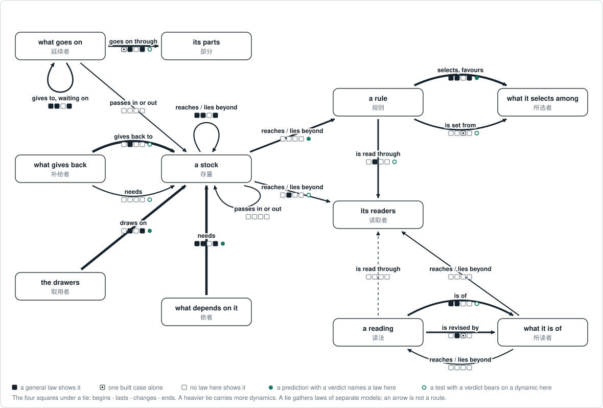

# The theorems and tests behind the map

<!-- Generated by tools/research/research.py render from theories/becoming/results/map/ (tools/research/the_map.py). Edit the data, not this view. -->

[Home](../../../../README.md) · [中文](../../../../README.zh.md) · **Read** · [One page](../../ONE-PAGE.md) · [The theory](../../THE-THEORY-OF-BECOMING.md) · [Chapters](../../chapters/README.md) · [Uses](../../USES.md) · **Check** · [Tests](../../../../TESTS.md) · [Results](../../../../RESULTS.md) · [Proofs](../../../../MAP.md#check-the-proofs-yourself) · [Open questions](../../../../OPEN-QUESTIONS.md) · [Reviewers](../../review/README.md) · **See** · [Atlas](../atlas/ATLAS.md) · [Graph](../THEORY-GRAPH.md) · [Connections](../atlas/CROSSWALK.md) · [How it grew](../../../LINEAGE.md) · [Glossary](../../../../GLOSSARY.md) · [Where everything is](../../../../MAP.md)

*AI-written, 11 November 2026: [how it was made](#how-it-was-made), and [what it does not hold](#what-it-does-not-hold).*

The layer under [the map](THE-MAP.md): the account's theorems and tests, filed on one web of **eleven kinds of role and the ties between them** and counted. A row of the map is a tie of this web; the map says what happens, and this page says where each theorem and each test is kept.

- **A role** is a place in a tie, not a thing: a stock, what draws on it, a rule, what it selects among. One thing can fill two roles.
- **A theorem** is a statement proved on a stated model and checked by the Lean proof checker. It says something general about one tie or one role: what makes it begin, last, change or end, where a line falls, what cannot happen.
- **A case** is one test, in its own words, with what in it was taken as which role. That pairing is a bridge.
- **The two are kept apart.** A case cannot make a theorem wrong: it falls under the theorem or outside it. What it can show wrong lies between them: a bridge, a measure, a scoring rule, the step from a theorem to a prediction, or a thesis, the claim that a whole kind of case fits the roles.

*How to read the picture.* Each box is a kind of role. Each arrow is a kind of tie between two roles, heavier where more of the 184 dynamics speak of it; a dynamic is one pattern of [the atlas](../atlas/ATLAS.md), with the theorems about it. The four squares under a tie stand for begins, lasts, changes and ends (生 住 异 亡). A filled square: a general theorem shows what makes it so. A square with a small mark inside: only a built case shows it, an example that it can happen. An empty square: no theorem written up here shows it. A green dot: a prediction written down before its test was run, and then scored for or against, names a theorem on this tie. A green ring: a test with such a verdict bears on a dynamic that speaks of it. A tie gathers theorems on separate models that each name this kind of tie; an arrow is not a route.

**[The same ledger to operate](the-web.html)** shows every theorem with its conditions and every case with its predictions: choose a tie, a role, a dynamic or a test. (GitHub shows that file as source; [it opens here](https://yongxu.github.io/theories/theories/becoming/results/map/the-web.html).) The same data as pages: [what the theorems say, tie by tie](LAWS.md), [every dynamic, by tie](DYNAMICS.md) and [every test as a case](CASES.md).

## Ways in

| Looking for | Start at |
|---|---|
| what happens to something many draw on: a commons, a budget, a base of support | [the drawers · draws on · a stock](LAWS.md#tie-draws-on-drawers-stock), [what gives back · gives back to · a stock](LAWS.md#tie-gives-back-renewer-stock), [what depends on it · needs · a stock](LAWS.md#tie-needs-dependent-stock) |
| how a reward, a judge, a market or a vote comes to lock on what it already picked | [a rule · selects and favours · what it selects among](LAWS.md#tie-selects-rule-selected), [a rule · is set from · what it selects among](LAWS.md#tie-set-from-rule-selected) |
| what never reaches a rule, and through what a rule is read | [a stock · reaches, or lies beyond · a rule](LAWS.md#tie-reaches-stock-rule), [a rule · is read through · its readers](LAWS.md#tie-read-through-rule-readers), [a stock · reaches, or lies beyond · its readers](LAWS.md#tie-reaches-stock-readers) |
| how a prediction or a model stands to what happens, and what revises it | [a reading · is of, and accords or misses · what it is of](LAWS.md#tie-is-of-reading-subject), [a reading · is revised by · what it is of](LAWS.md#tie-revised-by-reading-subject) |
| how something lasts while its members change, and chains of giving that wait on one another | [what goes on · goes on through its parts · its parts](LAWS.md#tie-passes-on-pattern-parts), [what goes on · gives to, waiting on · what goes on](LAWS.md#tie-gives-to-pattern-pattern) |
| how the tests came out against the theorems | [where reasoning has met a case](#where-reasoning-has-met-a-case), [every test as a case](CASES.md) |
| one dynamic by its name | [every dynamic, by tie](DYNAMICS.md) |
| a name from another field (Goodhart's law, the tragedy of the commons, lock-in by increasing returns) | [the connections](../atlas/CROSSWALK.md), where each is read against the account |

## The roles

A theorem's sentence uses these words and its model's own terms; a case uses its own words. The Chinese names are provisional.

| Role | 中文 | What it is | In the account's words | Theorems about it alone |
|---|---|---|---|---:|
| what goes on | 延续者 | Anything that goes on as the same in some respect: a formation, a whole, a pattern carried by brief carriers, a line of descent, a practice. | formation 形成; pattern 样式 | [49](LAWS.md#role-pattern) |
| its parts | 部分 | What it is made of or carried by, which can turn over while it goes on. | parts; carriers of a pattern | [3](LAWS.md#role-parts) |
| a stock | 存量 | Something with a level that is drawn on and given to: what something lives on, a reserve, a loss counted as it grows. | condition 缘 with a level; reserve | [114](LAWS.md#role-stock) |
| what gives back | 补给者 | What gives to a stock, from inside or from beyond. | renewal 更新; giving 给予 | [1](LAWS.md#role-renewer) |
| the drawers | 取用者 | What takes from a stock: one, the others, or all together. | drawer 取用者; the rest | [4](LAWS.md#role-drawers) |
| what depends on it | 依者 | What needs a stock at some level, whether or not it draws on it. | the dependent 依者; need | [19](LAWS.md#role-dependent) |
| a rule | 规则 | What a choosing goes by: a selection, an order over outcomes, a quota, a score. | selection 选择; order; act law | [3](LAWS.md#role-rule) |
| what it selects among | 所选者 | What a rule picks among: the carriers of what it favours and the rest, with the share of each. | carriers and the others; the share 份额; candidates | [15](LAWS.md#role-selected) |
| its readers | 读取者 | What a rule or a reading is read through: a pool, a group, the couplings into it. | readers 读者; pool 池; couplings | [2](LAWS.md#role-readers) |
| a reading | 读法 | What something holds of what it meets: a view, a prediction, a rank, a code from senses to forms. | a reading; prediction; code; record | [12](LAWS.md#role-reading) |
| what it is of | 所读者 | What a reading is of, or the standard it is read against. | what a reading is of; the standard it is read against | 0 |

102 principal theorems name no role: they hold of anything that goes on (凡相续者), every course, every process, every relation. 23 dynamics are made of such theorems alone. They are the web's legend: [what staying, leaving, returning and resting mean on every tie](LAWS.md#anything-that-goes-on).

## The ties

19 ties are drawn: each is the most-used tie of its kind, or one that at least four dynamics speak of. Each links to what its theorems say. Under each of the four questions stands the number of general theorems that conclude it; a theorem shown by one built case alone is counted beside it (*+ 1 built*). Some theorems say what would follow if something their model holds fixed were changed from outside: they are counted under *given changed*. Neither a built case nor such a theorem fills a square.

| Tie | Dynamics | Theorems, from how many dynamics | Begins | Lasts | Changes | Ends | Other forms | Given changed | Tests naming a theorem here | Tests on its dynamics |
|---|---:|---:|---:|---:|---:|---:|---:|---:|---:|---:|
| [the drawers · draws on · a stock](LAWS.md#tie-draws-on-drawers-stock) | 81 | 34 from 25 | 0 | 1 | 0 | 1 | 30 | 2 | 1 | 28 |
| [what gives back · gives back to · a stock](LAWS.md#tie-gives-back-renewer-stock) | 79 | 19 from 13 | 0 | 1 | 0 | 0 | 13 | 5 | 0 | 24 |
| [what depends on it · needs · a stock](LAWS.md#tie-needs-dependent-stock) | 65 | 65 from 35 | 1 | 6 | 0 | 11 | 39 | 8 | 1 | 24 |
| [a rule · selects and favours · what it selects among](LAWS.md#tie-selects-rule-selected) | 46 | 76 from 30 | 4 | 17 | 0 | 1 | 42 + 2 built | 10 | 8 | 14 |
| [a reading · is of, and accords or misses · what it is of](LAWS.md#tie-is-of-reading-subject) | 31 | 31 from 19 | 4 | 6 + 1 built | 0 | 0 | 19 + 1 built | 0 | 0 | 7 |
| [what goes on · goes on through its parts · its parts](LAWS.md#tie-passes-on-pattern-parts) | 29 | 48 from 18 | 0 + 2 built | 7 + 3 built | 0 | 7 | 18 + 1 built | 10 | 0 | 1 |
| [a stock · reaches, or lies beyond · a rule](LAWS.md#tie-reaches-stock-rule) | 26 | 12 from 6 | 0 | 0 | 0 | 0 | 11 | 1 | 3 | 13 |
| [a reading · is revised by · what it is of](LAWS.md#tie-revised-by-reading-subject) | 20 | 20 from 12 | 0 | 7 | 0 + 2 built | 0 | 11 | 0 | 0 | 0 |
| [a rule · is read through · its readers](LAWS.md#tie-read-through-rule-readers) | 17 | 5 from 4 | 0 | 1 | 0 | 0 | 4 | 0 | 0 | 13 |
| [a rule · is set from · what it selects among](LAWS.md#tie-set-from-rule-selected) | 16 | 4 from 4 | 0 | 0 | 0 + 1 built | 0 | 3 | 0 | 0 | 4 |
| [what goes on · gives to, waiting on · what goes on](LAWS.md#tie-gives-to-pattern-pattern) | 11 | 24 from 8 | 3 | 3 + 1 built | 0 | 4 | 11 | 2 | 0 | 0 |
| [a stock · reaches, or lies beyond · its readers](LAWS.md#tie-reaches-stock-readers) | 7 | 4 from 2 | 0 | 1 | 0 | 0 | 3 | 0 | 0 | 9 |
| [what gives back · needs · a stock](LAWS.md#tie-needs-renewer-stock) | 6 | 4 from 2 | 0 | 0 | 0 | 0 | 4 | 0 | 0 | 9 |
| [a stock · reaches, or lies beyond · a stock](LAWS.md#tie-reaches-stock-stock) | 6 | 12 from 5 | 1 | 1 | 0 | 2 | 6 | 2 | 0 | 0 |
| [what goes on · passes in or out · a stock](LAWS.md#tie-crosses-pattern-stock) | 4 | 2 from 2 | 0 | 0 | 0 | 0 | 0 | 2 | 0 | 0 |
| [a stock · passes in or out · a stock](LAWS.md#tie-crosses-stock-stock) | 4 | 3 from 2 | 0 | 0 | 0 | 0 | 2 | 1 | 0 | 0 |
| [what it is of · reaches, or lies beyond · its readers](LAWS.md#tie-reaches-subject-readers) | 4 | 8 from 4 | 0 | 0 | 0 | 0 | 7 | 1 | 0 | 0 |
| [what it is of · reaches, or lies beyond · a reading](LAWS.md#tie-reaches-subject-reading) | 4 | 5 from 3 | 0 | 0 | 0 | 0 | 5 | 0 | 0 | 0 |
| [a reading · is read through · its readers](LAWS.md#tie-read-through-reading-readers) | 4 | 0 | 0 | 0 | 0 | 0 | 0 | 0 | 0 | 0 |

*Other forms*: a theorem that says what keeps the tie from beginning, where a line falls, what it is unmoved by, that an order is kept, what cannot happen, what holding it shows, or that it is the same as a tie in another model. A theorem written up on several cards counts once. *Tests naming a theorem here*: tests in which a frozen prediction that got a verdict names a theorem on this tie. *Tests on its dynamics*: tests with such a verdict that bear on a dynamic speaking of it, those naming a theorem here among them. A verdict is agreed, not rejected or disagreed.

The 39 thinner ties, by kind, with the number of dynamics that speak of each

- *draws on*: a rule to a stock (1), its readers to a stock (1), what depends on it to a stock (2; 1 theorem), what goes on to a stock (1; 1 theorem), what it selects among to a stock (1; 1 theorem).
- *gives back to*: what goes on to a stock (1).
- *needs*: its parts to a stock (1), its readers to a stock (3; 4 theorems), what goes on to a stock (3; 2 theorems).
- *gives to, waiting on*: a stock to a stock (2), what depends on it to what depends on it (1; 2 theorems), what goes on to what depends on it (1).
- *is set from*: a rule to a reading (2), a rule to a rule (1; 1 theorem), a rule to its parts (1), a rule to what goes on (1).
- *is read through*: a rule to a reading (2; 4 theorems), its readers to its readers (2).
- *reaches, or lies beyond*: a reading to a rule (3; 1 theorem), a reading to what it is of (1), a reading to what it selects among (1; 1 theorem), a rule to a stock (1; 1 theorem), a stock to a reading (2; 1 theorem), a stock to what goes on (1; 2 theorems), a stock to what it selects among (1), its parts to a stock (1; 3 theorems), the drawers to a rule (2; 2 theorems), the drawers to its readers (3; 3 theorems), what depends on it to a reading (1; 1 theorem), what goes on to a rule (1), what goes on to what depends on it (1; 2 theorems), what it is of to a rule (2; 1 theorem), what it selects among to a rule (1; 1 theorem).
- *is of, and accords or misses*: a reading to a reading (2; 4 theorems), a reading to a stock (1).
- *is revised by*: a reading to a reading (3; 1 theorem), a reading to a rule (1), what goes on to a reading (1; 1 theorem).
- *passes in or out*: its parts to what goes on (1; 3 theorems).

## Where reasoning has met a case

A theorem says: if these hold, then that. A frozen prediction is written down before its test is run and names the theorems or the thesis it rests on; the test's record then says which of its conditions were met and what was seen. The 66 tests hold 295 frozen predictions. 154 of them rest on a theorem or a thesis and could have come out either way: 69 follow from a theorem under its bridge, 66 say more than any theorem, 19 are forecasts. Each is placed by its own record:

| The "if" | Seen (agreed) | Not rejected | Not seen (disagreed) | Could not tell | No verdict |
|---|---:|---:|---:|---:|---:|
| met: every condition assessed was met | 26 | 1 | 0 | 1 | 0 |
| not met: at least one condition failed | 11 | 0 | 32 | 8 | 4 |
| not checked: none failed, at least one not checked | 12 | 6 | 12 | 2 | 38 |
| none stated | 0 | 0 | 0 | 0 | 1 |

Counted apart: 26 frozen checks that name a theorem or a thesis (12 identity checks of a built model, which cannot come out otherwise, and 14 checks that a test could fail); 115 frozen entries that name neither; and 18 entries their records state without a freeze: designs, saved comparisons, reports.

Where both sides were settled:

- **The "if" was met and the "then" was seen (26).** They agree. Ask next whether something else predicts the same. [CG3 (round 1)](CASES.md#case-cg3-round-1) 3, [CG3 (round 2)](CASES.md#case-cg3-round-2) 2, [IN1 (round 1)](CASES.md#case-in1-round-1), [LA1b](CASES.md#case-la1b) 4, [LA1c](CASES.md#case-la1c) 2, [LA2](CASES.md#case-la2), [MQ1 (simulation)](CASES.md#case-mq1-simulation) 2, [MQ2](CASES.md#case-mq2) 2, [MQ4](CASES.md#case-mq4), [MQ5](CASES.md#case-mq5), [MQ6](CASES.md#case-mq6), [TR2A](CASES.md#case-tr2a), [TR7A](CASES.md#case-tr7a) 4, [VD2](CASES.md#case-vd2).
- **The "if" was met and the "then" was not seen (0).** No frozen prediction that rests on the account disagreed where every condition assessed was met.
- **The "if" was not met and the "then" was seen anyway (11).** At least one recorded condition failed and the outcome was as predicted; whether it came about another way is not checked here. [CG1](CASES.md#case-cg1), [LA2](CASES.md#case-la2) 2, [LA3](CASES.md#case-la3) 2, [LA4 (Stage A)](CASES.md#case-la4-stage-a) 3, [MQ2](CASES.md#case-mq2), [MQ4](CASES.md#case-mq4), [MQ5](CASES.md#case-mq5).
- **The "if" was not met and the "then" was not seen (32).** Neither held. The records place the failure at the bridge 16, the measure 4, an "if" that was not met 6, the step from theorem to prediction 5, the scoring rule 1. Where the bridge failed, the case was not paired with the theorem's roles and says nothing of where the theorem stops. [CG1](CASES.md#case-cg1) 2, [CG2](CASES.md#case-cg2) 2, [CG3 (round 1)](CASES.md#case-cg3-round-1), [CG3 (round 2)](CASES.md#case-cg3-round-2), [EM1](CASES.md#case-em1) 3, [IN1 (round 1)](CASES.md#case-in1-round-1) 3, [IN1 (round 2)](CASES.md#case-in1-round-2) 2, [LA3](CASES.md#case-la3) 2, [MQ1 (simulation)](CASES.md#case-mq1-simulation) 2, [MQ1 (yeast)](CASES.md#case-mq1-yeast), [MQ2](CASES.md#case-mq2), [MQ3](CASES.md#case-mq3) 4, [MQ4](CASES.md#case-mq4) 2, [MQ6](CASES.md#case-mq6) 4, [TR1A](CASES.md#case-tr1a), [VD1](CASES.md#case-vd1).

For 89 of the 295 frozen predictions the tests' own records name where the prediction, its scoring or its reading failed: the bridge 38, statistical power 13, the measure 10, an "if" that was not met 10, the records 8, the step from theorem to prediction 6, the scoring rule 4.

[Every test as a case](CASES.md) gives each test in its own words, what it took as which role, its bridges and each prediction; [the tests](../../../../TESTS.md) list how each came out, in its folder's words.

## What it holds today

| | |
|---|---|
| Dynamics placed | 184; 23 of them hold of anything that goes on and name no role |
| Ties between roles | 19 drawn; 39 thinner ones listed |
| Principal theorems written up | 778 write-ups of 731 Lean theorems; 723 of the 731 are among the 2,099 Lean theorems the atlas lists with premises. Counting a theorem once in a place: 420 on a tie, 222 on one role, 102 on anything that goes on |
| Drawn ties where no general theorem shows | a beginning: 14 (on 1, one built case does); a lasting: 8; a change: 19 (on 2, one built case does); an end: 13 |
| Tests | 66; in 47 at least one frozen prediction got a verdict |
| Frozen predictions | 295: 117 agreed, 8 not rejected, 64 disagreed, 17 could not tell, 89 with no verdict; 18 more entries were not frozen |
| Conditions assessed in cases | 598: 274 met, 106 failed, 218 not checked |
| Bridges the tests rest on | 327: 49 held, 58 failed, 66 by construction, 154 not checked |
| Lean theorems a prediction names | 145; 70 are among the atlas's theorems with premises, 75 are not |
| Dynamics a test bears on | 36 of 184 |
| Drawn ties and the tests | a frozen prediction with a verdict names a theorem on 4; a test with such a verdict bears on a dynamic of 7 more; none on 8 |

## What it does not hold

- **The kinds do not hold everything.** Every card says what of its dynamic the roles, ties, marks, forms and frames leave out: most often amounts, theorems that name no role, and conclusions that fit no form. The note is on the ledger to operate, under each dynamic.
- **A tie gathers separate models.** Roles of two models are drawn as one place where each model names that kind of role. Where no proof joins the two models, that sameness is a reading. Each tie's section says how many dynamics its theorems come from; the picture draws one line.
- **Only principal theorems are written up.** A card takes its dynamic's main results and most of the theorems its exits and transitions cite: 731 Lean theorems, where the atlas lists 2,099 with premises.
- **The question a theorem is filed under is a reading of its statement.** A theorem written up on several cards can be read under a different question on each; in a place it counts once, by the write-up of the course itself.
- **A filled square says a general theorem concludes that mark, not how much is known.** One theorem fills it.
- **A prediction's place rests on a reading of its test's record:** whether it was frozen, which conditions were met, and what was seen. The reading is the case's; the test's folder is the record.
- **A condition is given by its name in the atlas's ledger.** The ledger keeps its statement, and for 7 theorems it lists none.
- **The Chinese is provisional.**

## How it was made

The ground is [web.json](web.json): the kinds of role and tie, the marks, the forms and the frames. [cards.json](cards.json) holds one card for each dynamic and [cases.json](cases.json) one case for each test. Each card was written by an AI reader from the Lean statements, each case from its experiment's own record, and each was put to a second reader to refute. The ledger adds no result and changes no entry: the atlas and the Lean say what is proved, and the tests' folders say how each test came out.

`tools/research/the_map.py` checks the three files against the atlas and the tests table and writes this page, its picture, its three pages of detail and the ledger to operate at each render. The render stops at a card whose theorem is not a declaration of its dynamic, at a condition the ledger does not hold, and at a theorem's sentence that uses a word on the tool's short list of words that fit only a person. A model's own terms stay its own: a model of a round of work has a worker and a reviewer.
