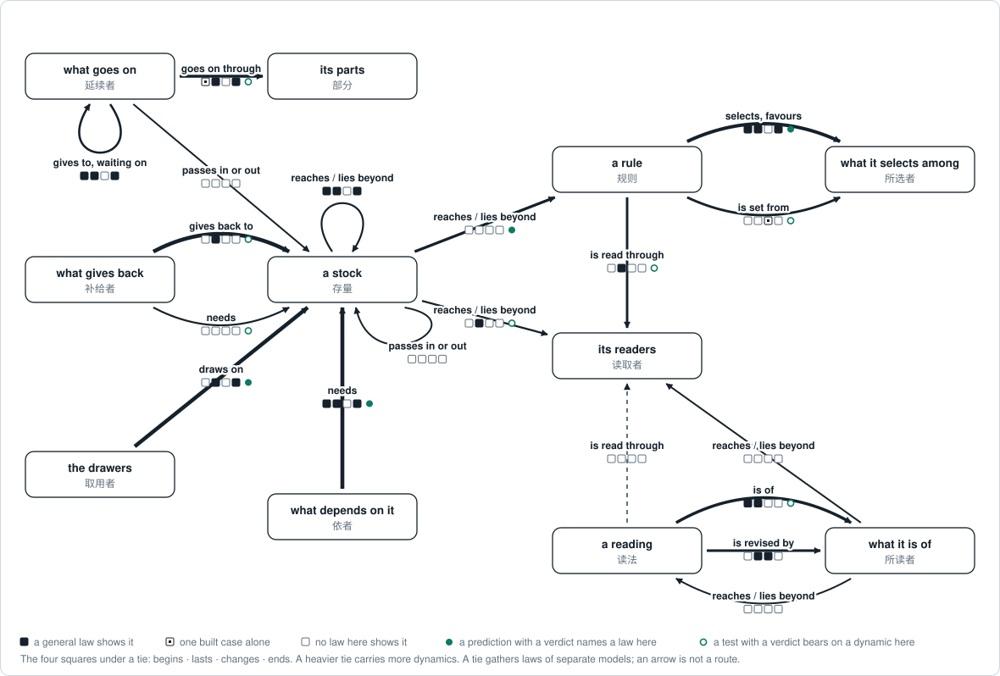

# The map

<!-- Generated by tools/research/research.py render from theories/becoming/results/map/ (tools/research/map_sheet.py). Edit the data, not this view. -->

[Home](../../../../README.md) · [中文](../../../../README.zh.md) · **Read** · [One page](../../ONE-PAGE.md) · [The theory](../../THE-THEORY-OF-BECOMING.md) · [Chapters](../../chapters/README.md) · [Uses](../../USES.md) · **Check** · [Tests](../../../../TESTS.md) · [Results](../../../../RESULTS.md) · [Proofs](../../../../MAP.md#check-the-proofs-yourself) · [Open questions](../../../../OPEN-QUESTIONS.md) · [Reviewers](../../review/README.md) · **See** · [Atlas](../atlas/ATLAS.md) · [Graph](../THEORY-GRAPH.md) · [Connections](../atlas/CROSSWALK.md) · [How it grew](../../../LINEAGE.md) · [Glossary](../../../../GLOSSARY.md) · [Where everything is](../../../../MAP.md)

[中文](THE-MAP.zh.md)

*AI-written, 12 November 2026: [how far it goes](#how-far-it-goes).*

A map of how anything forms, lasts, changes and ends, drawn so that people and AI can see the way together. Its first path: what picks among things by a rule (a reward, a judge, a market, a training run) can use up what the rule does not count, can lock itself in where the rule is updated from its own picks, and in built examples loses what would have read the loss. One way out is a law of the course itself: where the loss gets back to the rule in time, the rest count it, and the judgments together go against what the rule favoured at two updates running, the rule turns. No law drawn says what brings a loss to get back to the rule or to be counted. Every other way out drawn needs something given from outside, or is shown only in a built example or as a reading.

Drawn so far: 50 boxes on 14 rows, 5 paths told step by step, 7 tests laid on them.

*How to read it.* Each row asks one thing. Each box is one way the answer can stand. To place a thing, find on each row that applies to it the box that fits it; the boxes drawn so far need not hold every answer. An arrow with a head is a way from one box to another: along a row, a change of that row's answer; between rows, from one row's answer to another's. Its line says how that is known: solid where it is proved, dashed where it is proved only with something given from outside, dotted where it is not shown in general (a built example, or a reading). *Proved* means a theorem on a stated model, checked by machine; whether a real case fits the model is what the tests show. A line with a bar across it and no head is not a way from one box to the other: it marks a proved boundary between the two. A double line, also without a head, says one box is a case of another. On a path, a hollow number marks a step that is not proved of the course itself. A small ring on a box: something is known about staying there. A violet dot: a test is laid on it. A box outlined in green dashes is one the work wants to reach.

**[The same map to operate](interactive.html)**: choose a path, a test, any box or any arrow, or place something you know. (GitHub shows that file as source; [it opens here](https://yongxu.github.io/theories/theories/becoming/results/map/interactive.html).)

## The first path: A rule that holds itself in place

A reward, a judge, a market, a vote or a training run picks among things by a rule. This path follows what can happen to such a rule, and what turns it.

Close to what others call: [Goodhart's law, in its popular wording](PLACES.md#box-b2-uncounted); [cumulative advantage (the Matthew effect in its generalised form)](PLACES.md#box-b1-held); [regulatory capture](PLACES.md#box-bs-pays); [adaptive preferences (Sen)](PLACES.md#box-b3-inside); [Collingridge's dilemma](PLACES.md#box-b2-heard); [Guoyu: 國人莫敢言 (no one dared speak)](PLACES.md#box-b3-gone).

What is in it, and the words used

- **the rule**: what the picking goes by: a reward, a score, a price, a count of votes.
- **an update**: the rule set again; between updates it stays as it was. What it is set from differs from step to step, and each step says: its own picks, or judgments.
- **locked; the lock**: the rule favours one side and the next update would favour it no less; from there neither the favour nor that side's share falls.
- **the favoured side, its share and its lead**: what the rule picks more of. Its share is how much of the whole it has; its lead is the same thing told as how far ahead of the rest it is.
- **the rest**: what is picked among besides the favoured side. Where the rule is set from the judgments of what it picked (steps 7, 9 and 14), the rest judge too, and weigh by their numbers.
- **the loss**: how much has been used up of something the rule leaves out. What lives on that thing bears it. It is still called the loss once something counts it.
- **what reads the loss, or counts it**: anything among what sets the rule whose judgment changes with the loss.
- **what sets the rule**: those the rule is set from: from their judgments in steps 7, 9 and 14; in steps 8 and 15, from whether each of them keeps going.
- **the shapers**: what spends to change the rule in its own favour.
- **of the course itself; given from outside**: the first: proved under the conditions its sentence gives, with nothing else put in. The second: proved only with a further premise put in, which the step names: that the loss goes on growing, a way of judging, a measure, a limit, or where the loss falls. Which premises are marked as given from outside is the map's own marking, not a difference between two kinds of proof.
- **a built example**: a small case made up and worked out exactly, in which the thing happens. It shows that it can happen, not that it must.

Unmarked steps are proved, each under its condition. [Every step with the law it stands on](PATHS.md#path-lock).

**How it closes**

1. Where a rule leaves something out and that thing is being used up, the rule scores the outcome the same however much is used; what lives on that thing bears it. Such as a catch quota met every year while the seabed that feeds the fish wears away.
2. Where the rule is updated from its own picks: if every update favours the same side, and no less when that side's share is larger, the rule is locked in from the step after its second update, wherever it started. Such as a keyboard layout: people learn it because machines have it, and machines have it because people learned it.
3. A lock that goes by the lead alone runs the same however much is used up. That the loss goes on growing, locked or not, is assumed by the laws, not proved. *(proved only with something given from outside)*
4. In built examples, what is used up is what the readers of the loss stood on. They are removed. *(built example only)*
5. Once nothing is left that counts the loss, and none comes back, a lock that stands stays for good, provided what is used up never lowers the lead.
6. Where the judging of the rule is set by that same side too, the lock is closed on itself. It stays at every step, however far a loss that makes no difference to anything inside it grows. The account calls this loop the meta-attractor; this is its closed form. Such as a ranking refit to the clicks its own top results draw, its success measured by those same clicks. *Laid on a judge that reads its own earlier picks: in the arm that began with one side far ahead and the loss noted nowhere, it stayed locked in 5 of 5 runs while the loss grew. In another arm of the same test one note of the loss among nine turned the judge: it does not meet the law's conditions (step 14).*

**Another way in**

7. Shaping the rule in the shapers' own favour pays wherever what comes back to the shapers alone covers the cost. Where the rule is updated from the judgments of what it picked, and the shapers judge that return no lower than the rest do, a start at which shaping pays is locked in. Such as lobbying whose gains come back mostly to the firm that paid for it.

**The ways out**

8. For a rule that goes only by whether those that set it keep going: the loss gets back to it in time exactly where at least one of them can tell it while what is being lost can still be kept. Such as residents downstream who now sit on the board that sets the discharge limit.
9. If the rest count the loss, and the judgments taken together go against what the rule favoured at this update and the next, the rule turns. The turn is for good provided the rest go on counting the loss and judge no more in the favoured side's favour than that side does.
10. Or the judging is one that stops favouring once the loss passes a set amount. Then, where the loss goes on growing (given), the lock ends once it has passed that amount, however far ahead the favoured side is. *(proved only with something given from outside)*
11. Or the loss falls on the shapers themselves. It adds to their cost, and past a line shaping no longer pays. *(proved only with something given from outside)*
12. Or whether each keeps going is measured over everything that began, not only over what is left. Then every removal shows. *(proved only with something given from outside)* Such as a trial that counts every patient enrolled, including those who dropped out.
13. Or only outcomes that keep every need are allowed. Then the best by the rule takes only the spare. *(proved only with something given from outside)*

**Where it is too late**

14. If, by the time the rest begin to count the loss, the judgments together already favour what the rule favours, the lock stays (the rest judging no more in the favoured side's favour than that side does). Such as a minority report filed every year and outvoted every year. *The same judge: with one note in nine it chose prose in all 50 picks, and the share then swung back and forth. The law's condition was not met.*
15. If the loss makes no difference to anything that sets the rule until what is being lost can no longer be kept, no rule that goes only by whether those things keep going can read it in time. With room to gain, every best outcome by the rule leaves the uncounted thing at its lowest allowed level; what lives on it, still needing it, ends where that level is below its need. *Three AI fishers: an untold bed was kept in 0 of 60 seasons. Taking the best catch for themselves gives the same.*
16. In one built example the rule had turned; but the lead, grown large, used up what the counters of the loss stood on. They were gone, and the lock came back for good. *(built example only)*

**What no law shows**

17. No law says what first makes a rule start to be updated from its own picks. Until the first such update it stays as it began, whatever it picks. *(proved only with something given from outside)*
18. Two readings, with no law behind them. The loop reaches its own checks: the ways a loss could come to count are filled from inside and, one order further, breaking them is what gets rewarded. And the loop goes on remaking what picks it while what carries it is replaced. *(a reading, not proved)*

The steps sorted by how each is known: [what this path shows](PATHS.md#path-lock).

**What the work wants.** For people and AI choosing together: a rule that still counts what it uses up, set with the rest counting too, and a choosing in which shaping the rule does not pay. On this map those are the three boxes outlined in green: "The cost counts", "The rest count too" and "Shaping the rule costs". Four arrows on the whole map lead into the first, two of them on this path. One is a law of the course itself: where the rest count the loss and the judgments taken together go against what the rule favoured, the rule turns. The turn is for good if they still go against it at the next update, provided the rest go on counting the loss and judge no more in the favoured side's favour than that side does. The other three need something given from outside. No arrow drawn leads into the second, and it has no anchor in the Lean yet. One arrow leads into the third, a loss that falls on what shapes the rule, and that too is given from outside. This is wanted; it is not shown.

## The other paths

- **[Living on what comes back](PATHS.md#path-stock)** (15 steps). Anything that keeps going lives on something: a field, a fishery, a budget, a base of trust. This path follows that thing from holding its level to running out, and the ways back.
- **[What can still correct a view](PATHS.md#path-view)** (14 steps). A diagnosis, a stock list, a map, a forecast, a model's picture of its task: each is a view of something, and what comes back from that thing can correct it or fail to. This path follows a view from several accounts still open, to checked, to going by how things were; then two places where it stands whether right or wrong, with what it takes to leave each; and last, where the difference is seen and the means to correct are lacking.
- **[Giving that waits on giving](PATHS.md#path-giving)** (11 steps). Neighbours lend because the last loan came back; a workshop delivers because its supplier did. This path follows such giving: how it keeps going round, how one lapse can end it, and what starts it again. Beside it the path sets what outlasts each thing that carries it, such as a craft each master teaches the next: how it lasts by being handed on, and how it is gone.
- **[What each turn brings back](PATHS.md#path-returns)** (14 steps). A microphone that picks up its own loudspeaker, a shower tap turned back and forth, a debt that bears interest on interest: what is done travels on, and sometimes comes back to where it began. This path follows one difference sent out, a little more or less than there would otherwise be: whether it comes back at all, and whether each turn returns less of it, the same, or more.

**[Start from a name you know](PLACES.md#by-name)**: Goodhart's law, in its popular wording, the tragedy of the commons (Hardin), positive testing, one form of confirmation bias (Wason; Klayman and Ha), the gift that binds and moves on (Kimmerer; Mauss), oscillation in a balancing loop with delay (Forrester; Senge), and others.

## Where the reasoning met the world

Each test is laid on the map with what in it was taken as which box, what the reasoning said, what was seen and what gave way. Here each is given in a sentence or two; its page has the rest. 6 of the 7 were run in built set-ups, with language models or small learning programs; 1 on data from the field.

- **[Three AI fishers and a mussel bed](PATHS.md#test-lake)** (IN1). Not told of the mussel bed, the fishers kept it in 0 of 60 seasons, as the reasoning said; simply taking the best catch for the three gives the same. Told of it and told to count it, each of the two models kept it in 1 season of 10, and with a public message each as well one kept it in 8 of 10, the other in 1, where the reasoning said both times that they would keep it. What gave way was the pairing of the lake with the boxes, twice; no law was tested.
- **[A judge that reads its own earlier picks](PATHS.md#test-judge)** (LA2). With nothing reading the loss, the judge locked on lists in 5 of 5 runs, and it turned where it read the loss itself: both as the reasoning said. Where only one answer in nine carried the loss, the reasoning said the lock would stay; the judge chose prose in all 50 picks, and the share then swung back and forth. What gave way was the pairing (this judge does not read as a pool of readers counted by kind) and the scoring rule fixed beforehand, which passed that swinging course as kept.
- **[113 assessed fish stocks](PATHS.md#test-stocks)** (MQ3). Below the point drawn from the fitted curve, 63% of stretches were lower three years on and 43% fell every year, where the reasoning said all would fall every year; above it, 40% ended lower than they began, where it said none would. A condition of the reasoning gave way: in these stocks what is given back is not read off the level. The pairing is in doubt as well.
- **[Small trained policies and a bay a colony needs](PATHS.md#test-season)** (LA4 (Stage A)). Nothing fixed beforehand was contradicted: by 85% of the best catch, where nothing yet forces it, both kinds of network had left the bay almost empty. But the learning rule alone largely gives that, and where the reward did not count the bay's fish the result stayed unresolved, the measure giving way: runs ended at one extreme or the other. Before the run the pairing gave way and a clause of the conjecture was narrowed: a bay left out of the reward had been taken as one that learning does not push.
- **[Learning harvesters on one shared apple patch](PATHS.md#test-patch)** (EM1). Of eleven versions, a calculation beforehand marked five open (holding back pays) and six locked (against others who pick at every step, holding back gains a picker next to nothing). The five open ones were kept, as forecast; of the six locked ones three ended empty and three were kept, where the forecast said all six would end empty. What gave way was the pairing, not the law: the law holds for each course of events and does not decide where such learners end up.
- **[An AI choosing how many apples to leave, shown clear results](PATHS.md#test-harvest)** (LA1b). Every forecast passed. Where, by calculation, leaving apples pays nothing, all 30 runs ended leaving none, even with the bonus raised sixteenfold; where leaving pays, all 10 ended leaving some. Nothing gave way. What the run tests is whether the model follows the results it is shown, rounds set for it among them; the apples left were inside its reward, so it is no test of a loss the reward does not read.
- **[Learners checked at one stage and not the next](PATHS.md#test-checkedonce)** (TR7A). In each of the eleven runs that carry the verdict, all 20 learners ended nearer what the law calls best than they began; two of those runs could only pass, and in three the best is a derived chance, not proved in Lean. Nothing gave way, and the law itself, proved beforehand, was not on trial: these learners are built to climb toward more points on average, so the test shows only that the noise of sampled games, at these settings, left that direction standing. It says nothing of other trained systems.

## The whole map

Along a row, further right means less is still open from there. That order is ours: an order of open and closed, not of better and worse. The last band holds for anything that keeps going, whatever its ties, and has no such order. Counted over the arrows drawn so far that run along a row (boundaries and the last band apart): 12 of the 18 that run right are proved of the course itself; of the 20 that run back, 4 are, 14 need something given from outside and 2 are shown only in a built example. This is a count on an order we chose, not a finding.

### Every box

**What it lives on**

- *Whether what is spared comes back to the one that spared it*: [What it spares comes back to it](PLACES.md#box-b0-pays) · [Each takes little, together too much](PLACES.md#box-b0-together) · [What it spares is lost to it](PLACES.md#box-b0-lost)
- *What is taken against what comes back*: [Always something new](PLACES.md#box-a1-new) · [More comes than goes](PLACES.md#box-a1-up) · [Taking within what comes back](PLACES.md#box-a1-within) · [Taking more than comes back](PLACES.md#box-a1-over) · [Past turning back](PLACES.md#box-a1-past)
- *What lives on it*: [Has what it needs](PLACES.md#box-a2-supplied) · [Short of what it needs](PLACES.md#box-a2-short) · [Keeps going as something else](PLACES.md#box-a2-else) · [Ended](PLACES.md#box-a2-ended)

**What the choosing goes by**

- *Where the rule comes from*: [Set from outside](PLACES.md#box-b1-outside) · [Follows its own picks, not yet locked](PLACES.md#box-b1-swing) · [Holds itself in place](PLACES.md#box-b1-held)
- *Whether what is used up gets back to the rule*: [The cost counts](PLACES.md#box-b2-counted) · [Gets back to the rule in time](PLACES.md#box-b2-felt) · [Using up what is not counted](PLACES.md#box-b2-uncounted) · [Gets back, but the lock stays](PLACES.md#box-b2-heard)
- *What counts when the rule is set*: [A list fixed at the start](PLACES.md#box-b3-list) · [The rest count too](PLACES.md#box-b3-rest) · [What would read the loss is gone](PLACES.md#box-b3-gone) · [Judged only by its own picks](PLACES.md#box-b3-inside) · [Even the checks are its own](PLACES.md#box-b3-checkers)
- *Whether shaping the rule pays*: [Shaping the rule costs](PLACES.md#box-bs-costs) · [Shaping the rule pays](PLACES.md#box-bs-pays)

**A view and how things are**

- *How a view meets how things are*: [Ruling out what does not fit](PLACES.md#box-c1-open) · [Checked against the thing itself](PLACES.md#box-c1-checked) · [Going by how it was](PLACES.md#box-c1-old) · [Keeps to the known road](PLACES.md#box-c1-road) · [Looks the same from here](PLACES.md#box-c1-same) · [Sees it, lacks the means](PLACES.md#box-c1-nomeans)

**Between things that keep going**

- *How they depend on one another*: [Each depends on the others](PLACES.md#box-d0-ring) · [Held up wholly by another](PLACES.md#box-d0-line)
- *Giving that waits on giving*: [Giving goes round](PLACES.md#box-d1-round) · [One link has dropped out](PLACES.md#box-d1-gap) · [Each waits for the other](PLACES.md#box-d1-wait)
- *Lasting through what carries it*: [Handed on](PLACES.md#box-d2-handed) · [Stopped for want of one thing](PLACES.md#box-d2-stalled)
- *How many ways are in use*: [Several ways in use](PLACES.md#box-d3-several) · [All on the same one](PLACES.md#box-d3-one) · [No longer told apart](PLACES.md#box-d3-merged)

**Of anything that keeps going**

- *Whether what it does comes back*: [Nothing it does comes back](PLACES.md#box-e1-line) · [What it does comes back](PLACES.md#box-e1-ring)
- *How much comes back each turn*: [At rest](PLACES.md#box-e2-rest) · [Made good again](PLACES.md#box-e2-good) · [Coming round again](PLACES.md#box-e2-round) · [Swinging past the mark](PLACES.md#box-e2-swing) · [Growing on itself](PLACES.md#box-e2-grow) · [Nowhere it could rest](PLACES.md#box-e2-norest)

## How far it goes

*Proved* means a theorem on a stated model, checked by machine (Lean). A real case may not meet a law's conditions, or may be paired with the boxes wrongly: the tests laid here show both.

Written and checked by AI readers. The person who directs the work has read the first path, in an earlier wording; no reading by anyone outside the work is recorded yet. What each part was written from, and what it was set against:

| What | Written by | Set against |
|---|---|---|
| The 105 arrows: the full sentence of each | an AI reader | the law's Lean statement: 71 by a second AI reader, who corrected most; 31 by their one reader, each marked; 3 have no Lean statement (they are readings, or say one box is a case of another). Under 28 of the arrows stand 40 further sentences, 30 read twice and 10 once, each marked. The 26 sentences on staying at a box carry no mark: by the earlier logs, 25 have been set against the Lean by a second AI reader and one, at the lock, by its one reader |
| The arrows' short tags, the steps of the first two paths, some names of boxes and rows | the coordinating AI | the sentences they stand on, by further AI readers; not the Lean again, except the first six steps of the first path and the arrow from the lock to what is not counted, which one AI reader has since set against the Lean, correcting three of those steps and that arrow |
| The other 3 paths | an AI reader each | the arrows' sentences and, where a step turns on the law, the Lean, by a second AI reader |
| The 50 boxes, with their sentences and examples | the coordinating AI, from places AI readers proposed out of the account's 184 dynamics | 48 are tied to a definition or a law in the Lean; the examples are illustrations, not tested cases |
| The 7 tests laid on the map (8 rows of the account's table of tests: the two rounds with the fishers are two) | AI readers, from each test's own record or an earlier summary of it | the record, by a second AI reader; the later ones were then shortened and set against the record again |
| The sentence or two that opens each test; the names listed under each path; the opening paragraph; the cast of the first path | the coordinating AI | the records of the tests, the boxes' names with their readings, the first path with its arrows, and the Lean, by a second AI reader, who corrected all seven opening lines of the tests, the opening paragraph and 6 of the 21 names; the cast, against the Lean and the first path's boxes, by a further AI reader, who corrected most of it |
| The 45 names others gave, at 34 boxes | taken from the account's readings of other traditions and fields, most of them AI readings of a source recalled, not reread | the reading each comes from, by a second AI reader, who corrected most. Their Chinese forms are the AI readers' and are not yet checked against Chinese editions |
| The Chinese | AI readers, beside the English | read through as Chinese by two AI readers, one the boxes and arrows, one the first page, the paths, the opening lines of the tests and three of the tests in full; each returned 45 repairs and named more left standing. Six further AI readers set those repairs against the English, and against the Lean where a condition was touched, and corrected most. The full texts of the other four tests were not read through this way |

A name others gave says a place is close to what its source describes, sometimes only within limits its reading states, or is told apart from it; it is not the source's agreement. Not yet on the map: most of the 325 ways out of a condition and the 104 passages between conditions that the account has recorded, 58 of its 66 tests, and most of its readings of other traditions and fields.

The laws and tests behind the map, by role and tie: [the ledger](LEDGER.md), [what the laws say](LAWS.md), [every dynamic](DYNAMICS.md), [every test as a case](CASES.md).

