# 地图

<!-- Generated by tools/research/research.py render from theories/becoming/results/map/ (tools/research/map_sheet.py). Edit the data, not this view. -->

[English](THE-MAP.md) · [首页](../../../../README.zh.md) · [地图](THE-MAP.zh.md)

*由 AI 写成，2026 年 11 月 12 日：[做到了哪一步](#做到了哪一步)。*

这张图画的是：任何东西怎样生成、延续、变化、终结；画出来，是为了人和 AI 能一起看清路。第一条路：凡是按一条规则在各种东西之间取舍的（奖励、评委、市场、训练），可能耗掉规则没算进去的东西；规则照自己选出的结果来重定，就可能把自己定住；在造出来的例子里，本来读得到损耗的还被清走了。有一条出路是过程自己的定律：要是损耗及时传回规则那里，其余的把它算进去，合起来的判断接连两次重定都不利于规则原先偏向的一方，规则就转向。损耗怎样才传得回去、怎样才被算进去，图上的定律没有说。图上其余的出路，或者要有过程之外给定的东西，或者只见于造出来的例子，或者只是一种解读。

目前画出的：14 行上的 50 个方框，5 条一步一步讲的路，7 个放在上面的检验。

*怎么读。* 每一行问一件事。每个方框是一种可能的回答。要给一样东西找位置，就在每一个用得上的行里找合它的那个方框；目前画出的方框未必是全部的回答。带箭头的线是从一个方框到另一个的路：沿着一行的，是这一行的回答变了；跨行的，是从一行的回答通到另一行的回答。线型标明凭什么这么说：实线是已证明的；虚线是已证明、但要有过程之外给定的东西；点线是没有一般证明的（造出来的例子，或者一种解读）。“已证明”是指在写明的模型上成立、由机器检查过的定理；真实的情形合不合这个模型，要看放在图上的检验。线上有一道短杠、不带箭头的，不是从一个方框到另一个的路：它标的是两个方框之间已证明的界线。双线也不带箭头，表示一个方框是另一个的特例。路上空心的编号，标的是没有就过程本身证明的那几步。方框角上的小圆圈：关于“留在那里”已经知道一些。紫色的小点：有检验放在这里。绿色虚线框出的方框，是这项工作想要到达的。

**[这张图的互动版](interactive.html)**：选一条路、一个检验、任何一个方框或箭头，或者放上你熟悉的一件事。（GitHub 上这个文件显示为源码；[在这里打开](https://yongxu.github.io/theories/theories/becoming/results/map/interactive.html)。）

## 第一条路：规则怎样把自己定住

奖励、评委、市场、投票、训练，都是按一条规则在取舍。这条路讲的是这样的规则可能走到哪里，什么能让它转向。

相近的说法：[古德哈特定律（通行的说法）](PLACES.zh.md#box-b2-uncounted)；[优势累积（马太效应推广后的说法）](PLACES.zh.md#box-b1-held)；[规制俘获](PLACES.zh.md#box-bs-pays)；[适应性偏好（森）](PLACES.zh.md#box-b3-inside)；[科林格里奇困境](PLACES.zh.md#box-b2-heard)；[《国语》：国人莫敢言](PLACES.zh.md#box-b3-gone)。

这条路上有什么，用的是哪些词

- **规则**：取舍所凭的东西：奖励、分数、价格、票数。
- **重定**：把规则重新定一次；两次重定之间，规则不变。照什么来定，各步不同，每一步自己会写明：照它选出来的结果，或者照各方的判断。
- **定住；定局**：规则偏向一方，而且下一次重定也不会偏得更少；从这里起，偏向和这一方的份额都不再降。
- **受偏向的一方，它的份额和领先**：规则多选的那一方。份额是它占了多少；领先说的是同一件事：它比其余的多出多少。
- **其余的**：被取舍的各方里，受偏向的一方之外的。规则若是照它选中的各方的判断来定（第 7、9、14 步），其余的也在判断，分量按数量算。
- **损耗**：规则没算进去的那样东西已经被耗掉多少。承受后果的，是靠这样东西延续的。后来有哪一方把它算进去了，它也还叫损耗。
- **读得到损耗的，把损耗算进去的**：定规则的各方里，判断会随损耗而变的一方。
- **定规则的各方**：规则照着来定的那几方：在第 7、9、14 步，照的是它们的判断；在第 8、15 步，照的是它们各自还在不在。
- **改规则的一方**：花代价把规则往自己这边改的一方。
- **过程自己的；过程之外给定的**：前一种：在句子写明的条件下得到证明，不用另外放进什么。后一种：要另外放进一条前提才得到证明，放进的是什么，那一步会写明：损耗照旧在涨，某一种评法，某一种量法，某一条限制，或者损耗落在哪一方身上。哪些前提标作“过程之外给定的”，是这张图自己的标法，不是证明分成了两类。
- **造出来的例子**：专门搭出来、算得清的小例子，里面确实发生了这件事。它说明这件事可能发生，不说明一定发生。

没有标记的步骤都已证明，各有条件。[每一步和它依据的定律](PATHS.zh.md#path-lock)。

**它是怎么合上的**

1. 要是有样东西规则没算进去，它又在被耗掉：耗多耗少，规则打的分都一样；承受后果的，是靠这样东西延续的。比如配额年年达标，养鱼的海床却在一点点磨掉。
2. 规则若是照自己选出来的结果重定：只要每次重定都偏向同一方，这一方占得越多、偏向也不减，第二次重定之后就定住了，从哪里开始都一样。比如键盘布局：机器这么排，所以大家这么学；大家这么学，所以机器这么排。
3. 只看领先多少的定局，不管耗掉多少，都照原样走下去。损耗一直在涨（定不定住都一样），这是定律假定的，没有证明。*（已证明，但要有过程之外给定的东西）*
4. 在造出来的例子里：被耗掉的，正是读得到损耗的那一方立足的东西。它们被清走了。*（只在造出来的例子里见过）*
5. 算这笔损耗的一个都不剩，也不再回来；只要耗掉的不把领先的份额拉下来，已经立住的定局就从此不变。
6. 连怎么评这条规则，也由同一方来定：这个定局就合上了。只要损耗影响不到圈里的任何一样，不管它涨到多大，定局每一步都还在。这套理论把这个圈叫作“元吸引子”；这里说的是它合上以后的样子。比如榜单照着自己榜首带来的点击重排，成效也用这些点击来衡量。 *放到一个参照自己旧选择的评委上：有一组开始时一方已经遥遥领先，损耗哪儿都没提，这一组 5 轮里 5 轮都定着，损耗照涨。同一个检验的另一组里，九份中只有一份提到损耗，评委就转了向：它不满足定律的条件（见第 14 步）。*

**另一条进来的路**

7. 把规则往自己这边改，只要单单回到改规则一方的那份回报抵得过花费，就划得来。规则若是照它选中的各方的判断来重定，改规则的一方对这份回报的估计又不低于其余的，那么从改规则划得来的起点出发，这个局面就定住了。比如谁出钱游说，好处大半回到谁手里。

**出路**

8. 对只看定规则的各方还在不在的规则来说：损耗算不算及时传到规则那里，只看定规则的各方里有没有一方，能趁正在被耗掉的那样东西还留得住，就把损耗分辨出来。比如下游的居民进了定排放标准的委员会。
9. 要是其余的把损耗算进去了，合起来的判断在这一次和下一次重定时都不利于规则原先偏向的一方：规则就转向。只要其余的此后一直算着这笔损耗，它们的判断又不比受偏向的一方自己更偏向这一方，规则就从此不再转回。
10. 或者，评法本身就是：损耗过了定量就不再偏向。那么，损耗照旧在涨的话（这是给定的），一过那个量，不管受偏向的一方领先多少，定局都会破。*（已证明，但要有过程之外给定的东西）*
11. 或者，损耗落到改规则的一方自己身上：它加进了花费，过了一条线，改规则就不再划得来。*（已证明，但要有过程之外给定的东西）*
12. 或者，“是不是每一个都还在”按一开始的全部名单来量，不只在剩下的里面量。那样，清走一个就显出一个。*（已证明，但要有过程之外给定的东西）*比如临床试验把入组的每个病人都算上，中途退出的也算。
13. 或者，只允许这样的结果：每一份需要都保得住。那样，按规则做到最好，也只取走富余的。*（已证明，但要有过程之外给定的东西）*

**什么时候就晚了**

14. 要是等其余的开始算这笔损耗的时候，合起来的判断已经偏向规则所偏向的一方：定局不改（前提是其余的判断不比受偏向的一方自己更偏向这一方）。比如年年提交、年年被否决的少数意见。 *同一个评委：九份里只有一条备注，它 50 次全选了段落，此后份额来回摆。定律的条件不满足。*
15. 要是损耗非等到正在失去的东西留不住了，才在定规则的各方身上显出差别：那么只看它们还在不在的规则，没有一条来得及读到。只要还能多得，按规则算最好的结果，每一个都把规则没算进去的那样东西压到允许的最低处；要是这个最低处低于需要，那些照旧需要它、靠它延续的就尽了。 *三个 AI 渔民：没告诉它们有贝床时，60 季里一季也没留住。单是照对三家最有利的量去捕，也是这个结果。*
16. 造出来的一例：规则本来已经转了向；可是领先的一方份额已大，把算损耗的一方立足的东西耗尽了。它们不在了，定局又回来，从此不变。*（只在造出来的例子里见过）*

**定律没有说的**

17. 规则最初怎么开始照自己选出的结果重定，定律没有说。在第一次这样重定之前，不管选出什么，规则都和开始时一样。*（已证明，但要有过程之外给定的东西）*
18. 两条解读，都没有定律。一条：这个圈伸到了查错的途径上，损耗本来可以靠它们算进去的那些途径，也由圈里的占着；更进一层，弄坏这些途径反倒受奖励。另一条：承载它的换了一茬又一茬，这个圈照旧重建出选中它的条件。*（解读，没有证明）*

把每一步按“凭什么这么说”归类：[这条路显出来的](PATHS.zh.md#path-lock)。

**这项工作想要的：**人和 AI 一起取舍的时候：规则把自己耗掉的也算进去，定规则时其余的也算数，改规则划不来。在这张图上，就是绿色虚线框出的三个方框：“代价算进去了”“其余的也算”“改规则划不来”。通向第一个的箭头，整张图上有四条，其中两条在这条路上。其中一条是过程自己的定律：其余的把损耗算进去，合起来的判断不利于规则原先偏向的一方，规则就转向。下一次重定时仍然不利，其余的此后又一直算着这笔损耗，它们的判断也不比受偏向的一方自己更偏向这一方，规则就从此不再转回。另外三条都要有过程之外给定的东西。通向第二个，图上还没有画出任何箭头，Lean 里也还没有和它对应的定义或定律。通向第三个只有一条：损耗落在改规则的一方身上，这也是从过程之外给定的。这些是想要的；图上没有哪一处显示它们已经成立。

## 其余的路

- **[取与补：从守得住到用尽](PATHS.zh.md#path-stock)**（15 步）。凡是延续的，都靠着点什么：一块地，一片渔场，一笔预算，一份信任。这条路讲的是那样东西怎么从守得住走到用尽，以及回头的路。
- **[看法靠什么纠正，又在哪里纠不动](PATHS.zh.md#path-view)**（14 步）。诊断、库存单、地图、预报、模型对任务的理解，都是对某样东西的看法；从那样东西回来的结果，有时纠得了它，有时纠不了。这条路跟着一个看法走：从几种说法都还讲得通，到对过了，到还按老样子看；再到两个地方，在那里看法对也好、错也好都照样立着，以及从每一处出来要什么；最后是看出来了，却没本钱改。
- **[有来有往：怎么断，怎么续](PATHS.zh.md#path-giving)**（11 步）。邻居肯借，是因为上回借出去的还回来了；作坊交得出货，是因为上家先交了。这条路跟着这样的“给”走：它怎么转得下去，一处不给怎么就全停了，停了靠什么接上。旁边并排放着另一件事：比承载它的哪一茬都长久的东西，比如师傅带徒弟的手艺，怎么靠一茬传一茬留下来，又怎么就没了。
- **[转一圈，回来多少](PATHS.zh.md#path-returns)**（14 步）。话筒收到自己音箱的声音，淋浴的龙头拧过来又拧过去，欠的债利滚利：做出去的事往下传，有时又绕回原处。这条路跟着送出去的一点差别走，也就是比本来多出或少掉的那一点：它回不回得来；回得来的话，每转一圈是少了，原样，还是多了。

**[从你熟悉的说法进来](PLACES.zh.md#by-name)**：古德哈特定律（通行的说法）、公地悲剧（哈丁）、正向检验，确认偏误的一种（Wason；Klayman 与 Ha）、礼物结下关系，又传下去（基默尔；莫斯）、有延迟的调节回路的来回摆荡（福瑞斯特；圣吉）等等。

## 推理碰上实际的地方

每个检验放到图上的时候都写明：把其中的什么当作哪个方框，推理怎么说，实际看到什么，是哪里没对上。这里每个只说一两句；其余的在它自己的那一页。7 个里有 6 个是在搭出来的情境里跑的，用的是语言模型或小型学习程序；1 个用的是实地数据。

- **[三个 AI 渔民和一片贝床](PATHS.zh.md#test-lake)**（IN1）。没告诉渔民有贝床的时候，60 季里一季也没留住，和推理说的一样；只照对三家最有利的量去捕，结果也一样。告诉了、也要求它们把贝床算进去，两个模型都是 10 季里只留住 1 季；再加上各家各发一条公开消息，一个模型留住 8 季，另一个 1 季；这两回推理说的都是会留住。没对上的是把这片湖对到方框上的办法，前后两次；这里没有检验哪条定律。
- **[一个参照自己旧选择的评委](PATHS.zh.md#test-judge)**（LA2）。损耗没有被读到的时候，评委 5 轮都定在列表上；它自己读到损耗的时候就转向：这两处都和推理说的一样。九份里只有一份带着损耗的时候，推理说的是定局不变；评委却 50 次全选了段落，此后份额来回摆。没对上的是“对应”（这个评委读东西，不像一群按种类计数的读者），还有事先定死的评分规则：它把这个来回摆的过程判成了“定着”。
- **[113 个有评估数据的鱼类种群](PATHS.zh.md#test-stocks)**（MQ3）。在由拟合曲线算出的那一点以下，63% 的时段三年后比起点低，年年下降的只有 43%，推理说的是全部年年下降；在它以上，40% 三年后比起点低，推理说的是一个都不会。没对上的是推理的一个条件：这些种群补回多少，并不取决于当下的存量。“对应”本身也有疑问。
- **[训练出来的小策略，和一个群落要靠的海湾](PATHS.zh.md#test-season)**（LA4 (Stage A)）。事先定下的预测没有一条被推翻：捕获量到最好的 85% 时，还没有什么逼着它们这样，两类网络都已把海湾几乎捕空。不过单靠学习规则多半就会这样；奖励不算海湾里的鱼的那一组，结果仍没有定论，测量也出了问题：各次运行的结局不是这一头就是那一头。运行之前，没对上的是“对应”，猜想里的一条也收窄了：把“不算进奖励的海湾”当成了“学习不往哪一边推的海湾”。
- **[会学习的采摘者共采一块苹果地](PATHS.zh.md#test-patch)**（EM1）。十一种设置里，事先有一项计算把五种定为“敞开”（留着不采划得来），六种定为“锁住”（别人每一步都采的时候，留着不采几乎多得不到什么）。五种敞开的都留住了，和事先说的一样；六种锁住的里，三种采空了，三种留住了，事先说的是六种都会采空。没对上的是“对应”，不是定律：定律对每一个单独的过程都成立，却决定不了这类学习器最后走到哪里。
- **[把结果给 AI 看清楚，它替一名成员定留多少苹果](PATHS.zh.md#test-harvest)**（LA1b）。事先的预测全部通过。按事先的计算留着没好处的四种设置里，30 次最后都一个不留，奖励加到十六倍也一样；留着划得来的两种设置里，10 次最后都留了一些。没有哪里没对上。这次检验的是模型会不会跟着给它看的结果走，其中有几轮是实验替它定的；留下的苹果本来就算在它的回报里，所以这不是对“回报读不到的损失”的检验。
- **[只在第一步被查的学习器](PATHS.zh.md#test-checkedonce)**（TR7A）。在算进判定的十一组里，每一组的 20 个学习器最后都比起点更靠近定律说的最好；其中两组只可能通过，另有三组的“最好”是推导出来的一个概率，不是在 Lean 里证明的。没有哪里没对上，定律事先已经证明，这次受检的不是它：这些学习器的每一步，平均来说本来就是朝得分更多的方向走，所以这次检验只显出，在这些设置下，抽样对局的噪声没有盖过这个方向。它对别的训练出来的系统什么也没说。

## 整张图

一行里越往右，从那里还走得通的越少。这个次序是我们排的：排的是路还开着多少，不是好坏。最下面一栏说的是凡是延续的都会有的情形，不排这个次序。数一数目前画出的、沿着一行走的箭头（界线和最下面一栏不算）：往右的 18 条里，12 条是就过程本身证明的；往回的 20 条里，这样的有 4 条，14 条要有过程之外给定的东西，2 条只在造出来的例子里见过。这是在我们自己排的次序上数出来的，不是一个发现。

### 每一个方框

**靠什么延续**

- *留下的回不回得来*：[留下的还归自己](PLACES.zh.md#box-b0-pays) · [各自不多，合起来超了](PLACES.zh.md#box-b0-together) · [留着不如拿走](PLACES.zh.md#box-b0-lost)
- *取的与补的*：[总有新的](PLACES.zh.md#box-a1-new) · [越积越多](PLACES.zh.md#box-a1-up) · [用的补得上](PLACES.zh.md#box-a1-within) · [用得比补得快](PLACES.zh.md#box-a1-over) · [回不了头了](PLACES.zh.md#box-a1-past)
- *靠它延续的*：[够用](PLACES.zh.md#box-a2-supplied) · [不够用了](PLACES.zh.md#box-a2-short) · [还在，但已不是原样](PLACES.zh.md#box-a2-else) · [尽了](PLACES.zh.md#box-a2-ended)

**取舍凭什么**

- *规则从哪里来*：[规则由外面定](PLACES.zh.md#box-b1-outside) · [跟着结果改，还没定住](PLACES.zh.md#box-b1-swing) · [自己撑住自己](PLACES.zh.md#box-b1-held)
- *用掉的传不传得到规则*：[代价算进去了](PLACES.zh.md#box-b2-counted) · [及时传到了](PLACES.zh.md#box-b2-felt) · [用掉的不在账上](PLACES.zh.md#box-b2-uncounted) · [传到了，定局不改](PLACES.zh.md#box-b2-heard)
- *定规则时算上哪些*：[一开始就定下的名单](PLACES.zh.md#box-b3-list) · [其余的也算](PLACES.zh.md#box-b3-rest) · [读得到损耗的不在了](PLACES.zh.md#box-b3-gone) · [自己评自己](PLACES.zh.md#box-b3-inside) · [查错的也在圈里](PLACES.zh.md#box-b3-checkers)
- *改规则划不划得来*：[改规则划不来](PLACES.zh.md#box-bs-costs) · [改规则划得来](PLACES.zh.md#box-bs-pays)

**看法与实情**

- *看法怎么对上实情*：[不合的一个个排除](PLACES.zh.md#box-c1-open) · [拿实际对过了](PLACES.zh.md#box-c1-checked) · [还按老样子看](PLACES.zh.md#box-c1-old) · [只走熟路](PLACES.zh.md#box-c1-road) · [从这儿看都一样](PLACES.zh.md#box-c1-same) · [看出来了，没本钱改](PLACES.zh.md#box-c1-nomeans)

**彼此之间**

- *彼此怎么靠着*：[彼此都离不开](PLACES.zh.md#box-d0-ring) · [全靠另一个撑着](PLACES.zh.md#box-d0-line)
- *先给还是先等*：[有来有往](PLACES.zh.md#box-d1-round) · [有一环没接上](PLACES.zh.md#box-d1-gap) · [都等对方先给](PLACES.zh.md#box-d1-wait)
- *一茬接一茬*：[换了一茬，格局还在](PLACES.zh.md#box-d2-handed) · [缺一样，卡住了](PLACES.zh.md#box-d2-stalled)
- *用几种做法*：[各用各的](PLACES.zh.md#box-d3-several) · [都用同一个](PLACES.zh.md#box-d3-one) · [分不出来了](PLACES.zh.md#box-d3-merged)

**凡是延续的**

- *所做的会不会绕回自己*：[只往下传，不回来](PLACES.zh.md#box-e1-line) · [做出去的又绕回自己](PLACES.zh.md#box-e1-ring)
- *回来的是多是少*：[不再变了](PLACES.zh.md#box-e2-rest) · [又补回来了](PLACES.zh.md#box-e2-good) · [转一圈又回来](PLACES.zh.md#box-e2-round) · [来回摆，停不住](PLACES.zh.md#box-e2-swing) · [越滚越大](PLACES.zh.md#box-e2-grow) · [怎么都不算够](PLACES.zh.md#box-e2-norest)

## 做到了哪一步

“已证明”是指：在写明的模型上成立的定理，由机器（Lean）检查过。真实的情形未必满足定律的条件，也可能和图上的方框对应错了：放在图上的检验里，两样都出现过。

由 AI 读者写成、核对。主持这项工作的人读过第一条路（读的是较早的措辞）；这项工作之外的阅读，还没有记录。每一部分从哪里写出、对着什么核过：

| 什么 | 谁写的 | 对着什么核过 |
|---|---|---|
| 105 条箭头各自的完整句子 | 一位 AI 读者 | 定律的 Lean 命题：71 条由第二位 AI 读者核过，大多改正了；31 条只有写它的那一位核过，各自标明；3 条没有 Lean 命题（它们是解读，或者说一个方框是另一个的特例）。其中 28 条箭头下面另有 40 句，30 句两位读者核过，10 句一位，各自标明。“留在某个方框”的 26 句没有标记：按早先的记录，25 句由第二位 AI 读者对着 Lean 核过，1 句（在定局那里）只有写它的那一位核过 |
| 箭头上的短标签、头两条路的每一步、一些方框和行的名字 | 负责协调的 AI | 它们依据的句子，由另外的 AI 读者核过；没有再对着 Lean 核，只有第一条路的头六步，和从定局到“用掉的不在账上”的那条箭头，后来由一位 AI 读者对着 Lean 核过，其中三步和这条箭头改正了 |
| 另外 3 条路 | 各由一位 AI 读者 | 箭头的句子；哪一步取决于定律，就对着 Lean；由第二位 AI 读者核过 |
| 50 个方框，连同它们的句子和例子 | 负责协调的 AI，依据 AI 读者从这套理论的 183 条动态里提出的位置 | 48 个对上了 Lean 里的定义或定律；例子只是举例，不是检验过的情形 |
| 放在图上的 7 个检验（在这套理论的检验表里占 8 行：渔民的两轮算两行） | AI 读者，照检验自己的记录或早先的一份摘要 | 记录，由第二位 AI 读者核过；后来放上的几个改短之后，又对着记录核了一遍 |
| 每个检验开头的一两句；每条路下面列的说法；这一页开头的那一段；第一条路开头的“这条路上有什么” | 负责协调的 AI | 检验的记录、方框上的说法和它们出自的解读、第一条路和它的箭头，还有 Lean，由第二位 AI 读者核过：七个检验开头的那几句全部改正了，开头那一段改正了，21 个说法里改正了 6 个；“这条路上有什么”另由一位 AI 读者对着 Lean 和第一条路上的方框核过，大多改正了 |
| 34 个方框上别处的 45 个说法 | 取自这套理论对别的传统和学科的解读，其中多数是 AI 凭对出处的记忆写的，没有重读原书 | 各自出自的那条解读，由第二位 AI 读者核过，大多改正了。它们的中文写法出自 AI 读者，还没有对着中文版本核过 |
| 中文 | AI 读者，对着英文写 | 由两位 AI 读者当作中文通读过：一位读方框和箭头，一位读第一页、各条路、各个检验开头的那几句，和其中三个检验的全文；各提出 45 处修改，另外列了没改的地方。这些修改，又由六位 AI 读者对着英文核过，动到条件的地方还对着 Lean，大多又改过。其余四个检验的全文，没有这样通读过 |

别处的一个说法，说的是这个地方和出处讲的相近（有的只在解读写明的限度之内），或者有别；不是说出处赞同它。还没上图的：这套理论记下的 321 条“从一种状况出去的路”和 103 处“两种状况之间的转变”里的大部分，66 个检验里的 58 个，以及它对别的传统和学科的解读里的大部分。

这张图背后的定律和检验，按角色和联系排列（英文）：[总账](LEDGER.md)，[定律说了什么](LAWS.md)，[每一个动态](DYNAMICS.md)，[每个检验作为一个案例](CASES.md)。

